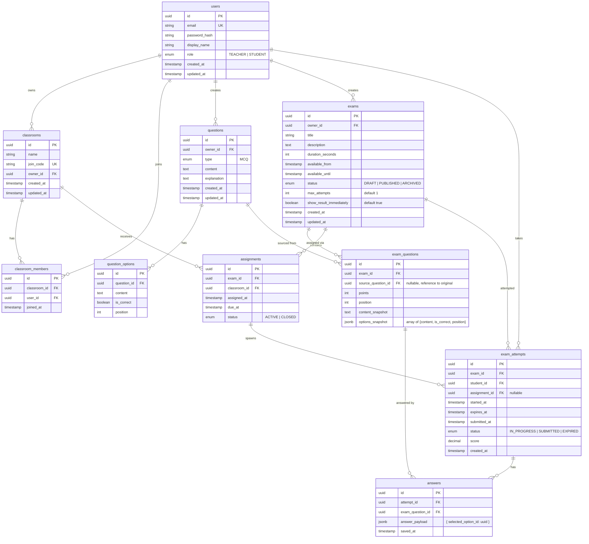

# Lumi Lite — Implementation Plan

## 1. Executive Summary

Lumi Lite is a lightweight LMS/online examination platform targeting ~100 users. The core flow: teachers create classrooms, build question banks, compose exams, assign them to classrooms; students join classrooms, take timed exams with autosave, submit, and receive automatic grading for multiple-choice questions.

**Repository state**: Empty git repo with no code, no dependencies, no infrastructure. Everything must be built from scratch.

**Recommended stack** (per guide): NestJS + Fastify backend, Next.js frontend, Prisma ORM, PostgreSQL, Docker Compose deployment.

**Estimated total effort**: 38–50 developer-days for a mid-level TypeScript/NestJS developer (see milestone breakdown for assumptions).

---

## 2. Repository Findings

| Aspect | Finding |
|---|---|
| Repository | Fresh git repo, no commits, no remote configured |
| Package manager | None — no `package.json` exists |
| Frontend | **MISSING** — no frontend app |
| Backend | **MISSING** — no backend app |
| ORM / Database | **MISSING** — no schema, no migrations |
| Auth | **MISSING** |
| Tests | **MISSING** |
| Docker / CI | **MISSING** |
| Existing modules | None |
| Conventions | None established — we define them in this plan |

**Conclusion**: This is a greenfield project. All guide requirements map to `MISSING`.

---

## 3. Gap Analysis

### 3.1 Domain-by-Domain Assessment

| Domain | Status | Existing Files | Gap |
|---|---|---|---|
| **Auth & roles** | MISSING | — | Full auth module: register, login, refresh, logout, JWT, role guard |
| **Classroom & membership** | MISSING | — | Classroom CRUD, join-by-code, member listing |
| **Question bank** | MISSING | — | Question CRUD, options management, answer hiding |
| **Exam creation & publishing** | MISSING | — | Exam CRUD, question attachment, draft/published lifecycle |
| **Assignment to classroom** | MISSING | — | Assignment creation, listing by student/classroom |
| **Exam attempts & timing** | MISSING | — | Attempt engine, server-side timing, state machine |
| **Answer autosave** | MISSING | — | Upsert endpoint, idempotent saves, retry safety |
| **Idempotent submission** | MISSING | — | Submit with transaction, duplicate detection |
| **Automatic grading** | MISSING | — | MCQ grading logic, score calculation |
| **Result visibility** | MISSING | — | Student result view, teacher class results |
| **Deployment** | MISSING | — | Docker Compose, Nginx, env config, backup scripts |
| **Testing** | MISSING | — | Jest setup, e2e tests, k6 load tests |

### 3.2 Infrastructure Gaps

| Component | Status | Notes |
|---|---|---|
| Monorepo / project structure | MISSING | Need to scaffold NestJS + Next.js |
| Prisma schema + migrations | MISSING | Full data model to design |
| Validation pipes / DTOs | MISSING | Global validation setup needed |
| Error handling / filters | MISSING | Consistent API error format |
| API response format | MISSING | Need standardized envelope |
| Logging | MISSING | Basic structured logging |
| Health check | MISSING | Readiness/liveness endpoints |

---

## 4. Assumptions and Product Decisions

See `docs/TECHNICAL_DECISIONS.md` for the full decision table. Key provisional defaults:

| Decision | Provisional Default | Status |
|---|---|---|
| User scale | 100 registered accounts (not concurrent) | **OPEN — needs PO confirmation** |
| Roles | `TEACHER` + `STUDENT` only; enum allows adding `ADMIN` later | PROPOSED |
| Exam types | Timed exams only (homework = exam with long duration) | PROPOSED |
| Question types | Multiple-choice single-answer only | PROPOSED |
| Retake policy | 1 attempt per exam per student (configurable field for future) | PROPOSED |
| File uploads | Not in MVP | PROPOSED |
| Essay questions | Not in MVP | PROPOSED |
| Question snapshot | Snapshot question content at exam publish time | PROPOSED |
| Result visibility | Immediate after submission (teacher can toggle) | PROPOSED |
| Lazy expiration | Yes — no background scheduler for MVP | PROPOSED |

---

## 5. Proposed Architecture

### 5.1 High-Level Architecture

```
┌──────────────┐     ┌──────────────┐     ┌──────────────┐
│   Browser     │────▶│   Nginx      │────▶│  Next.js     │
│   (Student/   │     │   (reverse   │     │  Frontend    │
│    Teacher)   │     │   proxy+TLS) │     │  :3000       │
└──────────────┘     └──────┬───────┘     └──────────────┘
                            │
                            ▼
                     ┌──────────────┐     ┌──────────────┐
                     │   NestJS     │────▶│  PostgreSQL   │
                     │   Backend    │     │  :5432       │
                     │   :4000      │     └──────────────┘
                     └──────────────┘
```

### 5.2 Backend Module Structure

```
apps/
  api/                          # NestJS backend
    src/
      modules/
        auth/                   # Register, login, refresh, logout, JWT strategy
        users/                  # User profile, role management
        classrooms/             # Classroom CRUD, join, members
        question-bank/          # Question + options CRUD
        exams/                  # Exam CRUD, publish, exam-questions
        assignments/            # Assign exam to classroom
        attempts/               # Attempt lifecycle, answers, submit
        grading/                # MCQ auto-grading service
      common/
        guards/                 # JwtAuthGuard, RolesGuard
        decorators/             # @Roles(), @CurrentUser()
        filters/                # HttpExceptionFilter
        interceptors/           # TransformInterceptor (response envelope)
        pipes/                  # Global ValidationPipe config
        dto/                    # Shared base DTOs (pagination, etc.)
      database/
        prisma/
          schema.prisma
          migrations/
      config/                   # Configuration module (env validation)
      main.ts
  web/                          # Next.js frontend
```

### 5.3 API Response Envelope

```json
{
  "success": true,
  "data": { ... },
  "meta": { "page": 1, "limit": 20, "total": 42 }
}
```

Error:
```json
{
  "success": false,
  "error": {
    "code": "EXAM_NOT_PUBLISHED",
    "message": "Cannot assign a draft exam"
  }
}
```

---

## 6. Database / ERD Overview

### 6.1 ERD (Mermaid)



### 6.2 Key Constraints and Indexes

| Table | Constraint | Type |
|---|---|---|
| `users` | `email` | UNIQUE |
| `classrooms` | `join_code` | UNIQUE |
| `classroom_members` | `(classroom_id, user_id)` | UNIQUE |
| `exam_questions` | `(exam_id, position)` | UNIQUE |
| `assignments` | `(exam_id, classroom_id)` | UNIQUE |
| `answers` | `(attempt_id, exam_question_id)` | UNIQUE |
| `exam_attempts` | `(exam_id, student_id)` | INDEX (for attempt count queries) |
| `exam_attempts` | `student_id` | INDEX (for student's attempts list) |
| `assignments` | `classroom_id` | INDEX |
| `exam_questions` | `exam_id` | INDEX |
| `question_options` | `question_id` | INDEX |

---

## 7. Milestones

### Milestone 0: Project Scaffolding (2–3 days)

**Goal**: Working project structure with all tooling configured, hello-world endpoints.

**Tasks**:
- Initialize monorepo structure (`apps/api`, `apps/web`)
- Scaffold NestJS app with Fastify adapter
- Scaffold Next.js app
- Configure Prisma with PostgreSQL connection
- Set up `docker-compose.yml` (PostgreSQL, backend, frontend, Nginx)
- Configure ESLint, Prettier, TypeScript strict mode
- Set up Jest for backend (unit + e2e)
- Create global ValidationPipe, HttpExceptionFilter, TransformInterceptor
- Create `@CurrentUser()` decorator skeleton
- Create configuration module with `@nestjs/config` and env validation (Joi/zod)
- Health check endpoint (`GET /health`)
- Create `.env.example` and document setup in `README.md`

**Acceptance criteria**:
- `docker-compose up` starts all services
- `GET /health` returns 200
- `npm run test` runs (even if no tests yet)
- Prisma can connect to PostgreSQL

**Estimated effort**: 2–3 dev-days

---

### Milestone 1: Auth & Users (4–5 days)

**Goal**: Users can register, login, refresh tokens, and logout. Role-based access control works.

**Database changes**:
- Create `users` table migration

**API endpoints**:
| Method | Path | Auth | Description |
|---|---|---|---|
| POST | `/auth/register` | Public | Register with email, password, display_name, role |
| POST | `/auth/login` | Public | Login, returns access + refresh tokens |
| POST | `/auth/refresh` | Refresh token | Returns new access token |
| POST | `/auth/logout` | Authenticated | Invalidate refresh token |
| GET | `/users/me` | Authenticated | Return current user profile |

**Modules/files**:
- `src/modules/auth/` — AuthModule, AuthController, AuthService, JWT strategy, refresh-token strategy
- `src/modules/users/` — UsersModule, UsersService
- `src/common/guards/jwt-auth.guard.ts`
- `src/common/guards/roles.guard.ts`
- `src/common/decorators/roles.decorator.ts`
- `src/common/decorators/current-user.decorator.ts`

**Authorization rules**:
- Register: public, validate email uniqueness
- Login: public, verify password with bcrypt
- All other endpoints: require valid JWT
- Refresh tokens stored hashed in DB or as a separate table (simple approach: a `refresh_tokens` column or table)

**Tests**:
- Unit: AuthService (register validation, password hashing, token generation)
- E2e: Full registration → login → me → refresh → logout flow
- E2e: Invalid credentials rejected
- E2e: Expired token rejected
- E2e: Role guard blocks unauthorized access

**Estimated effort**: 4–5 dev-days

---

### Milestone 2: Classrooms & Membership (3–4 days)

**Goal**: Teachers create classrooms, students join by code, both can view classrooms.

**Database changes**:
- Create `classrooms` and `classroom_members` tables migration

**API endpoints**:
| Method | Path | Auth | Role | Description |
|---|---|---|---|---|
| POST | `/classrooms` | Yes | TEACHER | Create classroom |
| GET | `/classrooms` | Yes | Both | List user's classrooms |
| GET | `/classrooms/:id` | Yes | Member | Get classroom detail |
| POST | `/classrooms/:id/join` | Yes | STUDENT | Join by code |
| GET | `/classrooms/:id/members` | Yes | TEACHER (owner) | List members |

**Modules/files**:
- `src/modules/classrooms/` — ClassroomsModule, ClassroomsController, ClassroomsService
- DTOs: CreateClassroomDto, JoinClassroomDto

**Authorization rules**:
- Only TEACHER can create classrooms
- Only classroom owner can view members
- Students see classrooms they belong to; teachers see classrooms they own
- Join code validated; duplicate membership returns success idempotently

**Tests**:
- Unit: join code generation, duplicate join handling
- E2e: Create → join → list members flow
- E2e: Student cannot create classroom
- E2e: Cannot join with invalid code

**Estimated effort**: 3–4 dev-days

---

### Milestone 3: Question Bank (3–4 days)

**Goal**: Teachers create, edit, delete multiple-choice questions with options.

**Database changes**:
- Create `questions` and `question_options` tables migration

**API endpoints**:
| Method | Path | Auth | Role | Description |
|---|---|---|---|---|
| POST | `/questions` | Yes | TEACHER | Create question with options |
| GET | `/questions` | Yes | TEACHER | List own questions (paginated) |
| GET | `/questions/:id` | Yes | TEACHER | Get question detail with options |
| PATCH | `/questions/:id` | Yes | TEACHER (owner) | Update question/options |
| DELETE | `/questions/:id` | Yes | TEACHER (owner) | Soft-delete or hard-delete |

**Modules/files**:
- `src/modules/question-bank/` — QuestionBankModule, QuestionsController, QuestionsService
- DTOs: CreateQuestionDto, UpdateQuestionDto (including nested options)

**Authorization rules**:
- Only TEACHER can access question bank
- Teacher can only manage their own questions
- At least one option must be marked `is_correct`
- `is_correct` is never sent to students in any endpoint

**Tests**:
- Unit: Question creation validation (must have options, must have correct answer)
- E2e: CRUD flow
- E2e: Student cannot access question bank

**Estimated effort**: 3–4 dev-days

---

### Milestone 3A: File Upload & Image Support (3–4 days)

**Goal**: Teachers can upload images into questions and options. Students see images when taking exams.

**Infrastructure changes**:
- Add MinIO service to Docker Compose (S3-compatible, self-hosted)
- Create `lumi-uploads` bucket with public-read policy

**API endpoints**:
| Method | Path | Auth | Role | Description |
|---|---|---|---|---|
| POST | `/uploads/images` | Yes | TEACHER | Upload image (multipart, max 5MB, jpg/png/webp/gif) |

**Modules/files**:
- `src/modules/uploads/` — UploadsModule, UploadsController, UploadsService
- S3 client config via `@aws-sdk/client-s3`

**How images work in questions**:
- No schema change needed — `questions.content` and `question_options.content` are already text fields
- Teacher uploads image → gets URL → URL is embedded in content as Markdown `` or HTML ``
- Frontend renders images inline in question display
- Snapshot at publish copies the content as-is (URLs remain valid)

**Validation**:
- File type whitelist: `image/jpeg`, `image/png`, `image/webp`, `image/gif`
- Max file size: 5MB
- Unique filename generated server-side (UUID + extension)

**Tests**:
- E2e: Upload image → create question with image URL → student sees image in exam
- E2e: Reject non-image file, reject oversized file

**Estimated effort**: 3–4 dev-days

---

### Milestone 3B: Google Docs Import (4–5 days)

**Goal**: Teachers export Google Docs as `.docx`, upload to the system, and auto-parse into questions.

**Approach**: No Google API/OAuth. Teacher downloads `.docx` from Google Docs (File → Download → .docx) and uploads it.

**API endpoints**:
| Method | Path | Auth | Role | Description |
|---|---|---|---|---|
| POST | `/questions/import` | Yes | TEACHER | Upload .docx, parse, return preview |
| POST | `/questions/import/confirm` | Yes | TEACHER | Confirm parsed questions, batch create |

**Modules/files**:
- `src/modules/question-bank/import/` — DocxParserService, ImportController
- Dependencies: `mammoth` (docx → HTML) or `docx` library

**Import flow**:
1. Teacher uploads `.docx` file
2. Backend parses with `mammoth` → HTML
3. QuestionExtractor parses HTML to find questions using convention:
   - Question: `Câu 1.` or numbered pattern
   - Options: `A.`, `B.`, `C.`, `D.`
   - Correct answer: `*` prefix or **bold** formatting
4. Embedded images extracted → uploaded to S3 → URLs replaced in content
5. Return preview: `{ questions: [...], warnings: [...] }`
6. Teacher reviews, optionally edits, then confirms
7. Backend batch-creates questions + options

**Template convention for teachers**:
```
Câu 1. Thủ đô của Việt Nam là gì?
A. TP Hồ Chí Minh
B. Đà Nẵng
*C. Hà Nội
D. Huế
```

**Tests**:
- Unit: Parser with various formats, edge cases
- E2e: Upload .docx → preview → confirm → questions created
- Edge cases: empty file, bad format, missing correct answer, embedded images, Vietnamese Unicode

**Estimated effort**: 4–5 dev-days

---

### Milestone 4: Exam Creation & Publishing (4–5 days)

**Goal**: Teachers create exams, add questions, configure settings, and publish. Publishing snapshots question content.

**Database changes**:
- Create `exams` and `exam_questions` tables migration

**API endpoints**:
| Method | Path | Auth | Role | Description |
|---|---|---|---|---|
| POST | `/exams` | Yes | TEACHER | Create draft exam |
| GET | `/exams` | Yes | TEACHER | List own exams |
| GET | `/exams/:id` | Yes | TEACHER (owner) | Get exam with questions |
| PATCH | `/exams/:id` | Yes | TEACHER (owner) | Update draft exam settings |
| POST | `/exams/:id/questions` | Yes | TEACHER (owner) | Add question to exam |
| DELETE | `/exams/:id/questions/:eqId` | Yes | TEACHER (owner) | Remove question from exam |
| PATCH | `/exams/:id/questions/:eqId` | Yes | TEACHER (owner) | Update points/position |
| POST | `/exams/:id/publish` | Yes | TEACHER (owner) | Publish exam (snapshots questions) |

**Snapshot mechanism**:
- On publish, for each `exam_question`: copy `content` from `questions` table into `content_snapshot`, copy options (content, is_correct, position) into `options_snapshot` (JSONB array)
- After publish, `exam_questions.content_snapshot` and `options_snapshot` are the source of truth for that exam
- Original `source_question_id` kept for traceability only

**Authorization rules**:
- Only exam owner can manage
- Can only add questions from own question bank
- Cannot modify a PUBLISHED exam (must archive and create new)
- Publish validates: has at least 1 question, duration > 0

**Tests**:
- Unit: Publish validation, snapshot creation
- E2e: Create → add questions → publish flow
- E2e: Cannot modify published exam
- E2e: Snapshot is independent of later question edits

**Estimated effort**: 4–5 dev-days

---

### Milestone 5: Assignment Flow (2–3 days)

**Goal**: Teachers assign published exams to classrooms. Students see assigned exams.

**Database changes**:
- Create `assignments` table migration

**API endpoints**:
| Method | Path | Auth | Role | Description |
|---|---|---|---|---|
| POST | `/exams/:id/assignments` | Yes | TEACHER (exam owner) | Assign to classroom |
| GET | `/assignments` | Yes | Both | List assignments (teacher: by exam; student: by classroom membership) |
| GET | `/assignments/:id` | Yes | Member | Get assignment detail |

**Authorization rules**:
- Only exam owner can assign
- Exam must be PUBLISHED
- Teacher must own the classroom
- Cannot assign same exam to same classroom twice (unique constraint)
- Students see assignments only for classrooms they belong to

**Tests**:
- E2e: Assign published exam → student sees it
- E2e: Cannot assign draft exam
- E2e: Cannot assign to unowned classroom
- E2e: Student not in classroom cannot see assignment

**Estimated effort**: 2–3 dev-days

---

### Milestone 6: Attempt Engine, Autosave & Server-Side Expiry (6–8 days)

**Goal**: Students start attempts, autosave answers, and the server enforces timing. This is the highest-risk milestone.

**Database changes**:
- Create `exam_attempts` and `answers` tables migration

**API endpoints**:
| Method | Path | Auth | Role | Description |
|---|---|---|---|---|
| POST | `/exams/:examId/attempts` | Yes | STUDENT | Start a new attempt |
| GET | `/attempts/:id` | Yes | Owner | Get attempt with questions (no correct answers) |
| PUT | `/attempts/:id/answers/:examQuestionId` | Yes | Owner | Upsert answer (autosave) |
| POST | `/attempts/:id/submit` | Yes | Owner | Submit attempt |

**Attempt lifecycle state machine**:
```
                    ┌────────────┐
   start attempt    │IN_PROGRESS │
   ────────────────▶│            │
                    └─────┬──────┘
                          │
              ┌───────────┼───────────┐
              ▼                       ▼
       ┌─────────────┐       ┌───────────┐
       │ SUBMITTED   │       │ EXPIRED   │
       │ (explicit)  │       │ (lazy)    │
       └─────────────┘       └───────────┘
```

**Start attempt validation** (all checked server-side):
1. Student is a member of a classroom that has this exam assigned
2. Exam status is PUBLISHED
3. Current time is within `available_from` — `available_until` (if set)
4. Student has not exceeded `max_attempts` for this exam
5. Student does not have an existing IN_PROGRESS attempt for this exam

On success: create attempt with `started_at = NOW()`, `expires_at = NOW() + duration_seconds`, status = `IN_PROGRESS`.

**Get attempt (for student)**:
- Return exam questions from `content_snapshot` and `options_snapshot`, but **strip `is_correct` from options**
- If attempt is expired (current time > expires_at), lazily transition to EXPIRED before returning

**Autosave (PUT answer)**:
- Validate attempt is IN_PROGRESS and not expired (lazy expiry check)
- Validate `exam_question_id` belongs to this attempt's exam
- Upsert into `answers` using unique `(attempt_id, exam_question_id)`
- Return saved answer with `saved_at` timestamp
- Safe for retries: same payload = same result

**Lazy expiration**:
- Every request that touches an attempt checks `NOW() > expires_at`
- If expired and status is still IN_PROGRESS → transition to EXPIRED
- No background scheduler needed for MVP
- Downside: an abandoned attempt stays IN_PROGRESS until next access. Acceptable for ~100 users.

**Concurrency safety**:
- Start attempt: use a transaction with `SELECT ... FOR UPDATE` or a unique partial index on `(exam_id, student_id) WHERE status = 'IN_PROGRESS'` to prevent double-start
- Autosave: upsert is naturally idempotent
- Submit: see Milestone 7

**Authorization rules**:
- Only the attempt owner (student_id) can read or modify their attempt
- Teacher cannot modify student attempts

**Tests**:
- Unit: State machine transitions, expiry logic
- E2e: Full start → autosave → verify saved flow
- E2e: Cannot start outside time window
- E2e: Cannot start when max attempts reached
- E2e: Cannot save answer after expiry
- E2e: Lazy expiry transitions correctly
- E2e: Concurrent start attempts produce only one IN_PROGRESS attempt
- E2e: Autosave retry produces same result

**Estimated effort**: 6–8 dev-days (highest complexity, needs careful concurrency handling)

---

### Milestone 7: Idempotent Submit & Grading (4–5 days)

**Goal**: Students submit attempts. Backend grades MCQ automatically. Duplicate submits return the same result.

**API endpoints**:
| Method | Path | Auth | Role | Description |
|---|---|---|---|---|
| POST | `/attempts/:id/submit` | Yes | Owner | Submit and grade |
| GET | `/attempts/:id/result` | Yes | Owner or exam TEACHER | View result |

**Submit flow** (single transaction):
```
BEGIN TRANSACTION
  1. SELECT attempt FOR UPDATE WHERE id = :id
  2. If status = SUBMITTED → return existing result (idempotent)
  3. If status = EXPIRED → return error (or grade what was saved — PO decision)
  4. If NOW() > expires_at → mark EXPIRED, then grade (treat as late submit)
  5. Validate student owns this attempt
  6. Grade all answers:
     - For each answer, compare selected_option_id against options_snapshot.is_correct
     - Calculate score = sum of points for correct answers
  7. UPDATE attempt: status = SUBMITTED, submitted_at = NOW(), score = calculated
  8. Return result
COMMIT
```

**Idempotency**: The `SELECT FOR UPDATE` + status check ensures that concurrent submit requests serialize. The first one grades; subsequent ones see `SUBMITTED` and return the existing result.

**Grading logic**:
- For MCQ: answer_payload.selected_option_id matches the option where `is_correct = true` in `options_snapshot`
- Score = sum of `exam_questions.points` for correctly answered questions
- Unanswered questions score 0

**Tests**:
- Unit: Grading calculation (all correct, all wrong, partial, unanswered)
- E2e: Submit → get result flow
- E2e: Double submit returns same score
- E2e: Concurrent submits produce one grade
- E2e: Cannot submit already-submitted attempt
- E2e: Late submit (after expiry) behavior

**Estimated effort**: 4–5 dev-days

---

### Milestone 8: Results & Teacher Views (3–4 days)

**Goal**: Students see their results. Teachers see class-level results for their exams.

**API endpoints**:
| Method | Path | Auth | Role | Description |
|---|---|---|---|---|
| GET | `/attempts/:id/result` | Yes | Student (owner) | Own result with answers and correct answers |
| GET | `/exams/:id/results` | Yes | TEACHER (owner) | All attempts for this exam, with scores |
| GET | `/classrooms/:id/results` | Yes | TEACHER (owner) | Summary results by classroom |

**Result visibility rules**:
- If `exam.show_result_immediately = true`: student can see result right after submit
- If `false`: student sees only "submitted" status until teacher enables
- Teacher always sees all results for their exams
- Result includes: score, total points, per-question answers with correct answer (post-submit only)

**Tests**:
- E2e: Student sees result when allowed
- E2e: Student cannot see result when visibility is off
- E2e: Teacher sees all students' results
- E2e: Teacher cannot see results of another teacher's exam

**Estimated effort**: 3–4 dev-days

---

### Milestone 9: Frontend MVP (8–10 days)

**Goal**: Functional web UI for all core flows. Not pixel-perfect, but usable.

**Pages**:
| Page | Description |
|---|---|
| `/login`, `/register` | Auth forms |
| `/dashboard` | Role-based home: teacher sees classrooms + exams; student sees classrooms + assignments |
| `/classrooms/new` | Teacher creates classroom |
| `/classrooms/:id` | Classroom detail, member list, join code |
| `/questions` | Teacher's question bank list + create/edit |
| `/exams/new`, `/exams/:id/edit` | Teacher creates/edits exam, adds questions |
| `/exams/:id` | Exam detail (teacher: manage; student: start attempt) |
| `/attempts/:id` | Exam-taking view with autosave, timer, submit |
| `/attempts/:id/result` | Result view |
| `/exams/:id/results` | Teacher: class results table |

**Key frontend behaviors**:
- Autosave: debounce 3–5 seconds after answer change, retry on network failure
- Timer: display from server's `expires_at`, warn at 5 min and 1 min, auto-submit at 0
- Token refresh: interceptor refreshes access token transparently

**Estimated effort**: 8–10 dev-days (basic UI with Tailwind CSS or similar)

---

### Milestone 10: Deployment Hardening (3–4 days)

**Goal**: Production-ready deployment with backups, monitoring, and load testing.

**Tasks**:
- Production Docker Compose with resource limits
- Nginx config: TLS (Let's Encrypt), gzip, rate limiting
- Environment-based configuration (dev/staging/prod)
- Automated PostgreSQL backup script (pg_dump cron)
- Documented restore procedure with tested restore
- Health check endpoints
- Structured logging (pino via Fastify)
- Basic error monitoring (Sentry free tier or log-based)
- k6 load test script modeling the student exam flow
- `README.md` with setup, deploy, and backup instructions

**Acceptance criteria**:
- `docker-compose -f docker-compose.prod.yml up` runs production stack
- Backup runs daily, restore tested
- k6 test passes with 100 concurrent users (if that is the target)
- TLS working

**Estimated effort**: 3–4 dev-days

---

## 8. Total Effort Summary

| Milestone | Effort (dev-days) |
|---|---|
| M0: Scaffolding | 2–3 |
| M1: Auth & Users | 4–5 |
| M2: Classrooms | 3–4 |
| M3: Question Bank | 3–4 |
| M3A: File Upload & Image | 3–4 |
| M3B: Google Docs Import | 4–5 |
| M4: Exam Creation | 4–5 |
| M5: Assignments | 2–3 |
| M6: Attempt Engine | 6–8 |
| M7: Submit & Grading | 4–5 |
| M8: Results & Views | 3–4 |
| M9: Frontend | 10–12 |
| M10: Deployment | 4–5 |
| **Total** | **53–70** |

**Assumptions behind estimates**:
- Single mid-level developer familiar with TypeScript and NestJS
- Working 6–8 productive hours/day
- Includes writing tests for each milestone
- Does not include product decisions, design reviews, or extensive UI polish
- Frontend estimate assumes basic UI library (e.g., Tailwind + headless components), not custom design

---

## 9. Risks and Mitigations

| Risk | Likelihood | Impact | Mitigation |
|---|---|---|---|
| Attempt concurrency bugs (double-start, double-submit) | Medium | High | Use database-level constraints + SELECT FOR UPDATE in transactions. Test with concurrent requests. |
| Client-side timer drift | Medium | Medium | Server is source of truth. Client timer is cosmetic; server enforces expires_at. |
| Question snapshot adds complexity | Low | Medium | Snapshot at publish is a one-time copy. Use JSONB for options to keep it simple. |
| Scope creep (essay questions, uploads, admin) | High | High | Defer all non-MVP features. Document PO decisions. |
| Frontend effort underestimated | Medium | Medium | Start with minimal UI. Use component library. Prioritize exam-taking flow. |
| No staging environment | Medium | Medium | Use Docker Compose profile for local prod simulation. |
| Data loss without backups | Low | Critical | Implement pg_dump backup in M10 before any real users. |

---

## 10. Testing and Deployment Plan

### Testing Strategy

| Level | Tool | Scope |
|---|---|---|
| Unit | Jest | Services, grading logic, state machine, validation |
| Integration | Jest + Supertest | Controller → Service → DB flows |
| E2e | Jest + Supertest | Full API flows (auth → attempt → submit) |
| Load | k6 | 100 concurrent users exam flow |

### Test Priority (must-have before launch)

1. Auth flow (register → login → protected route)
2. Attempt lifecycle (start → save → submit → result)
3. Concurrent submit idempotency
4. Lazy expiry enforcement
5. Answer isolation (student A cannot see student B's answers)
6. Role authorization (student cannot create exam, teacher cannot submit attempt)

### Deployment Plan

1. Development: `docker-compose up` (local PostgreSQL)
2. Staging: Same Docker Compose on VPS, separate DB
3. Production: Docker Compose + managed PostgreSQL (if budget allows) + Nginx + TLS
4. Backup: Automated daily pg_dump, tested restore, offsite copy
5. Monitoring: Health endpoint + application logs + error alerts
