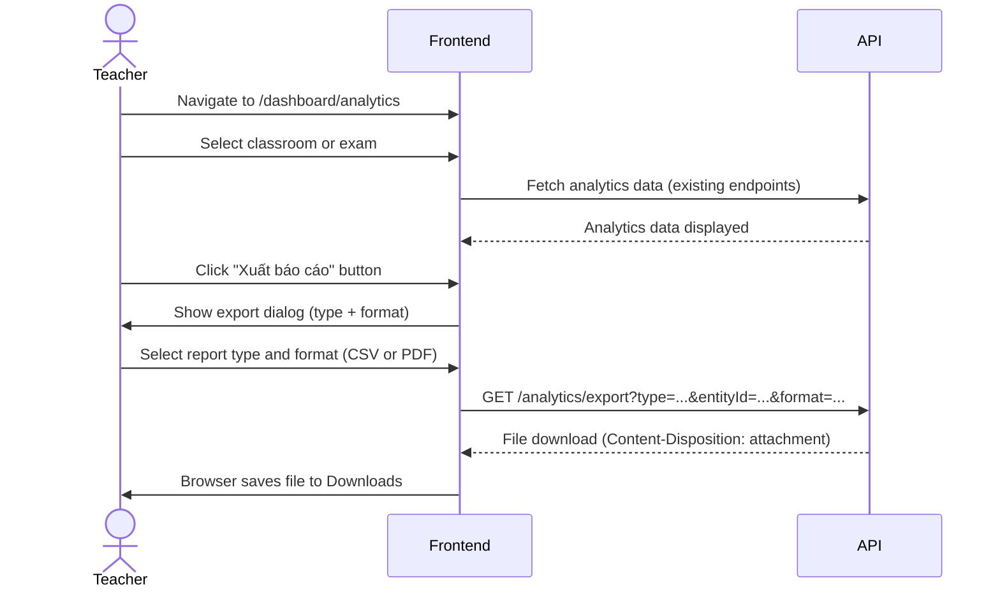

# H8. Export Analytics Reports

## 5.1 Feature Overview

| Field | Value |
|---|---|
| **Feature ID** | H8 |
| **Feature Name** | Export Analytics Reports |
| **Module** | H. Analytics & Reporting |
| **Priority** | P2 |
| **Complexity** | M |
| **Status** | Not implemented |
| **Target Roles** | Teacher |
| **Business Objective** | Allow teachers to download analytics data as CSV or PDF files for record-keeping, sharing with administrators, or offline analysis in spreadsheet software. |
| **User Problem** | Teachers who need to share performance data with school leadership or parents cannot extract it from the web dashboard. They must manually copy numbers or take screenshots, which is tedious and unprofessional. |
| **Dependencies** | H1 (Student & Classroom Performance Analytics) — all export data originates from the existing analytics endpoints. |

## 5.2 Actors and Permissions

### Teacher (Classroom / Exam Owner)

- **Can export**: Analytics reports for classrooms and exams they own.
- **Cannot**: Export analytics for classrooms or exams owned by other teachers.

### Student

- **Cannot**: Access any export endpoints (403 Forbidden).

### Backend Authorization

| Rule ID | Rule | Enforcement |
|---|---|---|
| H8-AUTH-01 | All export endpoints require TEACHER role. | Backend (RolesGuard) |
| H8-AUTH-02 | Classroom performance export: teacher must own the classroom (`classroom.ownerId === userId`). | Backend (service) |
| H8-AUTH-03 | Exam-level exports (distribution, questions, ranking): teacher must own the exam (`exam.ownerId === userId`). | Backend (service) |

## 5.3 Preconditions and Business Rules

### Preconditions

| ID | Precondition |
|---|---|
| H8-PRE-01 | Teacher is authenticated and has TEACHER role. |
| H8-PRE-02 | The target classroom or exam exists and is owned by the requesting teacher. |
| H8-PRE-03 | For exam-level exports, the exam must be PUBLISHED (DRAFT exams have no attempt data to export). |

### Business Rules

| Rule ID | Rule | Enforcement |
|---|---|---|
| H8-BR-01 | Four export types are supported: (1) Classroom performance report, (2) Exam score distribution report, (3) Per-question accuracy report, (4) Student ranking report. | Backend |
| H8-BR-02 | Two export formats are supported: CSV (`.csv`, UTF-8 with BOM for Excel compatibility) and PDF (`.pdf`). | Backend |
| H8-BR-03 | CSV exports include a header row with Vietnamese column names. All text values are quoted to handle commas in names. | Backend |
| H8-BR-04 | PDF exports include: (a) a header with the report title, classroom/exam name, and generation timestamp; (b) data in a table layout; (c) a footer with "Lumi Lite" and page number. | Backend |
| H8-BR-05 | Export data uses the same calculations as the analytics API: only SUBMITTED attempts are included, scores reflect manual overrides, ties share the same rank number. This ensures the exported data matches what the teacher sees on screen. | Backend |
| H8-BR-06 | Score values in exports are formatted to 2 decimal places (e.g., `7.50`, not `7.5` or `7.499999`). | Backend |
| H8-BR-07 | If the analytics data is empty (zero attempts), the export still succeeds. CSV contains only the header row. PDF contains the header and an empty table with a note: "Chưa có dữ liệu." | Backend |
| H8-BR-08 | Exported file names follow the pattern: `{report-type}_{entity-name}_{YYYYMMDD}.{ext}` — e.g., `xep-hang_de-thi-giua-ky_20261111.csv`. Entity name is slugified (lowercase, diacritics removed, spaces replaced by hyphens), truncated to 50 characters. | Backend |
| H8-BR-09 | The export is generated synchronously. At ~100 users the data set is small enough that no background job is needed. If generation exceeds 10 seconds, the request times out with 504. | Backend |
| H8-BR-10 | No export history is stored. Each export request generates a fresh file from current data. The teacher downloads it immediately. | Backend |

### Export Type Definitions

**Type 1 — Classroom Performance Report** (`classroom-performance`)

Data source: same query as `GET /analytics/classrooms/:id`.

CSV columns: `Lớp học`, `Số học sinh`, `Số bài thi`, `Điểm trung bình`, `Điểm cao nhất`, `Điểm thấp nhất`, `Tỷ lệ nộp bài (%)`, `Tổng lượt làm bài`.

PDF: single summary table with the same fields, plus classroom name in the header.

**Type 2 — Exam Score Distribution Report** (`score-distribution`)

Data source: same query as `GET /analytics/exams/:id/distribution`.

CSV columns: `Khoảng điểm`, `Số lượng`.

PDF: table of 10 rows (one per bucket) plus a simple horizontal bar chart rendered as rectangles. Total attempts shown below the table.

**Type 3 — Per-Question Accuracy Report** (`question-accuracy`)

Data source: same query as `GET /analytics/exams/:id/questions`.

CSV columns: `Câu`, `Nội dung`, `Số trả lời`, `Số đúng`, `Tỷ lệ đúng (%)`.

PDF: table with the same columns. correctRate formatted as percentage (e.g., `62.5%`). Rows with correctRate < 40% highlighted with a light red background in PDF.

**Type 4 — Student Ranking Report** (`student-ranking`)

Data source: same query as `GET /analytics/exams/:id/ranking`.

CSV columns: `Hạng`, `Họ tên`, `Email`, `Điểm`, `Thời gian nộp`.

PDF: table with the same columns. `submittedAt` formatted as `DD/MM/YYYY HH:mm`. Exam name and total submissions shown in the header.

## 5.4 Main User Flow — Happy Path



### Steps

1. Teacher navigates to `/dashboard/analytics` and selects a classroom or exam.
2. The analytics dashboard displays charts and stats as usual (H1).
3. Teacher clicks the "Xuất báo cáo" (Export report) button in the page toolbar.
4. A dialog appears listing the available report types for the current context:
   - If a classroom is selected: Classroom performance report.
   - If an exam is selected: Score distribution, Question accuracy, Student ranking.
5. Teacher selects the desired report type.
6. Teacher selects the format: CSV or PDF.
7. Teacher clicks "Tải xuống" (Download).
8. Frontend issues a GET request to the export endpoint.
9. Backend validates ownership, generates the file, and returns it with `Content-Disposition: attachment; filename="..."`.
10. Browser saves the file. The dialog closes.

## 5.5 Alternative Flows

### AF-01: Export When No Analytics Data Exists

1. Teacher selects a classroom with no assignments or an exam with no submissions.
2. Teacher clicks "Xuất báo cáo" and selects a report type and format.
3. Backend returns a valid file with headers only (CSV) or an empty table with "Chưa có dữ liệu" (PDF).
4. No error is shown. The file downloads normally.

### AF-02: Export Multiple Reports in Sequence

1. Teacher exports student ranking as CSV.
2. Without navigating away, teacher selects "Question accuracy" and exports as PDF.
3. Each export triggers an independent GET request. Both files download.

### AF-03: Teacher Switches Context Mid-Dialog

1. Teacher opens the export dialog for Exam A.
2. Before downloading, teacher changes the exam selector to Exam B.
3. Frontend closes the export dialog (or resets it). Teacher must reopen it.
4. This prevents exporting data for a different entity than the one currently displayed.

## 5.6 Edge Cases and Failure Scenarios

| Scenario ID | Scenario | Trigger | Expected Behavior | User Feedback | Data Integrity | Recovery | Severity |
|---|---|---|---|---|---|---|---|
| H8-E01 | Export for unowned classroom | Teacher crafts request for another teacher's classroom | 403 Forbidden | Toast: "Bạn không có quyền xuất báo cáo cho lớp này." | No data exposed | None needed | Medium |
| H8-E02 | Export for unowned exam | Teacher crafts request for another teacher's exam | 403 Forbidden | Toast: "Bạn không có quyền xuất báo cáo cho đề thi này." | No data exposed | None needed | Medium |
| H8-E03 | Export for non-existent entity | Invalid UUID in entityId | 404 Not Found | Toast: "Không tìm thấy dữ liệu." | Safe | None needed | Low |
| H8-E04 | Export for draft exam | Exam status is DRAFT | 400 Bad Request, code `EXAM_NOT_PUBLISHED` | Toast: "Đề thi chưa được phát hành. Không có dữ liệu để xuất." | Safe | Teacher publishes exam first | Low |
| H8-E05 | Very long classroom/exam name in filename | Name > 50 characters | Filename truncated to 50 chars (after slugification) | File downloads with truncated name | Safe | None needed | Low |
| H8-E06 | Classroom/exam name with special characters | Unicode, emoji, punctuation in name | Slugification removes diacritics and special characters | File downloads normally | Safe | None needed | Low |
| H8-E07 | Network failure during download | Connection drops mid-transfer | Partial file or browser error | Browser shows download failed | No server impact | Teacher retries export | Low |
| H8-E08 | Concurrent export requests | Teacher clicks download multiple times rapidly | Each request generates an independent file. No server-side state to conflict. | Multiple identical files download | Safe | None needed | Low |
| H8-E09 | Student ranking with many ties | 50 students all score 8.0 | All 50 get rank 1. CSV/PDF both show rank 1 for all. | Correct ranking displayed | Correct | None needed | Low |
| H8-E10 | Invalid format parameter | format=xlsx or format=docx | 400 Bad Request, code `INVALID_FORMAT` | Toast: "Định dạng không hợp lệ. Chọn CSV hoặc PDF." | Safe | Teacher selects valid format | Low |
| H8-E11 | Invalid report type parameter | type=unknown | 400 Bad Request, code `INVALID_REPORT_TYPE` | Toast: "Loại báo cáo không hợp lệ." | Safe | Teacher selects valid type | Low |

## 5.7 UI/UX Specification

### Entry Point

- An "Xuất báo cáo" button appears in the analytics page toolbar, next to the classroom/exam selectors.
- The button is visible only when at least one entity (classroom or exam) is selected.
- Icon: `Download` from lucide-react.
- Button variant: outline (secondary action, not primary).

### Export Dialog

- Opened by the "Xuất báo cáo" button.
- Uses the project's Dialog component (shadcn/ui).
- Title: "Xuất báo cáo thống kê"
- Content:
  1. **Report type selector** — radio group:
     - If classroom selected: "Tổng quan lớp học" (classroom-performance).
     - If exam selected: "Phân bố điểm" (score-distribution), "Độ chính xác câu hỏi" (question-accuracy), "Bảng xếp hạng học sinh" (student-ranking).
  2. **Format selector** — radio group:
     - "CSV — Phân tích dữ liệu" (csv)
     - "PDF — Báo cáo chính thức" (pdf)
  3. **Context info** — small muted text showing the selected entity name (e.g., "Lớp: Toán 10A" or "Đề thi: Kiểm tra giữa kỳ").
- Footer:
  - "Hủy" button (ghost variant) — closes dialog.
  - "Tải xuống" button (primary variant) — triggers export.
- During download: "Tải xuống" button shows a loading spinner and text "Đang tạo báo cáo...". Disabled to prevent double-click.

### States

| State | Behavior |
|---|---|
| No entity selected | "Xuất báo cáo" button is disabled, tooltip: "Vui lòng chọn lớp hoặc đề thi." |
| Classroom selected, no exam | Dialog shows only "Tổng quan lớp học" option. |
| Exam selected | Dialog shows 3 exam report options. Default selection: "Bảng xếp hạng học sinh". |
| Downloading | Button shows spinner, disabled. Other dialog controls remain visible but non-interactive. |
| Download complete | Dialog closes. Toast: "Đã tải xuống báo cáo thành công." |
| Download error | Toast with error message. Dialog remains open for retry. |

### Accessibility

- Dialog has `aria-labelledby` pointing to the title.
- Radio groups have `role="radiogroup"` with `aria-label`.
- Loading state communicated via `aria-busy="true"` on the download button.
- Toast messages are announced to screen readers via `role="status"`.

## 5.8 Data Requirements

### No Schema Changes

This feature reads existing data only. No new tables, columns, or indexes are required.

### Data Sources

| Export Type | Primary Query | Tables Involved |
|---|---|---|
| Classroom performance | Same as `getClassroomPerformance()` | `classrooms`, `classroom_members`, `assignments`, `exam_attempts` |
| Score distribution | Same as `getExamDistribution()` | `exams`, `exam_attempts` |
| Question accuracy | Same as `getExamQuestionStats()` | `exams`, `exam_questions`, `answers`, `exam_attempts` |
| Student ranking | Same as `getExamRanking()` | `exams`, `exam_attempts`, `users` |

### Data Volume Estimates

At ~100 concurrent users:
- Classroom performance: single row of aggregates. Trivial.
- Score distribution: 10 rows (buckets). Trivial.
- Question accuracy: up to ~50 rows (questions per exam). Small.
- Student ranking: up to ~100 rows (students per exam). Small.

CSV file size: < 50 KB in all cases. PDF file size: < 500 KB in all cases.

## 5.9 API Requirements

### GET /analytics/export

| Field | Value |
|---|---|
| **Purpose** | Generate and download an analytics report file |
| **Method** | GET |
| **Role** | TEACHER |
| **Auth** | JWT required |

#### Query Parameters

| Parameter | Type | Required | Validation | Description |
|---|---|---|---|---|
| `type` | string | Yes | One of: `classroom-performance`, `score-distribution`, `question-accuracy`, `student-ranking` | The report type to generate. |
| `entityId` | string (UUID) | Yes | Valid UUID v4 | The classroom ID (for `classroom-performance`) or exam ID (for the other three types). |
| `format` | string | Yes | One of: `csv`, `pdf` | The output file format. |

#### Responses

| Status | Condition | Body |
|---|---|---|
| 200 | Success | Binary file with appropriate Content-Type |
| 400 | Invalid `type` parameter | `{success: false, error: {code: "INVALID_REPORT_TYPE", message: "Loại báo cáo không hợp lệ."}}` |
| 400 | Invalid `format` parameter | `{success: false, error: {code: "INVALID_FORMAT", message: "Định dạng không hợp lệ. Chọn CSV hoặc PDF."}}` |
| 400 | `entityId` not a valid UUID | `{success: false, error: {code: "INVALID_ENTITY_ID", message: "ID không hợp lệ."}}` |
| 400 | Exam is DRAFT (for exam types) | `{success: false, error: {code: "EXAM_NOT_PUBLISHED", message: "Đề thi chưa được phát hành."}}` |
| 401 | No valid JWT | Standard 401 |
| 403 | Teacher does not own the entity | `{success: false, error: {code: "FORBIDDEN", message: "Bạn không có quyền xuất báo cáo."}}` |
| 404 | Entity not found | `{success: false, error: {code: "NOT_FOUND", message: "Không tìm thấy dữ liệu."}}` |

#### Response Headers (200 OK)

| Header | Value |
|---|---|
| `Content-Type` | `text/csv; charset=utf-8` (CSV) or `application/pdf` (PDF) |
| `Content-Disposition` | `attachment; filename="{filename}"; filename*=UTF-8''{encoded-filename}` |
| `Cache-Control` | `no-store` |

#### Validation Order

1. Authenticate (JWT).
2. Authorize (TEACHER role).
3. Validate query parameters (`type`, `format`, `entityId` format).
4. Look up entity — 404 if not found.
5. Check ownership — 403 if not owner.
6. For exam types: check `exam.status === 'PUBLISHED'` — 400 if DRAFT.
7. Generate and stream file.

## 5.10 State Management

### Frontend State

| State Variable | Type | Purpose |
|---|---|---|
| `exportDialogOpen` | boolean | Controls dialog visibility |
| `selectedReportType` | string \| null | Currently selected report type in dialog |
| `selectedFormat` | `'csv' \| 'pdf'` | Currently selected format (default: `'csv'`) |
| `exporting` | boolean | True while the download request is in flight |

### No Server-Side State

Exports are stateless. No export jobs, history, or queued downloads. Each request generates the file synchronously and streams it in the response.

## 5.11 Acceptance Criteria

```gherkin
Scenario: Export classroom performance as CSV
  Given a teacher owns classroom "Toán 10A" with 30 members and 5 exams
  And 20 students have submitted at least one exam
  When the teacher exports "Tổng quan lớp học" in CSV format
  Then a CSV file downloads with filename matching "tong-quan_toan-10a_*.csv"
  And the CSV has 1 header row and 1 data row
  And the data row contains memberCount=30, examCount=5, and avgScore matching the dashboard
  Rule: H8-BR-01, H8-BR-02, H8-BR-03, H8-BR-05, H8-BR-08

Scenario: Export classroom performance as PDF
  Given a teacher owns classroom "Toán 10A" with analytics data
  When the teacher exports "Tổng quan lớp học" in PDF format
  Then a PDF file downloads
  And the PDF header shows "Tổng quan lớp học — Toán 10A" and the generation timestamp
  And the PDF contains a summary table with all metrics
  Rule: H8-BR-04

Scenario: Export exam score distribution as CSV
  Given a teacher owns a published exam with 10 submitted attempts
  When the teacher exports "Phân bố điểm" in CSV format
  Then a CSV file downloads with 1 header row and 10 data rows (one per bucket)
  And each row shows the score range and count
  And the counts sum to 10
  Rule: H8-BR-01, H8-BR-05

Scenario: Export per-question accuracy as CSV
  Given a teacher owns a published exam with 5 questions and 15 submissions
  When the teacher exports "Độ chính xác câu hỏi" in CSV format
  Then a CSV file downloads with 5 data rows
  And correctRate is formatted as a percentage with 1 decimal (e.g., 62.5)
  Rule: H8-BR-01, H8-BR-05

Scenario: Export student ranking as CSV
  Given a teacher owns a published exam where two students scored 8.50
  When the teacher exports "Bảng xếp hạng học sinh" in CSV format
  Then both students show rank 1
  And the next student shows rank 3
  And scores are formatted to 2 decimals
  Rule: H8-BR-05, H8-BR-06

Scenario: Export student ranking as PDF
  Given a teacher owns a published exam with 25 submissions
  When the teacher exports "Bảng xếp hạng học sinh" in PDF format
  Then a PDF file downloads
  And the PDF contains a table with 25 rows sorted by rank ascending
  And submittedAt is formatted as DD/MM/YYYY HH:mm
  Rule: H8-BR-04

Scenario: Export with empty data
  Given a teacher owns a published exam with zero submissions
  When the teacher exports "Phân bố điểm" in CSV format
  Then a CSV file downloads with a header row only (no data rows)
  Rule: H8-BR-07

Scenario: Export with empty data — PDF
  Given a teacher owns a published exam with zero submissions
  When the teacher exports "Phân bố điểm" in PDF format
  Then a PDF file downloads with an empty table and the text "Chưa có dữ liệu."
  Rule: H8-BR-07

Scenario: Unauthorized — student attempts export
  Given a student is authenticated
  When the student calls GET /analytics/export with any valid parameters
  Then the response is 403 Forbidden
  Rule: H8-AUTH-01

Scenario: Unauthorized — teacher exports another teacher's classroom
  Given Teacher A owns classroom C1 and Teacher B does not
  When Teacher B calls GET /analytics/export?type=classroom-performance&entityId={C1}&format=csv
  Then the response is 403 Forbidden
  Rule: H8-AUTH-02

Scenario: Export for draft exam
  Given a teacher owns an exam in DRAFT status
  When the teacher calls GET /analytics/export?type=student-ranking&entityId={examId}&format=csv
  Then the response is 400 with code "EXAM_NOT_PUBLISHED"
  Rule: H8-PRE-03

Scenario: Invalid format parameter
  Given a teacher is authenticated
  When the teacher calls GET /analytics/export?type=student-ranking&entityId={examId}&format=xlsx
  Then the response is 400 with code "INVALID_FORMAT"
  Rule: H8-BR-02
```

## 5.12 QA Test Scenarios

| Test ID | Scenario | Preconditions | Steps | Expected | Priority |
|---|---|---|---|---|---|
| H8-T01 | Classroom performance CSV | Classroom with 3 exams, 10 attempts | Export classroom-performance as csv | CSV with correct aggregate values, UTF-8 BOM, Vietnamese headers | High |
| H8-T02 | Classroom performance PDF | Same as T01 | Export classroom-performance as pdf | PDF with header, table, footer, page number | High |
| H8-T03 | Score distribution CSV | Exam with 20 attempts with known scores | Export score-distribution as csv | 10 rows, counts match distribution endpoint | High |
| H8-T04 | Score distribution PDF | Same as T03 | Export score-distribution as pdf | PDF with table and bar chart visualization | Medium |
| H8-T05 | Question accuracy CSV | Exam with 5 questions, 10 submissions | Export question-accuracy as csv | 5 data rows with correct correctRate | High |
| H8-T06 | Question accuracy PDF | Same as T05 | Export question-accuracy as pdf | PDF with highlighted low-accuracy rows (< 40%) | Medium |
| H8-T07 | Student ranking CSV | Exam with 15 submissions, 2 ties | Export student-ranking as csv | Correct ranks, tied students share rank, scores to 2 decimals | High |
| H8-T08 | Student ranking PDF | Same as T07 | Export student-ranking as pdf | PDF table sorted by rank, submittedAt formatted DD/MM/YYYY HH:mm | Medium |
| H8-T09 | Empty data CSV | Published exam with 0 submissions | Export any type as csv | CSV with header row only, no error | Medium |
| H8-T10 | Empty data PDF | Published exam with 0 submissions | Export any type as pdf | PDF with "Chưa có dữ liệu." note | Medium |
| H8-T11 | Auth: student access | Student token | GET /analytics/export?type=...&format=csv | 403 Forbidden | High |
| H8-T12 | Auth: wrong teacher | Teacher B's token, Teacher A's classroom | GET /analytics/export?type=classroom-performance&entityId={A's classroom} | 403 Forbidden | High |
| H8-T13 | Auth: wrong teacher (exam) | Teacher B's token, Teacher A's exam | GET /analytics/export?type=student-ranking&entityId={A's exam} | 403 Forbidden | High |
| H8-T14 | Draft exam export | Exam in DRAFT status | GET /analytics/export?type=score-distribution&entityId={exam}&format=csv | 400 EXAM_NOT_PUBLISHED | Medium |
| H8-T15 | Invalid format | format=xlsx | GET /analytics/export?...&format=xlsx | 400 INVALID_FORMAT | Medium |
| H8-T16 | Invalid report type | type=summary | GET /analytics/export?type=summary&... | 400 INVALID_REPORT_TYPE | Medium |
| H8-T17 | Invalid entityId | entityId=not-a-uuid | GET /analytics/export?...&entityId=not-a-uuid | 400 INVALID_ENTITY_ID | Medium |
| H8-T18 | Entity not found | Valid UUID, no matching entity | GET /analytics/export?...&entityId={random-uuid} | 404 NOT_FOUND | Medium |
| H8-T19 | Filename with special characters | Classroom named "Toán — Lớp 10A (nâng cao)" | Export classroom-performance csv | Filename: toan-lop-10a-nang-cao in the slug portion | Low |
| H8-T20 | CSV encoding | Vietnamese text in student names | Export student-ranking csv, open in Excel | UTF-8 BOM ensures correct display, no mojibake | Medium |
| H8-T21 | Content-Disposition header | Any successful export | Check response headers | Content-Disposition attachment with filename and filename* | Medium |
| H8-T22 | Concurrent export requests | Same teacher, same report | Fire 3 requests simultaneously | All 3 return valid identical files, no errors | Low |
| H8-T23 | Long entity name | Classroom name with 100 characters | Export csv | Filename slug truncated to 50 characters | Low |

## 5.13 Open Questions and Assumptions

### Open Questions

| ID | Question | Why It Matters | Options | Recommended Default | Impact | Blocks Implementation? |
|---|---|---|---|---|---|---|
| H8-OQ-01 | Which PDF generation library should be used? | Affects bundle size, rendering quality, and Vietnamese font support. | (A) `pdfkit` — mature, lightweight, manual layout. (B) `puppeteer` / `playwright` — render HTML to PDF, heavy dependency. (C) `pdf-lib` — low-level, small, no HTML rendering. (D) `jsPDF` with `autoTable` plugin — decent table support but node.js usage is less common. | A — `pdfkit`. It supports TTF fonts (needed for Vietnamese diacritics), has no browser dependency, and is well-suited for tabular reports at this scale. | Medium. Wrong choice could require rework. | No — architect should confirm library choice before implementation. |
| H8-OQ-02 | Should export be a single endpoint or four separate endpoints? | Affects API design and router complexity. | (A) Single endpoint `GET /analytics/export` with `type` query param. (B) Four endpoints: `GET /analytics/classrooms/:id/export`, `GET /analytics/exams/:id/distribution/export`, etc. | A — single endpoint. Simpler routing, single validation pipeline, single controller method. The `type` param already disambiguates. | Low. | No. |
| H8-OQ-03 | Should the export endpoint return a streaming response or buffer the entire file? | At ~100 users and small data sets, buffering is fine. Streaming matters only at scale. | (A) Buffer in memory, return as a single response. (B) Stream using Node.js readable stream piped to response. | A — buffer. Data volume is tiny (< 500 KB). Simpler error handling. | Low. | No. |

### Assumptions

| ID | Assumption | Recommended Default | Impact If Wrong |
|---|---|---|---|
| H8-A-01 | Vietnamese fonts for PDF can be bundled as a TTF file with the API deployment (e.g., a Google Fonts file like Roboto or Noto Sans). No system font dependency. | Bundle a single `.ttf` file (e.g., `NotoSans-Regular.ttf`) with the API. Reference it by path in the PDF generator. | If the deployment environment restricts file bundling, the font path must be configurable via environment variable. Low risk in Docker deployment. |
| H8-A-02 | The bar chart in the score distribution PDF is a simple visual (colored rectangles proportional to count), not an interactive chart. | Render as colored rectangles using the PDF library's drawing primitives. No charting library needed. | If a more polished chart is expected, a charting library that renders to image (e.g., `chart.js` with `canvas`) could be needed. Adds complexity. |
| H8-A-03 | The teacher's timezone is not stored in the system. Timestamps in exported files use the server's timezone (UTC or configured TZ). | Use UTC with explicit label, e.g., "11/11/2026 14:30 (UTC)". | If timezone-aware exports are needed later, a `timezone` query parameter or user profile field would be required. Low impact — can add later. |
| H8-A-04 | Export does not need pagination. The entire data set is included in a single file. | Export all rows. At ~100 users, the largest export (student ranking) has at most ~100 rows. | If class sizes grow significantly (1000+ students), streaming or pagination might be needed. Not a concern at current scale. |
| H8-A-05 | No rate limiting is applied to the export endpoint beyond the global rate limit (if one is added per X-GAP-02). | Rely on global rate limiting. | If a teacher scripts rapid exports, the server handles repeated queries. At ~100 users, this is not a concern. |
