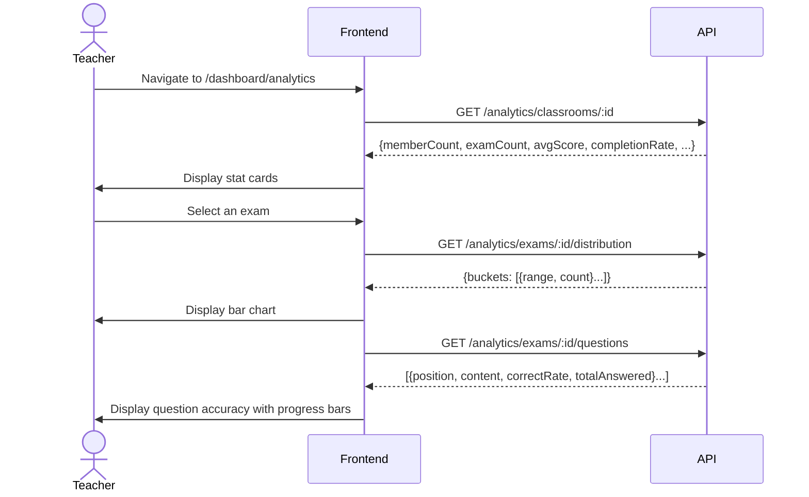

# H1. Student & Classroom Performance Analytics

## 5.1 Feature Overview

| Field | Value |
|---|---|
| **Feature ID** | H1 |
| **Feature Name** | Student & Classroom Performance Analytics |
| **Module** | H. Analytics & Reporting |
| **Priority** | P1 (Classroom Performance), P2 (Student Ranking, Student Over Time) |
| **Complexity** | M |
| **Status** | Existing — API implemented, partial frontend |
| **Target Roles** | Teacher |
| **Business Objective** | Provide teachers with actionable insights into student and classroom performance to identify weak areas, track progress, and improve teaching outcomes. |
| **User Problem** | Without analytics, teachers must manually calculate averages and compare scores across exams — tedious and error-prone. |
| **Dependencies** | ExamAttempt data (Module E/G), Classroom membership (Module B), Assignment data (Module F) |

## 5.2 Actors and Permissions

### Teacher (Classroom Owner)
- **Can view**: Classroom-level stats for own classrooms, exam-level stats for own exams, student rankings, question accuracy, score distribution
- **Can create**: N/A (read-only analytics)
- **Can update**: N/A
- **Can delete**: N/A
- **Cannot**: View analytics for classrooms/exams they don't own

### Student
- **Cannot**: Access any analytics endpoints (403 Forbidden)

### Backend Authorization
- All analytics endpoints require TEACHER role
- Classroom performance: verify teacher owns the classroom
- Exam analytics: verify teacher owns the exam
- Student performance: verify teacher owns a classroom containing the student

## 5.3 Preconditions and Business Rules

1. **Data availability**: Analytics are only meaningful when attempts exist. Empty classrooms or exams with zero attempts return zero/null values, not errors.
2. **Score source**: Analytics use `ExamAttempt.score` — this reflects manual overrides if applied.
3. **Attempt filter**: Only SUBMITTED attempts are included in analytics (IN_PROGRESS excluded).
4. **Cross-exam aggregation**: Classroom performance aggregates across all exams assigned to that classroom.
5. **Tie handling**: Student rankings assign the same rank to students with identical scores.
6. **Real-time**: Analytics are computed on-demand (no caching or materialized views). Acceptable at ~100 users.

## 5.4 Main User Flow — Happy Path



1. Teacher navigates to analytics page.
2. Selects a classroom from dropdown.
3. System displays 4 stat cards: member count, exam count, average score, completion rate.
4. Teacher selects an exam within the classroom.
5. System displays score distribution bar chart (10 buckets: 0–1, 1–2, ... 9–10).
6. System displays per-question accuracy with color-coded progress bars.
7. Teacher identifies questions with low accuracy for review.

## 5.5 Alternative Flows

### AF-01: View Student Ranking
1. Teacher navigates to exam analytics.
2. Calls GET /analytics/exams/:id/ranking.
3. System returns students sorted by score descending, with rank numbers (ties share rank).
4. Teacher identifies top and bottom performers.

### AF-02: View Student Performance Over Time
1. Teacher selects a specific student.
2. Calls GET /analytics/students/:id/performance.
3. System returns chronological list of attempts with exam title, score, date.
4. Frontend can display as a line chart showing score trend.

### AF-03: No Data Available
1. Teacher views analytics for a classroom with no assignments or attempts.
2. System returns zero values for all metrics.
3. Frontend shows empty state: "Chưa có dữ liệu phân tích. Hãy giao bài kiểm tra cho lớp."

## 5.6 Edge Cases and Failure Scenarios

| Scenario ID | Scenario | Trigger | Expected Behavior | User Feedback | Data Integrity | Recovery | Severity |
|---|---|---|---|---|---|---|---|
| H1-E01 | Classroom with no attempts | New classroom, no exams assigned | Return all-zero metrics | "Chưa có dữ liệu" | No data created | Assign exam first | Low |
| H1-E02 | Exam with 0 submissions | Exam assigned but no student started | Distribution: all buckets count=0, questions: correctRate=null | Show empty chart | Safe | Wait for submissions | Low |
| H1-E03 | Student removed from classroom after taking exam | Teacher removes student | Attempt data remains, included in analytics | Scores still counted | Attempts not deleted | Teacher can re-add student | Low |
| H1-E04 | Manual score override affects analytics | Teacher changes score | Analytics use current score (including override) | Updated in real-time | Consistent | None needed | Low |
| H1-E05 | Exam with only IN_PROGRESS attempts | All students started but none submitted | Filter out IN_PROGRESS | Show "0 bài nộp" | Safe | Wait for submissions | Low |
| H1-E06 | Teacher queries analytics for unowned classroom | Direct API call | 403 Forbidden | Error message | No data exposed | None | Medium |
| H1-E07 | Score tie in ranking | Two students have same score | Both get same rank number | "1. A (8.5), 1. B (8.5), 3. C (7.0)" | Correct ranking | None needed | Low |
| H1-E08 | Very large classroom (100+ students) | Scale scenario | Query may be slow without optimization | May need loading indicator | Correct but slow | Add database indexes | Medium |

## 5.7 UI/UX Specification

### Entry Point
- Sidebar navigation link "Thống kê" (TrendingUp icon) — visible to TEACHER only.
- Route: `/dashboard/analytics`

### Layout
- Classroom selector dropdown at top.
- 4 stat cards in a responsive grid (2×2 on mobile, 4×1 on desktop):
  - Thành viên (memberCount)
  - Bài kiểm tra (examCount)
  - Điểm trung bình (avgScore, formatted to 1 decimal)
  - Tỷ lệ hoàn thành (completionRate as percentage)
- Exam selector (buttons or dropdown).
- Score distribution bar chart (10 bars, brand-primary color).
- Question accuracy section: list of questions with progress bars.
  - Green (≥70% correctRate), Yellow (40–69%), Red (<40%).

### States
- **Loading**: Skeleton cards and chart placeholder.
- **Empty**: "Chưa có dữ liệu phân tích" with illustration.
- **Error**: Toast notification with retry option.

### Accessibility
- Chart bars have aria-label with value.
- Progress bars have text percentage alongside color.
- Color is not the sole indicator — text values always present.

## 5.8 Data Requirements

### Existing Schema (no changes needed)
- `ExamAttempt`: score, status, examId, studentId
- `Exam`: ownerId, title
- `Classroom`: ownerId, name
- `ClassroomMember`: classroomId, userId
- `Assignment`: examId, classroomId
- `ExamQuestion`: examId, position, contentSnapshot
- `Answer`: attemptId, examQuestionId, answerPayload

### Query Patterns
- Classroom performance: aggregate attempts across all exams assigned to classroom
- Score distribution: bucket attempt scores into 10 ranges
- Question accuracy: for each exam question, calculate (correct answers / total answers)
- Ranking: order students by score, handle ties
- Student over time: list attempts for a student ordered by date

### Indexing
- `exam_attempts(exam_id, student_id)` — existing index
- `exam_attempts(student_id)` — existing index
- `assignments(classroom_id)` — needed for classroom-level aggregation

## 5.9 API Requirements

### GET /analytics/classrooms/:id

| Field | Value |
|---|---|
| **Purpose** | Get classroom-level performance summary |
| **Role** | TEACHER (classroom owner) |
| **Auth** | JWT required |
| **Parameters** | `id` — classroom UUID |
| **Response 200** | `{memberCount, examCount, avgScore, highestScore, lowestScore, completionRate, submissionRate}` |
| **Error 403** | Not the classroom owner |
| **Error 404** | Classroom not found |

### GET /analytics/exams/:id/distribution

| Field | Value |
|---|---|
| **Purpose** | Get score distribution for an exam |
| **Role** | TEACHER (exam owner) |
| **Response 200** | `{buckets: [{range: "0-1", count: N}, ...]}` — 10 buckets |

### GET /analytics/exams/:id/questions

| Field | Value |
|---|---|
| **Purpose** | Get per-question accuracy stats |
| **Role** | TEACHER (exam owner) |
| **Response 200** | `[{position, content, correctRate, totalAnswered, mostSelectedOptionId}]` |

### GET /analytics/exams/:id/ranking

| Field | Value |
|---|---|
| **Purpose** | Get student ranking for an exam |
| **Role** | TEACHER (exam owner) |
| **Response 200** | `[{rank, studentId, displayName, score, submittedAt}]` |

### GET /analytics/students/:id/performance

| Field | Value |
|---|---|
| **Purpose** | Get a student's performance across all exams |
| **Role** | TEACHER (must own a classroom containing this student) |
| **Response 200** | `{attempts: [{examTitle, score, date}]}` |

## 5.10 State Management

Analytics are stateless read-only views. No state transitions.

## 5.11 Acceptance Criteria

```gherkin
Given a teacher owns a classroom with 3 submitted attempts averaging 7.5,
When the teacher views classroom analytics,
Then the avgScore shows 7.5 and memberCount reflects enrolled students.

Given an exam has 10 submitted attempts with scores [3, 5, 5, 6, 7, 7, 8, 8, 9, 10],
When the teacher views score distribution,
Then the bar chart shows correct counts per bucket.

Given an exam question was answered correctly by 8 of 10 students,
When the teacher views question accuracy,
Then that question shows correctRate = 0.8 with a green progress bar.

Given two students scored 8.5 on the same exam,
When the teacher views ranking,
Then both students show rank 1, and the next student shows rank 3.

Given a student is not enrolled in any of the teacher's classrooms,
When the teacher requests that student's performance,
Then the backend returns 403 Forbidden.
```

## 5.12 QA Test Scenarios

| Test ID | Scenario | Preconditions | Steps | Expected | Priority |
|---|---|---|---|---|---|
| H1-T01 | Classroom stats with data | 3 exams assigned, 10 attempts | GET /analytics/classrooms/:id | Correct aggregate values | High |
| H1-T02 | Classroom stats empty | No assignments | GET /analytics/classrooms/:id | All zeros/nulls | Medium |
| H1-T03 | Score distribution | 10 attempts with known scores | GET /analytics/exams/:id/distribution | Correct bucket counts | High |
| H1-T04 | Question accuracy | 5 correct, 3 incorrect for Q1 | GET /analytics/exams/:id/questions | correctRate = 0.625 | High |
| H1-T05 | Student ranking with ties | Two students score 8.0 | GET /analytics/exams/:id/ranking | Both rank 1, next rank 3 | Medium |
| H1-T06 | Auth: student access | Student requests analytics | GET /analytics/classrooms/:id | 403 Forbidden | High |
| H1-T07 | Auth: wrong teacher | Teacher B queries Teacher A's classroom | GET /analytics/classrooms/:id | 403 Forbidden | High |
| H1-T08 | Student performance | Student has 5 attempts across exams | GET /analytics/students/:id/performance | 5 entries, sorted by date | Medium |

## 5.13 Open Questions and Assumptions

| Question | Why It Matters | Options | Recommended Default | Impact |
|---|---|---|---|---|
| Should analytics cache results? | Real-time queries may slow down with many students | (A) No caching, (B) Redis cache with TTL, (C) Materialized views | A — no caching, sufficient for ~100 users | Low |
| Should analytics include IN_PROGRESS attempts? | Could skew averages | (A) Exclude (current), (B) Include | A — exclude | Low |
| Cross-classroom analytics? | Teacher may want overview of all classrooms | (A) Per-classroom only (current), (B) Add global teacher dashboard | A — per-classroom only for MVP | Low |
| Export analytics to CSV/PDF? | Teachers may need reports for school administration | (A) No export (current), (B) CSV export, (C) PDF report | B — CSV export (P2) | Low |
