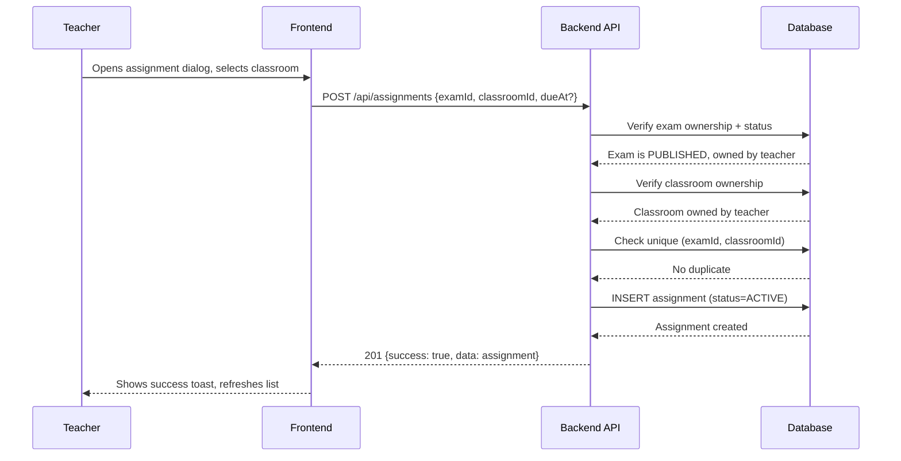
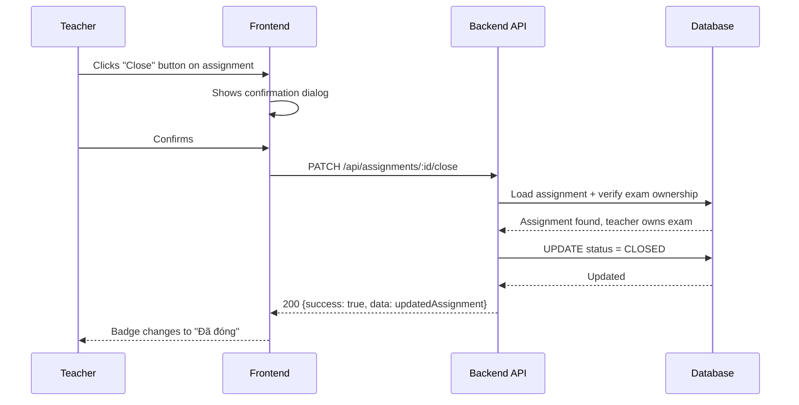
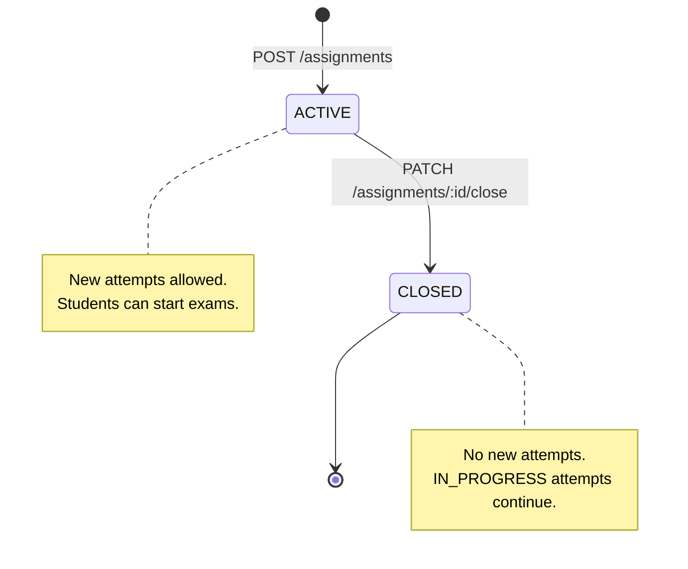

# F1. Create / Close Assignment

## 5.1 Feature Overview

| Field | Value |
|---|---|
| **Feature ID** | F1 |
| **Feature Name** | Create / Close Assignment |
| **Module** | F. Assignment Management |
| **Priority** | P0 |
| **Complexity** | S |
| **Status** | Existing — fully implemented (backend + frontend) |
| **Target Roles** | TEACHER |
| **Business Objective** | Allow teachers to distribute published exams to classrooms. An assignment is the bridge between an exam and a classroom — it makes the exam available to all students enrolled in that classroom. Closing an assignment prevents new attempts. |
| **User Problem** | Teachers need a way to make exams available to specific groups of students at specific times, and to stop accepting submissions when appropriate. |
| **Dependencies** | D5 (Publish Exam), B1 (Create Classroom), B2 (Join Classroom) |

## 5.2 Actors and Permissions

### Teacher (exam owner + classroom owner)

| Action | Permitted | Condition |
|---|---|---|
| Create assignment | Yes | Must own both the exam and the classroom |
| View own assignments | Yes | Only for own exams |
| Close assignment | Yes | Must own the assignment's exam |
| Reopen assignment | No | Not supported — create a new assignment or use a new exam |
| Delete assignment | No | Not implemented — close is the supported action |
| Assign to unowned classroom | No | Returns 403 |
| Assign unpublished exam | No | Returns 400 |

### Teacher (non-owner)

| Action | Permitted |
|---|---|
| View another teacher's assignments | No |
| Close another teacher's assignment | No |

### Student

| Action | Permitted |
|---|---|
| View assignments for joined classrooms | Yes (via GET /assignments) |
| Create assignment | No — 403 |
| Close assignment | No — 403 |

### Unauthenticated User

All requests return 401.

## 5.3 Preconditions and Business Rules

### Preconditions for creating an assignment

1. Teacher is authenticated and has role TEACHER.
2. The exam exists and is owned by the teacher.
3. The exam status is PUBLISHED.
4. The classroom exists and is owned by the teacher.
5. No assignment already exists for this (examId, classroomId) pair.

### Business rules

| Rule ID | Rule | Enforcement |
|---|---|---|
| F1-BR-01 | One assignment per exam per classroom. | Database UNIQUE constraint on `(exam_id, classroom_id)`. |
| F1-BR-02 | Only PUBLISHED exams can be assigned. | Backend validation before insert. |
| F1-BR-03 | Teacher must own both the exam and the classroom. | Backend authorization check. |
| F1-BR-04 | Closing an assignment sets status to CLOSED. | Backend updates status field. |
| F1-BR-05 | A closed assignment prevents new attempt starts but does not affect IN_PROGRESS attempts. | Checked in the attempt start flow (Module E), not in assignment service. |
| F1-BR-06 | `dueAt` is optional. When set, it is informational for the student — the server does not auto-close assignments at `dueAt`. | See F4 (Deadline Management) for enforcement details. |
| F1-BR-07 | `hideResults` defaults to false. When true, students cannot see their scores for this assignment. | Checked in result visibility logic. |
| F1-BR-08 | A DRAFT or ARCHIVED exam cannot be assigned. | Backend validation returns 400. |

## 5.4 Main User Flow — Happy Path

### Create Assignment



### Close Assignment



## 5.5 Alternative Flows

### AF-01: Teacher assigns the same exam to multiple classrooms

The teacher repeats the create assignment flow for each classroom. Each classroom gets its own assignment row. Students in different classrooms see the same exam independently.

### AF-02: Teacher closes assignment before any student starts

Valid operation. No attempts exist. The assignment transitions to CLOSED. If a student later tries to start, the attempt engine rejects because no ACTIVE assignment exists.

### AF-03: Teacher sets dueAt in the past

The system allows this (no validation against current time). The frontend should display a warning but not block submission. This accommodates timezone differences and edge cases where the teacher sets a deadline that has technically passed.

**Open question:** Should the backend reject `dueAt` in the past? See section 5.13.

### AF-04: Teacher assigns exam that already has a time window (availableFrom / availableUntil)

Both the assignment `dueAt` and the exam time window coexist. The exam time window is enforced by the attempt engine. The assignment `dueAt` is informational (P1 deadline enforcement may change this). Students must satisfy both: the exam must be within its availability window AND the assignment must be ACTIVE.

## 5.6 Edge Cases and Failure Scenarios

| Scenario ID | Scenario | Trigger | Expected Behavior | User Feedback | Data Integrity | Recovery | Severity |
|---|---|---|---|---|---|---|---|
| F1-EC-01 | Duplicate assignment (same exam + classroom) | Teacher tries to assign an exam already assigned to this classroom | Backend returns 409 Conflict | Toast: "Đề thi đã được giao cho lớp này" | No data created | Teacher can assign to a different classroom | Low |
| F1-EC-02 | Assign DRAFT exam | Teacher selects an unpublished exam | Backend returns 400 | Toast: "Chỉ có thể giao đề thi đã phát hành" | No data created | Teacher publishes the exam first | Medium |
| F1-EC-03 | Assign ARCHIVED exam | Teacher selects an archived exam | Backend returns 400 | Toast: "Đề thi đã được lưu trữ" | No data created | Teacher creates a new exam | Medium |
| F1-EC-04 | Assign to unowned classroom | API called with a classroom the teacher does not own | Backend returns 403 | Toast: "Bạn không có quyền giao bài cho lớp này" | No data created | None needed | High |
| F1-EC-05 | Assign to non-existent classroom | classroomId is invalid UUID | Backend returns 404 | Toast: "Lớp học không tồn tại" | No data created | Teacher selects a valid classroom | Low |
| F1-EC-06 | Assign to archived classroom | Classroom has archivedAt set | Backend should return 400 "Lớp học đã được lưu trữ" | Toast with message | No data created | Teacher unarchives the classroom first | Medium |
| F1-EC-07 | Close already-closed assignment | Teacher clicks close on a closed assignment | Backend returns 200 (idempotent) or 400 | No change | No data changed | None needed | Low |
| F1-EC-08 | Close assignment with IN_PROGRESS attempts | Students are currently taking the exam | Assignment transitions to CLOSED; IN_PROGRESS attempts are NOT terminated | Teacher sees "Đã đóng" but active attempts continue | Attempts unaffected — they run to expiry or submission | Students can finish current attempt but cannot start new ones | High |
| F1-EC-09 | Exam deleted while assignment exists | Teacher deletes an exam (not currently possible for PUBLISHED exams) | If implemented: cascade delete assignments, or reject deletion | N/A — currently blocked by business rules | FK constraint protects integrity | N/A | Critical |
| F1-EC-10 | Network error during create | Request fails mid-flight | Frontend shows error toast | "Không thể giao bài. Vui lòng thử lại." | No data created (request never reached DB) | Retry | Low |
| F1-EC-11 | Classroom has zero students | Teacher assigns to an empty classroom | Assignment created successfully — it's valid even with no students | No warning currently | Assignment exists, waiting for students to join | Students who join later see the assignment | Low |

## 5.7 UI/UX Specification

### Entry Point

Teacher navigates to `/dashboard/assignments`. The page shows their published exams and a dialog to assign each one.

### Create Assignment Dialog

| Element | Specification |
|---|---|
| Trigger | "Giao bài" button on an exam card (Primary Blue) |
| Dialog title | "Giao đề thi" |
| Classroom selector | Dropdown listing teacher's owned classrooms (exclude archived) |
| Due date field | Optional DateTime picker. Label: "Hạn nộp (tùy chọn)" |
| Submit button | "Giao bài" (Primary Blue, full width) |
| Loading state | Button shows spinner + "Đang giao..." |
| Success | Dialog closes, toast: "Đã giao bài thành công" |
| Error | Toast with error message, dialog stays open |

### Assignment List (Teacher View)

| Element | Specification |
|---|---|
| Layout | Table or card list grouped by exam |
| Columns | Classroom name, assigned date, due date, status badge, student count, action buttons |
| Status badges | ACTIVE = `default` variant (blue), CLOSED = `outline` variant (neutral) |
| Actions | "Đóng" button (destructive style) for ACTIVE assignments |

### Close Confirmation Dialog

| Element | Specification |
|---|---|
| Title | "Đóng bài giao?" |
| Body | "Học sinh sẽ không thể bắt đầu làm bài mới. Học sinh đang làm bài sẽ không bị ảnh hưởng." |
| Confirm | "Đóng bài giao" (destructive/red) |
| Cancel | "Huỷ" (secondary) |

### Responsive Behavior

- Desktop: Table layout with all columns visible.
- Mobile: Card layout. Each card shows classroom name, status badge, due date. Actions in a dropdown or bottom sheet.

## 5.8 Data Requirements

### Existing Schema (no changes needed for P0)

```
Assignment {
  id          UUID PK
  examId      UUID FK → Exam.id
  classroomId UUID FK → Classroom.id
  assignedAt  DateTime (default: now)
  dueAt       DateTime? (nullable)
  status      AssignmentStatus (ACTIVE | CLOSED)
  hideResults Boolean (default: false)
}
```

**Constraints:**
- UNIQUE `(exam_id, classroom_id)` — one assignment per exam per classroom.
- FK `exam_id` → `exams.id` (no cascade delete — exam cannot be deleted while PUBLISHED).
- FK `classroom_id` → `classrooms.id` (cascade behavior: if classroom is deleted, assignments are deleted).

**Indexes:**
- `(exam_id, classroom_id)` — unique index covers lookup.
- `classroom_id` — for student queries filtering by classroom membership.

### Proposed Schema Changes

None for current functionality. See F3 (Submission Tracking) for proposed additions.

## 5.9 API Requirements

### POST /api/assignments — Create Assignment

| Field | Value |
|---|---|
| **Method** | POST |
| **Endpoint** | `/api/assignments` |
| **Purpose** | Assign a published exam to a classroom |
| **Required Role** | TEACHER |
| **Authorization** | Authenticated teacher must own both the exam and the classroom |

**Request Body:**
```json
{
  "examId": "uuid",
  "classroomId": "uuid",
  "dueAt": "2026-12-01T23:59:00Z"  // optional
}
```

**Validation Rules:**
| Field | Rule |
|---|---|
| examId | Required, valid UUID, must reference an existing PUBLISHED exam owned by the teacher |
| classroomId | Required, valid UUID, must reference an existing non-archived classroom owned by the teacher |
| dueAt | Optional, ISO 8601 datetime string |

**Success Response (201):**
```json
{
  "success": true,
  "data": {
    "id": "uuid",
    "examId": "uuid",
    "classroomId": "uuid",
    "assignedAt": "2026-11-11T10:00:00Z",
    "dueAt": "2026-12-01T23:59:00Z",
    "status": "ACTIVE",
    "hideResults": false
  }
}
```

**Error Responses:**

| Status | Code | Condition |
|---|---|---|
| 400 | EXAM_NOT_PUBLISHED | Exam is DRAFT or ARCHIVED |
| 400 | CLASSROOM_ARCHIVED | Classroom is archived |
| 403 | FORBIDDEN | Teacher does not own the exam or classroom |
| 404 | EXAM_NOT_FOUND | examId does not exist |
| 404 | CLASSROOM_NOT_FOUND | classroomId does not exist |
| 409 | ASSIGNMENT_EXISTS | Assignment already exists for this exam + classroom |

### GET /api/assignments — List Assignments

| Field | Value |
|---|---|
| **Method** | GET |
| **Endpoint** | `/api/assignments` |
| **Purpose** | List assignments (role-dependent view) |
| **Required Role** | TEACHER or STUDENT |

**Query Parameters:**
| Param | Type | Description |
|---|---|---|
| examId | UUID? | Filter by exam (teacher only) |
| classroomId | UUID? | Filter by classroom |
| status | String? | Filter by ACTIVE or CLOSED |

**Teacher Response:** Assignments for the teacher's own exams. Includes classroom name and member count.

**Student Response:** Assignments for classrooms the student is a member of. Includes exam title, duration, status, and the student's attempt status (not started / in progress / submitted).

### PATCH /api/assignments/:id/close — Close Assignment

| Field | Value |
|---|---|
| **Method** | PATCH |
| **Endpoint** | `/api/assignments/:id/close` |
| **Purpose** | Close an assignment to prevent new attempts |
| **Required Role** | TEACHER |
| **Authorization** | Teacher must own the assignment's exam |

**Request Body:** None.

**Success Response (200):**
```json
{
  "success": true,
  "data": {
    "id": "uuid",
    "status": "CLOSED"
  }
}
```

**Error Responses:**

| Status | Code | Condition |
|---|---|---|
| 403 | FORBIDDEN | Teacher does not own the exam |
| 404 | ASSIGNMENT_NOT_FOUND | Assignment does not exist |

**Idempotency:** Closing an already-closed assignment returns 200 with the current state.

## 5.10 State Management



**State transition rules:**

| From | To | Trigger | Reversible |
|---|---|---|---|
| (none) | ACTIVE | Teacher creates assignment | No (delete not supported) |
| ACTIVE | CLOSED | Teacher closes assignment | No (reopen not supported) |

**Forbidden transitions:**
- CLOSED → ACTIVE (no reopen).
- Direct deletion of assignments is not exposed via API.

## 5.11 Acceptance Criteria

### Positive

```
Given a teacher owns a PUBLISHED exam and a classroom with students,
When the teacher creates an assignment for this exam and classroom,
Then the assignment is created with status ACTIVE,
And all students in the classroom can see the exam in their assignment list.
```

```
Given a teacher owns an ACTIVE assignment,
When the teacher closes the assignment,
Then the assignment status changes to CLOSED,
And no new attempts can be started for this assignment,
And existing IN_PROGRESS attempts are not affected.
```

```
Given a teacher assigns the same exam to two different classrooms,
When a student in classroom A views assignments,
Then they see only the assignment for classroom A,
And a student in classroom B sees only the assignment for classroom B.
```

### Negative

```
Given a teacher owns a DRAFT exam,
When the teacher tries to create an assignment for it,
Then the backend returns 400 EXAM_NOT_PUBLISHED.
```

```
Given a student is authenticated,
When the student tries to create an assignment,
Then the backend returns 403.
```

```
Given teacher A owns an exam and teacher B owns a classroom,
When teacher A tries to assign the exam to teacher B's classroom,
Then the backend returns 403 FORBIDDEN.
```

```
Given an assignment already exists for exam X and classroom Y,
When the teacher tries to create a duplicate assignment,
Then the backend returns 409 ASSIGNMENT_EXISTS.
```

## 5.12 QA Test Scenarios

| Test ID | Scenario | Preconditions | Steps | Test Data | Expected Result | Priority |
|---|---|---|---|---|---|---|
| F1-TC-01 | Create assignment — happy path | Teacher has a PUBLISHED exam and a classroom with 3 students | POST /assignments with valid examId and classroomId | examId=valid, classroomId=valid | 201, assignment created, students see it | Critical |
| F1-TC-02 | Create with optional dueAt | Same as TC-01 | POST /assignments with dueAt set to a future date | dueAt="2026-12-01T23:59:00Z" | 201, assignment has dueAt | High |
| F1-TC-03 | Duplicate assignment rejected | Assignment already exists for (exam, classroom) | POST /assignments with same IDs | Same examId + classroomId | 409 ASSIGNMENT_EXISTS | Critical |
| F1-TC-04 | DRAFT exam rejected | Exam status is DRAFT | POST /assignments | examId=draftExam | 400 EXAM_NOT_PUBLISHED | Critical |
| F1-TC-05 | ARCHIVED exam rejected | Exam status is ARCHIVED | POST /assignments | examId=archivedExam | 400 EXAM_NOT_PUBLISHED | High |
| F1-TC-06 | Unowned classroom rejected | Teacher does not own the classroom | POST /assignments | classroomId=otherTeacher | 403 FORBIDDEN | Critical |
| F1-TC-07 | Unowned exam rejected | Teacher does not own the exam | POST /assignments | examId=otherTeacher | 403 FORBIDDEN | Critical |
| F1-TC-08 | Student cannot create | User role is STUDENT | POST /assignments | Any valid body | 403 | Critical |
| F1-TC-09 | Close assignment — happy path | ACTIVE assignment exists | PATCH /assignments/:id/close | Valid assignment ID | 200, status=CLOSED | Critical |
| F1-TC-10 | Close already-closed | Assignment status is CLOSED | PATCH /assignments/:id/close | Same ID | 200, no change | Medium |
| F1-TC-11 | Close with active attempts | 2 students have IN_PROGRESS attempts | PATCH /assignments/:id/close | Valid ID | 200, attempts unaffected | Critical |
| F1-TC-12 | Non-owner cannot close | Teacher B tries to close teacher A's assignment | PATCH /assignments/:id/close | Teacher B auth token | 403 | High |
| F1-TC-13 | Empty classroom assignment | Classroom has 0 students | POST /assignments | classroomId=emptyClass | 201, assignment created | Medium |
| F1-TC-14 | Archived classroom rejected | Classroom has archivedAt set | POST /assignments | classroomId=archivedClass | 400 CLASSROOM_ARCHIVED | High |
| F1-TC-15 | Non-existent exam | examId does not exist | POST /assignments | examId=random UUID | 404 | Medium |

## 5.13 Open Questions and Assumptions

### Open Questions

| # | Question | Why It Matters | Options | Recommended Default | Impact |
|---|---|---|---|---|---|
| OQ-01 | Should `dueAt` in the past be rejected on create? | Prevents accidental misconfiguration, but complicates timezone handling | A) Reject (400), B) Allow with warning, C) Allow silently | B) Allow — frontend shows warning, backend accepts | Low — purely cosmetic |
| OQ-02 | Should closing an assignment auto-submit IN_PROGRESS attempts? | Determines whether students lose in-progress work when teacher closes | A) Yes — force-submit, B) No — let them finish | B) No — let them finish (current behavior). Force-submit is destructive and unexpected. | High — affects student experience |
| OQ-03 | Should assignment deletion be supported? | Currently only close is supported, which is non-reversible | A) Support soft-delete, B) Keep close-only | B) Keep close-only for MVP. Delete adds complexity with cascading attempt cleanup. | Medium |
| OQ-04 | Should teachers be able to reopen a closed assignment? | Allows correction if closed accidentally | A) Yes — add CLOSED→ACTIVE transition, B) No | A) Yes — low cost to implement, prevents teacher frustration | Medium |
| OQ-05 | Should assigning to an archived classroom be prevented? | Archived classrooms are hidden from default list but still exist | A) Prevent (400), B) Allow | A) Prevent — archived classrooms should not receive new assignments | Low |

### Assumptions

| # | Assumption | Basis |
|---|---|---|
| AS-01 | A teacher can only assign exams they own (no shared exams). | Current ownership model — no exam sharing. |
| AS-02 | Closing an assignment is permanent (no reopen). | Current implementation. May change per OQ-04. |
| AS-03 | The `hideResults` field is set at creation time and not editable later. | Field exists in schema but no PATCH endpoint exposes it. |
| AS-04 | Assignment deletion cascades are handled by the database FK constraint on Classroom. | If a classroom is deleted, its assignments are deleted via CASCADE. |
