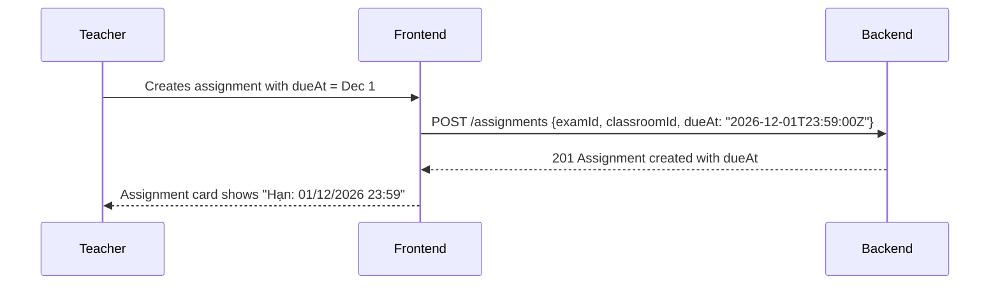
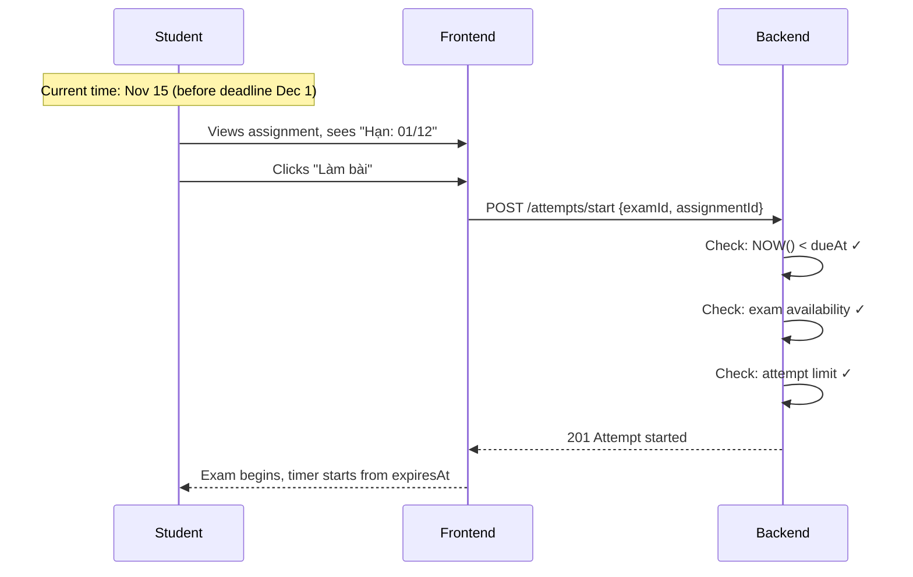
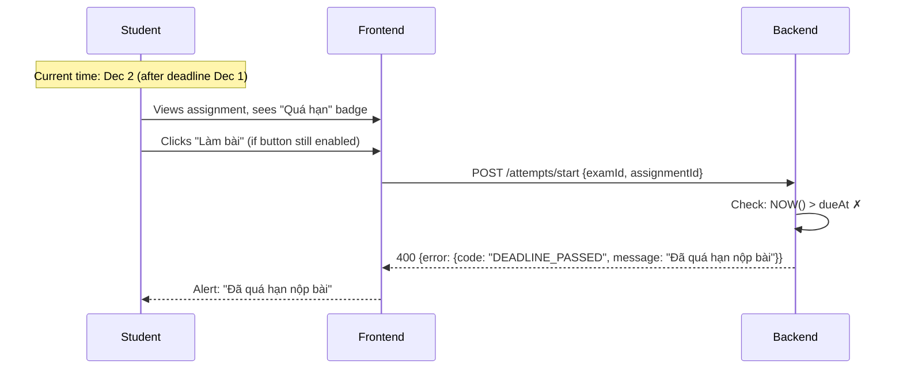

# F4. Deadline Enforcement and Management

## 5.1 Feature Overview

| Field | Value |
|---|---|
| **Feature ID** | F4 |
| **Feature Name** | Deadline Enforcement and Management |
| **Module** | F. Assignment Management |
| **Priority** | P1 |
| **Complexity** | M |
| **Status** | Partially implemented — schema field `dueAt` exists; no server-side enforcement or UI treatment |
| **Target Roles** | TEACHER, STUDENT |
| **Business Objective** | Allow teachers to set deadlines for assignments and enforce them, so students are motivated to complete exams on time and teachers can control the submission window. |
| **User Problem** | Teachers set deadlines but the system does not currently enforce them. Students may see a deadline but can still start an exam after it passes. |
| **Dependencies** | F1 (Create Assignment), F2 (Student View), E1 (Start Exam) |

## 5.2 Actors and Permissions

### Teacher

| Action | Permitted | Condition |
|---|---|---|
| Set dueAt when creating assignment | Yes | Optional field |
| Update dueAt on an existing assignment | Proposed — not yet implemented | |
| Remove dueAt (make it null) | Proposed — not yet implemented | |
| Override deadline for specific student | No — not in scope | |

### Student

| Action | Permitted |
|---|---|
| Start exam before deadline | Yes |
| Start exam after deadline | **Depends on enforcement mode** (see business rules) |
| Finish an IN_PROGRESS attempt after deadline | Yes — expiresAt governs, not dueAt |

## 5.3 Preconditions and Business Rules

### Critical distinction: dueAt vs expiresAt

These are two different time boundaries that serve different purposes. Confusing them is the most common source of bugs and misunderstanding.

| Concept | Field | Scope | Set By | Meaning |
|---|---|---|---|---|
| **Assignment deadline** | `Assignment.dueAt` | Per-assignment (all students) | Teacher | The date by which students should complete the assignment. Governs whether a student can **start** a new attempt. |
| **Attempt expiry** | `ExamAttempt.expiresAt` | Per-attempt (individual student) | System (startedAt + durationSeconds) | The moment this specific attempt times out. Governs whether a student can **continue saving answers and submit**. |

**Key rule:** Once a student has started an attempt, the attempt's `expiresAt` controls their time — NOT `dueAt`. A student who starts at 23:50 with a 60-minute exam can work until 00:50 even if `dueAt` was 23:59.

### Business rules

| Rule ID | Rule | Enforcement |
|---|---|---|
| F4-BR-01 | `dueAt` is optional. When null, no deadline applies. | Backend skips deadline check when null. |
| F4-BR-02 | When `dueAt` is set and `NOW() > dueAt`, new attempts are blocked. | Backend returns 400 when student calls POST /attempts/start. |
| F4-BR-03 | An IN_PROGRESS attempt is NOT affected when `dueAt` passes. | `expiresAt` on the attempt is the only time boundary for ongoing work. |
| F4-BR-04 | `dueAt` and exam `availableUntil` are independent. Both are checked when starting an attempt. The student must satisfy both. | Backend checks both conditions. |
| F4-BR-05 | Teacher can set `dueAt` in the past at creation time. | Allowed but frontend shows a warning. Backend does not reject. |
| F4-BR-06 | Closing an assignment (status=CLOSED) is independent of `dueAt`. A teacher can close before or after the deadline. | Both checks apply: CLOSED blocks new starts; past dueAt also blocks new starts. |
| F4-BR-07 | Teacher can update `dueAt` after assignment creation (proposed). | New PATCH endpoint needed. |
| F4-BR-08 | Server time is authoritative. Client clock is not trusted. | All time comparisons use `NOW()` on the server. |

### Time check order for starting an attempt

When a student calls POST /attempts/start, the system checks in order:

1. Assignment exists and status is ACTIVE → else 400
2. `Assignment.dueAt` is null OR `NOW() < dueAt` → else 400 "DEADLINE_PASSED"
3. Exam status is PUBLISHED → else 400
4. `Exam.availableFrom` is null OR `NOW() >= availableFrom` → else 400 "EXAM_NOT_AVAILABLE_YET"
5. `Exam.availableUntil` is null OR `NOW() <= availableUntil` → else 400 "EXAM_EXPIRED"
6. Student attempt count < `Exam.maxAttempts` → else 400 "MAX_ATTEMPTS_REACHED"
7. No existing IN_PROGRESS attempt → else return existing attempt

## 5.4 Main User Flow — Happy Path

### Teacher sets a deadline



### Student starts before deadline



### Student tries to start after deadline



## 5.5 Alternative Flows

### AF-01: Student starts before deadline, finishes after deadline

The student starts at 23:50 on Nov 30. The exam is 60 minutes. `dueAt` is Dec 1 00:00. The attempt `expiresAt` is Dec 1 00:50.

The student can continue working until 00:50. The `dueAt` does not interrupt the in-progress attempt. This is correct behavior — the student started on time.

### AF-02: Teacher extends the deadline

The teacher updates `dueAt` from Dec 1 to Dec 5. Students who were blocked by the original deadline can now start. Students who already submitted are unaffected.

### AF-03: Teacher removes the deadline

The teacher sets `dueAt` to null. All deadline checks are bypassed. Students can start anytime (subject to assignment status and exam availability).

### AF-04: dueAt and availableUntil conflict

Teacher sets `dueAt = Dec 5` but the exam has `availableUntil = Dec 1`. Students cannot start after Dec 1 because the exam availability check fails first. The `dueAt` is effectively redundant.

Frontend should warn: "Lưu ý: Đề thi chỉ mở đến 01/12, trước hạn nộp bài."

### AF-05: Assignment with no deadline (dueAt = null)

Students can start anytime as long as the assignment is ACTIVE and the exam is within its availability window. No deadline badge shown.

## 5.6 Edge Cases and Failure Scenarios

| Scenario ID | Scenario | Trigger | Expected Behavior | User Feedback | Data Integrity | Recovery | Severity |
|---|---|---|---|---|---|---|---|
| F4-EC-01 | Student starts 1 second before deadline | Request reaches server at dueAt boundary | Server uses `NOW() < dueAt` (strictly less than). If the server timestamp is exactly at or past dueAt, the request is rejected. | If started: exam proceeds normally. If rejected: "Đã quá hạn nộp bài" | Attempt created if check passed | Student contacts teacher if they believe they were on time | High |
| F4-EC-02 | Clock skew between client and server | Client clock is 5 minutes ahead; student thinks deadline hasn't passed but server says it has | Server time is authoritative. Request rejected if server says expired. | "Đã quá hạn nộp bài" | No data created | Frontend should display server-relative countdown, not client-relative | High |
| F4-EC-03 | Teacher changes dueAt while student is loading the page | dueAt changed between page load and "Start" click | Start attempt uses current dueAt from database, not what was shown to student | May be confusing: student saw a valid deadline but gets "quá hạn" | No data issue | Refresh shows updated deadline | Medium |
| F4-EC-04 | dueAt is in the past at assignment creation | Teacher sets dueAt to yesterday | Assignment created (backend does not reject). Frontend should warn. | Warning: "Hạn nộp đã qua" | Assignment exists but no new attempts possible | Teacher updates dueAt | Medium |
| F4-EC-05 | Timezone handling | Student in UTC+7, teacher in UTC+9, dueAt stored in UTC | All times stored and compared in UTC. Display converted to user's locale. | dueAt displayed in student's local timezone | No timezone-related data issues | Ensure consistent timezone display | High |
| F4-EC-06 | Daylight Saving Time transition | dueAt falls during DST transition (less relevant for Vietnam — UTC+7 with no DST) | Times stored in UTC; no DST ambiguity | Correct display | No issue for UTC+7 | N/A for primary user base | Low |
| F4-EC-07 | Multiple time constraints conflict | dueAt = Dec 5, availableUntil = Dec 1, assignment ACTIVE | The stricter constraint wins. Student is blocked by availableUntil on Dec 2 (400 EXAM_EXPIRED), even though dueAt hasn't passed. | "Đề thi đã đóng" (from exam) | No data issue | Teacher should align dates | Medium |
| F4-EC-08 | Teacher extends deadline after some students were blocked | Students tried after old deadline, failed. Teacher extends. | Previously blocked students can now start. Their failed attempts were never created. | Students should retry after teacher announces extension | No data issue | Teacher communicates new deadline | Medium |
| F4-EC-09 | IN_PROGRESS attempt when dueAt passes | Student started before deadline, continues after | Attempt unaffected. expiresAt is the governing boundary. | No interruption | Attempt data safe | N/A | Critical |
| F4-EC-10 | Server restart at deadline boundary | Server processes restart exactly at dueAt | Stateless check: each request compares NOW() to dueAt. No state lost. | Brief downtime | No data issue | Server recovers | Low |

## 5.7 UI/UX Specification

### Teacher: Setting Deadline

#### In Create Assignment Dialog

| Element | Specification |
|---|---|
| Field | DateTime picker. Label: "Hạn nộp bài (tùy chọn)" |
| Default | Empty (no deadline) |
| Validation | Frontend: warn if date is in the past. Backend: accept any date. |
| Help text | "Học sinh sẽ không thể bắt đầu làm bài sau thời gian này" |

#### In Assignment List (Teacher View)

| Element | Specification |
|---|---|
| Due date display | "Hạn: [dd/MM/yyyy HH:mm]" in text-muted |
| Past deadline | Warning color text: "Quá hạn" |
| No deadline | Text: "Không có hạn nộp" or simply absent |

### Student: Viewing Deadline

#### In Assignment Card

| Condition | Display |
|---|---|
| dueAt in the future (> 24h) | "Hạn: [date]" in text-muted |
| dueAt within 24h | "Hạn: [date]" in warning color. Optionally: "Còn [X] giờ" |
| dueAt within 1h | "Hạn: [date]" in error/red. "Sắp hết hạn!" |
| dueAt has passed | "Quá hạn" destructive badge. "Làm bài" button disabled or hidden |
| dueAt is null | No deadline shown |

#### Countdown (optional enhancement)

For upcoming deadlines, show a relative time: "Còn 2 ngày", "Còn 5 giờ", "Còn 30 phút". Update every minute.

### Proposed: Teacher Updates Deadline

| Element | Specification |
|---|---|
| Entry point | "Sửa" button next to deadline in assignment detail |
| Dialog | DateTime picker with current value pre-filled |
| Clear option | "Xoá hạn nộp" button to set dueAt = null |
| Confirmation | Save button. No confirmation dialog needed (non-destructive). |

## 5.8 Data Requirements

### Existing Schema

```
Assignment {
  ...
  dueAt DateTime? @map("due_at")  -- already exists
  ...
}
```

No schema changes required. The `dueAt` field exists and is nullable.

### Proposed Schema Changes

None. Enforcement is a code-level change in the attempt start logic.

### Enforcement Implementation Location

The deadline check should be added to `AttemptsService.start()`, alongside existing checks for assignment status, exam availability, and attempt limits:

```typescript
// In attempts.service.ts → start()
if (assignment.dueAt && new Date() >= assignment.dueAt) {
  throw new BadRequestException('DEADLINE_PASSED');
}
```

### Proposed API Addition: Update dueAt

A new endpoint to update the deadline on an existing assignment:

**PATCH /api/assignments/:id** (or dedicated PATCH /api/assignments/:id/deadline)

This is not currently implemented.

## 5.9 API Requirements

### Existing: POST /api/assignments (modified)

No API change needed — `dueAt` is already accepted in the request body.

### Existing: POST /api/attempts/start (modified behavior)

| Field | Value |
|---|---|
| **Change** | Add deadline check before creating attempt |
| **New error response** | 400 `DEADLINE_PASSED` when `NOW() >= assignment.dueAt` |

**New Error Response:**
```json
{
  "success": false,
  "error": {
    "code": "DEADLINE_PASSED",
    "message": "Đã quá hạn nộp bài"
  }
}
```

### Proposed: PATCH /api/assignments/:id — Update Assignment

| Field | Value |
|---|---|
| **Method** | PATCH |
| **Endpoint** | `/api/assignments/:id` |
| **Purpose** | Update assignment settings (dueAt, hideResults) |
| **Required Role** | TEACHER |
| **Authorization** | Teacher must own the assignment's exam |
| **Status** | **Proposed — not implemented** |

**Request Body:**
```json
{
  "dueAt": "2026-12-05T23:59:00Z"  // or null to remove
}
```

**Validation:**
| Field | Rule |
|---|---|
| dueAt | Optional. ISO 8601 datetime or null. No past-date restriction (warn on frontend). |

**Success Response (200):**
```json
{
  "success": true,
  "data": {
    "id": "uuid",
    "dueAt": "2026-12-05T23:59:00Z",
    "status": "ACTIVE"
  }
}
```

**Error Responses:**

| Status | Code | Condition |
|---|---|---|
| 403 | FORBIDDEN | Teacher does not own the exam |
| 404 | ASSIGNMENT_NOT_FOUND | Assignment does not exist |

## 5.10 State Management

No new state machine. Deadlines do not change the assignment's status (ACTIVE/CLOSED). They add a time-based precondition to the attempt start flow.

### Decision matrix for "Can student start?"

```
Assignment.status == ACTIVE?
  └─ No → BLOCKED (assignment closed)
  └─ Yes → Assignment.dueAt == null OR NOW() < dueAt?
              └─ No → BLOCKED (deadline passed)
              └─ Yes → Exam.availableFrom <= NOW()?
                          └─ No → BLOCKED (not yet available)
                          └─ Yes → Exam.availableUntil >= NOW()?
                                      └─ No → BLOCKED (exam expired)
                                      └─ Yes → attempts < maxAttempts?
                                                  └─ No → BLOCKED (max reached)
                                                  └─ Yes → No IN_PROGRESS attempt?
                                                              └─ No → RETURN existing
                                                              └─ Yes → CREATE attempt ✓
```

## 5.11 Acceptance Criteria

### Positive

```
Given a teacher creates an assignment with dueAt = "2026-12-01T23:59:00Z",
And the current time is 2026-11-15,
When a student starts the exam,
Then the attempt is created successfully.
```

```
Given a student started an attempt at 23:50 before dueAt of 00:00,
And the exam duration is 60 minutes (expiresAt = 00:50),
When dueAt passes at 00:00,
Then the student can continue working and submit until 00:50.
```

```
Given a teacher sets dueAt = null,
When a student views the assignment,
Then no deadline is displayed,
And the student can start at any time (subject to other constraints).
```

```
Given a teacher extends dueAt from Dec 1 to Dec 5,
When a student who was previously blocked tries to start on Dec 3,
Then the attempt starts successfully.
```

### Negative

```
Given an assignment has dueAt = "2026-12-01T23:59:00Z",
And the current server time is 2026-12-02T00:00:01Z,
When a student tries to start the exam,
Then the backend returns 400 DEADLINE_PASSED.
```

```
Given an assignment has dueAt = "2026-12-05" but the exam has availableUntil = "2026-12-01",
When a student tries to start on Dec 3,
Then the backend returns 400 EXAM_EXPIRED (exam check fails first).
```

## 5.12 QA Test Scenarios

| Test ID | Scenario | Preconditions | Steps | Test Data | Expected Result | Priority |
|---|---|---|---|---|---|---|
| F4-TC-01 | Start before deadline | dueAt is in the future | POST /attempts/start | NOW() < dueAt | 201 Attempt created | Critical |
| F4-TC-02 | Start after deadline | dueAt is in the past | POST /attempts/start | NOW() > dueAt | 400 DEADLINE_PASSED | Critical |
| F4-TC-03 | Start with no deadline | dueAt is null | POST /attempts/start | dueAt=null | 201 Attempt created (if other checks pass) | Critical |
| F4-TC-04 | IN_PROGRESS attempt unaffected by passed deadline | Student started before dueAt | Save answer after dueAt passes | attempt.expiresAt still in future | 200 Answer saved | Critical |
| F4-TC-05 | Submit IN_PROGRESS attempt after deadline | Student started before dueAt | POST /attempts/:id/submit after dueAt | attempt.expiresAt in future | 200 Submitted successfully | Critical |
| F4-TC-06 | Cannot start NEW attempt after deadline | Student submitted one, wants retake. dueAt passed. | POST /attempts/start | maxAttempts=3, NOW() > dueAt | 400 DEADLINE_PASSED | High |
| F4-TC-07 | dueAt exactly at current time | Request arrives at boundary | POST /attempts/start | NOW() == dueAt (±1ms) | Depends on comparison operator (>= means blocked) | High |
| F4-TC-08 | Extend deadline — previously blocked student succeeds | Teacher updates dueAt from Dec 1 to Dec 5 | Student starts on Dec 3 | New dueAt in future | 201 Attempt created | High |
| F4-TC-09 | Remove deadline | Teacher sets dueAt = null | Student starts | No deadline check | 201 Attempt created | Medium |
| F4-TC-10 | dueAt in past at creation | Teacher creates with past dueAt | POST /assignments | dueAt = yesterday | 201 Created (no backend rejection) | Medium |
| F4-TC-11 | dueAt + availableUntil conflict | dueAt > availableUntil | Student starts between availableUntil and dueAt | NOW between the two | 400 EXAM_EXPIRED (exam check, not deadline) | High |
| F4-TC-12 | Frontend deadline display | dueAt is in 2 hours | Load assignment list | Student view | Shows "Còn 2 giờ" in warning color | Medium |
| F4-TC-13 | Frontend overdue display | dueAt passed | Load assignment list | Student view | Shows "Quá hạn" badge, "Làm bài" disabled | Medium |

## 5.13 Open Questions and Assumptions

### Open Questions

| # | Question | Why It Matters | Options | Recommended Default | Impact |
|---|---|---|---|---|---|
| OQ-01 | Should the comparison be `NOW() < dueAt` (strict) or `NOW() <= dueAt` (inclusive)? | Determines whether a student can start at exactly the deadline moment | A) Strict (`<`): blocked at exact deadline, B) Inclusive (`<=`): allowed at exact deadline | A) Strict — safer. The deadline is "until" this time, not "at" this time. | Low |
| OQ-02 | Should `dueAt` auto-close the assignment? | Currently, passing dueAt does not change assignment status. Teacher must manually close. | A) Auto-close (needs scheduler), B) No auto-close (current), C) Lazy close (check on access) | B) No auto-close. dueAt blocks new starts; teacher closes when ready. Avoids needing a scheduler. | Medium |
| OQ-03 | Should teachers be able to grant individual deadline extensions? | Some students may have valid reasons for late start | A) Per-student dueAt override, B) Teacher extends global dueAt, C) Not supported | B) Teacher extends global dueAt. Per-student overrides add complexity. | Medium |
| OQ-04 | Should the frontend countdown use server time or client time? | Client clocks can be inaccurate | A) Client-side countdown (simpler), B) Server time synced via API, C) Server timestamp in assignment response used as reference | C) Use server timestamp from the GET /assignments response as a reference point, compute countdown from that. | High |
| OQ-05 | Should there be a grace period? | Network delays might cause a student to click "Start" a few seconds after the deadline | A) Hard cutoff (no grace), B) 1-minute grace, C) 5-minute grace | A) Hard cutoff. Grace periods add ambiguity and teacher confusion. | Medium |

### Assumptions

| # | Assumption | Basis |
|---|---|---|
| AS-01 | All times are stored in UTC in the database. | Standard PostgreSQL timestamptz practice. |
| AS-02 | Vietnam timezone (UTC+7) is the primary display timezone. Frontend uses `toLocaleString('vi-VN')`. | Target audience. |
| AS-03 | There is no background scheduler to enforce deadlines. All checks happen at request time (lazy evaluation). | Technical decision AD-06 (no scheduler for MVP). |
| AS-04 | `dueAt` enforcement will be added to the existing `AttemptsService.start()` method, not as middleware or a separate check. | Simplest implementation. The start method already validates multiple preconditions. |
| AS-05 | The update assignment endpoint (PATCH /assignments/:id) does not currently exist and needs to be created for P1. | Codebase inspection confirms no PATCH endpoint for assignments. |
