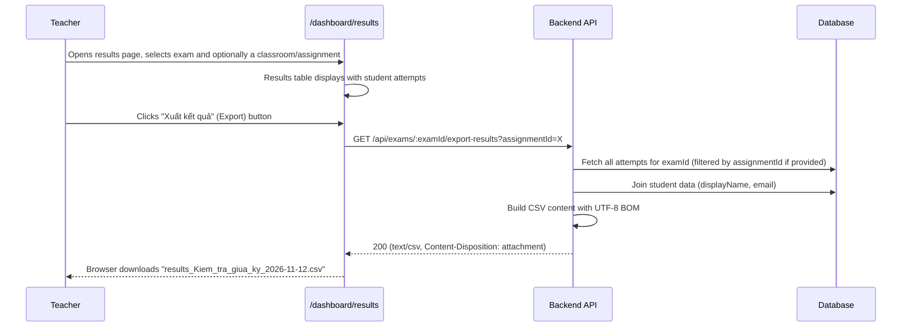

# F10. Export Assignment Results

## 5.1 Feature Overview

| Field | Value |
|---|---|
| **Feature ID** | F10 |
| **Feature Name** | Export Assignment Results |
| **Module** | F. Assignment Management |
| **Priority** | P2 |
| **Complexity** | S |
| **Status** | Not implemented — no export functionality exists. The results page (`/dashboard/results`) displays attempt data in a table but has no download button. No CSV generation logic exists in the backend. |
| **Target Roles** | TEACHER |
| **Business Objective** | Allow teachers to download a CSV file of all student results for a specific assignment. Supports offline grading review, administrative record-keeping, reporting to school leadership, and parent communication. |
| **User Problem** | Teachers currently view results only in the web interface. They cannot share grade reports with colleagues or administrators who do not have platform accounts, and they have no offline backup of student performance data. |
| **Dependencies** | G2 (Exam Results & Review), F1 (Create Assignment), D5 (Assign Exam to Classroom) |

## 5.2 Actors and Permissions

### Teacher (exam owner)

| Action | Permitted | Condition |
|---|---|---|
| Export results for own exam's assignment | Yes | Must own the exam |
| Export results for a specific assignment (filtered by classroom) | Yes | Must own the exam |
| Export all results for an exam (across all assignments) | Yes | Must own the exam |

### Teacher (non-owner)

| Action | Permitted |
|---|---|
| Export results for another teacher's exam | No — 403 |

### Student

| Action | Permitted |
|---|---|
| Export any results | No — 403 |

### Unauthenticated User

All requests return 401.

## 5.3 Preconditions and Business Rules

### Preconditions

1. Teacher is authenticated with role TEACHER.
2. The exam exists and is owned by the teacher.
3. At least zero attempts exist (an empty export is valid — returns headers only).

### Business Rules

| Rule ID | Rule | Enforcement |
|---|---|---|
| F10-BR-01 | Export format is CSV with UTF-8 BOM encoding. The BOM (``) is prepended so that Excel on Windows correctly interprets Vietnamese characters. | Backend |
| F10-BR-02 | CSV columns (in order): STT (ordinal number), Họ tên, Email, Điểm, Thời gian nộp, Trạng thái, Số lần làm bài, Nhận xét. | Backend |
| F10-BR-03 | One row per attempt. If a student has multiple attempts (when `maxAttempts > 1`), each attempt is a separate row. The student name and email repeat for each attempt. | Backend |
| F10-BR-04 | Score is formatted as a number with 2 decimal places (e.g., `8.50`). If the attempt has no score (null), the column is empty. | Backend |
| F10-BR-05 | Submission time (`Thời gian nộp`) is formatted in Vietnamese locale: `DD/MM/YYYY HH:mm` in the server's configured timezone (or UTC if unspecified). If the attempt has no `submittedAt` (IN_PROGRESS), the column is empty. | Backend |
| F10-BR-06 | Status values are Vietnamese labels: `Đang làm` (IN_PROGRESS), `Đã nộp` (SUBMITTED), `Hết hạn` (EXPIRED). | Backend |
| F10-BR-07 | `Số lần làm bài` is the ordinal attempt number for that student on this exam. Computed as the rank of this attempt among the student's attempts sorted by `startedAt ASC`. | Backend |
| F10-BR-08 | `Nhận xét` contains the attempt-level feedback from the teacher, if any. If null, the column is empty. Newlines in feedback are replaced with spaces (CSV compatibility). | Backend |
| F10-BR-09 | The response content type is `text/csv` with `Content-Disposition: attachment; filename="results_{examTitle}_{date}.csv"`. The filename uses ASCII-safe characters; Vietnamese characters in the exam title are transliterated or simplified. | Backend |
| F10-BR-10 | When the teacher filters export by assignmentId, only attempts linked to that assignment are included. Without an assignmentId filter, all attempts for the exam are included. | Backend |
| F10-BR-11 | Attempts are sorted by student displayName ASC, then by startedAt ASC within each student's attempts. | Backend |
| F10-BR-12 | IN_PROGRESS attempts that have expired (NOW() > expiresAt) are auto-submitted before export. This ensures the export reflects current state. | Backend |
| F10-BR-13 | The CSV file content is generated synchronously on the server. At ~100 concurrent users, the result set is small enough (hundreds of rows at most) that streaming or background jobs are unnecessary. | Backend |

## 5.4 Main User Flow — Happy Path



### Steps

1. Teacher navigates to `/dashboard/results`.
2. Teacher selects an exam from the dropdown.
3. Optionally selects a specific assignment (classroom filter).
4. Clicks the "Xuất kết quả" button (Download icon + text).
5. Browser downloads the CSV file.
6. Teacher opens the file in Excel, Google Sheets, or another spreadsheet application.

### Example CSV Output

```csv
STT,Họ tên,Email,Điểm,Thời gian nộp,Trạng thái,Số lần làm bài,Nhận xét
1,Nguyễn Văn A,a@example.com,8.50,12/11/2026 14:30,Đã nộp,1,Làm tốt lắm
2,Nguyễn Văn A,a@example.com,9.00,13/11/2026 10:00,Đã nộp,2,Cải thiện tốt
3,Trần Thị B,b@example.com,6.00,12/11/2026 15:00,Đã nộp,1,
4,Lê Văn C,c@example.com,,,,1,
```

Row 4: Student C has an IN_PROGRESS attempt with no score or submission time.

## 5.5 Alternative Flows

### AF-01: Export all results for an exam (no assignment filter)

1. Teacher selects an exam but does not select a specific assignment/classroom.
2. Clicks "Xuất kết quả".
3. API returns all attempts across all assignments and direct attempts for this exam.
4. CSV includes all students from all classrooms.

### AF-02: Export with no attempts (empty results)

1. Teacher assigns an exam but no students have taken it yet.
2. Clicks "Xuất kết quả".
3. API returns a CSV with headers only (no data rows).
4. File downloads with just the header row.

### AF-03: Export triggers auto-submit of expired attempts

1. Student D has an IN_PROGRESS attempt where `NOW() > expiresAt`.
2. Teacher clicks "Xuất kết quả".
3. Backend detects the expired attempt, auto-submits and grades it.
4. CSV includes Student D's attempt as SUBMITTED with a score.

### AF-04: Export with multiple attempts per student

1. Exam has `maxAttempts = 3`.
2. Student A made 2 attempts (scores: 6.00, 8.50).
3. CSV has 2 rows for Student A, one per attempt, with `Số lần làm bài` = 1 and 2.

### AF-05: Export with manualScoreOverride

1. Teacher manually overrode Student B's score from 5.00 to 8.00.
2. CSV shows 8.00. There is no indicator in the CSV for override status.
3. (See OQ-01 for whether override indicator should be included.)

## 5.6 Edge Cases and Failure Scenarios

| Scenario ID | Scenario | Trigger | Expected Behavior | User Feedback | Data Integrity | Recovery | Severity |
|---|---|---|---|---|---|---|---|
| F10-EC-01 | No attempts exist | Exam assigned but no one took it | CSV with header row only, no data rows | File downloads (1 row) | Consistent | N/A | Low |
| F10-EC-02 | IN_PROGRESS attempt in results | Student started but did not submit and timer has not expired | Row shows: no score, no submittedAt, status "Đang làm" | Included in CSV | No data integrity issue | Student may submit later | Medium |
| F10-EC-03 | Expired but not auto-submitted | IN_PROGRESS + NOW() > expiresAt | Backend auto-submits before generating CSV (F10-BR-12) | Score computed, status changes | Attempt submitted and graded | N/A | Medium |
| F10-EC-04 | Score with manual override | manualScoreOverride = true | CSV shows the override score. No special indicator. | Score column shows override value | Consistent | See OQ-01 | Low |
| F10-EC-05 | Vietnamese characters in exam title | Title: "Kiểm tra giữa kỳ Toán 12" | Filename simplified: `results_Kiem_tra_giua_ky_Toan_12_2026-11-12.csv` | File downloads with safe filename | No data loss (CSV content uses UTF-8) | N/A | Low |
| F10-EC-06 | Feedback contains commas or quotes | Teacher wrote: `"Tốt, nhưng cần cải thiện"` | Feedback cell is quoted in CSV: `"Tốt, nhưng cần cải thiện"` | Correct CSV escaping | Consistent | N/A | Medium |
| F10-EC-07 | Feedback contains newlines | Teacher wrote multi-line feedback | Newlines replaced with spaces (F10-BR-08) | Single-line cell in CSV | Slight formatting loss | Acceptable trade-off | Low |
| F10-EC-08 | Very large export | 100 students × 3 attempts × 10 exams | CSV is ~30 KB. Synchronous generation is fine. | File downloads quickly | No timeout | N/A | Low |
| F10-EC-09 | Non-owner teacher exports | Teacher B tries to export Teacher A's exam | Backend returns 403 | Toast: "Bạn không có quyền thực hiện thao tác này" | No data exposed | N/A | High |
| F10-EC-10 | Student tries to export | Student calls GET /exams/:id/export-results | Backend returns 403 | No file downloaded | No data exposed | N/A | High |
| F10-EC-11 | Exam does not exist | Invalid examId in URL | Backend returns 404 | Toast: "Không tìm thấy bài thi" | No file generated | Check exam ID | Low |
| F10-EC-12 | Assignment does not exist (filter) | Valid examId, invalid assignmentId | Backend returns 404 | Toast: "Không tìm thấy bài giao" | No file generated | Check assignment ID | Low |

## 5.7 UI/UX Specification

### Export Button

| Element | Specification |
|---|---|
| Location | `/dashboard/results` — top-right area, next to the "Công bố kết quả" button |
| Label | "Xuất kết quả" |
| Icon | Download icon (lucide-react `Download`) |
| Variant | Outline button |
| Disabled state | Disabled when no exam is selected. Tooltip: "Chọn bài thi để xuất kết quả" |
| Loading state | Button text changes to "Đang xuất..." with spinner. Disabled during download. |

### Export Trigger Behavior

| Step | Behavior |
|---|---|
| Click button | Browser navigates to the API endpoint (or fetches via JS and triggers download) |
| Download starts | Button returns to normal state |
| Error | Toast: "Không thể xuất kết quả. Vui lòng thử lại." |

### No Export Configuration Dialog

The export uses fixed columns (F10-BR-02). There is no dialog for selecting columns, date range, or format. This keeps the implementation simple.

### Responsive Behavior

- Mobile: Export button uses icon-only (Download icon) to save space. Full label on desktop.
- The CSV file itself is the same regardless of device.

## 5.8 Data Requirements

### No Schema Changes Required

The export reads existing data from `ExamAttempt`, `User`, and `Assignment` tables. No new models or fields are needed.

### Data Sources for CSV Columns

| CSV Column | Source |
|---|---|
| STT | Generated ordinal (row number in sorted output) |
| Họ tên | `User.displayName` via `ExamAttempt.studentId → User` |
| Email | `User.email` via same join |
| Điểm | `ExamAttempt.score` (Decimal, formatted to 2 places) |
| Thời gian nộp | `ExamAttempt.submittedAt` (formatted DD/MM/YYYY HH:mm) |
| Trạng thái | `ExamAttempt.status` (mapped to Vietnamese label) |
| Số lần làm bài | Computed: rank of this attempt among student's attempts for this exam, ordered by startedAt |
| Nhận xét | `ExamAttempt.feedback` (newlines → spaces) |

## 5.9 API Requirements

### GET /api/exams/:examId/export-results — Export Results as CSV

| Field | Value |
|---|---|
| **Method** | GET |
| **Endpoint** | `/api/exams/:examId/export-results` |
| **Purpose** | Download all results for an exam as a CSV file |
| **Required Role** | TEACHER |
| **Authorization** | `exam.ownerId === currentUser.id` |

**Query Parameters:**

| Param | Type | Required | Description |
|---|---|---|---|
| assignmentId | string (UUID) | No | Filter results to a specific assignment. If omitted, includes all attempts for the exam. |

**Validation Rules:**

| Rule | Error Code | Error Message |
|---|---|---|
| Exam not found | EXAM_NOT_FOUND | "Không tìm thấy bài thi" |
| Not exam owner | FORBIDDEN | "Bạn không có quyền thực hiện thao tác này" |
| Invalid assignmentId (not found or not for this exam) | ASSIGNMENT_NOT_FOUND | "Không tìm thấy bài giao" |

**Success Response (200):**

Headers:
```
Content-Type: text/csv; charset=utf-8
Content-Disposition: attachment; filename="results_Exam_Title_2026-11-12.csv"
```

Body: UTF-8 BOM + CSV content as described in F10-BR-02.

**Error Responses:**

| Status | Code | Condition |
|---|---|---|
| 403 | FORBIDDEN | Teacher does not own the exam |
| 404 | EXAM_NOT_FOUND | Exam does not exist |
| 404 | ASSIGNMENT_NOT_FOUND | assignmentId provided but not found or not linked to this exam |

### Implementation Notes

The controller method should:
1. Verify exam ownership.
2. Fetch all attempts (with optional assignmentId filter).
3. Auto-submit any expired IN_PROGRESS attempts.
4. Sort by student name, then startedAt.
5. Build CSV string with BOM prefix.
6. Set response headers and return the CSV body directly (not wrapped in the standard JSON envelope).

```typescript
// Controller method signature (sketch)
@Get(':examId/export-results')
@Roles('TEACHER')
@Header('Content-Type', 'text/csv; charset=utf-8')
async exportResults(
  @Param('examId') examId: string,
  @Query('assignmentId') assignmentId: string | undefined,
  @CurrentUser('id') userId: string,
  @Res() reply: FastifyReply,
) {
  const csv = await this.examsService.exportResults(examId, userId, assignmentId);
  reply.header('Content-Disposition', `attachment; filename="${csv.filename}"`);
  reply.send(csv.content);
}
```

**Note:** This endpoint returns raw CSV, not the standard `{success, data}` envelope. The response interceptor should be bypassed for this route.

## 5.10 State Management

Export is a read-only operation with one side effect: auto-submitting expired attempts (F10-BR-12).

```
Teacher clicks "Xuất kết quả"
  → Backend checks for expired IN_PROGRESS attempts → auto-submits them
  → Backend queries all relevant attempts
  → Backend generates CSV
  → Browser downloads file
```

No state is created or modified on the Assignment or Exam. The only mutation is the lazy auto-submit of expired attempts, which is consistent with the system's existing lazy expiry behavior (AD-06).

## 5.11 Acceptance Criteria

### Positive

```
Given a teacher owns an exam with 3 submitted attempts,
When the teacher clicks "Xuất kết quả",
Then a CSV file downloads with 3 data rows + 1 header row,
And the file opens correctly in Excel with Vietnamese characters.
```

```
Given an exam with maxAttempts=2 and a student with 2 attempts,
When the teacher exports results,
Then the CSV has 2 rows for that student, with Số lần làm bài = 1 and 2.
```

```
Given a student has an expired IN_PROGRESS attempt,
When the teacher exports results,
Then the attempt is auto-submitted before export,
And the CSV shows the student's score and status "Đã nộp".
```

```
Given a teacher filters by assignmentId for "Class A",
When the teacher exports results,
Then only attempts linked to that assignment are included,
And attempts from other classrooms are excluded.
```

```
Given an exam with no attempts,
When the teacher exports results,
Then a CSV file downloads with the header row only (no data rows).
```

```
Given an attempt has teacher feedback with commas,
When the CSV is generated,
Then the feedback cell is properly quoted and renders correctly in a spreadsheet.
```

### Negative

```
Given Teacher B does not own the exam,
When they call GET /exams/:examId/export-results,
Then the backend returns 403 FORBIDDEN.
```

```
Given a student is authenticated,
When the student calls the export endpoint,
Then the backend returns 403 (TEACHER role required).
```

```
Given an invalid examId,
When the teacher calls the export endpoint,
Then the backend returns 404 EXAM_NOT_FOUND.
```

## 5.12 QA Test Scenarios

| Test Case ID | Scenario | Preconditions | Steps | Test Data | Expected Result | Priority |
|---|---|---|---|---|---|---|
| F10-TC-01 | Export basic results | 3 students submitted | GET /exams/:id/export-results | — | CSV with 3 rows, correct headers | Critical |
| F10-TC-02 | UTF-8 BOM present | Any export | Download file, inspect first bytes | — | File starts with `` | High |
| F10-TC-03 | Vietnamese chars in cells | Student name "Nguyễn Văn A" | Export | — | Name renders correctly in Excel | High |
| F10-TC-04 | Score formatting | Score = 8.5 | Export | — | Cell shows "8.50" | High |
| F10-TC-05 | Date formatting | submittedAt = 2026-11-12T14:30:00Z | Export | — | Cell shows "12/11/2026 14:30" | High |
| F10-TC-06 | Status labels | IN_PROGRESS, SUBMITTED, EXPIRED attempts | Export | — | "Đang làm", "Đã nộp", "Hết hạn" | High |
| F10-TC-07 | Multiple attempts per student | maxAttempts=3, student has 2 | Export | — | 2 rows for student, Số lần = 1, 2 | High |
| F10-TC-08 | Filter by assignmentId | Exam in 2 classrooms | Export with assignmentId for class A | — | Only class A's attempts in CSV | High |
| F10-TC-09 | No filter (all assignments) | Exam in 2 classrooms | Export without assignmentId | — | All attempts from both classrooms | High |
| F10-TC-10 | No attempts (empty export) | Exam assigned, 0 attempts | Export | — | CSV with header only | Medium |
| F10-TC-11 | Expired attempt auto-submitted | IN_PROGRESS, expiresAt in past | Export | — | Attempt auto-submitted, score in CSV | High |
| F10-TC-12 | IN_PROGRESS (not expired) | Student still working | Export | — | Row with empty score, empty time, "Đang làm" | Medium |
| F10-TC-13 | Feedback with commas | Feedback: "Tốt, rất tốt" | Export | — | Cell properly quoted: `"Tốt, rất tốt"` | Medium |
| F10-TC-14 | Feedback with newlines | Multi-line feedback | Export | — | Newlines replaced with spaces | Medium |
| F10-TC-15 | Feedback null | No feedback on attempt | Export | — | Empty cell | Low |
| F10-TC-16 | Manual score override | manualScoreOverride=true, score=9.00 | Export | — | Score shows 9.00 | Medium |
| F10-TC-17 | Non-owner teacher | Teacher B calls export on Teacher A's exam | Export | — | 403 FORBIDDEN | Critical |
| F10-TC-18 | Student calls export | Student authenticated | Export | — | 403 | Critical |
| F10-TC-19 | Invalid examId | Bad UUID | Export | — | 404 EXAM_NOT_FOUND | Medium |
| F10-TC-20 | Invalid assignmentId | Valid exam, bad assignment UUID | Export | — | 404 ASSIGNMENT_NOT_FOUND | Medium |
| F10-TC-21 | Sort order | 3 students: Trần, Lê, Nguyễn | Export | — | Rows sorted: Lê, Nguyễn, Trần | Medium |
| F10-TC-22 | Content-Disposition header | Any export | Check response headers | — | `attachment; filename="results_..."` | Medium |

## 5.13 Open Questions and Assumptions

### Open Questions

| # | Question | Why It Matters | Options | Recommended Default | Impact | Blocks Implementation? |
|---|---|---|---|---|---|---|
| OQ-01 | Should the CSV include a "Sửa điểm" (manual override) column? | Teachers may want to distinguish auto-graded from manually-overridden scores for administrative records. | (a) No override column (proposed — keep CSV simple). (b) Add a "Chấm tay" column with "Có"/"Không" values. | (a) — omit. The CSV is a snapshot of scores. Whether the score was auto- or manually-graded is an internal detail. | Low | No |
| OQ-02 | Should per-question scores be exportable? | With F8 (Manual Grading Workflow), each question has `earnedPoints`. A more detailed export could include per-question columns. | (a) Attempt-level only (proposed). (b) Add one column per question: "Câu 1", "Câu 2", etc. | (a) — attempt-level for MVP. Per-question export is a separate P3 feature. Variable column count adds complexity. | Medium | No |
| OQ-03 | Should the export include students who did NOT attempt the exam? | Teachers may want to see which students are missing from the results. This requires joining with classroom membership data. | (a) Only attempted students (proposed). (b) Include all classroom members, with empty rows for non-attempters. | (a) — export only attempted students. The teacher can cross-reference with the classroom member list separately. Option (b) requires the assignmentId filter, which limits the "all exams" export. | Low | No |
| OQ-04 | What timezone should be used for the submission time? | The server may run in UTC, but teachers expect local time. | (a) UTC (proposed — simple, unambiguous). (b) Server timezone from config. (c) Teacher's timezone from profile (not currently stored). | (a) — UTC for MVP. Add a timezone note in the column header ("Thời gian nộp (UTC)") or document it. Can add timezone preference later. | Low | No |
| OQ-05 | Should Excel format (.xlsx) be supported in addition to CSV? | .xlsx handles Vietnamese characters without BOM concerns, supports formatting, and is what most teachers expect. However, it requires a library (e.g., `exceljs`). | (a) CSV only (proposed). (b) CSV + XLSX. (c) XLSX only. | (a) — CSV only for MVP. UTF-8 BOM handles the character encoding concern. XLSX support can be added as a P3 enhancement with `exceljs`. | Low | No |

### Assumptions

| # | Assumption | Basis |
|---|---|---|
| AS-01 | CSV generation is synchronous and returns the file directly in the HTTP response. At ~100 concurrent users, the data set is small enough (hundreds of rows) that no background job or streaming is needed. | PD-01: 100 concurrent users. |
| AS-02 | The export endpoint bypasses the standard `{success, data}` response envelope. It returns raw CSV with appropriate headers. | Standard REST practice for file downloads. The response interceptor must be configured to skip this route. |
| AS-03 | The filename is ASCII-safe. Vietnamese characters in the exam title are stripped or transliterated (e.g., "Kiểm tra" → "Kiem_tra"). The CSV content itself uses UTF-8 with BOM for full Vietnamese support. | `Content-Disposition` filename has limited character set support across browsers. |
| AS-04 | The STT (ordinal number) column starts at 1 and increments per row in the sorted output. It is a display convenience, not a database field. | Common convention in Vietnamese administrative documents. |
| AS-05 | No rate limiting specific to the export endpoint is needed at ~100 users. The standard request-level rate limiting (when implemented) is sufficient. | Small user base, lightweight operation. |
