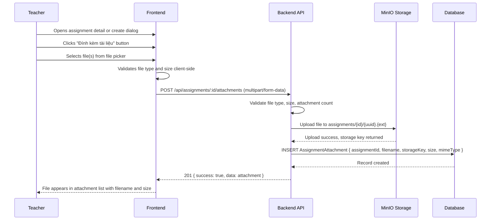
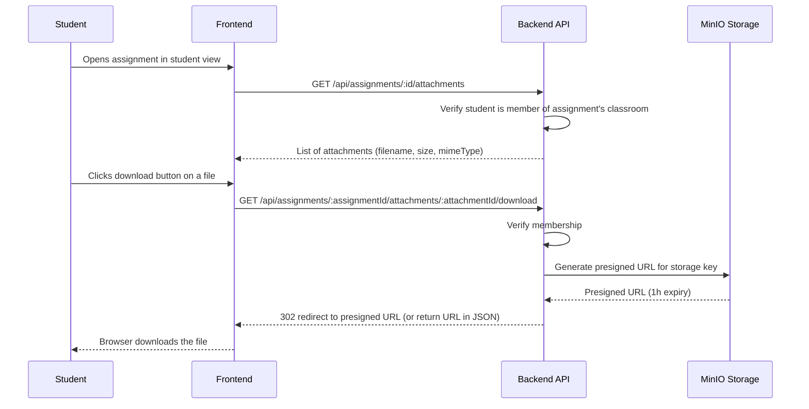
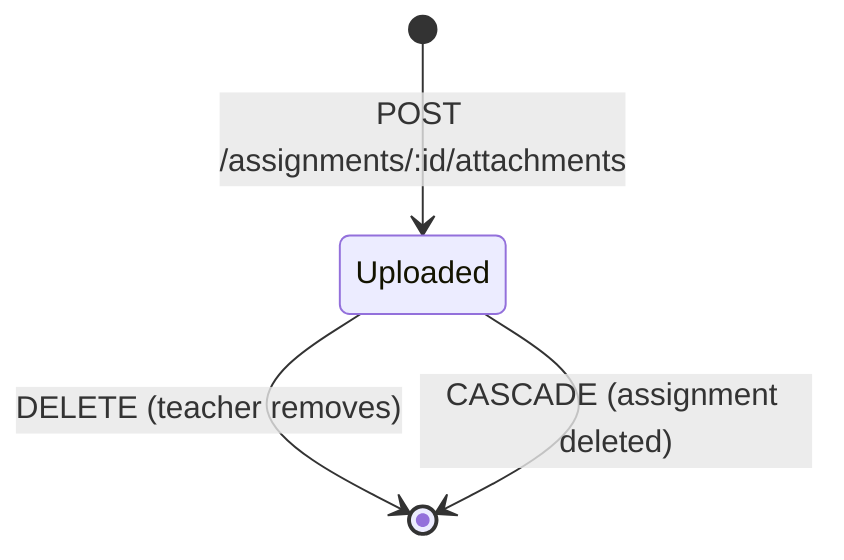

# F6. File Attachments on Assignments

## 5.1 Feature Overview

| Field | Value |
|---|---|
| **Feature ID** | F6 |
| **Feature Name** | File Attachments on Assignments |
| **Module** | F. Assignment Management |
| **Priority** | P2 |
| **Complexity** | L |
| **Status** | Not implemented — no file upload infrastructure exists. PD-06 CONFIRMED that MinIO will be used for file storage, but the upload service has not been built yet. |
| **Target Roles** | TEACHER (uploads), STUDENT (downloads) |
| **Business Objective** | Allow teachers to attach reference materials (PDFs, images, documents) to assignments so students can access supplementary content before or during the exam. Common in educational contexts where questions reference external diagrams, readings, or data tables. |
| **User Problem** | Teachers need to distribute reference materials alongside exams. Without file attachments, teachers must share files through external channels (email, messaging apps), which breaks the workflow and is error-prone. |
| **Dependencies** | F1 (Create Assignment), PD-06 (File Upload — MinIO infrastructure), C-GAP-01 (image upload for questions) |

## 5.2 Actors and Permissions

### Teacher (assignment owner via exam ownership)

| Action | Permitted | Condition |
|---|---|---|
| Attach files when creating an assignment | Yes | Must own the exam and classroom |
| Attach files to an existing ACTIVE assignment | Yes | Must own the exam |
| Remove an attachment from own assignment | Yes | Must own the exam |
| Replace an attachment | Yes | Remove + re-upload |
| View/download own attachments | Yes | Always |

### Teacher (non-owner)

| Action | Permitted |
|---|---|
| Attach files to another teacher's assignment | No — 403 |
| View another teacher's assignment attachments | No — 403 |

### Student (classroom member)

| Action | Permitted | Condition |
|---|---|---|
| Download attachments for assignments in joined classrooms | Yes | Must be a member of the assignment's classroom |
| Upload/modify attachments | No — 403 |

### Unauthenticated User

All requests return 401.

## 5.3 Preconditions and Business Rules

### Preconditions

1. MinIO (or S3-compatible) storage service is deployed and accessible from the API.
2. An UploadsModule/service exists that handles file upload, storage, and URL generation.
3. The assignment exists.

### Business Rules

| Rule ID | Rule | Enforcement |
|---|---|---|
| F6-BR-01 | Allowed file types: PDF (`.pdf`), images (`.png`, `.jpg`, `.jpeg`, `.gif`), documents (`.doc`, `.docx`), spreadsheets (`.xls`, `.xlsx`). | Backend — validate MIME type and extension before upload. |
| F6-BR-02 | Maximum file size: 10 MB per file. | Backend — reject files exceeding the limit before writing to storage. |
| F6-BR-03 | Maximum 5 attachments per assignment. | Backend — count existing attachments before accepting new ones. |
| F6-BR-04 | Total attachment storage per assignment: 50 MB. | Backend — sum existing attachment sizes before accepting new ones. |
| F6-BR-05 | Files are stored in MinIO under the path `assignments/{assignmentId}/{uuid}.{ext}`. | Backend — UploadsService generates the storage path. |
| F6-BR-06 | Attachment URLs are signed with a time-limited presigned URL (1 hour expiry) for download. | Backend — generate presigned URL on each download request. |
| F6-BR-07 | Deleting an assignment cascades to delete its attachment records. The physical files in MinIO should be cleaned up (via cascade or a cleanup job). | Backend — database CASCADE on FK. MinIO cleanup: see Open Questions. |
| F6-BR-08 | Students can download attachments regardless of assignment status (ACTIVE or CLOSED). | Backend — no status check on download, only membership check. |
| F6-BR-09 | Attachment metadata (filename, size, MIME type) is stored in the database. The original filename is preserved for display. | Backend — stored in `AssignmentAttachment` model. |
| F6-BR-10 | File content is not scanned for viruses or malware in MVP. | N/A — see Open Questions for future improvement. |

## 5.4 Main User Flow — Happy Path

### Teacher Attaches Files to Assignment



### Student Downloads Attachment



## 5.5 Alternative Flows

### AF-01: Teacher attaches files during assignment creation

1. Teacher opens the create assignment dialog.
2. Before submitting, teacher clicks "Đính kèm tài liệu" and selects files.
3. Frontend holds files in memory.
4. On form submit: first creates the assignment (POST /assignments), then uploads each file (POST /assignments/:id/attachments).
5. If assignment creation fails, no files are uploaded.

### AF-02: Teacher removes an attachment

1. Teacher opens assignment detail.
2. Clicks the delete icon (X) next to a file.
3. Confirmation dialog: "Xoá tệp đính kèm '{filename}'?"
4. On confirm: DELETE /api/assignments/:assignmentId/attachments/:attachmentId.
5. Backend deletes the DB record and the file from MinIO.

### AF-03: File type rejected

1. Teacher selects a `.zip` or `.exe` file.
2. Frontend shows validation error: "Loại tệp không được hỗ trợ. Chỉ chấp nhận: PDF, ảnh, Word, Excel."
3. File is not uploaded.

### AF-04: File size exceeded

1. Teacher selects a 15 MB PDF.
2. Frontend shows validation error: "Kích thước tệp tối đa 10 MB."
3. File is not uploaded.

### AF-05: Attachment limit reached

1. Assignment already has 5 attachments.
2. Teacher tries to upload a 6th file.
3. Backend returns 400: "Tối đa 5 tệp đính kèm mỗi bài giao."
4. Teacher must remove an existing attachment first.

## 5.6 Edge Cases and Failure Scenarios

| Scenario ID | Scenario | Trigger | Expected Behavior | User Feedback | Data Integrity | Recovery | Severity |
|---|---|---|---|---|---|---|---|
| F6-EC-01 | MinIO unavailable | Storage service is down during upload | Backend returns 503 | Toast: "Không thể tải lên. Vui lòng thử lại sau." | No DB record created (upload is attempted before DB insert) | Retry when storage recovers | High |
| F6-EC-02 | Upload succeeds but DB insert fails | Storage write OK, then DB error | Orphaned file in MinIO | Toast: "Lỗi lưu thông tin. Vui lòng thử lại." | Orphaned file — needs cleanup | Retry; cleanup job removes orphans eventually | Medium |
| F6-EC-03 | Concurrent uploads exceed limit | Two teachers (or same teacher, two tabs) upload simultaneously to same assignment, both pass count check | Could exceed 5-file limit by 1 | No immediate error | Slightly over limit — acceptable | Backend re-checks count after upload in a transaction | Low |
| F6-EC-04 | File with malicious name | Filename contains `../` or control characters | Backend sanitizes filename: strip path separators, limit to alphanumeric + safe chars | Filename displayed as sanitized version | No path traversal possible | Automatic | High |
| F6-EC-05 | Student downloads from wrong classroom | Student not a member of the assignment's classroom | Backend returns 403 | "Bạn không có quyền truy cập tài liệu này" | No file served | N/A | High |
| F6-EC-06 | Presigned URL expired | Student clicks download link after 1 hour | URL returns 403/expired from MinIO | "Liên kết đã hết hạn. Vui lòng tải lại trang." | No data loss | Student refreshes and gets new presigned URL | Low |
| F6-EC-07 | Delete attachment when file missing in storage | DB record exists but MinIO file was deleted externally | Backend deletes DB record, logs warning about missing file | No error to user | DB record cleaned up | Graceful degradation | Low |
| F6-EC-08 | Assignment closed, student downloads | Assignment status CLOSED, student downloads attachment | Download allowed (F6-BR-08) | File downloads normally | N/A | N/A | Low |
| F6-EC-09 | MIME type mismatch | File extension is `.pdf` but content is actually an image | Backend validates MIME type from file content (magic bytes), not just extension | Reject if mismatch, or accept based on content type | Prevents type spoofing | Teacher re-uploads correct file | Medium |

## 5.7 UI/UX Specification

### Teacher: Attachment Section in Assignment Detail

| Element | Specification |
|---|---|
| Location | Assignment detail page, below assignment info |
| Section header | "Tài liệu đính kèm" with file count badge |
| Upload button | "Đính kèm tài liệu" (outline variant, with Paperclip icon) |
| File picker | Native file picker, filtered to allowed types |
| Upload progress | Progress bar or spinner per file during upload |
| Attachment list | Table or list: filename (clickable to download), size (formatted: "2.3 MB"), type icon, delete button (X) |
| Empty state | "Chưa có tài liệu đính kèm" |

### Teacher: Create Assignment Dialog (Enhanced)

| Element | Specification |
|---|---|
| New section | "Tài liệu đính kèm (tùy chọn)" below the due date field |
| Upload area | Drag-and-drop zone or button: "Chọn tệp đính kèm" |
| Queued files | Show list of selected files with size and remove button before form submit |
| Note | Files are uploaded after assignment is created |

### Student: Attachment Display

| Element | Specification |
|---|---|
| Location | Student assignment view, before "Bắt đầu làm bài" button |
| Section header | "Tài liệu tham khảo" |
| Attachment list | Filename (clickable/download button), size, type icon |
| Download action | Button: "Tải xuống" (outline, with Download icon) |
| Empty state | Section hidden if no attachments |

### Responsive Behavior

- Mobile: Attachment list is a vertical card list. Download button is full-width per card.
- Desktop: Horizontal table layout with inline download buttons.

## 5.8 Data Requirements

### Proposed Schema Changes

**New model: AssignmentAttachment**
```prisma
model AssignmentAttachment {
  id           String   @id @default(uuid()) @db.Uuid
  assignmentId String   @map("assignment_id") @db.Uuid
  filename     String   // original filename for display
  storageKey   String   @map("storage_key") // path in MinIO
  size         Int      // file size in bytes
  mimeType     String   @map("mime_type")
  uploadedAt   DateTime @default(now()) @map("uploaded_at")

  assignment Assignment @relation(fields: [assignmentId], references: [id], onDelete: Cascade)

  @@index([assignmentId])
  @@map("assignment_attachments")
}
```

**Assignment model update:**
```prisma
model Assignment {
  // ... existing fields ...
  attachments AssignmentAttachment[]
}
```

### Indexes

- `assignmentId` — for listing attachments by assignment.

### Storage

- MinIO bucket: `lumi-attachments` (or a shared bucket with prefix-based separation).
- Object path: `assignments/{assignmentId}/{uuid}.{ext}`.
- Lifecycle: no auto-expiry. Cleanup via FK CASCADE on assignment delete + orphan cleanup job.

## 5.9 API Requirements

### POST /api/assignments/:id/attachments — Upload Attachment

| Field | Value |
|---|---|
| **Method** | POST |
| **Endpoint** | `/api/assignments/:id/attachments` |
| **Purpose** | Upload a file attachment to an assignment |
| **Content-Type** | `multipart/form-data` |
| **Required Role** | TEACHER |
| **Authorization** | Teacher must own the exam for this assignment |

**Request:**
- `file`: multipart file field (single file per request)

**Validation Rules:**
| Rule | Limit | Error Code | Error Message |
|---|---|---|---|
| File type | pdf, png, jpg, jpeg, gif, doc, docx, xls, xlsx | INVALID_FILE_TYPE | "Loại tệp không được hỗ trợ" |
| File size | Max 10 MB | FILE_TOO_LARGE | "Kích thước tệp tối đa 10 MB" |
| Attachment count | Max 5 per assignment | ATTACHMENT_LIMIT_REACHED | "Tối đa 5 tệp đính kèm mỗi bài giao" |
| Total size | Max 50 MB per assignment | STORAGE_LIMIT_REACHED | "Dung lượng đính kèm tối đa 50 MB" |

**Success Response (201):**
```json
{
  "success": true,
  "data": {
    "id": "uuid",
    "filename": "tai-lieu-tham-khao.pdf",
    "size": 2456789,
    "mimeType": "application/pdf",
    "uploadedAt": "2026-11-11T10:00:00Z"
  }
}
```

**Error Responses:**

| Status | Code | Condition |
|---|---|---|
| 400 | INVALID_FILE_TYPE | File type not in allowed list |
| 400 | FILE_TOO_LARGE | File exceeds 10 MB |
| 400 | ATTACHMENT_LIMIT_REACHED | Assignment already has 5 files |
| 400 | STORAGE_LIMIT_REACHED | Total attachment size would exceed 50 MB |
| 403 | FORBIDDEN | Teacher does not own the exam |
| 404 | ASSIGNMENT_NOT_FOUND | Assignment does not exist |
| 503 | STORAGE_UNAVAILABLE | MinIO is unreachable |

### GET /api/assignments/:id/attachments — List Attachments

| Field | Value |
|---|---|
| **Method** | GET |
| **Endpoint** | `/api/assignments/:id/attachments` |
| **Purpose** | List all attachments for an assignment |
| **Required Role** | TEACHER (owns exam) or STUDENT (classroom member) |
| **Authorization** | Teacher: owns the exam. Student: member of the assignment's classroom. |

**Success Response (200):**
```json
{
  "success": true,
  "data": [
    {
      "id": "uuid",
      "filename": "tai-lieu-tham-khao.pdf",
      "size": 2456789,
      "mimeType": "application/pdf",
      "uploadedAt": "2026-11-11T10:00:00Z"
    }
  ]
}
```

### GET /api/assignments/:assignmentId/attachments/:attachmentId/download — Download Attachment

| Field | Value |
|---|---|
| **Method** | GET |
| **Endpoint** | `/api/assignments/:assignmentId/attachments/:attachmentId/download` |
| **Purpose** | Get a download URL for an attachment |
| **Required Role** | TEACHER (owns exam) or STUDENT (classroom member) |

**Success Response (200):**
```json
{
  "success": true,
  "data": {
    "url": "https://minio.example.com/lumi-attachments/assignments/uuid/file.pdf?X-Amz-..."
  }
}
```

Alternative: respond with 302 redirect to the presigned URL.

### DELETE /api/assignments/:assignmentId/attachments/:attachmentId — Delete Attachment

| Field | Value |
|---|---|
| **Method** | DELETE |
| **Endpoint** | `/api/assignments/:assignmentId/attachments/:attachmentId` |
| **Purpose** | Remove an attachment from an assignment |
| **Required Role** | TEACHER |
| **Authorization** | Teacher must own the exam |

**Success Response (200):**
```json
{
  "success": true,
  "data": { "id": "uuid", "deleted": true }
}
```

**Error Responses:**

| Status | Code | Condition |
|---|---|---|
| 403 | FORBIDDEN | Teacher does not own the exam |
| 404 | ATTACHMENT_NOT_FOUND | Attachment does not exist |

## 5.10 State Management

Attachments have no state machine. They are created (uploaded) and deleted. No status transitions.



## 5.11 Acceptance Criteria

### Positive

```
Given a teacher owns an ACTIVE assignment,
When the teacher uploads a 5 MB PDF via POST /assignments/:id/attachments,
Then the file is stored in MinIO and the attachment record is created,
And the attachment appears in the assignment's attachment list.
```

```
Given an assignment has 2 attachments,
When a student who is a member of the assignment's classroom requests the attachment list,
Then the student receives both attachments with their filenames and sizes.
```

```
Given an assignment has an attachment,
When a student requests the download URL,
Then the student receives a presigned URL that allows downloading the file.
```

```
Given an assignment has an attachment,
When the teacher deletes the attachment,
Then the DB record is removed and the file is deleted from MinIO.
```

### Negative

```
Given a teacher tries to upload a .zip file,
When the upload request is sent,
Then the backend rejects with 400 INVALID_FILE_TYPE.
```

```
Given a teacher tries to upload a 15 MB file,
When the upload request is sent,
Then the backend rejects with 400 FILE_TOO_LARGE.
```

```
Given an assignment already has 5 attachments,
When the teacher tries to upload a 6th,
Then the backend rejects with 400 ATTACHMENT_LIMIT_REACHED.
```

```
Given a student is not a member of the assignment's classroom,
When the student tries to list or download attachments,
Then the backend returns 403.
```

## 5.12 QA Test Scenarios

| Test Case ID | Scenario | Preconditions | Steps | Test Data | Expected Result | Priority |
|---|---|---|---|---|---|---|
| F6-TC-01 | Upload PDF — happy path | Teacher owns assignment, <5 existing | POST multipart with 2 MB PDF | file: test.pdf (2 MB) | 201, attachment created | Critical |
| F6-TC-02 | Upload image (PNG) | Same as TC-01 | POST multipart with PNG | file: diagram.png (500 KB) | 201, attachment created | High |
| F6-TC-03 | Upload DOCX | Same as TC-01 | POST multipart with DOCX | file: notes.docx (1 MB) | 201, attachment created | High |
| F6-TC-04 | Upload blocked type (.zip) | Same as TC-01 | POST multipart with ZIP | file: archive.zip | 400 INVALID_FILE_TYPE | Critical |
| F6-TC-05 | Upload blocked type (.exe) | Same as TC-01 | POST multipart with EXE | file: program.exe | 400 INVALID_FILE_TYPE | Critical |
| F6-TC-06 | File too large (>10 MB) | Same as TC-01 | POST multipart with 15 MB file | file: large.pdf (15 MB) | 400 FILE_TOO_LARGE | Critical |
| F6-TC-07 | Attachment limit reached | 5 existing attachments | POST 6th file | file: extra.pdf | 400 ATTACHMENT_LIMIT_REACHED | High |
| F6-TC-08 | List attachments (teacher) | Assignment has 3 attachments | GET /assignments/:id/attachments (teacher token) | — | 200, 3 items | High |
| F6-TC-09 | List attachments (student member) | Student is classroom member | GET /assignments/:id/attachments (student token) | — | 200, attachment list | High |
| F6-TC-10 | List attachments (non-member student) | Student not in classroom | GET /assignments/:id/attachments | — | 403 | Critical |
| F6-TC-11 | Download attachment (student) | Student is classroom member | GET download URL, fetch it | — | File downloads | High |
| F6-TC-12 | Delete attachment (teacher) | Attachment exists | DELETE /assignments/:aId/attachments/:id | — | 200, file removed from MinIO and DB | High |
| F6-TC-13 | Delete attachment (non-owner) | Teacher B's assignment | Teacher A tries DELETE | — | 403 | Critical |
| F6-TC-14 | Student cannot upload | Student authenticated | POST /assignments/:id/attachments | file: test.pdf | 403 | Critical |
| F6-TC-15 | Upload to non-existent assignment | Invalid assignment ID | POST multipart | file: test.pdf | 404 | Medium |
| F6-TC-16 | Download with expired presigned URL | URL generated >1 hour ago | Fetch expired URL | — | 403 from MinIO | Medium |
| F6-TC-17 | Malicious filename | Filename: `../../etc/passwd` | POST multipart | Malicious name | Filename sanitized, stored safely | High |

## 5.13 Open Questions and Assumptions

### Open Questions

| # | Question | Why It Matters | Options | Recommended Default | Impact |
|---|---|---|---|---|---|
| OQ-01 | Should MinIO file cleanup happen synchronously on attachment delete, or via a background job? | Synchronous delete is simpler but if MinIO is slow, the API response is slow. A background job is more resilient. | (a) Synchronous delete in the same request. (b) Mark deleted in DB, cleanup job removes from MinIO later. | (a) — synchronous for MVP. At ~100 users, MinIO delete latency is negligible. | Low |
| OQ-02 | Should the UploadsModule be shared with question image uploads (C-GAP-01)? | Both features need MinIO connectivity. Sharing the module avoids duplication. | (a) Shared UploadsModule with configurable paths. (b) Separate modules. | (a) — shared module. Different storage paths but same connection and upload logic. | Medium — affects architecture |
| OQ-03 | Should attachments be scannable for viruses? | Uploaded files could contain malware. At ~100 users (trusted teachers), risk is low. | (a) No scanning (MVP). (b) ClamAV integration. | (a) — no scanning for MVP. Revisit if user base grows. | Low for MVP |
| OQ-04 | Should attachments be downloadable during the exam (while the student is in the attempt UI)? | Students may need to reference materials while answering. | (a) Yes — show attachments in the exam-taking UI. (b) No — only before starting the exam. | (a) — show attachments in the exam-taking UI. This is the primary use case. | Medium — affects exam UI |
| OQ-05 | Should the presigned URL approach be used, or should downloads proxy through the API? | Presigned URLs offload bandwidth from the API but expose MinIO URLs. Proxying hides storage details but increases API load. | (a) Presigned URL (redirect). (b) API proxy (stream through API). | (a) — presigned URL. At ~100 users, bandwidth is not a concern, and presigned URLs are simpler. | Low |
| OQ-06 | Can a teacher attach files to a CLOSED assignment? | Teacher might want to share post-exam materials. | (a) Allow. (b) Block — assignment is closed. | (b) — block. Closed assignments should not change. Teacher can share materials through other means. | Low |

### Assumptions

| # | Assumption | Basis |
|---|---|---|
| AS-01 | MinIO will be deployed as part of the Docker Compose stack, per PD-06. | CONFIRMED decision. |
| AS-02 | The MinIO bucket and access credentials will be configured via environment variables. | Standard MinIO deployment pattern. |
| AS-03 | File deduplication is not required. The same file uploaded to two assignments is stored twice. | Simplicity for MVP. |
| AS-04 | Attachment filenames may contain Vietnamese characters (UTF-8). | Vietnamese UI requirement. |
| AS-05 | The 10 MB per-file and 50 MB per-assignment limits are provisional. They can be adjusted based on teacher feedback. | No specific PO guidance; these are reasonable defaults for educational PDFs and images. |
