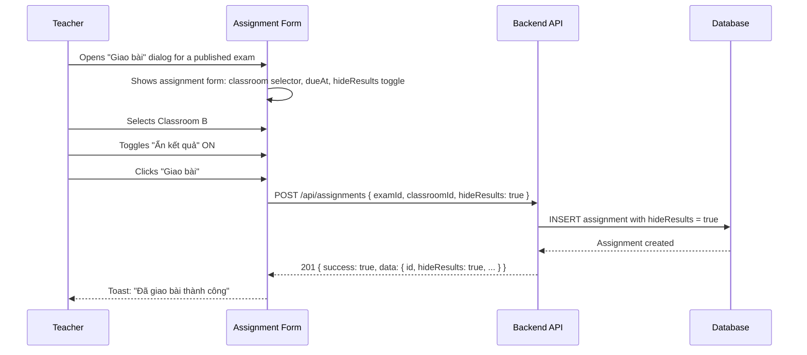
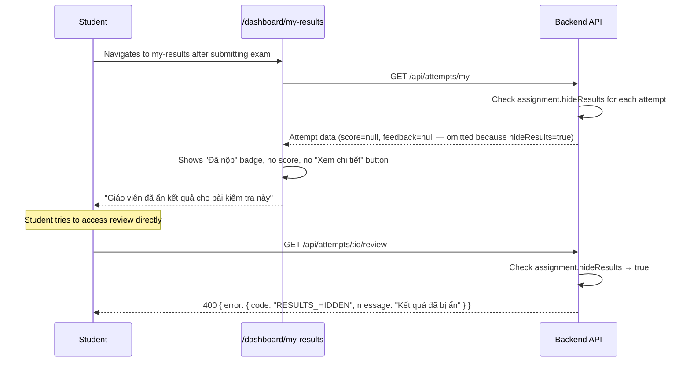
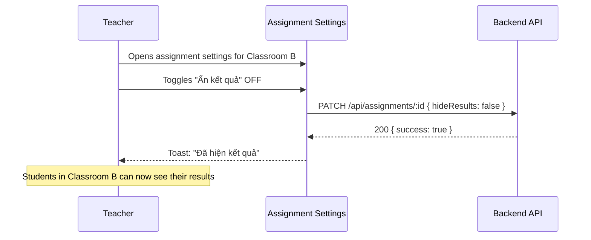

# F9. Hide Score / Hide Results per Assignment

## 5.1 Feature Overview

| Field | Value |
|---|---|
| **Feature ID** | F9 |
| **Feature Name** | Hide Score / Hide Results per Assignment |
| **Module** | F. Assignment Management |
| **Priority** | P2 |
| **Complexity** | S |
| **Status** | Partial — the `hideResults` Boolean field exists on the `Assignment` model (`@default(false)`), but it is not enforced by any backend logic and there is no UI to toggle it. The `CreateAssignmentDto` does not include `hideResults`. The student-facing review endpoint (`GET /attempts/:id/review`) and the results list (`GET /attempts/my`) do not check `assignment.hideResults`. |
| **Target Roles** | TEACHER (controls toggle), STUDENT (subject to visibility) |
| **Business Objective** | Allow teachers to hide exam results on a per-assignment basis, overriding the exam-level `showResultImmediately` flag. When the same exam is assigned to multiple classrooms, the teacher may want to show results immediately in one classroom but hide them in another (e.g., one classroom took the exam earlier). |
| **User Problem** | The existing visibility control (G5) is per-exam: `showResultImmediately` and `resultsReleased` apply to ALL students who took the exam, regardless of which assignment they came through. If a teacher assigns the same exam to Class A (Monday) and Class B (Wednesday), releasing results after Monday lets Class B see the answers before their exam. The `hideResults` flag solves this by adding an assignment-level override. |
| **Dependencies** | G5 (Result Visibility & Release Control), F1 (Create / Close Assignment), D5 (Assign Exam to Classroom) |

## 5.2 Actors and Permissions

### Teacher (exam and classroom owner)

| Action | Permitted | Condition |
|---|---|---|
| Set `hideResults` when creating an assignment | Yes | Must own the exam and the classroom |
| Toggle `hideResults` on an existing ACTIVE assignment | Yes | Must own the exam |
| Toggle `hideResults` on a CLOSED assignment | Yes | Must own the exam (hiding results is independent of assignment status) |
| View results for own exam regardless of `hideResults` | Yes | Teacher access is never restricted by visibility flags |

### Teacher (non-owner)

| Action | Permitted |
|---|---|
| Toggle hideResults on another teacher's assignment | No — 403 |

### Student

| Action | Permitted | Condition |
|---|---|---|
| View own score when hideResults = false | Yes | Subject to exam-level visibility rules (G5) |
| View own score when hideResults = true | No | Even if exam-level `showResultImmediately = true` or `resultsReleased = true` |
| View answer review when hideResults = true | No | Backend returns 400 |
| View teacher feedback when hideResults = true | No | Hidden along with score |
| Toggle hideResults | No — 403 |

### Unauthenticated User

All requests return 401.

## 5.3 Preconditions and Business Rules

### Preconditions

1. An assignment exists linking an exam to a classroom.
2. Teacher owns the exam associated with the assignment.

### Business Rules

| Rule ID | Rule | Enforcement |
|---|---|---|
| F9-BR-01 | `Assignment.hideResults` is a Boolean field, default `false`. When `true`, students who took the exam through THIS assignment cannot see their score, answer review, or teacher feedback. | Backend |
| F9-BR-02 | `hideResults` overrides exam-level visibility. The effective visibility for a student is: `canSeeResults = (exam.showResultImmediately OR exam.resultsReleased) AND NOT assignment.hideResults`. | Backend + Frontend |
| F9-BR-03 | The override is one-directional: `hideResults = true` can hide results that would otherwise be visible via exam flags, but `hideResults = false` cannot make results visible when both exam-level flags are `false`. | Backend |
| F9-BR-04 | `hideResults` applies per-assignment. If the same exam is assigned to two classrooms, each assignment has its own `hideResults` value. Changing one does not affect the other. | Backend — the field is on Assignment, not Exam |
| F9-BR-05 | When `hideResults = true`, the backend MUST omit the score, feedback, and per-question earned points from the student-facing API response for attempts linked to this assignment. Frontend alone is not sufficient to enforce this. | Backend |
| F9-BR-06 | Teacher can toggle `hideResults` at any time — during creation, while the assignment is ACTIVE, or after it is CLOSED. There is no restriction on when the toggle can change. | Backend |
| F9-BR-07 | Toggling `hideResults` from `true` to `false` makes results visible on the student's next API request. There is no delayed visibility or notification. | Backend + Frontend |
| F9-BR-08 | Toggling `hideResults` does not affect grading. Scores are always computed and stored regardless of visibility. | Backend |
| F9-BR-09 | For attempts that are NOT linked to an assignment (direct exam attempts without `assignmentId`), the `hideResults` flag does not apply. Visibility follows exam-level flags only. | Backend |

## 5.4 Main User Flow — Happy Path

### Teacher Creates Assignment with hideResults



### Student Cannot See Results (hideResults = true)



### Teacher Unhides Results



## 5.5 Alternative Flows

### AF-01: Same exam, different hideResults per classroom

1. Teacher assigns "Midterm Math" to Class A with `hideResults = false` (Monday).
2. Teacher assigns "Midterm Math" to Class B with `hideResults = true` (to be taken Wednesday).
3. Monday: Class A takes the exam. Results are visible immediately (assuming `showResultImmediately = true`).
4. Wednesday: Class B takes the exam. Results are hidden.
5. After Class B finishes, teacher toggles `hideResults = false` on Class B's assignment.
6. Both classes can now see results.

### AF-02: hideResults combined with exam-level deferred mode

1. Exam has `showResultImmediately = false`, `resultsReleased = false`.
2. Assignment has `hideResults = false`.
3. Student submits. Results are hidden because exam-level flags block visibility.
4. Teacher releases results at exam level (`resultsReleased = true`).
5. Student can now see results (assignment doesn't block them).

### AF-03: hideResults combined with exam-level released results

1. Exam has `showResultImmediately = true` (or `resultsReleased = true`).
2. Assignment has `hideResults = true`.
3. Student submits. Exam-level says "show results", but assignment overrides to "hide".
4. Student cannot see results.
5. Teacher sets `hideResults = false` on the assignment.
6. Student can now see results.

### AF-04: Teacher toggles hideResults after assignment is CLOSED

1. Assignment is CLOSED. Students can no longer start new attempts.
2. Teacher realizes results were hidden and wants to show them.
3. Teacher toggles `hideResults = false`.
4. Students who submitted before the close can now see their results.

## 5.6 Edge Cases and Failure Scenarios

| Scenario ID | Scenario | Trigger | Expected Behavior | User Feedback | Data Integrity | Recovery | Severity |
|---|---|---|---|---|---|---|---|
| F9-EC-01 | Attempt without assignment | Student started exam directly (no assignmentId) | `hideResults` does not apply — visibility follows exam-level flags only | Normal result visibility | Consistent | N/A | Medium |
| F9-EC-02 | hideResults toggled while student views results | Student is on my-results page, teacher toggles hideResults | Student sees the change on next API request (page refresh). Previously viewed data cannot be "unseen". | Stale display until refresh | Flag updated atomically | Student refreshes | Low |
| F9-EC-03 | hideResults = true but teacher views results | Teacher opens results page | Teacher sees all scores and reviews regardless of hideResults. The flag only affects student access. | Normal teacher view | No impact on teacher | N/A | Medium |
| F9-EC-04 | Student inspects API for hidden score | hideResults = true; student calls GET /attempts/my | Backend omits score from response (per F9-BR-05). No data leak. | Score is null in response | No leak | N/A | High |
| F9-EC-05 | Non-owner teacher toggles hideResults | Teacher B's classroom, Teacher A's exam | API verifies exam ownership. Returns 403. | Toast: "Bạn không có quyền thực hiện thao tác này" | No change | N/A | High |
| F9-EC-06 | hideResults on assignment with no attempts | No students have taken the exam yet | Toggle succeeds. No visible effect. | No error | Flag updated | N/A | Low |
| F9-EC-07 | Bulk result release (exam level) + assignment hideResults | Teacher releases results at exam level, but one assignment has hideResults = true | Students in the hidden assignment still cannot see results. Other assignments show results. | Per-assignment behavior is correct | Consistent | Teacher must also unhide the assignment | Medium |
| F9-EC-08 | CreateAssignmentDto missing hideResults | Teacher creates assignment without specifying hideResults | Default to `false` (schema default) | Results visible by default | Consistent | N/A | Low |

## 5.7 UI/UX Specification

### Assignment Creation Form

| Element | Specification |
|---|---|
| Location | "Giao bài" dialog (CreateAssignmentDialog) |
| New field | Toggle switch: "Ẩn kết quả" with label below the dueAt field |
| Default state | OFF (hideResults = false) |
| Helper text | "Khi bật, học sinh sẽ không thể xem điểm và đáp án cho bài kiểm tra này" |

### Assignment Edit / Settings

| Element | Specification |
|---|---|
| Location | Assignment detail page or inline edit on assignment list |
| Toggle | Same as creation form — "Ẩn kết quả" toggle switch |
| Save action | PATCH /assignments/:id { hideResults: true/false } |
| Feedback | Toast: "Đã cập nhật cài đặt" on success |

### Assignment List (Teacher View)

| Element | Specification |
|---|---|
| Indicator | Eye-off icon (EyeOff from lucide-react) next to assignment name when hideResults = true |
| Tooltip | "Kết quả đã bị ẩn cho lớp này" |

### Student Results Display (hideResults = true)

| Element | Specification |
|---|---|
| Score | Hidden — show "—" instead of numeric score |
| Review button | Hidden — "Xem chi tiết" button is not rendered |
| Feedback | Hidden — no feedback text shown |
| Status badge | Show "Đã nộp" badge only (no score information) |
| Info message | "Giáo viên đã ẩn kết quả cho bài kiểm tra này" in muted text below the attempt card |

### Responsive Behavior

- Mobile: Toggle switch is full-width with label above.
- Desktop: Toggle is inline with label to the right.

## 5.8 Data Requirements

### Existing Schema (Field Already Exists)

```prisma
model Assignment {
  // ... existing fields
  hideResults Boolean @default(false) @map("hide_results")  // EXISTS — no schema change needed
}
```

### DTO Changes Required

**CreateAssignmentDto** — add `hideResults`:
```typescript
@IsOptional()
@IsBoolean()
hideResults?: boolean;
```

**New UpdateAssignmentDto** — for toggling hideResults:
```typescript
@IsOptional()
@IsBoolean()
hideResults?: boolean;
```

### No Schema Migration Required

The field exists in the Prisma schema and database. Only DTO, controller, and service changes are needed.

## 5.9 API Requirements

### POST /api/assignments — Create Assignment (Enhanced)

**Request Body Enhancement:**
```json
{
  "examId": "uuid",
  "classroomId": "uuid",
  "dueAt": "2026-12-01T23:59:00Z",
  "hideResults": true
}
```

| Field | Type | Required | Default | Validation |
|---|---|---|---|---|
| hideResults | boolean | No | false | Must be boolean if provided |

### PATCH /api/assignments/:id — Update Assignment (New Endpoint)

| Field | Value |
|---|---|
| **Method** | PATCH |
| **Endpoint** | `/api/assignments/:id` |
| **Purpose** | Update assignment settings (currently: toggle hideResults) |
| **Required Role** | TEACHER |
| **Authorization** | `assignment.exam.ownerId === currentUser.id` |

**Request Body:**
```json
{
  "hideResults": false
}
```

**Validation Rules:**

| Field | Rule | Error Code | Error Message |
|---|---|---|---|
| hideResults | Optional, boolean | VALIDATION_ERROR | "Giá trị không hợp lệ" |
| id | Assignment must exist | ASSIGNMENT_NOT_FOUND | "Không tìm thấy bài giao" |
| — | Teacher must own the exam | FORBIDDEN | "Bạn không có quyền thực hiện thao tác này" |

**Success Response (200):**
```json
{
  "success": true,
  "data": {
    "id": "uuid",
    "examId": "uuid",
    "classroomId": "uuid",
    "hideResults": false,
    "status": "ACTIVE"
  }
}
```

### GET /api/attempts/my — Student Results (Enhanced)

**Behavior change when `attempt.assignment.hideResults = true`:**

The backend must join through `attempt → assignment` and check `hideResults`. When `true`:
- Omit `score` from the response (return `null`).
- Omit `feedback` from the response (return `null`).
- Add `resultsHidden: true` flag for the frontend to display the info message.

**Enhanced response per attempt:**
```json
{
  "id": "uuid",
  "examId": "uuid",
  "status": "SUBMITTED",
  "score": null,
  "feedback": null,
  "resultsHidden": true,
  "exam": {
    "title": "Kiểm tra giữa kỳ",
    "showResultImmediately": true,
    "resultsReleased": false
  }
}
```

### GET /api/attempts/:id/review — Answer Review (Enhanced)

**Behavior change:** Add `assignment.hideResults` to the visibility check.

Current logic:
```
if (role === STUDENT && !showResultImmediately && !resultsReleased) → 400
```

New logic:
```
if (role === STUDENT) {
  if (attempt.assignment?.hideResults) → 400 "Kết quả đã bị ẩn"
  if (!showResultImmediately && !resultsReleased) → 400 "Results not available"
}
```

## 5.10 State Management

`hideResults` is a simple boolean toggle. No state machine or transitions.

```
Assignment created with hideResults = false (default)
  ↓
Teacher toggles hideResults = true → students cannot see results
  ↓
Teacher toggles hideResults = false → students can see results (subject to exam-level flags)
```

**Effective visibility matrix (complete):**

| exam.showResultImmediately | exam.resultsReleased | assignment.hideResults | Student Can See Results |
|---|---|---|---|
| true | false | false | **Yes** |
| true | false | true | **No** — assignment overrides |
| true | true | false | **Yes** |
| true | true | true | **No** — assignment overrides |
| false | false | false | **No** — exam-level blocks |
| false | false | true | **No** — both block |
| false | true | false | **Yes** |
| false | true | true | **No** — assignment overrides |

Formula: `canSeeResults = (showResultImmediately OR resultsReleased) AND NOT hideResults`

## 5.11 Acceptance Criteria

### Positive

```
Given a teacher creates an assignment with hideResults = true,
When a student submits the exam through this assignment,
Then the student cannot see the score on my-results page,
And the "Xem chi tiết" button is hidden,
And the student sees "Giáo viên đã ẩn kết quả cho bài kiểm tra này".
```

```
Given an assignment has hideResults = true,
When the teacher toggles hideResults to false via PATCH /assignments/:id,
Then students can see their results on the next page load (subject to exam-level flags).
```

```
Given the same exam is assigned to Class A (hideResults=false) and Class B (hideResults=true),
When a student in Class A views their results,
Then the score is visible,
And when a student in Class B views their results,
Then the score is hidden.
```

```
Given hideResults = true on an assignment,
When the student calls GET /attempts/my,
Then the score field is null in the API response (not just hidden in UI).
```

```
Given hideResults = true on an assignment,
When the student calls GET /attempts/:id/review,
Then the backend returns 400 with code RESULTS_HIDDEN.
```

```
Given hideResults = true on an assignment,
When the teacher views the results table,
Then the teacher sees all scores normally (hideResults does not apply to teachers).
```

### Negative

```
Given Teacher B who does not own the exam,
When they attempt to toggle hideResults on the assignment,
Then the backend returns 403 FORBIDDEN.
```

```
Given a student is authenticated,
When the student tries to PATCH /assignments/:id with hideResults,
Then the backend returns 403 (TEACHER role required).
```

```
Given an assignment that does not exist,
When the teacher calls PATCH /assignments/invalid-id,
Then the backend returns 404 ASSIGNMENT_NOT_FOUND.
```

## 5.12 QA Test Scenarios

| Test Case ID | Scenario | Preconditions | Steps | Test Data | Expected Result | Priority |
|---|---|---|---|---|---|---|
| F9-TC-01 | Create assignment with hideResults=true | Published exam, owned classroom | POST /assignments { hideResults: true } | hideResults: true | 201, assignment created with hideResults=true | Critical |
| F9-TC-02 | Default hideResults=false | No hideResults in body | POST /assignments { examId, classroomId } | — | Created with hideResults=false | High |
| F9-TC-03 | Toggle hideResults true→false | Assignment exists, hideResults=true | PATCH /assignments/:id { hideResults: false } | — | 200, hideResults=false | Critical |
| F9-TC-04 | Toggle hideResults false→true | Assignment exists, hideResults=false | PATCH /assignments/:id { hideResults: true } | — | 200, hideResults=true | Critical |
| F9-TC-05 | Student score hidden (API level) | hideResults=true, student submitted | Student GET /attempts/my | — | Score is null, resultsHidden=true | Critical |
| F9-TC-06 | Student review blocked | hideResults=true | Student GET /attempts/:id/review | — | 400 RESULTS_HIDDEN | Critical |
| F9-TC-07 | Teacher sees results regardless | hideResults=true | Teacher GET /attempts?examId=X | — | Scores visible to teacher | Critical |
| F9-TC-08 | Same exam, different assignments | Exam assigned to A (hide=false), B (hide=true) | Student A views results, Student B views results | — | A sees score, B does not | Critical |
| F9-TC-09 | hideResults + showResultImmediately=true | Exam: showResultImmediately=true. Assignment: hideResults=true | Student submits and views results | — | Score hidden (assignment overrides) | High |
| F9-TC-10 | hideResults + resultsReleased=true | Exam: resultsReleased=true. Assignment: hideResults=true | Student views results | — | Score hidden | High |
| F9-TC-11 | hideResults=false + deferred mode | Exam: showResult=false, released=false. Assignment: hideResults=false | Student views results | — | Score hidden (exam-level blocks) | High |
| F9-TC-12 | Non-owner teacher toggle | Teacher B, Teacher A's exam | PATCH /assignments/:id { hideResults: true } | — | 403 FORBIDDEN | Critical |
| F9-TC-13 | Student toggle attempt | Student authenticated | PATCH /assignments/:id { hideResults: false } | — | 403 | High |
| F9-TC-14 | Attempt without assignment | Direct exam attempt (assignmentId=null) | Student views results | — | hideResults not applicable, normal visibility | Medium |
| F9-TC-15 | Toggle on CLOSED assignment | Assignment status CLOSED | PATCH { hideResults: false } | — | 200, toggle succeeds | Medium |
| F9-TC-16 | Feedback hidden with score | hideResults=true, teacher wrote feedback | Student GET /attempts/my | — | Feedback is null in response | High |

## 5.13 Open Questions and Assumptions

### Open Questions

| # | Question | Why It Matters | Options | Recommended Default | Impact | Blocks Implementation? |
|---|---|---|---|---|---|---|
| OQ-01 | Should `hideResults` affect the post-submit screen? | When `hideResults = true` and `showResultImmediately = true`, should the student see the score on the post-submit screen immediately after submitting? | (a) Hide on post-submit too (assignment override applies everywhere). (b) Show on post-submit screen only, hide on my-results (brief window). | (a) — hide everywhere. Consistency is more important. If the teacher chose to hide results, the score should not flash on the post-submit screen. | Medium — affects post-submit page logic | No |
| OQ-02 | Should there be a "release results for this assignment" action that sets hideResults=false + sends a notification? | Currently, toggling hideResults is a silent field change. A dedicated release action could combine the toggle with a notification to students. | (a) Just toggle hideResults (proposed). (b) Add a "Công bố kết quả cho lớp này" button that toggles + notifies. | (a) — keep it simple. Notification integration can be added later as part of J-GAP-01. | Low | No |
| OQ-03 | Can the exam-level `resultsReleased` flag be made per-assignment instead? | Currently, `resultsReleased` is on Exam, not Assignment. The `hideResults` flag on Assignment partially addresses this, but with inverted semantics (hide vs release). | (a) Keep both flags as-is (proposed). hideResults on Assignment overrides exam-level release. (b) Move `resultsReleased` to Assignment, remove from Exam. (c) Add `resultsReleased` to Assignment as well. | (a) — keep both. The exam-level `resultsReleased` serves the common case (one exam, one classroom). The assignment-level `hideResults` serves the exception case. Adding `resultsReleased` to Assignment would create confusing overlapping controls. | Medium — would change G5 significantly | No |

### Assumptions

| # | Assumption | Basis |
|---|---|---|
| AS-01 | `hideResults` is the only assignment-level visibility override. There is no per-assignment `showResultImmediately` or `resultsReleased`. | Schema design — only `hideResults` exists on the Assignment model. |
| AS-02 | The backend omits score and feedback from student API responses when `hideResults = true`. Frontend hiding alone is not sufficient because students can inspect network responses. | Security concern — same pattern as G5-EC-03. |
| AS-03 | `hideResults` does not affect teacher access. Teachers always see all results for their exams. | Consistent with G5 — visibility flags restrict students, not teachers. |
| AS-04 | The `PATCH /assignments/:id` endpoint is new. Currently, the only mutation on assignments is `PATCH /assignments/:id/close`. This new endpoint enables general assignment updates. | Current codebase only has create and close endpoints for assignments. |
| AS-05 | If `assignmentId` is null on an attempt (direct exam attempt), `hideResults` does not apply and the attempt follows exam-level visibility only. | Defensive assumption — some attempts may not be linked to assignments. |
