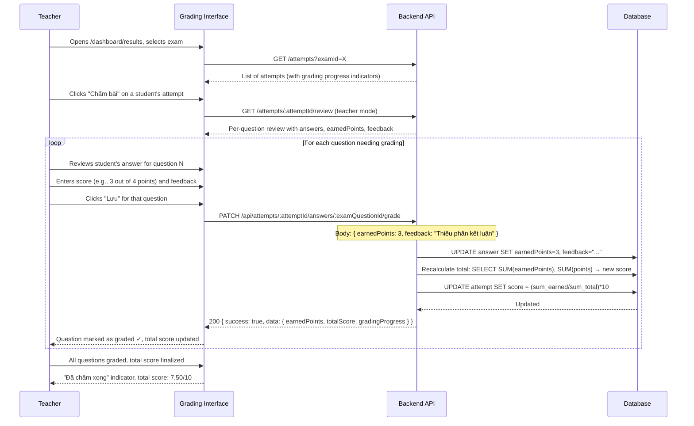

# F8. Manual Grading Workflow

## 5.1 Feature Overview

| Field | Value |
|---|---|
| **Feature ID** | F8 |
| **Feature Name** | Manual Grading Workflow |
| **Module** | F. Assignment Management |
| **Priority** | P2 |
| **Complexity** | M |
| **Status** | Not implemented — only bulk score override exists (`PATCH /attempts/:id/score`). No per-question scoring, no grading queue, no `PENDING_GRADING` status. The `Answer` model has no `earnedPoints` field. Per-answer feedback schema exists but the controller endpoint is not exposed. |
| **Target Roles** | TEACHER (grades), STUDENT (views grades when visible) |
| **Business Objective** | Provide teachers with a structured per-question grading workflow for ESSAY and subjective questions. Teachers assign a score and optional feedback to each answer individually. The system auto-recalculates the total attempt score based on per-question earned points, combining auto-graded and manually-graded results. |
| **User Problem** | Currently, the only way to adjust a student's score is a bulk override on the entire attempt (G2). This forces teachers to mentally calculate partial scores for multi-question exams. For exams with mixed MCQ + ESSAY questions, auto-grading scores ESSAY as 0, and the teacher must compute the correct total manually. There is no record of which questions were graded or what score each received. |
| **Dependencies** | G1 (Auto-Grading), G2 (Manual Grading — Score Override), G5 (Result Visibility), F5 (Teacher Feedback), D4 (Publish Exam) |

## 5.2 Actors and Permissions

### Teacher (exam owner)

| Action | Permitted | Condition |
|---|---|---|
| Open the grading interface for an attempt | Yes | Must own the exam (`attempt.exam.ownerId`) |
| Assign a per-question score (earnedPoints) | Yes | Attempt must be SUBMITTED; must own the exam |
| Write per-answer feedback while grading | Yes | Same as above |
| Recalculate total score after grading | Automatic | Triggered by saving per-question scores |
| Grade attempts for another teacher's exam | No — 403 |

### Teacher (non-owner)

| Action | Permitted |
|---|---|
| Access grading interface for another teacher's exam | No — 403 |

### Student

| Action | Permitted | Condition |
|---|---|---|
| View per-question earned points in answer review | Yes | Only when results are visible (`showResultImmediately OR resultsReleased`); assignment-level `hideResults` overrides to hidden |
| View per-answer feedback | Yes | Same visibility condition |
| Modify any scores | No — 403 |

### Unauthenticated User

All requests return 401.

## 5.3 Preconditions and Business Rules

### Preconditions

1. Teacher is authenticated with role TEACHER.
2. The attempt exists and has status SUBMITTED. Grading an IN_PROGRESS attempt is not allowed (see OQ-01).
3. Teacher owns the exam associated with the attempt (`attempt.exam.ownerId === currentUser.id`).

### Business Rules

| Rule ID | Rule | Enforcement |
|---|---|---|
| F8-BR-01 | Each Answer row gains an `earnedPoints` field (`Decimal(10,2)`, nullable). `null` means "not yet graded" for manually-graded question types, or auto-graded value for auto-gradable types. | Backend — schema change |
| F8-BR-02 | When a teacher sets `earnedPoints` on an answer, the value must be `>= 0` and `<= examQuestion.points` (the max points for that question). Values outside this range are rejected with 400. | Backend validation |
| F8-BR-03 | After any per-question score update, the backend recalculates the attempt's total score using the formula: `score = (SUM(earnedPoints for all questions) / SUM(points for all exam questions)) * 10`, rounded to 2 decimal places. | Backend — automatic recalculation |
| F8-BR-04 | Recalculation sets `manualScoreOverride = false` on the attempt, because the score is now computed from per-question grades, not a bulk override. If the teacher previously used the bulk override (`PATCH /attempts/:id/score`), per-question grading replaces it. | Backend |
| F8-BR-05 | Auto-gradable question types (MCQ, MCQ_MULTI, TRUE_FALSE, SHORT_ANSWER, FILL_BLANK) have their `earnedPoints` set by the auto-grading engine at submit time. The teacher can override these per-question scores. | Backend |
| F8-BR-06 | ESSAY questions start with `earnedPoints = null` after auto-grading (auto-grade scores them as 0 in the total but leaves `earnedPoints` unset). They contribute 0 to the total until the teacher grades them. | Backend |
| F8-BR-07 | An attempt is considered "fully graded" when all answers have a non-null `earnedPoints`. The UI uses this to show grading progress. This is a display concern; no `PENDING_GRADING` status is added to the AttemptStatus enum. | Frontend (see OQ-02) |
| F8-BR-08 | Per-question grading and per-answer feedback can be saved independently. The teacher can grade without providing feedback, or provide feedback without changing the score. | Backend — separate fields on Answer |
| F8-BR-09 | A teacher can re-grade a question (change `earnedPoints` after it was previously set). The total score is recalculated each time. No grading history is kept. | Backend |
| F8-BR-10 | If a teacher uses per-question grading on some questions and then uses the bulk score override (`PATCH /attempts/:id/score`), the bulk override takes precedence. The per-question `earnedPoints` values are preserved but the attempt score reflects the override. | Backend — `manualScoreOverride = true` signals that per-question totals do not apply |
| F8-BR-11 | The grading interface shows questions in exam position order, not the student's shuffled order. The teacher grades by question number, not by the order the student saw them. | Frontend |
| F8-BR-12 | For questions the student did not answer (no Answer row exists), the teacher can still assign `earnedPoints` by creating an Answer row with empty `answerPayload` and the teacher's score. | Backend — upsert behavior |

## 5.4 Main User Flow — Happy Path



### Steps

1. Teacher navigates to `/dashboard/results` and selects an exam.
2. The attempts list shows a grading progress column: "3/5 câu đã chấm" for each attempt.
3. Teacher clicks "Chấm bài" on an attempt row to open the grading interface.
4. The grading interface shows each question in order with:
   - Question content (from snapshot)
   - Student's answer
   - For auto-graded questions: correct answer indicator and pre-filled `earnedPoints`
   - For ESSAY questions: text response and an empty score input
5. Teacher enters a score and optional feedback for each ungraded question.
6. On save, the backend validates the score, stores it, and recalculates the total.
7. After all questions are graded, the interface shows "Đã chấm xong".

## 5.5 Alternative Flows

### AF-01: Teacher re-grades a previously graded question

1. Teacher opens the grading interface for a fully-graded attempt.
2. Sees question 3 was scored 2/4. Decides it deserves 3/4.
3. Changes the score to 3, saves.
4. Backend recalculates total score. New total replaces old total.
5. No history of the previous 2/4 score is kept.

### AF-02: Teacher overrides an auto-graded MCQ score

1. Exam has 5 MCQ questions. Auto-grading scored the student 4/5 correct.
2. Teacher reviews question 2 and decides the auto-grading was wrong (ambiguous question).
3. Teacher changes question 2's `earnedPoints` from 0 to the full points value.
4. Total score recalculated: now 5/5 correct → 10.00.

### AF-03: Partial grading — teacher grades some questions, leaves others

1. Exam has 3 MCQ + 2 ESSAY questions. Auto-grading graded MCQs; ESSAY questions have `earnedPoints = null`.
2. Teacher grades ESSAY question 4 (assigns 3/5 points) but skips ESSAY question 5 for now.
3. Total score is calculated using: MCQ earned + ESSAY Q4 earned + 0 (Q5 ungraded). The formula treats `null` as 0 for the total.
4. Grading progress shows "4/5 câu đã chấm".
5. Teacher can return later to grade question 5.

### AF-04: Teacher uses bulk override after per-question grading

1. Teacher graded all questions per-question. Total is 7.50.
2. Teacher decides to give the student a 9.00 as a final score override.
3. Teacher uses `PATCH /attempts/:id/score` with `score: 9.0`.
4. `manualScoreOverride = true`. The displayed score is 9.00.
5. Per-question `earnedPoints` values remain in the database but no longer drive the total score.

### AF-05: Grading an unanswered question

1. Student skipped question 3 (no Answer row exists).
2. Teacher opens grading interface. Question 3 shows "Chưa trả lời".
3. Teacher assigns 0 points.
4. Backend creates an Answer row with empty `answerPayload` and `earnedPoints = 0`.

## 5.6 Edge Cases and Failure Scenarios

| Scenario ID | Scenario | Trigger | Expected Behavior | User Feedback | Data Integrity | Recovery | Severity |
|---|---|---|---|---|---|---|---|
| F8-EC-01 | earnedPoints exceeds question max | Teacher enters 6 for a 4-point question | Backend rejects with 400 | Toast: "Điểm tối đa cho câu này là 4" | No change | Teacher corrects input | Medium |
| F8-EC-02 | Negative earnedPoints | Teacher enters -1 | Backend rejects with 400 | Toast: "Điểm phải từ 0 trở lên" | No change | Teacher corrects input | Medium |
| F8-EC-03 | Grade on IN_PROGRESS attempt | Attempt not yet submitted | Backend rejects with 400 | Toast: "Không thể chấm bài chưa nộp" | No change | Wait for submission | High |
| F8-EC-04 | Non-owner teacher grades | Teacher B grades Teacher A's exam attempt | Backend rejects with 403 | Toast: "Bạn không có quyền thực hiện thao tác này" | No change | N/A | High |
| F8-EC-05 | Concurrent grading by same teacher (two tabs) | Teacher opens grading in two tabs, saves different scores | Last write wins for each question | No error; last save persists | Per-question, not per-attempt, so conflicts are per-question | Acceptable for ~100 users | Low |
| F8-EC-06 | Regrade after per-question grading | Teacher triggers exam-level regrade (G4) | Regrade re-runs auto-grading for auto-gradable questions but does NOT reset manually-entered `earnedPoints` on ESSAY questions. `manualScoreOverride` on the attempt is set to false; total recalculated from per-question scores. | Re-graded auto scores may change | ESSAY grades preserved; auto-grades updated | Expected behavior | High |
| F8-EC-07 | Total score becomes > 10 due to bonus points | Teacher gives more than max points on a question (blocked by F8-BR-02) | Cannot happen — earnedPoints capped at `examQuestion.points` | N/A | N/A | N/A | N/A |
| F8-EC-08 | All questions unanswered | Student submitted with no answers | All Answer rows missing. Total = 0. Teacher can create Answer rows and assign points. | Score is 0.00 until teacher grades | Consistent | Teacher grades manually | Low |
| F8-EC-09 | Exam has 0 total points | Edge case: all questions have 0 points | Division by zero in score formula | Score defaults to 0.00 (guarded by `totalPoints > 0` check in existing code) | Score = 0.00 | N/A | Low |
| F8-EC-10 | Per-question grade followed by bulk override, then per-question again | Teacher alternates between grading methods | Latest action determines score. Per-question → recalc (override=false). Bulk → override (override=true). Per-question again → recalc (override=false). | Score reflects latest method | Consistent | Each method is valid | Medium |

## 5.7 UI/UX Specification

### Grading Interface Entry Point

| Element | Specification |
|---|---|
| Location | `/dashboard/results` — attempts table |
| Trigger | "Chấm bài" button on each attempt row (replaces or sits beside the existing eye icon for review) |
| Visibility | Shown only for SUBMITTED attempts |
| Progress indicator | Column in attempts table: "{graded}/{total} câu đã chấm" |
| Color coding | Not fully graded: amber badge. Fully graded: green badge. |

### Grading Interface (Full Page or Dialog)

| Element | Specification |
|---|---|
| Layout | Left sidebar: question navigator (numbered list with graded/ungraded indicators). Main area: current question with grading controls. |
| Question display | Question content (from snapshot), student's answer, correct answer (for auto-gradable types) |
| Score input | `<Input type="number" min={0} max={question.points} step={0.5} />` — pre-filled with current `earnedPoints` or empty for ungraded |
| Score label | "Điểm: ___ / {question.points}" |
| Feedback textarea | Below score input. Placeholder: "Nhận xét câu này..." Max 2000 chars. Collapsible — hidden by default, opened via "Thêm nhận xét" link. |
| Save button | "Lưu" per question (saves score + feedback together) |
| Auto-graded indicator | For MCQ/TRUE_FALSE etc.: "Chấm tự động" badge next to the pre-filled score |
| Navigation | "Câu trước" / "Câu sau" buttons. Question list clickable. |
| Summary bar | Fixed at bottom: "Tổng điểm: {current}/{max} ({score}/10) — {graded}/{total} câu đã chấm" |

### Attempt Table Enhancements

| Element | Specification |
|---|---|
| Grading status column | New column between "Score" and "Actions" |
| Status text | "Chưa chấm" (no manual grading done) / "{n}/{total} câu" / "Đã chấm xong" |
| Score display | If `manualScoreOverride = true`: show score with "Sửa điểm" badge. If all per-question scores exist: show computed score. Otherwise: show auto-graded score. |

### Student-Facing Display (Answer Review)

| Element | Specification |
|---|---|
| Per-question score | "Điểm: {earnedPoints}/{points}" below each question in the review |
| Per-answer feedback | "Phản hồi GV: {feedback}" in italic below the score |
| Visibility | Only when `canSeeResults` is true (G5 rules) |

### Responsive Behavior

- Mobile: Question navigator collapses to a dropdown. Grading area is full-width. Summary bar is simplified.
- Desktop: Side-by-side layout with navigator panel.

## 5.8 Data Requirements

### Schema Change: Answer

Add `earnedPoints` field:
```prisma
model Answer {
  id             String    @id @default(uuid()) @db.Uuid
  attemptId      String    @map("attempt_id") @db.Uuid
  examQuestionId String    @map("exam_question_id") @db.Uuid
  answerPayload  Json      @map("answer_payload")
  earnedPoints   Decimal?  @map("earned_points") @db.Decimal(10, 2)  // NEW
  feedback       String?
  savedAt        DateTime  @default(now()) @map("saved_at")

  attempt      ExamAttempt  @relation(fields: [attemptId], references: [id], onDelete: Cascade)
  examQuestion ExamQuestion @relation(fields: [examQuestionId], references: [id])

  @@unique([attemptId, examQuestionId])
  @@map("answers")
}
```

### Auto-Grading Integration

The existing `gradeAndSubmit` method in `AttemptsService` must be updated to set `earnedPoints` on each Answer row during auto-grading, in addition to computing the total score. Currently it computes `earnedPoints` in a local variable but does not persist it per-answer.

### No New Models Required

Per-question grading uses the existing `Answer` model with the new `earnedPoints` field. No separate grading table or queue model is needed.

## 5.9 API Requirements

### PATCH /api/attempts/:attemptId/answers/:examQuestionId/grade — Grade Answer

| Field | Value |
|---|---|
| **Method** | PATCH |
| **Endpoint** | `/api/attempts/:attemptId/answers/:examQuestionId/grade` |
| **Purpose** | Set the earned points and optional feedback for a specific answer |
| **Required Role** | TEACHER |
| **Authorization** | `attempt.exam.ownerId === currentUser.id` AND `attempt.status === 'SUBMITTED'` |

**Request Body:**
```json
{
  "earnedPoints": 3,
  "feedback": "Thiếu phần kết luận"
}
```

**Validation Rules:**

| Field | Rule | Error Code | Error Message |
|---|---|---|---|
| earnedPoints | Required, number, >= 0 | VALIDATION_ERROR | "Điểm phải từ 0 trở lên" |
| earnedPoints | <= examQuestion.points | VALIDATION_ERROR | "Điểm tối đa cho câu này là {points}" |
| feedback | Optional, string, max 2000 chars | VALIDATION_ERROR | "Nhận xét câu trả lời tối đa 2000 ký tự" |
| attemptId | Attempt must exist | ATTEMPT_NOT_FOUND | "Không tìm thấy bài làm" |
| attemptId | Attempt must be SUBMITTED | ATTEMPT_NOT_SUBMITTED | "Không thể chấm bài chưa nộp" |
| examQuestionId | Must belong to the attempt's exam | QUESTION_NOT_FOUND | "Không tìm thấy câu hỏi trong bài thi" |

**Behavior:**
1. If no Answer row exists for this (attemptId, examQuestionId), create one with empty `answerPayload: {}`.
2. Set `earnedPoints` and `feedback` (if provided) on the Answer.
3. Recalculate attempt total score:
   - Query all answers for this attempt, join with ExamQuestion for points.
   - For answers with `earnedPoints IS NOT NULL`: sum earnedPoints.
   - For answers with `earnedPoints IS NULL`: count as 0.
   - Total exam points: `SUM(examQuestion.points)` for all questions in the exam.
   - `score = (sumEarned / totalPoints) * 10`, rounded to 2 decimal places.
4. Set `attempt.score = computed score`, `attempt.manualScoreOverride = false`.

**Success Response (200):**
```json
{
  "success": true,
  "data": {
    "answerId": "uuid",
    "examQuestionId": "uuid",
    "earnedPoints": "3.00",
    "feedback": "Thiếu phần kết luận",
    "attemptScore": "7.50",
    "gradingProgress": {
      "graded": 4,
      "total": 5
    }
  }
}
```

**Error Responses:**

| Status | Code | Condition |
|---|---|---|
| 400 | VALIDATION_ERROR | earnedPoints out of range or feedback too long |
| 400 | ATTEMPT_NOT_SUBMITTED | Attempt is IN_PROGRESS |
| 403 | FORBIDDEN | Teacher does not own the exam |
| 404 | ATTEMPT_NOT_FOUND | Attempt does not exist |
| 404 | QUESTION_NOT_FOUND | examQuestionId does not belong to the attempt's exam |

### GET /api/attempts/:attemptId/review — Enhanced for Grading

The existing review endpoint already returns per-question data. Enhancement needed:

- Include `earnedPoints` in each question's response.
- Include `examQuestion.points` (max points) for the score input constraint.
- Include `gradingProgress: { graded, total }` in the response metadata.

**Enhanced response shape per question:**
```json
{
  "position": 1,
  "content": "...",
  "options": [...],
  "correctOptionId": "...",
  "selectedOptionId": "...",
  "isCorrect": true,
  "points": 4,
  "earnedPoints": 4,
  "feedback": null,
  "questionType": "MCQ"
}
```

## 5.10 State Management

Per-question grading does not add new attempt statuses. It enriches the data on existing SUBMITTED attempts.

**earnedPoints lifecycle per answer:**

```
Auto-gradable (MCQ, etc.):
  submit → earnedPoints set by auto-grader → teacher may override → teacher may re-override

ESSAY:
  submit → earnedPoints = null (auto-grader skips) → teacher sets earnedPoints → teacher may re-grade
```

**Attempt score lifecycle with per-question grading:**

```
Auto-grade at submit → score = (auto-earned / total) * 10
  ↓
Teacher grades ESSAY questions → score recalculated with manual earned included
  ↓
(Optional) Teacher bulk overrides → manualScoreOverride = true, score = override value
  ↓
(Optional) Teacher returns to per-question grading → manualScoreOverride = false, score recalculated
```

**Interaction with regrade (G4):**

When regrade is triggered on an exam:
- For each attempt where `manualScoreOverride = false`:
  - Re-run auto-grading for auto-gradable questions → update their `earnedPoints`.
  - Preserve `earnedPoints` on ESSAY questions (do not reset teacher grades).
  - Recalculate total score.
- For attempts where `manualScoreOverride = true`: skip entirely (existing G4 behavior).

## 5.11 Acceptance Criteria

### Positive

```
Given a SUBMITTED attempt with 3 MCQ (2pts each) + 1 ESSAY (4pts), auto-score = 6.00,
When the teacher sets ESSAY question earnedPoints to 3,
Then the attempt score is recalculated: (6+3)/10 * 10 = 9.00,
And manualScoreOverride is false.
```

```
Given a teacher opens the grading interface for a SUBMITTED attempt,
When the teacher views the question list,
Then auto-graded questions show pre-filled earnedPoints,
And ESSAY questions show empty score inputs.
```

```
Given a teacher grades 3 of 5 questions,
When the teacher views the attempts list,
Then the grading progress column shows "3/5 câu đã chấm".
```

```
Given a teacher sets earnedPoints = 2 on a question worth 4 points,
When the teacher changes it to 3,
Then earnedPoints is 3 and the total score is recalculated.
```

```
Given the teacher graded all questions per-question (total: 7.50),
When the teacher then uses bulk score override to set 9.00,
Then the attempt score is 9.00 and manualScoreOverride is true.
```

```
Given a student with a graded attempt and results visible,
When the student views the answer review,
Then each question shows "Điểm: {earned}/{max}" and any per-answer feedback.
```

### Negative

```
Given a teacher enters earnedPoints = 6 on a 4-point question,
When the request is processed,
Then the backend returns 400 with "Điểm tối đa cho câu này là 4".
```

```
Given a teacher tries to grade an IN_PROGRESS attempt,
When the request is processed,
Then the backend returns 400 ATTEMPT_NOT_SUBMITTED.
```

```
Given Teacher B tries to grade Teacher A's exam attempt,
When the request is processed,
Then the backend returns 403 FORBIDDEN.
```

```
Given a student tries to call PATCH /attempts/:id/answers/:eqId/grade,
When the request is processed,
Then the backend returns 403 (TEACHER role required).
```

## 5.12 QA Test Scenarios

| Test Case ID | Scenario | Preconditions | Steps | Test Data | Expected Result | Priority |
|---|---|---|---|---|---|---|
| F8-TC-01 | Grade ESSAY question — happy path | SUBMITTED attempt, ESSAY Q (4pts), earnedPoints=null | PATCH grade { earnedPoints: 3 } | 3/4 pts | 200, earnedPoints=3, score recalculated | Critical |
| F8-TC-02 | Grade with feedback | Same as TC-01 | PATCH grade { earnedPoints: 3, feedback: "Tốt" } | — | 200, feedback stored, score recalculated | High |
| F8-TC-03 | Override auto-graded MCQ score | MCQ scored 0 (wrong answer) | PATCH grade { earnedPoints: 2 } | 2/2 pts | 200, earnedPoints=2, score recalculated | High |
| F8-TC-04 | Re-grade a question | earnedPoints already 2 | PATCH grade { earnedPoints: 3 } | 3/4 pts | 200, earnedPoints=3, score recalculated | High |
| F8-TC-05 | earnedPoints > max points | 4-point question | PATCH grade { earnedPoints: 6 } | 6/4 pts | 400 VALIDATION_ERROR | Critical |
| F8-TC-06 | Negative earnedPoints | Any question | PATCH grade { earnedPoints: -1 } | -1 | 400 VALIDATION_ERROR | High |
| F8-TC-07 | Grade IN_PROGRESS attempt | Attempt not submitted | PATCH grade | earnedPoints: 3 | 400 ATTEMPT_NOT_SUBMITTED | Critical |
| F8-TC-08 | Non-owner teacher | Teacher B's exam | Teacher A PATCHes grade | earnedPoints: 3 | 403 FORBIDDEN | Critical |
| F8-TC-09 | Student cannot grade | Student authenticated | PATCH grade | earnedPoints: 3 | 403 | Critical |
| F8-TC-10 | Score recalculation accuracy | 3 MCQ (2pts ea) + 2 ESSAY (3pts ea), MCQ earned 4/6, ESSAY 1 graded 2/3, ESSAY 2 graded 3/3 | Grade both ESSAY questions | — | Total: (4+2+3)/12 * 10 = 7.50 | Critical |
| F8-TC-11 | Grade unanswered question | Student skipped question (no Answer row) | PATCH grade { earnedPoints: 0 } | — | 200, Answer created with empty payload | High |
| F8-TC-12 | manualScoreOverride reset | Attempt has manualScoreOverride=true | PATCH grade on any question | earnedPoints: 3 | manualScoreOverride=false, score recalculated | High |
| F8-TC-13 | Grading progress count | 5 questions, 2 auto-graded, 3 ungraded | Grade 1 ESSAY question | — | gradingProgress: { graded: 3, total: 5 } | Medium |
| F8-TC-14 | Feedback too long | Any question | PATCH grade { feedback: 2001 chars } | Long text | 400 VALIDATION_ERROR | Medium |
| F8-TC-15 | Regrade preserves ESSAY grades | ESSAY earnedPoints=3 (manually set) | Trigger exam regrade | — | ESSAY earnedPoints stays 3; MCQ may change | High |
| F8-TC-16 | Student sees per-question scores | Graded attempt, results visible | Student GET /attempts/:id/review | — | Each question shows earnedPoints | High |
| F8-TC-17 | Student hidden when results not visible | Graded attempt, results NOT visible | Student GET /attempts/:id/review | — | 403 or earnedPoints omitted | High |
| F8-TC-18 | examQuestionId not in exam | Valid attempt, invalid examQuestionId | PATCH grade | — | 404 QUESTION_NOT_FOUND | Medium |
| F8-TC-19 | Bulk override after per-question | Per-question grades set | PATCH /attempts/:id/score { score: 9 } | score: 9 | manualScoreOverride=true, score=9.00 | High |

## 5.13 Open Questions and Assumptions

### Open Questions

| # | Question | Why It Matters | Options | Recommended Default | Impact | Blocks Implementation? |
|---|---|---|---|---|---|---|
| OQ-01 | Should there be a `PENDING_GRADING` attempt status? | Without it, teachers must manually identify which attempts need grading by checking earnedPoints nulls. With it, the status machine gets more complex and frontend routing changes. | (a) No new status — use `gradingProgress` count to indicate grading completeness (proposed). (b) Add `PENDING_GRADING` between SUBMITTED and a new `GRADED` status. | (a) — No new status. Keep the status enum simple. Use earnedPoints null-count for UI indicators. Adding a status would require changes across every endpoint that checks `status === 'SUBMITTED'`. | High — affects attempt lifecycle | No — can add later if needed |
| OQ-02 | How should the grading interface be structured: dialog, full page, or inline? | A dialog limits screen space for reading essays. A full page requires new routing. Inline grading adds complexity to the results page. | (a) Full page at `/dashboard/results/:attemptId/grade`. (b) Large dialog (80% viewport). (c) Inline expandable rows. | (a) — Full page. Essay grading needs reading space. The URL also allows sharing a direct link to a specific grading session. | Low — UX only, no backend impact | No |
| OQ-03 | Should `earnedPoints` on auto-graded questions be set during auto-grading or only when the teacher opens the grading interface? | If set during auto-grading, all MCQ answers immediately have earnedPoints. If deferred, the teacher must explicitly "confirm" each auto-grade. | (a) Set during auto-grading (proposed). This means auto-graded questions show as "graded" immediately. (b) Leave null until teacher confirms. | (a) — set during auto-grading. Less teacher work. Teacher can still override. | Medium — affects auto-grading code | No |
| OQ-04 | When regrade runs, should it reset manually-set `earnedPoints` on auto-gradable question types? | If the teacher overrode an MCQ's score and then triggers regrade, should the MCQ score revert to auto-graded or keep the teacher's override? | (a) Reset auto-gradable earnedPoints to new auto-grade, preserve only ESSAY grades. (b) Preserve all manually-changed earnedPoints regardless of question type. (c) Teacher chooses per-regrade. | (b) — preserve all manually-changed earnedPoints. The teacher explicitly chose to override; regrade should not silently undo their decision. Detect manual changes by comparing earnedPoints to what auto-grading would produce. | Medium — affects regrade logic | No |

### Assumptions

| # | Assumption | Basis |
|---|---|---|
| AS-01 | Per-question grading uses the existing `Answer` model with a new `earnedPoints` field, not a separate `Grade` table. | Simplest schema change. One field addition vs. a new model with FK relationships. |
| AS-02 | `earnedPoints` is `Decimal(10,2)` to match the attempt's `score` precision. | Consistency with existing `score` field type. |
| AS-03 | The auto-grading engine (`gradeAndSubmit`) will be updated to persist `earnedPoints` per answer, not just compute a total. This is a necessary refactor of existing code. | Current code computes earned points in a local variable but does not store them per-answer. |
| AS-04 | The `gradingProgress` in the API response is computed on the fly (`COUNT(earnedPoints IS NOT NULL) / COUNT(*)`) and not stored as a separate field. | Avoids denormalization. At ~100 users, the query cost is negligible. |
| AS-05 | Per-question grading feedback uses the existing `Answer.feedback` field (max 2000 chars, per F5-BR-04). No additional feedback model is needed. | Field already exists in the schema. |
