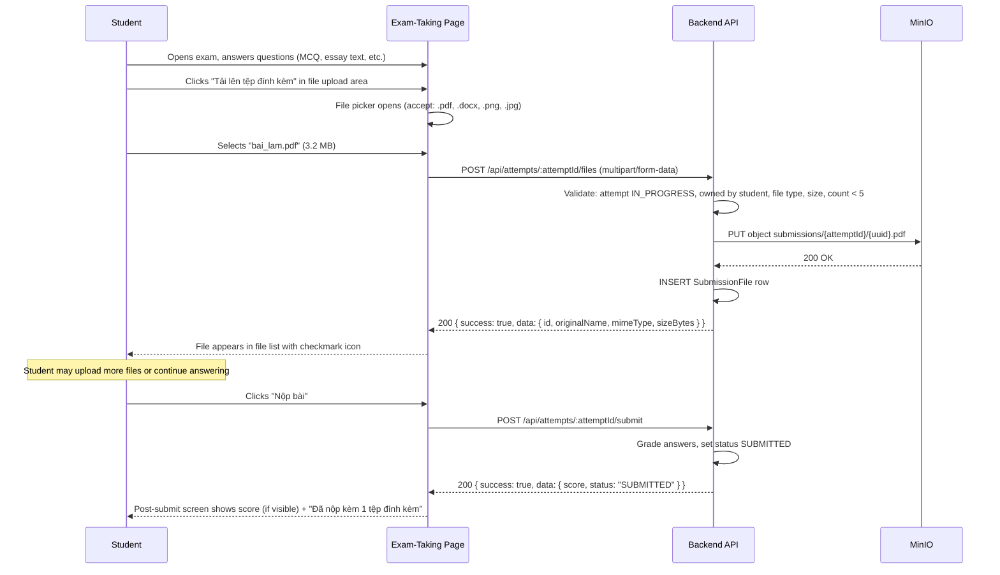

# F7. Student File Submission

## 5.1 Feature Overview

| Field | Value |
|---|---|
| **Feature ID** | F7 |
| **Feature Name** | Student File Submission |
| **Module** | F. Assignment Management |
| **Priority** | P2 |
| **Complexity** | L |
| **Status** | Not implemented — no file upload infrastructure exists. PD-06 CONFIRMED MinIO for storage, but no upload service has been built. No Submission model exists; student answers are currently stored only as JSON payloads on the `Answer` model. |
| **Target Roles** | STUDENT (uploads files), TEACHER (views/downloads files) |
| **Business Objective** | Enable students to submit their work as file uploads for essay-based, project-based, or document-based assignments. Supports assessment types beyond auto-gradable MCQ where the deliverable is a document, diagram, or written report. |
| **User Problem** | ESSAY questions currently store only text in `answerPayload`. Students working on projects, reports, or written exams cannot attach PDFs, images, or documents. Teachers must rely on external channels (email, messaging) to collect these submissions, breaking the assessment workflow. |
| **Dependencies** | F1 (Create Assignment), F6 (File Attachments — shared MinIO infrastructure), PD-06 (MinIO CONFIRMED), F8 (Manual Grading Workflow), E3 (Submit Exam) |

## 5.2 Actors and Permissions

### Student (classroom member)

| Action | Permitted | Condition |
|---|---|---|
| Upload files to own IN_PROGRESS attempt | Yes | Must own the attempt; attempt must be IN_PROGRESS |
| Replace a previously uploaded file | Yes | Must own the attempt; attempt IN_PROGRESS |
| Delete own uploaded file before submission | Yes | Must own the attempt; attempt IN_PROGRESS |
| Upload files after submission | No — 400 |
| View/download own submitted files | Yes | Always (regardless of result visibility) |
| View another student's files | No — 403 |

### Teacher (exam owner)

| Action | Permitted | Condition |
|---|---|---|
| View/download any submitted file for own exam's attempts | Yes | Must own the exam (`attempt.exam.ownerId`) |
| Delete a student's submitted file | No — not supported in MVP |
| Upload files on behalf of a student | No — not supported |

### Teacher (non-owner)

| Action | Permitted |
|---|---|
| View/download files for another teacher's exam attempts | No — 403 |

### Unauthenticated User

All requests return 401.

## 5.3 Preconditions and Business Rules

### Preconditions

1. MinIO file storage service is deployed (Docker Compose) and UploadsModule is implemented (depends on PD-06 / C-GAP-01).
2. Student is authenticated with role STUDENT.
3. An active attempt (IN_PROGRESS) exists for the student.
4. The exam includes at least one ESSAY question, or the assignment allows file submissions (see OQ-01).

### Business Rules

| Rule ID | Rule | Enforcement |
|---|---|---|
| F7-BR-01 | A student may upload files only while the attempt status is IN_PROGRESS. After SUBMITTED or EXPIRED, upload endpoints return 400. | Backend |
| F7-BR-02 | Allowed file types: PDF (`.pdf`), DOCX (`.docx`), PNG (`.png`), JPG/JPEG (`.jpg`, `.jpeg`). The backend validates MIME type and file extension; mismatched MIME/extension is rejected. | Backend |
| F7-BR-03 | Maximum file size: 10 MB per file. | Backend — enforced at the upload endpoint via Fastify multipart limit. |
| F7-BR-04 | Maximum files per attempt: 5. Uploading a 6th file returns 400. | Backend |
| F7-BR-05 | Each uploaded file is stored in MinIO under `submissions/{attemptId}/{uuid}.{ext}`. The original filename, MIME type, and file size are recorded in the `SubmissionFile` table. | Backend |
| F7-BR-06 | File downloads use signed URLs with a 15-minute expiry. The backend generates the signed URL on demand; the URL is not stored persistently. | Backend |
| F7-BR-07 | When an attempt is auto-submitted on expiry (AD-11), any previously uploaded files are preserved and included in the submission. No files are lost. | Backend |
| F7-BR-08 | Deleting a file while the attempt is IN_PROGRESS soft-deletes the `SubmissionFile` row and removes the object from MinIO. After submission, files cannot be deleted. | Backend |
| F7-BR-09 | Files are associated with the ExamAttempt, not with a specific Answer or ExamQuestion. A student may upload general submission files alongside answering individual questions. | Backend (see OQ-02 for per-question file association) |
| F7-BR-10 | File uploads do not affect scoring or attempt status. They are supplementary evidence attached to the attempt for teacher review. | Backend |
| F7-BR-11 | Uploading a file with the same original filename as an existing file on the attempt replaces the old file (same `SubmissionFile` row updated, old MinIO object deleted, new one stored). | Backend |
| F7-BR-12 | File content is not scanned for viruses in MVP. The backend validates only type and size. | Backend (see OQ-03) |

## 5.4 Main User Flow — Happy Path



### Steps

1. Student navigates to the exam-taking page with an IN_PROGRESS attempt.
2. Below the question area, a file upload section shows "Tải lên tệp đính kèm" with a drag-and-drop zone or file picker button.
3. Student selects a file. The UI shows upload progress.
4. On success, the file appears in a list with filename, size, and a remove button.
5. Student may upload additional files (up to 5 total).
6. Student submits the attempt. Files remain attached.

## 5.5 Alternative Flows

### AF-01: Student replaces a file

1. Student uploads "bai_lam.pdf" (v1).
2. Student realizes the file has errors.
3. Student uploads a new file also named "bai_lam.pdf".
4. Backend replaces the old file: deletes the old MinIO object, uploads the new one, updates the `SubmissionFile` row.
5. File list shows "bai_lam.pdf" with updated size and timestamp.

### AF-02: Student deletes a file before submission

1. Student clicks the remove (trash) icon next to a file in the list.
2. Confirmation: "Xóa tệp 'bai_lam.pdf'?"
3. On confirm: API call `DELETE /api/attempts/:attemptId/files/:fileId`.
4. MinIO object deleted, `SubmissionFile` row deleted.
5. File disappears from the list. Upload count decremented.

### AF-03: Auto-submit preserves uploaded files

1. Student uploads 2 files and answers some questions.
2. Timer expires. Client auto-submit fires, or next server request triggers lazy expiry.
3. Attempt status becomes SUBMITTED. Uploaded files remain attached.
4. Teacher can view and download the files in the review.

### AF-04: Teacher downloads student files

1. Teacher navigates to `/dashboard/results`, selects an exam.
2. Opens ReviewDialog for a student's attempt.
3. File attachments section lists the student's uploaded files.
4. Teacher clicks a filename → browser downloads the file via a signed URL.

### AF-05: Upload during poor connectivity

1. Student starts uploading a file.
2. Network drops mid-upload. Multipart request fails.
3. No partial file stored in MinIO (MinIO does not commit partial uploads).
4. UI shows error: "Tải lên thất bại. Vui lòng thử lại."
5. Student retries after connectivity returns.

## 5.6 Edge Cases and Failure Scenarios

| Scenario ID | Scenario | Trigger | Expected Behavior | User Feedback | Data Integrity | Recovery | Severity |
|---|---|---|---|---|---|---|---|
| F7-EC-01 | Unsupported file type | Student selects `.exe` or `.zip` file | Backend rejects with 400 | Toast: "Chỉ hỗ trợ tệp PDF, DOCX, PNG, JPG" | No file stored | Student selects correct type | Medium |
| F7-EC-02 | File exceeds 10 MB | Student selects 15 MB file | Backend rejects with 400 (Fastify multipart limit) | Toast: "Kích thước tệp tối đa 10 MB" | No file stored | Student compresses or resizes | Medium |
| F7-EC-03 | 6th file upload | Student already has 5 files | Backend rejects with 400 | Toast: "Tối đa 5 tệp đính kèm" | No new file stored | Student deletes one first | Low |
| F7-EC-04 | Upload after submission | Attempt is SUBMITTED | Backend rejects with 400 | Toast: "Không thể tải lên sau khi nộp bài" | No file stored | N/A — submission is final | High |
| F7-EC-05 | Upload after expiry | Attempt expired (lazy check) | Backend auto-submits attempt, then rejects upload with 400 | Toast: "Thời gian đã hết. Bài đã được nộp tự động." | Attempt auto-submitted | N/A | High |
| F7-EC-06 | MIME/extension mismatch | File named `.pdf` but MIME is `application/zip` | Backend rejects with 400 | Toast: "Tệp không hợp lệ" | No file stored | Student uploads correct file | High |
| F7-EC-07 | Student not attempt owner | Student A uploads to Student B's attempt | Backend rejects with 403 | Toast: "Bạn không có quyền thực hiện thao tác này" | No file stored | N/A | High |
| F7-EC-08 | MinIO unavailable | Storage service down | Backend returns 500 | Toast: "Không thể tải lên tệp. Vui lòng thử lại sau." | No file stored (transaction rolled back) | Retry when service recovers | High |
| F7-EC-09 | Delete file after submission | Attempt SUBMITTED, student tries DELETE | Backend rejects with 400 | Toast: "Không thể xóa tệp sau khi nộp bài" | File preserved | N/A | Medium |
| F7-EC-10 | Concurrent upload of same filename | Student opens two tabs, uploads same filename simultaneously | Last write wins at the database level (upsert on attemptId + originalName) | One file stored; no error to user | Consistent | Acceptable | Low |
| F7-EC-11 | Attempt deleted or non-existent | Upload to invalid attemptId | Backend returns 404 | Toast: "Không tìm thấy bài làm" | No file stored | Check attempt ID | Low |

## 5.7 UI/UX Specification

### File Upload Area (Exam-Taking Page)

| Element | Specification |
|---|---|
| Location | Below the question list, above the submit button, on the exam-taking page |
| Visibility | Always visible during an IN_PROGRESS attempt. Hidden after submission. |
| Label | "Tệp đính kèm" (section heading) |
| Upload trigger | Button: "Tải lên tệp" (outline variant) + drag-and-drop zone with dashed border |
| Accepted types | `.pdf, .docx, .png, .jpg, .jpeg` (set in `accept` attribute) |
| Progress | Linear progress bar during upload |
| File list | Each uploaded file: icon (by type), filename (truncated at 30 chars), file size, remove button (trash icon) |
| Empty state | "Chưa có tệp đính kèm" |
| Max files hint | Below the upload button: "Tối đa 5 tệp, mỗi tệp tối đa 10 MB" |

### File List in Teacher Review

| Element | Specification |
|---|---|
| Location | Inside ReviewDialog, below the question review section |
| Section heading | "Tệp đính kèm của học sinh" |
| Each file | Filename (clickable link), file size, upload time |
| Click action | Download via signed URL (opens in new tab for PDF/images, downloads for DOCX) |
| Empty state | "Học sinh không đính kèm tệp" |

### Student Post-Submit View

| Element | Specification |
|---|---|
| Location | Post-submit confirmation screen and my-results detail page |
| Display | "Tệp đính kèm: {count} tệp" with a collapsible list of filenames |
| Download | Student can download their own files from the my-results detail page |

### Responsive Behavior

- Mobile: Upload button is full-width. File list stacks vertically. Drag-and-drop zone has reduced height.
- Desktop: Upload area is inline. File list uses a compact table layout.

## 5.8 Data Requirements

### New Model: SubmissionFile

```prisma
model SubmissionFile {
  id           String   @id @default(uuid()) @db.Uuid
  attemptId    String   @map("attempt_id") @db.Uuid
  storageKey   String   @map("storage_key")    // MinIO object key: submissions/{attemptId}/{uuid}.{ext}
  originalName String   @map("original_name")  // User-facing filename
  mimeType     String   @map("mime_type")
  sizeBytes    Int      @map("size_bytes")
  uploadedAt   DateTime @default(now()) @map("uploaded_at")

  attempt ExamAttempt @relation(fields: [attemptId], references: [id], onDelete: Cascade)

  @@unique([attemptId, originalName])
  @@map("submission_files")
}
```

### Schema Change: ExamAttempt

Add relation to SubmissionFile:
```prisma
// Add to ExamAttempt model:
submissionFiles SubmissionFile[]
```

### MinIO Bucket Configuration

| Setting | Value |
|---|---|
| Bucket name | `lumi-submissions` |
| Key pattern | `submissions/{attemptId}/{uuid}.{ext}` |
| Access | Private — all access via signed URLs |
| Lifecycle | No auto-deletion in MVP. See OQ-04 for retention policy. |

## 5.9 API Requirements

### POST /api/attempts/:attemptId/files — Upload File

| Field | Value |
|---|---|
| **Method** | POST |
| **Endpoint** | `/api/attempts/:attemptId/files` |
| **Content-Type** | `multipart/form-data` |
| **Purpose** | Upload a file to attach to an exam attempt |
| **Required Role** | STUDENT |
| **Authorization** | `attempt.studentId === currentUser.id` AND `attempt.status === 'IN_PROGRESS'` |

**Request Body (multipart):**

| Field | Type | Required | Constraints |
|---|---|---|---|
| file | File | Yes | Max 10 MB. MIME: `application/pdf`, `application/vnd.openxmlformats-officedocument.wordprocessingml.document`, `image/png`, `image/jpeg` |

**Validation Rules:**

| Rule | Error Code | Error Message |
|---|---|---|
| Attempt not found | ATTEMPT_NOT_FOUND | "Không tìm thấy bài làm" |
| Not attempt owner | FORBIDDEN | "Bạn không có quyền thực hiện thao tác này" |
| Attempt not IN_PROGRESS | ATTEMPT_NOT_IN_PROGRESS | "Không thể tải lên sau khi nộp bài" |
| Invalid file type | INVALID_FILE_TYPE | "Chỉ hỗ trợ tệp PDF, DOCX, PNG, JPG" |
| File too large | FILE_TOO_LARGE | "Kích thước tệp tối đa 10 MB" |
| Max files reached (5) | MAX_FILES_REACHED | "Tối đa 5 tệp đính kèm" |
| MIME/extension mismatch | INVALID_FILE_TYPE | "Tệp không hợp lệ" |

**Success Response (201):**
```json
{
  "success": true,
  "data": {
    "id": "uuid",
    "originalName": "bai_lam.pdf",
    "mimeType": "application/pdf",
    "sizeBytes": 3355443,
    "uploadedAt": "2026-11-12T10:30:00Z"
  }
}
```

### GET /api/attempts/:attemptId/files — List Files

| Field | Value |
|---|---|
| **Method** | GET |
| **Endpoint** | `/api/attempts/:attemptId/files` |
| **Purpose** | List all files attached to an attempt |
| **Required Role** | STUDENT (own attempt) or TEACHER (exam owner) |
| **Authorization** | Student: `attempt.studentId === currentUser.id`. Teacher: `attempt.exam.ownerId === currentUser.id`. |

**Success Response (200):**
```json
{
  "success": true,
  "data": [
    {
      "id": "uuid",
      "originalName": "bai_lam.pdf",
      "mimeType": "application/pdf",
      "sizeBytes": 3355443,
      "uploadedAt": "2026-11-12T10:30:00Z"
    }
  ]
}
```

### GET /api/attempts/:attemptId/files/:fileId/download — Download File

| Field | Value |
|---|---|
| **Method** | GET |
| **Endpoint** | `/api/attempts/:attemptId/files/:fileId/download` |
| **Purpose** | Get a signed download URL for a file |
| **Required Role** | STUDENT (own attempt) or TEACHER (exam owner) |
| **Authorization** | Same as list endpoint |

**Success Response (200):**
```json
{
  "success": true,
  "data": {
    "downloadUrl": "https://minio.local/lumi-submissions/submissions/...?X-Amz-Signature=...",
    "expiresIn": 900
  }
}
```

### DELETE /api/attempts/:attemptId/files/:fileId — Delete File

| Field | Value |
|---|---|
| **Method** | DELETE |
| **Endpoint** | `/api/attempts/:attemptId/files/:fileId` |
| **Purpose** | Remove a file from an attempt before submission |
| **Required Role** | STUDENT |
| **Authorization** | `attempt.studentId === currentUser.id` AND `attempt.status === 'IN_PROGRESS'` |

**Validation Rules:**

| Rule | Error Code | Error Message |
|---|---|---|
| Attempt not IN_PROGRESS | ATTEMPT_NOT_IN_PROGRESS | "Không thể xóa tệp sau khi nộp bài" |
| File not found | FILE_NOT_FOUND | "Không tìm thấy tệp" |

**Success Response (200):**
```json
{
  "success": true,
  "data": null
}
```

## 5.10 State Management

Files follow the attempt lifecycle:

```
Attempt IN_PROGRESS
  └─ Student can: upload, replace, delete files
  └─ File states: created → replaced → deleted (optional)

Attempt SUBMITTED (manual or auto-submit on expiry)
  └─ Files frozen — no upload, replace, or delete
  └─ Student can: view and download own files
  └─ Teacher can: view and download files

Attempt EXPIRED (legacy — auto-submit converts to SUBMITTED per AD-11)
  └─ Same as SUBMITTED
```

No separate state machine for files. File mutability is governed entirely by the attempt status.

## 5.11 Acceptance Criteria

### Positive

```
Given a student has an IN_PROGRESS attempt,
When the student uploads a valid PDF file (3 MB),
Then the file is stored in MinIO and a SubmissionFile record is created,
And the response contains the file metadata (id, originalName, mimeType, sizeBytes).
```

```
Given a student uploaded 3 files on an IN_PROGRESS attempt,
When the student submits the attempt,
Then all 3 files remain attached and the teacher can view them in the review.
```

```
Given a student uploaded a file before the timer expired,
When the attempt auto-submits on expiry,
Then the file is preserved and visible to the teacher.
```

```
Given a teacher owns an exam with a submitted attempt that has files,
When the teacher opens the review for that attempt,
Then the teacher sees the list of files and can download each via a signed URL.
```

```
Given a student uploaded a file named "bai_lam.pdf",
When the student uploads another file named "bai_lam.pdf",
Then the old file is replaced and only one "bai_lam.pdf" appears in the list.
```

```
Given a student has an IN_PROGRESS attempt with 2 files,
When the student deletes one file,
Then the file is removed from MinIO and the SubmissionFile record is deleted,
And the file count is 1.
```

### Negative

```
Given a student's attempt is SUBMITTED,
When the student tries to upload a file,
Then the backend returns 400 ATTEMPT_NOT_IN_PROGRESS.
```

```
Given a student uploads a .exe file,
When the upload request is processed,
Then the backend returns 400 INVALID_FILE_TYPE.
```

```
Given a student already has 5 files on the attempt,
When the student tries to upload a 6th file,
Then the backend returns 400 MAX_FILES_REACHED.
```

```
Given Student A tries to upload a file to Student B's attempt,
When the request is processed,
Then the backend returns 403 FORBIDDEN.
```

```
Given a teacher is authenticated,
When the teacher tries to upload a file to a student's attempt,
Then the backend returns 403 (STUDENT role required for upload).
```

## 5.12 QA Test Scenarios

| Test Case ID | Scenario | Preconditions | Steps | Test Data | Expected Result | Priority |
|---|---|---|---|---|---|---|
| F7-TC-01 | Upload PDF — happy path | IN_PROGRESS attempt | POST /attempts/:id/files with 3 MB PDF | Valid PDF file | 201, file metadata returned | Critical |
| F7-TC-02 | Upload DOCX | IN_PROGRESS attempt | POST with .docx file (2 MB) | Valid DOCX | 201, stored | High |
| F7-TC-03 | Upload PNG image | IN_PROGRESS attempt | POST with .png (1 MB) | Valid PNG | 201, stored | High |
| F7-TC-04 | Upload JPG image | IN_PROGRESS attempt | POST with .jpg (500 KB) | Valid JPEG | 201, stored | High |
| F7-TC-05 | Reject unsupported type | IN_PROGRESS attempt | POST with .zip file | ZIP file | 400 INVALID_FILE_TYPE | Critical |
| F7-TC-06 | Reject oversized file | IN_PROGRESS attempt | POST with 15 MB PDF | Large file | 400 FILE_TOO_LARGE | Critical |
| F7-TC-07 | Reject 6th file | 5 files already uploaded | POST 6th file | Valid PDF | 400 MAX_FILES_REACHED | High |
| F7-TC-08 | Reject upload after submit | SUBMITTED attempt | POST file | Valid PDF | 400 ATTEMPT_NOT_IN_PROGRESS | Critical |
| F7-TC-09 | Reject upload after expiry | Expired attempt (lazy check) | POST file | Valid PDF | 400 (attempt auto-submitted) | High |
| F7-TC-10 | Replace same-name file | File "a.pdf" exists | POST new "a.pdf" | Valid PDF | 201, old replaced | High |
| F7-TC-11 | Delete file before submit | IN_PROGRESS, 1 file | DELETE /attempts/:id/files/:fileId | — | 200, file removed | High |
| F7-TC-12 | Reject delete after submit | SUBMITTED, 1 file | DELETE file | — | 400 ATTEMPT_NOT_IN_PROGRESS | High |
| F7-TC-13 | List files (student) | 3 files uploaded | GET /attempts/:id/files as student owner | — | 200, 3 files listed | High |
| F7-TC-14 | List files (teacher) | Student submitted with files | GET /attempts/:id/files as exam owner teacher | — | 200, files listed | High |
| F7-TC-15 | Download file (signed URL) | File exists | GET /attempts/:id/files/:fileId/download | — | 200, signed URL returned | High |
| F7-TC-16 | Non-owner student access | Student A's attempt | Student B calls GET files | — | 403 FORBIDDEN | Critical |
| F7-TC-17 | Non-owner teacher access | Teacher A's exam | Teacher B calls GET files | — | 403 FORBIDDEN | Critical |
| F7-TC-18 | Auto-submit preserves files | 2 files uploaded, timer expires | Trigger lazy expiry | — | Attempt SUBMITTED, 2 files preserved | Critical |
| F7-TC-19 | MIME/extension mismatch | IN_PROGRESS attempt | POST file named .pdf with MIME application/zip | Mismatched file | 400 INVALID_FILE_TYPE | High |
| F7-TC-20 | MinIO unavailable | Storage service down | POST file | Valid PDF | 500, no file record created | Medium |

## 5.13 Open Questions and Assumptions

### Open Questions

| # | Question | Why It Matters | Options | Recommended Default | Impact | Blocks Implementation? |
|---|---|---|---|---|---|---|
| OQ-01 | Should file submission be available for all exam types, or only when the exam contains ESSAY questions? | If MCQ-only exams allow file uploads, students might upload irrelevant files. If restricted, the system needs a way to flag whether an exam supports file submissions. | (a) Available on all attempts. (b) Only when exam has ESSAY questions. (c) Teacher toggles a `allowFileSubmission` flag on the exam. | (c) — explicit teacher control is clearest. Add a boolean `allowFileSubmission` to the Exam model (default `false`). | Medium — affects exam config UI and backend validation | No — can default to (a) and restrict later |
| OQ-02 | Should files be associated per-question (Answer level) or per-attempt? | Per-question association gives teachers a clearer picture of which file answers which question. Per-attempt is simpler and supports general project submissions. | (a) Per-attempt (proposed — simpler). (b) Per-answer (add `answerId` FK to SubmissionFile). (c) Optional per-answer — student can tag a file to a question or leave it general. | (a) — per-attempt for MVP. Teachers review files alongside the full attempt, not per-question. | Low — can add per-answer FK later | No |
| OQ-03 | Should uploaded files be scanned for viruses? | Students could upload malicious PDFs. At ~100 users in a trusted educational context, risk is low. | (a) No scanning in MVP (proposed). (b) ClamAV integration in Docker Compose. (c) Async scanning with quarantine bucket. | (a) — no scanning for MVP. Add ClamAV post-launch if needed. | Low for MVP | No |
| OQ-04 | What is the file retention policy? | Over time, stored files accumulate. Should old files be purged after a semester? | (a) Keep forever (proposed). (b) Auto-delete after 6 months. (c) Teacher-initiated bulk delete per exam. | (a) — keep forever for MVP. Storage is cheap on local MinIO. Add lifecycle policy later. | Low | No |
| OQ-05 | Should the shared MinIO infrastructure be set up as part of this feature or separately? | F6 (teacher file attachments) and C-GAP-01 (question images) also depend on MinIO. If set up here, other features can reuse it. | (a) Set up MinIO + UploadsModule as a prerequisite milestone (M3A from backlog). (b) Set up as part of F7 implementation. | (a) — MinIO setup should be a shared prerequisite, not embedded in one feature. | High — blocks F6, F7, and question image uploads | Yes — implementation cannot start until MinIO is available |

### Assumptions

| # | Assumption | Basis |
|---|---|---|
| AS-01 | MinIO will be used for all file storage (submissions, attachments, question images). The same bucket scheme and UploadsModule will be shared. | PD-06 CONFIRMED MinIO. |
| AS-02 | File replacement by same name (F7-BR-11) uses upsert semantics on `@@unique([attemptId, originalName])`. This avoids filename conflicts without requiring the student to delete first. | Simplest UX. |
| AS-03 | The `SubmissionFile` model uses `onDelete: Cascade` from ExamAttempt. If an attempt is deleted, its files and MinIO objects are removed. MinIO cleanup requires an application-level hook (Prisma middleware or service-level cascade). | Prisma does not automatically delete MinIO objects. |
| AS-04 | Signed URLs are generated with a 15-minute expiry. This is long enough for a download but short enough to prevent link sharing. | Standard practice for private object storage. |
| AS-05 | The Fastify multipart plugin (`@fastify/multipart`) is used for file upload handling, with `limits.fileSize` set to 10 MB. | NestJS + Fastify stack. |
