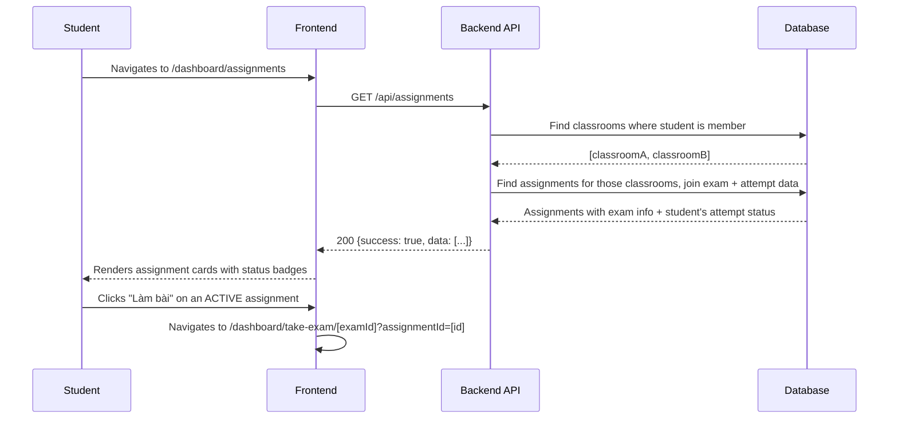
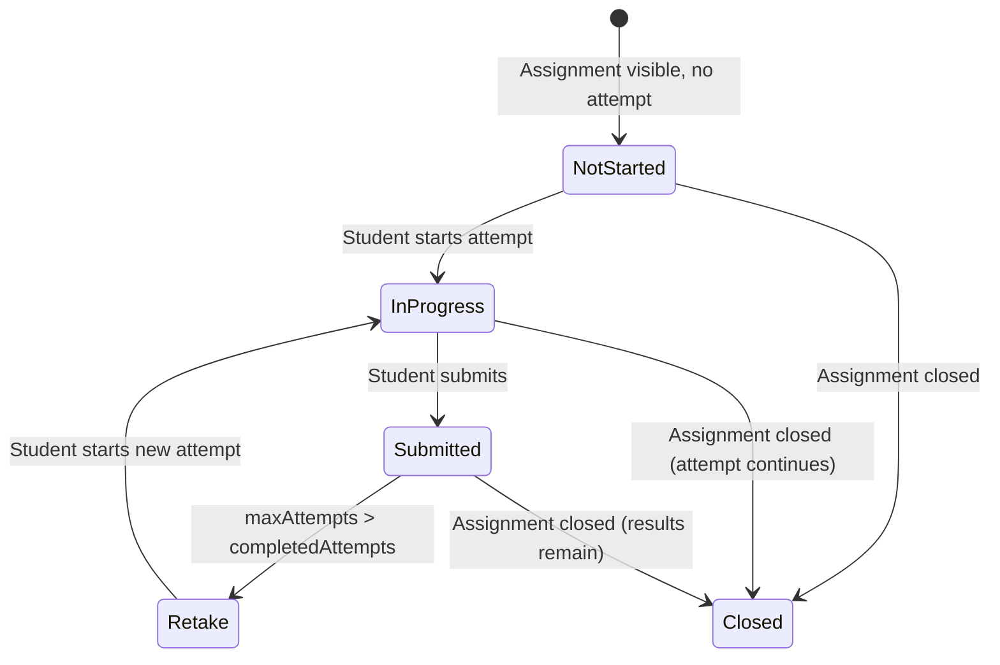

# F2. Student Assignment List and Status

## 5.1 Feature Overview

| Field | Value |
|---|---|
| **Feature ID** | F2 |
| **Feature Name** | Student Assignment List and Status |
| **Module** | F. Assignment Management |
| **Priority** | P0 |
| **Complexity** | S |
| **Status** | Existing — implemented (backend + frontend) |
| **Target Roles** | STUDENT |
| **Business Objective** | Give students a single view of all exams they need to take, with clear status indicators showing what's pending, in progress, completed, or overdue. |
| **User Problem** | Students need to discover which exams have been assigned to them across all their classrooms, understand deadlines, and quickly navigate to start or continue an exam. |
| **Dependencies** | F1 (Create Assignment), B2 (Join Classroom), E1 (Start Exam) |

## 5.2 Actors and Permissions

### Student

| Action | Permitted | Condition |
|---|---|---|
| View assignment list | Yes | Only assignments for classrooms the student has joined |
| View assignment detail | Yes | Student must be a member of the assignment's classroom |
| Start exam from assignment | Yes | Assignment ACTIVE, exam within availability window, attempt limit not exceeded |
| Close or modify assignment | No | 403 |

### Teacher

| Action | Permitted |
|---|---|
| View student's assignment list | No (teachers have their own view) |

### Unauthenticated User

All requests return 401.

### Key authorization rule

A student sees an assignment if and only if:
1. The student is an active member of the assignment's classroom, AND
2. The assignment exists (regardless of status — students can see CLOSED assignments to check their results).

## 5.3 Preconditions and Business Rules

| Rule ID | Rule | Enforcement |
|---|---|---|
| F2-BR-01 | Students see assignments only for classrooms they belong to. | Backend filters by classroom membership join. |
| F2-BR-02 | The list includes both ACTIVE and CLOSED assignments. | Backend returns all statuses; frontend differentiates with badges. |
| F2-BR-03 | Each assignment shows the student's attempt status: NOT_STARTED, IN_PROGRESS, or SUBMITTED. | Backend joins on ExamAttempt to compute per-student status. |
| F2-BR-04 | Score is visible only when `exam.showResultImmediately = true` OR `exam.resultsReleased = true`, AND `assignment.hideResults = false`. | Backend omits score field when conditions not met. |
| F2-BR-05 | Assignments are ordered by most recent first (assignedAt DESC). | Backend default ordering. |
| F2-BR-06 | The "Làm bài" button is enabled only when the student can start a new attempt (assignment ACTIVE, within time window, under attempt limit). | Frontend disables button; backend enforces at attempt start. |

## 5.4 Main User Flow — Happy Path



## 5.5 Alternative Flows

### AF-01: Student has an IN_PROGRESS attempt

The assignment card shows "Đang làm" (IN_PROGRESS) badge. The button text changes to "Tiếp tục làm bài". Clicking navigates to the exam-taking page, which resumes the existing attempt.

### AF-02: Student has a SUBMITTED attempt and results are visible

The card shows score and "Đã nộp" badge. A "Xem kết quả" link navigates to the results page. If `maxAttempts > 1` and the student has remaining attempts, a secondary "Làm lại" button appears.

### AF-03: Student has a SUBMITTED attempt but results are hidden

The card shows "Đã nộp" badge without a score. Message: "Chờ giáo viên công bố kết quả."

### AF-04: Assignment is CLOSED and student never started

The card shows "Đã đóng" badge in neutral/muted style. No action button. If the student had completed an attempt, the result is still accessible.

### AF-05: Student joins a classroom that already has assignments

The student immediately sees existing ACTIVE assignments for that classroom. No special notification is sent (notifications are handled by Module J).

### AF-06: dueAt has passed but assignment is still ACTIVE

The card shows "Quá hạn" warning badge. Whether the student can still start depends on the assignment status (ACTIVE = yes) and exam availability window. See F4 for deadline enforcement.

## 5.6 Edge Cases and Failure Scenarios

| Scenario ID | Scenario | Trigger | Expected Behavior | User Feedback | Data Integrity | Recovery | Severity |
|---|---|---|---|---|---|---|---|
| F2-EC-01 | Student is not a member of any classroom | New student, hasn't joined any class | Empty list returned | "Chưa có bài tập nào. Hãy tham gia lớp học trước." | No issue | Student joins a classroom | Low |
| F2-EC-02 | Student removed from classroom after viewing list | Teacher removes student between page load and click | Start attempt fails (membership check) | Alert: "Bạn không còn trong lớp học này" | No attempt created | Student contacts teacher | High |
| F2-EC-03 | Assignment closed between page load and click | Teacher closes while student is viewing | Start attempt fails (assignment not ACTIVE) | Alert: "Bài giao đã được đóng" | No attempt created | Refresh page | Medium |
| F2-EC-04 | Exam unpublished after assignment created | Teacher somehow changes exam status (not currently possible for PUBLISHED) | Assignment still visible but start attempt fails | Error message | Assignment row becomes stale | Teacher action needed | Low |
| F2-EC-05 | Student in multiple classrooms with same exam | Same exam assigned to two classrooms the student joined | Student sees two separate assignment cards | May be confusing | Student can attempt each independently (separate assignments, separate attempts) | N/A — valid but confusing UX | Medium |
| F2-EC-06 | Large number of assignments | Student has 50+ assignments across classrooms | Page loads slowly | Pagination or virtual scroll | No data issue | Implement pagination (currently unbounded) | Medium |
| F2-EC-07 | Network error loading list | API request fails | Frontend shows error state | "Không thể tải danh sách. Thử lại." with retry button | No data issue | Retry | Low |
| F2-EC-08 | Concurrent classroom removal and assignment creation | Race between teacher removing student and creating assignment | Student may briefly see then lose assignment | Eventual consistency on next refresh | No data corruption | Refresh resolves | Low |

## 5.7 UI/UX Specification

### Page: `/dashboard/assignments`

**Entry point:** Sidebar navigation link "Bài tập" (for students).

### Layout

| Element | Specification |
|---|---|
| Page title | "Bài tập" |
| Empty state | Illustration/icon + "Chưa có bài tập nào. Hãy tham gia lớp học để nhận bài tập." |
| Loading state | Skeleton cards (3 placeholders) |
| Error state | Error message + "Thử lại" button |

### Assignment Card (Student View)

| Element | Specification |
|---|---|
| Card style | `surface` background, subtle `border`, rounded corners |
| Header | Exam title (bold), classroom name (text-secondary) |
| Status badge | See badge mapping below |
| Due date | "Hạn: [date]" in text-muted. If past: warning color |
| Duration | Clock icon + "[X] phút" |
| Score (if visible) | Bold primary color: "8.5 / 10" |
| Action button | Primary: "Làm bài" / "Tiếp tục" / "Làm lại". Secondary: "Xem kết quả" |

### Badge Mapping

| Condition | Badge Text | Variant |
|---|---|---|
| Assignment ACTIVE, no attempt | "Chưa làm" | `outline` |
| Assignment ACTIVE, IN_PROGRESS attempt | "Đang làm" | `secondary` (amber) |
| Attempt SUBMITTED, results visible | "Đã nộp" | `default` (green) |
| Attempt SUBMITTED, results hidden | "Đã nộp" | `default` |
| Assignment CLOSED, no attempt | "Đã đóng" | `outline` (muted) |
| dueAt passed, assignment still ACTIVE | "Quá hạn" | `destructive` (warning) |

### Button States

| Condition | Button | Enabled |
|---|---|---|
| ACTIVE, no attempt, within time window | "Làm bài" | Yes |
| ACTIVE, IN_PROGRESS attempt | "Tiếp tục làm bài" | Yes |
| ACTIVE, SUBMITTED, attempts remaining | "Làm lại" | Yes |
| ACTIVE, SUBMITTED, no attempts remaining | — | Disabled / hidden |
| CLOSED | — | Disabled / hidden |
| Outside availability window | "Chưa mở" or "Đã hết hạn" | Disabled |

### Responsive Behavior

- Desktop: Cards in a grid (2 columns).
- Tablet: Cards in a grid (1–2 columns).
- Mobile: Full-width stacked cards.

## 5.8 Data Requirements

### No new schema required

The student assignment view is a read-only query joining:
- `assignments` — the assignment record
- `exams` — title, duration, availability, showResultImmediately, resultsReleased
- `classroom_members` — filtering by the student's memberships
- `exam_attempts` — the student's attempt for this exam (if any)

### Query Pattern (Pseudocode)

```sql
SELECT a.*, e.title, e.duration_seconds, e.show_result_immediately, e.results_released,
       ea.id as attempt_id, ea.status as attempt_status, ea.score
FROM assignments a
JOIN classrooms c ON a.classroom_id = c.id
JOIN classroom_members cm ON cm.classroom_id = c.id AND cm.user_id = :studentId
JOIN exams e ON a.exam_id = e.id
LEFT JOIN exam_attempts ea ON ea.exam_id = a.exam_id AND ea.student_id = :studentId
ORDER BY a.assigned_at DESC
```

**Note:** If a student has multiple attempts for the same exam (when maxAttempts > 1), the query should return the most recent attempt or summarize all attempts. Current implementation returns the latest.

## 5.9 API Requirements

### GET /api/assignments — Student View

| Field | Value |
|---|---|
| **Method** | GET |
| **Endpoint** | `/api/assignments` |
| **Purpose** | List assignments for the authenticated student |
| **Required Role** | STUDENT (role-dependent response) |

**Query Parameters:**
| Param | Type | Description |
|---|---|---|
| classroomId | UUID? | Filter to a specific classroom |
| status | String? | Filter by ACTIVE or CLOSED |

**Response (200):**
```json
{
  "success": true,
  "data": [
    {
      "id": "assignment-uuid",
      "examId": "exam-uuid",
      "classroomId": "classroom-uuid",
      "assignedAt": "2026-11-10T08:00:00Z",
      "dueAt": "2026-11-20T23:59:00Z",
      "status": "ACTIVE",
      "exam": {
        "title": "Kiểm tra giữa kỳ Toán 12",
        "durationSeconds": 2700,
        "showResultImmediately": true,
        "resultsReleased": false
      },
      "classroom": {
        "name": "12A1"
      },
      "myAttempt": {
        "id": "attempt-uuid",
        "status": "SUBMITTED",
        "score": "8.50",
        "submittedAt": "2026-11-11T09:30:00Z"
      }
    }
  ]
}
```

**Notes:**
- `myAttempt` is null if the student has not started.
- `score` is null or omitted if result visibility conditions are not met.
- Response does not include exam questions or answers.

## 5.10 State Management

The student view is read-only — no state transitions happen here. The assignment's status (ACTIVE/CLOSED) and the student's attempt status (null/IN_PROGRESS/SUBMITTED) are computed on each request.

### Derived display state



## 5.11 Acceptance Criteria

### Positive

```
Given a student is a member of classroom "12A1",
And the teacher has assigned exam "Kiểm tra Toán" to classroom "12A1",
When the student views /dashboard/assignments,
Then the student sees "Kiểm tra Toán" in their assignment list with status "Chưa làm".
```

```
Given a student has an IN_PROGRESS attempt for an assigned exam,
When the student views the assignment list,
Then the card shows "Đang làm" badge and "Tiếp tục làm bài" button.
```

```
Given a student has submitted an attempt and showResultImmediately is true,
When the student views the assignment list,
Then the card shows the score and a "Xem kết quả" link.
```

```
Given a student has submitted but resultsReleased is false and showResultImmediately is false,
When the student views the assignment list,
Then the score is hidden and a message says "Chờ giáo viên công bố kết quả".
```

### Negative

```
Given a student is NOT a member of classroom "12A1",
When the student views assignments,
Then assignments for classroom "12A1" are not shown.
```

```
Given a student is authenticated,
When the student calls POST /assignments,
Then the backend returns 403.
```

## 5.12 QA Test Scenarios

| Test ID | Scenario | Preconditions | Steps | Test Data | Expected Result | Priority |
|---|---|---|---|---|---|---|
| F2-TC-01 | Student sees assignments for joined classrooms | Student is member of 2 classrooms, each with 1 assignment | GET /assignments | Student auth | Returns 2 assignments | Critical |
| F2-TC-02 | Student does not see other classrooms' assignments | Student is member of classroom A only; classroom B has assignment | GET /assignments | Student auth | Returns only classroom A's assignment | Critical |
| F2-TC-03 | Attempt status = null (not started) | No attempt exists | GET /assignments | Student auth | myAttempt = null | High |
| F2-TC-04 | Attempt status = IN_PROGRESS | Student started but not submitted | GET /assignments | Student auth | myAttempt.status = "IN_PROGRESS" | High |
| F2-TC-05 | Attempt status = SUBMITTED with score | Student submitted, showResultImmediately=true | GET /assignments | Student auth | myAttempt.score visible | High |
| F2-TC-06 | Score hidden when results not released | showResultImmediately=false, resultsReleased=false | GET /assignments | Student auth | myAttempt.score = null or omitted | Critical |
| F2-TC-07 | Both ACTIVE and CLOSED assignments shown | 1 ACTIVE + 1 CLOSED assignment | GET /assignments | Student auth | Returns 2 assignments with correct statuses | Medium |
| F2-TC-08 | Student removed from classroom | Student was member, then removed | GET /assignments | Student auth | Assignment no longer returned | High |
| F2-TC-09 | Empty state — no classrooms | Student has not joined any classroom | GET /assignments | Student auth | Empty array | Medium |
| F2-TC-10 | Filter by classroomId | Student has assignments in 2 classrooms | GET /assignments?classroomId=X | Student auth | Returns only classroom X assignments | Medium |
| F2-TC-11 | Multiple attempts (maxAttempts > 1) | Exam allows 3 attempts, student submitted 1 | GET /assignments | Student auth | myAttempt shows latest attempt, "Làm lại" available | High |

## 5.13 Open Questions and Assumptions

### Open Questions

| # | Question | Why It Matters | Options | Recommended Default | Impact |
|---|---|---|---|---|---|
| OQ-01 | When maxAttempts > 1, should `myAttempt` return the best score or the latest attempt? | Affects what the student sees as their "result" | A) Latest attempt, B) Best score, C) All attempts | A) Latest attempt for the card; link to full history for details | Medium |
| OQ-02 | Should CLOSED assignments be hidden or shown with a badge? | Affects whether students can review past assignments | A) Hidden, B) Shown with "Đã đóng" badge | B) Shown — students need to access results for closed assignments | Medium |
| OQ-03 | Should the assignment list be paginated? | Currently returns all assignments. At scale, this could be large. | A) Paginate (page/limit), B) Unbounded | B) Unbounded for MVP (~100 users = few hundred assignments max). Add pagination when needed. | Low |
| OQ-04 | Should we show a "new assignment" indicator for recently assigned exams? | Helps students notice new assignments | A) Yes — show "Mới" badge for 24h, B) No | A) Yes — simple frontend logic based on `assignedAt` | Low |

### Assumptions

| # | Assumption | Basis |
|---|---|---|
| AS-01 | A student can belong to multiple classrooms and sees assignments from all of them in one list. | Current implementation joins on all classroom memberships. |
| AS-02 | The assignment list does not need real-time updates. | Standard request-response model. Student refreshes to see changes. |
| AS-03 | When an exam has both `availableFrom`/`availableUntil` and the assignment has `dueAt`, all three are shown to the student. | The student needs to understand all time constraints. |
| AS-04 | Attempt data for the student view comes from ExamAttempt, not Answer. | We only need attempt-level status and score, not answer-level detail. |
