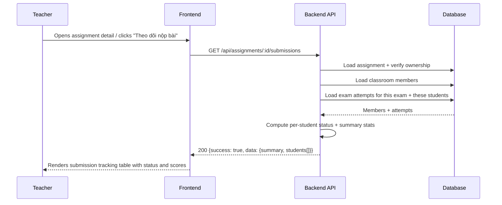

# F3. Submission Tracking for Teachers

## 5.1 Feature Overview

| Field | Value |
|---|---|
| **Feature ID** | F3 |
| **Feature Name** | Submission Tracking |
| **Module** | F. Assignment Management |
| **Priority** | P1 |
| **Complexity** | M |
| **Status** | Proposed — not implemented |
| **Target Roles** | TEACHER |
| **Business Objective** | Give teachers a per-student breakdown of submission status for each assignment, enabling them to identify students who haven't started, are in progress, or have submitted. This replaces the current "flat results list" with a structured assignment-centric tracking view. |
| **User Problem** | Teachers currently see results only in the exam-level results page. They cannot easily answer: "Which students in classroom 12A1 have not yet started assignment X?" |
| **Dependencies** | F1 (Create Assignment), E1 (Start Exam), G1 (Auto Grading) |

## 5.2 Actors and Permissions

### Teacher (assignment owner)

| Action | Permitted | Condition |
|---|---|---|
| View submission tracking for own assignment | Yes | Teacher owns the exam of this assignment |
| See per-student status (not started / in progress / submitted) | Yes | |
| See scores for submitted students | Yes | Always visible to teacher regardless of visibility settings |
| Export submission data | Proposed (P2) | |

### Teacher (non-owner)

| Action | Permitted |
|---|---|
| View submission tracking for another teacher's assignment | No — 403 |

### Student

| Action | Permitted |
|---|---|
| View submission tracking | No — 403 |

## 5.3 Preconditions and Business Rules

| Rule ID | Rule | Enforcement |
|---|---|---|
| F3-BR-01 | Only the exam owner can view submission tracking. | Backend authorization check. |
| F3-BR-02 | The student list is derived from classroom membership at query time. | Students who join after assignment creation appear as "not started". Students removed no longer appear. |
| F3-BR-03 | A student's status is computed from their ExamAttempt records: 0 attempts = NOT_STARTED, any IN_PROGRESS = IN_PROGRESS, any SUBMITTED = SUBMITTED. | Backend aggregation. |
| F3-BR-04 | If a student has multiple attempts (maxAttempts > 1), show the count and best/latest score. | Backend returns attempt summary, not individual attempt list. |
| F3-BR-05 | Summary statistics are computed server-side: total students, submitted count, in-progress count, not-started count, average score, completion rate. | Single API response. |

## 5.4 Main User Flow — Happy Path



## 5.5 Alternative Flows

### AF-01: Teacher filters by status

Teacher clicks a filter chip ("Chưa làm", "Đang làm", "Đã nộp") to narrow the student list. This is a frontend filter on the already-loaded data (no additional API call needed for a class of ~30–50 students).

### AF-02: Teacher views tracking for a closed assignment

Same view. CLOSED assignments still show historical submission data. The summary reflects final state.

### AF-03: Teacher views tracking when no students have started

All students show "Chưa làm" status. Summary: 0 submitted, 0 in progress, N not started. Completion rate: 0%.

### AF-04: Student joins classroom after assignment was created

On next load of the tracking page, the new student appears in the list as "Chưa làm". The total student count increases.

## 5.6 Edge Cases and Failure Scenarios

| Scenario ID | Scenario | Trigger | Expected Behavior | User Feedback | Data Integrity | Recovery | Severity |
|---|---|---|---|---|---|---|---|
| F3-EC-01 | Student removed from classroom but has a submitted attempt | Teacher removed student; attempt exists in DB | Student no longer appears in the tracking list. Their attempt still exists but is not counted in the classroom summary. | Teacher does not see the removed student | Attempt data preserved; just not shown in classroom context | Teacher can view the attempt directly via exam results | Medium |
| F3-EC-02 | Classroom has 0 students | Empty classroom | Table shows empty state: "Chưa có học sinh trong lớp" | Clear message | No issue | Students need to join | Low |
| F3-EC-03 | Student has expired (abandoned) attempt | Student started but never submitted, attempt expired | Status shows as "Đã nộp" if auto-graded on expiry, or "Đã hết giờ" if marked EXPIRED | Badge indicates expired status | Attempt data preserved | N/A | Medium |
| F3-EC-04 | Concurrent view — teacher loads while student is submitting | Race condition between status check and submit | May show IN_PROGRESS momentarily; refresh shows SUBMITTED | Stale by seconds at most | No issue — read-only view | Refresh | Low |
| F3-EC-05 | Large classroom (100+ students) | High member count | API still returns all students (no pagination for MVP) | May load slowly | No issue | Consider pagination for scale | Medium |
| F3-EC-06 | Multiple attempts per student | Exam maxAttempts = 3, student has 2 SUBMITTED + 1 IN_PROGRESS | Show latest status (IN_PROGRESS), best score, attempt count | "Lần 3/3 — Đang làm" | All attempts preserved | N/A | Medium |
| F3-EC-07 | Teacher views assignment for another teacher's exam | Direct API call with another teacher's assignment ID | 403 Forbidden | Error message | No data exposed | N/A | High |

## 5.7 UI/UX Specification

### Entry Point

From the teacher's assignment list, a "Chi tiết" or "Theo dõi" link/button on each assignment card navigates to the submission tracking view.

**Proposed page:** `/dashboard/assignments/:id` or a dialog/sheet overlay.

### Summary Stats Bar

Four stat cards at the top:

| Stat | Icon | Color |
|---|---|---|
| Tổng học sinh | Users | neutral |
| Đã nộp | CheckCircle | success green |
| Đang làm | Clock | warning amber |
| Chưa làm | XCircle | muted |

Plus: **Completion rate** as a percentage and **Average score** (for submitted students).

### Student Table

| Column | Description |
|---|---|
| Học sinh | displayName + email (text-secondary) |
| Trạng thái | Badge: "Chưa làm" / "Đang làm" / "Đã nộp" / "Đã hết giờ" |
| Điểm | Score / 10 (blank for not started, "—" for in progress) |
| Thời gian nộp | submittedAt formatted (blank if not submitted) |
| Số lần | "1/1" or "2/3" (attempts used / max) |

### Filter Chips

Row of clickable chips above the table: "Tất cả", "Chưa làm", "Đang làm", "Đã nộp". Active chip uses primary color; inactive chips are outline.

### Responsive Behavior

- Desktop: Full table with all columns.
- Mobile: Card-per-student layout. Name, badge, score on each card.

### Empty State

"Chưa có học sinh nào trong lớp này." with a link to the classroom management page.

## 5.8 Data Requirements

### No schema changes required

Submission tracking is a read-only query combining existing tables:
- `assignments` — the assignment
- `classroom_members` — the student list
- `users` — student names and emails
- `exam_attempts` — attempt status and scores

### Query Strategy

The API performs a LEFT JOIN from classroom members to exam attempts:

```
classroom_members (for this classroom)
  LEFT JOIN exam_attempts (for this exam AND this student)
  JOIN users (for display name)
```

Students with no matching attempt row have status "NOT_STARTED".

### Computed Fields

| Field | Computation |
|---|---|
| studentStatus | No attempt = NOT_STARTED; latest attempt IN_PROGRESS = IN_PROGRESS; any SUBMITTED = SUBMITTED |
| bestScore | MAX(score) across all submitted attempts for this student |
| latestScore | Score of the most recent submitted attempt |
| attemptCount | COUNT of attempts for this student and exam |
| summary.totalStudents | COUNT of classroom members |
| summary.submittedCount | COUNT of students with at least one SUBMITTED attempt |
| summary.inProgressCount | COUNT of students with an IN_PROGRESS attempt and no SUBMITTED |
| summary.notStartedCount | totalStudents - submittedCount - inProgressCount |
| summary.avgScore | AVG(score) of all submitted attempts |
| summary.completionRate | submittedCount / totalStudents |

## 5.9 API Requirements

### GET /api/assignments/:id/submissions — Submission Tracking

| Field | Value |
|---|---|
| **Method** | GET |
| **Endpoint** | `/api/assignments/:id/submissions` |
| **Purpose** | Get per-student submission status and summary for an assignment |
| **Required Role** | TEACHER |
| **Authorization** | Teacher must own the exam associated with this assignment |
| **Status** | **Proposed — not implemented** |

**Response (200):**
```json
{
  "success": true,
  "data": {
    "assignment": {
      "id": "uuid",
      "examTitle": "Kiểm tra giữa kỳ Toán 12",
      "classroomName": "12A1",
      "status": "ACTIVE",
      "dueAt": "2026-11-20T23:59:00Z"
    },
    "summary": {
      "totalStudents": 30,
      "submittedCount": 20,
      "inProgressCount": 3,
      "notStartedCount": 7,
      "avgScore": 7.25,
      "completionRate": 0.67
    },
    "students": [
      {
        "userId": "uuid",
        "displayName": "Nguyễn Văn A",
        "email": "a@example.com",
        "status": "SUBMITTED",
        "score": "8.50",
        "submittedAt": "2026-11-11T09:30:00Z",
        "attemptCount": 1,
        "maxAttempts": 1
      },
      {
        "userId": "uuid",
        "displayName": "Trần Thị B",
        "email": "b@example.com",
        "status": "IN_PROGRESS",
        "score": null,
        "submittedAt": null,
        "attemptCount": 1,
        "maxAttempts": 1
      },
      {
        "userId": "uuid",
        "displayName": "Lê Văn C",
        "email": "c@example.com",
        "status": "NOT_STARTED",
        "score": null,
        "submittedAt": null,
        "attemptCount": 0,
        "maxAttempts": 1
      }
    ]
  }
}
```

**Error Responses:**

| Status | Code | Condition |
|---|---|---|
| 403 | FORBIDDEN | Teacher does not own the exam |
| 404 | ASSIGNMENT_NOT_FOUND | Assignment does not exist |

**Sorting:** Default sort by status (NOT_STARTED first, then IN_PROGRESS, then SUBMITTED), then by displayName alphabetically. Frontend can re-sort.

## 5.10 State Management

No new state machines. This feature reads from existing states:

| Entity | States | Source |
|---|---|---|
| Assignment | ACTIVE, CLOSED | `assignments.status` |
| Student submission status | NOT_STARTED, IN_PROGRESS, SUBMITTED, EXPIRED | Derived from `exam_attempts` |

The computed `studentStatus` is not persisted — it's derived on each request.

## 5.11 Acceptance Criteria

### Positive

```
Given a teacher has an assignment for exam X in classroom Y with 30 students,
And 20 have submitted, 3 are in progress, 7 have not started,
When the teacher views submission tracking,
Then the summary shows totalStudents=30, submittedCount=20, inProgressCount=3, notStartedCount=7,
And the student list shows each student with their correct status and score.
```

```
Given a student joins the classroom after the assignment was created,
When the teacher views submission tracking,
Then the new student appears as NOT_STARTED,
And totalStudents increases by 1.
```

```
Given a student has been removed from the classroom,
When the teacher views submission tracking,
Then the removed student does not appear in the list,
And totalStudents does not count them.
```

### Negative

```
Given teacher B does not own the exam,
When teacher B requests GET /assignments/:id/submissions,
Then the backend returns 403 FORBIDDEN.
```

```
Given a student is authenticated,
When the student requests GET /assignments/:id/submissions,
Then the backend returns 403.
```

## 5.12 QA Test Scenarios

| Test ID | Scenario | Preconditions | Steps | Test Data | Expected Result | Priority |
|---|---|---|---|---|---|---|
| F3-TC-01 | Tracking with mixed statuses | 3 students: 1 submitted, 1 in progress, 1 not started | GET /assignments/:id/submissions | Teacher auth | 3 students with correct statuses, summary counts correct | Critical |
| F3-TC-02 | All students submitted | 5 students, all submitted | GET /assignments/:id/submissions | Teacher auth | completionRate = 1.0, avgScore computed | High |
| F3-TC-03 | No students started | 5 students, none started | GET /assignments/:id/submissions | Teacher auth | all NOT_STARTED, avgScore = null | High |
| F3-TC-04 | Empty classroom | 0 students | GET /assignments/:id/submissions | Teacher auth | totalStudents = 0, empty students array | Medium |
| F3-TC-05 | Student removed after submission | Student submitted, then removed from classroom | GET /assignments/:id/submissions | Teacher auth | Removed student not in list; count reduced | High |
| F3-TC-06 | Multiple attempts | maxAttempts=3, student has 2 submitted attempts | GET /assignments/:id/submissions | Teacher auth | attemptCount=2, best/latest score shown | High |
| F3-TC-07 | Non-owner teacher denied | Teacher B's auth token | GET /assignments/:id/submissions for teacher A's assignment | Teacher B auth | 403 | Critical |
| F3-TC-08 | Student denied | Student auth token | GET /assignments/:id/submissions | Student auth | 403 | Critical |
| F3-TC-09 | Non-existent assignment | Random UUID | GET /assignments/random-uuid/submissions | Teacher auth | 404 | Medium |
| F3-TC-10 | Closed assignment tracking | Assignment is CLOSED | GET /assignments/:id/submissions | Teacher auth | Returns data normally (CLOSED doesn't block viewing) | Medium |
| F3-TC-11 | Expired attempt status | Student started, never submitted, attempt expired | GET /assignments/:id/submissions | Teacher auth | Student status = SUBMITTED (auto-graded) or EXPIRED | High |

## 5.13 Open Questions and Assumptions

### Open Questions

| # | Question | Why It Matters | Options | Recommended Default | Impact |
|---|---|---|---|---|---|
| OQ-01 | What does "status" mean when a student has multiple attempts with different statuses? | A student could have 1 SUBMITTED + 1 IN_PROGRESS attempt | A) Show latest attempt status, B) Show highest-priority status (IN_PROGRESS > SUBMITTED > NOT_STARTED), C) Show both | A) Show latest attempt status with attempt count context | Medium |
| OQ-02 | Should the response include a list of individual attempts per student, or just a summary? | Impacts API payload size and frontend complexity | A) Summary only (status, score, count), B) Full attempt list per student | A) Summary for the tracking view. Teacher can drill into exam results for full attempt detail. | Medium |
| OQ-03 | Should the endpoint support pagination? | For large classrooms (100+ students) | A) Always paginate, B) Paginate only if > 50, C) No pagination | C) No pagination for MVP. A class of 100 students is a small payload. | Low |
| OQ-04 | Should expelled/removed students be listed separately? | Teacher might want to see that a student who submitted was later removed | A) Omit removed students entirely, B) Show in a separate "Removed" section | A) Omit — simplest approach. Teacher can still see in exam-level results. | Low |
| OQ-05 | Should teacher be able to send a reminder notification to students who haven't started? | Useful workflow addition | A) Yes — add POST /assignments/:id/remind, B) No — out of scope | B) No for P1. Consider for P2 alongside notification system. | Low |

### Assumptions

| # | Assumption | Basis |
|---|---|---|
| AS-01 | The student list is derived from current classroom membership, not a snapshot at assignment creation time. | Simpler implementation. Students who join later see the assignment and appear in tracking. |
| AS-02 | Auto-graded expired attempts are treated as SUBMITTED for tracking purposes. | Per technical decision AD-11: auto-submit on expiry. |
| AS-03 | Summary statistics are computed on each request, not cached. | Scale (~100 users) does not justify caching infrastructure. |
| AS-04 | This endpoint is a new addition (does not exist in current codebase). | Confirmed by codebase inspection — no /submissions endpoint exists. |
