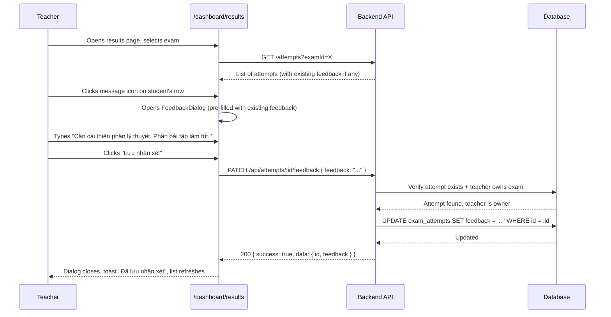
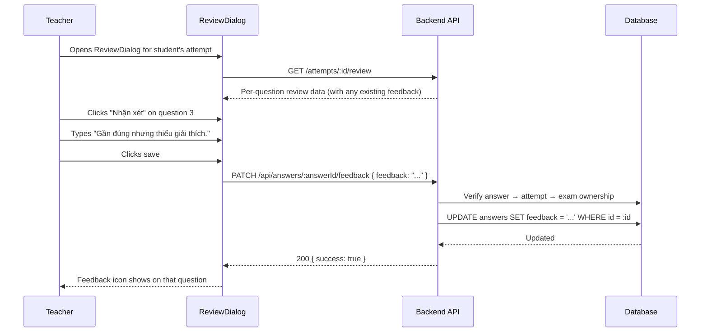

# F5. Teacher Feedback per Attempt

## 5.1 Feature Overview

| Field | Value |
|---|---|
| **Feature ID** | F5 |
| **Feature Name** | Teacher Feedback per Attempt |
| **Module** | F. Assignment Management |
| **Priority** | P2 |
| **Complexity** | S |
| **Status** | Existing — attempt-level feedback fully implemented (backend + frontend). Per-answer feedback schema exists, service method exists, but no controller endpoint is exposed. |
| **Target Roles** | TEACHER (writes feedback), STUDENT (reads feedback) |
| **Business Objective** | Enable teachers to provide qualitative, per-attempt and per-answer written feedback to students on their exam submissions, supporting pedagogical assessment beyond numeric scores. |
| **User Problem** | A numeric score alone does not tell students what they did well or what to improve. Teachers need a way to write personalized comments that students can read alongside their results. |
| **Dependencies** | G1 (Auto-Grading), G2 (Manual Grading & Score Override), G5 (Result Visibility Control), E3 (Submit Exam) |

## 5.2 Actors and Permissions

### Teacher (exam owner)

| Action | Permitted | Condition |
|---|---|---|
| Write attempt-level feedback | Yes | Must own the exam that the attempt belongs to |
| Update attempt-level feedback | Yes | Overwrites the previous value |
| Clear attempt-level feedback | Yes | Submit empty string |
| Write per-answer feedback | Yes (proposed endpoint) | Must own the exam; answer must belong to that exam's attempt |
| View all feedback on own exams | Yes | Always visible to teacher regardless of visibility flags |

### Teacher (non-owner)

| Action | Permitted |
|---|---|
| Write feedback on another teacher's exam attempts | No — 403 |
| View feedback on another teacher's exam attempts | No — 403 |

### Student

| Action | Permitted | Condition |
|---|---|---|
| View attempt-level feedback on own attempt | Yes | Only when results are visible (`showResultImmediately OR resultsReleased`) |
| View per-answer feedback on own attempt | Yes | Only when results are visible and student accesses the answer review |
| Write or modify any feedback | No — 403 |

### Unauthenticated User

All requests return 401.

## 5.3 Preconditions and Business Rules

### Preconditions

1. Teacher is authenticated with role TEACHER.
2. The attempt exists.
3. The teacher owns the exam associated with the attempt (`attempt.exam.ownerId === currentUser.id`).

### Business Rules

| Rule ID | Rule | Enforcement |
|---|---|---|
| F5-BR-01 | Attempt-level feedback is a free-text string stored on `ExamAttempt.feedback`. | Backend — `PATCH /attempts/:id/feedback`. |
| F5-BR-02 | Per-answer feedback is a free-text string stored on `Answer.feedback`. | Backend — proposed `PATCH /answers/:id/feedback` endpoint. |
| F5-BR-03 | Attempt-level feedback max length is 5000 characters. | Backend validation via class-validator `@MaxLength(5000)`. |
| F5-BR-04 | Per-answer feedback max length is 2000 characters. | Backend validation via class-validator `@MaxLength(2000)`. |
| F5-BR-05 | Feedback is visible to the student only when result visibility is enabled (`exam.showResultImmediately OR exam.resultsReleased`). | Backend enforces on review endpoint; frontend respects on results list. |
| F5-BR-06 | Writing feedback does not change the attempt's score or status. | Backend — feedback update touches only the `feedback` column. |
| F5-BR-07 | Empty string is accepted and clears existing feedback. | Backend — `feedback: ""` sets the field to empty string (or null). |
| F5-BR-08 | Teacher can write feedback on an attempt regardless of its status (IN_PROGRESS or SUBMITTED). | Backend — current implementation allows this. See Open Questions for whether this should be restricted. |
| F5-BR-09 | Writing feedback on an attempt that already has feedback overwrites the previous value. No history is kept. | Backend — last write wins. |
| F5-BR-10 | Only the exam owner can write feedback. Ownership check: `attempt → exam → ownerId`. | Backend authorization check in service method. |

## 5.4 Main User Flow — Happy Path

### Attempt-Level Feedback



### Per-Answer Feedback (Proposed)



## 5.5 Alternative Flows

### AF-01: Teacher updates existing feedback

1. Teacher opens FeedbackDialog and sees the pre-filled text from a previous session.
2. Teacher edits the text and saves.
3. The new text replaces the old text entirely. No diff or history.

### AF-02: Teacher clears feedback

1. Teacher opens FeedbackDialog, selects all text and deletes it.
2. Clicks "Lưu nhận xét" with an empty textarea.
3. Backend stores empty string (or null). Student no longer sees feedback.

### AF-03: Teacher writes feedback before results are released

1. Exam has `showResultImmediately = false` and `resultsReleased = false`.
2. Teacher writes feedback on several attempts while reviewing.
3. Feedback is stored but invisible to students.
4. Teacher releases results — students now see both scores and feedback.

### AF-04: Student views feedback in answer review

1. Student navigates to their results and clicks "Xem chi tiết".
2. Answer review page shows per-question breakdown.
3. For each question where the teacher wrote per-answer feedback, the feedback text appears below the question.

## 5.6 Edge Cases and Failure Scenarios

| Scenario ID | Scenario | Trigger | Expected Behavior | User Feedback | Data Integrity | Recovery | Severity |
|---|---|---|---|---|---|---|---|
| F5-EC-01 | Feedback exceeds max length | Teacher pastes text >5000 chars for attempt or >2000 chars for answer | Backend rejects with 400 | Toast: "Nhận xét tối đa 5000 ký tự" (or 2000 for answer) | No change | Teacher shortens text | Low |
| F5-EC-02 | Teacher not exam owner | Teacher A writes feedback on Teacher B's exam attempt | Backend returns 403 | Toast: "Bạn không có quyền thực hiện thao tác này" | No change | N/A | High |
| F5-EC-03 | Attempt does not exist | PATCH /attempts/nonexistent-id/feedback | Backend returns 404 | Toast: "Không tìm thấy bài làm" | No change | Check attempt ID | Low |
| F5-EC-04 | Student inspects API for hidden feedback | Feedback exists but results not visible; student calls GET /attempts/my | Feedback is in the API response (current behavior — see Open Questions) | Frontend hides it | Potential data leak | Backend should omit feedback when visibility is off | High |
| F5-EC-05 | Concurrent feedback writes | Teacher opens two tabs, writes different feedback, saves both | Last write wins | No error; second save overwrites first | Acceptable for ~100 users | Teacher refreshes to see latest | Low |
| F5-EC-06 | Network failure during save | Request fails mid-flight | Frontend shows error toast | "Không thể lưu nhận xét. Vui lòng thử lại." | No data changed | Retry | Low |
| F5-EC-07 | Feedback on answer that does not exist | Teacher calls PATCH /answers/bad-id/feedback | Backend returns 404 | Toast: "Không tìm thấy câu trả lời" | No change | Check answer ID | Low |
| F5-EC-08 | XSS in feedback text | Teacher enters `<script>alert(1)</script>` | Backend stores as-is; frontend must escape when rendering | Text rendered as plain text, not HTML | No XSS if frontend escapes | Frontend uses text rendering (React default) | High |
| F5-EC-09 | Feedback on IN_PROGRESS attempt | Teacher writes feedback before student submits | Currently accepted (stored). Student may never see it if attempt auto-submits differently. | No error | Feedback stored | See Open Questions | Medium |

## 5.7 UI/UX Specification

### Entry Point

Teacher navigates to `/dashboard/results`. Each attempt row has a message icon (MessageSquare) button that opens the FeedbackDialog.

### FeedbackDialog (Existing — Attempt-Level)

| Element | Specification |
|---|---|
| Trigger | MessageSquare icon button (ghost variant) on attempt row |
| Dialog title | "Nhận xét" |
| Textarea | Pre-filled with existing feedback. Placeholder: "Nhận xét cho học sinh..." Max 5000 chars. 3 rows default height. |
| Submit button | "Lưu nhận xét" (Primary Blue, full width) |
| Loading state | Button shows "Đang lưu...", disabled |
| Success | Dialog closes, toast: "Đã lưu nhận xét", table refreshes |
| Error | Toast with error message, dialog stays open |

### Per-Answer Feedback (Proposed UI Enhancement)

| Element | Specification |
|---|---|
| Location | Inside ReviewDialog, below each question's answer display |
| Trigger | "Nhận xét câu này" link/button below each question |
| Input | Inline textarea or expandable input, max 2000 chars |
| Save | Save button per question, or auto-save on blur |
| Display | When feedback exists, show it as italic text below the points earned: "Phản hồi: {feedback}" |

### Student-Facing Feedback Display

| Location | Behavior |
|---|---|
| My Results list (`/dashboard/my-results`) | Show attempt feedback below the score if visible: "Nhận xét: {feedback}" |
| Answer Review page | Show per-answer feedback below each question: "Phản hồi GV: {feedback}" |
| Results not visible | No feedback text shown anywhere |

### Responsive Behavior

- Mobile: FeedbackDialog opens full-width. Textarea fills available width.
- Desktop: Dialog is centered, standard width (~400px).

## 5.8 Data Requirements

### Existing Schema (No changes needed)

**ExamAttempt.feedback**:
```
feedback  String?  // attempt-level feedback from teacher
```

**Answer.feedback**:
```
feedback  String?  // per-answer feedback from teacher
```

Both fields already exist in the Prisma schema and database.

### No Schema Changes Required

The data model fully supports both attempt-level and per-answer feedback. The gap is purely in the API layer (per-answer feedback endpoint) and frontend (per-answer feedback UI).

## 5.9 API Requirements

### PATCH /api/attempts/:id/feedback — Update Attempt Feedback (Existing)

| Field | Value |
|---|---|
| **Method** | PATCH |
| **Endpoint** | `/api/attempts/:id/feedback` |
| **Purpose** | Set or update teacher feedback on an exam attempt |
| **Required Role** | TEACHER |
| **Authorization** | `attempt.exam.ownerId === currentUser.id` |

**Request Body:**
```json
{
  "feedback": "Cần cải thiện phần lý thuyết. Phần bài tập làm tốt."
}
```

**Validation Rules:**
| Field | Rule | Error Code | Error Message |
|---|---|---|---|
| feedback | Required, string | VALIDATION_ERROR | "Vui lòng nhập nhận xét" |
| feedback | Max 5000 characters | VALIDATION_ERROR | "Nhận xét tối đa 5000 ký tự" |

**Success Response (200):**
```json
{
  "success": true,
  "data": {
    "id": "uuid",
    "feedback": "Cần cải thiện phần lý thuyết. Phần bài tập làm tốt."
  }
}
```

**Error Responses:**

| Status | Code | Condition |
|---|---|---|
| 400 | VALIDATION_ERROR | Feedback exceeds max length |
| 403 | FORBIDDEN | Teacher does not own the exam |
| 404 | ATTEMPT_NOT_FOUND | Attempt ID does not exist |

### PATCH /api/answers/:id/feedback — Update Per-Answer Feedback (Proposed)

| Field | Value |
|---|---|
| **Method** | PATCH |
| **Endpoint** | `/api/answers/:id/feedback` |
| **Purpose** | Set or update teacher feedback on a specific answer |
| **Required Role** | TEACHER |
| **Authorization** | `answer.attempt.exam.ownerId === currentUser.id` |
| **Status** | **Proposed** — service method `updateAnswerFeedback` exists in `AttemptsService` but no controller route is exposed |

**Request Body:**
```json
{
  "feedback": "Gần đúng nhưng thiếu giải thích."
}
```

**Validation Rules:**
| Field | Rule | Error Code | Error Message |
|---|---|---|---|
| feedback | Required, string | VALIDATION_ERROR | "Vui lòng nhập nhận xét" |
| feedback | Max 2000 characters | VALIDATION_ERROR | "Nhận xét câu trả lời tối đa 2000 ký tự" |

**Success Response (200):**
```json
{
  "success": true,
  "data": {
    "id": "uuid",
    "feedback": "Gần đúng nhưng thiếu giải thích."
  }
}
```

**Error Responses:**

| Status | Code | Condition |
|---|---|---|
| 400 | VALIDATION_ERROR | Feedback exceeds max length |
| 403 | FORBIDDEN | Teacher does not own the exam |
| 404 | ANSWER_NOT_FOUND | Answer ID does not exist |

## 5.10 State Management

Feedback does not introduce new states. It modifies data on existing attempt or answer rows.

**Feedback lifecycle:**
```
null (no feedback) → "text" (teacher writes) → "new text" (teacher updates) → "" (teacher clears)
```

There is no state machine for feedback — it is a simple text field with last-write-wins semantics.

## 5.11 Acceptance Criteria

### Positive

```
Given a teacher owns an exam with a submitted attempt,
When the teacher writes feedback "Làm tốt lắm!" via PATCH /attempts/:id/feedback,
Then the attempt's feedback field is set to "Làm tốt lắm!".
```

```
Given a teacher wrote feedback on an attempt and resultsReleased = true,
When the student views their results,
Then the student sees "Nhận xét: Làm tốt lắm!" on their result card.
```

```
Given a teacher wrote feedback but showResultImmediately = false and resultsReleased = false,
When the student views their results,
Then no feedback is displayed.
```

```
Given a teacher writes per-answer feedback on question 3,
When the student opens the answer review (with results visible),
Then question 3 shows "Phản hồi GV: {feedback}".
```

```
Given existing feedback "Old text" on an attempt,
When the teacher updates to "New text",
Then the feedback is "New text" (old text is gone).
```

```
Given existing feedback on an attempt,
When the teacher submits an empty string,
Then the feedback is cleared.
```

### Negative

```
Given a teacher does not own the exam,
When they attempt to write feedback on one of its attempts,
Then the backend returns 403 FORBIDDEN.
```

```
Given a student is authenticated,
When the student tries to call PATCH /attempts/:id/feedback,
Then the backend returns 403.
```

```
Given feedback text exceeds 5000 characters,
When the teacher submits,
Then the backend returns 400 VALIDATION_ERROR.
```

## 5.12 QA Test Scenarios

| Test Case ID | Scenario | Preconditions | Steps | Test Data | Expected Result | Priority |
|---|---|---|---|---|---|---|
| F5-TC-01 | Write attempt feedback — happy path | Submitted attempt, teacher owns exam | PATCH /attempts/:id/feedback { feedback: "Tốt" } | feedback: "Tốt" | 200, feedback stored | Critical |
| F5-TC-02 | Update existing feedback | Attempt has feedback "Old" | PATCH feedback "New" | feedback: "New" | 200, feedback updated to "New" | High |
| F5-TC-03 | Clear feedback | Attempt has feedback "Text" | PATCH feedback "" | feedback: "" | 200, feedback cleared | Medium |
| F5-TC-04 | Feedback exceeds max | — | PATCH feedback with 5001 chars | 5001-char string | 400 VALIDATION_ERROR | High |
| F5-TC-05 | Non-owner teacher | Teacher B's exam attempt | Teacher A PATCHes feedback | Any feedback | 403 FORBIDDEN | Critical |
| F5-TC-06 | Student cannot write | Student authenticated | PATCH /attempts/:id/feedback | Any feedback | 403 | Critical |
| F5-TC-07 | Student sees feedback (results visible) | Teacher wrote feedback, showResultImmediately=true | Student GET /attempts/my | — | Feedback visible in response | High |
| F5-TC-08 | Student hidden feedback (results not visible) | Teacher wrote feedback, showResultImmediately=false, resultsReleased=false | Student views results | — | Feedback not displayed | High |
| F5-TC-09 | Feedback after results release | Teacher wrote feedback, then releases results | Student views results | — | Feedback now visible | High |
| F5-TC-10 | Per-answer feedback write | Answer exists, teacher owns exam | PATCH /answers/:id/feedback { feedback: "Cần cải thiện" } | feedback: "Cần cải thiện" | 200, answer feedback stored | High |
| F5-TC-11 | Per-answer feedback in review | Teacher wrote per-answer feedback, results visible | Student GET /attempts/:id/review | — | Feedback shown per question | High |
| F5-TC-12 | Feedback on non-existent attempt | Invalid attempt ID | PATCH /attempts/bad-id/feedback | feedback: "Test" | 404 ATTEMPT_NOT_FOUND | Medium |
| F5-TC-13 | Feedback on IN_PROGRESS attempt | Attempt status IN_PROGRESS | PATCH feedback | feedback: "Note" | 200 (currently accepted — see OQ) | Medium |
| F5-TC-14 | XSS in feedback | — | PATCH feedback with `<script>` tag | `<script>alert(1)</script>` | Stored as-is; rendered as plain text by frontend | High |

## 5.13 Open Questions and Assumptions

### Open Questions

| # | Question | Why It Matters | Options | Recommended Default | Impact |
|---|---|---|---|---|---|
| OQ-01 | Should per-answer feedback have a dedicated controller endpoint? | Service method `updateAnswerFeedback` exists in `AttemptsService` but no route in `AttemptsController` exposes it. | (a) Add `PATCH /answers/:id/feedback` route. (b) Add route as `PATCH /attempts/:attemptId/answers/:examQuestionId/feedback`. (c) Defer — per-answer feedback not accessible via API. | (a) — add a dedicated route. The service method already exists. Estimated +0.5 dev-days. | Medium — blocks per-answer feedback UI |
| OQ-02 | Should feedback be allowed on IN_PROGRESS attempts? | Current implementation allows it. Teacher might want to pre-write notes, but the student will not see it until submitted (and visibility allows). | (a) Allow (current behavior). (b) Restrict to SUBMITTED attempts only. | (a) — allow it. Feedback stored pre-submission is harmless; teacher is not blocked from preparing notes. | Low |
| OQ-03 | Should the backend omit feedback from GET /attempts/my when results are not visible? | Currently, feedback is in the API response. A student can see it via dev tools even when the UI hides it. | (a) Always include (current). (b) Omit feedback when `!canSeeResults`. (c) Return null when hidden. | (b) or (c) — consistent with the same concern in G5 for scores. | High — data leakage concern |
| OQ-04 | Should there be a rich-text editor for feedback? | Plain text limits formatting. Teachers might want bold, bullets, or links. | (a) Plain text only (current). (b) Markdown support. (c) Rich-text editor (e.g., TipTap). | (a) — plain text for MVP. Rich text adds significant frontend complexity. | Low |

### Assumptions

| # | Assumption | Basis |
|---|---|---|
| AS-01 | Feedback has no history — only the latest value is stored. | Current schema design (single `feedback` column). |
| AS-02 | Feedback visibility follows the same rules as score visibility (G5). | Logical consistency — feedback is part of the result. |
| AS-03 | The `UpdateFeedbackDto` requires a non-null string. Sending `null` is not valid; use empty string to clear. | Current DTO uses `@IsString()` without `@IsOptional()`. |
| AS-04 | Per-answer feedback is independent of attempt-level feedback. Both can coexist. | Schema design — separate fields on separate models. |
