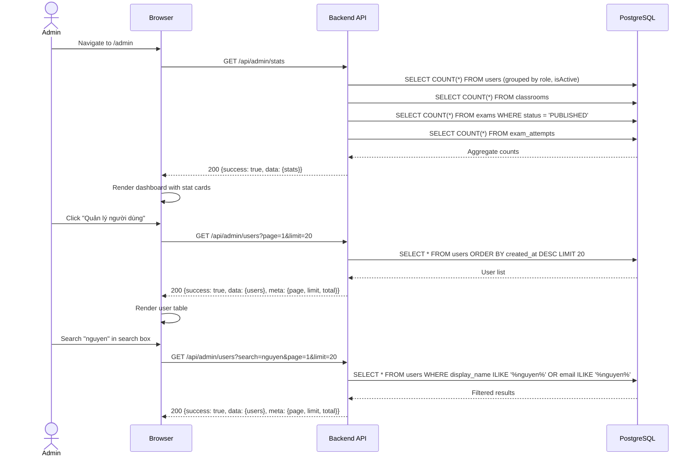
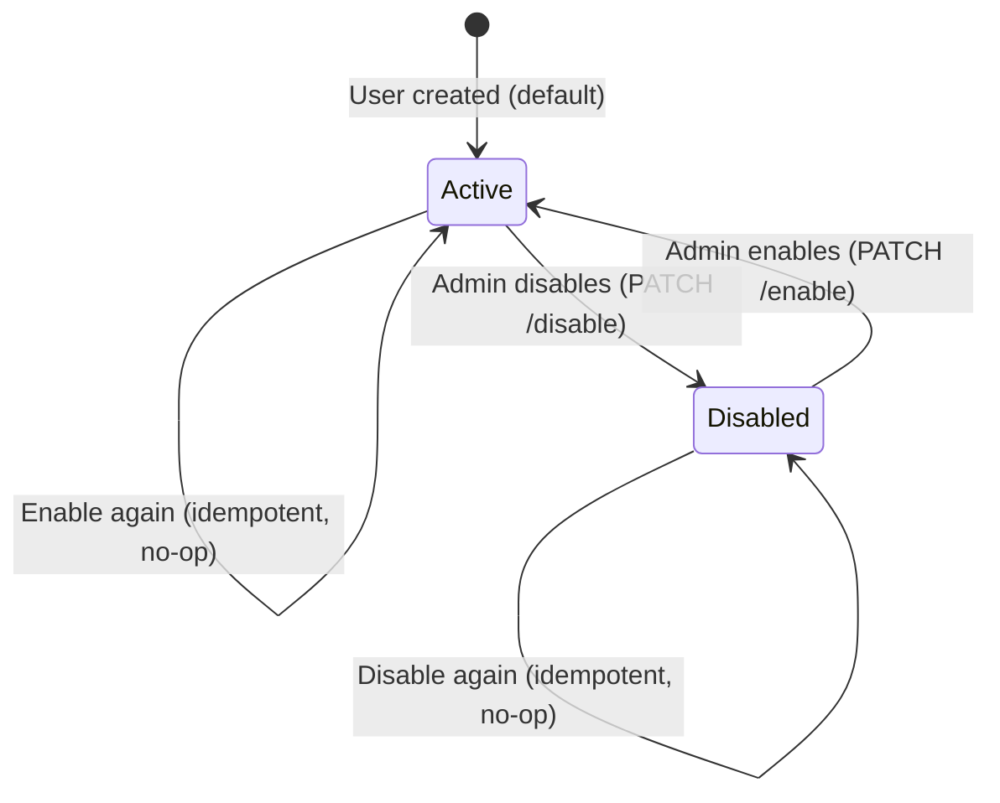

# A6. Admin Dashboard

## 5.1 Feature Overview

| Field | Value |
|---|---|
| Feature ID | A6 |
| Feature Name | Admin Dashboard |
| Module | A. Authentication & User Management |
| Priority | P2 |
| Complexity | L |
| Status | **Not Implemented** — ADMIN role exists in the `Role` enum but has no dedicated endpoints, UI, or permissions |
| Target Roles | ADMIN |
| Business Objective | Provide a system-wide administration panel so a platform operator can manage users, monitor system health, and maintain the platform without direct database access |
| User Problem | The platform operator has no way to manage users (disable accounts, change roles, search users) or see system-level statistics without accessing the database directly |
| Dependencies | A1 (Registration), A2 (Login), A5 (RBAC) — the ADMIN role must be excluded from self-registration and seeded or created through a CLI/migration |

## 5.2 Actors and Permissions

### ADMIN

| Action | Allowed | Notes |
|---|---|---|
| Access admin dashboard | Yes | Route `/admin` and all sub-routes |
| List all users | Yes | Paginated, searchable |
| Search users by name or email | Yes | Partial match |
| View user detail | Yes | All profile fields, creation date, role, account status |
| Disable a user account | Yes | Soft-disable via `isActive` flag; user cannot log in |
| Enable a disabled account | Yes | Restores login ability |
| Change a user's role | Yes | TEACHER ↔ STUDENT only; cannot create another ADMIN via this endpoint — see A6-BR-06 |
| View system statistics | Yes | Aggregate counts |
| View recent activity | Yes | Recent registrations and exam submissions |

### TEACHER

| Action | Allowed | Notes |
|---|---|---|
| Access admin dashboard | No | 403 Forbidden |
| Access any admin API endpoint | No | RolesGuard blocks |

### STUDENT

| Action | Allowed | Notes |
|---|---|---|
| Access admin dashboard | No | 403 Forbidden |
| Access any admin API endpoint | No | RolesGuard blocks |

### Backend Authorization

- All endpoints under `/api/admin/*` are protected by `JwtAuthGuard` (global) and must be decorated with `@Roles('ADMIN')`.
- The existing `RolesGuard` in `apps/api/src/common/guards/roles.guard.ts` already reads the `roles` metadata and checks `user.role`. No changes to the guard itself are needed.
- The ADMIN role must **not** be selectable via self-registration (`POST /auth/register`). See A6-BR-01.

## 5.3 Preconditions and Business Rules

| Rule ID | Rule | Enforcement |
|---|---|---|
| A6-BR-01 | The ADMIN role cannot be obtained through self-registration. `POST /auth/register` must reject `role: "ADMIN"` with a 400 error | Backend — `RegisterDto` validation. Currently a gap: `@IsEnum(Role)` accepts ADMIN. Fix: use `@IsIn(['TEACHER', 'STUDENT'])` |
| A6-BR-02 | The first ADMIN account is created via a database seed script or Prisma migration, not through any API endpoint | DevOps / migration — no API for creating ADMIN users from scratch |
| A6-BR-03 | Only ADMIN can access any endpoint under `/api/admin/*`. Requests from TEACHER or STUDENT return `403 Forbidden` | Backend — `@Roles('ADMIN')` on the controller class |
| A6-BR-04 | Disabling a user sets `isActive = false`. A disabled user's existing refresh tokens are revoked immediately. A disabled user receives `403` on login with message "Tài khoản đã bị vô hiệu hóa" | Backend — `AdminService.disableUser()` + check in `AuthService.login()` |
| A6-BR-05 | Enabling a user sets `isActive = true`. The user can log in again immediately. No tokens are generated on enable | Backend — `AdminService.enableUser()` |
| A6-BR-06 | An admin cannot change a user's role to ADMIN through the change-role endpoint. Only TEACHER ↔ STUDENT changes are permitted | Backend — validation in `AdminService.changeRole()` |
| A6-BR-07 | An admin cannot disable or change the role of their own account | Backend — service-level check: `if (targetUserId === currentUserId) throw ForbiddenException` |
| A6-BR-08 | System statistics are computed on demand from the database. No caching, no materialized views. Acceptable for ~100 users | Backend — aggregate queries in `AdminService.getStats()` |
| A6-BR-09 | User listing supports pagination (offset-based, default page=1 limit=20 max=100), search (partial match on email or displayName), and filter by role and active status | Backend — query params on `GET /api/admin/users` |
| A6-BR-10 | All admin actions (disable, enable, change role) create an audit entry in the application log. No audit table in MVP; structured logging is sufficient | Backend — `Logger.log()` with action, admin ID, target user ID, and timestamp |

## 5.4 Main User Flow — Happy Path



**Steps**:

1. **Admin** logs in with an ADMIN account and is redirected to `/admin` (not `/dashboard`).
2. **System** loads the admin dashboard, displaying system statistics: total users, total teachers, total students, total classrooms, total published exams, total attempts.
3. **Admin** clicks "Quản lý người dùng" to view the user list.
4. **System** displays a paginated table of all users with columns: display name, email, role, status (active/disabled), created date.
5. **Admin** can search by name or email, filter by role, and page through results.

## 5.5 Alternative Flows

### AF-A6-01: Admin disables a user account

- **Trigger**: Admin clicks the "Vô hiệu hóa" button on a user row.
- **Behavior**: Browser shows a confirmation dialog: "Bạn có chắc muốn vô hiệu hóa tài khoản này? Người dùng sẽ không thể đăng nhập." On confirm, sends `PATCH /api/admin/users/:id/disable`. Backend sets `isActive = false`, deletes all refresh tokens for that user.
- **Result**: User row updates to show "Đã vô hiệu hóa" badge. The target user is logged out on their next request (access token expires within 15 min; refresh fails immediately).

### AF-A6-02: Admin enables a disabled account

- **Trigger**: Admin clicks "Kích hoạt" button on a disabled user row.
- **Behavior**: Sends `PATCH /api/admin/users/:id/enable`. Backend sets `isActive = true`.
- **Result**: User row updates to show "Hoạt động" badge. The user can log in again.

### AF-A6-03: Admin changes a user's role

- **Trigger**: Admin clicks the role dropdown on a user row and selects a different role.
- **Behavior**: Browser shows confirmation: "Đổi vai trò người dùng này thành {new role}?" On confirm, sends `PATCH /api/admin/users/:id/role` with `{ role: "TEACHER" | "STUDENT" }`. Backend updates the role. All existing refresh tokens for that user are revoked so that the next token refresh picks up the new role.
- **Result**: Role column updates. The user must re-login to get a new access token with the updated role claim.

### AF-A6-04: Admin views system statistics

- **Trigger**: Admin navigates to `/admin` or clicks the dashboard tab.
- **Behavior**: `GET /api/admin/stats` returns aggregate counts computed on demand.
- **Result**: Dashboard shows stat cards with: total users (broken down by role), total classrooms, total published exams, total exam attempts, recent registrations (last 7 days).

### AF-A6-05: Non-admin user attempts to access admin routes

- **Trigger**: A TEACHER or STUDENT navigates to `/admin` or calls `/api/admin/*`.
- **Behavior**: Backend returns `403 Forbidden`. Frontend redirects to `/dashboard`.
- **Result**: No admin data is exposed.

### AF-A6-06: Admin navigates to the regular dashboard

- **Trigger**: Admin clicks a link to `/dashboard`.
- **Behavior**: The ADMIN role does not own classrooms, exams, or attempts. The dashboard shows an empty state with a link to `/admin`.
- **Result**: Admin is guided back to the admin panel.

## 5.6 Edge Cases and Failure Scenarios

| Scenario ID | Scenario | Trigger | Expected Behavior | User Feedback | Data Integrity | Recovery | Severity |
|---|---|---|---|---|---|---|---|
| EC-A6-01 | Admin tries to disable themselves | Admin calls `PATCH /api/admin/users/:ownId/disable` | Backend returns `403 Forbidden` with code `CANNOT_MODIFY_SELF` | Error toast: "Không thể vô hiệu hóa tài khoản của chính bạn" | No change | N/A | Medium |
| EC-A6-02 | Admin tries to change their own role | Admin calls `PATCH /api/admin/users/:ownId/role` | Backend returns `403 Forbidden` with code `CANNOT_MODIFY_SELF` | Error toast: "Không thể thay đổi vai trò của chính bạn" | No change | N/A | Medium |
| EC-A6-03 | Admin tries to promote user to ADMIN | Request body contains `role: "ADMIN"` | Backend returns `400 Bad Request` with code `INVALID_ROLE` | Error toast: "Vai trò không hợp lệ" | No change | N/A | High |
| EC-A6-04 | Admin disables a user who has an active exam attempt | User has `IN_PROGRESS` attempt, account disabled | The attempt is not automatically submitted. Refresh tokens are revoked. When the access token expires (≤15 min), the student's next request fails. The attempt remains `IN_PROGRESS` and will be lazily expired on next access | N/A (admin-initiated) | Attempt stays `IN_PROGRESS`; lazy expiry handles grading later | Teacher or admin can view the attempt. Student can log in again if re-enabled | Medium |
| EC-A6-05 | Target user does not exist | `PATCH /api/admin/users/:nonExistentId/disable` | Backend returns `404 Not Found` with code `USER_NOT_FOUND` | Error toast: "Không tìm thấy người dùng" | No change | N/A | Low |
| EC-A6-06 | Admin disables an already-disabled user | Double-click or retry | Backend returns `200 OK` (idempotent) — `isActive` is already false | No error; UI already shows disabled state | No change | N/A | Low |
| EC-A6-07 | Admin enables an already-active user | Double-click or retry | Backend returns `200 OK` (idempotent) — `isActive` is already true | No error; UI already shows active state | No change | N/A | Low |
| EC-A6-08 | Disabled user tries to log in | User submits valid credentials but `isActive = false` | Backend returns `403 Forbidden` with message "Tài khoản đã bị vô hiệu hóa" | Login page shows: "Tài khoản đã bị vô hiệu hóa. Vui lòng liên hệ quản trị viên." | No data change | Contact admin to re-enable | Medium |
| EC-A6-09 | Role change while user has active sessions | User is logged in, admin changes their role | Access token retains old role until it expires (≤15 min). Refresh tokens are revoked, so the next refresh fails and forces re-login with new role | User may briefly act with old role permissions | Acceptable window (≤15 min). No immediate revocation mechanism without Redis | Medium |
| EC-A6-10 | Concurrent admin actions on same user | Two admins disable/enable the same user simultaneously | Last-write-wins. Both operations succeed. Final state is the last one committed | No corruption — each operation is a single UPDATE | N/A | Low |
| EC-A6-11 | Large user listing | System has many users (though expected ~100) | Pagination enforced; max 100 per page. `ILIKE` search on indexed columns | Acceptable performance for ~100 users | N/A | Add index on `display_name` if performance degrades at scale | Low |

## 5.7 UI/UX Specification

### Entry Point

- URL: `/admin` (protected — ADMIN only)
- Accessible via: After login, ADMIN users are redirected to `/admin` instead of `/dashboard`. Sidebar shows "Quản trị" section for ADMIN users.

### Page Layout — Dashboard (`/admin`)

- **Header**: "Quản trị hệ thống" title.
- **Stat cards row**: 4–6 cards in a responsive grid (2 cols on mobile, 3–4 on desktop):
  - "Tổng người dùng" — total users count
  - "Giáo viên" — teacher count
  - "Học sinh" — student count
  - "Lớp học" — classroom count
  - "Bài kiểm tra" — published exam count
  - "Lượt làm bài" — total attempt count
- **Recent activity section**: A table or list of the 10 most recent registrations (user name, role, date).
- Each stat card follows the existing dashboard card pattern: icon, label, count, subtle background color.

### Page Layout — User Management (`/admin/users`)

- **Header**: "Quản lý người dùng" title.
- **Controls row**:
  - Search input: placeholder "Tìm theo tên hoặc email..."
  - Role filter dropdown: "Tất cả", "Giáo viên", "Học sinh"
  - Status filter dropdown: "Tất cả", "Hoạt động", "Đã vô hiệu hóa"
- **User table**:
  - Columns: Họ tên, Email, Vai trò, Trạng thái, Ngày tạo, Thao tác
  - Status badge: "Hoạt động" (green) or "Đã vô hiệu hóa" (red)
  - Actions column: role dropdown (TEACHER/STUDENT), toggle disable/enable button
  - Pagination at bottom: page numbers, previous/next

### States

| State | Appearance |
|---|---|
| Loading | Skeleton cards and skeleton table rows |
| Empty (no users match search) | "Không tìm thấy người dùng nào" message centered in table area |
| Error | Red error banner: "Không thể tải dữ liệu. Vui lòng thử lại." with retry button |
| Confirm dialog (disable) | Modal: "Vô hiệu hóa tài khoản", body text, "Xác nhận" (destructive) and "Hủy" buttons |
| Confirm dialog (role change) | Modal: "Thay đổi vai trò", body text showing old → new role, "Xác nhận" and "Hủy" buttons |
| Action success | Toast notification: "Cập nhật thành công" (2s auto-dismiss) |

### Responsive Behavior

- Stat cards: `grid-cols-2` on mobile, `grid-cols-3` on tablet, `grid-cols-4` or more on desktop.
- User table: horizontal scroll on mobile with fixed first column (name).
- Search and filters stack vertically on mobile.

### Accessibility

- All actions have `aria-label` attributes.
- Confirm dialogs trap focus and return focus on dismiss.
- Status badges use text + color (not color alone) per brand guidelines.
- Disable/enable buttons use distinct labels, not just a toggle icon.

## 5.8 Data Requirements

### Existing Schema (Verified)

The `User` model is sufficient for most admin operations. The `Role` enum already includes `ADMIN`.

**Table: `users`** — see register.md section 5.8 for full column listing.

### Proposed Changes

| Change | Rationale | Priority |
|---|---|---|
| Add `is_active Boolean @default(true)` column to `users` table | Required for disable/enable account functionality (A6-BR-04, A6-BR-05). Without this, there is no way to soft-disable a user | P1 (blocks A6) |
| Add check in `AuthService.login()`: if `!user.isActive` throw `ForbiddenException` | Enforces A6-BR-04 at login time | P1 (blocks A6) |
| Add `isActive` filter support to `UsersService` | Admin queries need to filter by active status | P1 (blocks A6) |

**Proposed Prisma schema addition**:

```prisma
model User {
  // ... existing fields ...
  isActive    Boolean  @default(true) @map("is_active")
  // ... existing relations ...
}
```

**Migration**: A single `ALTER TABLE users ADD COLUMN is_active BOOLEAN NOT NULL DEFAULT true;` — all existing users default to active.

## 5.9 API Requirements

### GET /api/admin/stats

| Field | Value |
|---|---|
| Method | GET |
| Endpoint | `/api/admin/stats` |
| Purpose | Retrieve system-wide aggregate statistics |
| Required Role | ADMIN |
| Authorization | `@Roles('ADMIN')` |

**Success Response (200 OK)**:

```json
{
  "success": true,
  "data": {
    "totalUsers": 95,
    "totalTeachers": 10,
    "totalStudents": 84,
    "totalAdmins": 1,
    "activeUsers": 92,
    "disabledUsers": 3,
    "totalClassrooms": 15,
    "totalPublishedExams": 42,
    "totalAttempts": 380,
    "recentRegistrations": 5
  }
}
```

| Field | Type | Description |
|---|---|---|
| totalUsers | number | Count of all users |
| totalTeachers | number | Count of users with role TEACHER |
| totalStudents | number | Count of users with role STUDENT |
| totalAdmins | number | Count of users with role ADMIN |
| activeUsers | number | Count of users with isActive = true |
| disabledUsers | number | Count of users with isActive = false |
| totalClassrooms | number | Count of all classrooms (including archived) |
| totalPublishedExams | number | Count of exams with status PUBLISHED |
| totalAttempts | number | Count of all exam attempts |
| recentRegistrations | number | Count of users created in the last 7 days |

**Error Responses**:

| Status | Code | Condition |
|---|---|---|
| 401 | UNAUTHORIZED | No valid JWT |
| 403 | FORBIDDEN | User role is not ADMIN |

---

### GET /api/admin/users

| Field | Value |
|---|---|
| Method | GET |
| Endpoint | `/api/admin/users` |
| Purpose | List all users with search, filter, and pagination |
| Required Role | ADMIN |
| Authorization | `@Roles('ADMIN')` |

**Query Parameters**:

| Param | Type | Required | Default | Validation |
|---|---|---|---|---|
| page | number | No | 1 | Min 1 |
| limit | number | No | 20 | Min 1, Max 100 |
| search | string | No | — | Partial match on displayName or email (ILIKE) |
| role | string | No | — | Must be `TEACHER`, `STUDENT`, or `ADMIN` |
| isActive | boolean | No | — | `true` or `false` |

**Success Response (200 OK)**:

```json
{
  "success": true,
  "data": {
    "users": [
      {
        "id": "550e8400-...",
        "email": "teacher@example.com",
        "displayName": "Nguyễn Văn A",
        "role": "TEACHER",
        "isActive": true,
        "createdAt": "2026-11-01T10:00:00.000Z"
      }
    ]
  },
  "meta": {
    "page": 1,
    "limit": 20,
    "total": 95
  }
}
```

**Error Responses**:

| Status | Code | Condition |
|---|---|---|
| 401 | UNAUTHORIZED | No valid JWT |
| 403 | FORBIDDEN | Not ADMIN |

---

### GET /api/admin/users/:id

| Field | Value |
|---|---|
| Method | GET |
| Endpoint | `/api/admin/users/:id` |
| Purpose | Get detailed user profile for admin view |
| Required Role | ADMIN |
| Authorization | `@Roles('ADMIN')` |

**Success Response (200 OK)**:

```json
{
  "success": true,
  "data": {
    "id": "550e8400-...",
    "email": "teacher@example.com",
    "displayName": "Nguyễn Văn A",
    "role": "TEACHER",
    "isActive": true,
    "createdAt": "2026-11-01T10:00:00.000Z",
    "updatedAt": "2026-11-05T14:30:00.000Z",
    "classroomCount": 3,
    "examCount": 12,
    "attemptCount": 0
  }
}
```

**Error Responses**:

| Status | Code | Condition |
|---|---|---|
| 401 | UNAUTHORIZED | No valid JWT |
| 403 | FORBIDDEN | Not ADMIN |
| 404 | USER_NOT_FOUND | User ID does not exist |

---

### PATCH /api/admin/users/:id/disable

| Field | Value |
|---|---|
| Method | PATCH |
| Endpoint | `/api/admin/users/:id/disable` |
| Purpose | Disable a user account |
| Required Role | ADMIN |
| Authorization | `@Roles('ADMIN')` |

**Request Body**: None.

**Behavior**: Sets `isActive = false`. Deletes all refresh tokens for the target user. Logs the action.

**Success Response (200 OK)**:

```json
{
  "success": true,
  "data": {
    "id": "550e8400-...",
    "email": "teacher@example.com",
    "displayName": "Nguyễn Văn A",
    "role": "TEACHER",
    "isActive": false
  }
}
```

**Error Responses**:

| Status | Code | Message | Condition |
|---|---|---|---|
| 401 | UNAUTHORIZED | — | No valid JWT |
| 403 | CANNOT_MODIFY_SELF | "Không thể vô hiệu hóa tài khoản của chính bạn" | Admin targets themselves |
| 404 | USER_NOT_FOUND | "Không tìm thấy người dùng" | User ID does not exist |

---

### PATCH /api/admin/users/:id/enable

| Field | Value |
|---|---|
| Method | PATCH |
| Endpoint | `/api/admin/users/:id/enable` |
| Purpose | Re-enable a disabled user account |
| Required Role | ADMIN |
| Authorization | `@Roles('ADMIN')` |

**Request Body**: None.

**Success Response (200 OK)**:

```json
{
  "success": true,
  "data": {
    "id": "550e8400-...",
    "email": "teacher@example.com",
    "displayName": "Nguyễn Văn A",
    "role": "TEACHER",
    "isActive": true
  }
}
```

**Error Responses**:

| Status | Code | Message | Condition |
|---|---|---|---|
| 401 | UNAUTHORIZED | — | No valid JWT |
| 403 | CANNOT_MODIFY_SELF | "Không thể thay đổi tài khoản của chính bạn" | Admin targets themselves |
| 404 | USER_NOT_FOUND | "Không tìm thấy người dùng" | User ID does not exist |

---

### PATCH /api/admin/users/:id/role

| Field | Value |
|---|---|
| Method | PATCH |
| Endpoint | `/api/admin/users/:id/role` |
| Purpose | Change a user's role |
| Required Role | ADMIN |
| Authorization | `@Roles('ADMIN')` |

**Request Body**:

```json
{
  "role": "TEACHER"
}
```

| Field | Type | Required | Validation |
|---|---|---|---|
| role | string | Yes | Must be `"TEACHER"` or `"STUDENT"`. `"ADMIN"` is rejected |

**Behavior**: Updates the user's role. Deletes all refresh tokens for the target user so they must re-login with the new role in their JWT payload.

**Success Response (200 OK)**:

```json
{
  "success": true,
  "data": {
    "id": "550e8400-...",
    "email": "teacher@example.com",
    "displayName": "Nguyễn Văn A",
    "role": "TEACHER",
    "isActive": true
  }
}
```

**Error Responses**:

| Status | Code | Message | Condition |
|---|---|---|---|
| 400 | INVALID_ROLE | "Vai trò không hợp lệ" | `role` is `"ADMIN"` or not in enum |
| 401 | UNAUTHORIZED | — | No valid JWT |
| 403 | CANNOT_MODIFY_SELF | "Không thể thay đổi vai trò của chính bạn" | Admin targets themselves |
| 404 | USER_NOT_FOUND | "Không tìm thấy người dùng" | User ID does not exist |

---

### GET /api/admin/recent-activity

| Field | Value |
|---|---|
| Method | GET |
| Endpoint | `/api/admin/recent-activity` |
| Purpose | List recent platform activity for the admin dashboard |
| Required Role | ADMIN |
| Authorization | `@Roles('ADMIN')` |

**Query Parameters**:

| Param | Type | Required | Default | Validation |
|---|---|---|---|---|
| limit | number | No | 10 | Min 1, Max 50 |

**Success Response (200 OK)**:

```json
{
  "success": true,
  "data": {
    "recentRegistrations": [
      {
        "id": "...",
        "displayName": "Trần Thị B",
        "role": "STUDENT",
        "createdAt": "2026-11-11T08:00:00.000Z"
      }
    ],
    "recentAttempts": [
      {
        "id": "...",
        "studentName": "Lê Văn C",
        "examTitle": "Kiểm tra Toán chương 3",
        "submittedAt": "2026-11-11T09:30:00.000Z",
        "score": 8.5
      }
    ]
  }
}
```

**Error Responses**:

| Status | Code | Condition |
|---|---|---|
| 401 | UNAUTHORIZED | No valid JWT |
| 403 | FORBIDDEN | Not ADMIN |

## 5.10 State Management



The `isActive` flag is the only admin-managed state on the `User` model. Role is an orthogonal attribute that can change independently of active status.

## 5.11 Acceptance Criteria

### Positive Cases

**AC-A6-01**: Given an ADMIN user is logged in, when they navigate to `/admin`, then they see system statistics including total users, teachers, students, classrooms, published exams, and attempts.

**AC-A6-02**: Given an ADMIN user is on the user management page, when they view the user list, then all users are shown in a paginated table with name, email, role, status, and creation date.

**AC-A6-03**: Given an ADMIN user, when they search for "nguyen" in the search box, then only users whose display name or email contains "nguyen" (case-insensitive) are shown.

**AC-A6-04**: Given an ADMIN user, when they filter by role "TEACHER", then only users with role TEACHER are shown.

**AC-A6-05**: Given an ADMIN user, when they click "Vô hiệu hóa" on an active user and confirm, then the user's `isActive` becomes `false`, their refresh tokens are deleted, and the user row shows "Đã vô hiệu hóa".

**AC-A6-06**: Given a disabled user, when they attempt to log in with valid credentials, then they receive a `403` error with the message "Tài khoản đã bị vô hiệu hóa".

**AC-A6-07**: Given an ADMIN user, when they click "Kích hoạt" on a disabled user, then the user's `isActive` becomes `true` and they can log in again.

**AC-A6-08**: Given an ADMIN user, when they change a user's role from STUDENT to TEACHER, then the role is updated in the database and the user's refresh tokens are revoked.

### Negative Cases

**AC-A6-09**: Given a TEACHER user, when they attempt to access `GET /api/admin/users`, then they receive `403 Forbidden`.

**AC-A6-10**: Given a STUDENT user, when they navigate to `/admin`, then they are redirected to `/dashboard`.

**AC-A6-11**: Given an ADMIN user, when they attempt to disable their own account, then they receive a `403` error with code `CANNOT_MODIFY_SELF`.

**AC-A6-12**: Given an ADMIN user, when they attempt to change a user's role to ADMIN, then they receive a `400` error with code `INVALID_ROLE`.

**AC-A6-13**: Given an ADMIN user, when they attempt to change their own role, then they receive a `403` error with code `CANNOT_MODIFY_SELF`.

**AC-A6-14**: Given a self-registration request with `role: "ADMIN"`, when submitted to `POST /auth/register`, then the request is rejected with `400 Bad Request`.

## 5.12 QA Test Scenarios

| Test Case ID | Scenario | Preconditions | Test Steps | Test Data | Expected Result | Priority |
|---|---|---|---|---|---|---|
| TC-A6-01 | Admin views system stats | ADMIN account exists and is logged in | 1. Navigate to /admin 2. Verify stat cards | N/A | Stats displayed with correct counts verified against DB | P0 |
| TC-A6-02 | Admin lists users | ADMIN logged in, ≥3 users exist | 1. Navigate to /admin/users 2. Verify table content | N/A | All users displayed with correct fields, pagination works | P0 |
| TC-A6-03 | Admin searches users by name | ADMIN logged in, user "Nguyễn Văn A" exists | 1. Enter "nguyen" in search 2. Submit | search: "nguyen" | Only matching users shown | P1 |
| TC-A6-04 | Admin searches users by email | ADMIN logged in | 1. Enter "teacher@" in search | search: "teacher@" | Only matching users shown | P1 |
| TC-A6-05 | Admin filters by role | ADMIN logged in, both teachers and students exist | 1. Select "Giáo viên" from role filter | role: TEACHER | Only teachers shown | P1 |
| TC-A6-06 | Admin disables a user | ADMIN logged in, target user is active | 1. Click "Vô hiệu hóa" 2. Confirm dialog 3. Verify DB | Target user ID | isActive = false in DB, refresh tokens deleted | P0 |
| TC-A6-07 | Disabled user cannot log in | User has been disabled | 1. Attempt POST /auth/login with valid credentials | Disabled user's email/password | 403 with message "Tài khoản đã bị vô hiệu hóa" | P0 |
| TC-A6-08 | Admin enables a user | ADMIN logged in, target user is disabled | 1. Click "Kích hoạt" 2. Verify DB | Target user ID | isActive = true, user can log in | P0 |
| TC-A6-09 | Admin changes role STUDENT→TEACHER | ADMIN logged in, target is STUDENT | 1. Select "Giáo viên" from role dropdown 2. Confirm | role: TEACHER | role updated, refresh tokens revoked | P0 |
| TC-A6-10 | Admin cannot self-disable | ADMIN logged in | 1. Call PATCH /admin/users/{ownId}/disable | Own user ID | 403 CANNOT_MODIFY_SELF | P0 |
| TC-A6-11 | Admin cannot self-change-role | ADMIN logged in | 1. Call PATCH /admin/users/{ownId}/role | Own user ID, role: STUDENT | 403 CANNOT_MODIFY_SELF | P0 |
| TC-A6-12 | Admin cannot promote to ADMIN | ADMIN logged in | 1. Call PATCH /admin/users/{id}/role with role ADMIN | role: ADMIN | 400 INVALID_ROLE | P0 |
| TC-A6-13 | Teacher cannot access admin API | TEACHER logged in | 1. Call GET /api/admin/stats | N/A | 403 Forbidden | P0 |
| TC-A6-14 | Student cannot access admin page | STUDENT logged in | 1. Navigate to /admin | N/A | Redirected to /dashboard | P0 |
| TC-A6-15 | ADMIN blocked from self-registration | No auth | 1. POST /auth/register with role: ADMIN | role: "ADMIN" | 400 Bad Request | P0 |
| TC-A6-16 | Disable idempotency | User already disabled | 1. Call PATCH /admin/users/{id}/disable again | Already disabled user | 200 OK, isActive still false | P1 |
| TC-A6-17 | Pagination works correctly | >20 users exist | 1. GET /admin/users?page=1&limit=5 2. Verify meta.total 3. GET page=2 | N/A | Correct page sizes, no duplicate users | P1 |
| TC-A6-18 | Non-existent user | ADMIN logged in | 1. Call PATCH /admin/users/{randomUuid}/disable | Non-existent UUID | 404 USER_NOT_FOUND | P1 |

## 5.13 Open Questions and Assumptions

### OQ-A6-01: How is the first ADMIN account created?

| | |
|---|---|
| **Question** | What is the mechanism to create the initial ADMIN account? The self-registration endpoint rejects ADMIN role. |
| **Why it matters** | Without a creation mechanism, the admin dashboard has no user. This blocks production deployment of A6. |
| **Options** | (A) Database seed script with a well-known email/password that must be changed on first login. (B) A CLI command (`npm run create-admin -- --email admin@example.com`). (C) A Prisma seed (`prisma db seed`). (D) Direct SQL INSERT in migration. |
| **Recommended default** | Option B — a CLI command is explicit, auditable, and does not leave credentials in source code. Falls back to option C for development. |
| **Impact** | Small. 1 dev-day for the CLI command. Seed for dev can be done in `prisma/seed.ts`. |
| **Blocks implementation?** | No — admin can be inserted manually during development. Blocks production readiness. |

### OQ-A6-02: Should there be multiple ADMIN accounts?

| | |
|---|---|
| **Question** | Can there be more than one ADMIN, and can an existing ADMIN promote another user to ADMIN? |
| **Why it matters** | The current spec (A6-BR-06) prohibits promoting via the API. If multiple admins are needed, a separate mechanism is required. |
| **Options** | (A) Single ADMIN only — enforced by the seed/CLI. (B) Multiple ADMINs allowed — remove A6-BR-06 restriction. (C) Multiple ADMINs, but only via CLI — keep API restriction. |
| **Recommended default** | Option C — multiple ADMINs created via CLI; the API only allows TEACHER ↔ STUDENT changes. This prevents accidental privilege escalation while allowing ops flexibility. |
| **Impact** | Low. No code change from the spec as written. CLI supports creating additional admins. |
| **Blocks implementation?** | No. |

### OQ-A6-03: Should admin actions send notifications to affected users?

| | |
|---|---|
| **Question** | When an admin disables/enables an account or changes a role, should the affected user receive an in-app or email notification? |
| **Why it matters** | A user whose account is disabled will simply fail to refresh their token. They may not understand why. A notification or a clear error message improves UX. |
| **Options** | (A) No notification — the login error message is sufficient. (B) In-app notification (only visible after re-enable and login). (C) Email notification (requires email service, not yet available). |
| **Recommended default** | Option A for MVP — the login error message "Tài khoản đã bị vô hiệu hóa" is clear. Email notification deferred until email service exists. |
| **Impact** | None for option A. |
| **Blocks implementation?** | No. |

### OQ-A6-04: Should admin see classroom and exam details?

| | |
|---|---|
| **Question** | Should the admin dashboard include the ability to browse all classrooms and exams (read-only), or only manage users? |
| **Why it matters** | Full system oversight vs. simpler scope. Managing classrooms/exams adds significant UI and API work. |
| **Options** | (A) User management + stats only (this spec). (B) Add read-only classroom listing. (C) Add read-only classroom + exam listing. (D) Full oversight with edit capability. |
| **Recommended default** | Option A for initial implementation. Classroom/exam oversight can be added as a separate feature (A8) if needed. |
| **Impact** | Reduces scope by approximately 3–4 dev-days compared to option C. |
| **Blocks implementation?** | No. |

### Assumptions

| ID | Assumption | Risk if Wrong |
|---|---|---|
| ASM-A6-01 | At ~100 users, computing stats on demand (no caching) is performant enough. Aggregate COUNT queries on the `users`, `classrooms`, `exams`, and `exam_attempts` tables complete in <100ms | If tables grow beyond expectations, add database-level caching or materialized views |
| ASM-A6-02 | The `isActive` field is sufficient for account management. No "deleted" or "suspended" states are needed for MVP | If account deletion with data retention is required, a `deletedAt` timestamp and data anonymization flow would be needed |
| ASM-A6-03 | Access token expiry (≤15 min) is an acceptable delay between disabling an account and the user actually losing access. Immediate token revocation would require Redis-based blacklisting | If immediate revocation is required, implement a token blacklist. Not needed at ~100 users |
| ASM-A6-04 | ADMIN users do not own classrooms, exams, or attempts. The admin role is purely for platform operations. An ADMIN who also teaches should have a separate TEACHER account | If admins need to teach, the role system needs to support multiple roles per user or a combined ADMIN+TEACHER role |
| ASM-A6-05 | The admin dashboard is a separate Next.js route group (`/admin/*`), not part of the existing `/dashboard/*` layout. This keeps admin and user-facing UI cleanly separated | Minimal risk — routing decision, easy to restructure |
