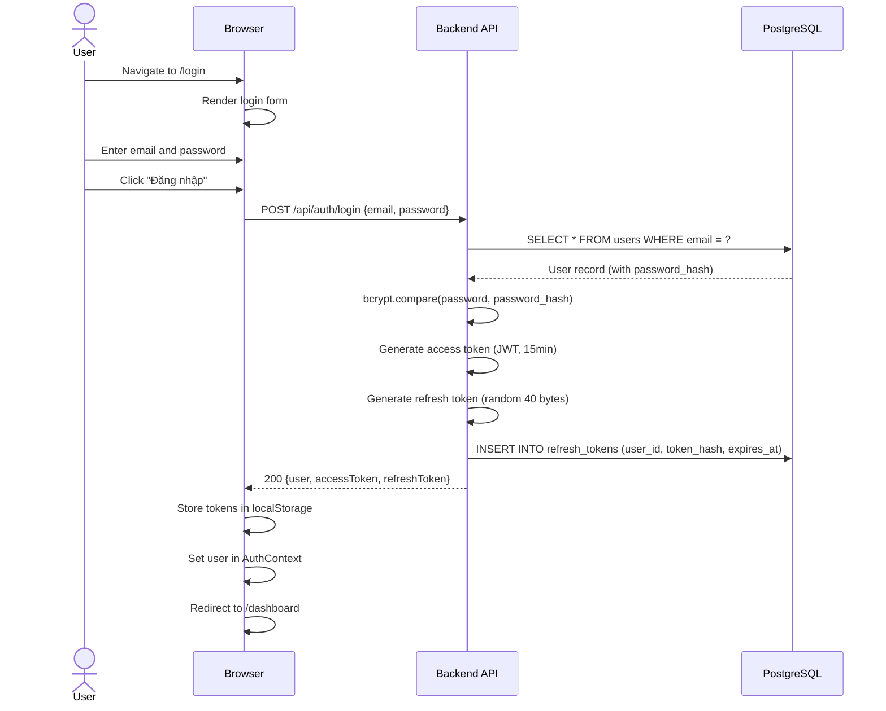
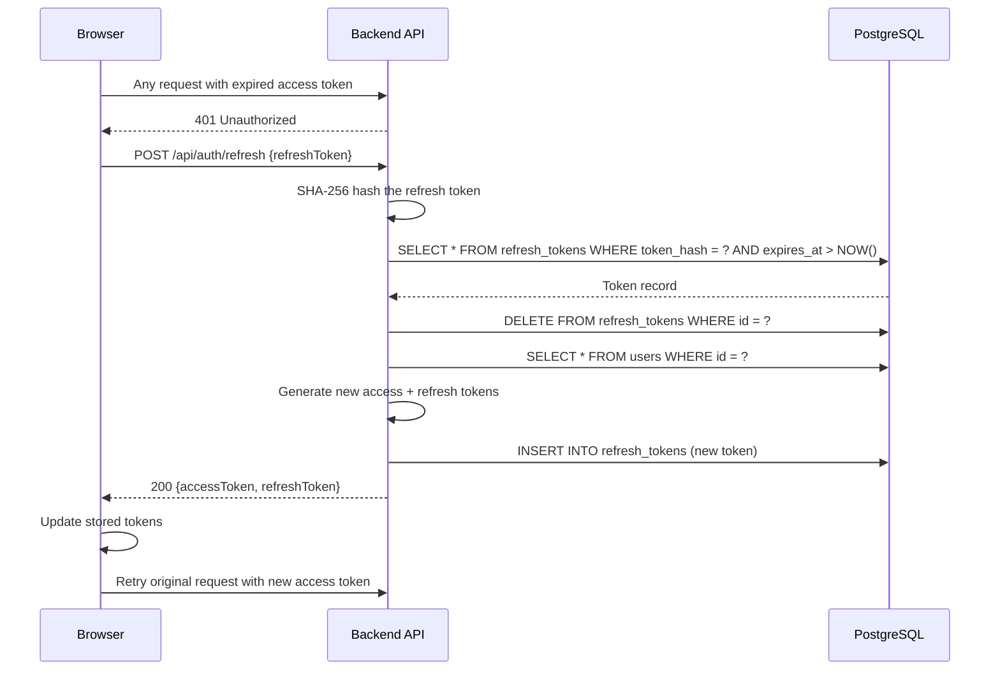
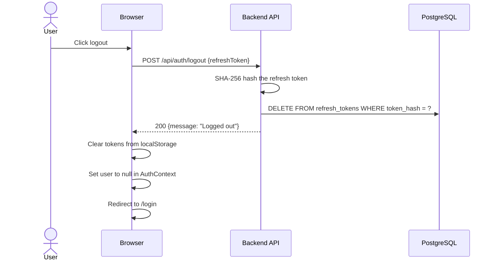
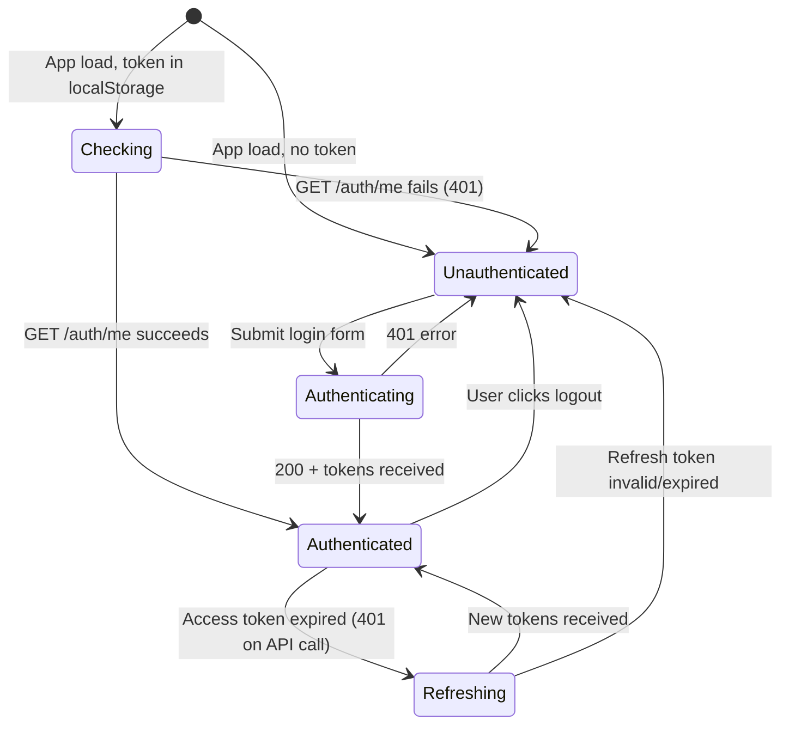

# A2. Login / Logout / Token Refresh

## 5.1 Feature Overview

| Field | Value |
|---|---|
| Feature ID | A2 |
| Feature Name | Login / Logout / Token Refresh |
| Module | A. Authentication & User Management |
| Priority | P0 |
| Complexity | M |
| Status | **Existing** — Backend and frontend fully implemented |
| Target Roles | All registered users (TEACHER, STUDENT) |
| Business Objective | Authenticate users, maintain sessions, and allow secure logout |
| User Problem | Users need secure access to the platform with persistent sessions that don't require frequent re-login |
| Dependencies | A1 (Registration) — user must have an account |

## 5.2 Actors and Permissions

### Anonymous User

| Action | Allowed | Notes |
|---|---|---|
| View login form | Yes | Public route |
| Submit login credentials | Yes | Public endpoint with `@Public()` |
| Access protected routes | No | Redirected to /login by ProtectedRoute component |
| Submit refresh token | Yes | Public endpoint (token is the credential) |

### Authenticated User

| Action | Allowed | Notes |
|---|---|---|
| View login form | Redirected | Redirected to /dashboard |
| Log out | Yes | Invalidates refresh token |
| Refresh access token | Yes | Transparent via frontend interceptor |
| Access endpoints matching their role | Yes | Enforced by RolesGuard |

### Backend Authorization

- `POST /auth/login` — `@Public()`, no JWT required.
- `POST /auth/refresh` — `@Public()`, validates the refresh token itself.
- `POST /auth/logout` — Requires valid JWT (no `@Public()`). Body must include the refresh token to invalidate.
- All other endpoints — Require valid JWT via global `JwtAuthGuard`.

## 5.3 Preconditions and Business Rules

| Rule ID | Rule | Enforcement |
|---|---|---|
| LOGIN-BR-01 | Login requires email and password | DTO validation |
| LOGIN-BR-02 | Password is verified against bcrypt hash | `bcrypt.compare()` in AuthService |
| LOGIN-BR-03 | Invalid credentials return a generic "Invalid credentials" message | Does not reveal whether email exists or password is wrong |
| LOGIN-BR-04 | Successful login returns both access token and refresh token | AuthService.generateTokens() |
| LOGIN-BR-05 | Access token expires in 15 minutes (900 seconds) | JWT `expiresIn` from config, default `900s` |
| LOGIN-BR-06 | Refresh token expires in 7 days | Stored with `expiresAt` in DB |
| LOGIN-BR-07 | Refresh token is a 40-byte random hex, stored as SHA-256 hash | `crypto.randomBytes(40)`, hashed with `crypto.createHash('sha256')` |
| LOGIN-BR-08 | Refresh token rotation — old token deleted on refresh, new token issued | Delete-then-create in `refresh()` |
| LOGIN-BR-09 | Logout invalidates the refresh token | `deleteMany` by tokenHash |
| LOGIN-BR-10 | Logout is idempotent — calling logout with an already-deleted token does not error | `deleteMany` returns 0 deleted, no exception |
| LOGIN-BR-11 | Access token payload contains `{ sub: userId, role: userRole }` | Used by JwtStrategy to identify user |
| LOGIN-BR-12 | Tokens are stored in browser localStorage | Via `setTokens()` in api.ts |

## 5.4 Main User Flow — Happy Path

### Login Flow



### Token Refresh Flow



### Logout Flow



## 5.5 Alternative Flows

### AF-01: User visits /login while already authenticated

- AuthContext has a non-null `user`.
- `useEffect` in LoginPage detects this and calls `router.replace('/dashboard')`.

### AF-02: Token refresh fails (refresh token expired or invalid)

- API returns 401.
- Frontend clears tokens and user state.
- User is effectively logged out and must re-authenticate.

### AF-03: User closes browser and returns later

- On next visit, `AuthProvider` runs `fetchUser()`.
- It calls `loadTokens()` to read localStorage.
- If access token exists, tries `GET /auth/me`.
- If the access token is expired and auto-refresh is not implemented in the interceptor, the request fails and tokens are cleared.

### AF-04: Multiple tabs open

- All tabs share the same localStorage tokens.
- Logout in one tab clears localStorage, but other tabs won't know until they attempt an API call.
- On failed API call, the tab clears its AuthContext and redirects to login.

## 5.6 Edge Cases and Failure Scenarios

| Scenario ID | Scenario | Trigger | Expected Behavior | User Feedback | Data Integrity | Recovery | Severity |
|---|---|---|---|---|---|---|---|
| EC-A2-01 | Wrong password | User enters incorrect password | `bcrypt.compare` returns false, 401 thrown | "Invalid credentials" error in red banner | No state change | User retries with correct password | Medium |
| EC-A2-02 | Non-existent email | User enters email not in the database | `findByEmail` returns null, 401 thrown | "Invalid credentials" (same as wrong password — no email enumeration) | No state change | User registers or corrects email | Medium |
| EC-A2-03 | Access token expires mid-session | User is working on a page, token expires | Next API call returns 401 | If auto-refresh works: seamless. If not: user must re-login | No data loss (frontend should retry) | Auto-refresh or re-login | High |
| EC-A2-04 | Refresh token expired | User returns after 7+ days | Refresh call returns 401 | Must re-login | Old refresh token no longer in DB (auto-purged or expired) | User logs in again | Medium |
| EC-A2-05 | Refresh token reuse after rotation | Attacker captures an old refresh token and tries to use it | Token hash not found in DB, 401 returned | N/A (API call) | New token was already issued; old one deleted | Token rotation protects against replay | Critical (mitigated) |
| EC-A2-06 | Concurrent refresh requests | Two tabs refresh simultaneously with the same token | First request succeeds, deletes the token. Second request finds no token, returns 401 | One tab continues working; other tab logs out | Only one new token pair issued | Tab that failed needs to re-login | Medium |
| EC-A2-07 | Logout with invalid refresh token | User's refresh token was already invalidated | `deleteMany` returns 0, no error thrown | "Logged out" message returned regardless | No state change | N/A — logout is complete | Low |
| EC-A2-08 | Login with disabled/deleted account | Account was removed from DB | `findByEmail` returns null, 401 | "Invalid credentials" | No state change | User contacts administrator | Medium |
| EC-A2-09 | localStorage cleared or unavailable | Private browsing, or user clears site data | `loadTokens()` finds nothing, user appears unauthenticated | Must log in again | No server-side impact | Log in again | Low |
| EC-A2-10 | JWT secret changes (server restart with new secret) | Deployment misconfiguration | All existing access tokens become invalid | All users get 401 on next request | Refresh tokens are still valid (stored hashed, not JWT) | Users can refresh or re-login | High |
| EC-A2-11 | Brute force login attempts | Attacker tries many passwords | No rate limiting exists | No feedback beyond 401 | No state change | **Gap**: Implement rate limiting | Critical |
| EC-A2-12 | Token stored in localStorage (XSS risk) | XSS vulnerability elsewhere in the app | Attacker could read tokens from localStorage | N/A | Tokens compromised | Logout invalidates refresh token. Consider httpOnly cookies for production. | High |

## 5.7 UI/UX Specification

### Login Page

**Entry Point**: `/login` — default landing for unauthenticated users.

**Layout**: Full-screen centered card, identical structure to registration page.

**Components**:
- Card with header: "Lumi Lite" title (text-primary, text-2xl, font-bold), subtitle "Đăng nhập vào tài khoản của bạn".
- Form with email input, password input, submit button.
- Link to registration page: "Chưa có tài khoản? Đăng ký".
- **Missing**: No "Quên mật khẩu?" link on the login page — see Password Reset spec.

**Fields**:

| Field | Type | Label | Placeholder | Required |
|---|---|---|---|---|
| Email | email | "Email" | "email@example.com" | Yes |
| Password | password | "Mật khẩu" | "••••••••" | Yes |

**States**:

| State | Behavior |
|---|---|
| Default | Empty form |
| Loading | Button disabled, text "Đang đăng nhập..." |
| Error | Red banner: `bg-destructive/10 text-destructive` with error message |
| Success | Redirect to /dashboard |

### Logout

**Entry Point**: Dropdown menu in dashboard header layout.

**Behavior**: Calls `logout()` from AuthContext. Silently catches API errors (fire-and-forget). Clears local state. Redirects via router or page reload.

### Token Refresh (Invisible)

No UI — happens transparently via API interceptor when a request receives 401.

## 5.8 Data Requirements

### Existing Schema (Verified)

**Table: `refresh_tokens`**

| Column | Type | Constraints | Notes |
|---|---|---|---|
| id | UUID | PK | |
| user_id | UUID | FK → users(id), ON DELETE CASCADE | |
| token_hash | String | NOT NULL | SHA-256 of the raw token |
| expires_at | DateTime | NOT NULL | NOW() + 7 days at creation |
| created_at | DateTime | NOT NULL, default now() | |

**Indexes**: `@@index([userId])` — for listing/cleaning a user's tokens.

### Proposed Changes

| Change | Rationale | Priority |
|---|---|---|
| Add `device_info` or `user_agent` to refresh_tokens | Allow users to see active sessions and revoke specific ones | P3 |
| Periodic cleanup of expired refresh tokens | Prevent table bloat | P2 — can use a simple cron or Prisma query on startup |

## 5.9 API Requirements

### POST /api/auth/login

| Field | Value |
|---|---|
| Method | POST |
| Endpoint | `/api/auth/login` |
| Purpose | Authenticate user and issue tokens |
| Required Role | None (public) |
| Authorization | `@Public()` |
| Idempotency | Not idempotent — creates a new refresh token each time |

**Request Body**:

```json
{
  "email": "teacher@example.com",
  "password": "securePassword123"
}
```

**Success Response (200)**:

```json
{
  "success": true,
  "data": {
    "user": {
      "id": "uuid",
      "email": "teacher@example.com",
      "displayName": "Nguyễn Văn A",
      "role": "TEACHER",
      "createdAt": "2026-11-11T10:00:00.000Z"
    },
    "accessToken": "eyJhbGciOi...",
    "refreshToken": "a1b2c3d4e5..."
  }
}
```

**Error Responses**:

| Status | Condition |
|---|---|
| 400 | Missing or invalid fields |
| 401 | Invalid credentials (wrong email or password) |

---

### POST /api/auth/refresh

| Field | Value |
|---|---|
| Method | POST |
| Endpoint | `/api/auth/refresh` |
| Purpose | Exchange refresh token for new token pair |
| Required Role | None (public) |
| Authorization | `@Public()` — the refresh token itself is the credential |

**Request Body**:

```json
{
  "refreshToken": "a1b2c3d4e5..."
}
```

**Success Response (200)**:

```json
{
  "success": true,
  "data": {
    "accessToken": "eyJhbGciOi... (new)",
    "refreshToken": "f6g7h8i9j0... (new, rotated)"
  }
}
```

**Error Responses**:

| Status | Condition |
|---|---|
| 400 | Missing refreshToken |
| 401 | Invalid, expired, or already-consumed refresh token |

**Important**: This endpoint performs token rotation. The old refresh token is deleted and a new one is issued. A replay of the old token will fail.

---

### POST /api/auth/logout

| Field | Value |
|---|---|
| Method | POST |
| Endpoint | `/api/auth/logout` |
| Purpose | Invalidate refresh token (end session) |
| Required Role | Authenticated (any role) |
| Authorization | Requires valid JWT access token |
| Idempotency | Yes — calling with an already-deleted token returns 200 |

**Request Body**:

```json
{
  "refreshToken": "a1b2c3d4e5..."
}
```

**Success Response (200)**:

```json
{
  "success": true,
  "data": {
    "message": "Logged out"
  }
}
```

**Error Responses**:

| Status | Condition |
|---|---|
| 401 | No valid access token (JWT guard rejects) |

---

### GET /api/auth/me

| Field | Value |
|---|---|
| Method | GET |
| Endpoint | `/api/auth/me` |
| Purpose | Get current authenticated user's profile |
| Required Role | Authenticated (any role) |
| Authorization | Requires valid JWT |

**Success Response (200)**:

```json
{
  "success": true,
  "data": {
    "id": "uuid",
    "email": "teacher@example.com",
    "displayName": "Nguyễn Văn A",
    "role": "TEACHER",
    "createdAt": "2026-11-11T10:00:00.000Z"
  }
}
```

**Note**: Never returns `passwordHash`.

## 5.10 State Management

### Authentication State Machine



### Frontend Auth State (`AuthContext`)

| Property | Type | Description |
|---|---|---|
| `user` | `User \| null` | Current user object, or null if not authenticated |
| `loading` | `boolean` | True during initial auth check on app load |

## 5.11 Acceptance Criteria

### Login

**AC-A2-01**: Given a registered user with email "user@test.com" and password "password123", when they enter these credentials on the login page and click "Đăng nhập", then they receive tokens and are redirected to /dashboard.

**AC-A2-02**: Given a registered user, when they enter a wrong password, then they see "Invalid credentials" and no tokens are issued.

**AC-A2-03**: Given no user with email "nobody@test.com" exists, when someone enters this email with any password, then they see "Invalid credentials" (same message as wrong password — no email enumeration).

### Token Refresh

**AC-A2-04**: Given a user has a valid refresh token, when their access token expires and the frontend calls POST /auth/refresh, then new access and refresh tokens are returned and the old refresh token is invalidated.

**AC-A2-05**: Given a refresh token that has already been consumed (rotated), when an attacker attempts to use it, then the request is rejected with 401.

### Logout

**AC-A2-06**: Given an authenticated user, when they click logout, then their refresh token is deleted from the database, tokens are removed from localStorage, and they are redirected to /login.

**AC-A2-07**: Given a user has already logged out, when the same logout request is repeated, then the server returns 200 without error (idempotent).

## 5.12 QA Test Scenarios

| Test Case ID | Scenario | Preconditions | Test Steps | Test Data | Expected Result | Priority |
|---|---|---|---|---|---|---|
| TC-A2-01 | Successful login | Registered user exists | 1. Go to /login 2. Enter email+password 3. Click submit | Valid credentials | Tokens returned, redirect to /dashboard | P0 |
| TC-A2-02 | Wrong password | Registered user exists | 1. Enter correct email, wrong password 2. Submit | Wrong password | 401, "Invalid credentials" error shown | P0 |
| TC-A2-03 | Non-existent email | No user with that email | 1. Enter nonexistent email 2. Submit | Fake email | 401, "Invalid credentials" (same message) | P0 |
| TC-A2-04 | Empty credentials | None | 1. Click submit with empty fields | Empty | HTML required prevents submission | P1 |
| TC-A2-05 | Token refresh success | User has valid refresh token | 1. Call POST /auth/refresh with valid token | Valid refresh token | New access + refresh tokens | P0 |
| TC-A2-06 | Token rotation | After refresh | 1. Refresh with token A → get token B 2. Try to refresh with token A again | Reused token | 401 on second attempt | P0 |
| TC-A2-07 | Expired refresh token | Refresh token > 7 days old | 1. Call POST /auth/refresh with expired token | Expired token | 401 | P0 |
| TC-A2-08 | Logout invalidates token | Logged in user | 1. Call POST /auth/logout with refresh token 2. Call POST /auth/refresh with same token | Token from login | Logout: 200. Refresh: 401 | P0 |
| TC-A2-09 | Logout is idempotent | Already logged out | 1. Logout 2. Logout again with same token | Same token | Both return 200 | P1 |
| TC-A2-10 | /login redirect when authenticated | User is logged in | 1. Navigate to /login | Active session | Redirect to /dashboard | P1 |
| TC-A2-11 | Access token in JWT payload | Login successfully | 1. Decode the access token JWT | N/A | Contains `sub` (userId) and `role` fields | P0 |
| TC-A2-12 | Concurrent login sessions | Same user, different browsers | 1. Login from browser A 2. Login from browser B | Same credentials | Both sessions work independently (separate refresh tokens) | P1 |

## 5.13 Open Questions and Assumptions

### OQ-A2-01: Should login be rate-limited?

| | |
|---|---|
| **Question** | There is no rate limiting on the login endpoint. Should we add it? |
| **Why it matters** | An attacker can brute-force passwords. At 100 users this is low risk, but still a best practice gap. |
| **Options** | (a) NestJS throttler module (in-memory or Redis-backed). (b) Nginx-level rate limiting. (c) Defer for MVP. |
| **Recommended default** | Option (c) for MVP, with (b) added in deployment hardening (M10). |
| **Impact** | Low effort for any option. |

### OQ-A2-02: Should tokens use httpOnly cookies instead of localStorage?

| | |
|---|---|
| **Question** | Current implementation stores tokens in localStorage, which is vulnerable to XSS. |
| **Why it matters** | If any XSS vulnerability exists, tokens can be stolen. httpOnly cookies prevent JavaScript access. |
| **Options** | (a) Switch to httpOnly cookies. (b) Keep localStorage for simplicity. (c) Hybrid: access token in memory, refresh token in httpOnly cookie. |
| **Recommended default** | Option (b) for MVP. Note the risk in security documentation. |
| **Impact** | Switching to cookies requires CORS config changes, CSRF protection, and backend cookie handling. |

### OQ-A2-03: Should there be a "Quên mật khẩu?" link on the login page?

| | |
|---|---|
| **Question** | The login page currently has no link to the forgot password flow. |
| **Why it matters** | Users who forget their password have no way to recover from the login page. The API exists but has no UI. |
| **Recommended default** | Add a "Quên mật khẩu?" link below the password field, linking to a dedicated page or modal. |
| **Impact** | Frontend-only change. See A3 (Password Reset) spec. |

### Assumptions

| ID | Assumption | Risk if Wrong |
|---|---|---|
| ASM-A2-01 | Multiple concurrent sessions per user are allowed | If single-session is required, need to invalidate all tokens on new login |
| ASM-A2-02 | Access token expiry of 15 minutes is acceptable | If too short for exam-taking, users may get logged out mid-exam (mitigated by auto-refresh) |
| ASM-A2-03 | No "remember me" functionality is needed | If needed, would use longer refresh token expiry |
| ASM-A2-04 | Deleted users cannot log in | No soft-delete on users currently; if added, login must check active status |
