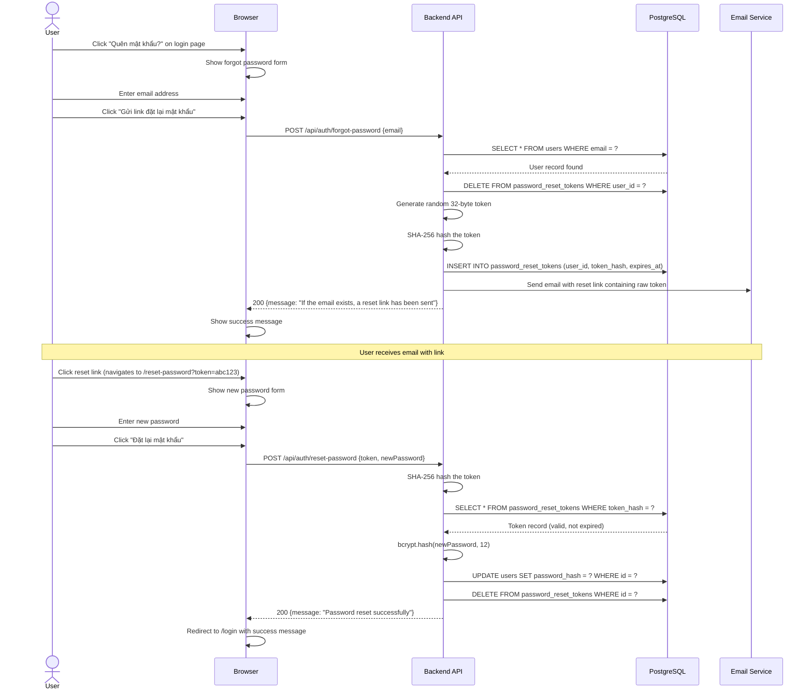
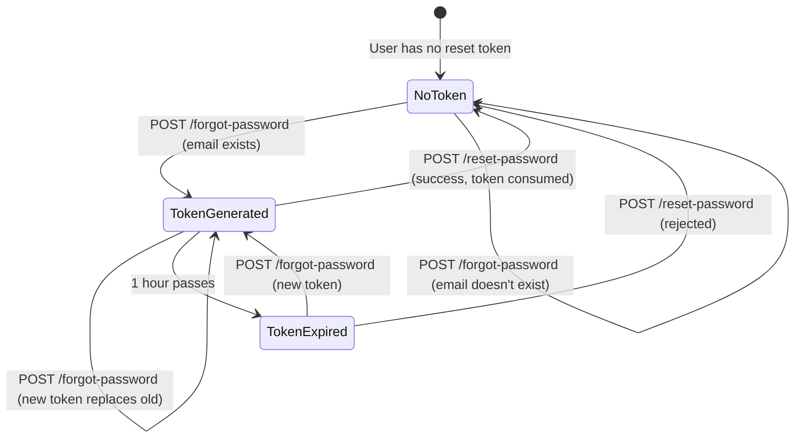

# A3. Forgot / Reset Password

## 5.1 Feature Overview

| Field | Value |
|---|---|
| Feature ID | A3 |
| Feature Name | Forgot Password / Reset Password |
| Module | A. Authentication & User Management |
| Priority | P1 |
| Complexity | M |
| Status | **Partially Implemented** — Backend API complete, no dedicated frontend page |
| Target Roles | Anonymous users who have a registered account |
| Business Objective | Allow users to regain access to their account when they forget their password |
| User Problem | A user cannot log in because they forgot their password |
| Dependencies | A1 (Registration) — user must have an account; Email service — **not yet implemented** |

## 5.2 Actors and Permissions

### Anonymous User (Forgot Password)

| Action | Allowed | Notes |
|---|---|---|
| Request password reset | Yes | Public endpoint; does not reveal whether email exists |
| Submit reset token + new password | Yes | Public endpoint; token is the credential |

### Authenticated User

| Action | Allowed | Notes |
|---|---|---|
| Request password reset | Yes | Can use forgot-password even while logged in |
| Reset another user's password | No | Token is scoped to the user who requested it |

### Backend Authorization

- `POST /auth/forgot-password` — `@Public()`, no JWT required.
- `POST /auth/reset-password` — `@Public()`, token in request body is the credential.
- No role-based restrictions — any registered user can reset their password.

## 5.3 Preconditions and Business Rules

| Rule ID | Rule | Enforcement |
|---|---|---|
| PW-BR-01 | Forgot-password always returns 200, regardless of whether the email exists | Prevents email enumeration attacks |
| PW-BR-02 | Reset token is 32 bytes of `crypto.randomBytes`, hex-encoded | Generated in `forgotPassword()` |
| PW-BR-03 | Token stored as SHA-256 hash in the database | `hashToken()` method; raw token never stored |
| PW-BR-04 | Token expires after 1 hour | `expiresAt = Date.now() + 3600_000` |
| PW-BR-05 | Only one active reset token per user at a time | Previous tokens deleted before creating new one (`deleteMany`) |
| PW-BR-06 | Token is single-use — deleted after successful reset | `delete` after password update |
| PW-BR-07 | New password must be at least 6 characters | DTO validation (`@MinLength(6)`) |
| PW-BR-08 | New password is hashed with bcrypt (cost 12) | Same hashing as registration |
| PW-BR-09 | After reset, the user can log in with the new password immediately | Password hash updated in users table |
| PW-BR-10 | Existing refresh tokens are NOT invalidated after password reset | **Gap**: User should be forced to re-login on all devices after password change |

### Implementation Gap: No Email Service

The current implementation returns the raw reset token in the API response (`resetToken` field) for development purposes. In production:
- The token must be sent via email, not returned in the response.
- The response should only contain the generic message.
- An email service (e.g., Nodemailer + SMTP, or a transactional email provider) must be configured.

### Implementation Gap: No Frontend Page

There is no dedicated `/forgot-password` or `/reset-password` page. The API endpoints exist and work, but there is no way for users to access this feature through the UI.

## 5.4 Main User Flow — Happy Path



## 5.5 Alternative Flows

### AF-01: Email does not exist in the system

- `findByEmail` returns null.
- API returns the same 200 message: "If the email exists, a reset link has been sent".
- No token is created. No email is sent.
- User sees the same success message (no email enumeration).

### AF-02: User requests reset multiple times

- Each request deletes all previous tokens for that user (`deleteMany`).
- Only the most recent token is valid.
- Previous reset links become invalid.

### AF-03: User remembers password before using the token

- Token expires naturally after 1 hour.
- No cleanup needed; expired tokens are checked on use.
- User logs in normally.

### AF-04: User resets password while logged in on another device

- Password is updated.
- Existing refresh tokens on other devices remain valid (current implementation).
- Other sessions continue working until their access token expires.
- **Recommended improvement**: Invalidate all refresh tokens for the user on password reset.

## 5.6 Edge Cases and Failure Scenarios

| Scenario ID | Scenario | Trigger | Expected Behavior | User Feedback | Data Integrity | Recovery | Severity |
|---|---|---|---|---|---|---|---|
| EC-A3-01 | Token expired | User clicks reset link after 1 hour | `expiresAt < new Date()` check fails, 400 thrown | "Invalid or expired reset token" | No password change | User requests a new reset | Medium |
| EC-A3-02 | Token already used | User clicks the same reset link a second time | Token was deleted after first use, `findUnique` returns null, 400 | "Invalid or expired reset token" | Password already changed from first use | N/A — password was already reset | Low |
| EC-A3-03 | Invalid/tampered token | Attacker guesses or modifies the token | SHA-256 hash doesn't match any record, 400 | "Invalid or expired reset token" | No state change | N/A | Low (mitigated by 32-byte randomness) |
| EC-A3-04 | Brute force token guessing | Attacker tries many tokens | 2^256 possible hashes; infeasible to brute-force | 400 for each attempt | No state change | **Consider**: Rate limiting on reset-password endpoint | Low |
| EC-A3-05 | User account deleted between request and reset | User requests reset, then account is deleted | `CASCADE` on PasswordResetToken deletes the token; or if token found, `updateProfile` on a deleted user fails | Error during reset | Token is orphaned or cascaded | User cannot reset — account doesn't exist | Low |
| EC-A3-06 | New password same as current | User sets the same password | Currently allowed — no check for password reuse | Success message | Password hash updated (with different salt, so hash changes) | N/A | Low |
| EC-A3-07 | Password too short | User enters password < 6 chars | DTO `@MinLength(6)` rejects with 400 | Validation error | No state change | User enters longer password | Low |
| EC-A3-08 | Concurrent reset requests for same user | Two browser tabs submit forgot-password simultaneously | Second request overwrites first (`deleteMany` then `create`); only the token from the second request is valid | Both tabs show success | Only one valid token in DB | Use the most recent email's link | Low |
| EC-A3-09 | Email service failure | SMTP server is down when sending reset email | In current implementation (no email service), token is returned in response. In production, request should still return 200 (don't reveal failure) | Same success message | Token created in DB but email not sent | User retries; new token replaces the unsent one | High (production only) |
| EC-A3-10 | Token with special characters in URL | Token hex contains characters that need URL encoding | Token is hex-encoded (0-9, a-f only) — URL-safe | N/A | N/A | N/A | Low |

## 5.7 UI/UX Specification

### Current State: No Dedicated UI

The forgot/reset password flow has no frontend pages. The following specification describes the **proposed** UI.

### Proposed: Forgot Password Page

**URL**: `/forgot-password`

**Entry Point**: "Quên mật khẩu?" link on the /login page (currently missing — must be added).

**Layout**: Same centered card as login/register.

**Components**:
- Card header: "Quên mật khẩu" title, subtitle: "Nhập email để nhận link đặt lại mật khẩu"
- Email input field
- Submit button: "Gửi link"
- Back link: "Quay lại đăng nhập"

**States**:

| State | Behavior |
|---|---|
| Default | Empty email input |
| Loading | Button disabled, text "Đang gửi..." |
| Success | Show message: "Nếu email tồn tại, chúng tôi đã gửi link đặt lại mật khẩu." Hide the form. Show "Quay lại đăng nhập" link. |
| Error (validation) | Show field validation error |
| Error (network) | Show generic error banner |

### Proposed: Reset Password Page

**URL**: `/reset-password?token=<token>`

**Entry Point**: Link in the email (or returned in dev response).

**Layout**: Same centered card.

**Components**:
- Card header: "Đặt lại mật khẩu" title
- New password input
- Confirm password input (client-side match validation)
- Submit button: "Đặt lại mật khẩu"

**States**:

| State | Behavior |
|---|---|
| Default | Empty password fields |
| Loading | Button disabled, text "Đang xử lý..." |
| Success | Show message: "Mật khẩu đã được đặt lại." Show "Đăng nhập" link. |
| Error (invalid token) | Show: "Link đặt lại mật khẩu không hợp lệ hoặc đã hết hạn." Show "Gửi lại link" button. |
| Error (validation) | Show field validation errors |

## 5.8 Data Requirements

### Existing Schema (Verified)

**Table: `password_reset_tokens`**

| Column | Type | Constraints | Notes |
|---|---|---|---|
| id | UUID | PK | |
| user_id | UUID | FK → users(id), ON DELETE CASCADE | |
| token_hash | String | UNIQUE | SHA-256 of the raw token |
| expires_at | DateTime | NOT NULL | NOW() + 1 hour |
| created_at | DateTime | NOT NULL, default now() | |

**Indexes**: `@@index([userId])` for cleanup queries.

### Proposed Changes

| Change | Rationale | Priority |
|---|---|---|
| None — schema is adequate | N/A | N/A |

### Data Lifecycle

- Token created on forgot-password request.
- Previous tokens for the same user deleted first (one active token per user).
- Token deleted after successful password reset.
- Expired tokens remain in DB until next request (no cleanup job).
- `ON DELETE CASCADE` from users — if user is deleted, token is deleted.

## 5.9 API Requirements

### POST /api/auth/forgot-password

| Field | Value |
|---|---|
| Method | POST |
| Endpoint | `/api/auth/forgot-password` |
| Purpose | Request a password reset token |
| Required Role | None (public) |
| Authorization | `@Public()` |

**Request Body**:

```json
{
  "email": "user@example.com"
}
```

**Success Response (200)** — always, regardless of email existence:

```json
{
  "success": true,
  "data": {
    "message": "If the email exists, a reset link has been sent",
    "resetToken": "a1b2c3..." 
  }
}
```

> **Note**: `resetToken` is returned only in development mode. Must be removed in production.

**Error Responses**:

| Status | Condition |
|---|---|
| 400 | Invalid email format |

---

### POST /api/auth/reset-password

| Field | Value |
|---|---|
| Method | POST |
| Endpoint | `/api/auth/reset-password` |
| Purpose | Set a new password using a reset token |
| Required Role | None (public) |
| Authorization | `@Public()` — the token is the credential |

**Request Body**:

```json
{
  "token": "a1b2c3d4e5f6...",
  "newPassword": "newSecurePassword123"
}
```

**Success Response (200)**:

```json
{
  "success": true,
  "data": {
    "message": "Password reset successfully"
  }
}
```

**Error Responses**:

| Status | Condition |
|---|---|
| 400 | Invalid or expired token |
| 400 | New password too short (< 6 chars) |

## 5.10 State Management



## 5.11 Acceptance Criteria

### Positive Cases

**AC-A3-01**: Given a registered user with email "user@test.com", when they submit a forgot-password request with that email, then a reset token is generated and stored (hashed) in the database.

**AC-A3-02**: Given a valid reset token, when the user submits a new password (minimum 6 characters), then their password is updated and the token is consumed.

**AC-A3-03**: Given a user has reset their password, when they log in with the new password, then authentication succeeds.

### Negative Cases

**AC-A3-04**: Given an email "nobody@test.com" that is not registered, when someone submits a forgot-password request with that email, then the response is 200 with the same generic message (no email enumeration).

**AC-A3-05**: Given a reset token that was generated more than 1 hour ago, when the user attempts to reset their password, then the request is rejected with 400.

**AC-A3-06**: Given a reset token that has already been used, when the user attempts to use it again, then the request is rejected with 400.

**AC-A3-07**: Given a user requests a new reset token, when they try to use the previously generated token, then it fails (old token was deleted).

## 5.12 QA Test Scenarios

| Test Case ID | Scenario | Preconditions | Test Steps | Test Data | Expected Result | Priority |
|---|---|---|---|---|---|---|
| TC-A3-01 | Full reset flow | Registered user | 1. POST /forgot-password 2. Use returned token in POST /reset-password 3. Login with new password | email: "user@test.com", newPassword: "newpass123" | All three steps succeed | P0 |
| TC-A3-02 | Non-existent email | No user with that email | 1. POST /forgot-password with fake email | email: "fake@test.com" | 200 with generic message, no token in DB | P0 |
| TC-A3-03 | Expired token | Token > 1 hour old | 1. Generate token 2. Manually set expiresAt to past 3. POST /reset-password | Expired token | 400 "Invalid or expired" | P0 |
| TC-A3-04 | Reused token | Token already consumed | 1. Reset password with token 2. Try to reset again with same token | Same token | Second attempt: 400 | P0 |
| TC-A3-05 | Token replacement | Two requests for same email | 1. POST /forgot-password → token A 2. POST /forgot-password → token B 3. Try token A | Same email | Token A: 400 (deleted). Token B: succeeds | P1 |
| TC-A3-06 | Short new password | Valid token | 1. POST /reset-password with 3-char password | newPassword: "abc" | 400 validation error | P1 |
| TC-A3-07 | Old password still works after requesting reset (before using token) | Token generated but not used | 1. Request reset 2. Login with old password | Old credentials | Login succeeds (token doesn't change password) | P1 |
| TC-A3-08 | Old password fails after reset | Password was reset | 1. Reset password 2. Login with old password | Old password | 401 Invalid credentials | P0 |
| TC-A3-09 | Token is not stored in plaintext | After requesting reset | 1. Query password_reset_tokens table | N/A | token_hash column contains SHA-256 hex, not the raw token | P0 |
| TC-A3-10 | Invalid token format | Random string | 1. POST /reset-password with garbage token | token: "garbage" | 400 "Invalid or expired" | P1 |

## 5.13 Open Questions and Assumptions

### OQ-A3-01: Should password reset invalidate all existing sessions?

| | |
|---|---|
| **Question** | After a password reset, should all refresh tokens for that user be invalidated? |
| **Why it matters** | If a user's password was compromised and they reset it, the attacker's active session (refresh token) would still work. |
| **Options** | (a) Delete all refresh tokens for the user on password reset. (b) Keep existing sessions. |
| **Recommended default** | Option (a) — delete all refresh tokens on password reset. One-line addition to `resetPassword()`. |
| **Impact** | Low. Add `await this.prisma.refreshToken.deleteMany({ where: { userId: stored.userId } })` in resetPassword. |

### OQ-A3-02: Should there be rate limiting on forgot-password?

| | |
|---|---|
| **Question** | The original spec mentions "max 3 requests per email per hour" but this is not implemented. |
| **Why it matters** | Without rate limiting, an attacker could flood a user's inbox. With the current implementation (token returned in response), it's less of an issue, but will matter when email is enabled. |
| **Recommended default** | Defer until email service is added. The `deleteMany` before `create` already ensures only one active token. |

### OQ-A3-03: What is the frontend flow for password reset?

| | |
|---|---|
| **Question** | No /forgot-password or /reset-password page exists. What should the UX be? |
| **Why it matters** | Users currently have no way to use this feature from the UI. |
| **Options** | (a) Dedicated pages: /forgot-password and /reset-password. (b) Modal on the login page. (c) Defer until email service is configured. |
| **Recommended default** | Option (a) — consistent with the login/register page pattern. Add "Quên mật khẩu?" link to login page. |

### OQ-A3-04: Should the minimum password length be 6 or 8?

| | |
|---|---|
| **Question** | Registration requires 8 characters, but reset-password DTO only requires 6. This is inconsistent. |
| **Why it matters** | A user could reset their password to a weaker password than was originally required. |
| **Recommended default** | Align to 8 characters across all password inputs. |
| **Impact** | Change `@MinLength(6)` to `@MinLength(8)` in `ResetPasswordDto` and `UpdateProfileDto`. |

### Assumptions

| ID | Assumption | Risk if Wrong |
|---|---|---|
| ASM-A3-01 | Email service will be added before production launch | Users can't use this feature in production without it |
| ASM-A3-02 | The dev-mode `resetToken` in the response will be removed before production | Token exposure in production would be a critical security issue |
| ASM-A3-03 | One hour TTL is sufficient for reset tokens | If email delivery is slow, users might need more time |
| ASM-A3-04 | Only one reset token per user at a time is acceptable | No scenario requires multiple valid tokens |
