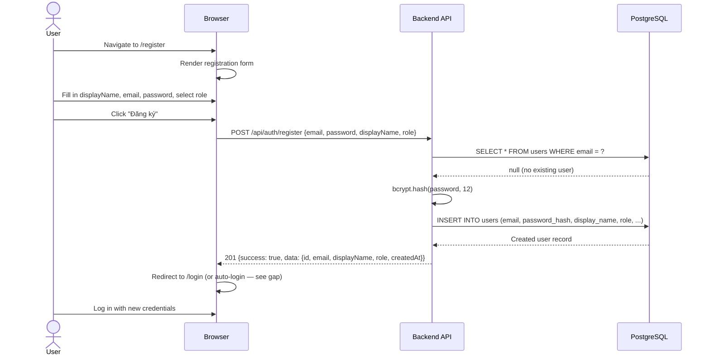
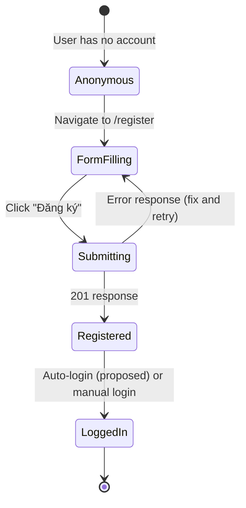

# A1. User Registration

## 5.1 Feature Overview

| Field | Value |
|---|---|
| Feature ID | A1 |
| Feature Name | User Registration |
| Module | A. Authentication & User Management |
| Priority | P0 |
| Complexity | M |
| Status | **Existing** — Backend and frontend implemented |
| Target Roles | Anonymous (unauthenticated) users |
| Business Objective | Allow new teachers and students to create accounts and start using the platform |
| User Problem | A user has no account and needs to access the LMS to teach or learn |
| Dependencies | None — this is a root feature |

## 5.2 Actors and Permissions

### Anonymous User (Visitor)

| Action | Allowed | Notes |
|---|---|---|
| View registration form | Yes | Public route |
| Create account | Yes | Self-service registration |
| Choose role (TEACHER/STUDENT) | Yes | Role is immutable after registration |
| Register as ADMIN | No | ADMIN role exists in enum but is not selectable via API/UI |

### Authenticated User

| Action | Allowed | Notes |
|---|---|---|
| View registration form | Redirected | If already logged in, redirect to /dashboard |
| Create a second account | No | Must log out first; no multi-account support |

### Backend Authorization

- `POST /auth/register` is decorated with `@Public()` — bypasses the global `JwtAuthGuard`.
- The `RegisterDto` uses `@IsEnum(Role)` which accepts `TEACHER`, `STUDENT`, and `ADMIN`. **Gap identified**: The backend does not explicitly reject `ADMIN` role registration. This is an authorization gap — see Open Questions.
- No rate limiting is currently implemented on the registration endpoint.

## 5.3 Preconditions and Business Rules

| Rule ID | Rule | Enforcement |
|---|---|---|
| REG-BR-01 | Email must be a valid email format | DTO validation (`@IsEmail()`) |
| REG-BR-02 | Email must be unique across all users | Service-level check + database UNIQUE constraint |
| REG-BR-03 | Password must be at least 8 characters | DTO validation (`@MinLength(8)`) |
| REG-BR-04 | Display name must be at least 1 character | DTO validation (`@MinLength(1)`) |
| REG-BR-05 | Role must be TEACHER or STUDENT | DTO validation (`@IsEnum(Role)`) — **but see gap above** |
| REG-BR-06 | Password is hashed with bcrypt (cost factor 12) before storage | AuthService.register() |
| REG-BR-07 | Registration does not automatically log the user in | Backend returns user data only, no tokens — **see Implementation Gap** |
| REG-BR-08 | Email comparison is case-sensitive | Prisma default — no explicit lowercasing |

### Implementation Gap

The frontend `auth-context.tsx` (line 57–64) expects the register response to include `accessToken` and `refreshToken`, but `AuthService.register()` only returns `sanitizeUser(user)` (no tokens). This means:
- Registration likely fails silently or throws a client-side error when trying to destructure tokens.
- **Recommendation**: Either (a) modify the backend to return tokens on registration (auto-login), or (b) modify the frontend to redirect to login after successful registration.

## 5.4 Main User Flow — Happy Path



**Steps**:

1. **User** navigates to `/register`.
2. **System** displays the registration form with fields: display name, email, password, role selector (Student/Teacher toggle buttons).
3. **User** enters display name (e.g., "Nguyễn Văn A").
4. **User** enters email (e.g., "teacher@example.com").
5. **User** enters password (minimum 8 characters).
6. **User** selects role: "Học sinh" (Student, default) or "Giáo viên" (Teacher).
7. **User** clicks "Đăng ký" button.
8. **System** sends POST /api/auth/register.
9. **System** validates input, checks email uniqueness, hashes password, creates user.
10. **System** returns the created user profile (without password hash).
11. **Browser** redirects to dashboard (if auto-login) or login page.

## 5.5 Alternative Flows

### AF-01: User navigates to register while already logged in

- **Trigger**: Authenticated user visits /register.
- **Behavior**: The `useEffect` in RegisterPage checks `user` from AuthContext. If not null, calls `router.replace('/dashboard')`.
- **Result**: User is silently redirected to the dashboard.

### AF-02: User switches role before submitting

- **Trigger**: User clicks the "Giáo viên" button after initially selecting "Học sinh" (or vice versa).
- **Behavior**: The `role` state toggles. The selected button shows `variant="default"` (primary blue), the unselected shows `variant="outline"`.
- **Result**: The final submission uses whichever role is currently selected.

### AF-03: User clicks "Đăng nhập" link to switch to login

- **Trigger**: User clicks the "Đã có tài khoản? Đăng nhập" link.
- **Behavior**: Next.js client-side navigation to /login.
- **Result**: Registration form state is lost (not persisted).

## 5.6 Edge Cases and Failure Scenarios

| Scenario ID | Scenario | Trigger | Expected Behavior | User Feedback | Data Integrity | Recovery | Severity |
|---|---|---|---|---|---|---|---|
| EC-A1-01 | Duplicate email | User registers with an email that already exists in the database | Backend throws `ConflictException` (409) | Error message: "Email already registered" displayed in red banner | No data created | User can change email and retry | Medium |
| EC-A1-02 | Password too short | User enters password with fewer than 8 characters | DTO validation rejects with 400 | Validation error shown; HTML `minLength={8}` provides client-side hint | No data created | User enters a longer password | Low |
| EC-A1-03 | Invalid email format | User enters "not-an-email" | DTO `@IsEmail()` rejects with 400 | Error shown; HTML `type="email"` provides client-side hint | No data created | User enters valid email | Low |
| EC-A1-04 | Empty display name | User submits with empty name | DTO `@MinLength(1)` rejects with 400 | Error message shown | No data created | User enters a name | Low |
| EC-A1-05 | Very long display name | User enters a 10,000-character name | No max length validation exists in DTO | Name stored as-is; potential UI overflow issues | User record created with long name | **Gap**: Add `@MaxLength(100)` to DTO | Medium |
| EC-A1-06 | SQL injection in email | Attacker sends `'; DROP TABLE users;--` as email | Prisma parameterized queries prevent injection | 400 validation error (not a valid email) | No data affected | N/A | Critical (mitigated) |
| EC-A1-07 | ADMIN role in request body | Attacker sends `role: "ADMIN"` via API | Currently accepted by `@IsEnum(Role)` — **gap** | User created with ADMIN role | ADMIN account created without authorization | **Fix required**: Reject ADMIN role in register DTO | Critical |
| EC-A1-08 | Concurrent duplicate registrations | Two requests with same email arrive simultaneously | First succeeds; second hits DB UNIQUE constraint and throws | Second request gets 409 Conflict | Only one user created | Second user retries with different email | Medium |
| EC-A1-09 | Network failure during registration | Connection drops after user clicks submit | Request never reaches server or response lost | Browser may show generic error | No user created (or created but client unaware) | User retries; if user was created, they'll get duplicate error — can then log in | Medium |
| EC-A1-10 | Email with mixed case | User registers with "Teacher@Example.COM" | Email stored as-is (no normalization) | Successful registration | User must log in with exact case used | **Recommendation**: Normalize email to lowercase | Medium |
| EC-A1-11 | XSS in display name | Attacker enters `<script>alert('xss')</script>` as name | Stored as-is in database; React auto-escapes on render | Name displayed safely (React escapes HTML) | Data contains script tags but not executed | Consider sanitizing input at API level | Low |
| EC-A1-12 | Unicode/emoji in display name | User enters "Nguyễn 🎓 Văn A" | Accepted; PostgreSQL handles Unicode | Displayed correctly | Valid data | None needed | Low |

## 5.7 UI/UX Specification

### Entry Point

- URL: `/register`
- Accessible via: Direct navigation, or "Đăng ký" link on login page.

### Page Layout

- Full-screen centered card (same pattern as login page).
- `min-h-screen` with `items-center justify-center` flex.
- Card: `max-w-md`, responsive padding.

### Form Fields

| Field | Type | Label (Vietnamese) | Placeholder | Required | Validation |
|---|---|---|---|---|---|
| Display Name | text input | "Họ tên" | "Nguyễn Văn A" | Yes | Min 1 char (HTML required) |
| Email | email input | "Email" | "email@example.com" | Yes | HTML type=email + required |
| Password | password input | "Mật khẩu" | "Tối thiểu 8 ký tự" | Yes | HTML minLength=8 + required |
| Role | 2-button toggle | "Vai trò" | N/A | Yes | Default: STUDENT |

### Role Selector

- Two buttons in a 2-column grid: "Học sinh" (Student) and "Giáo viên" (Teacher).
- Selected button: `variant="default"` (brand-primary blue background, white text).
- Unselected button: `variant="outline"` (border only).
- Default selection: Student.

### States

| State | Appearance |
|---|---|
| Default | Empty form, Student role pre-selected |
| Filling | Fields populated, no errors |
| Loading | Submit button disabled, text changes to "Đang tạo..." |
| Error | Red banner above form: `bg-destructive/10 text-destructive` |
| Success | Redirect to /dashboard (or /login) |

### Responsive Behavior

- Card is `w-full max-w-md` — fills mobile screen width with `px-4` page padding.
- Form elements stack vertically.
- Role toggle buttons are side-by-side (`grid-cols-2`).

### Accessibility

- All inputs have associated `<Label>` with `htmlFor` matching `id`.
- Error messages should use `role="alert"` (currently not implemented).
- Submit button disabled state uses muted styling.

## 5.8 Data Requirements

### Existing Schema (Verified)

**Table: `users`**

| Column | Type | Constraints | Notes |
|---|---|---|---|
| id | UUID | PK, auto-generated | `@default(uuid())` |
| email | String | UNIQUE, NOT NULL | |
| password_hash | String | NOT NULL | bcrypt hash (cost 12) |
| display_name | String | NOT NULL | Min 1 char validated in DTO |
| role | Enum (Role) | NOT NULL | TEACHER, STUDENT, ADMIN |
| created_at | DateTime | NOT NULL, default now() | |
| updated_at | DateTime | NOT NULL, auto-updated | `@updatedAt` |

### Proposed Changes

| Change | Rationale | Priority |
|---|---|---|
| Add max length constraint on `display_name` (100 chars) | Prevent abuse; UI assumes reasonable length | P1 |
| Add index on `email` (for login lookup) | Already has UNIQUE constraint which creates an index | None needed |
| Normalize email to lowercase before storage | Prevent duplicate accounts from case differences | P1 |

## 5.9 API Requirements

### POST /api/auth/register

| Field | Value |
|---|---|
| Method | POST |
| Endpoint | `/api/auth/register` |
| Purpose | Create a new user account |
| Required Role | None (public) |
| Authorization | `@Public()` — no JWT required |

**Request Body**:

```json
{
  "email": "teacher@example.com",
  "password": "securePassword123",
  "displayName": "Nguyễn Văn A",
  "role": "TEACHER"
}
```

| Field | Type | Required | Validation |
|---|---|---|---|
| email | string | Yes | Valid email format |
| password | string | Yes | Min 8 characters |
| displayName | string | Yes | Min 1 character |
| role | string | Yes | Must be "TEACHER" or "STUDENT" |

**Success Response (201 Created)**:

```json
{
  "success": true,
  "data": {
    "id": "550e8400-e29b-41d4-a716-446655440000",
    "email": "teacher@example.com",
    "displayName": "Nguyễn Văn A",
    "role": "TEACHER",
    "createdAt": "2026-11-11T10:00:00.000Z"
  }
}
```

**Error Responses**:

| Status | Code | Condition |
|---|---|---|
| 400 | Validation error | Missing/invalid fields |
| 409 | CONFLICT | Email already registered |

**Note**: Current implementation does NOT return tokens on registration. See Implementation Gap in section 5.3.

## 5.10 State Management

Registration has no complex state machine. The relevant states are:



## 5.11 Acceptance Criteria

### Positive Cases

**AC-A1-01**: Given an anonymous user is on the registration page, when they fill all fields with valid data and select "Học sinh" role and click "Đăng ký", then a new user with role STUDENT is created and the user is redirected.

**AC-A1-02**: Given an anonymous user is on the registration page, when they fill all fields with valid data and select "Giáo viên" role and click "Đăng ký", then a new user with role TEACHER is created and the user is redirected.

**AC-A1-03**: Given a user registers with email "test@example.com", when they later attempt to log in with "test@example.com" and the password used during registration, then they are successfully authenticated.

### Negative Cases

**AC-A1-04**: Given a user with email "existing@example.com" already exists, when a new user attempts to register with the same email, then the system returns a 409 error and no new account is created.

**AC-A1-05**: Given an anonymous user, when they submit a registration with a password shorter than 8 characters, then the system returns a 400 error.

**AC-A1-06**: Given an anonymous user, when they submit a registration without a displayName, then the system returns a 400 error.

**AC-A1-07**: Given an authenticated user navigates to /register, then they are redirected to /dashboard without seeing the registration form.

## 5.12 QA Test Scenarios

| Test Case ID | Scenario | Preconditions | Test Steps | Test Data | Expected Result | Priority |
|---|---|---|---|---|---|---|
| TC-A1-01 | Successful student registration | No existing user with test email | 1. Navigate to /register 2. Enter name, email, password 3. Select "Học sinh" 4. Click "Đăng ký" | name: "Test Student", email: "student@test.com", password: "password123" | User created with STUDENT role, redirect to dashboard/login | P0 |
| TC-A1-02 | Successful teacher registration | No existing user with test email | 1. Navigate to /register 2. Enter name, email, password 3. Select "Giáo viên" 4. Click "Đăng ký" | name: "Test Teacher", email: "teacher@test.com", password: "password123" | User created with TEACHER role, redirect to dashboard/login | P0 |
| TC-A1-03 | Duplicate email rejection | User "existing@test.com" already exists | 1. Navigate to /register 2. Enter email: existing@test.com 3. Submit | email: "existing@test.com" | 409 error, "Email already registered" shown | P0 |
| TC-A1-04 | Short password rejection | None | 1. Enter password "abc" 2. Submit | password: "abc" (3 chars) | 400 error, password validation message | P0 |
| TC-A1-05 | Invalid email rejection | None | 1. Enter email "notanemail" 2. Submit | email: "notanemail" | 400 error, email validation message | P1 |
| TC-A1-06 | Empty form submission | None | 1. Click "Đăng ký" without filling any fields | All fields empty | HTML required validation prevents submission | P1 |
| TC-A1-07 | Role defaults to Student | None | 1. Navigate to /register 2. Do not click any role button | N/A | "Học sinh" button is pre-selected (default variant) | P1 |
| TC-A1-08 | Password is hashed in DB | Register a user | 1. Register user 2. Query DB for the user record | Any valid data | password_hash column contains bcrypt hash (starts with $2b$12$), NOT plaintext | P0 |
| TC-A1-09 | Redirect when already logged in | User is authenticated | 1. Log in 2. Navigate to /register | Authenticated session | Immediate redirect to /dashboard | P1 |
| TC-A1-10 | Concurrent duplicate registration | None | 1. Send 10 simultaneous POST /auth/register with same email via API | Same email in all requests | Exactly 1 user created, others receive 409 | P1 |
| TC-A1-11 | ADMIN role registration (security) | None | 1. Send POST /auth/register with role: "ADMIN" via API | role: "ADMIN" | Should be rejected (400/403) — **currently a gap** | P0 |
| TC-A1-12 | Vietnamese characters in display name | None | 1. Register with displayName: "Trần Thị Bé" | Vietnamese diacritics | User created successfully, name stored and displayed correctly | P1 |

## 5.13 Open Questions and Assumptions

### OQ-A1-01: Should registration return tokens (auto-login)?

| | |
|---|---|
| **Question** | Should `POST /auth/register` return accessToken + refreshToken so the user is automatically logged in after registration? |
| **Why it matters** | Frontend currently expects tokens from register response but backend doesn't return them. This is a functional bug. |
| **Options** | (a) Backend returns tokens — single step UX. (b) Frontend redirects to login page after registration — two-step but simpler. |
| **Recommended default** | Option (a) — return tokens on registration for better UX. |
| **Impact** | Backend: add `generateTokens()` call in `register()`. Frontend: already expects this behavior. |

### OQ-A1-02: Should ADMIN role be blocked from self-registration?

| | |
|---|---|
| **Question** | The `@IsEnum(Role)` validation accepts ADMIN. Should registration explicitly reject ADMIN role? |
| **Why it matters** | An attacker can create an ADMIN account via the API. Even though no admin-specific functionality exists yet, the role is stored and could be exploited if admin features are added later. |
| **Options** | (a) Add validation in DTO to reject ADMIN. (b) Add validation in service layer. (c) Accept the risk since ADMIN has no special privileges currently. |
| **Recommended default** | Option (a) — restrict DTO to TEACHER/STUDENT only. Use a separate `@IsIn(['TEACHER', 'STUDENT'])` validator. |
| **Impact** | One-line DTO change. No migration needed. |

### OQ-A1-03: Should email be normalized to lowercase?

| | |
|---|---|
| **Question** | Currently "User@Example.com" and "user@example.com" are treated as different emails. |
| **Why it matters** | A user could accidentally create duplicate accounts, or be unable to log in because they used different casing. |
| **Options** | (a) Normalize to lowercase in the register and login endpoints. (b) Use case-insensitive comparison (ILIKE or CITEXT column). (c) Leave as-is. |
| **Recommended default** | Option (a) — normalize email to lowercase before any operation. |
| **Impact** | Add `.toLowerCase().trim()` in register and login service methods. No migration needed. |

### Assumptions

| ID | Assumption | Risk if Wrong |
|---|---|---|
| ASM-A1-01 | Self-service registration is open to anyone (no invitation required) | If the platform is private, an invitation or approval workflow would be needed |
| ASM-A1-02 | Role is chosen at registration and cannot be changed by the user | If role switching is needed later, a separate feature must be built |
| ASM-A1-03 | One account per email address | If a user needs both TEACHER and STUDENT roles, a role-switching feature would be needed |
| ASM-A1-04 | No email verification is required for MVP | Spam/fake registrations possible at scale |
| ASM-A1-05 | No CAPTCHA or rate limiting on registration | Bots could create mass accounts; acceptable at ~100-user scale |
