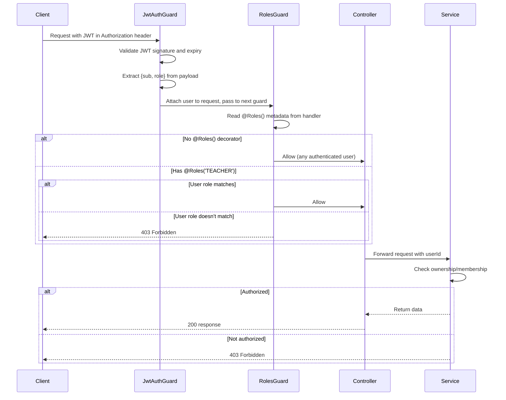
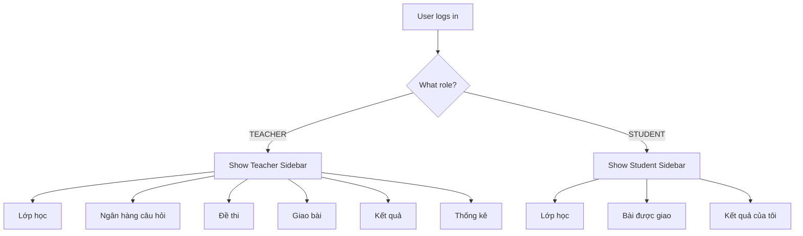
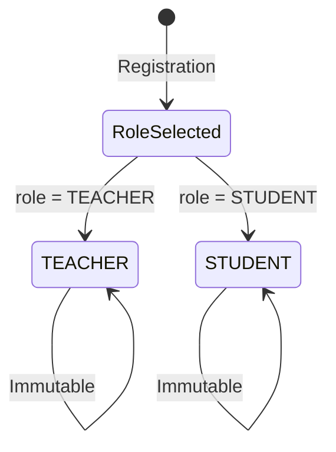
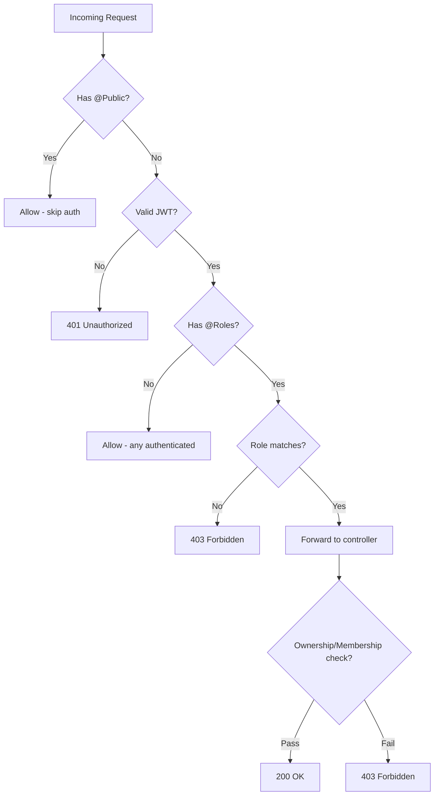

# A5. Role-Based Access Control

## 5.1 Feature Overview

| Field | Value |
|---|---|
| Feature ID | A5 |
| Feature Name | Role-Based Access Control (RBAC) |
| Module | A. Authentication & User Management |
| Priority | P0 |
| Complexity | S |
| Status | **Existing** — Fully implemented with global guards |
| Target Roles | System-wide — governs access for all roles |
| Business Objective | Ensure teachers and students can only access features appropriate to their role |
| User Problem | Without RBAC, students could create exams or view answer keys, and teachers could submit exam attempts |
| Dependencies | A1 (Registration — role assignment), A2 (Login — JWT contains role) |

## 5.2 Actors and Permissions

### TEACHER

| Resource | View | Create | Update | Delete | Notes |
|---|---|---|---|---|---|
| Own classrooms | ✅ | ✅ | ✅ | ✅ | Full CRUD on owned classrooms |
| Classroom members | ✅ | — | — | ✅ (remove) | Can view and remove members |
| Own questions | ✅ | ✅ | ✅ | ✅ | Scoped to own question bank |
| Own exams | ✅ | ✅ | ✅ | ✅ | Full CRUD on owned exams |
| Assignments (own exams) | ✅ | ✅ | ✅ | — | Can create and manage |
| Student attempts (own exams) | ✅ | — | ✅ (score/feedback) | — | Can view and grade |
| Analytics | ✅ | — | — | — | Teacher-only section |
| Other teacher's data | ❌ | ❌ | ❌ | ❌ | Ownership enforced in service layer |

### STUDENT

| Resource | View | Create | Update | Delete | Notes |
|---|---|---|---|---|---|
| Joined classrooms | ✅ | — | — | — | View classrooms they're a member of |
| Classroom members | ✅ | — | — | — | Can see other members |
| Assigned exams | ✅ | — | — | — | Via assignment to their classroom |
| Own attempts | ✅ | ✅ (start) | ✅ (answer) | — | Can start and answer |
| Own results | ✅ | — | — | — | Subject to visibility rules |
| Question bank | ❌ | ❌ | ❌ | ❌ | No access |
| Exam management | ❌ | ❌ | ❌ | ❌ | No access |
| Analytics | ❌ | ❌ | ❌ | ❌ | No access |

### ADMIN (Reserved)

| Resource | View | Create | Update | Delete | Notes |
|---|---|---|---|---|---|
| All resources | — | — | — | — | ADMIN role exists in enum but has no special privileges or endpoints |

## 5.3 Preconditions and Business Rules

| Rule ID | Rule | Enforcement |
|---|---|---|
| RBAC-BR-01 | Every request (except @Public endpoints) must have a valid JWT | Global `JwtAuthGuard` applied in AppModule |
| RBAC-BR-02 | Role is embedded in the JWT payload as `role` field | Set during token generation: `{ sub: userId, role }` |
| RBAC-BR-03 | Endpoints decorated with `@Roles('TEACHER')` reject non-TEACHER users with 403 | Global `RolesGuard` reads `@Roles()` metadata |
| RBAC-BR-04 | Endpoints without `@Roles()` decorator allow any authenticated user | RolesGuard passes if no roles metadata is set |
| RBAC-BR-05 | Ownership checks are enforced in the service layer, not just by role | E.g., teacher can only manage their OWN classrooms/exams/questions |
| RBAC-BR-06 | Membership checks are enforced in the service layer | Student must be a member of the classroom to access its assignments |
| RBAC-BR-07 | Role is set at registration and cannot be changed | No API endpoint or UI for role change |
| RBAC-BR-08 | Frontend hides UI elements based on role | Sidebar shows different items for TEACHER vs STUDENT |
| RBAC-BR-09 | Frontend role check is for UX only — backend is the authority | An attacker bypassing the frontend still hits backend guards |
| RBAC-BR-10 | ADMIN role has no special routes or privileges currently | Reserved for future use |

## 5.4 Main User Flow — Happy Path

### Authorization Check Flow



### Frontend Role-Based Navigation



## 5.5 Alternative Flows

### AF-01: Public endpoints (no auth required)

- Endpoints decorated with `@Public()` bypass JwtAuthGuard.
- Examples: `/auth/register`, `/auth/login`, `/auth/refresh`, `/auth/forgot-password`, `/auth/reset-password`.
- No role check is performed.

### AF-02: Endpoint with no @Roles decorator (any authenticated)

- JwtAuthGuard validates the token.
- RolesGuard finds no roles metadata and allows the request.
- Examples: `GET /auth/me`, `PATCH /auth/profile`, `POST /auth/logout`.

### AF-03: Student accesses a TEACHER-only endpoint via API

- JwtAuthGuard passes (valid token).
- RolesGuard detects `@Roles('TEACHER')` and user role is STUDENT.
- Returns 403 Forbidden.
- Frontend never shows the UI for this action, but the backend enforces it independently.

## 5.6 Edge Cases and Failure Scenarios

| Scenario ID | Scenario | Trigger | Expected Behavior | User Feedback | Data Integrity | Recovery | Severity |
|---|---|---|---|---|---|---|---|
| EC-A5-01 | Student calls teacher-only API | Student sends POST /api/questions via curl/Postman | RolesGuard returns 403 | "Forbidden resource" | No data change | N/A | Medium |
| EC-A5-02 | Teacher accesses another teacher's exam | Teacher A calls GET /exams/:id where exam belongs to Teacher B | Service-layer ownership check fails, 403 | "Forbidden" or "Not found" | No data exposed | N/A | High |
| EC-A5-03 | Student accesses another student's attempt | Student A calls GET /attempts/:id where attempt belongs to Student B | Service checks `studentId === userId`, returns 403 | "Forbidden" | No data exposed | N/A | Critical |
| EC-A5-04 | Token with tampered role | Attacker modifies JWT payload to change role to TEACHER | JWT signature verification fails (HMAC/RSA) | 401 Unauthorized | No access granted | N/A | Critical (mitigated) |
| EC-A5-05 | Role changed in DB but old token in use | Admin changes a user's role directly in the database | Old JWT still has the original role until expiry (up to 15 min) | User has stale permissions | Stale role in token for 15 minutes max | Token refresh gets new role | Medium |
| EC-A5-06 | ADMIN role user tries to access system | User with ADMIN role logs in | Can access endpoints without `@Roles()` decorator; blocked from `@Roles('TEACHER')` and `@Roles('STUDENT')` endpoints | Can only use shared endpoints (profile, etc.) | No special admin access | N/A | Low |
| EC-A5-07 | Missing Authorization header | Request sent without JWT | JwtAuthGuard rejects with 401 | "Unauthorized" | No access | User must log in | Medium |
| EC-A5-08 | Malformed JWT | Invalid JWT string in header | JwtStrategy throws, 401 | "Unauthorized" | No access | User must re-login | Low |
| EC-A5-09 | Expired JWT | Access token past expiry time | JwtStrategy rejects, 401 | Frontend should auto-refresh | No access | Token refresh or re-login | Medium |
| EC-A5-10 | Student removed from classroom tries to access | Student was in classroom, got removed, tries to view | Membership check in service fails | 403 or 404 | No data exposed | Student must re-join | Medium |

## 5.7 UI/UX Specification

### Role-Based Sidebar (Existing Implementation)

The sidebar navigation in `apps/web/src/components/sidebar-nav.tsx` shows different items based on user role:

**Teacher sees**:
- Lớp học (Classrooms)
- Ngân hàng câu hỏi (Question Bank)
- Đề thi (Exams)
- Giao bài (Assignments)
- Kết quả (Results)
- Thống kê (Analytics)

**Student sees**:
- Lớp học (Classrooms)
- Bài được giao (Assignments)
- Kết quả của tôi (My Results)

### Role Badge in Header

The dashboard layout header shows the user's role as a badge or text in the dropdown menu area.

### Error Handling for Unauthorized Access

If a student navigates directly to a teacher-only URL (e.g., `/dashboard/questions`):
- The page component fetches data from the teacher-only API.
- API returns 403.
- **Current behavior**: The page likely shows empty state or error. **Gap**: No dedicated "unauthorized" error page.

### Proposed Improvement

Add a client-side role check in protected page components:
- If `user.role !== 'TEACHER'` on teacher-only pages, redirect to `/dashboard`.
- Display an error toast or message: "Bạn không có quyền truy cập trang này."

## 5.8 Data Requirements

### Existing Schema

**Role enum** (in Prisma schema):

```
enum Role {
  TEACHER
  STUDENT
  ADMIN
}
```

**In users table**: `role` column stores the enum value.

**In JWT payload**: `{ sub: userId, role: "TEACHER" | "STUDENT" | "ADMIN" }`.

### No Additional Schema Required

RBAC is enforced through:
1. JWT payload (role).
2. Guard decorators (`@Roles()`).
3. Service-layer ownership/membership checks.

No separate permissions table is needed at this scale.

### Proposed Changes

None. The current guard-based RBAC is sufficient for the TEACHER/STUDENT model.

If fine-grained permissions are needed later (e.g., per-classroom permissions, co-teachers), a permissions model would be required. This is P3.

## 5.9 API Requirements

### Guard Implementation (Existing)

**JwtAuthGuard** (Global):
- Applied to all routes.
- Skips routes decorated with `@Public()`.
- Validates JWT and attaches user to request.

**RolesGuard** (Global):
- Applied to all routes.
- Reads `@Roles()` metadata.
- If no roles specified → allow.
- If roles specified → check `request.user.role` against allowed roles.
- Returns 403 if role doesn't match.

### Decorators (Existing)

| Decorator | Usage | Example |
|---|---|---|
| `@Public()` | Bypass JWT guard | `@Public() @Post('login')` |
| `@Roles('TEACHER')` | Restrict to teacher | `@Roles('TEACHER') @Post('questions')` |
| `@Roles('TEACHER', 'STUDENT')` | Allow multiple roles | Not currently used but supported |
| `@CurrentUser('id')` | Extract user ID from JWT | `@CurrentUser('id') userId: string` |
| `@CurrentUser()` | Extract full user from JWT | Not commonly used |

### Endpoint Role Requirements Summary

| Module | Endpoint | Required Role | Additional Check |
|---|---|---|---|
| Auth | POST /register, /login, /refresh, /forgot-password, /reset-password | Public | — |
| Auth | POST /logout, GET /me, PATCH /profile | Any authenticated | — |
| Classrooms | POST /classrooms | TEACHER | — |
| Classrooms | GET /classrooms | Any | Filtered by ownership/membership |
| Classrooms | POST /classrooms/join | Any | — |
| Classrooms | GET /classrooms/:id/members | Any | Was TEACHER-only, changed to all members |
| Questions | All /questions endpoints | TEACHER | Ownership check |
| Questions | All /questions/categories | TEACHER | Ownership check |
| Exams | All /exams endpoints | TEACHER | Ownership check |
| Assignments | POST /assignments | TEACHER | Exam + classroom ownership |
| Assignments | GET /assignments | Any | Filtered by role |
| Attempts | POST /attempts/start | STUDENT | Membership + assignment validation |
| Attempts | POST /attempts/:id/answer, /submit | STUDENT | Attempt ownership |
| Attempts | GET /attempts/my | STUDENT | Own attempts only |
| Attempts | PATCH /attempts/:id/score, /feedback | TEACHER | Exam ownership |
| Attempts | GET /attempts/:id/review | Any | Teacher (exam owner) or student (attempt owner + result visibility) |
| Analytics | All /analytics endpoints | TEACHER | Classroom/exam ownership |
| Notifications | All /notifications endpoints | Any | User's own notifications |

## 5.10 State Management

### Role State

Role is immutable after registration. No state transitions.



### Authorization Decision Flow



## 5.11 Acceptance Criteria

### Positive Cases

**AC-A5-01**: Given a teacher is authenticated, when they access `POST /questions`, then the request is allowed and a question is created.

**AC-A5-02**: Given a student is authenticated, when they access `POST /attempts/start` with valid assignment membership, then the attempt is created.

**AC-A5-03**: Given an unauthenticated user, when they access `POST /auth/login`, then the request is allowed (public endpoint).

### Negative Cases

**AC-A5-04**: Given a student is authenticated, when they access `POST /questions`, then they receive 403 Forbidden.

**AC-A5-05**: Given an unauthenticated user, when they access `GET /auth/me`, then they receive 401 Unauthorized.

**AC-A5-06**: Given Teacher A is authenticated, when they access `GET /exams/:id` where the exam belongs to Teacher B, then they receive 403 Forbidden.

**AC-A5-07**: Given a student is authenticated, when they try to view another student's attempt via `GET /attempts/:id`, then they receive 403 Forbidden.

### Frontend

**AC-A5-08**: Given a teacher is logged in, when the sidebar renders, then they see: Lớp học, Ngân hàng câu hỏi, Đề thi, Giao bài, Kết quả, Thống kê.

**AC-A5-09**: Given a student is logged in, when the sidebar renders, then they see: Lớp học, Bài được giao, Kết quả của tôi.

## 5.12 QA Test Scenarios

| Test Case ID | Scenario | Preconditions | Test Steps | Test Data | Expected Result | Priority |
|---|---|---|---|---|---|---|
| TC-A5-01 | Student blocked from question bank API | Student logged in | 1. POST /api/questions with student JWT | Valid question data | 403 Forbidden | P0 |
| TC-A5-02 | Teacher can create question | Teacher logged in | 1. POST /api/questions with teacher JWT | Valid question data | 201 Created | P0 |
| TC-A5-03 | No JWT → 401 | Not logged in | 1. GET /api/auth/me without Authorization header | None | 401 Unauthorized | P0 |
| TC-A5-04 | Teacher A can't see Teacher B's exam | Two teacher accounts | 1. Login as Teacher A 2. GET /exams/:id (Teacher B's exam) | Teacher B's exam ID | 403 or 404 | P0 |
| TC-A5-05 | Student can't see other student's attempt | Two student accounts | 1. Login as Student A 2. GET /attempts/:id (Student B's attempt) | Student B's attempt ID | 403 | P0 |
| TC-A5-06 | Public endpoint works without auth | Not logged in | 1. POST /api/auth/login with valid credentials | Valid creds | 200 with tokens | P0 |
| TC-A5-07 | Role in JWT matches DB | After login | 1. Login 2. Decode JWT 3. Compare role with DB | N/A | JWT role matches user.role in DB | P0 |
| TC-A5-08 | Sidebar differs by role (Teacher) | Teacher logged in | 1. Check sidebar items | N/A | Shows teacher-specific nav items | P1 |
| TC-A5-09 | Sidebar differs by role (Student) | Student logged in | 1. Check sidebar items | N/A | Shows student-specific nav items | P1 |
| TC-A5-10 | ADMIN role has limited access | User with ADMIN role (DB insert) | 1. Login as ADMIN 2. Try teacher endpoints 3. Try student endpoints | ADMIN user | Teacher endpoints: 403. Student endpoints: 403. Profile: 200 | P2 |
| TC-A5-11 | Tampered JWT rejected | Valid JWT | 1. Modify JWT payload (change role) 2. Send request | Tampered JWT | 401 (signature invalid) | P0 |

## 5.13 Open Questions and Assumptions

### OQ-A5-01: Should ADMIN role have any special access?

| | |
|---|---|
| **Question** | ADMIN exists in the enum but has no special endpoints. Should admin features be planned? |
| **Why it matters** | At scale, an admin needs user management, system oversight, etc. |
| **Recommended default** | No admin features for MVP. Keep the enum for future extensibility. |
| **Impact** | No work needed. Document as P3. |

### OQ-A5-02: Should role-changing be possible?

| | |
|---|---|
| **Question** | Can a STUDENT become a TEACHER or vice versa? |
| **Why it matters** | Some platforms allow dual-role users (e.g., a TA who is both teacher and student). |
| **Options** | (a) No role change (current). (b) Admin can change roles. (c) User can request role change. |
| **Recommended default** | Option (a). If dual-role is needed, consider a separate permissions model. |

### OQ-A5-03: Should there be row-level security for shared resources?

| | |
|---|---|
| **Question** | Currently, ownership checks are in service code. Should we use Prisma middleware or database-level RLS? |
| **Why it matters** | Service-level checks are error-prone (developer might forget). RLS provides defense in depth. |
| **Recommended default** | Keep service-level checks for MVP. Consider Prisma middleware for common patterns. |

### Assumptions

| ID | Assumption | Risk if Wrong |
|---|---|---|
| ASM-A5-01 | Two roles (TEACHER + STUDENT) are sufficient for MVP | If co-teacher, TA, or parent roles are needed, architecture must change |
| ASM-A5-02 | Ownership is the primary authorization model (no shared resources) | If exam/question sharing between teachers is needed, a permissions model is required |
| ASM-A5-03 | Frontend role checks are for UX only; backend is authoritative | If frontend-only checks exist without backend enforcement, security gap |
| ASM-A5-04 | JWT role is trustworthy for the token's lifetime (up to 15 min) | Role changes in DB are delayed until token refresh |
