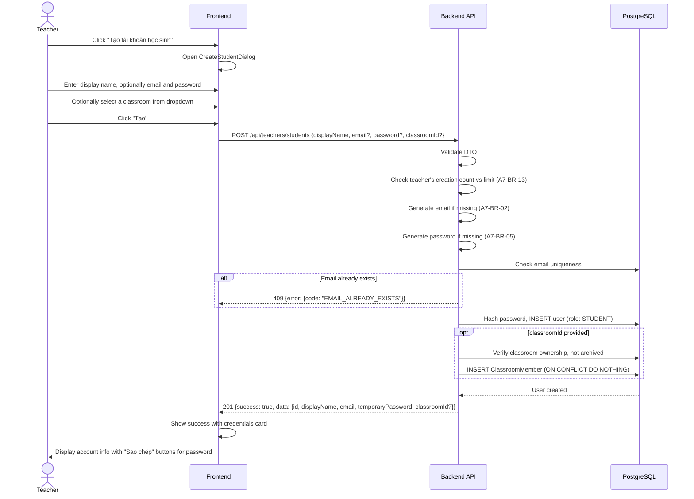
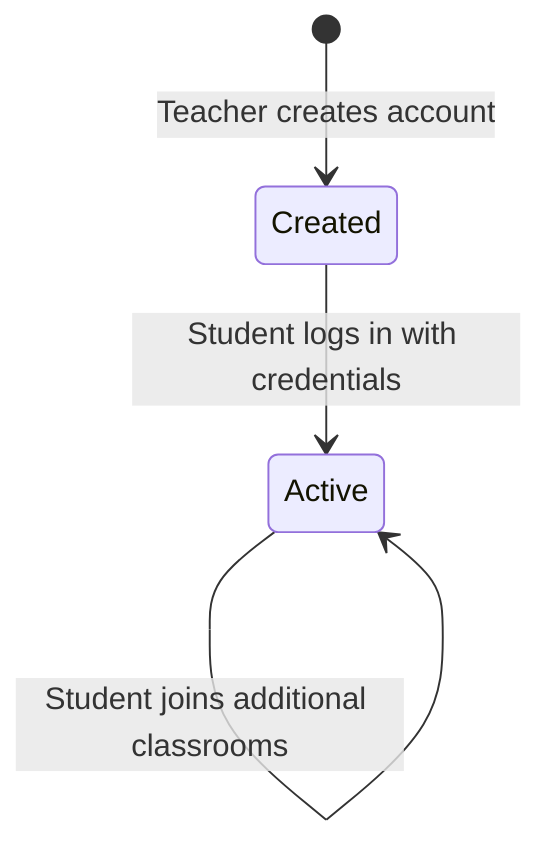

# A7. Teacher Creates Student Accounts

## 5.1 Feature Overview

| Field | Value |
|---|---|
| Feature ID | A7 |
| Feature Name | Teacher Creates Student Accounts |
| Module | A. Authentication & User Management |
| Priority | P2 |
| Complexity | M |
| Status | **Not Implemented** — only self-registration via `POST /auth/register` exists. No endpoint or UI for teacher-initiated account creation. |
| Target Roles | TEACHER |
| Business Objective | Allow teachers to create student accounts on behalf of students who may not have email addresses (common in K-12 Vietnam), reducing onboarding friction and giving teachers control over their classroom roster from day one |
| User Problem | In K-12 settings, many students lack personal email. The current self-registration flow requires email and is student-initiated, making it impractical for young learners. Teachers need a way to set up accounts so students can start using the platform immediately. |
| Dependencies | A1 (Registration), A2 (Login), A5 (RBAC), B1 (Create Classroom), B2 (Join Classroom) |

## 5.2 Actors and Permissions

### Teacher (TEACHER role)

| Action | Permitted | Notes |
|---|---|---|
| Create a single student account | Yes | Via dedicated endpoint |
| Create multiple student accounts (batch) | Yes | Up to 50 per request |
| Set a temporary password for the student | Yes | Or let the system auto-generate one |
| Auto-add created students to one of the teacher's classrooms | Yes | Optional; must be a classroom the teacher owns |
| View the list of accounts they created | Yes | Filtered by `createdByTeacherId` |
| View the temporary password after creation | Yes | Shown once in the response; teacher communicates it to the student |
| Create a TEACHER or ADMIN account | **No** | Only STUDENT accounts |

### Student (STUDENT role)

| Action | Permitted | Notes |
|---|---|---|
| Create any account | **No** | 403 Forbidden |

### Backend Authorization

- The create-students endpoints require `@Roles('TEACHER')` at the controller level.
- `createdByTeacherId` is set from `@CurrentUser('id')`, never from the request body.
- For auto-add to classroom: the service verifies `classroom.ownerId === currentUser.id`.

## 5.3 Preconditions and Business Rules

### Preconditions

1. User is authenticated with a valid JWT access token.
2. User has the `TEACHER` role.
3. If `classroomId` is provided, the classroom must exist, not be archived, and be owned by the requesting teacher.

### Business Rules

| Rule ID | Rule | Enforcement |
|---|---|---|
| A7-BR-01 | Teacher-created accounts always have role `STUDENT`. The request body must not contain a `role` field; the backend hardcodes it. | Backend — service sets `role: 'STUDENT'` unconditionally |
| A7-BR-02 | Email is optional for teacher-created accounts. If not provided, the system generates a unique placeholder in the format `student_<shortId>@lumi.local` that is not routable. | Backend — service generates email if absent |
| A7-BR-03 | If email is provided, it must be unique across all users. If a user with that email already exists, the endpoint returns 409 with code `EMAIL_ALREADY_EXISTS`. | Backend — unique constraint check before insert |
| A7-BR-04 | Display name is required, 1–100 characters. | Backend + Frontend — DTO validation |
| A7-BR-05 | If `password` is not provided, the system generates a random 8-character alphanumeric password. | Backend — service generates password with `crypto.randomBytes` |
| A7-BR-06 | If `password` is provided, it must be 6–72 characters. The minimum is lower than self-registration (8 chars) because these are teacher-managed temporary passwords for young students. | Backend — DTO validation; `@MinLength(6)`, `@MaxLength(72)` |
| A7-BR-07 | Password is hashed with bcrypt cost factor 12 before storage, consistent with `AuthService.register()`. | Backend — bcrypt in service |
| A7-BR-08 | The plaintext password is returned once in the creation response so the teacher can share it with the student. It is never stored or retrievable afterwards. | Backend — response includes `temporaryPassword`; not stored in DB |
| A7-BR-09 | If `classroomId` is provided and valid, the created student(s) are automatically added as members of that classroom. If the student already has a `ClassroomMember` record for that classroom, the step is silently skipped. | Backend — upsert on `ClassroomMember` |
| A7-BR-10 | If `classroomId` is provided but the classroom is not owned by the requesting teacher, return 403 with code `CLASSROOM_NOT_OWNED`. | Backend — ownership check |
| A7-BR-11 | If `classroomId` is provided but the classroom is archived, return 400 with code `CLASSROOM_ARCHIVED`. | Backend — `archivedAt IS NULL` check |
| A7-BR-12 | Batch creation accepts 1–50 students per request. Each student entry is validated independently. If any entry fails validation, the entire batch is rejected (all-or-nothing). | Backend — DTO array validation + transaction |
| A7-BR-13 | A teacher can create at most 500 student accounts total. The service counts existing users with `createdByTeacherId === currentUser.id` before inserting. If the limit would be exceeded, return 400 with code `STUDENT_CREATION_LIMIT_REACHED`. | Backend — count check |
| A7-BR-14 | Teacher-created students can later change their password via the existing `PATCH /auth/profile` endpoint. No forced password change on first login in MVP. | Existing behavior, no change needed |
| A7-BR-15 | Teacher-created students can use the self-registration endpoint to upgrade their placeholder email to a real one if they choose to. This is a future consideration — not in scope for A7 MVP. | Deferred — see Open Questions |
| A7-BR-16 | Generated placeholder emails (`*@lumi.local`) cannot be used for forgot-password flow since no email can be sent. The forgot-password endpoint returns the generic response (OQ-08 behavior) without creating a token. | Backend — no change needed; existing behavior returns generic message |

### Validation Rules (DTO-level)

**CreateStudentDto** (single)

| Field | Type | Required | Validation |
|---|---|---|---|
| `displayName` | string | Yes | `@IsString()`, `@MinLength(1)`, `@MaxLength(100)` |
| `email` | string | No | `@IsOptional()`, `@IsEmail()` |
| `password` | string | No | `@IsOptional()`, `@IsString()`, `@MinLength(6)`, `@MaxLength(72)` |
| `classroomId` | string | No | `@IsOptional()`, `@IsUUID()` |

**BatchCreateStudentsDto**

| Field | Type | Required | Validation |
|---|---|---|---|
| `students` | CreateStudentDto[] | Yes | `@IsArray()`, `@ArrayMinSize(1)`, `@ArrayMaxSize(50)`, `@ValidateNested({ each: true })` |
| `classroomId` | string | No | `@IsOptional()`, `@IsUUID()` — applies to all students in the batch |

## 5.4 Main User Flow — Happy Path

### Single Student Creation



### Steps

| Step | Actor | Action | System Response | Data Changed |
|---|---|---|---|---|
| 1 | Teacher | Opens create student dialog | — | — |
| 2 | Teacher | Enters display name | — | — |
| 3 | Teacher | Optionally enters email and password | — | — |
| 4 | Teacher | Optionally selects a classroom | — | — |
| 5 | Teacher | Clicks "Tạo" | Account created, credentials shown | `users` row created, optionally `classroom_members` row |

## 5.5 Alternative Flows

### AF-A7-01: Batch creation of student accounts

- **Trigger**: Teacher clicks "Tạo nhiều tài khoản" tab in the dialog.
- **UI**: Teacher fills a table-like form with rows: display name (required), email (optional), password (optional). Rows can be added (up to 50) or removed. A single classroom selector applies to all.
- **Endpoint**: `POST /api/teachers/students/batch`
- **Behavior**: All entries validated. If any fails (e.g., duplicate email), entire batch is rejected. On success, all accounts created in a single transaction with classroom membership if specified.
- **Response**: Array of created student objects with `temporaryPassword` for each.

### AF-A7-02: Teacher creates student without email

- **Trigger**: Teacher leaves the email field blank.
- **Behavior**: System generates `student_<8-char-hex>@lumi.local` as the email. This is stored in the DB to satisfy the `@unique` constraint but is not a real email.
- **Result**: Student logs in using this generated email (shown to teacher) and the password. Teacher shares both with the student.

### AF-A7-03: Teacher creates student and auto-adds to classroom

- **Trigger**: Teacher selects a classroom from the dropdown.
- **Behavior**: After creating the user, the service creates a `ClassroomMember` record.
- **Result**: Student appears in the classroom member list immediately.

### AF-A7-04: Email already in use

- **Trigger**: Teacher enters an email that already belongs to another user.
- **Behavior**: `POST` returns 409 with code `EMAIL_ALREADY_EXISTS`.
- **UI**: Error toast: "Email này đã được sử dụng. Vui lòng sử dụng email khác."
- **Result**: No account created.

### AF-A7-05: Teacher views created accounts

- **Trigger**: Teacher navigates to "Tài khoản đã tạo" section.
- **Endpoint**: `GET /api/teachers/students`
- **Behavior**: Returns paginated list of students where `createdByTeacherId === currentUser.id`.
- **Result**: Teacher can see display name, email, creation date, and classroom membership. Passwords are not shown (not stored in plaintext).

### AF-A7-06: Teacher creates student with a duplicate email in the same batch

- **Trigger**: Batch request contains two entries with the same email.
- **Behavior**: DTO validation rejects: each email in the batch must be unique within the batch itself, checked before DB insert.
- **Result**: 400 with message "Email trùng lặp trong danh sách: {email}".

## 5.6 Edge Cases and Failure Scenarios

| Scenario ID | Scenario | Trigger | Expected Behavior | User Feedback | Data Integrity | Recovery | Severity |
|---|---|---|---|---|---|---|---|
| EC-A7-01 | Teacher's creation limit reached | Teacher has 500 created accounts | 400 `STUDENT_CREATION_LIMIT_REACHED` | Toast: "Bạn đã đạt giới hạn tạo 500 tài khoản học sinh" | No data created | Contact admin or reuse existing accounts | Low |
| EC-A7-02 | Email collision in batch with existing user | Batch includes email that exists in DB | 409 `EMAIL_ALREADY_EXISTS`, identifies the conflicting email | Error details include which email(s) conflict | No data created (all-or-nothing) | Remove or change the conflicting email | Medium |
| EC-A7-03 | Duplicate emails within the same batch | Two rows have email "a@b.com" | 400 `DUPLICATE_EMAIL_IN_BATCH` | Toast: "Email trùng lặp trong danh sách: a@b.com" | No data created | Fix the duplicate | Medium |
| EC-A7-04 | Classroom not owned by teacher | Teacher provides another teacher's classroomId | 403 `CLASSROOM_NOT_OWNED` | Toast: "Bạn không có quyền thêm học sinh vào lớp này" | No data created | Select own classroom | High |
| EC-A7-05 | Classroom archived | Teacher provides archived classroomId | 400 `CLASSROOM_ARCHIVED` | Toast: "Lớp học đã được lưu trữ" | No data created | Unarchive or choose another classroom | Low |
| EC-A7-06 | Classroom at member capacity | Classroom already has maximum members (if enforced) | No limit enforced in MVP — skip | N/A | Member added | N/A | Low |
| EC-A7-07 | Generated email collides | Auto-generated `student_<hex>@lumi.local` matches existing | Extremely unlikely (8 hex chars = 4 billion combinations); service retries up to 3 times with new random | No user feedback needed | Retry generates unique email | Automatic retry | Low |
| EC-A7-08 | Student account already exists with placeholder email, teacher creates another with same display name | Different accounts, same name | Allowed — display names are not unique | No issue — different IDs and emails | Two separate accounts | N/A | Low |
| EC-A7-09 | Network failure during batch creation | Connection drops mid-request | Transaction rolls back — no partial creation | Browser error or timeout message | No data created | Retry the batch | Medium |
| EC-A7-10 | Student later self-registers with a real email | Student with `@lumi.local` email wants to upgrade | Out of scope for A7. Student currently cannot change their email. See Open Questions. | N/A | N/A | Deferred | Low |

## 5.7 UI/UX Specification

### Entry Points

1. **Classroom detail page** (`/dashboard/classrooms/[id]`): "Tạo tài khoản học sinh" button in the members section header. Pre-selects the current classroom in the dialog.
2. **Students management page** (proposed): "Tạo tài khoản" button on a dedicated `/dashboard/students` or `/dashboard/my-students` page.

### CreateStudentDialog

- **Component**: Dialog (shadcn)
- **Tabs**: "Tạo một" (single) | "Tạo nhiều" (batch)

#### Single Tab

| Element | Details |
|---|---|
| Họ và tên * | Text input, required, placeholder: "Nhập họ tên học sinh" |
| Email | Text input, optional, placeholder: "Để trống nếu học sinh không có email" |
| Mật khẩu | Text input with show/hide toggle, optional, placeholder: "Để trống để tạo tự động" |
| Thêm vào lớp | Select dropdown listing teacher's non-archived classrooms, optional |
| "Tạo" button | Primary, disabled until displayName is filled |
| "Hủy" button | Secondary |

#### Batch Tab

| Element | Details |
|---|---|
| Table form | Rows with: Họ tên (required), Email (optional), Mật khẩu (optional) |
| "+ Thêm hàng" button | Adds a new empty row (max 50) |
| "Xóa" icon per row | Removes the row (min 1 row) |
| Thêm vào lớp | Single dropdown above the table, applies to all |
| "Tạo N tài khoản" button | Primary, count reflects valid rows |

### Success State — Credentials Card

After creation, dialog content is replaced with a credentials card:

```
┌─────────────────────────────────────────┐
│ ✓ Đã tạo tài khoản thành công          │
│                                         │
│  Họ tên:   Nguyễn Văn A                │
│  Email:    student_a3f2c1@lumi.local    │  [Sao chép]
│  Mật khẩu: xK9m2pQ4                    │  [Sao chép]
│                                         │
│  ⚠ Mật khẩu chỉ hiển thị một lần.     │
│  Hãy sao chép và gửi cho học sinh.      │
│                                         │
│  [Tạo thêm]        [Đóng]              │
└─────────────────────────────────────────┘
```

For batch creation, the card shows a table of all created accounts with a "Sao chép tất cả" button that copies the full list to clipboard in the format:
```
Họ tên | Email | Mật khẩu
Nguyễn Văn A | student_a3f2c1@lumi.local | xK9m2pQ4
Trần Thị B | student_b7d4e2@lumi.local | mN3kL8rW
```

### States

| State | Appearance |
|---|---|
| Loading (creating) | Button shows spinner, form fields disabled |
| Error (validation) | Red border on invalid fields, field-level error messages |
| Error (API) | Toast notification with error message |
| Success | Credentials card replaces form |
| Empty classroom list | Dropdown shows "Chưa có lớp học" disabled option |

### Responsive Behavior

- Dialog: full-screen on mobile, centered modal on desktop.
- Batch table: horizontal scroll on mobile.
- Credentials card: stacked layout on mobile.

## 5.8 Data Requirements

### Existing Entities (Verified)

**User** — `apps/api/prisma/schema.prisma`

| Field | Type | Notes |
|---|---|---|
| id | UUID | PK, auto-generated |
| email | String | Unique. Currently required for all users |
| passwordHash | String | bcrypt cost 12 |
| displayName | String | User's display name |
| role | Role (enum) | TEACHER, STUDENT, ADMIN |
| createdAt | DateTime | Auto-set |
| updatedAt | DateTime | Auto-updated |

**ClassroomMember** — `apps/api/prisma/schema.prisma`

| Field | Type | Notes |
|---|---|---|
| classroomId | UUID FK | Required |
| userId | UUID FK | Required |
| joinedAt | DateTime | Auto-set |
| — | — | `@@unique([classroomId, userId])` |

### Proposed Schema Changes

| Change | Reason |
|---|---|
| Add `createdByTeacherId String? @map("created_by_teacher_id") @db.Uuid` to `User` | Tracks which teacher created this student account. NULL for self-registered users. Needed for A7-BR-13 limit check and AF-A7-05 listing. |
| Add `createdByTeacher User? @relation("CreatedStudents", fields: [createdByTeacherId], references: [id])` to `User` | Prisma relation for teacher → created students |
| Add `createdStudents User[] @relation("CreatedStudents")` to `User` | Back-relation for Prisma |
| Add index on `created_by_teacher_id` | For efficient count and listing queries |

Updated User model additions:

```prisma
model User {
  // ... existing fields ...
  createdByTeacherId String? @map("created_by_teacher_id") @db.Uuid

  // ... existing relations ...
  createdByTeacher   User?   @relation("CreatedStudents", fields: [createdByTeacherId], references: [id])
  createdStudents    User[]  @relation("CreatedStudents")
}
```

**Migration**: `ALTER TABLE users ADD COLUMN created_by_teacher_id UUID REFERENCES users(id);`
All existing users get `NULL` (self-registered). Non-breaking change.

## 5.9 API Requirements

### POST /api/teachers/students — Create Single Student

| Field | Value |
|---|---|
| Method | POST |
| Endpoint | `/api/teachers/students` |
| Purpose | Teacher creates one student account |
| Required Role | TEACHER |
| Authorization | `@Roles('TEACHER')`, `createdByTeacherId` from JWT |

**Request Body**:

```json
{
  "displayName": "Nguyễn Văn A",
  "email": "vana@example.com",
  "password": "matkhau123",
  "classroomId": "uuid-of-classroom"
}
```

**Success Response (201 Created)**:

```json
{
  "success": true,
  "data": {
    "id": "uuid",
    "displayName": "Nguyễn Văn A",
    "email": "vana@example.com",
    "role": "STUDENT",
    "temporaryPassword": "matkhau123",
    "classroomId": "uuid-of-classroom",
    "createdAt": "2026-11-12T10:00:00.000Z"
  }
}
```

| Response Field | Type | Description |
|---|---|---|
| id | string (UUID) | The created user ID |
| displayName | string | Student's display name |
| email | string | The email (real or generated) |
| role | string | Always `"STUDENT"` |
| temporaryPassword | string | The plaintext password (shown once) |
| classroomId | string? | The classroom the student was added to, if any |
| createdAt | string (ISO 8601) | Account creation timestamp |

**Error Responses**:

| Status | Code | Message | Condition |
|---|---|---|---|
| 400 | VALIDATION_ERROR | DTO validation message | Invalid displayName, email format, or password length |
| 400 | STUDENT_CREATION_LIMIT_REACHED | "Bạn đã đạt giới hạn tạo 500 tài khoản học sinh" | Teacher has created 500 students |
| 400 | CLASSROOM_ARCHIVED | "Lớp học đã được lưu trữ" | classroomId points to an archived classroom |
| 401 | UNAUTHORIZED | — | Missing or invalid JWT |
| 403 | FORBIDDEN | — | User is not TEACHER |
| 403 | CLASSROOM_NOT_OWNED | "Bạn không có quyền thêm học sinh vào lớp này" | classroomId belongs to another teacher |
| 404 | CLASSROOM_NOT_FOUND | "Không tìm thấy lớp học" | classroomId does not exist |
| 409 | EMAIL_ALREADY_EXISTS | "Email này đã được sử dụng" | Provided email is already registered |

---

### POST /api/teachers/students/batch — Batch Create Students

| Field | Value |
|---|---|
| Method | POST |
| Endpoint | `/api/teachers/students/batch` |
| Purpose | Teacher creates multiple student accounts at once |
| Required Role | TEACHER |
| Authorization | `@Roles('TEACHER')` |

**Request Body**:

```json
{
  "students": [
    { "displayName": "Nguyễn Văn A", "email": "vana@example.com" },
    { "displayName": "Trần Thị B" },
    { "displayName": "Lê Văn C", "password": "abc123" }
  ],
  "classroomId": "uuid-of-classroom"
}
```

**Success Response (201 Created)**:

```json
{
  "success": true,
  "data": {
    "created": [
      {
        "id": "uuid-1",
        "displayName": "Nguyễn Văn A",
        "email": "vana@example.com",
        "temporaryPassword": "vana_password"
      },
      {
        "id": "uuid-2",
        "displayName": "Trần Thị B",
        "email": "student_a3f2c1d8@lumi.local",
        "temporaryPassword": "xK9m2pQ4"
      },
      {
        "id": "uuid-3",
        "displayName": "Lê Văn C",
        "email": "student_b7d4e2f1@lumi.local",
        "temporaryPassword": "abc123"
      }
    ],
    "count": 3,
    "classroomId": "uuid-of-classroom"
  }
}
```

**Error Responses**: Same as single creation, plus:

| Status | Code | Message | Condition |
|---|---|---|---|
| 400 | DUPLICATE_EMAIL_IN_BATCH | "Email trùng lặp trong danh sách: {email}" | Two entries have the same email |
| 400 | VALIDATION_ERROR | "Tối đa 50 tài khoản mỗi lần tạo" | Array exceeds 50 items |

---

### GET /api/teachers/students — List Created Students

| Field | Value |
|---|---|
| Method | GET |
| Endpoint | `/api/teachers/students` |
| Purpose | List student accounts created by the current teacher |
| Required Role | TEACHER |

**Query Parameters**:

| Param | Type | Default | Validation |
|---|---|---|---|
| page | number | 1 | Min 1 |
| limit | number | 20 | Min 1, Max 100 |
| search | string | — | Partial match on displayName or email |
| classroomId | string | — | Filter by classroom membership |

**Success Response (200 OK)**:

```json
{
  "success": true,
  "data": [
    {
      "id": "uuid",
      "displayName": "Nguyễn Văn A",
      "email": "vana@example.com",
      "createdAt": "2026-11-12T10:00:00.000Z",
      "classrooms": [
        { "id": "uuid", "name": "Toán 12A1" }
      ]
    }
  ],
  "meta": { "page": 1, "limit": 20, "total": 45 }
}
```

Note: Passwords are never returned in listing responses.

**Error Responses**:

| Status | Code | Condition |
|---|---|---|
| 401 | UNAUTHORIZED | Missing or invalid JWT |
| 403 | FORBIDDEN | Not TEACHER |

## 5.10 State Management

Teacher-created student accounts have no special lifecycle states beyond the standard user model. Once created, the student account behaves identically to a self-registered account.



No additional state transitions are introduced by this feature.

## 5.11 Acceptance Criteria

### Positive Cases

```gherkin
Given a teacher is authenticated,
When they submit POST /api/teachers/students with displayName "Nguyễn Văn A",
Then a STUDENT account is created with a generated email and password,
And the response includes the temporaryPassword.
Rule: A7-BR-01, A7-BR-02, A7-BR-05, A7-BR-08

Given a teacher provides an email and password in the request,
When the account is created,
Then the email and password provided are used (password hashed with bcrypt 12),
And the response includes the plaintext password.
Rule: A7-BR-07, A7-BR-08

Given a teacher provides a classroomId they own,
When the student is created,
Then the student is automatically added as a ClassroomMember of that classroom.
Rule: A7-BR-09

Given a teacher submits a batch of 5 students with a classroomId,
When all entries are valid,
Then 5 accounts are created in a single transaction,
And all 5 are added to the classroom,
And the response includes temporaryPassword for each.
Rule: A7-BR-09, A7-BR-12

Given a teacher-created student logs in with the temporary password,
When they call PATCH /auth/profile with a new password,
Then their password is updated successfully.
Rule: A7-BR-14
```

### Negative Cases

```gherkin
Given a teacher tries to create a student with an email already in use,
When POST /api/teachers/students is called,
Then the response is 409 with code EMAIL_ALREADY_EXISTS.
Rule: A7-BR-03

Given a teacher provides a classroomId belonging to another teacher,
When POST /api/teachers/students is called,
Then the response is 403 with code CLASSROOM_NOT_OWNED.
Rule: A7-BR-10

Given a teacher has already created 500 student accounts,
When they try to create one more,
Then the response is 400 with code STUDENT_CREATION_LIMIT_REACHED.
Rule: A7-BR-13

Given a student is authenticated,
When they call POST /api/teachers/students,
Then the response is 403 Forbidden.
Rule: A7-BR-01

Given a batch request contains two entries with the same email,
When POST /api/teachers/students/batch is called,
Then the response is 400 with code DUPLICATE_EMAIL_IN_BATCH.

Given a batch request contains 51 entries,
When POST /api/teachers/students/batch is called,
Then the response is 400 validation error.
Rule: A7-BR-12
```

## 5.12 QA Test Scenarios

| Test ID | Scenario | Preconditions | Steps | Test Data | Expected Result | Priority |
|---|---|---|---|---|---|---|
| TC-A7-01 | Create single student, no email, no password | Teacher logged in | POST /api/teachers/students | displayName: "Nguyễn Văn A" | 201, email generated `*@lumi.local`, password generated, returned in response | P0 |
| TC-A7-02 | Create single student with email and password | Teacher logged in | POST /api/teachers/students | displayName, email, password | 201, provided email and password used | P0 |
| TC-A7-03 | Create student with classroom auto-add | Teacher logged in, owns classroom | POST /api/teachers/students | displayName, classroomId | 201, student is in ClassroomMember | P0 |
| TC-A7-04 | Created student can log in | Student account created | POST /auth/login with generated credentials | email + temporaryPassword from creation | 200, JWT returned | P0 |
| TC-A7-05 | Email already exists | User with email exists | POST /api/teachers/students with duplicate email | email: existing user's email | 409 EMAIL_ALREADY_EXISTS | P0 |
| TC-A7-06 | Classroom not owned by teacher | Teacher A logged in, classroom owned by Teacher B | POST /api/teachers/students | classroomId: B's classroom | 403 CLASSROOM_NOT_OWNED | P0 |
| TC-A7-07 | Archived classroom | Teacher logged in, classroom archived | POST /api/teachers/students | classroomId: archived classroom | 400 CLASSROOM_ARCHIVED | P1 |
| TC-A7-08 | Batch create 5 students | Teacher logged in | POST /api/teachers/students/batch with 5 entries | 5 valid students | 201, 5 accounts created with passwords | P0 |
| TC-A7-09 | Batch with duplicate email in request | Teacher logged in | POST batch with 2 entries having same email | email: "a@b.com" twice | 400 DUPLICATE_EMAIL_IN_BATCH | P1 |
| TC-A7-10 | Batch exceeds 50 | Teacher logged in | POST batch with 51 entries | 51 students | 400 validation error | P1 |
| TC-A7-11 | Creation limit reached | Teacher has 500 created accounts | POST /api/teachers/students | displayName only | 400 STUDENT_CREATION_LIMIT_REACHED | P1 |
| TC-A7-12 | Student role cannot call endpoint | Student logged in | POST /api/teachers/students | Valid body | 403 Forbidden | P0 |
| TC-A7-13 | Unauthenticated request | No JWT | POST /api/teachers/students | Valid body | 401 Unauthorized | P0 |
| TC-A7-14 | List created students | Teacher has created 3 students | GET /api/teachers/students | — | 200, 3 students listed without passwords | P1 |
| TC-A7-15 | Created student changes password | Student created by teacher | PATCH /auth/profile with newPassword | currentPassword: temporary, newPassword: new | 200, password updated | P1 |
| TC-A7-16 | Batch all-or-nothing on invalid entry | Batch: 3 valid + 1 invalid (empty displayName) | POST batch | 4 entries, one invalid | 400, no accounts created | P0 |
| TC-A7-17 | Password minimum 6 chars | Teacher logged in | POST /api/teachers/students with 5-char password | password: "12345" | 400 validation error | P1 |
| TC-A7-18 | Generate email uniqueness retry | Generated email collides (simulated) | Service retries with new random | — | Unique email generated after retry | P2 |

## 5.13 Open Questions and Assumptions

| # | Question | Why It Matters | Options | Recommended Default | Impact |
|---|---|---|---|---|---|
| 1 | Should teacher-created students be able to change their email (upgrade from `@lumi.local` to a real email)? | Students with placeholder emails cannot use forgot-password. Allowing email change adds a self-service path. | A) No email change in MVP. B) Add `PATCH /auth/profile` support for email change with uniqueness check. C) Allow email change only for `@lumi.local` users. | **A) No email change in MVP** — teacher can create a new account with a real email. Keeps scope small. | Low: no code change for option A |
| 2 | Should the teacher be able to reset a student's password after creation? | If a student forgets their password and has no email, they have no self-service recovery path. | A) No — teacher creates a new account. B) Add `POST /api/teachers/students/:id/reset-password` that generates a new password. C) Existing admin functionality (A6) handles it. | **B) Add a teacher-reset endpoint** — minimal API, high UX value for K-12. 0.5 dev-days. | Medium: directly affects student experience |
| 3 | Should the creation limit per teacher be 500 or configurable? | 500 covers most K-12 scenarios (~10 classes × 50 students). | A) Fixed 500. B) Configurable via environment variable. C) No limit. | **A) Fixed 500** — simple, generous for ~100 concurrent users. | Low |
| 4 | Should batch creation be all-or-nothing or allow partial success? | All-or-nothing is simpler but can be frustrating if one entry out of 50 has an error. | A) All-or-nothing (recommended). B) Partial success with per-entry status. | **A) All-or-nothing** — consistent with C12 (Question Groups) approach. Easier to reason about for both developer and user. | Low |
| 5 | What format should generated emails use? | Must be unique, recognizable as system-generated, and not deliverable. | A) `student_<hex>@lumi.local`. B) `<displayName-slug>_<short-id>@lumi.local`. C) UUID-based. | **A) `student_<hex>@lumi.local`** — simple, guaranteed unique pattern, clearly system-generated. | Low |

### Assumptions

1. **Assumed**: The `email` field on the `User` model remains required (non-nullable). Generated placeholder emails satisfy the uniqueness constraint. This avoids a schema change to make `email` optional, which would affect all existing auth flows.
2. **Assumed**: There is no forced password change on first login. Students use the temporary password until they choose to change it via `PATCH /auth/profile`.
3. **Assumed**: The teacher endpoint lives in a new `TeachersController` (or as a sub-route under `AuthController`). The path `/api/teachers/students` groups teacher-administrative actions separately from auth.
4. **Assumed**: Password auto-generation produces 8-character alphanumeric strings (uppercase, lowercase, digits), avoiding ambiguous characters (`0/O`, `1/l/I`).
5. **Assumed**: The `temporaryPassword` field in the response is the plaintext password the teacher set or the system generated. It is never stored; the database only contains the bcrypt hash.
