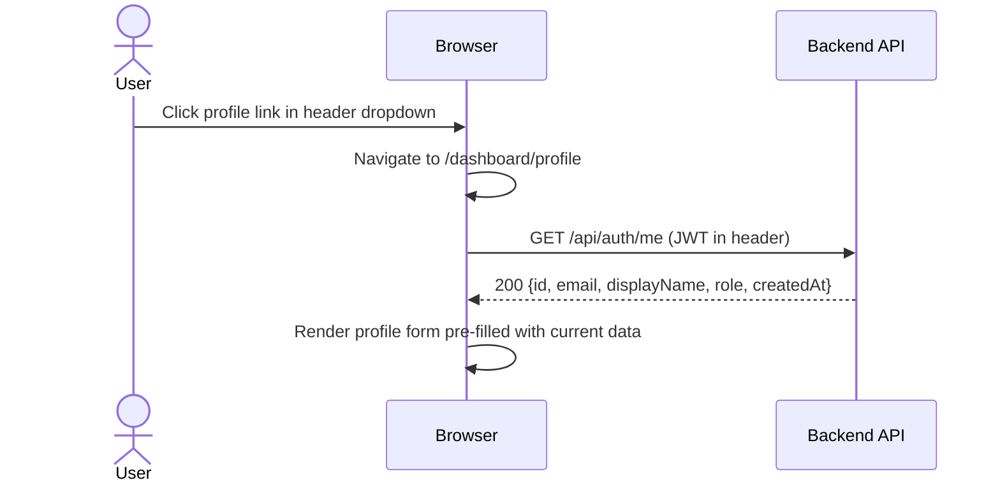
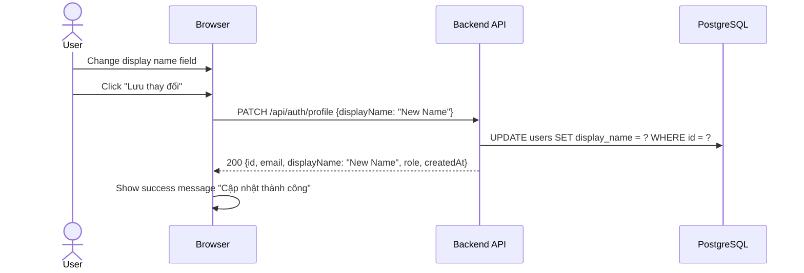
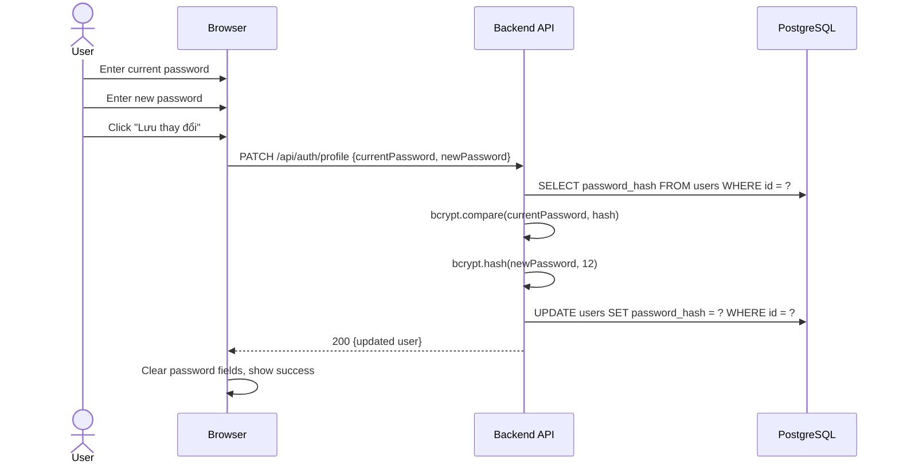

# A4. User Profile & Edit Profile

## 5.1 Feature Overview

| Field | Value |
|---|---|
| Feature ID | A4 |
| Feature Name | User Profile View & Edit |
| Module | A. Authentication & User Management |
| Priority | P0 (view) / P1 (edit) |
| Complexity | S |
| Status | **Existing** — Backend and frontend fully implemented |
| Target Roles | All authenticated users (TEACHER, STUDENT) |
| Business Objective | Allow users to view their account information and update display name and password |
| User Problem | Users need to see their identity in the system and change their name or password |
| Dependencies | A1 (Registration), A2 (Login) |

## 5.2 Actors and Permissions

### Authenticated User (Own Profile)

| Action | Allowed | Notes |
|---|---|---|
| View own profile | Yes | GET /auth/me |
| View email | Yes | Read-only (not editable) |
| View role | Yes | Read-only (not editable) |
| Edit display name | Yes | PATCH /auth/profile |
| Change password | Yes | Requires current password verification |
| Change email | No | Not supported (see Open Questions) |
| Change role | No | Role is immutable |
| Delete account | No | Not implemented (see Open Questions) |

### Any User (Other's Profile)

| Action | Allowed | Notes |
|---|---|---|
| View another user's profile | No | No endpoint exists for viewing other users' profiles |

### Backend Authorization

- `GET /auth/me` — Requires valid JWT. Returns the authenticated user's own data.
- `PATCH /auth/profile` — Requires valid JWT. Always operates on the authenticated user (userId from JWT, not from URL).
- No user can modify another user's profile.

## 5.3 Preconditions and Business Rules

| Rule ID | Rule | Enforcement |
|---|---|---|
| PROF-BR-01 | User must be authenticated to view or edit profile | Global JwtAuthGuard |
| PROF-BR-02 | Display name is optional in the update payload | `@IsOptional()` in UpdateProfileDto |
| PROF-BR-03 | To change password, current password must be provided and correct | `bcrypt.compare` in `updateProfile()` |
| PROF-BR-04 | New password must be at least 6 characters | DTO `@MinLength(6)` — **inconsistency**: should be 8, matching registration |
| PROF-BR-05 | If newPassword is provided without currentPassword, request is rejected | 400 "Current password is required" |
| PROF-BR-06 | Empty payload is accepted (no-op) | No changes applied, returns current user |
| PROF-BR-07 | Email is read-only — no update endpoint exists | Field not present in UpdateProfileDto |
| PROF-BR-08 | Role is read-only | Field not present in UpdateProfileDto |
| PROF-BR-09 | Profile response never includes passwordHash | `sanitizeUser()` strips it |

## 5.4 Main User Flow — Happy Path

### View Profile



### Edit Display Name



### Change Password



## 5.5 Alternative Flows

### AF-01: User changes only display name (no password change)

- `currentPassword` and `newPassword` are omitted or empty.
- Only `displayName` is sent in the request.
- Backend updates only the name.

### AF-02: User changes both name and password

- All fields sent in one request.
- Backend validates current password, then updates both name and password hash.

### AF-03: User submits without changes

- Frontend detects `displayName === user?.displayName` and no password entered.
- Sends empty body (or body with no changed fields).
- Backend does no-op, returns current user.

### AF-04: User enters wrong current password

- `bcrypt.compare` returns false.
- API returns 400 "Current password is incorrect".
- Display name change (if included) is also rejected — the entire request fails.
- **Note**: This means name and password changes are atomic — both succeed or both fail.

## 5.6 Edge Cases and Failure Scenarios

| Scenario ID | Scenario | Trigger | Expected Behavior | User Feedback | Data Integrity | Recovery | Severity |
|---|---|---|---|---|---|---|---|
| EC-A4-01 | Wrong current password | User enters incorrect current password while changing password | 400 "Current password is incorrect" | Error displayed below form | No changes applied (including name changes) | User retries with correct password | Medium |
| EC-A4-02 | newPassword without currentPassword | API request includes newPassword but not currentPassword | 400 "Current password is required" | Error displayed | No changes | User provides current password | Medium |
| EC-A4-03 | New password too short | New password < 6 characters | DTO validation rejects | Validation error | No changes | User enters longer password | Low |
| EC-A4-04 | Display name set to empty string | User clears the display name field | DTO `@IsOptional()` with `@IsString()` — empty string passes, but `@MinLength` not present on displayName | Name set to empty — **potential gap** | User has empty display name | **Recommend**: Add `@MinLength(1)` to displayName in UpdateProfileDto | Medium |
| EC-A4-05 | Very long display name | User enters 10,000 characters | No max length in DTO | Stored as-is — UI may overflow | **Recommend**: Add `@MaxLength(100)` | Medium |
| EC-A4-06 | Session expires during edit | User fills form, token expires before submit | API returns 401 | Frontend should attempt token refresh, then retry | Form data preserved in client state | Auto-refresh or re-login | Medium |
| EC-A4-07 | Same password as current | User enters current password as new password | Currently allowed | Success message | Password hash changes (different salt) | None needed; consider rejecting for UX | Low |
| EC-A4-08 | Concurrent profile updates | User edits profile in two browser tabs | Both succeed; last write wins | Both tabs show success | No conflict detection — last update overwrites | Acceptable at this scale | Low |
| EC-A4-09 | User account deleted while editing | Admin deletes user between page load and save | `findById` returns null, `UnauthorizedException` thrown | 401 error | No changes (user doesn't exist) | N/A | Low |
| EC-A4-10 | XSS in display name | Attacker enters script tags in name | Stored in DB; React auto-escapes on render | Name displayed safely | Data contains HTML but never executed | Consider server-side sanitization | Low |

## 5.7 UI/UX Specification

### Entry Point

- **URL**: `/dashboard/profile`
- **Accessible via**: User avatar/name dropdown in dashboard header → "Hồ sơ" or profile icon link.
- **Also accessible via**: Sidebar navigation (if added — currently via header dropdown).

### Page Layout

- Max width `max-w-lg`, centered horizontally with `mx-auto`.
- Page title: "Hồ sơ cá nhân" (h1, text-2xl, font-bold).
- Single Card containing all form fields.

### Form Fields

| Field | Type | Label | Editable | Notes |
|---|---|---|---|---|
| Email | text input | "Email" | No (disabled) | Displayed with `disabled` attribute |
| Role | text input | "Vai trò" | No (disabled) | Shows "Giáo viên" or "Học sinh" (Vietnamese) |
| Display Name | text input | "Tên hiển thị" | Yes | Pre-filled with current value |
| — | `<hr>` separator | — | — | Visual separator between name and password sections |
| — | hint text | "Đổi mật khẩu (để trống nếu không đổi)" | — | Muted text explaining password fields are optional |
| Current Password | password input | "Mật khẩu hiện tại" | Yes | Empty by default |
| New Password | password input | "Mật khẩu mới" | Yes | Empty by default |

### Card Structure

- **Header**: CardTitle "Thông tin", CardDescription "Cập nhật tên hiển thị và mật khẩu".
- **Content**: Form with vertical stacking (`space-y-4`).
- **Submit**: "Lưu thay đổi" button, full width, primary blue.

### States

| State | Behavior |
|---|---|
| Default | Form pre-filled with current user data; password fields empty |
| Loading | Button disabled, text "Đang lưu..." |
| Success | Green text "Cập nhật thành công" below form; password fields cleared |
| Error | Red text with error message below form |

### Responsive

- `max-w-lg` ensures the form doesn't stretch too wide on desktop.
- On mobile, card fills available width with standard page padding.

## 5.8 Data Requirements

### Existing Schema

Uses the `users` table — no additional tables needed.

**Updateable fields**:

| Column | Updateable via Profile | Notes |
|---|---|---|
| display_name | Yes | Via PATCH /auth/profile |
| password_hash | Yes | Via PATCH /auth/profile (with currentPassword verification) |
| email | No | Not supported |
| role | No | Immutable |

### Proposed Changes

| Change | Rationale | Priority |
|---|---|---|
| Add `@MinLength(1)` to displayName in UpdateProfileDto | Prevent empty name | P1 |
| Add `@MaxLength(100)` to displayName in UpdateProfileDto | Prevent abuse | P1 |
| Change `@MinLength(6)` to `@MinLength(8)` for newPassword | Consistent with registration | P1 |

## 5.9 API Requirements

### GET /api/auth/me

See [Login/Logout spec (A2)](./login-logout.md) section 5.9 for full documentation.

Returns: `{id, email, displayName, role, createdAt}`.

---

### PATCH /api/auth/profile

| Field | Value |
|---|---|
| Method | PATCH |
| Endpoint | `/api/auth/profile` |
| Purpose | Update current user's display name and/or password |
| Required Role | Any authenticated user |
| Authorization | JWT required; operates on the authenticated user only |

**Request Body** (all fields optional):

```json
{
  "displayName": "Nguyễn Văn B",
  "currentPassword": "oldPassword123",
  "newPassword": "newPassword456"
}
```

| Field | Type | Required | Validation |
|---|---|---|---|
| displayName | string | No | Min 1 char (proposed) |
| currentPassword | string | Only if newPassword is provided | Min 6 chars (DTO) |
| newPassword | string | No | Min 6 chars (should be 8) |

**Success Response (200)**:

```json
{
  "success": true,
  "data": {
    "id": "uuid",
    "email": "user@example.com",
    "displayName": "Nguyễn Văn B",
    "role": "TEACHER",
    "createdAt": "2026-11-11T10:00:00.000Z"
  }
}
```

**Error Responses**:

| Status | Code | Condition |
|---|---|---|
| 400 | BAD_REQUEST | newPassword provided without currentPassword |
| 400 | BAD_REQUEST | Current password is incorrect |
| 400 | Validation | Fields fail validation rules |
| 401 | UNAUTHORIZED | No valid JWT |

## 5.10 State Management

No complex state machine. Profile is a simple CRUD operation on user data.

## 5.11 Acceptance Criteria

### Positive Cases

**AC-A4-01**: Given an authenticated user, when they navigate to /dashboard/profile, then they see their current email (disabled), role (disabled), and display name (editable).

**AC-A4-02**: Given an authenticated user, when they change their display name and click "Lưu thay đổi", then the API updates their name and the success message "Cập nhật thành công" is shown.

**AC-A4-03**: Given an authenticated user, when they provide their correct current password and a valid new password, then their password is updated and they can log in with the new password.

### Negative Cases

**AC-A4-04**: Given an authenticated user, when they provide an incorrect current password, then the update is rejected with "Current password is incorrect" and no changes are applied.

**AC-A4-05**: Given an authenticated user, when they provide a new password without the current password, then the request is rejected with "Current password is required".

**AC-A4-06**: Given an unauthenticated user, when they try to access GET /auth/me or PATCH /auth/profile, then they receive 401 Unauthorized.

## 5.12 QA Test Scenarios

| Test Case ID | Scenario | Preconditions | Test Steps | Test Data | Expected Result | Priority |
|---|---|---|---|---|---|---|
| TC-A4-01 | View profile | Logged in user | 1. Navigate to /dashboard/profile | N/A | See email, role (disabled), display name (editable) | P0 |
| TC-A4-02 | Update display name | Logged in user | 1. Change name 2. Click save | displayName: "New Name" | Name updated, success message | P0 |
| TC-A4-03 | Change password successfully | Logged in user | 1. Enter current password 2. Enter new password 3. Save | currentPassword: "old", newPassword: "newpassword" | Success; can login with new password | P0 |
| TC-A4-04 | Wrong current password | Logged in user | 1. Enter wrong current password 2. Enter new password 3. Save | currentPassword: "wrong" | 400, "Current password is incorrect" | P0 |
| TC-A4-05 | New password without current | Logged in user | 1. Leave current password empty 2. Enter new password 3. Save | Only newPassword | 400, "Current password is required" | P1 |
| TC-A4-06 | Empty payload | Logged in user | 1. Click save without changes | Empty body | 200, no changes, returns current user | P1 |
| TC-A4-07 | Email is not editable | Logged in user | 1. Try to edit email field | N/A | Input is disabled, cannot type | P1 |
| TC-A4-08 | Role is not editable | Logged in user | 1. Try to edit role field | N/A | Input is disabled, shows Vietnamese role name | P1 |
| TC-A4-09 | Password fields cleared on success | After successful password change | 1. Change password 2. Observe form | N/A | Current and new password fields are empty | P1 |
| TC-A4-10 | Profile accessible from header | Logged in user | 1. Click avatar/user dropdown 2. Click profile option | N/A | Navigate to /dashboard/profile | P1 |
| TC-A4-11 | Vietnamese characters in name | Logged in user | 1. Set name to "Trần Thị Bé" 2. Save | displayName: "Trần Thị Bé" | Name saved and displayed correctly | P1 |

## 5.13 Open Questions and Assumptions

### OQ-A4-01: Should email change be supported?

| | |
|---|---|
| **Question** | Can users change their email address? |
| **Why it matters** | Users may switch email addresses. Without this feature, they must create a new account. |
| **Options** | (a) Not supported (current). (b) Change with verification email. (c) Change with current password verification only. |
| **Recommended default** | Option (a) for MVP. Document as P3 feature. |
| **Impact** | Option (b) requires email service. Option (c) is simple but risky. |

### OQ-A4-02: Should account deletion be supported?

| | |
|---|---|
| **Question** | Azota supports account deletion. Should Lumi Lite? |
| **Why it matters** | GDPR/privacy compliance may require it. Users who leave the platform may want to delete their data. |
| **Options** | (a) Not supported (current). (b) Soft delete (mark as deleted, hide from system). (c) Hard delete (cascade delete all user data). |
| **Recommended default** | Option (a) for MVP. Consider (b) for P2 if compliance requires it. |
| **Impact** | Hard delete cascading through classrooms, attempts, etc. is complex. Soft delete is simpler. |

### OQ-A4-03: Should profile display an avatar?

| | |
|---|---|
| **Question** | Should users be able to upload a profile picture? |
| **Recommended default** | Not for MVP. Use initials-based avatar (already common in shadcn patterns). |

### Assumptions

| ID | Assumption | Risk if Wrong |
|---|---|---|
| ASM-A4-01 | Users do not need to change their email | If needed, requires email verification workflow |
| ASM-A4-02 | Users do not need to delete their accounts in MVP | May need this for compliance |
| ASM-A4-03 | Password change does not invalidate other sessions | If security requires it, need to delete all refresh tokens on password change |
| ASM-A4-04 | Display name has no uniqueness requirement | Two users can have the same display name |
