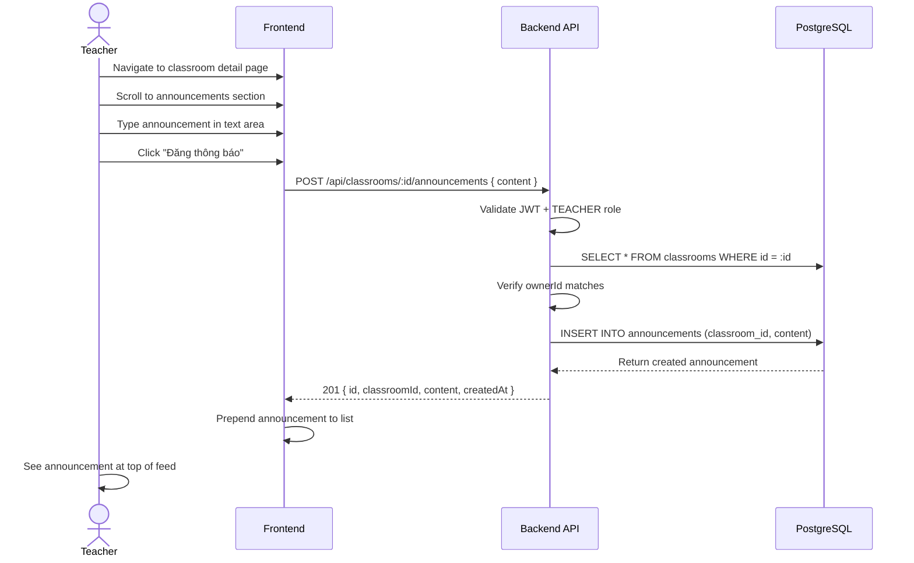
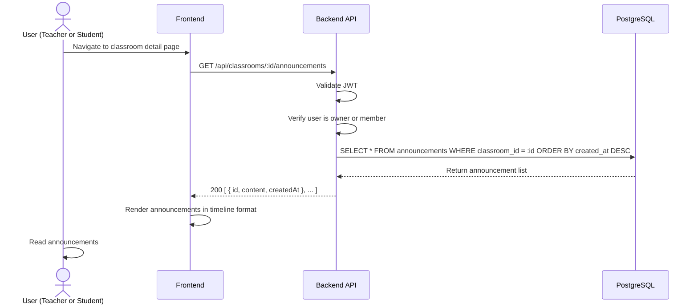
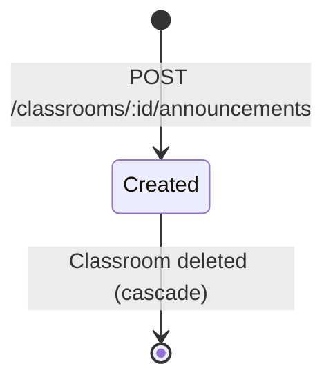

# B5. Classroom Announcements

## 5.1 Feature Overview

| Field | Value |
|---|---|
| Feature ID | B5 |
| Feature Name | Classroom Announcements |
| Module | B. Classroom Management |
| Priority | P2 |
| Complexity | S |
| Status | **Proposed** — schema exists, no API endpoints or frontend UI. |
| Target Roles | TEACHER (create), TEACHER + STUDENT (view) |
| Business Objective | Provide a communication channel within each classroom for teachers to broadcast messages to students, similar to Azota's "Bảng tin" (announcement feed). |
| User Problem | Teachers need a simple way to communicate reminders, instructions, and general messages to their class without relying on external tools (Zalo, email). |
| Dependencies | A1 (Authentication), B1 (Create Classroom), B2 (Join Classroom). |

## 5.2 Actors and Permissions

### Teacher (classroom owner)

| Action | Permitted | Notes |
|---|---|---|
| Create announcement | Yes | Teacher writes a message visible to all members |
| View announcements | Yes | Can see all announcements in their classroom |
| Delete an announcement | **Proposed** | Should the owner be able to delete/edit? See Open Questions. |

### Student (classroom member)

| Action | Permitted | Notes |
|---|---|---|
| View announcements | Yes | Can see all announcements in classrooms they belong to |
| Create announcement | **No** | Only teachers can post |
| Delete announcement | **No** | — |

### Non-member

| Action | Permitted | Notes |
|---|---|---|
| View announcements | **No** | Must be owner or member (proposed enforcement) |

## 5.3 Preconditions and Business Rules

### Preconditions

1. User must be authenticated.
2. Classroom must exist and not be deleted.
3. For creating announcements: user must be the classroom owner (TEACHER).
4. For viewing announcements: user must be the classroom owner or a member.

### Business Rules

| Rule ID | Rule | Enforcement |
|---|---|---|
| B5-R1 | Only the classroom owner can create announcements. | Proposed: ownership check in service. |
| B5-R2 | Announcements are visible to all classroom members and the owner. | Proposed: membership/ownership check on GET endpoint. |
| B5-R3 | Announcements are ordered by `createdAt` descending (newest first). | Proposed: `orderBy: { createdAt: 'desc' }`. |
| B5-R4 | Announcement content is required and must be at least 1 character. | Proposed: DTO validation. |
| B5-R5 | Announcements are immutable after creation (no edit). | Proposed simplification. See Open Questions for edit support. |
| B5-R6 | Deleting a classroom cascades to all its announcements. | Existing: Prisma schema has `onDelete: Cascade`. |

### Validation Rules (Proposed)

| Field | Type | Required | Constraints |
|---|---|---|---|
| `content` | string | Yes | Min 1 char, max 5000 chars |

## 5.4 Main User Flow — Happy Path

### Create Announcement



### View Announcements



## 5.5 Alternative Flows

### AF-1: No announcements yet

1. User navigates to classroom detail.
2. Announcements section shows empty state: "Chưa có thông báo nào."
3. Teacher sees the input area to create the first announcement.

### AF-2: Long announcement content

1. Teacher writes a multi-paragraph announcement.
2. Content is stored as plain text (with newlines).
3. Frontend renders with `whitespace-pre-wrap` to preserve line breaks.

### AF-3: Student views announcements

1. Student navigates to classroom detail.
2. Announcements are displayed in read-only mode.
3. The create input area is not shown for students.

## 5.6 Edge Cases and Failure Scenarios

| Scenario ID | Scenario | Trigger | Expected Behavior | User Feedback | Data Integrity | Recovery | Severity |
|---|---|---|---|---|---|---|---|
| B5-E1 | Non-owner teacher tries to post | Teacher doesn't own the classroom | 403 Forbidden. | Error message. | No announcement created. | N/A — by design. | Low |
| B5-E2 | Student tries to post | Student role | 403 Forbidden (role guard). | Post UI not shown for students. | No announcement created. | N/A. | Low |
| B5-E3 | Non-member views announcements | User not in classroom | Proposed: 403 Forbidden. | Error or redirect. | No data exposure. | N/A. | Medium |
| B5-E4 | Empty content | Teacher submits empty text | 400 validation error. | Inline error on textarea. | No announcement created. | Re-enter content. | Low |
| B5-E5 | Very long content (>5000 chars) | Teacher pastes a large text | Proposed: 400 validation (max 5000). Current schema: unlimited. | Error message with char limit. | No announcement created if validated. | Shorten content. | Low |
| B5-E6 | Classroom deleted while viewing | Another tab deletes the classroom | Cascade deletes all announcements. Next API call returns 404. | Stale data shown until refresh. | All data cleaned up. | Navigate to classrooms list. | Low |
| B5-E7 | XSS in content | Teacher posts `<script>alert(1)</script>` | Content stored as-is. Frontend must render as text, not HTML. | Text displayed literally (no execution). | Safe if rendered as text. | N/A. | Medium |
| B5-E8 | Archived classroom announcements | Teacher posts to archived classroom | **Open question**: Should this be allowed? Archiving doesn't block API access by default. | Announcement created. | Data integrity fine. | Consider blocking. | Low |
| B5-E9 | High volume (100+ announcements) | Active classroom over time | Without pagination, all announcements returned. May be slow. | Long scroll. | Data fine. | Add pagination. | Medium |
| B5-E10 | Concurrent posts | Two announcements posted simultaneously | Both created with different IDs and timestamps. | Both appear in list. | No conflict — announcements are append-only. | N/A — safe. | Low |

## 5.7 UI/UX Specification

### Proposed Entry Point

On the classroom detail page (`/dashboard/classrooms/:id`), add an **Announcements section** above or below the Members section.

### Proposed Layout

```
┌──────────────────────────────────────┐
│ 📢 Thông báo                         │
│                                      │
│ ┌──────────────────────────────────┐ │  ← Teacher only
│ │ [Textarea: Viết thông báo...]    │ │
│ │                      [Đăng]      │ │
│ └──────────────────────────────────┘ │
│                                      │
│ ┌──────────────────────────────────┐ │  ← Announcement card
│ │ Announcement content here.       │ │
│ │ Multi-line supported.            │ │
│ │                     11/11/2026   │ │
│ └──────────────────────────────────┘ │
│                                      │
│ ┌──────────────────────────────────┐ │
│ │ Older announcement...            │ │
│ │                     10/11/2026   │ │
│ └──────────────────────────────────┘ │
│                                      │
│ (Chưa có thông báo nào)             │  ← Empty state
└──────────────────────────────────────┘
```

### Component Specifications

| Element | Specification |
|---|---|
| **Section header** | "Thông báo" with megaphone icon |
| **Input area** | Textarea (3 rows). Placeholder: "Viết thông báo cho lớp...". Teacher-only. |
| **Post button** | Primary Blue. "Đăng" (or "Đăng thông báo"). Disabled while loading. |
| **Announcement card** | Light card (`surface` background, subtle `border`). Content with `whitespace-pre-wrap`. |
| **Timestamp** | Bottom-right of card. `text-muted`. Vietnamese date format. |
| **Empty state** | Centered muted text: "Chưa có thông báo nào." |

### Responsive Behavior

Full-width on all breakpoints. Cards stack vertically.

## 5.8 Data Requirements

### Entities

#### Announcement (Existing Schema)

| Field | Type | Required | Constraints | Notes |
|---|---|---|---|---|
| `id` | UUID | Auto | Primary key | |
| `classroomId` | UUID FK | Yes | References `classrooms.id`, cascade delete | |
| `content` | String | Yes | Proposed: min 1, max 5000 | Currently no length limit |
| `createdAt` | DateTime | Auto | Default `now()` | |

### Relationships

- `Announcement.classroomId` → `Classroom.id` (many-to-one, cascade delete)

### Indexes

- No additional indexes needed beyond the FK on `classroomId` (Prisma creates this automatically).

### Missing Fields (Proposed — Not Required for MVP)

These could be added later if the feature evolves:

| Field | Purpose | Priority |
|---|---|---|
| `authorId` | Track who posted (if multiple teachers manage a classroom) | P3 |
| `updatedAt` | Support editing | P3 |
| `pinned` | Pin important announcements to the top | P3 |

## 5.9 API Requirements

### POST /api/classrooms/:id/announcements — Create Announcement (Proposed)

| Field | Value |
|---|---|
| **Method** | POST |
| **Endpoint** | `/api/classrooms/:id/announcements` |
| **Purpose** | Create a new announcement in a classroom |
| **Required Role** | TEACHER (classroom owner) |
| **Authentication** | JWT Bearer token required |
| **Status** | **Not implemented** |

#### Request Body

```json
{
  "content": "Các em nhớ ôn bài chương 3 cho buổi kiểm tra ngày mai nhé."
}
```

| Field | Type | Required | Validation |
|---|---|---|---|
| `content` | string | Yes | `@IsString()`, `@MinLength(1)`, `@MaxLength(5000)` |

#### Success Response (201 Created)

```json
{
  "success": true,
  "data": {
    "id": "uuid",
    "classroomId": "uuid",
    "content": "Các em nhớ ôn bài chương 3 cho buổi kiểm tra ngày mai nhé.",
    "createdAt": "2026-11-11T10:00:00.000Z"
  }
}
```

#### Error Responses

| Status | Code | Condition |
|---|---|---|
| 400 | VALIDATION_ERROR | Empty or too-long content |
| 401 | UNAUTHORIZED | Missing/invalid JWT |
| 403 | FORBIDDEN | Not the classroom owner |
| 404 | NOT_FOUND | Classroom does not exist |

---

### GET /api/classrooms/:id/announcements — List Announcements (Proposed)

| Field | Value |
|---|---|
| **Method** | GET |
| **Endpoint** | `/api/classrooms/:id/announcements` |
| **Purpose** | List all announcements for a classroom |
| **Required Role** | Any authenticated user who is owner or member |
| **Authentication** | JWT Bearer token required |
| **Status** | **Not implemented** |

#### Query Parameters (Proposed)

| Param | Type | Required | Default | Description |
|---|---|---|---|---|
| `page` | int | No | 1 | Page number |
| `limit` | int | No | 20 | Items per page (max 100) |

#### Success Response (200 OK)

```json
{
  "success": true,
  "data": [
    {
      "id": "uuid",
      "classroomId": "uuid",
      "content": "Thông báo mới nhất...",
      "createdAt": "2026-11-11T10:00:00.000Z"
    }
  ],
  "meta": {
    "page": 1,
    "limit": 20,
    "total": 5
  }
}
```

#### Authorization

Must verify that the requesting user is either:
- The classroom owner (`classroom.ownerId === userId`), OR
- A classroom member (`classroomMember` exists for `classroomId + userId`)

## 5.10 State Management

Announcements have no lifecycle states. They are append-only records:



No editing, no publishing workflow, no draft state.

## 5.11 Acceptance Criteria

### Positive

```gherkin
Given a teacher owns a classroom with 5 students,
When the teacher creates an announcement with content "Ôn bài chương 3",
Then an Announcement record is created in the database,
And all 5 students can see the announcement when viewing the classroom.

Given a classroom has 3 announcements,
When a student views the classroom announcements,
Then all 3 announcements are returned,
And they are ordered by createdAt descending (newest first).
```

### Negative

```gherkin
Given a student is a classroom member,
When the student attempts to create an announcement,
Then the backend returns 403 Forbidden.

Given a user is not a member or owner of a classroom,
When the user attempts to view announcements,
Then the backend returns 403 Forbidden.

Given a teacher attempts to create an announcement with empty content,
When the request is processed,
Then the backend returns 400 Validation Error.
```

## 5.12 QA Test Scenarios

| Test ID | Scenario | Preconditions | Steps | Expected Result | Priority |
|---|---|---|---|---|---|
| B5-T1 | Create announcement | Owner auth'd | POST /classrooms/:id/announcements `{ content: "Test" }` | 201, record created | High |
| B5-T2 | List announcements | Classroom has 3 announcements, member auth'd | GET /classrooms/:id/announcements | 200, 3 items, newest first | High |
| B5-T3 | Empty classroom announcements | No announcements | GET /classrooms/:id/announcements | 200, empty array | Medium |
| B5-T4 | Non-owner cannot create | Another teacher | POST /classrooms/:id/announcements | 403 | Critical |
| B5-T5 | Student cannot create | Student member | POST /classrooms/:id/announcements | 403 | Critical |
| B5-T6 | Non-member cannot view | User not in classroom | GET /classrooms/:id/announcements | 403 | High |
| B5-T7 | Empty content rejected | Owner auth'd | POST with `{ content: "" }` | 400 | Medium |
| B5-T8 | Long content rejected | Owner auth'd | POST with >5000 char content | 400 | Medium |
| B5-T9 | Cascade on classroom delete | Classroom has announcements | DELETE /classrooms/:id | Announcements deleted | High |
| B5-T10 | Ordering | 3 announcements, different times | GET announcements | Ordered newest first | Medium |
| B5-T11 | XSS content | Owner auth'd | POST with `{ content: "<script>alert(1)</script>" }` | 201. Content stored and returned as text. | High |

## 5.13 Open Questions and Assumptions

| # | Question | Why It Matters | Options | Recommended Default | Impact |
|---|---|---|---|---|---|
| B5-Q1 | Should announcements be editable after creation? | Teachers may want to fix typos. But edit complicates the model (need `updatedAt`, edit history). | A) Immutable (simpler). B) Editable with `updatedAt`. | **A) Immutable** — keep it simple for P2. Teacher can post a correction. | None if immutable. Low if editable. |
| B5-Q2 | Should announcements be deletable? | Teacher may want to remove incorrect or outdated announcements. | A) Not deletable. B) Owner can delete. | **B) Owner can delete** — add `DELETE /classrooms/:id/announcements/:announcementId`. | Low — simple endpoint. |
| B5-Q3 | Should announcements trigger notifications? | Students may miss announcements if they don't check the classroom page. | A) No notification. B) In-app notification to all members. | **B) In-app notification** — use existing `NotificationsService.createMany()` with type `ANNOUNCEMENT`. | Medium — integration with notifications module. |
| B5-Q4 | Should pagination be implemented from the start? | Without it, classrooms with many announcements could be slow. | A) No pagination. B) Paginated with `?page=&limit=`. | **B) Paginated** — matches existing API conventions. | Low — standard pattern. |
| B5-Q5 | Should announcements support rich text or attachments? | Azota supports basic formatting in their "Bảng tin". | A) Plain text only. B) Markdown support. C) Rich text editor. | **A) Plain text only** — simplest for P2. | None for plain text. |

### Assumptions

1. **Plain text only.** Announcements are simple text messages without formatting, images, or attachments. Rich content is out of scope for P2.
2. **No read tracking.** The system does not track which students have read an announcement. This could be a P3 feature.
3. **No pinning.** All announcements are shown in chronological order. There is no ability to pin an announcement to the top.
4. **Classroom-scoped.** Announcements belong to exactly one classroom. There is no cross-classroom announcement mechanism.
