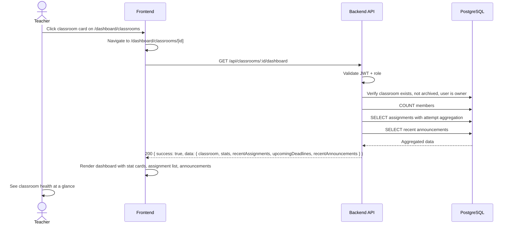
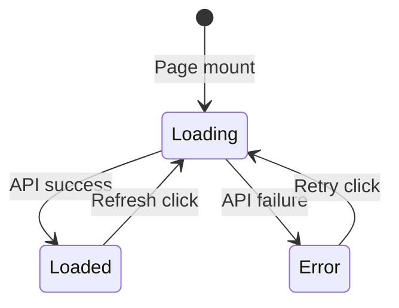

# B7. Classroom Dashboard

## 5.1 Feature Overview

| Field | Value |
|---|---|
| Feature ID | B7 |
| Feature Name | Classroom Dashboard |
| Module | B. Classroom Management |
| Priority | P1 |
| Complexity | M |
| Status | **Not implemented** — the current `/dashboard/classrooms/[id]` page shows only the member list and edit/delete actions. No metrics, no assignments list, no announcements. |
| Target Roles | TEACHER (full), STUDENT (limited view) |
| Business Objective | Provide a single landing page for a classroom that gives the teacher an at-a-glance understanding of classroom health — student count, assignment activity, completion rates, and upcoming deadlines — so they can act without visiting multiple pages. |
| User Problem | After opening a classroom, teachers see only a member list. They must navigate to the analytics page and assignments page separately to understand what is happening. Students see no useful information after opening a classroom. |
| Dependencies | B1 (Create Classroom), B2 (Join Classroom), B3 (Manage Students), D5 (Assign Exam), F1 (Create Assignment), H1 (Analytics APIs), B5 (Announcements — schema only). |

## 5.2 Actors and Permissions

### Teacher (TEACHER role, classroom owner)

| Action | Permitted | Notes |
|---|---|---|
| View dashboard for own classroom | Yes | Verified via `Classroom.ownerId === userId` |
| See all metrics (member count, avg score, completion rate, submission rate) | Yes | Data from `GET /api/classrooms/:id/dashboard` |
| See full assignment list with submission counts | Yes | |
| See announcements section | Yes | Requires B5 implementation for write; read is in scope here |
| Navigate to member management, analytics, assignment detail | Yes | Links from dashboard |

### Student (STUDENT role, classroom member)

| Action | Permitted | Notes |
|---|---|---|
| View dashboard for a classroom they belong to | Yes | Verified via `ClassroomMember` record |
| See own metrics (assignments completed, own avg score, pending count) | Yes | Student sees only their own data |
| See assignment list with own status per assignment | Yes | Shows: not started / in progress / submitted |
| See announcements | Yes | Read-only |
| See other students' scores or overall class avg | **No** | Privacy — student sees only own data |

### Non-member / Non-owner

| Action | Permitted | Notes |
|---|---|---|
| View any dashboard | **No** | Backend returns 403. Frontend redirects to classrooms list. |

**Backend enforcement**: A new `GET /api/classrooms/:id/dashboard` endpoint checks ownership (TEACHER) or membership (STUDENT) before returning data. Role and membership checks happen in the service layer, not just the controller guard.

## 5.3 Preconditions and Business Rules

### Preconditions

1. User must be authenticated.
2. Classroom must exist and not be archived (`archivedAt IS NULL`).
3. User must be the classroom owner (TEACHER) or a member (STUDENT).

### Business Rules

| Rule ID | Rule | Enforcement |
|---|---|---|
| B7-R1 | The dashboard endpoint requires the caller to be the classroom owner or a classroom member. Non-members receive 403. | Backend: service checks `ownerId` or `ClassroomMember` existence before querying. |
| B7-R2 | Archived classrooms return 404 from the dashboard endpoint. The dashboard is not available for archived classrooms. | Backend: query includes `archivedAt: null` filter. |
| B7-R3 | Teacher sees aggregate metrics across all students. Student sees only their own metrics. The response shape differs by role. | Backend: service branches on role to construct the response. |
| B7-R4 | Completion rate is calculated as: (number of members who have at least one SUBMITTED attempt for an assignment) / (total member count). If member count is 0, rate is `null`. | Backend: computed in the dashboard service per active assignment. |
| B7-R5 | Average score is the mean of all SUBMITTED attempt scores for all active assignments in the classroom. Uses score scale 0–10, rounded to 2 decimal places. If no submitted attempts, value is `null`. | Backend: aggregation query. |
| B7-R6 | "Upcoming deadlines" shows assignments where `dueAt > NOW()` and `status = 'ACTIVE'`, ordered by `dueAt ASC`, limited to 5. | Backend: filtered query in dashboard service. |
| B7-R7 | Student's "pending assignments" are active assignments for which the student has no SUBMITTED attempt. | Backend: LEFT JOIN attempt check filtered by `studentId`. |
| B7-R8 | The assignments list on the dashboard shows the 10 most recent assignments by `assignedAt DESC`. A "Xem tất cả" link navigates to the full assignment list. | Frontend: truncated list with navigation link. |
| B7-R9 | The announcements section shows the 3 most recent announcements by `createdAt DESC`. If no announcements exist, the section is hidden. | Frontend: conditional render. Backend: included in dashboard response. |
| B7-R10 | Dashboard data is fetched on page load. No automatic refresh or polling. Teacher can manually refresh with a refresh button. | Frontend: single fetch on mount + manual refresh. |

### Validation Rules

| Field | Type | Required | Constraints |
|---|---|---|---|
| `:id` (path param) | UUID | Yes | Must be a valid UUID. If invalid, return 400. |

## 5.4 Main User Flow — Happy Path



### Step-by-step

1. **Teacher** clicks a classroom card on the classrooms list page.
2. **Frontend** navigates to `/dashboard/classrooms/[id]`.
3. **Frontend** sends `GET /api/classrooms/:id/dashboard`.
4. **Backend** validates JWT and extracts user ID and role.
5. **Backend** verifies the classroom exists, is not archived, and the user is the owner.
6. **Backend** queries member count, assignment stats (completion, avg score), upcoming deadlines, and recent announcements.
7. **Backend** returns the assembled dashboard payload.
8. **Frontend** renders: stat cards row, recent assignments table, upcoming deadlines, and announcements.
9. **Teacher** sees the classroom overview and can navigate to detailed views via links.

**Success condition**: Dashboard loads within 2 seconds for a classroom with up to 100 members and 50 assignments. All metrics are accurate as of page load.

## 5.5 Alternative Flows

### AF-1: Student views classroom dashboard

1. Student navigates to `/dashboard/classrooms/[id]` (from their classrooms list).
2. Frontend sends `GET /api/classrooms/:id/dashboard`.
3. Backend detects role is STUDENT, verifies membership.
4. Backend returns student-scoped data: own completion count, own avg score, own pending assignments, assignment list with per-student status, announcements.
5. Frontend renders student-specific layout (no class-wide aggregates, no member count stat card).

### AF-2: Teacher views classroom with no assignments

1. Dashboard loads normally.
2. Stat cards show: member count = N, exams assigned = 0, avg score = "—", completion = "—".
3. Assignment list shows empty state: "Chưa có bài kiểm tra nào được giao. Giao bài kiểm tra đầu tiên!"
4. Upcoming deadlines section is hidden.

### AF-3: Teacher views classroom with no members

1. Dashboard loads normally.
2. Member count = 0. Completion rate = "—". Avg score = "—".
3. A banner above the stats: "Lớp học chưa có học sinh. Chia sẻ mã lớp để mời học sinh tham gia." with the join code badge and copy button.

### AF-4: Teacher clicks refresh button

1. Teacher clicks the refresh icon button in the page header.
2. Frontend re-fetches `GET /api/classrooms/:id/dashboard`.
3. Loading indicators appear on stat cards (shimmer/skeleton).
4. Data updates in place.

## 5.6 Edge Cases and Failure Scenarios

| Scenario ID | Scenario | Trigger | Expected Behavior | User Feedback | Data Integrity | Recovery | Severity |
|---|---|---|---|---|---|---|---|
| B7-E1 | Classroom has been archived between navigation and load | Teacher bookmarked the URL, classroom was archived | Backend returns 404 | "Không tìm thấy lớp học hoặc lớp đã được lưu trữ." | No data change | Navigate back to classrooms list | Low |
| B7-E2 | Non-owner teacher accesses dashboard | Teacher navigates to another teacher's classroom URL | Backend returns 403 Forbidden | "Bạn không có quyền xem lớp học này." | No data change | N/A — access denied by design | Low |
| B7-E3 | Student removed from classroom while viewing dashboard | Admin or teacher removes student during session | Dashboard loaded data is stale but harmless. Next navigation or refresh returns 403 | On refresh: "Bạn không còn là thành viên của lớp học này." | No data change | Student is redirected to classrooms list | Low |
| B7-E4 | Classroom with large number of assignments (100+) | Teacher has assigned many exams over time | Dashboard returns only top 10 recent + top 5 upcoming deadlines. Full list via pagination link. | Performance acceptable due to bounded query | No impact | N/A | Low |
| B7-E5 | Scores contain NULL values (ungraded essays) | Essay questions scored as 0 pending manual grading | NULL scores excluded from avg calculation. Stat card shows note "Chưa bao gồm bài chưa chấm" if any NULLs exist | Tooltip or note text | No impact — NULLs ignored | N/A | Low |
| B7-E6 | Network failure during dashboard load | Connection drops | Frontend shows error state with retry button | "Không thể tải dữ liệu. Vui lòng thử lại." with retry button | No data change | Retry button re-fetches | Medium |
| B7-E7 | Invalid UUID in URL | User types gibberish in URL bar | Backend returns 400 (DTO/pipe validation) | "Đường dẫn không hợp lệ." | No data change | Navigate to classrooms list | Low |
| B7-E8 | Concurrent member joins during dashboard view | Students join while teacher is viewing | Dashboard shows count at time of query. Refresh shows updated count. | Stale by seconds — acceptable | No integrity issue | Manual refresh | Low |

## 5.7 UI/UX Specification

### Entry Point

- **Page**: `/dashboard/classrooms/[id]` — this IS the classroom landing page.
- **Current state**: Shows classroom name, join code, edit/delete buttons, and member list card only.
- **Proposed**: Replace current layout with a full dashboard. Move member list to a dedicated tab/section.

### Layout — Teacher View

```
┌──────────────────────────────────────────────────────┐
│  ← Lớp học    [Classroom Name]       [Mã: ABC123] ⟳ │  Header
├──────────────────────────────────────────────────────┤
│  ┌────────┐ ┌────────┐ ┌────────┐ ┌────────────────┐│
│  │ 32     │ │  5     │ │  7.5   │ │  85%           ││  Stat Cards
│  │Học sinh│ │Bài giao│ │Điểm TB │ │Tỷ lệ hoàn thành││
│  └────────┘ └────────┘ └────────┘ └────────────────┘│
├──────────────────────────────────────────────────────┤
│  Bài kiểm tra gần đây                  [Xem tất cả]│
│  ┌──────────────────────────────────────────────────┐│
│  │ Toán 12 - KT giữa kỳ   | 28/32 nộp | 15/11   ││  Recent Assignments
│  │ Vật lý 11 - Bài 3       | 30/32 nộp | 10/11   ││
│  └──────────────────────────────────────────────────┘│
├──────────────────────────────────────────────────────┤
│  Sắp đến hạn                                        │
│  ┌──────────────────────────────────────────────────┐│
│  │ Toán 12 - Bài tập 5      | Hạn: 18/11/2026    ││  Upcoming Deadlines
│  └──────────────────────────────────────────────────┘│
├──────────────────────────────────────────────────────┤
│  Thông báo                                          │
│  ┌──────────────────────────────────────────────────┐│
│  │ 10/11: Chuẩn bị kiểm tra giữa kỳ...           ││  Announcements
│  └──────────────────────────────────────────────────┘│
└──────────────────────────────────────────────────────┘
```

### Layout — Student View

```
┌──────────────────────────────────────────────────────┐
│  ← Lớp học    [Classroom Name]                       │  Header
├──────────────────────────────────────────────────────┤
│  ┌────────────┐ ┌────────────┐ ┌────────────────────┐│
│  │  3/5       │ │  7.2       │ │  2                 ││  Student Stats
│  │Đã hoàn thành│ │Điểm TB     │ │Chưa làm           ││
│  └────────────┘ └────────────┘ └────────────────────┘│
├──────────────────────────────────────────────────────┤
│  Bài kiểm tra                            [Xem tất cả]│
│  ┌──────────────────────────────────────────────────┐│
│  │ Toán 12 - KT giữa kỳ   | Đã nộp    | 8.0 điểm ││
│  │ Vật lý 11 - Bài 3       | Chưa làm  | —        ││
│  └──────────────────────────────────────────────────┘│
├──────────────────────────────────────────────────────┤
│  Sắp đến hạn                                        │
│  ┌──────────────────────────────────────────────────┐│
│  │ Vật lý 11 - Bài 3        | Hạn: 20/11/2026    ││
│  └──────────────────────────────────────────────────┘│
└──────────────────────────────────────────────────────┘
```

### Stat Cards

| Card (Teacher) | Value Source | Format |
|---|---|---|
| Học sinh (Students) | `ClassroomMember` count | Integer |
| Bài giao (Assigned) | `Assignment` count where `classroomId` matches | Integer |
| Điểm TB (Avg Score) | Mean of all SUBMITTED attempt scores | Decimal, 1 dp, or "—" if none |
| Tỷ lệ hoàn thành (Completion) | See B7-R4 | Percentage, or "—" if no members |

| Card (Student) | Value Source | Format |
|---|---|---|
| Đã hoàn thành (Completed) | Count of assignments with at least one SUBMITTED attempt by this student / total active assignments | "N/M" fraction |
| Điểm TB (Avg Score) | Mean of student's own SUBMITTED scores in this classroom | Decimal, 1 dp, or "—" |
| Chưa làm (Pending) | Active assignments with no attempt by this student | Integer |

### States

- **Loading**: Skeleton cards (4 rectangles for stat cards, 3 rows for assignment list).
- **Error**: Error message with retry button.
- **Empty classroom** (no members): Banner prompting teacher to share join code.
- **No assignments**: Empty state illustration with "Giao bài kiểm tra đầu tiên!" link for teacher; "Chưa có bài kiểm tra nào" for student.

### Responsive Behavior

| Breakpoint | Stat Cards | Assignment List |
|---|---|---|
| < 640px (mobile) | 2×2 grid | Full-width stack, abbreviated columns |
| 640px–1024px (tablet) | 4×1 row | Full table |
| > 1024px (desktop) | 4×1 row | Full table |

## 5.8 Data Requirements

### Entities Used (All Existing)

No schema changes are required. The dashboard is a read-only aggregation view over existing tables.

#### Classroom (Existing)

| Field | Use in Dashboard |
|---|---|
| `id` | Path parameter |
| `name` | Page title |
| `joinCode` | Displayed for teacher |
| `ownerId` | Ownership check |
| `archivedAt` | Precondition check |

#### ClassroomMember (Existing)

| Field | Use in Dashboard |
|---|---|
| `classroomId` | Filter members |
| `userId` | Count, membership check |

#### Assignment (Existing)

| Field | Use in Dashboard |
|---|---|
| `classroomId` | Filter assignments for this classroom |
| `examId` | Join to exam for title |
| `dueAt` | Upcoming deadlines |
| `status` | Filter ACTIVE only |
| `assignedAt` | Sort recent |

#### ExamAttempt (Existing)

| Field | Use in Dashboard |
|---|---|
| `examId` | Join to assignment's exam |
| `studentId` | Per-student stats, completion |
| `status` | Filter SUBMITTED |
| `score` | Avg score calculation |

#### Announcement (Existing — schema only, no endpoints)

| Field | Use in Dashboard |
|---|---|
| `classroomId` | Filter by classroom |
| `content` | Display text |
| `createdAt` | Sort recent |

### Proposed Schema Changes

None.

### Proposed Indexes (for performance)

The following indexes may improve dashboard query performance if they do not already exist:

- `Assignment(classroomId, status)` — filter active assignments per classroom.
- `ExamAttempt(examId, status)` — aggregate submitted attempts per exam.

These are recommendations for the architect; not strictly required at ~100 users.

## 5.9 API Requirements

### GET /api/classrooms/:id/dashboard — Classroom Dashboard

| Field | Value |
|---|---|
| **Method** | GET |
| **Endpoint** | `/api/classrooms/:id/dashboard` |
| **Purpose** | Return aggregated dashboard data for a classroom |
| **Required Role** | TEACHER (owner) or STUDENT (member) |
| **Authentication** | JWT Bearer token required |

#### Path Parameters

| Param | Type | Required | Validation |
|---|---|---|---|
| `id` | UUID string | Yes | Must be valid UUID format |

#### Success Response — Teacher (200 OK)

```json
{
  "success": true,
  "data": {
    "classroom": {
      "id": "uuid",
      "name": "Toán 12A1",
      "joinCode": "A3F2C1"
    },
    "stats": {
      "memberCount": 32,
      "assignmentCount": 5,
      "avgScore": 7.45,
      "completionRate": 0.85,
      "hasUngradedAttempts": false
    },
    "recentAssignments": [
      {
        "id": "uuid",
        "examTitle": "KT Giữa kỳ",
        "assignedAt": "2026-11-10T08:00:00.000Z",
        "dueAt": "2026-11-18T23:59:59.000Z",
        "status": "ACTIVE",
        "submittedCount": 28,
        "totalStudents": 32
      }
    ],
    "upcomingDeadlines": [
      {
        "assignmentId": "uuid",
        "examTitle": "Bài tập 5",
        "dueAt": "2026-11-18T23:59:59.000Z"
      }
    ],
    "recentAnnouncements": [
      {
        "id": "uuid",
        "content": "Chuẩn bị kiểm tra giữa kỳ...",
        "createdAt": "2026-11-10T08:00:00.000Z"
      }
    ]
  }
}
```

#### Success Response — Student (200 OK)

```json
{
  "success": true,
  "data": {
    "classroom": {
      "id": "uuid",
      "name": "Toán 12A1"
    },
    "stats": {
      "completedCount": 3,
      "totalAssignments": 5,
      "avgScore": 7.2,
      "pendingCount": 2
    },
    "assignments": [
      {
        "id": "uuid",
        "examTitle": "KT Giữa kỳ",
        "dueAt": "2026-11-18T23:59:59.000Z",
        "status": "ACTIVE",
        "myStatus": "SUBMITTED",
        "myScore": 8.0
      }
    ],
    "upcomingDeadlines": [
      {
        "assignmentId": "uuid",
        "examTitle": "Bài tập 5",
        "dueAt": "2026-11-18T23:59:59.000Z"
      }
    ],
    "recentAnnouncements": [
      {
        "id": "uuid",
        "content": "Chuẩn bị kiểm tra giữa kỳ...",
        "createdAt": "2026-11-10T08:00:00.000Z"
      }
    ]
  }
}
```

`myStatus` values: `"NOT_STARTED"` | `"IN_PROGRESS"` | `"SUBMITTED"`.

#### Error Responses

| Status | Code | Message | Condition |
|---|---|---|---|
| 400 | VALIDATION_ERROR | "ID không hợp lệ." | Invalid UUID format |
| 401 | UNAUTHORIZED | "Vui lòng đăng nhập." | Missing or invalid JWT |
| 403 | FORBIDDEN | "Bạn không có quyền xem lớp học này." | User is not owner and not member |
| 404 | NOT_FOUND | "Không tìm thấy lớp học hoặc lớp đã được lưu trữ." | Classroom does not exist or `archivedAt IS NOT NULL` |

## 5.10 State Management

This feature is read-only and stateless. No state transitions are introduced. The dashboard aggregates data from existing entities whose lifecycles are managed by other features (B1–B5, D5, F1–F4, E1–E5, G1–G5).

Frontend state:



## 5.11 Acceptance Criteria

### Positive — Teacher

```gherkin
Given a teacher owns a classroom with 3 members and 2 active assignments,
  and 2 members have submitted attempt(s) for one assignment,
When the teacher opens the classroom dashboard,
Then the stat cards show: Học sinh = 3, Bài giao = 2,
  and Tỷ lệ hoàn thành reflects the proportion of members who have submitted.

Given a teacher owns a classroom with submitted attempts,
When the teacher views the dashboard,
Then Điểm TB shows the mean of all submitted attempt scores rounded to 2 decimal places.

Given a classroom has 12 assignments,
When the teacher views the dashboard,
Then the recent assignments section shows the 10 most recent by assignedAt DESC,
And a "Xem tất cả" link is shown.

Given a classroom has assignments with dueAt in the future,
When the teacher views the dashboard,
Then the upcoming deadlines section shows up to 5, ordered by dueAt ASC.

Given a classroom has 2 announcements,
When the teacher views the dashboard,
Then the announcements section shows them ordered by createdAt DESC.
```

### Positive — Student

```gherkin
Given a student is a member of a classroom with 5 active assignments,
  and the student has submitted 3 of them,
When the student opens the classroom dashboard,
Then the stat cards show: Đã hoàn thành = 3/5, Chưa làm = 2,
  and Điểm TB is the mean of the student's own submitted scores.

Given a student is viewing the dashboard,
When the student looks at the assignment list,
Then each assignment shows the student's own status (NOT_STARTED, IN_PROGRESS, SUBMITTED)
  and their score if SUBMITTED and results are visible.
```

### Negative / Permission

```gherkin
Given a teacher does NOT own a classroom,
When they request GET /api/classrooms/:id/dashboard,
Then the backend returns 403 Forbidden.

Given a student is NOT a member of a classroom,
When they request GET /api/classrooms/:id/dashboard,
Then the backend returns 403 Forbidden.

Given a classroom is archived,
When any user requests GET /api/classrooms/:id/dashboard,
Then the backend returns 404 Not Found.

Given an unauthenticated request,
When GET /api/classrooms/:id/dashboard is called,
Then the backend returns 401 Unauthorized.
```

## 5.12 QA Test Scenarios

| Test ID | Scenario | Preconditions | Steps | Test Data | Expected Result | Priority |
|---|---|---|---|---|---|---|
| B7-T1 | Teacher dashboard — happy path | Teacher owns classroom with 5 members, 3 assignments, 10 submitted attempts | GET /api/classrooms/:id/dashboard | Valid teacher JWT | 200 with correct memberCount, assignmentCount, avgScore, completionRate | Critical |
| B7-T2 | Student dashboard — happy path | Student is member, has 2/4 assignments submitted | GET /api/classrooms/:id/dashboard | Valid student JWT | 200 with correct completedCount=2, totalAssignments=4, pendingCount=2 | Critical |
| B7-T3 | Non-owner teacher denied | Teacher does NOT own classroom | GET /api/classrooms/:id/dashboard | Other teacher's JWT | 403 Forbidden | Critical |
| B7-T4 | Non-member student denied | Student is NOT a member | GET /api/classrooms/:id/dashboard | Non-member student JWT | 403 Forbidden | Critical |
| B7-T5 | Archived classroom returns 404 | Classroom archivedAt is set | GET /api/classrooms/:id/dashboard | Owner teacher JWT | 404 Not Found | High |
| B7-T6 | Empty classroom (no members) | Classroom with 0 members | GET /api/classrooms/:id/dashboard | Owner teacher JWT | 200, memberCount=0, completionRate=null | High |
| B7-T7 | No assignments | Classroom with members but 0 assignments | GET /api/classrooms/:id/dashboard | Owner teacher JWT | 200, assignmentCount=0, avgScore=null, recentAssignments=[] | High |
| B7-T8 | Recent assignments limited to 10 | Classroom with 15 assignments | GET /api/classrooms/:id/dashboard | Owner teacher JWT | recentAssignments array has 10 items | Medium |
| B7-T9 | Upcoming deadlines limited to 5 | 8 assignments with future dueAt | GET /api/classrooms/:id/dashboard | Owner teacher JWT | upcomingDeadlines has 5 items, ordered by dueAt ASC | Medium |
| B7-T10 | Student sees own status per assignment | Student with mixed statuses | GET /api/classrooms/:id/dashboard | Student JWT | Each assignment has correct myStatus | High |
| B7-T11 | Unauthenticated request | No JWT | GET /api/classrooms/:id/dashboard | No token | 401 Unauthorized | Critical |
| B7-T12 | Invalid UUID | Malformed ID in path | GET /api/classrooms/not-a-uuid/dashboard | Valid JWT | 400 Validation Error | Medium |
| B7-T13 | Student does not see class avg | Student is member | GET /api/classrooms/:id/dashboard | Student JWT | Response has no `stats.avgScore` for class; only own score | High |
| B7-T14 | Announcements included | Classroom with 5 announcements | GET /api/classrooms/:id/dashboard | Owner teacher JWT | recentAnnouncements has 3 items, ordered createdAt DESC | Medium |
| B7-T15 | Frontend: loading skeleton | Page navigated to | Observe UI before data arrives | — | Skeleton stat cards and rows visible | Medium |
| B7-T16 | Frontend: error + retry | Network failure simulated | Observe UI, click retry | — | Error message shown, retry re-fetches successfully | Medium |

## 5.13 Open Questions and Assumptions

| # | Question | Why It Matters | Options | Recommended Default | Impact |
|---|---|---|---|---|---|
| B7-Q1 | Should the dashboard show data for CLOSED assignments, or only ACTIVE? | Affects completion rate and avg score. CLOSED assignments may represent historical data the teacher wants to see. | A) ACTIVE only. B) ACTIVE + CLOSED. C) Configurable filter. | **B) ACTIVE + CLOSED** for stats and recent list, with an optional filter toggle. Upcoming deadlines only for ACTIVE. | Low — query filter change. |
| B7-Q2 | Should the student see their score on assignments where `resultsReleased = false` and `showResultImmediately = false`? | Privacy and pedagogical control. Current exam results module respects these flags. | A) Always hide until released. B) Show if `showResultImmediately`. C) Always show on dashboard. | **A) Always respect the exam's visibility settings** — consistent with existing behavior in G5 (Result Visibility Control). | Low — same logic as exam results. |
| B7-Q3 | Should the announcements section be included in the initial B7 implementation, given that B5 (Announcements) has no endpoints yet? | Announcements model exists in schema but has no CRUD. Including read-only display is possible but there will be no data to show until B5 is implemented. | A) Include the section, show empty state until B5 ships. B) Defer announcements section entirely. | **A) Include the section** — the query is trivial and the UI section can show an empty state. This avoids rework when B5 ships. | None — forward-compatible. |
| B7-Q4 | Should the dashboard be a separate endpoint or extend the existing `GET /classrooms/:id`? | Architectural cleanliness vs simplicity. A separate endpoint avoids bloating the existing detail response. | A) New `GET /classrooms/:id/dashboard` endpoint. B) Add `?include=dashboard` query param to existing endpoint. | **A) Separate endpoint** — keeps the simple detail response fast and clean. Dashboard queries are heavier. | Low — routing only. |
| B7-Q5 | For classrooms with multiple attempts per exam (`maxAttempts > 1`), which attempt's score is used for the student's "myScore" on the dashboard? | Affects displayed score. Consistent with OQ-05. | A) Last attempt. B) Best attempt. C) Follow OQ-05 resolution. | **C) Follow OQ-05** — currently defaults to last attempt (provisional). | Low — one field. |

### Assumptions

1. **The dashboard replaces the current classroom detail page layout.** The member list currently shown at `/dashboard/classrooms/[id]` moves to a "Thành viên" tab or section accessible from the dashboard. This is a UI restructure, not a new route.
2. **No real-time updates.** Dashboard data is fetched on mount. Polling or WebSocket push is not included (consistent with OQ-11 provisional default: polling only where needed, and dashboard does not need it).
3. **Announcement write capability is NOT in scope for B7.** B7 only reads and displays announcements. Creating/editing announcements is B5's scope.
4. **The dashboard endpoint lives in the classrooms controller**, not the analytics controller, because it is the classroom's primary view.
