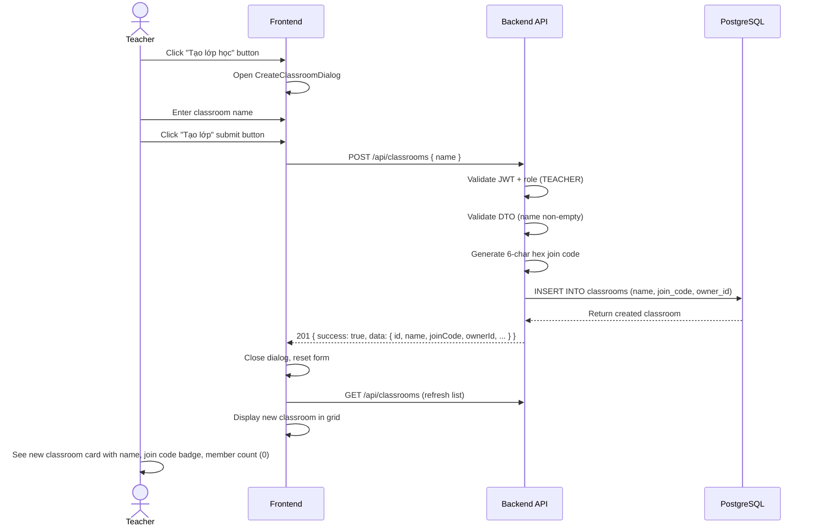
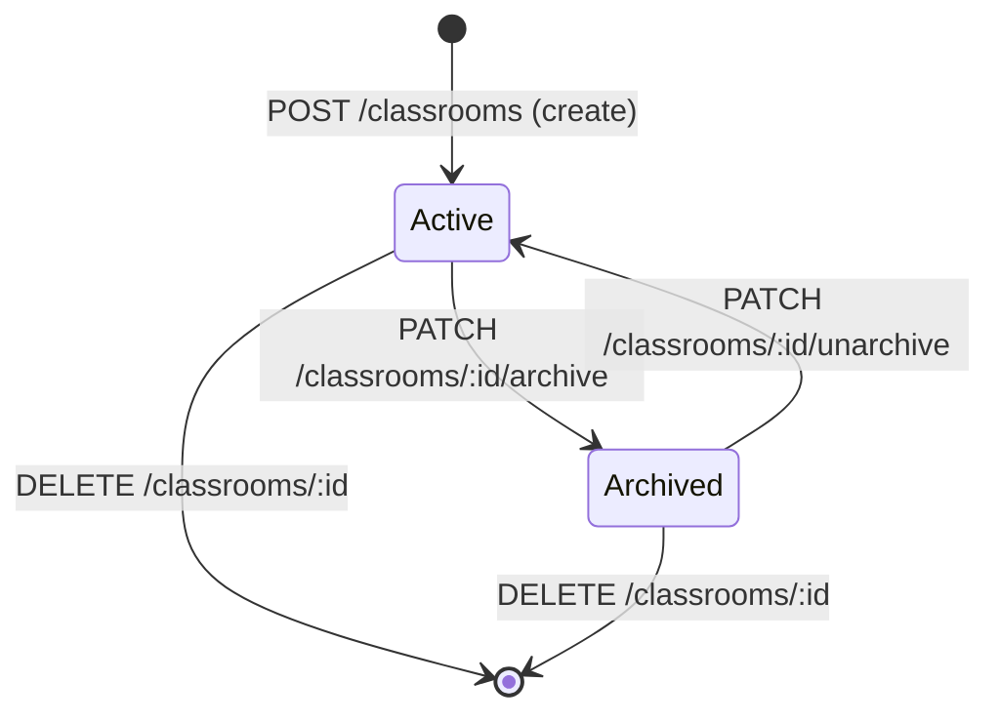

# B1. Create Classroom

## 5.1 Feature Overview

| Field | Value |
|---|---|
| Feature ID | B1 |
| Feature Name | Create Classroom |
| Module | B. Classroom Management |
| Priority | P0 |
| Complexity | S |
| Status | **Existing** — fully implemented (backend + frontend) |
| Target Roles | TEACHER |
| Business Objective | Enable teachers to create virtual classrooms to organize students and distribute exam assignments. |
| User Problem | Teachers need a simple way to group students into classes so they can assign exams and track results per class. |
| Dependencies | A1 (Authentication) — user must be authenticated with TEACHER role. |

## 5.2 Actors and Permissions

### Teacher (TEACHER role)

| Action | Permitted | Notes |
|---|---|---|
| Create a new classroom | Yes | Becomes the owner |
| View own classrooms | Yes | Filtered by `ownerId` |
| View join code of own classroom | Yes | Displayed in classroom detail and classroom card |

### Student (STUDENT role)

| Action | Permitted | Notes |
|---|---|---|
| Create a classroom | **No** | Backend rejects with 403 via `@Roles('TEACHER')` |

### Unauthenticated User

| Action | Permitted | Notes |
|---|---|---|
| Create a classroom | **No** | Backend rejects with 401 via global `JwtAuthGuard` |

**Backend enforcement**: The `@Roles('TEACHER')` decorator on the controller endpoint enforces role-based access. The global `JwtAuthGuard` enforces authentication. Hiding the UI button alone is insufficient; the backend must independently reject unauthorized requests.

## 5.3 Preconditions and Business Rules

### Preconditions

1. User must be authenticated.
2. User must have the `TEACHER` role.

### Business Rules

| Rule ID | Rule | Enforcement |
|---|---|---|
| B1-R1 | Classroom name is required and must be at least 1 character. | `CreateClassroomDto` validation: `@IsString()`, `@MinLength(1)` |
| B1-R2 | A unique 6-character hex join code is auto-generated on creation. | `ClassroomsService.generateJoinCode()` generates `crypto.randomBytes(3).toString('hex').toUpperCase()` |
| B1-R3 | The creating teacher becomes the classroom owner. | `ownerId` set to the authenticated user's ID. |
| B1-R4 | The teacher is NOT automatically added as a classroom member. | The owner relationship is separate from `ClassroomMember`. Owner is tracked via `Classroom.ownerId`, not the members table. |
| B1-R5 | No maximum limit on classrooms a teacher can own (within system resources). | No limit currently enforced. Consider adding a soft limit in P3. |
| B1-R6 | Classroom name does not need to be unique. | Multiple classrooms can share the same name. |

### Validation Rules

| Field | Type | Required | Constraints |
|---|---|---|---|
| `name` | string | Yes | Min 1 character. No max length in DTO (Prisma `String` type, effectively unlimited). |

**Note**: No max length is currently enforced on `name`. This is flagged as an open question (see Section 5.13).

## 5.4 Main User Flow — Happy Path



### Step-by-step

1. **Teacher** clicks the "Tạo lớp học" button (top-right of classrooms page).
2. **System** opens the `CreateClassroomDialog` modal.
3. **Teacher** enters a classroom name (e.g., "Toán 12A1").
4. **Teacher** clicks "Tạo lớp" to submit.
5. **Frontend** sends `POST /api/classrooms` with `{ name }`.
6. **Backend** validates authentication, role, and DTO.
7. **Backend** generates a unique 6-character hex join code.
8. **Backend** creates the classroom record in the database.
9. **Backend** returns the created classroom object.
10. **Frontend** closes the dialog, resets the form fields, and refreshes the classroom list.
11. **Teacher** sees the new classroom card in the grid with the join code badge.

**Success condition**: Classroom record exists in DB with correct `ownerId`, unique `joinCode`, and the teacher sees it in their classroom list.

## 5.5 Alternative Flows

### AF-1: Teacher cancels creation

1. Teacher opens the dialog and enters a name.
2. Teacher clicks outside the dialog or presses Escape.
3. Dialog closes. No API call is made. No data is created.
4. Form state is NOT reset (current behavior). On reopen, the previously entered name may still be visible.

### AF-2: Teacher creates multiple classrooms

1. Teacher creates a classroom (happy path completes).
2. Teacher clicks "Tạo lớp học" again.
3. A fresh dialog appears (form state was reset after successful creation).
4. Process repeats without limit.

### AF-3: Teacher creates classroom from mobile

1. Same flow as happy path.
2. On mobile width (<640px), the classroom grid shows 1 column instead of 2-3.
3. Dialog renders at full width with no horizontal scroll.

## 5.6 Edge Cases and Failure Scenarios

| Scenario ID | Scenario | Trigger | Expected Behavior | User Feedback | Data Integrity | Recovery | Severity |
|---|---|---|---|---|---|---|---|
| B1-E1 | Empty classroom name | Teacher submits form without entering a name | Frontend `required` attribute blocks submission. If bypassed, backend returns 400 validation error. | Form validation prevents submission. If API error: toast or inline error. | No record created. | Re-enter a valid name. | Low |
| B1-E2 | Extremely long classroom name | Teacher enters a name with 10,000+ characters | No max length currently enforced in DTO or DB. Record is created. May cause UI overflow. | Name displayed, possibly truncated or overflowing card layout. | Record created with full name. | **Gap**: Should add `@MaxLength(200)` to DTO. | Medium |
| B1-E3 | Join code collision | Generated join code already exists in DB | Prisma throws unique constraint violation. Current code does NOT retry. | Server returns 500 internal error. | No record created. | Teacher retries. Service should implement retry loop. | Medium |
| B1-E4 | Student attempts to create classroom | Student role accesses POST /classrooms | `@Roles('TEACHER')` guard returns 403 Forbidden. | "Tạo lớp học" button not shown in UI. If API called directly: 403 error. | No record created. | N/A — role restriction is by design. | Low |
| B1-E5 | Unauthenticated request | JWT expired or missing | Global `JwtAuthGuard` returns 401 Unauthorized. | Frontend intercepts 401, redirects to login. | No record created. | Re-authenticate. | Low |
| B1-E6 | Network failure during creation | Connection drops after submit | Request fails. Frontend `catch` block runs silently (current: no error feedback). | No feedback shown (gap). | No record created (POST is not retried). | Teacher re-submits. Safe because classroom creation is not idempotent but re-submitting creates a new classroom. | Medium |
| B1-E7 | Special characters in name | Name contains emoji, HTML, SQL, newlines | DTO accepts any string. Prisma parameterized queries prevent SQL injection. Frontend renders text content (no XSS for plain text). | Name displayed as-is. | Record stored correctly. | N/A. | Low |
| B1-E8 | Concurrent creation with same name | Two teachers create "Toán 12" at the same time | Both succeed. Classroom names are not unique. | Both teachers see their own classroom. | Two separate records with different IDs and join codes. | N/A — expected behavior. | Low |
| B1-E9 | Database unavailable | PostgreSQL is down | Prisma connection fails. NestJS returns 500. | Frontend shows generic error (currently silent catch). | No record created. | Retry when DB recovers. | Critical |

## 5.7 UI/UX Specification

### Entry Point

- **Page**: `/dashboard/classrooms`
- **Button**: "Tạo lớp học" (Primary Blue) with Plus icon, top-right of page header.
- **Visibility**: Only visible when `user.role === 'TEACHER'`. Students see "Tham gia" button instead.

### CreateClassroomDialog (Existing Implementation)

| Element | Specification |
|---|---|
| **Trigger** | Primary Blue button with Plus icon + "Tạo lớp học" text |
| **Dialog** | Modal overlay (shadcn Dialog). Title: "Tạo lớp học mới" |
| **Name field** | Text input. Label: "Tên lớp". Placeholder: "VD: Toán 12A1". HTML `required`. |
| **Submit button** | Full width. Primary Blue. Text: "Tạo lớp". Disabled while loading (text: "Đang tạo..."). |
| **Success** | Dialog closes. Form resets. Classroom list refreshes. |
| **Error** | Currently silent (catch block is empty). **Gap**: Should show error toast. |

### Classroom Card (After Creation)

| Element | Specification |
|---|---|
| **Layout** | Card component in responsive grid (1 col mobile, 2 col sm, 3 col lg) |
| **Title** | Classroom name (left-aligned) |
| **Join code badge** | Monospace secondary badge (teacher only). Displayed on card header. |
| **Member count** | "N thành viên" with Users icon. |
| **Click action** | Navigates to `/dashboard/classrooms/:id` |

### Empty State

- Dashed border container, centered text: "Chưa có lớp học nào. Tạo lớp học đầu tiên!"

### Loading State

- Centered spinner animation (border-4 border-primary border-t-transparent).

### Responsive Behavior

| Breakpoint | Grid Columns |
|---|---|
| < 640px (mobile) | 1 |
| 640px – 1024px (tablet) | 2 |
| > 1024px (desktop) | 3 |

## 5.8 Data Requirements

### Entities

#### Classroom (Existing)

| Field | Type | Required | Constraints | Notes |
|---|---|---|---|---|
| `id` | UUID | Auto | Primary key, auto-generated | |
| `name` | String | Yes | Min 1 char (DTO). No max. | Consider adding max 200 |
| `joinCode` | String | Auto | Unique. 6-char uppercase hex. | Generated by service |
| `ownerId` | UUID FK | Auto | References `users.id` | Set to authenticated user |
| `archivedAt` | DateTime? | No | Null = active | Used by archive feature |
| `createdAt` | DateTime | Auto | Default `now()` | |
| `updatedAt` | DateTime | Auto | Auto-updated | |

### Relationships

- `Classroom.ownerId` → `User.id` (many-to-one)
- `Classroom` → `ClassroomMember[]` (one-to-many, cascade delete)
- `Classroom` → `Assignment[]` (one-to-many)

### Indexes

- `join_code` — UNIQUE index (existing)
- `owner_id` — implicit via FK (existing)

### Proposed Schema Changes

None required for this feature.

## 5.9 API Requirements

### POST /api/classrooms — Create Classroom

| Field | Value |
|---|---|
| **Method** | POST |
| **Endpoint** | `/api/classrooms` |
| **Purpose** | Create a new classroom |
| **Required Role** | TEACHER |
| **Authentication** | JWT Bearer token required |

#### Request Body

```json
{
  "name": "Toán 12A1"
}
```

| Field | Type | Required | Validation |
|---|---|---|---|
| `name` | string | Yes | `@IsString()`, `@MinLength(1)` |

#### Success Response (201 Created)

```json
{
  "success": true,
  "data": {
    "id": "uuid",
    "name": "Toán 12A1",
    "joinCode": "A3F2C1",
    "ownerId": "uuid",
    "archivedAt": null,
    "createdAt": "2026-11-11T10:00:00.000Z",
    "updatedAt": "2026-11-11T10:00:00.000Z"
  }
}
```

#### Error Responses

| Status | Code | Condition |
|---|---|---|
| 400 | VALIDATION_ERROR | Missing or invalid `name` |
| 401 | UNAUTHORIZED | Missing or invalid JWT |
| 403 | FORBIDDEN | User role is not TEACHER |
| 500 | INTERNAL_ERROR | Database error or join code collision |

#### Idempotency

Not idempotent. Each call creates a new classroom, even with the same name.

## 5.10 State Management

### Classroom Lifecycle

This feature creates classrooms in the active (non-archived) state. The full lifecycle:



- **Active**: `archivedAt = null`. Visible in default classroom list. New assignments allowed.
- **Archived**: `archivedAt = DateTime`. Hidden from default list. No new assignments.
- **Deleted**: Record removed from DB. Cascade deletes members and assignments.

**Create** always produces an **Active** classroom.

## 5.11 Acceptance Criteria

### Positive

```gherkin
Given a user is authenticated as TEACHER,
When the teacher submits a classroom creation request with name "Toán 12A1",
Then a new classroom record is created in the database,
And the classroom has a unique 6-character hex join code,
And the classroom's ownerId matches the teacher's user ID,
And the classroom's archivedAt is null,
And the response status is 201.

Given a teacher has created a classroom,
When the teacher views their classroom list,
Then the new classroom appears in the list,
And the list shows the classroom name, join code, and member count (0).
```

### Negative

```gherkin
Given a user is authenticated as STUDENT,
When the student sends POST /api/classrooms with a valid name,
Then the backend returns 403 Forbidden,
And no classroom is created.

Given an unauthenticated user,
When the user sends POST /api/classrooms,
Then the backend returns 401 Unauthorized.

Given a teacher submits a classroom creation request with an empty name,
When the request is processed,
Then the backend returns 400 Validation Error,
And no classroom is created.
```

## 5.12 QA Test Scenarios

| Test ID | Scenario | Preconditions | Steps | Test Data | Expected Result | Priority |
|---|---|---|---|---|---|---|
| B1-T1 | Happy path: create classroom | Teacher authenticated | 1. POST /classrooms with `{ name: "Toán 12A1" }` | `name: "Toán 12A1"` | 201 response. Classroom created with join code and correct owner. | Critical |
| B1-T2 | Empty name rejected | Teacher authenticated | 1. POST /classrooms with `{ name: "" }` | `name: ""` | 400 validation error. No classroom created. | High |
| B1-T3 | Missing name rejected | Teacher authenticated | 1. POST /classrooms with `{}` | (empty body) | 400 validation error. | High |
| B1-T4 | Student cannot create | Student authenticated | 1. POST /classrooms with `{ name: "Test" }` | `name: "Test"` | 403 Forbidden. | Critical |
| B1-T5 | Unauthenticated cannot create | No auth token | 1. POST /classrooms with `{ name: "Test" }` | `name: "Test"` | 401 Unauthorized. | Critical |
| B1-T6 | Join code is unique | Teacher authenticated | 1. Create 100 classrooms. 2. Verify all join codes are distinct. | Loop 100 times | All join codes unique. | High |
| B1-T7 | Join code format | Teacher authenticated | 1. Create classroom. 2. Check join code format. | Any valid name | 6-char uppercase hex (matches `/^[A-F0-9]{6}$/`). | Medium |
| B1-T8 | Special characters in name | Teacher authenticated | 1. POST with `{ name: "<script>alert(1)</script>" }` | XSS payload | 201 created. Name stored and returned as-is (no execution). | High |
| B1-T9 | Concurrent creation | Two teachers | 1. Simultaneously POST /classrooms with same name | Same name, different tokens | Both succeed with different IDs and join codes. | Medium |
| B1-T10 | Frontend: dialog opens and submits | Teacher logged in, on classrooms page | 1. Click "Tạo lớp học". 2. Enter name. 3. Submit. | `name: "Lý 11"` | Dialog closes. Classroom appears in grid. | High |
| B1-T11 | Frontend: cancel dialog | Teacher logged in | 1. Click "Tạo lớp học". 2. Press Escape. | — | Dialog closes. No API call. | Medium |
| B1-T12 | Frontend: empty state display | Teacher with no classrooms | 1. Load classrooms page | — | Shows "Chưa có lớp học nào. Tạo lớp học đầu tiên!" | Medium |

## 5.13 Open Questions and Assumptions

| # | Question | Why It Matters | Options | Recommended Default | Impact |
|---|---|---|---|---|---|
| B1-Q1 | Should there be a max length for classroom name? | Very long names break card layout and could waste DB storage. | A) No limit (current). B) 200 chars. C) 100 chars. | **B) 200 chars** — add `@MaxLength(200)` to DTO. | Low — DTO change only. |
| B1-Q2 | Should join code collision be handled with retry? | The probability is low (~1 in 16M) but non-zero. Current code does NOT retry. | A) No retry (current). B) Retry up to 3 times. | **B) Retry up to 3 times** — simple loop in `create()`. | Low — service change only. |
| B1-Q3 | Should the creation dialog show an error toast on failure? | Currently failures are silently swallowed. Teacher gets no feedback. | A) Silent (current). B) Toast with error message. | **B) Toast with error message.** | Low — frontend-only. |
| B1-Q4 | Should there be a limit on classrooms per teacher? | Prevents resource abuse. Not an issue at ~100 users. | A) No limit (current). B) Configurable limit (e.g., 50). | **A) No limit** — add in P3 if needed. | None for now. |

### Assumptions

1. **Classroom name uniqueness is not required.** Multiple classrooms can share the same name, differentiated by their join codes and IDs. This is consistent with Azota's behavior.
2. **The owner is not a member.** The `ClassroomMember` table tracks students. The teacher-owner relationship is via `Classroom.ownerId`. This means the owner does not appear in the member list.
3. **Join code format is 6-character uppercase hex.** This provides 16,777,216 unique combinations, sufficient for the target scale of ~100 users.
