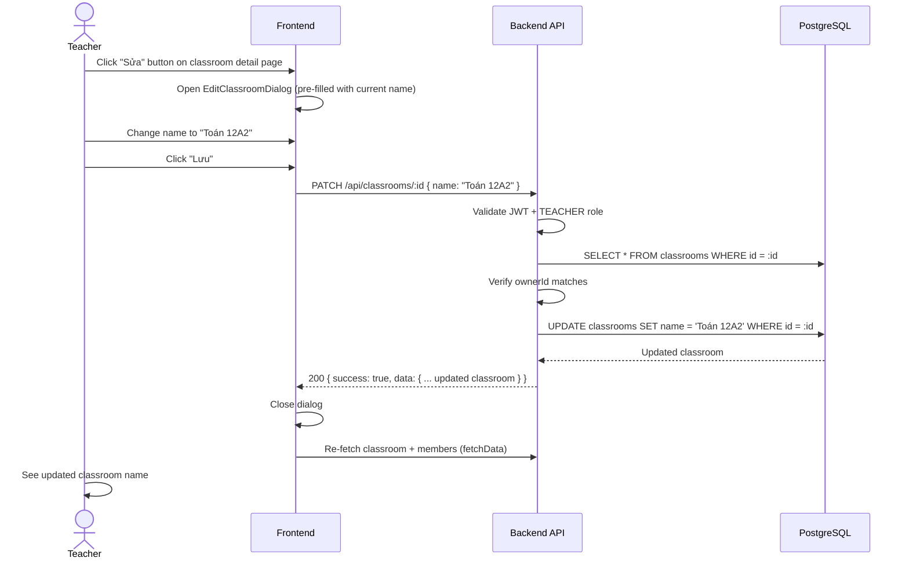
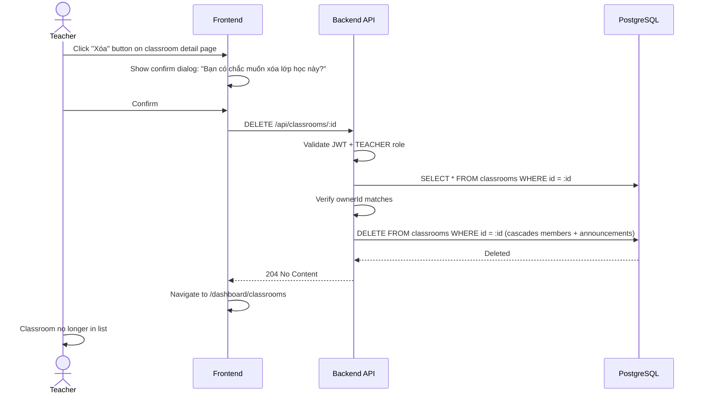
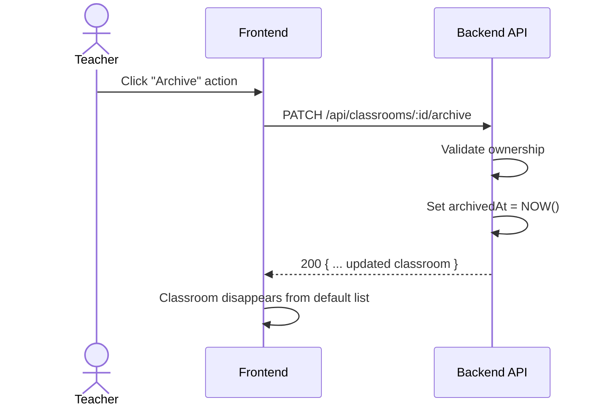
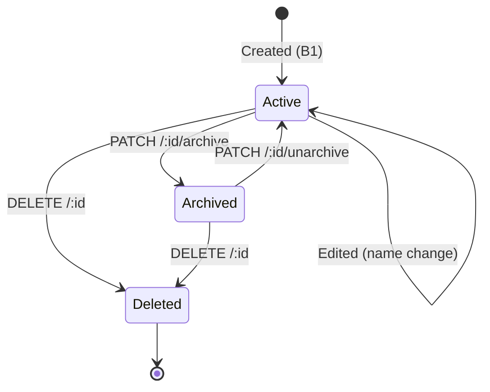

# B4. Edit, Delete, and Archive/Restore Classroom

## 5.1 Feature Overview

| Field | Value |
|---|---|
| Feature ID | B4 |
| Feature Name | Edit, Delete, and Archive/Restore Classroom |
| Module | B. Classroom Management |
| Priority | P0 (Edit, Delete), P2 (Archive/Restore) |
| Complexity | S (Edit), M (Delete — cascade considerations), S (Archive) |
| Status | **Existing** — fully implemented (backend + frontend) |
| Target Roles | TEACHER (classroom owner only) |
| Business Objective | Enable teachers to maintain their classrooms — update names, remove unused classrooms, and archive inactive ones without losing data. |
| User Problem | Teachers need to rename classrooms to reflect changes (e.g., new school year), delete classrooms no longer needed, and hide inactive classrooms without permanently losing member/assignment data. |
| Dependencies | A1 (Authentication), B1 (Create Classroom). |

## 5.2 Actors and Permissions

### Teacher (classroom owner)

| Action | Permitted | Notes |
|---|---|---|
| Edit classroom name | Yes | `PATCH /classrooms/:id` — ownership verified |
| Delete classroom | Yes | `DELETE /classrooms/:id` — ownership verified |
| Archive classroom | Yes | `PATCH /classrooms/:id/archive` — ownership verified |
| Restore (unarchive) classroom | Yes | `PATCH /classrooms/:id/unarchive` — ownership verified |

### Teacher (non-owner)

| Action | Permitted | Notes |
|---|---|---|
| Any of the above | **No** | All endpoints check `classroom.ownerId !== userId` → 403 |

### Student

| Action | Permitted | Notes |
|---|---|---|
| Edit/Delete/Archive/Restore | **No** | `@Roles('TEACHER')` on all endpoints |

## 5.3 Preconditions and Business Rules

### Edit Classroom

| Rule ID | Rule | Enforcement |
|---|---|---|
| B4-R1 | Only the classroom owner can edit. | `service.update()`: `classroom.ownerId !== ownerId` → 403 |
| B4-R2 | The only editable field is `name`. | `UpdateClassroomDto` only accepts `name`. |
| B4-R3 | Name is optional in the update payload. | `@IsOptional()` on `name`. If omitted, no change. |
| B4-R4 | Empty payload is a no-op. | Prisma `update()` with empty `data` succeeds silently. |
| B4-R5 | Editing does not change the join code. | `joinCode` is not in the DTO. |

### Delete Classroom

| Rule ID | Rule | Enforcement |
|---|---|---|
| B4-R6 | Only the classroom owner can delete. | `service.delete()`: ownership check. |
| B4-R7 | Deleting a classroom cascades to `ClassroomMember` records. | Prisma schema: `ClassroomMember` has `onDelete: Cascade`. |
| B4-R8 | Deleting a classroom cascades to `Announcement` records. | Prisma schema: `Announcement` has `onDelete: Cascade`. |
| B4-R9 | Deleting a classroom does NOT cascade to `Assignment` or `ExamAttempt`. | `Assignment` FK to Classroom does not have `onDelete: Cascade`. Prisma will throw a foreign key error if assignments exist. |
| B4-R10 | **Gap**: No check for existing assignments before deletion. | Current code calls `prisma.classroom.delete()` directly, which will fail with a FK violation if assignments reference this classroom. |

### Archive/Restore Classroom

| Rule ID | Rule | Enforcement |
|---|---|---|
| B4-R11 | Only the classroom owner can archive/restore. | Both endpoints check ownership. |
| B4-R12 | Archiving sets `archivedAt` to current timestamp. | `prisma.classroom.update({ data: { archivedAt: new Date() } })` |
| B4-R13 | Restoring clears `archivedAt` to null. | `prisma.classroom.update({ data: { archivedAt: null } })` |
| B4-R14 | Archived classrooms are hidden from the default classroom list. | `findAllForUser` filters `archivedAt: null`. |
| B4-R15 | Archiving does not affect memberships or assignments. | All data preserved; classroom is just hidden from listing. |
| B4-R16 | Archiving an already-archived classroom is a no-op (idempotent). | Sets `archivedAt` again — same effect. |
| B4-R17 | Restoring a non-archived classroom is a no-op (idempotent). | Sets `archivedAt: null` again — same effect. |

## 5.4 Main User Flow — Happy Path

### Edit Classroom



### Delete Classroom



### Archive Classroom



## 5.5 Alternative Flows

### AF-1: Edit with no changes

1. Teacher opens edit dialog.
2. Does not modify the name.
3. Clicks "Lưu".
4. Frontend sends `PATCH` with the same name value.
5. Backend updates with same value — no real change, returns success.

### AF-2: Cancel edit

1. Teacher opens edit dialog.
2. Presses Escape or clicks outside.
3. Dialog closes. No API call.

### AF-3: Delete a classroom with no members

1. Teacher clicks "Xóa" on an empty classroom.
2. Confirms deletion.
3. Backend deletes. No cascade needed (no members). Success.

### AF-4: Restore an archived classroom

1. Teacher navigates to an archived classroom (via direct URL or a future "archived classrooms" view).
2. Clicks "Restore" / calls `PATCH /classrooms/:id/unarchive`.
3. `archivedAt` set to null. Classroom reappears in the default list.

## 5.6 Edge Cases and Failure Scenarios

| Scenario ID | Scenario | Trigger | Expected Behavior | User Feedback | Data Integrity | Recovery | Severity |
|---|---|---|---|---|---|---|---|
| B4-E1 | Delete classroom with existing assignments | Classroom has assignments that reference it | Prisma throws FK constraint violation (500 error). Classroom NOT deleted. | Frontend shows error (currently may be silent). | All data preserved. | Teacher must close/delete assignments first. **Gap**: Should check for assignments before deleting and return a clear error. | High |
| B4-E2 | Delete classroom with active attempts | Students have IN_PROGRESS attempts for exams assigned to this classroom | If assignments prevent deletion (B4-E1), this scenario is blocked. If assignments are deleted first, attempts remain (linked to examId/studentId, not classroom). | Same as B4-E1. | Attempts preserved. | Resolve assignments first. | High |
| B4-E3 | Non-owner tries to edit | Another teacher's classroom | `classroom.ownerId !== ownerId` → 403 Forbidden. | 403 error. | No change. | N/A — by design. | Low |
| B4-E4 | Edit with empty name | Teacher clears the name field | `@IsOptional()` allows missing name. If sent as `""`: MinLength is not enforced on `UpdateClassroomDto`. **Gap**: Empty string could be set. | Name appears blank. | Record updated with empty string. | **Fix**: Add `@MinLength(1)` to `UpdateClassroomDto.name`. | Medium |
| B4-E5 | Delete a non-existent classroom | Invalid UUID | `findById()` throws 404 "Classroom not found". | 404 error. | No change. | N/A. | Low |
| B4-E6 | Concurrent edit and delete | Tab 1 edits while Tab 2 deletes | Tab 1's PATCH may fail with 404 if Tab 2's DELETE completes first. | Tab 1 gets error. | Classroom deleted. | Tab 1 navigates back to list. | Low |
| B4-E7 | Archive an already archived classroom | Teacher archives twice | `archivedAt` is set again to a new timestamp. Idempotent effect (still archived). | Success response. No visible change. | `archivedAt` updated to new value. | N/A — safe. | Low |
| B4-E8 | Restore a non-archived classroom | Unarchive a classroom that's already active | `archivedAt` set to null (already null). No-op. | Success response. | No change. | N/A — safe. | Low |
| B4-E9 | Archived classroom visibility | Student is member of an archived classroom | `findAllForUser` filters `archivedAt: null`. Student no longer sees the classroom. | Classroom disappears from student's list. | Membership preserved. Student can see it again if restored. | N/A — by design. | Low |
| B4-E10 | View archived classrooms | Teacher wants to see archived list | No endpoint or UI for listing archived classrooms. Only direct URL access. | **Gap**: No "Archived" tab or filter. | Data exists in DB. | **Proposed**: Add `?archived=true` filter to `GET /classrooms`. | Medium |

## 5.7 UI/UX Specification

### Edit — Entry Point and Dialog

| Element | Specification |
|---|---|
| **Trigger** | Outline button "Sửa" with Pencil icon. Visible on classroom detail page header (teacher-owner only). |
| **Dialog** | Modal overlay. Title: "Chỉnh sửa lớp học" |
| **Name field** | Text input. Label: "Tên lớp". Pre-filled with current name. HTML `required`. |
| **Submit** | Full width. Primary Blue. "Lưu" / "Đang lưu..." while loading. |
| **Success** | Dialog closes. Page re-fetches data. |

### Delete — Entry Point and Confirmation

| Element | Specification |
|---|---|
| **Trigger** | Destructive button "Xóa" with Trash2 icon. Visible on classroom detail page header (teacher-owner only). |
| **Confirmation** | Browser native `confirm()`: "Bạn có chắc muốn xóa lớp học này?" |
| **Success** | Redirect to `/dashboard/classrooms`. |
| **Proposed improvement** | Replace `confirm()` with a styled dialog that warns about cascade effects. |

### Archive/Restore

Currently **no dedicated UI button** for archive/restore. The API endpoints exist but the frontend classroom detail page does not expose archive/restore actions.

**Proposed UI**: Add an "Archive" option in a dropdown menu on the classroom detail page. Archived classrooms could be shown in a separate tab or toggled filter on the classrooms list page.

### Layout on Classroom Detail Page

```
[← Back]  Classroom Name                    [Sửa] [Xóa]
           Mã lớp: A3F2C1  [Copy]

[Members Card]
  Thành viên (N)
  [Member rows with remove buttons]
```

## 5.8 Data Requirements

### Entities

Uses existing `Classroom` model. Key fields for this feature:

| Field | Type | Notes |
|---|---|---|
| `name` | String | Editable via PATCH |
| `archivedAt` | DateTime? | null = active, non-null = archived |

### Cascade Behavior on Delete

| Related Entity | Cascade? | Notes |
|---|---|---|
| `ClassroomMember` | **Yes** (onDelete: Cascade) | All memberships deleted |
| `Announcement` | **Yes** (onDelete: Cascade) | All announcements deleted |
| `Assignment` | **No** (no onDelete specified) | Prisma defaults to `Restrict` — delete blocked if assignments exist |

### Proposed Schema Changes

None required for existing functionality. For the archive view feature, no schema changes needed (filter query only).

## 5.9 API Requirements

### PATCH /api/classrooms/:id — Edit Classroom

| Field | Value |
|---|---|
| **Method** | PATCH |
| **Endpoint** | `/api/classrooms/:id` |
| **Purpose** | Update classroom properties (currently only name) |
| **Required Role** | TEACHER (owner) |

#### Request Body

```json
{
  "name": "Toán 12A2"
}
```

| Field | Type | Required | Validation |
|---|---|---|---|
| `name` | string | No | `@IsOptional()`, `@IsString()`. **Gap**: No `@MinLength(1)`. |

#### Success Response (200 OK)

```json
{
  "success": true,
  "data": {
    "id": "uuid",
    "name": "Toán 12A2",
    "joinCode": "A3F2C1",
    "ownerId": "uuid",
    "archivedAt": null,
    "createdAt": "...",
    "updatedAt": "..."
  }
}
```

#### Error Responses

| Status | Code | Condition |
|---|---|---|
| 401 | UNAUTHORIZED | Missing/invalid JWT |
| 403 | FORBIDDEN | Not the classroom owner |
| 404 | NOT_FOUND | Classroom does not exist |

---

### DELETE /api/classrooms/:id — Delete Classroom

| Field | Value |
|---|---|
| **Method** | DELETE |
| **Endpoint** | `/api/classrooms/:id` |
| **Purpose** | Permanently delete a classroom and cascade members/announcements |
| **Required Role** | TEACHER (owner) |

#### Success Response (204 No Content)

Empty body.

#### Error Responses

| Status | Code | Condition |
|---|---|---|
| 403 | FORBIDDEN | Not the owner |
| 404 | NOT_FOUND | Classroom not found |
| 500 | INTERNAL_ERROR | FK violation — assignments exist. **Should be 400 with clear message.** |

---

### PATCH /api/classrooms/:id/archive — Archive Classroom

| Field | Value |
|---|---|
| **Method** | PATCH |
| **Endpoint** | `/api/classrooms/:id/archive` |
| **Purpose** | Hide classroom from default lists without deleting data |
| **Required Role** | TEACHER (owner) |

#### Success Response (200 OK)

Returns the updated classroom with `archivedAt` set.

---

### PATCH /api/classrooms/:id/unarchive — Restore Classroom

| Field | Value |
|---|---|
| **Method** | PATCH |
| **Endpoint** | `/api/classrooms/:id/unarchive` |
| **Purpose** | Restore a previously archived classroom |
| **Required Role** | TEACHER (owner) |

#### Success Response (200 OK)

Returns the updated classroom with `archivedAt: null`.

## 5.10 State Management

### Classroom Lifecycle



| State | `archivedAt` | Visible in list | Can create assignments | Can join |
|---|---|---|---|---|
| Active | `null` | Yes | Yes | Yes |
| Archived | `DateTime` | No (default), Yes (with filter) | **Open question** | Yes (current — should block?) |
| Deleted | N/A (record removed) | No | No | No |

## 5.11 Acceptance Criteria

### Edit

```gherkin
Given a classroom owner,
When they update the classroom name to "New Name",
Then the classroom record's name is "New Name",
And the join code is unchanged.
```

### Delete

```gherkin
Given a classroom with 5 members and no assignments,
When the owner deletes the classroom,
Then the classroom record is removed,
And all 5 ClassroomMember records are removed.

Given a classroom with active assignments,
When the owner attempts to delete it,
Then the deletion fails with an error,
And all data remains intact.
```

### Archive/Restore

```gherkin
Given an active classroom,
When the owner archives it,
Then the classroom's archivedAt is set to the current time,
And the classroom no longer appears in the default classroom list for the owner or members.

Given an archived classroom,
When the owner restores it,
Then archivedAt is set to null,
And the classroom reappears in the default list.
```

## 5.12 QA Test Scenarios

| Test ID | Scenario | Preconditions | Steps | Expected Result | Priority |
|---|---|---|---|---|---|
| B4-T1 | Edit: update name | Owner auth'd | PATCH /classrooms/:id `{ name: "New" }` | 200, name updated | High |
| B4-T2 | Edit: non-owner rejected | Another teacher auth'd | PATCH /classrooms/:id `{ name: "New" }` | 403 Forbidden | Critical |
| B4-T3 | Edit: empty name | Owner auth'd | PATCH /classrooms/:id `{ name: "" }` | **Current**: 200 (gap). **Expected**: 400. | Medium |
| B4-T4 | Delete: success (no assignments) | Classroom with members, no assignments | DELETE /classrooms/:id | 204, classroom + members gone | Critical |
| B4-T5 | Delete: blocked by assignments | Classroom has an assignment | DELETE /classrooms/:id | Should return 400. **Current**: 500 (gap). | High |
| B4-T6 | Delete: non-owner rejected | Another teacher | DELETE /classrooms/:id | 403 | Critical |
| B4-T7 | Archive: success | Active classroom, owner auth'd | PATCH /classrooms/:id/archive | 200, archivedAt set | High |
| B4-T8 | Archive: hidden from list | Classroom archived | GET /classrooms | Classroom not in response | High |
| B4-T9 | Unarchive: success | Archived classroom | PATCH /classrooms/:id/unarchive | 200, archivedAt = null | High |
| B4-T10 | Unarchive: visible in list | Restored classroom | GET /classrooms | Classroom appears in response | High |
| B4-T11 | Archive: idempotent | Already archived | PATCH /classrooms/:id/archive again | 200, no error | Medium |
| B4-T12 | Delete: student role rejected | Student auth'd | DELETE /classrooms/:id | 403 | Critical |

## 5.13 Open Questions and Assumptions

| # | Question | Why It Matters | Options | Recommended Default | Impact |
|---|---|---|---|---|---|
| B4-Q1 | How should deletion handle existing assignments? | Current code will throw a 500 FK error. | A) Block deletion if assignments exist (return 400). B) Cascade delete assignments. C) Close assignments, then delete. | **A) Block with clear error message** — "Hãy xoá hoặc đóng tất cả bài giao trước khi xoá lớp." | Medium — add pre-check in service. |
| B4-Q2 | Should `UpdateClassroomDto.name` enforce `@MinLength(1)`? | Currently an empty string can be saved. | A) No enforcement (current). B) Add `@MinLength(1)`. | **B) Add `@MinLength(1)`.** | Low — one-line DTO change. |
| B4-Q3 | Should there be a UI for viewing and managing archived classrooms? | Currently archived classrooms are invisible. Teacher can't restore without direct URL. | A) No UI (current). B) Add "Lưu trữ" tab on classrooms page. | **B) Add tab** — simple filter toggle. | Medium — frontend change. |
| B4-Q4 | Should archived classrooms block new student joins? | Currently students can join archived classrooms. | A) Allow (current). B) Block with error. | **B) Block** — archived means inactive. | Low — one condition in join service. |
| B4-Q5 | Should archived classrooms block new assignment creation? | Spec says archived classrooms should not accept new assignments. Not currently enforced. | A) Allow. B) Block. | **B) Block** — check `archivedAt` in assignment creation service. | Low — one condition. |

### Assumptions

1. **Delete is permanent (hard delete).** There is no trash/recycle bin or undo mechanism. Once deleted, the classroom and its memberships are gone.
2. **Archive preserves all data.** Archiving only sets `archivedAt`. Memberships, assignments, and all related data remain unchanged.
3. **Join code survives archive/restore.** The join code does not change when archiving or restoring.
