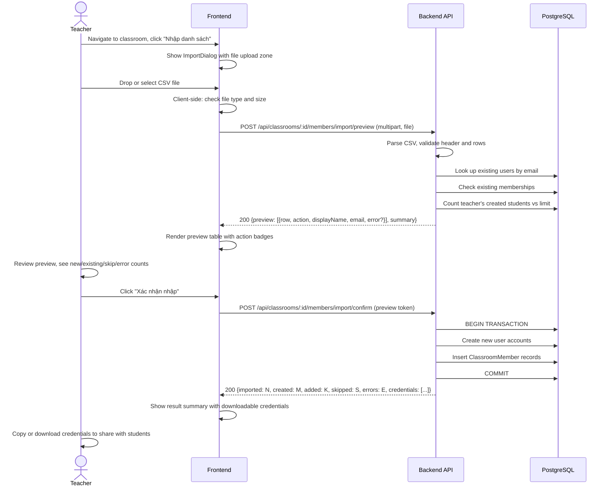
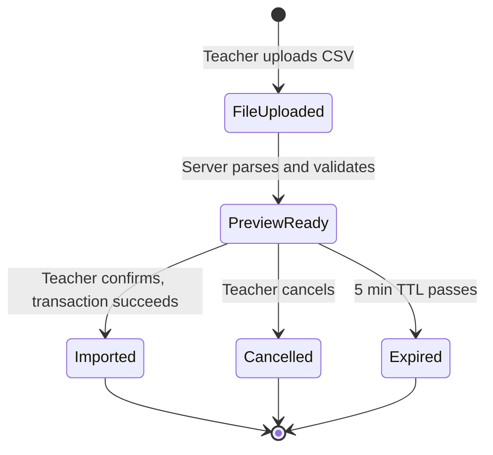

# B10. Import/Export Student List

## 5.1 Feature Overview

| Field | Value |
|---|---|
| Feature ID | B10 |
| Feature Name | Import/Export Student List |
| Module | B. Classroom Management |
| Priority | P2 |
| Complexity | M |
| Status | **Not Implemented** — no import or export functionality exists for classroom members. Gaps: B-GAP-04 (import), B-GAP-05 (export). |
| Target Roles | TEACHER (classroom owner) |
| Business Objective | Enable teachers to bulk-onboard students by uploading a CSV file and to download the current class roster as CSV for record-keeping, grade books, or transferring to other systems |
| User Problem | Adding students one by one (via account creation or share-join-code) is slow for classes of 30–50 students. Teachers need to populate classrooms from existing spreadsheet rosters. Conversely, teachers need to export the member list for use in grade books, reports, or other tools. |
| Dependencies | A1 (Registration), A7 (Teacher Creates Students — for the account creation logic), B1 (Create Classroom), B2 (Join Classroom), B3 (Manage Students) |

## 5.2 Actors and Permissions

### Teacher (TEACHER role, classroom owner)

| Action | Permitted | Notes |
|---|---|---|
| Upload CSV to import students into own classroom | Yes | Creates accounts if needed, adds to classroom |
| Preview import before confirming | Yes | Mandatory preview step |
| Download CSV of own classroom's members | Yes | Export current roster |
| Import/export for another teacher's classroom | **No** | 403 Forbidden |

### Student (STUDENT role)

| Action | Permitted | Notes |
|---|---|---|
| Any import/export operation | **No** | 403 Forbidden |

### Backend Authorization

- Import and export endpoints live under the classrooms controller and require `@Roles('TEACHER')`.
- Every operation verifies `classroom.ownerId === currentUser.id` in the service layer.

## 5.3 Preconditions and Business Rules

### Preconditions

1. User is authenticated with a valid JWT access token.
2. User has `TEACHER` role.
3. The classroom exists, is not archived, and is owned by the requesting teacher.

### Business Rules

| Rule ID | Rule | Enforcement |
|---|---|---|
| B10-BR-01 | Import CSV must have a header row. Required column: `name` (display name). Optional columns: `email`, `password`. Column names are case-insensitive and may use Vietnamese equivalents: `họ tên` / `tên` for name, `email` for email, `mật khẩu` for password. | Backend — CSV parser with header mapping |
| B10-BR-02 | Maximum file size for CSV import is 1 MB. Files larger than this are rejected before parsing. | Backend — file size check in controller; Frontend — client-side check |
| B10-BR-03 | Maximum 200 rows per CSV import (excluding header). If more rows exist, only the first 200 are processed and the preview indicates truncation. | Backend — row limit in parser |
| B10-BR-04 | For each row: if `email` is provided and a user with that email exists, the existing user is added to the classroom (no new account created). If the existing user is already a member, the row is skipped. | Backend — email lookup then upsert membership |
| B10-BR-05 | For each row: if `email` is provided but no user with that email exists, a new STUDENT account is created with that email, the display name from the row, and the password from the row (or auto-generated if blank). The new user is added to the classroom. | Backend — create user + membership in transaction |
| B10-BR-06 | For each row: if `email` is blank, a new STUDENT account is created with a generated `student_<hex>@lumi.local` email (same as A7-BR-02), the display name, and the password from the row (or auto-generated). The new user is added to the classroom. | Backend — same generation logic as A7 |
| B10-BR-07 | New accounts created during import have `createdByTeacherId` set to the importing teacher's ID, consistent with A7. | Backend — set in user creation |
| B10-BR-08 | Passwords for new accounts are hashed with bcrypt cost 12. The plaintext password (provided or generated) is included in the import result so the teacher can distribute credentials. | Backend — bcrypt + include in response |
| B10-BR-09 | Import is a two-step process: (1) Preview — teacher uploads CSV, backend parses and validates, returns a preview of what will happen per row; (2) Confirm — teacher reviews the preview and confirms, backend executes the import. | Backend — separate preview and confirm endpoints |
| B10-BR-10 | The preview response classifies each row as: `create` (new account + membership), `add` (existing user, new membership), `skip` (already a member), or `error` (validation failure). Rows with errors do not block other rows from being imported. | Backend — per-row classification |
| B10-BR-11 | During the confirm step, import executes in a single database transaction. If the transaction fails, no accounts are created and no memberships are added. | Backend — Prisma transaction |
| B10-BR-12 | The teacher's student creation limit (A7-BR-13: 500 accounts) applies to import. If the import would exceed this limit, the preview step indicates how many can be created and warns about the limit. | Backend — count check during preview |
| B10-BR-13 | CSV export includes columns: `Họ tên`, `Email`, `Ngày tham gia`. One row per classroom member, sorted by `joinedAt ASC`. The file is UTF-8 with BOM for Excel compatibility. | Backend — CSV generation |
| B10-BR-14 | Export file name follows the pattern: `{classroom_name}_danh_sach_{YYYYMMDD}.csv`. Non-ASCII characters in the classroom name are preserved. | Backend — Content-Disposition header |
| B10-BR-15 | Only active (non-archived) classrooms can be imported into. Export is allowed for any classroom the teacher owns, including archived ones (for record-keeping). | Backend — archive check on import only |
| B10-BR-16 | Empty rows in the CSV (all fields blank) are silently skipped during parsing. | Backend — parser filter |
| B10-BR-17 | Display name in each row is required (1–100 chars). Rows with empty or overlong names are marked as `error` in the preview. | Backend — per-row validation |
| B10-BR-18 | If an existing user found by email has role TEACHER or ADMIN, that row is marked as `error` with message "Tài khoản này không phải học sinh". Only STUDENT accounts can be added to classrooms via import. | Backend — role check on existing user |

### Validation Rules

**Import File**

| Check | Validation | Error |
|---|---|---|
| File type | `.csv` extension, MIME `text/csv` or `text/plain` or `application/vnd.ms-excel` | "Vui lòng tải lên file CSV" |
| File size | ≤ 1 MB | "File quá lớn. Giới hạn 1 MB." |
| Header row | Must contain at least a `name`/`họ tên`/`tên` column | "Không tìm thấy cột 'Họ tên' trong file" |
| Row count | ≤ 200 (excluding header) | Warning, not rejection: "Chỉ 200 hàng đầu tiên sẽ được xử lý" |

**Per-Row**

| Field | Validation | Error Message |
|---|---|---|
| displayName | Required, 1–100 chars | "Họ tên không được để trống" / "Họ tên quá dài (tối đa 100 ký tự)" |
| email | If provided: valid email format | "Email không hợp lệ" |
| password | If provided: 6–72 chars | "Mật khẩu phải từ 6 đến 72 ký tự" |

## 5.4 Main User Flow — Happy Path

### Import Flow



### Steps

| Step | Actor | Action | System Response | Data Changed |
|---|---|---|---|---|
| 1 | Teacher | Clicks "Nhập danh sách" | ImportDialog opens | — |
| 2 | Teacher | Uploads CSV file | File validated client-side | — |
| 3 | System | Parses CSV, classifies rows | Preview returned | — |
| 4 | Teacher | Reviews preview | — | — |
| 5 | Teacher | Clicks "Xác nhận nhập" | Import executed | Users created, memberships added |
| 6 | System | Shows results with credentials | — | — |

## 5.5 Alternative Flows

### AF-B10-01: Export classroom member list

- **Trigger**: Teacher clicks "Xuất danh sách" on the classroom page.
- **Endpoint**: `GET /api/classrooms/:id/members/export`
- **Behavior**: Backend generates CSV with columns `Họ tên`, `Email`, `Ngày tham gia`. Returns file as download with `Content-Type: text/csv; charset=utf-8` and BOM.
- **Result**: Browser downloads the CSV file.

### AF-B10-02: All imported students are already members

- **Trigger**: CSV contains emails that all correspond to existing members.
- **Behavior**: Preview shows all rows as `skip`. Confirm step is still available but would be a no-op.
- **Result**: Summary shows imported: 0, skipped: N.

### AF-B10-03: CSV has rows with errors alongside valid rows

- **Trigger**: Some rows have validation errors (empty name, invalid email).
- **Behavior**: Preview shows error rows marked red with error message. Teacher can still confirm — only valid rows are imported; error rows are skipped.
- **Result**: Partial import of valid rows. Summary includes error count.

### AF-B10-04: Teacher cancels after preview

- **Trigger**: Teacher clicks "Hủy" on the preview screen.
- **Behavior**: No import occurs. Dialog closes.
- **Result**: No data change.

### AF-B10-05: CSV with non-UTF-8 encoding

- **Trigger**: Teacher uploads a CSV saved with Windows-1252 or other encoding.
- **Behavior**: Backend attempts to detect encoding (UTF-8 with BOM, UTF-8 without BOM, Windows-1252). Vietnamese diacritics are preserved where possible. If detection fails, characters are replaced with `?` and teacher sees a warning.
- **Result**: Best-effort parsing with encoding warning if applicable.

### AF-B10-06: Import would exceed teacher's student creation limit

- **Trigger**: Teacher has created 480 students and CSV would create 30 new accounts.
- **Behavior**: Preview shows a warning: "Bạn chỉ có thể tạo thêm 20 tài khoản (đã dùng 480/500)." Rows beyond the limit are marked as `error` with reason "Vượt giới hạn tạo tài khoản."
- **Result**: Only rows within the limit are importable.

## 5.6 Edge Cases and Failure Scenarios

| Scenario ID | Scenario | Trigger | Expected Behavior | User Feedback | Data Integrity | Recovery | Severity |
|---|---|---|---|---|---|---|---|
| EC-B10-01 | Empty CSV (header only, no data rows) | Teacher uploads CSV with header but no rows | Preview returns empty list, summary shows 0 rows | "File không có dữ liệu" | No data change | Upload a file with data | Low |
| EC-B10-02 | CSV without recognized header | Missing `name`/`họ tên` column | 400 validation error | "Không tìm thấy cột 'Họ tên' trong file" | No data change | Fix header | Medium |
| EC-B10-03 | CSV exceeds 200 rows | 250 data rows | Preview processes first 200, warns about truncation | "Chỉ 200 hàng đầu tiên được xử lý. File có 250 hàng." | Only 200 rows processed | Split into multiple files | Low |
| EC-B10-04 | CSV exceeds 1 MB | Large file | Rejected before parsing | "File quá lớn. Giới hạn 1 MB." | No data change | Reduce file size | Low |
| EC-B10-05 | Existing user with TEACHER role in CSV | Email matches a TEACHER user | Row marked as `error` | "Tài khoản này không phải học sinh" | Row skipped | Remove row from CSV | Medium |
| EC-B10-06 | Duplicate emails within CSV | Two rows have same email | Second row marked as `error`: "Email trùng lặp trong file" | Error shown in preview | First occurrence processed, duplicate skipped | Fix CSV | Medium |
| EC-B10-07 | Transaction failure during confirm | DB error during import | Transaction rolls back | "Đã xảy ra lỗi khi nhập. Vui lòng thử lại." | No data change (rolled back) | Retry | High |
| EC-B10-08 | Preview token expired or tampered | Stale or invalid token | 400 `INVALID_PREVIEW_TOKEN` | "Phiên nhập đã hết hạn. Vui lòng tải lên lại." | No data change | Re-upload CSV | Low |
| EC-B10-09 | Classroom membership changed between preview and confirm | A student was added or removed | Import proceeds based on current state, not preview state. Some rows may be skipped that weren't in preview. | Summary reflects actual result | Consistent — based on DB state at confirm time | N/A | Low |
| EC-B10-10 | Export of classroom with 0 members | Empty classroom | CSV with header row only | File downloads with headers but no data | N/A | N/A | Low |
| EC-B10-11 | Non-CSV file uploaded | `.xlsx`, `.pdf`, etc. | Rejected by file type check | "Vui lòng tải lên file CSV" | No data change | Use correct format | Low |
| EC-B10-12 | Classroom archived during import flow | Teacher archives between preview and confirm | Confirm returns 400 `CLASSROOM_ARCHIVED` | "Lớp học đã được lưu trữ" | No data change | Unarchive first | Low |

## 5.7 UI/UX Specification

### Entry Point

- **Page**: `/dashboard/classrooms/[id]` — members section
- **Buttons**: "Nhập danh sách" (upload icon) and "Xuất danh sách" (download icon) in the members section header, visible only to the classroom owner

### Import Dialog

**Step 1 — File Upload**

```
┌─────────────────────────────────────────────┐
│  Nhập danh sách học sinh                     │
│                                             │
│  ┌─────────────────────────────────────┐    │
│  │                                     │    │
│  │   📄 Kéo thả file CSV vào đây      │    │
│  │      hoặc nhấn để chọn file        │    │
│  │                                     │    │
│  │   Tối đa 200 hàng, 1 MB            │    │
│  └─────────────────────────────────────┘    │
│                                             │
│  📥 Tải mẫu CSV                             │
│                                             │
│  [Hủy]                                      │
└─────────────────────────────────────────────┘
```

**Step 2 — Preview**

```
┌─────────────────────────────────────────────┐
│  Xem trước kết quả nhập                     │
│                                             │
│  Tổng: 30 hàng | Tạo mới: 25 | Thêm: 3    │
│  Bỏ qua: 1 | Lỗi: 1                       │
│                                             │
│  ┌─────────────────────────────────────┐    │
│  │ # │ Họ tên    │ Email    │ Kết quả  │    │
│  │ 1 │ Nguyễn A  │ a@b.com  │ 🟢 Tạo  │    │
│  │ 2 │ Trần B    │ —        │ 🟢 Tạo  │    │
│  │ 3 │ Lê C      │ c@d.com  │ 🔵 Thêm │    │
│  │ 4 │ Phạm D    │ d@e.com  │ ⚪ Bỏ qua│    │
│  │ 5 │           │ e@f.com  │ 🔴 Lỗi  │    │
│  └─────────────────────────────────────┘    │
│                                             │
│  [Hủy]                    [Xác nhận nhập]   │
└─────────────────────────────────────────────┘
```

Action badges:
- "Tạo mới" (green): new account + membership
- "Thêm" (blue): existing user, new membership
- "Bỏ qua" (gray): already a member
- "Lỗi" (red): validation error, with tooltip showing reason

**Step 3 — Result**

```
┌─────────────────────────────────────────────┐
│  Nhập thành công                            │
│                                             │
│  Đã tạo: 25 tài khoản mới                  │
│  Đã thêm: 3 học sinh có sẵn                │
│  Bỏ qua: 1 (đã là thành viên)              │
│  Lỗi: 1                                    │
│                                             │
│  📋 Sao chép thông tin đăng nhập            │
│  📥 Tải file thông tin đăng nhập (.csv)     │
│                                             │
│  [Đóng]                                     │
└─────────────────────────────────────────────┘
```

The credentials download is a CSV with columns: `Họ tên`, `Email`, `Mật khẩu` — only for newly created accounts.

### Export

- **Trigger**: Teacher clicks "Xuất danh sách".
- **Behavior**: Browser downloads CSV immediately (no dialog). Toast: "Đang tải xuống..."
- **File**: UTF-8 with BOM, columns `Họ tên`, `Email`, `Ngày tham gia` (formatted as `DD/MM/YYYY`).

### Sample CSV Template

Available via "Tải mẫu CSV" link:

```csv
Họ tên,Email,Mật khẩu
Nguyễn Văn A,vana@example.com,
Trần Thị B,,matkhau123
Lê Văn C,,
```

### States

| State | Appearance |
|---|---|
| File upload idle | Drag-drop zone with instructions |
| File uploading | Progress indicator in drop zone |
| Parsing/previewing | Spinner: "Đang phân tích file..." |
| Preview ready | Table with action badges and summary counts |
| Importing | Button shows spinner, disabled |
| Import complete | Result summary with credential actions |
| Error (file) | Red text below drop zone |
| Error (import) | Toast notification |

### Responsive Behavior

- Dialog: full-screen on mobile, centered modal on desktop.
- Preview table: horizontal scroll on mobile with fixed first column (row number).
- Template download link and export button always visible.

## 5.8 Data Requirements

### Existing Entities (Verified)

All existing — see `apps/api/prisma/schema.prisma`.

**User**: id, email (unique), passwordHash, displayName, role, createdAt, updatedAt.

**ClassroomMember**: id, classroomId, userId, joinedAt. `@@unique([classroomId, userId])`.

**Classroom**: id, name, joinCode, ownerId, archivedAt.

### Proposed Schema Changes

| Change | Reason |
|---|---|
| Same as A7: `createdByTeacherId` on User | Tracks teacher-created accounts for limit enforcement (B10-BR-12) |

No additional schema changes beyond what A7 proposes. B10 reuses the same user creation logic.

### Preview Token Storage

The preview result is stored server-side to prevent tampering between preview and confirm:

- **Option A (recommended)**: Store in-memory with a short TTL (5 minutes). At ~100 users, an in-memory Map with periodic cleanup is sufficient. No new DB table needed.
- **Option B**: Store in DB table `import_previews` with TTL column. More durable but heavier.

The preview token is a UUID generated by the server, sent to the client, and required on the confirm endpoint.

## 5.9 API Requirements

### POST /api/classrooms/:id/members/import/preview — Parse and Preview

| Field | Value |
|---|---|
| Method | POST |
| Endpoint | `/api/classrooms/:id/members/import/preview` |
| Purpose | Parse an uploaded CSV and return a preview of the import actions |
| Required Role | TEACHER (classroom owner) |
| Content-Type | `multipart/form-data` |

**Request**: Multipart form with field `file` containing the CSV.

**Success Response (200 OK)**:

```json
{
  "success": true,
  "data": {
    "previewToken": "uuid-token",
    "expiresAt": "2026-11-12T10:05:00.000Z",
    "summary": {
      "total": 30,
      "toCreate": 25,
      "toAdd": 3,
      "toSkip": 1,
      "errors": 1,
      "creationLimitRemaining": 20,
      "truncated": false
    },
    "rows": [
      {
        "rowNumber": 1,
        "displayName": "Nguyễn Văn A",
        "email": "vana@example.com",
        "action": "create",
        "error": null
      },
      {
        "rowNumber": 2,
        "displayName": "Trần Thị B",
        "email": null,
        "action": "create",
        "error": null
      },
      {
        "rowNumber": 5,
        "displayName": "",
        "email": "e@f.com",
        "action": "error",
        "error": "Họ tên không được để trống"
      }
    ]
  }
}
```

| `action` Value | Meaning |
|---|---|
| `create` | New user account + classroom membership |
| `add` | Existing user, new classroom membership |
| `skip` | Already a member |
| `error` | Validation failure — see `error` field |

**Error Responses**:

| Status | Code | Message | Condition |
|---|---|---|---|
| 400 | INVALID_FILE_TYPE | "Vui lòng tải lên file CSV" | Not a CSV file |
| 400 | FILE_TOO_LARGE | "File quá lớn. Giới hạn 1 MB." | File > 1 MB |
| 400 | MISSING_HEADER | "Không tìm thấy cột 'Họ tên' trong file" | No name column |
| 400 | EMPTY_FILE | "File không có dữ liệu" | Header only, no data rows |
| 400 | CLASSROOM_ARCHIVED | "Lớp học đã được lưu trữ" | Classroom is archived |
| 401 | UNAUTHORIZED | — | Missing or invalid JWT |
| 403 | FORBIDDEN | — | Not TEACHER or not classroom owner |
| 404 | NOT_FOUND | "Không tìm thấy lớp học" | Classroom ID not found |

---

### POST /api/classrooms/:id/members/import/confirm — Execute Import

| Field | Value |
|---|---|
| Method | POST |
| Endpoint | `/api/classrooms/:id/members/import/confirm` |
| Purpose | Execute the previewed import |
| Required Role | TEACHER (classroom owner) |

**Request Body**:

```json
{
  "previewToken": "uuid-token"
}
```

**Success Response (200 OK)**:

```json
{
  "success": true,
  "data": {
    "created": 25,
    "added": 3,
    "skipped": 1,
    "errors": 1,
    "credentials": [
      {
        "displayName": "Nguyễn Văn A",
        "email": "vana@example.com",
        "temporaryPassword": "xK9m2pQ4"
      },
      {
        "displayName": "Trần Thị B",
        "email": "student_a3f2c1d8@lumi.local",
        "temporaryPassword": "mN3kL8rW"
      }
    ]
  }
}
```

The `credentials` array contains only newly created accounts. Existing users added to the classroom do not appear here.

**Error Responses**:

| Status | Code | Message | Condition |
|---|---|---|---|
| 400 | INVALID_PREVIEW_TOKEN | "Phiên nhập đã hết hạn. Vui lòng tải lên lại." | Token expired, missing, or invalid |
| 400 | CLASSROOM_ARCHIVED | "Lớp học đã được lưu trữ" | Classroom archived between preview and confirm |
| 401 | UNAUTHORIZED | — | Missing or invalid JWT |
| 403 | FORBIDDEN | — | Not TEACHER or not classroom owner |
| 404 | NOT_FOUND | "Không tìm thấy lớp học" | Classroom ID not found |

---

### GET /api/classrooms/:id/members/export — Export Member List

| Field | Value |
|---|---|
| Method | GET |
| Endpoint | `/api/classrooms/:id/members/export` |
| Purpose | Download classroom member list as CSV |
| Required Role | TEACHER (classroom owner) |
| Response Content-Type | `text/csv; charset=utf-8` |

**Response Headers**:

```
Content-Type: text/csv; charset=utf-8
Content-Disposition: attachment; filename="Toan_12A1_danh_sach_20261112.csv"
```

**Response Body** (CSV with UTF-8 BOM):

```csv
Họ tên,Email,Ngày tham gia
Nguyễn Văn A,vana@example.com,01/11/2026
Trần Thị B,student_a3f2c1d8@lumi.local,05/11/2026
```

**Error Responses**:

| Status | Code | Condition |
|---|---|---|
| 401 | UNAUTHORIZED | Missing or invalid JWT |
| 403 | FORBIDDEN | Not TEACHER or not classroom owner |
| 404 | NOT_FOUND | Classroom ID not found |

---

### GET /api/classrooms/:id/members/import/template — Download CSV Template

| Field | Value |
|---|---|
| Method | GET |
| Endpoint | `/api/classrooms/:id/members/import/template` |
| Purpose | Download a sample CSV template for import |
| Required Role | TEACHER |
| Response Content-Type | `text/csv; charset=utf-8` |

**Response Body**:

```csv
Họ tên,Email,Mật khẩu
Nguyễn Văn A,vana@example.com,
Trần Thị B,,matkhau123
Lê Văn C,,
```

## 5.10 State Management

The import flow has a transient state machine managed in-memory on the server:



No persistent state is stored for the import flow itself. The `previewToken` and its associated data are held in server memory with a 5-minute TTL.

## 5.11 Acceptance Criteria

### Positive Cases

```gherkin
Given a teacher owns a classroom and uploads a valid CSV with 10 students (no existing emails),
When they confirm the import,
Then 10 STUDENT accounts are created,
And all 10 are added as classroom members,
And the response includes temporaryPassword for each.
Rule: B10-BR-05, B10-BR-08, B10-BR-11

Given a CSV contains an email that matches an existing STUDENT user who is not a member,
When the teacher confirms the import,
Then the existing user is added to the classroom without creating a new account.
Rule: B10-BR-04

Given a CSV contains an email of a user already in the classroom,
When the preview runs,
Then that row is marked as "skip" and no duplicate membership is created.
Rule: B10-BR-04

Given a teacher exports the classroom member list,
When they click "Xuất danh sách",
Then a CSV file downloads with columns Họ tên, Email, Ngày tham gia in UTF-8 with BOM.
Rule: B10-BR-13, B10-BR-14

Given a CSV has rows without email,
When the teacher confirms the import,
Then generated `*@lumi.local` emails are used for those accounts.
Rule: B10-BR-06

Given a CSV uses Vietnamese column headers (Họ tên, Email, Mật khẩu),
When the preview runs,
Then headers are recognized and rows are parsed correctly.
Rule: B10-BR-01
```

### Negative Cases

```gherkin
Given a file larger than 1 MB is uploaded,
When the preview endpoint is called,
Then a 400 error with code FILE_TOO_LARGE is returned.
Rule: B10-BR-02

Given a CSV has no recognized name column,
When the preview endpoint is called,
Then a 400 error with code MISSING_HEADER is returned.
Rule: B10-BR-01

Given a student is authenticated,
When they call any import/export endpoint,
Then the request is rejected with 403 Forbidden.

Given a teacher does not own the classroom,
When they attempt to import or export,
Then the request is rejected with 403 Forbidden.

Given the preview token has expired (5 minutes),
When the teacher tries to confirm,
Then a 400 error with code INVALID_PREVIEW_TOKEN is returned.
Rule: B10-BR-09

Given a CSV row has an email matching a TEACHER user,
When the preview runs,
Then that row is marked as error: "Tài khoản này không phải học sinh".
Rule: B10-BR-18
```

## 5.12 QA Test Scenarios

| Test ID | Scenario | Preconditions | Steps | Test Data | Expected Result | Priority |
|---|---|---|---|---|---|---|
| TC-B10-01 | Import with all new students | Teacher owns classroom, no existing emails | Upload CSV with 5 students, confirm | 5 rows, names + emails | 201, 5 accounts created, 5 memberships | P0 |
| TC-B10-02 | Import with existing students | 2 emails match existing STUDENT users | Upload CSV, confirm | 5 rows, 2 existing | 2 added, 3 created | P0 |
| TC-B10-03 | Import with already-member students | 1 email is already a member | Upload CSV, preview | 5 rows, 1 already member | 1 skip in preview | P1 |
| TC-B10-04 | Import without emails | Rows have name only | Upload CSV, confirm | 3 rows, no emails | 3 accounts with `@lumi.local` emails | P0 |
| TC-B10-05 | Import with custom passwords | Rows have password column filled | Upload CSV, confirm | password: "abc123" | Account created with provided password | P1 |
| TC-B10-06 | Import with auto-generated passwords | Password column empty | Upload CSV, confirm | No password column | Passwords auto-generated, returned in response | P0 |
| TC-B10-07 | Preview shows correct actions | Mixed CSV | Upload CSV | Mix of new, existing, already-member | Correct action per row in preview | P0 |
| TC-B10-08 | Confirm with expired token | Wait 5+ minutes after preview | POST confirm with old token | Expired previewToken | 400 INVALID_PREVIEW_TOKEN | P1 |
| TC-B10-09 | File too large | 2 MB CSV | Upload | Large file | 400 FILE_TOO_LARGE | P1 |
| TC-B10-10 | Non-CSV file | Upload .xlsx | Upload | Excel file | 400 INVALID_FILE_TYPE | P1 |
| TC-B10-11 | Missing name column | CSV without `Họ tên` header | Upload | Header: "Email,Password" | 400 MISSING_HEADER | P0 |
| TC-B10-12 | Row with empty name | Name field blank in a row | Upload CSV | Row with name="" | Row marked as error in preview | P1 |
| TC-B10-13 | TEACHER email in CSV | Email matches a TEACHER user | Upload CSV | teacher's email | Row marked as error in preview | P1 |
| TC-B10-14 | Duplicate email in CSV | Two rows same email | Upload CSV | email: "a@b.com" twice | Second row marked as error | P1 |
| TC-B10-15 | Export classroom members | Classroom with 5 members | GET export endpoint | — | CSV file with 5 rows + header, UTF-8 BOM | P0 |
| TC-B10-16 | Export empty classroom | Classroom with 0 members | GET export | — | CSV with header only | P1 |
| TC-B10-17 | Student cannot import | Student logged in | POST import/preview | Valid CSV | 403 Forbidden | P0 |
| TC-B10-18 | Non-owner cannot import | Teacher B, classroom owned by A | POST import/preview | Valid CSV | 403 Forbidden | P0 |
| TC-B10-19 | Archived classroom import | Classroom archived | POST import/preview | Valid CSV | 400 CLASSROOM_ARCHIVED | P1 |
| TC-B10-20 | Creation limit exceeded | Teacher at 490/500 limit | Upload CSV with 15 new students | 15 rows | Preview shows 10 as create, 5 as error (limit) | P1 |
| TC-B10-21 | Vietnamese headers | Headers: "Họ tên,Email,Mật khẩu" | Upload CSV | Vietnamese headers | Parsed correctly | P1 |
| TC-B10-22 | CSV with 200+ rows | 250 data rows | Upload CSV | 250 rows | Preview processes 200, warns about truncation | P1 |
| TC-B10-23 | Created students can log in | After import | POST /auth/login with credentials from import result | email + temporaryPassword | 200, JWT returned | P0 |
| TC-B10-24 | Template download | Teacher logged in | GET template endpoint | — | CSV template file downloads | P2 |

## 5.13 Open Questions and Assumptions

| # | Question | Why It Matters | Options | Recommended Default | Impact |
|---|---|---|---|---|---|
| 1 | Should import support partial success (import valid rows, skip error rows) or all-or-nothing? | Partial success is more forgiving but error rows are silently excluded. All-or-nothing requires fixing all errors first. | A) Partial success — import valid rows, skip errors. B) All-or-nothing — reject entire CSV if any row has errors. | **A) Partial success** — teacher sees error rows in preview and can choose to proceed with valid ones. More practical for real-world messy data. Differs from A7 batch (all-or-nothing) because CSVs tend to have more formatting issues. | Low: per-row transaction handling |
| 2 | Should the preview token be stored in-memory or in the database? | In-memory is simpler but lost on server restart. DB is durable but adds a table. | A) In-memory with TTL (recommended). B) Database table. | **A) In-memory** — at ~100 users, server restarts during an active import preview are rare. The 5-minute TTL limits exposure. | Low |
| 3 | Should exported CSV include the generated `@lumi.local` emails? | Teacher might find them confusing. But they are the actual login credentials. | A) Include all emails. B) Show "—" for generated emails. C) Add a column "Loại tài khoản" (system-generated vs real). | **A) Include all emails** — the email is the student's login identifier. Omitting it removes useful information. | Low |
| 4 | Should the system attempt encoding auto-detection for non-UTF-8 CSVs? | Vietnamese diacritics are critical. Excel on Windows often saves as Windows-1252. | A) Auto-detect UTF-8 and Windows-1252. B) Require UTF-8 only. | **A) Auto-detect** — use a detection library (e.g., `chardet` or `iconv-lite`). Very common need for Vietnamese text. | Low: 0.5 dev-days for encoding handling |
| 5 | Should the export endpoint include a `score` column per student (average score in this classroom)? | Useful for teachers but adds query complexity and mixes import/export scope with analytics. | A) Members only (name, email, join date). B) Members + avg score. | **A) Members only** — keeps export focused on roster. Score export belongs in the analytics/results module (G-GAP-05). | Low |

### Assumptions

1. **Assumed**: The CSV parser runs server-side, not in the browser. The file is uploaded as multipart to the preview endpoint. Client-side parsing would also work but is harder to secure against malformed input.
2. **Assumed**: The preview-confirm two-step flow prevents accidental mass account creation. The teacher always sees what will happen before it happens.
3. **Assumed**: Import reuses the user creation logic from A7 (same `createdByTeacherId`, same password hashing, same generated email format). If A7 is implemented first, B10 calls the same service methods.
4. **Assumed**: Multipart file upload uses Fastify's built-in multipart support (`@fastify/multipart`), consistent with the stack.
5. **Assumed**: The exported CSV date format is `DD/MM/YYYY` (Vietnamese convention), not ISO 8601.
