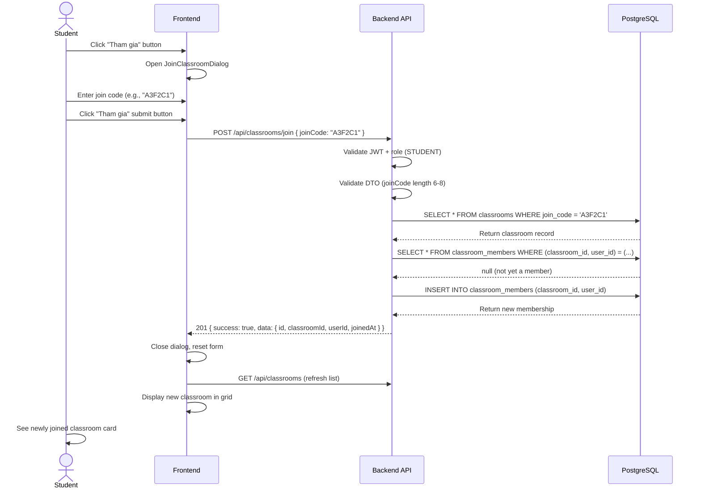
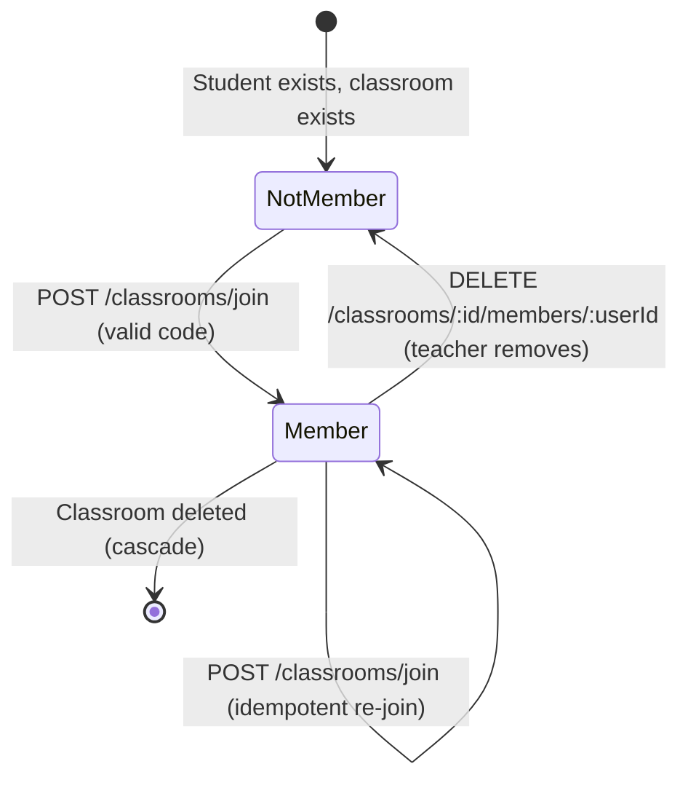

# B2. Join Classroom via Code

## 5.1 Feature Overview

| Field | Value |
|---|---|
| Feature ID | B2 |
| Feature Name | Join Classroom via Code |
| Module | B. Classroom Management |
| Priority | P0 |
| Complexity | S |
| Status | **Existing** — fully implemented (backend + frontend) |
| Target Roles | STUDENT |
| Business Objective | Allow students to self-enroll in classrooms using a code shared by their teacher, eliminating the need for teacher-managed enrollment. |
| User Problem | Students need a simple, self-service way to join their teacher's classroom without requiring the teacher to manually add each student. |
| Dependencies | A1 (Authentication), B1 (Create Classroom — classroom must exist with a join code). |

## 5.2 Actors and Permissions

### Student (STUDENT role)

| Action | Permitted | Notes |
|---|---|---|
| Join a classroom by code | Yes | Via `POST /classrooms/join` or `POST /classrooms/:id/join` |
| Re-join an already-joined classroom | Yes | Idempotent — returns existing membership |
| View classrooms they belong to | Yes | Via `GET /classrooms` filtered by membership |

### Teacher (TEACHER role)

| Action | Permitted | Notes |
|---|---|---|
| Join a classroom by code | **No** | `@Roles('STUDENT')` on join endpoints. Teachers access classrooms via ownership, not membership. |
| Share the join code | Yes (out-of-band) | Teacher copies and shares the code via other channels (chat, board, verbally). |

### Unauthenticated User

| Action | Permitted | Notes |
|---|---|---|
| Join a classroom | **No** | 401 Unauthorized |

**Backend enforcement**: Both join endpoints (`POST /classrooms/join` and `POST /classrooms/:id/join`) are restricted to `@Roles('STUDENT')`. The `JoinClassroomDto` validates the join code format (string, 6–8 chars).

## 5.3 Preconditions and Business Rules

### Preconditions

1. User must be authenticated.
2. User must have the `STUDENT` role.
3. A classroom with the given join code must exist.

### Business Rules

| Rule ID | Rule | Enforcement |
|---|---|---|
| B2-R1 | Join code must match exactly (case-sensitive as stored, but codes are generated as uppercase hex). | `ClassroomsService.joinByCode()` queries `findUnique({ where: { joinCode } })`. |
| B2-R2 | Joining is **idempotent**: if the student is already a member, the existing membership is returned without creating a duplicate. | Service checks `classroomMember.findUnique({ where: { classroomId_userId } })` before insert. |
| B2-R3 | Students can join multiple classrooms. | No limit on number of memberships per student. |
| B2-R4 | Archived classrooms CAN still be joined. | Current implementation does not check `archivedAt` during join. **Open question**: should archived classrooms reject joins? |
| B2-R5 | There is no approval workflow — join is instant. | Unlike Azota which has teacher approval options, our system auto-enrolls on valid code. |

### Validation Rules

| Field | Type | Required | Constraints |
|---|---|---|---|
| `joinCode` | string | Yes | `@IsString()`, `@Length(6, 8)` |

## 5.4 Main User Flow — Happy Path



### Step-by-step

1. **Student** clicks the "Tham gia" button (top-right of classrooms page).
2. **System** opens the `JoinClassroomDialog` modal.
3. **Student** enters the 6-character join code received from their teacher.
4. **Student** clicks "Tham gia" to submit.
5. **Frontend** sends `POST /api/classrooms/join` with `{ joinCode }`.
6. **Backend** looks up the classroom by join code.
7. **Backend** checks if the student is already a member (idempotent check).
8. **Backend** creates the membership record.
9. **Frontend** closes the dialog, resets the form, and refreshes the classroom list.
10. **Student** sees the newly joined classroom in their grid.

**Success condition**: A `ClassroomMember` record exists linking the student to the classroom, and the student sees the classroom in their list.

## 5.5 Alternative Flows

### AF-1: Student is already a member (idempotent re-join)

1. Student enters a join code for a classroom they have already joined.
2. Backend finds the existing `ClassroomMember` record.
3. Backend returns the existing record (200 OK) instead of creating a duplicate.
4. Frontend closes dialog and refreshes list — no visible change.
5. No error shown to the student.

### AF-2: Student enters lowercase code

1. Student enters "a3f2c1" (lowercase).
2. Backend queries `WHERE join_code = 'a3f2c1'`.
3. Since join codes are stored as uppercase ("A3F2C1"), the query returns no match.
4. Backend returns 400 "Invalid join code".
5. **Gap**: Consider case-insensitive matching (see Open Questions).

### AF-3: Student cancels the join dialog

1. Student opens the dialog and enters a code.
2. Student clicks outside the dialog or presses Escape.
3. Dialog closes. No API call is made.
4. Form state is not persisted.

### AF-4: Join via direct classroom URL (alternative endpoint)

The backend also supports `POST /classrooms/:id/join` with `{ joinCode }` in the body. This is not used by the current frontend but could support join-by-link scenarios.

1. Student receives a link like `/classrooms/{id}/join?code=A3F2C1`.
2. Frontend calls `POST /classrooms/:id/join` with the code.
3. Backend validates that the code matches the classroom ID.
4. Same membership creation flow.

## 5.6 Edge Cases and Failure Scenarios

| Scenario ID | Scenario | Trigger | Expected Behavior | User Feedback | Data Integrity | Recovery | Severity |
|---|---|---|---|---|---|---|---|
| B2-E1 | Invalid join code | Student enters a code that doesn't match any classroom | Backend: `findUnique({ where: { joinCode } })` returns null → 400 "Invalid join code". | Error shown in dialog: "Invalid join code" (red text). | No membership created. | Student re-enters correct code. | Low |
| B2-E2 | Lowercase code | Student enters "a3f2c1" instead of "A3F2C1" | Prisma default string comparison is case-sensitive. Query returns null → 400. | Same as B2-E1. | No membership. | Student re-enters in correct case, or system should normalize to uppercase. | Medium |
| B2-E3 | Already a member | Student re-submits the same code | Idempotent: existing membership returned. No new record created. | Dialog closes normally. No error. List unchanged. | No duplicate created (unique constraint `classroomId_userId`). | N/A — intended behavior. | Low |
| B2-E4 | Code with extra spaces | Student enters " A3F2C1 " (with spaces) | DTO validation passes (length check may fail if spaces push beyond 8 chars). Backend query with spaces won't match. | 400 error or validation error. | No membership. | Re-enter without spaces. **Gap**: Should trim input. | Medium |
| B2-E5 | Archived classroom | Student joins a classroom where `archivedAt` is not null | Current behavior: join succeeds. No archive check in join flow. | Student sees the classroom. But if archived classrooms are hidden from the student list, the classroom may not appear. | Membership created. | **Open question**: Should archived classrooms reject new joins? | Medium |
| B2-E6 | Teacher tries to join | Teacher role attempts POST /classrooms/join | `@Roles('STUDENT')` returns 403 Forbidden. | 403 error. "Tham gia" button not shown for teachers. | No membership created. | N/A — by design. | Low |
| B2-E7 | Network failure | Connection drops during join request | Request fails. Frontend shows error message in dialog. | Error text: "Failed to join" or similar. | No membership created. | Student retries. Safe because join is idempotent. | Medium |
| B2-E8 | JWT expires during join | Token expires between dialog open and submit | Backend returns 401. Frontend interceptor attempts token refresh. If refresh succeeds, retry. If not, redirect to login. | If refresh works: transparent retry. If not: redirected to login. | No membership (first attempt). May succeed on retry. | Re-login and retry. | Medium |
| B2-E9 | Classroom deleted between code share and join | Teacher deletes the classroom after sharing the code | `findUnique({ where: { joinCode } })` returns null → 400. | Error: "Invalid join code". | No membership. | Teacher creates a new classroom and shares new code. | Low |
| B2-E10 | Concurrent joins by same student | Student clicks join twice rapidly | First creates membership. Second finds existing (idempotent). Database unique constraint prevents duplicates. | Both return success. | Exactly one membership record. | N/A — safe by design. | Low |
| B2-E11 | Very short code (< 6 chars) | Student enters "ABC" | DTO validation `@Length(6, 8)` rejects. Returns 400. | Validation error. | No membership. | Enter full code. | Low |

## 5.7 UI/UX Specification

### Entry Point

- **Page**: `/dashboard/classrooms`
- **Button**: "Tham gia" (Primary Blue) with LogIn icon. Top-right. Visible only for STUDENT role.
- **Button replaced by**: "Tạo lớp học" for TEACHER role.

### JoinClassroomDialog (Existing Implementation)

| Element | Specification |
|---|---|
| **Trigger** | Primary Blue button with LogIn icon + "Tham gia" text |
| **Dialog** | Modal overlay (shadcn Dialog). Title: "Tham gia lớp học" |
| **Error display** | Red-tinted banner (`bg-destructive/10 text-destructive`) at top of form when error occurs |
| **Join code field** | Text input. Label: "Mã lớp". Placeholder: "Nhập mã lớp (6 ký tự)". `maxLength={8}`. HTML `required`. |
| **Submit button** | Full width. Primary Blue. Text: "Tham gia". Disabled while loading (text: "Đang tham gia..."). |
| **Success** | Dialog closes. Form resets. Classroom list refreshes. |
| **Error** | Error message shown in red banner inside dialog. |

### Post-Join State

After successful join, the classroom appears in the student's classroom grid as a card with:
- Classroom name (no join code shown for students)
- Member count
- Clickable to navigate to classroom detail

### Responsive Behavior

Same grid layout as described in B1. Dialog renders responsively at all breakpoints.

## 5.8 Data Requirements

### Entities

#### ClassroomMember (Existing)

| Field | Type | Required | Constraints | Notes |
|---|---|---|---|---|
| `id` | UUID | Auto | Primary key | |
| `classroomId` | UUID FK | Yes | References `classrooms.id`, cascade delete | |
| `userId` | UUID FK | Yes | References `users.id`, cascade delete | |
| `joinedAt` | DateTime | Auto | Default `now()` | |

### Constraints

- **Unique**: `(classroomId, userId)` — prevents duplicate memberships.
- **Cascade delete**: If classroom is deleted, all memberships are removed. If user is deleted, their memberships are removed.

### Indexes

- Composite unique index on `(classroomId, userId)` — existing.
- The unique `joinCode` index on `classrooms` table enables efficient code lookup.

### Proposed Schema Changes

None required for this feature.

## 5.9 API Requirements

### POST /api/classrooms/join — Join by Code (Primary Endpoint)

| Field | Value |
|---|---|
| **Method** | POST |
| **Endpoint** | `/api/classrooms/join` |
| **Purpose** | Student joins a classroom using only the join code |
| **Required Role** | STUDENT |
| **Authentication** | JWT Bearer token required |

#### Request Body

```json
{
  "joinCode": "A3F2C1"
}
```

| Field | Type | Required | Validation |
|---|---|---|---|
| `joinCode` | string | Yes | `@IsString()`, `@Length(6, 8)` |

#### Success Response (201 Created / 200 OK for re-join)

```json
{
  "success": true,
  "data": {
    "id": "uuid",
    "classroomId": "uuid",
    "userId": "uuid",
    "joinedAt": "2026-11-11T10:00:00.000Z"
  }
}
```

**Note**: Current implementation returns 201 for both new and existing memberships. Strictly, re-join (idempotent) should return 200.

#### Error Responses

| Status | Code | Condition |
|---|---|---|
| 400 | VALIDATION_ERROR | Invalid `joinCode` format (too short, too long) |
| 400 | BAD_REQUEST | Join code does not match any classroom ("Invalid join code") |
| 401 | UNAUTHORIZED | Missing or invalid JWT |
| 403 | FORBIDDEN | User role is not STUDENT |

#### Idempotency

**Idempotent by design.** Submitting the same code multiple times returns the same membership record without creating duplicates.

---

### POST /api/classrooms/:id/join — Join by ID and Code (Secondary Endpoint)

| Field | Value |
|---|---|
| **Method** | POST |
| **Endpoint** | `/api/classrooms/:id/join` |
| **Purpose** | Student joins a specific classroom by ID, validated with join code |
| **Required Role** | STUDENT |

This endpoint requires both the classroom ID (URL param) and the join code (body). It validates that the code matches the classroom before creating membership.

Not currently used by the frontend but available for deep-link scenarios.

## 5.10 State Management

### Membership State

Classroom membership is binary: the student is either a member or not. There is no pending/approval state.



There are no intermediate states (pending, suspended, etc.). This is simpler than Azota which supports teacher approval workflows.

## 5.11 Acceptance Criteria

### Positive

```gherkin
Given a student is authenticated,
And a classroom exists with join code "A3F2C1",
When the student submits a join request with joinCode "A3F2C1",
Then a ClassroomMember record is created linking the student to the classroom,
And the student can see the classroom in their classroom list.

Given a student has already joined a classroom with code "A3F2C1",
When the student submits the same join code again,
Then the existing membership is returned,
And no duplicate record is created,
And the response is successful (no error).

Given a student joins a classroom,
When the classroom owner views the member list,
Then the student appears in the member list with their displayName, email, and joinedAt date.
```

### Negative

```gherkin
Given a student provides a join code "XXXXXX" that does not match any classroom,
When the join request is processed,
Then the backend returns 400 "Invalid join code",
And no membership record is created.

Given a teacher is authenticated,
When the teacher attempts to join a classroom by code,
Then the backend returns 403 Forbidden.

Given an unauthenticated user,
When the user attempts to join a classroom,
Then the backend returns 401 Unauthorized.
```

## 5.12 QA Test Scenarios

| Test ID | Scenario | Preconditions | Steps | Test Data | Expected Result | Priority |
|---|---|---|---|---|---|---|
| B2-T1 | Happy path: join classroom | Student auth'd, classroom exists with code "A3F2C1" | POST /classrooms/join `{ joinCode: "A3F2C1" }` | `joinCode: "A3F2C1"` | 201, membership created | Critical |
| B2-T2 | Idempotent re-join | Student already member of classroom | POST /classrooms/join with same code | Same code | 200/201, existing record returned, no duplicate | Critical |
| B2-T3 | Invalid code | Student auth'd | POST /classrooms/join `{ joinCode: "ZZZZZZ" }` | Non-existent code | 400 "Invalid join code" | High |
| B2-T4 | Code too short | Student auth'd | POST /classrooms/join `{ joinCode: "AB" }` | 2-char code | 400 validation error | Medium |
| B2-T5 | Code too long | Student auth'd | POST /classrooms/join `{ joinCode: "ABCDEFGHIJ" }` | 10-char code | 400 validation error | Medium |
| B2-T6 | Teacher cannot join | Teacher auth'd | POST /classrooms/join `{ joinCode: "A3F2C1" }` | Valid code | 403 Forbidden | Critical |
| B2-T7 | Unauthenticated | No token | POST /classrooms/join `{ joinCode: "A3F2C1" }` | Valid code | 401 Unauthorized | Critical |
| B2-T8 | Case sensitivity | Student auth'd, code is "A3F2C1" | POST /classrooms/join `{ joinCode: "a3f2c1" }` | Lowercase code | 400 (current behavior). See open question. | Medium |
| B2-T9 | Concurrent join | Two students join same classroom simultaneously | Parallel POST /classrooms/join | Same code, different students | Both succeed with separate memberships | Medium |
| B2-T10 | Join then view list | Student joins classroom | 1. Join. 2. GET /classrooms. | Valid code | Classroom appears in list | High |
| B2-T11 | Frontend: error displayed | Student on classrooms page | 1. Click "Tham gia". 2. Enter invalid code. 3. Submit. | `joinCode: "ZZZZZZ"` | Error banner shown in dialog | High |
| B2-T12 | Deleted classroom code | Classroom was deleted | POST /classrooms/join with old code | Code of deleted classroom | 400 "Invalid join code" | Medium |

## 5.13 Open Questions and Assumptions

| # | Question | Why It Matters | Options | Recommended Default | Impact |
|---|---|---|---|---|---|
| B2-Q1 | Should join code matching be case-insensitive? | Students may type lowercase. Codes are generated as uppercase hex. | A) Case-sensitive (current). B) Normalize to uppercase before lookup. | **B) Normalize** — `toUpperCase()` on the input before querying. Prevents frustration. | Low — one-line change in service. |
| B2-Q2 | Should archived classrooms reject new joins? | If a classroom is archived, the teacher may not want new students. | A) Allow (current). B) Reject with 400. | **B) Reject** — add archive check in join flow. | Low — one condition added. |
| B2-Q3 | Should the join code input auto-trim whitespace? | Users may paste codes with leading/trailing spaces. | A) No trim (current). B) Trim before sending. | **B) Trim** — `joinCode.trim()` in frontend before API call, and `.trim()` in service. | Low — trivial fix. |
| B2-Q4 | Should re-join return 200 or 201? | HTTP correctness: 201 means a resource was created. Re-join creates nothing. | A) Always 201 (current). B) 201 for new, 200 for existing. | **B) 201 for new, 200 for existing** — more correct, and the frontend doesn't care about the status code distinction. | Low. |

### Assumptions

1. **Join codes do not expire.** A join code is valid for the lifetime of the classroom. There is no expiration or regeneration mechanism (unlike Azota which can regenerate codes).
2. **No teacher approval required.** Any student with the correct code joins instantly. This is simpler than Azota's optional approval flow.
3. **Teachers cannot join classrooms.** The TEACHER role accesses classrooms only via ownership, never via the join flow.
4. **Students cannot leave classrooms voluntarily.** Only the classroom owner can remove a student. A student self-leave feature is not currently implemented (P3 consideration).
