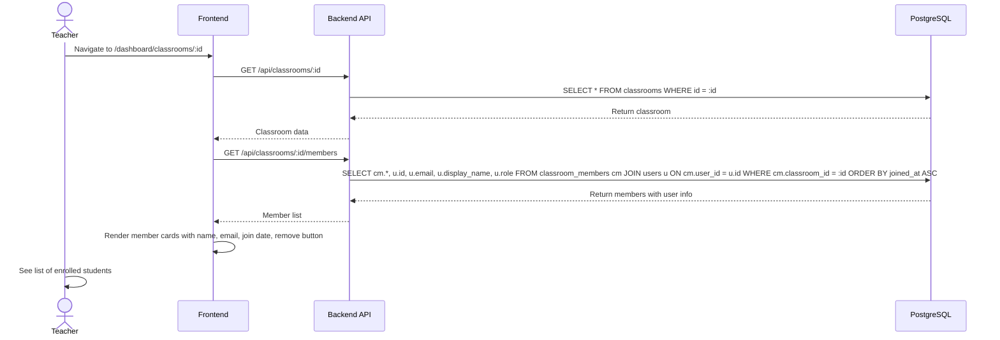
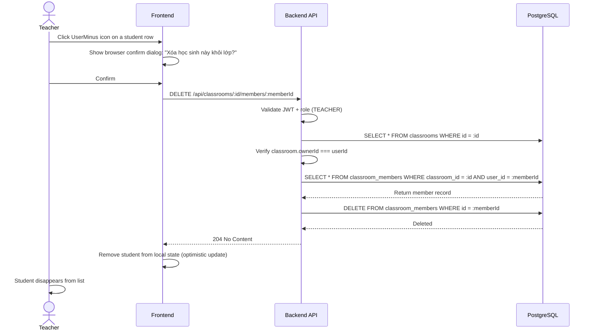

# B3. Manage Students (List / Remove Members)

## 5.1 Feature Overview

| Field | Value |
|---|---|
| Feature ID | B3 |
| Feature Name | Manage Students — List and Remove Members |
| Module | B. Classroom Management |
| Priority | P0 (List Members), P1 (Remove Member) |
| Complexity | S |
| Status | **Existing** — fully implemented (backend + frontend) |
| Target Roles | TEACHER (remove), TEACHER + STUDENT (view list) |
| Business Objective | Enable teachers to view who is in their classroom and remove students when necessary. Enable all classroom participants to see the class roster. |
| User Problem | Teachers need to monitor enrollment and maintain control over classroom membership. Students need to see who else is in their class. |
| Dependencies | A1 (Authentication), B1 (Create Classroom), B2 (Join Classroom). |

## 5.2 Actors and Permissions

### Teacher (TEACHER role — classroom owner)

| Action | Permitted | Notes |
|---|---|---|
| View member list | Yes | `GET /classrooms/:id/members` — no ownership check currently |
| Remove a student | Yes | `DELETE /classrooms/:id/members/:memberId` — ownership verified |

### Teacher (non-owner)

| Action | Permitted | Notes |
|---|---|---|
| View member list | Yes (current) | **Gap**: `getMembers` has no ownership/membership check. Any authenticated user can view any classroom's member list by ID. |
| Remove a student | **No** | Ownership check: `classroom.ownerId !== ownerId` → 403 |

### Student

| Action | Permitted | Notes |
|---|---|---|
| View member list | Yes (current) | Same gap as non-owner teacher — no membership check on the endpoint |
| Remove a student | **No** | `@Roles('TEACHER')` on the controller |
| Remove self (leave classroom) | **No** | Not implemented |

### Backend Enforcement Notes

- **View members**: `GET /classrooms/:id/members` currently has **no authorization check** beyond JWT authentication. Any authenticated user can view any classroom's member list. This is a **security gap** that should be fixed.
- **Remove member**: `DELETE /classrooms/:id/members/:memberId` checks classroom ownership correctly.

## 5.3 Preconditions and Business Rules

### Preconditions

1. User must be authenticated.
2. The classroom must exist.
3. For remove: the requesting user must be the classroom owner (TEACHER).

### Business Rules

| Rule ID | Rule | Enforcement |
|---|---|---|
| B3-R1 | All authenticated users can view a classroom's member list. | Current behavior (no ownership/membership check). **Proposed**: restrict to classroom owner + members. |
| B3-R2 | Only the classroom owner can remove a student. | `classroomsService.removeMember()` checks `classroom.ownerId !== ownerId`. |
| B3-R3 | Removing a student deletes their `ClassroomMember` record. | Hard delete via `prisma.classroomMember.delete()`. |
| B3-R4 | Removing a student does NOT delete their exam attempts or answers. | No cascade from membership to attempts. Attempts are linked to `ExamAttempt.studentId`, not to membership. |
| B3-R5 | The classroom owner cannot remove themselves (they are not a member). | Owner is tracked via `Classroom.ownerId`, not `ClassroomMember`. The remove endpoint only finds members. |
| B3-R6 | The member list is ordered by `joinedAt` ascending (earliest first). | `orderBy: { joinedAt: 'asc' }` in `getMembers()`. |
| B3-R7 | Members include user details: `id`, `email`, `displayName`, `role`. | `include: { user: { select: { id, email, displayName, role } } }` |

## 5.4 Main User Flow — Happy Path

### List Members



### Remove Member



## 5.5 Alternative Flows

### AF-1: Empty classroom (no members)

1. Teacher navigates to classroom detail.
2. Member list API returns empty array.
3. Frontend displays: "Chưa có học sinh nào tham gia".

### AF-2: Student views member list

1. Student navigates to classroom detail (via clicking a classroom card).
2. Frontend fetches and displays the member list.
3. The remove button (UserMinus) is hidden for students (`isTeacher` check in the UI).

### AF-3: Teacher cancels removal

1. Teacher clicks the remove button.
2. Browser `confirm()` dialog appears.
3. Teacher clicks "Cancel".
4. No API call is made. Member remains.

### AF-4: Removed student attempts to access the classroom

1. Student is removed from the classroom.
2. Student still has the classroom in their browser state.
3. On next page refresh, `GET /classrooms` no longer includes this classroom.
4. If student tries to navigate to the classroom detail directly, they can still view it (due to the authorization gap on `GET /classrooms/:id`).

## 5.6 Edge Cases and Failure Scenarios

| Scenario ID | Scenario | Trigger | Expected Behavior | User Feedback | Data Integrity | Recovery | Severity |
|---|---|---|---|---|---|---|---|
| B3-E1 | Non-owner teacher views members of another teacher's classroom | Teacher knows the classroom ID | Current: succeeds (no auth check on `GET /members`). **Gap**: Should return 403. | Members displayed. | No data modification. But reveals student PII. | Fix: Add ownership/membership check. | High |
| B3-E2 | Remove a student who has an in-progress exam attempt | Teacher removes student while student is taking an exam | Membership deleted. Attempt remains `IN_PROGRESS` linked to `studentId`. Student can still submit. | No warning to teacher about active attempts. | Attempt data preserved. Student may be unable to start new attempts (membership check at start). | **Open question**: Should removal be blocked or warned if student has active attempts? | High |
| B3-E3 | Remove a non-existent member | API called with a `memberId` not in the classroom | Service: `findFirst({ where: { classroomId, userId: memberId } })` returns null → 404 "Member not found". | 404 error. | No data changed. | N/A. | Low |
| B3-E4 | Non-owner teacher tries to remove | Teacher who doesn't own the classroom | Service: `classroom.ownerId !== ownerId` → 403 Forbidden. | 403 error. | No data changed. | N/A — by design. | Low |
| B3-E5 | Student tries to remove another student | Student role accesses DELETE endpoint | `@Roles('TEACHER')` → 403 Forbidden. | 403 error. | No data changed. | N/A — by design. | Low |
| B3-E6 | Remove the last student in a classroom | Only one member left | Removal succeeds. Member list becomes empty. | Empty state shown: "Chưa có học sinh nào tham gia". | Classroom still exists with 0 members. | N/A — valid state. | Low |
| B3-E7 | Classroom deleted while viewing member list | Another session/tab deletes the classroom | Next API call to this classroom returns 404. | Frontend may show stale data until refresh. | Cascade delete already removed all members. | Navigate back to classroom list. | Medium |
| B3-E8 | Concurrent removal of same student | Two teachers (or same teacher, two tabs) delete the same member | First succeeds (204). Second gets 404 "Member not found". | Second call shows error (or silent if error is swallowed). | Member removed exactly once. | N/A — safe. | Low |
| B3-E9 | Large classroom (many members) | Classroom has 100+ students | `getMembers()` returns all members without pagination. | May be slow to render. | Data integrity fine. | **Gap**: Should add pagination for large classrooms. | Medium |
| B3-E10 | Remove student then student tries to re-join | Student is removed, then uses join code | Student can re-join (join code still valid). New membership created. | Student sees classroom again after re-join. | New `ClassroomMember` with new `joinedAt`. Previous exam data preserved. | By design — teacher can remove again if needed. | Low |

## 5.7 UI/UX Specification

### Entry Point

Member list is displayed on the classroom detail page: `/dashboard/classrooms/:id`.

### Member List Section (Existing Implementation)

| Element | Specification |
|---|---|
| **Container** | Card component with CardHeader + CardContent |
| **Header** | Users icon + "Thành viên (N)" where N is the count |
| **Empty state** | Text: "Chưa có học sinh nào tham gia" |
| **Member row** | Rounded border container with flex layout |
| **Member info (left)** | Display name (font-medium), email below (text-xs, muted) |
| **Member info (right)** | Join date (text-xs, muted, formatted vi-VN locale) |
| **Remove button** | Ghost button with UserMinus icon, `text-destructive` color. Visible only for TEACHER. |

### Remove Confirmation

- **Mechanism**: Browser native `confirm()` dialog.
- **Message**: "Xóa học sinh này khỏi lớp?"
- **Behavior**: If confirmed, API call made. If cancelled, no action.
- **Proposed improvement**: Replace `confirm()` with a styled confirmation dialog for better UX (P2).

### Optimistic Update

After successful removal, the student is removed from the local `members` state immediately:
```js
setMembers((prev) => prev.filter((m) => m.user.id !== memberId));
```

No re-fetch of the member list is required.

### Responsive Behavior

Member rows use flex layout and wrap gracefully on mobile. On narrow screens, the date and remove button stack vertically.

## 5.8 Data Requirements

### Entities

Uses existing `ClassroomMember` model. See B2 spec for full schema.

### Query Pattern

The `getMembers` method returns members with joined user data:
```
ClassroomMember JOIN User ON ClassroomMember.userId = User.id
WHERE ClassroomMember.classroomId = :id
ORDER BY ClassroomMember.joinedAt ASC
```

Selected user fields: `id`, `email`, `displayName`, `role`.

### Proposed Schema Changes

None for the current feature. See Open Questions for authorization improvements.

## 5.9 API Requirements

### GET /api/classrooms/:id/members — List Members

| Field | Value |
|---|---|
| **Method** | GET |
| **Endpoint** | `/api/classrooms/:id/members` |
| **Purpose** | List all members of a classroom with user details |
| **Required Role** | Any authenticated user (current). **Proposed**: Owner or member only. |
| **Authentication** | JWT Bearer token required |

#### URL Parameters

| Param | Type | Required | Description |
|---|---|---|---|
| `id` | UUID | Yes | Classroom ID |

#### Success Response (200 OK)

```json
{
  "success": true,
  "data": [
    {
      "id": "membership-uuid",
      "classroomId": "classroom-uuid",
      "userId": "user-uuid",
      "joinedAt": "2026-11-10T08:00:00.000Z",
      "user": {
        "id": "user-uuid",
        "email": "student@example.com",
        "displayName": "Nguyen Van A",
        "role": "STUDENT"
      }
    }
  ]
}
```

#### Error Responses

| Status | Code | Condition |
|---|---|---|
| 401 | UNAUTHORIZED | Missing or invalid JWT |
| 404 | NOT_FOUND | Classroom does not exist (if classroom existence is checked — currently not checked) |

**Security gap**: This endpoint currently does not verify that the requesting user owns the classroom or is a member. Any authenticated user can view any classroom's member list by guessing the ID.

---

### DELETE /api/classrooms/:id/members/:memberId — Remove Member

| Field | Value |
|---|---|
| **Method** | DELETE |
| **Endpoint** | `/api/classrooms/:id/members/:memberId` |
| **Purpose** | Remove a student from a classroom |
| **Required Role** | TEACHER (classroom owner) |
| **Authentication** | JWT Bearer token required |

#### URL Parameters

| Param | Type | Required | Description |
|---|---|---|---|
| `id` | UUID | Yes | Classroom ID |
| `memberId` | UUID | Yes | User ID of the student to remove |

#### Success Response (204 No Content)

Empty body.

#### Error Responses

| Status | Code | Condition |
|---|---|---|
| 401 | UNAUTHORIZED | Missing or invalid JWT |
| 403 | FORBIDDEN | User is not the classroom owner |
| 404 | NOT_FOUND | Classroom not found, or user is not a member |

## 5.10 State Management

Membership is a binary state (see B2 spec). The remove operation transitions from Member → NotMember.

No complex state machine is involved.

## 5.11 Acceptance Criteria

### Positive

```gherkin
Given a classroom has 3 student members,
When the classroom owner requests the member list,
Then the response contains 3 member records,
And each includes the student's displayName, email, and joinedAt date,
And members are ordered by joinedAt ascending.

Given a classroom owner views the member list,
When the owner removes a student,
Then the student's ClassroomMember record is deleted,
And the student no longer appears in the member list,
And the student no longer sees this classroom in their classroom list.

Given a student was removed from a classroom,
When the student's existing exam attempts are checked,
Then all prior ExamAttempt and Answer records still exist unchanged.
```

### Negative

```gherkin
Given a teacher who does NOT own the classroom,
When the teacher attempts to remove a student,
Then the backend returns 403 Forbidden,
And the membership is not affected.

Given a student is authenticated,
When the student attempts to remove another student via API,
Then the backend returns 403 Forbidden.

Given a memberId that does not belong to any member of the classroom,
When the owner attempts to remove that member,
Then the backend returns 404 "Member not found".
```

## 5.12 QA Test Scenarios

| Test ID | Scenario | Preconditions | Steps | Test Data | Expected Result | Priority |
|---|---|---|---|---|---|---|
| B3-T1 | List members | Classroom has 3 students | GET /classrooms/:id/members | Classroom ID | 200 with 3 members, ordered by joinedAt | Critical |
| B3-T2 | Empty classroom | Classroom with no members | GET /classrooms/:id/members | Classroom ID | 200 with empty array | Medium |
| B3-T3 | Member details | Classroom has members | GET /classrooms/:id/members | — | Each member has id, email, displayName, role, joinedAt | High |
| B3-T4 | Remove student — happy path | Classroom with 2 students, owner auth'd | DELETE /classrooms/:id/members/:userId | Valid member userId | 204, member count drops to 1 | Critical |
| B3-T5 | Remove non-existent member | Owner auth'd | DELETE /classrooms/:id/members/:randomId | Non-member userId | 404 "Member not found" | High |
| B3-T6 | Non-owner tries to remove | Teacher who doesn't own classroom | DELETE /classrooms/:id/members/:userId | Valid member | 403 Forbidden | Critical |
| B3-T7 | Student tries to remove | Student auth'd | DELETE /classrooms/:id/members/:userId | Valid member | 403 Forbidden | Critical |
| B3-T8 | Remove preserves attempts | Student has submitted attempts | 1. Remove student. 2. Query attempts by studentId. | — | Attempts still exist in DB | High |
| B3-T9 | Removed student can re-join | Student was removed | 1. Remove. 2. Student POSTs /classrooms/join with the code. | Valid join code | New membership created | Medium |
| B3-T10 | Auth gap: non-member views list | User not in classroom | GET /classrooms/:id/members with random classroom ID | — | **Current**: 200 with members (bug). **Expected**: 403. | High |
| B3-T11 | Frontend: remove with confirm | Teacher on detail page | 1. Click UserMinus. 2. Confirm. | — | Student removed from UI list immediately | High |
| B3-T12 | Frontend: cancel remove | Teacher on detail page | 1. Click UserMinus. 2. Cancel confirm. | — | No change, student remains | Medium |

## 5.13 Open Questions and Assumptions

| # | Question | Why It Matters | Options | Recommended Default | Impact |
|---|---|---|---|---|---|
| B3-Q1 | Should `GET /classrooms/:id/members` check ownership/membership? | Currently any authenticated user can view any classroom's member list — exposing student PII. | A) No check (current). B) Owner + members only. C) Owner only. | **B) Owner + members** — the teacher needs it for management, students benefit from seeing classmates. | Medium — add a guard that checks `isOwner || isMember`. |
| B3-Q2 | Should removing a student with active attempts be blocked or warned? | Removing a student while they're mid-exam could cause confusion, though the attempt data is preserved. | A) Allow silently (current). B) Warn teacher. C) Block if IN_PROGRESS attempt exists. | **B) Warn teacher** — return a notice that the student has active attempts, but still allow removal on confirmation. | Medium — requires querying attempts before delete. |
| B3-Q3 | Should there be pagination on the member list? | Classrooms with 100+ students could cause slow responses and render issues. | A) No pagination (current). B) Paginate with `?page=&limit=`. | **A) No pagination for now** — target scale is ~100 users total. Add in P3. | Low. |
| B3-Q4 | Should students be able to leave a classroom voluntarily? | Some platforms let students leave. Currently only the teacher can remove. | A) Teacher-only removal (current). B) Student self-leave endpoint. | **A) Teacher-only for MVP.** Self-leave is P3. | None for now. |

### Assumptions

1. **Removing a student is a hard delete.** The `ClassroomMember` record is permanently deleted. There is no soft-delete or audit log for membership changes.
2. **Exam data is NOT affected by removal.** `ExamAttempt` is linked to `studentId` and `examId`, not to `ClassroomMember`. Removing a student preserves all their exam data.
3. **The owner never appears in the member list.** The owner is tracked via `Classroom.ownerId`. The member list contains only students (people who joined via code).
