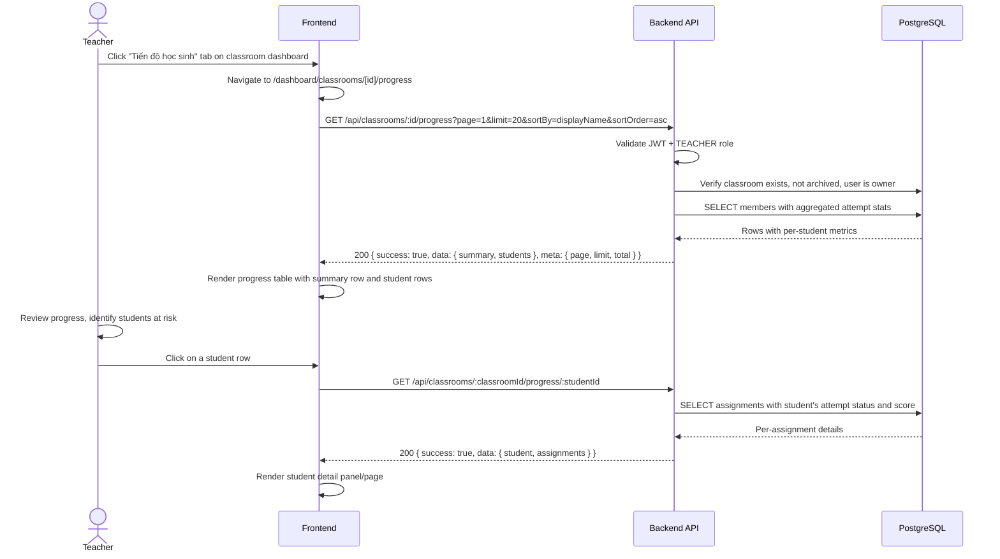
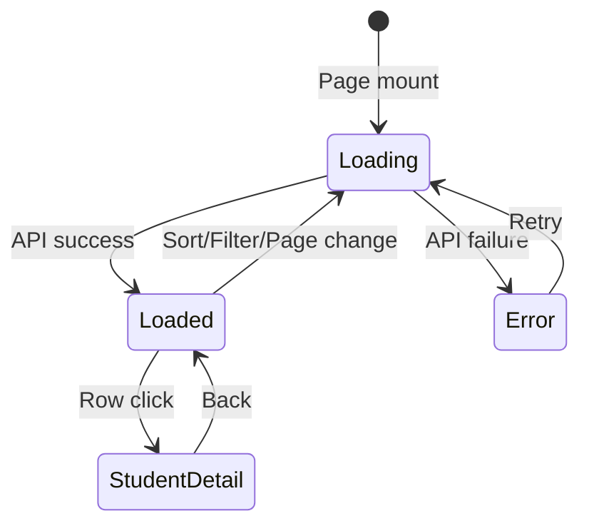

# B8. Student Progress Tracking

## 5.1 Feature Overview

| Field | Value |
|---|---|
| Feature ID | B8 |
| Feature Name | Student Progress Tracking |
| Module | B. Classroom Management |
| Priority | P1 |
| Complexity | M |
| Status | **Not implemented** — the analytics module has `GET /api/analytics/classrooms/:id` for aggregate classroom performance and `GET /api/analytics/students/:id/performance` for a student's exam history, but there is no classroom-scoped per-student progress view listing all students with their individual metrics. |
| Target Roles | TEACHER |
| Business Objective | Give teachers a per-student progress view within a classroom so they can identify students who are falling behind, not completing assignments, or struggling with material — enabling timely intervention. |
| User Problem | Teachers can see aggregate classroom metrics (H1) and individual exam results (G2), but have no single view that shows every student's progress across all assignments in a classroom. They must check results exam by exam. |
| Dependencies | B1 (Create Classroom), B3 (Manage Students), D5 (Assign Exam), E1–E3 (Exam Attempts), G1 (Grading), H1 (Analytics APIs — for reuse of patterns). |

## 5.2 Actors and Permissions

### Teacher (TEACHER role, classroom owner)

| Action | Permitted | Notes |
|---|---|---|
| View progress table for own classroom | Yes | Verified via `Classroom.ownerId === userId` |
| Sort and filter the progress table | Yes | Client-side or query-param-driven |
| Export progress data to CSV | Yes | P2 — listed as open question |
| Click a student row to see their detailed attempt history | Yes | Navigates to per-student detail |

### Student (STUDENT role)

| Action | Permitted | Notes |
|---|---|---|
| View progress of other students | **No** | Students cannot access this endpoint. Their own stats are visible on the classroom dashboard (B7). |

### Unauthenticated User

| Action | Permitted | Notes |
|---|---|---|
| Access any progress endpoint | **No** | 401 via global `JwtAuthGuard` |

**Backend enforcement**: `@Roles('TEACHER')` on the controller endpoint. Service verifies `Classroom.ownerId === userId` before executing the query. Students receive 403 regardless of membership.

## 5.3 Preconditions and Business Rules

### Preconditions

1. User must be authenticated with TEACHER role.
2. Classroom must exist and not be archived.
3. User must be the classroom owner.

### Business Rules

| Rule ID | Rule | Enforcement |
|---|---|---|
| B8-R1 | Only the classroom owner can view student progress for that classroom. Other teachers receive 403. | Backend: service checks `classroom.ownerId === userId`. |
| B8-R2 | The progress table includes every current classroom member. Students who were removed are excluded. | Backend: query joins `ClassroomMember` — only active memberships. |
| B8-R3 | For each student, "assignments completed" is the count of active assignments in this classroom for which the student has at least one attempt with status `SUBMITTED`. | Backend: COUNT query with LEFT JOIN on `ExamAttempt`. |
| B8-R4 | For each student, "average score" is the mean of their SUBMITTED attempt scores across all assignments in this classroom. If the student has no submitted attempts, the value is `null`. Scale is 0–10, rounded to 2 decimal places. | Backend: AVG aggregation filtered by `studentId` and assignment's `examId`. |
| B8-R5 | For each student, "pending assignments" is the count of active assignments for which the student has no attempt (neither IN_PROGRESS nor SUBMITTED). | Backend: COUNT where no `ExamAttempt` exists for the student+exam pair. |
| B8-R6 | For each student, "last activity" is the `MAX(savedAt)` from their answers or `MAX(submittedAt)` from their attempts, whichever is later. If the student has never interacted, value is `null`. | Backend: MAX aggregation. |
| B8-R7 | When a student has multiple attempts for one exam (`maxAttempts > 1`), the score used is the last submitted attempt's score (consistent with OQ-05 provisional default). Only one "completed" count per assignment regardless of attempt count. | Backend: score from latest SUBMITTED attempt per exam, COUNT(DISTINCT assignment). |
| B8-R8 | The progress table is paginated. Default page size is 20, maximum 100. Sorting is supported on: `displayName`, `avgScore`, `completedCount`, `lastActivity`. Default sort: `displayName ASC`. | Backend: query params `page`, `limit`, `sortBy`, `sortOrder`. |
| B8-R9 | A summary row at the top of the table shows class-level aggregates: total students, class avg score, class completion rate. | Backend: included in the response as `summary`. |
| B8-R10 | An individual student detail sub-view shows all assignments with the student's attempt status and score per assignment. This is accessible via `GET /api/classrooms/:classroomId/progress/:studentId`. | Backend: separate endpoint returning per-assignment detail for one student in one classroom. |

### Validation Rules

| Field | Type | Required | Constraints |
|---|---|---|---|
| `:classroomId` (path) | UUID | Yes | Valid UUID |
| `:studentId` (path, detail) | UUID | Yes | Valid UUID, must be a member of the classroom |
| `page` (query) | integer | No | Min 1. Default 1. |
| `limit` (query) | integer | No | Min 1, max 100. Default 20. |
| `sortBy` (query) | string | No | One of: `displayName`, `avgScore`, `completedCount`, `lastActivity`. Default `displayName`. |
| `sortOrder` (query) | string | No | `asc` or `desc`. Default `asc`. |
| `search` (query) | string | No | Partial match on `displayName` or `email`. |

## 5.4 Main User Flow — Happy Path



### Step-by-step

1. **Teacher** navigates to the classroom dashboard and clicks the "Tiến độ học sinh" tab or link.
2. **Frontend** navigates to `/dashboard/classrooms/[id]/progress`.
3. **Frontend** sends `GET /api/classrooms/:id/progress` with default pagination and sort.
4. **Backend** validates JWT, verifies TEACHER role, checks classroom ownership.
5. **Backend** queries all classroom members with per-student aggregation: completed count, avg score, pending count, last activity.
6. **Backend** also computes class-level summary (total members, class avg, class completion rate).
7. **Backend** returns paginated student list with summary.
8. **Frontend** renders a table with summary stats at top and one row per student.
9. **Teacher** can sort by any column, search by name/email, or click a student row.
10. On row click, **frontend** navigates to or opens the student detail view, fetching per-assignment details.

**Success condition**: Teacher can see every student's progress at a glance and drill into individual performance. Data matches the sum of individual exam results.

## 5.5 Alternative Flows

### AF-1: Teacher searches for a specific student

1. Teacher types a student name or email in the search field.
2. Frontend debounces input (300ms) and re-fetches with `search` query param.
3. Backend filters members by `displayName ILIKE %search%` OR `email ILIKE %search%`.
4. Table updates with filtered results.

### AF-2: Teacher sorts by average score descending

1. Teacher clicks the "Điểm TB" column header.
2. Frontend re-fetches with `sortBy=avgScore&sortOrder=desc`.
3. Students with `null` avg score appear last.
4. Table re-renders sorted.

### AF-3: Classroom has no assignments yet

1. Teacher navigates to progress tab.
2. API returns students with all metrics at 0/null.
3. Frontend shows the table with members listed, all status columns showing "—".
4. A note above the table: "Chưa có bài kiểm tra nào được giao."

### AF-4: Classroom has no members

1. API returns empty students list and summary with memberCount=0.
2. Frontend shows empty state: "Chưa có học sinh nào trong lớp."

### AF-5: Teacher views student detail

1. Teacher clicks a student row in the progress table.
2. Frontend sends `GET /api/classrooms/:classroomId/progress/:studentId`.
3. Backend returns a list of all assignments with the student's status and score per assignment.
4. Frontend shows a detail panel (slide-over or sub-page) with an assignments table.

## 5.6 Edge Cases and Failure Scenarios

| Scenario ID | Scenario | Trigger | Expected Behavior | User Feedback | Data Integrity | Recovery | Severity |
|---|---|---|---|---|---|---|---|
| B8-E1 | Student removed after page load | Teacher removes a student while another teacher tab shows progress | Stale data shown until refresh. Removed student will disappear on next fetch. | No immediate feedback. Refresh updates list. | No integrity issue — member record is deleted | Manual refresh | Low |
| B8-E2 | Student joins during pagination | New student joins while teacher is on page 2 | New student may appear on page 1 (offset shift). Acceptable at this scale. | Slight page drift on refresh | No integrity issue | Refresh shows current state | Low |
| B8-E3 | Non-owner teacher accesses progress | Teacher tries URL for another teacher's classroom | 403 Forbidden | "Bạn không có quyền xem lớp học này." | No data exposed | N/A | Low |
| B8-E4 | Student accesses progress endpoint | Student sends GET /api/classrooms/:id/progress | 403 Forbidden via `@Roles('TEACHER')` | "Bạn không có quyền truy cập." | No data exposed | N/A | Low |
| B8-E5 | Large classroom (100 members) | Teacher opens progress for a full classroom | Paginated response. Page 1 returns 20 students. Performance acceptable with indexed queries. | Normal load time | No issue | N/A | Low |
| B8-E6 | Student has attempts for exams not assigned to this classroom | Student took exams via other classrooms | Those attempts are NOT counted. Query filters by assignment.classroomId. | Only classroom-scoped data shown | Correct filtering | N/A | Medium |
| B8-E7 | Archived classroom | Teacher accesses progress for an archived classroom | 404 Not Found | "Không tìm thấy lớp học hoặc lớp đã được lưu trữ." | No data exposed | N/A | Low |
| B8-E8 | Student detail for non-member | Teacher requests progress/:studentId where student is not a member | 404 Not Found | "Học sinh không phải thành viên của lớp học này." | No data exposed | N/A | Low |
| B8-E9 | Exam with manual score override | Teacher overrode a student's auto-graded score | Overridden score is used (it is stored on `ExamAttempt.score` with `manualScoreOverride=true`). No distinction in display. | Score shown as-is | Correct — override is the authoritative score | N/A | Low |
| B8-E10 | Multiple attempts per exam | maxAttempts > 1, student has 3 attempts | Uses last SUBMITTED attempt's score per B8-R7. Assignment counted as completed once. | Single score shown per assignment | Consistent with OQ-05 | N/A | Low |

## 5.7 UI/UX Specification

### Entry Point

- **Page**: `/dashboard/classrooms/[id]/progress`
- **Access**: Tab link "Tiến độ học sinh" on the classroom dashboard (B7). Also accessible directly via URL.
- **Current state**: Does not exist.

### Layout — Progress Table

```
┌──────────────────────────────────────────────────────────┐
│  ← Lớp học   Toán 12A1 > Tiến độ học sinh         [⟳]  │  Header
├──────────────────────────────────────────────────────────┤
│  ┌────────────┐ ┌────────────┐ ┌────────────────────┐   │
│  │ 32         │ │  7.5       │ │  78%               │   │  Summary Cards
│  │ Học sinh   │ │ Điểm TB lớp│ │ Hoàn thành lớp     │   │
│  └────────────┘ └────────────┘ └────────────────────┘   │
├──────────────────────────────────────────────────────────┤
│  [🔍 Tìm học sinh...]                                   │  Search
├──────────────────────────────────────────────────────────┤
│  Tên ▲  | Email        | Hoàn thành | Điểm TB | Chưa  │
│          |              |            |         | làm   │  Table Header
│─────────────────────────────────────────────────────────│
│  Nguyễn A | a@mail.com  |    4/5     |  8.2   |   1   │
│  Trần B   | b@mail.com  |    3/5     |  6.5   |   2   │
│  Lê C     | c@mail.com  |    0/5     |   —    |   5   │  ← At-risk
│─────────────────────────────────────────────────────────│
│                    Trang 1 / 2  [<] [>]                 │  Pagination
└──────────────────────────────────────────────────────────┘
```

### Table Columns

| Column | Header (Vietnamese) | Data | Sortable | Format |
|---|---|---|---|---|
| Student name | Tên | `user.displayName` | Yes | Text |
| Email | Email | `user.email` | No | Text (truncated on mobile) |
| Completed | Hoàn thành | completed/total | Yes (by completedCount) | "N/M" |
| Avg score | Điểm TB | avgScore | Yes | Decimal 1dp, or "—" |
| Pending | Chưa làm | pendingCount | No | Integer |
| Last activity | Hoạt động gần nhất | lastActivity | Yes | Relative date "2 ngày trước", or "—" |

### Visual Indicators

- **At-risk highlight**: Students with `completedCount = 0` and `totalAssignments > 0` get a subtle yellow/amber left border on their row to draw attention.
- **Score color**: Scores below 5.0 are displayed in the semantic error/warning color. Scores 5.0–7.0 in default text. Scores above 7.0 in semantic success color.

### Student Detail Panel

When clicking a student row, a slide-over panel (or sub-page) shows:

```
┌──────────────────────────────────────┐
│  ← Quay lại    Nguyễn Văn A         │
│  a@mail.com                          │
├──────────────────────────────────────┤
│  Hoàn thành: 4/5  |  Điểm TB: 8.2  │
├──────────────────────────────────────┤
│  Bài kiểm tra    | Trạng thái | Điểm│
│─────────────────────────────────────│
│  KT Giữa kỳ      | Đã nộp    | 8.5 │
│  Bài tập 3        | Đã nộp    | 7.0 │
│  Bài tập 4        | Đang làm  |  —  │
│  Bài tập 5        | Chưa làm  |  —  │
└──────────────────────────────────────┘
```

### States

- **Loading**: Skeleton table (header + 5 shimmer rows).
- **Error**: Error message with retry button.
- **Empty (no members)**: "Chưa có học sinh nào trong lớp."
- **No assignments**: Table shows students with all metrics as "—". Note: "Chưa có bài kiểm tra nào được giao."

### Responsive Behavior

| Breakpoint | Table Layout | Detail Panel |
|---|---|---|
| < 640px (mobile) | Card list instead of table. Each student is a card showing name, completed, score. | Full-page view |
| 640px–1024px (tablet) | Table with email and last activity columns hidden | Slide-over panel |
| > 1024px (desktop) | Full table | Slide-over panel |

## 5.8 Data Requirements

### Entities Used (All Existing)

No schema changes are required. Student progress is computed from existing tables.

#### ClassroomMember (Existing)

| Field | Use |
|---|---|
| `classroomId` | Filter by classroom |
| `userId` | Join to User and ExamAttempt |

#### User (Existing)

| Field | Use |
|---|---|
| `displayName` | Table column |
| `email` | Table column |

#### Assignment (Existing)

| Field | Use |
|---|---|
| `classroomId` | Filter assignments for this classroom |
| `examId` | Join to ExamAttempt |
| `status` | Filter ACTIVE (or ACTIVE+CLOSED per B7-Q1) |

#### ExamAttempt (Existing)

| Field | Use |
|---|---|
| `examId` | Match to assignment |
| `studentId` | Match to member |
| `status` | Filter SUBMITTED for score, any for "in progress" |
| `score` | Avg score computation |
| `submittedAt` | Last activity computation |

#### Answer (Existing)

| Field | Use |
|---|---|
| `attemptId` | Join for last activity |
| `savedAt` | Last activity computation |

### Proposed Schema Changes

None.

### Proposed Indexes

- `ExamAttempt(studentId, examId, status)` — would speed up the per-student aggregation. Recommendation for architect.

## 5.9 API Requirements

### GET /api/classrooms/:classroomId/progress — Student Progress List

| Field | Value |
|---|---|
| **Method** | GET |
| **Endpoint** | `/api/classrooms/:classroomId/progress` |
| **Purpose** | Return per-student progress metrics for all members of a classroom |
| **Required Role** | TEACHER (classroom owner) |
| **Authentication** | JWT Bearer token required |

#### Path Parameters

| Param | Type | Required | Validation |
|---|---|---|---|
| `classroomId` | UUID | Yes | Valid UUID |

#### Query Parameters

| Param | Type | Required | Default | Validation |
|---|---|---|---|---|
| `page` | integer | No | 1 | Min 1 |
| `limit` | integer | No | 20 | Min 1, max 100 |
| `sortBy` | string | No | `displayName` | One of: `displayName`, `avgScore`, `completedCount`, `lastActivity` |
| `sortOrder` | string | No | `asc` | `asc` or `desc` |
| `search` | string | No | — | Partial match on displayName or email |

#### Success Response (200 OK)

```json
{
  "success": true,
  "data": {
    "summary": {
      "memberCount": 32,
      "classAvgScore": 7.45,
      "classCompletionRate": 0.78,
      "totalAssignments": 5
    },
    "students": [
      {
        "userId": "uuid",
        "displayName": "Nguyễn Văn A",
        "email": "a@example.com",
        "completedCount": 4,
        "totalAssignments": 5,
        "avgScore": 8.2,
        "pendingCount": 1,
        "lastActivity": "2026-11-10T14:30:00.000Z"
      },
      {
        "userId": "uuid",
        "displayName": "Lê Thị C",
        "email": "c@example.com",
        "completedCount": 0,
        "totalAssignments": 5,
        "avgScore": null,
        "pendingCount": 5,
        "lastActivity": null
      }
    ]
  },
  "meta": {
    "page": 1,
    "limit": 20,
    "total": 32
  }
}
```

#### Error Responses

| Status | Code | Message | Condition |
|---|---|---|---|
| 400 | VALIDATION_ERROR | "ID không hợp lệ." / "Tham số không hợp lệ." | Invalid UUID or invalid query params |
| 401 | UNAUTHORIZED | "Vui lòng đăng nhập." | Missing or invalid JWT |
| 403 | FORBIDDEN | "Bạn không có quyền xem lớp học này." | User is not the classroom owner, or user is STUDENT |
| 404 | NOT_FOUND | "Không tìm thấy lớp học hoặc lớp đã được lưu trữ." | Classroom not found or archived |

---

### GET /api/classrooms/:classroomId/progress/:studentId — Student Detail

| Field | Value |
|---|---|
| **Method** | GET |
| **Endpoint** | `/api/classrooms/:classroomId/progress/:studentId` |
| **Purpose** | Return per-assignment details for a specific student in a classroom |
| **Required Role** | TEACHER (classroom owner) |
| **Authentication** | JWT Bearer token required |

#### Path Parameters

| Param | Type | Required | Validation |
|---|---|---|---|
| `classroomId` | UUID | Yes | Valid UUID |
| `studentId` | UUID | Yes | Valid UUID, must be a current member |

#### Success Response (200 OK)

```json
{
  "success": true,
  "data": {
    "student": {
      "userId": "uuid",
      "displayName": "Nguyễn Văn A",
      "email": "a@example.com"
    },
    "summary": {
      "completedCount": 4,
      "totalAssignments": 5,
      "avgScore": 8.2,
      "pendingCount": 1
    },
    "assignments": [
      {
        "assignmentId": "uuid",
        "examTitle": "KT Giữa kỳ",
        "assignedAt": "2026-11-01T08:00:00.000Z",
        "dueAt": "2026-11-10T23:59:59.000Z",
        "status": "SUBMITTED",
        "score": 8.5,
        "submittedAt": "2026-11-09T15:30:00.000Z",
        "attemptCount": 1
      },
      {
        "assignmentId": "uuid",
        "examTitle": "Bài tập 5",
        "assignedAt": "2026-11-08T08:00:00.000Z",
        "dueAt": "2026-11-20T23:59:59.000Z",
        "status": "NOT_STARTED",
        "score": null,
        "submittedAt": null,
        "attemptCount": 0
      }
    ]
  }
}
```

`status` values: `"NOT_STARTED"` | `"IN_PROGRESS"` | `"SUBMITTED"`.

#### Error Responses

| Status | Code | Message | Condition |
|---|---|---|---|
| 400 | VALIDATION_ERROR | "ID không hợp lệ." | Invalid UUID |
| 401 | UNAUTHORIZED | "Vui lòng đăng nhập." | Missing or invalid JWT |
| 403 | FORBIDDEN | "Bạn không có quyền xem lớp học này." | Not the classroom owner |
| 404 | NOT_FOUND | "Không tìm thấy lớp học hoặc lớp đã được lưu trữ." | Classroom not found/archived |
| 404 | NOT_FOUND | "Học sinh không phải thành viên của lớp học này." | Student is not a current member |

## 5.10 State Management

No new state transitions. This feature is read-only and operates over existing data.

Frontend state:



## 5.11 Acceptance Criteria

### Positive

```gherkin
Given a teacher owns a classroom with 5 members and 3 active assignments,
  and member A has submitted 2 assignments (scores 7.0, 9.0),
  and member B has submitted 0 assignments,
When the teacher requests GET /api/classrooms/:id/progress,
Then the response includes 5 students,
  and member A shows completedCount=2, avgScore=8.0, pendingCount=1,
  and member B shows completedCount=0, avgScore=null, pendingCount=3.

Given a teacher views the progress table,
When the teacher sorts by avgScore descending,
Then students are ordered by average score highest first,
  and students with null avgScore appear last.

Given a teacher views the progress table,
When the teacher searches for "Nguyễn",
Then only students whose displayName or email contains "Nguyễn" are shown.

Given a teacher clicks on a student row,
When the student detail loads,
Then each assignment in the classroom is listed with the student's status and score.

Given the classroom has 50 members and page=1, limit=20,
When the teacher requests the progress list,
Then 20 students are returned with meta.total=50 and meta.page=1.

Given a student has 3 submitted attempts for one exam (maxAttempts=3),
When progress is calculated,
Then the assignment is counted as completed once,
  and the score shown is from the last submitted attempt.
```

### Negative / Permission

```gherkin
Given a teacher does NOT own the classroom,
When they request GET /api/classrooms/:id/progress,
Then the backend returns 403 Forbidden.

Given a student requests GET /api/classrooms/:id/progress,
Then the backend returns 403 Forbidden.

Given the classroom is archived,
When the teacher requests GET /api/classrooms/:id/progress,
Then the backend returns 404 Not Found.

Given a teacher requests progress for a studentId who is not a member,
When GET /api/classrooms/:classroomId/progress/:studentId is called,
Then the backend returns 404 Not Found with "Học sinh không phải thành viên của lớp học này."
```

## 5.12 QA Test Scenarios

| Test ID | Scenario | Preconditions | Steps | Test Data | Expected Result | Priority |
|---|---|---|---|---|---|---|
| B8-T1 | Progress list — happy path | Teacher owns classroom, 5 members, 3 assignments, various submission states | GET /api/classrooms/:id/progress | Teacher JWT | 200, correct per-student metrics, summary matches | Critical |
| B8-T2 | Non-owner teacher denied | Teacher is NOT the owner | GET /api/classrooms/:id/progress | Other teacher JWT | 403 | Critical |
| B8-T3 | Student denied | Student is a member | GET /api/classrooms/:id/progress | Student JWT | 403 | Critical |
| B8-T4 | Unauthenticated denied | No JWT | GET /api/classrooms/:id/progress | No token | 401 | Critical |
| B8-T5 | Archived classroom | Classroom archivedAt is set | GET /api/classrooms/:id/progress | Owner JWT | 404 | High |
| B8-T6 | Empty classroom | 0 members | GET /api/classrooms/:id/progress | Owner JWT | 200, students=[], summary.memberCount=0 | High |
| B8-T7 | No assignments | Members exist but no assignments | GET /api/classrooms/:id/progress | Owner JWT | 200, all students have completedCount=0, avgScore=null, totalAssignments=0 | High |
| B8-T8 | Pagination | 50 members, limit=20 | GET …?page=1&limit=20 | Owner JWT | 20 students, meta.total=50 | High |
| B8-T9 | Sort by avgScore desc | Members with various scores | GET …?sortBy=avgScore&sortOrder=desc | Owner JWT | Descending score order, nulls last | Medium |
| B8-T10 | Search by name | 5 members, search "Nguyễn" | GET …?search=Nguyễn | Owner JWT | Only matching members returned | Medium |
| B8-T11 | Student detail — happy path | Student has 3/5 assignments submitted | GET /api/classrooms/:cid/progress/:sid | Owner JWT | 200, 5 assignments listed, 3 SUBMITTED, 2 NOT_STARTED | High |
| B8-T12 | Student detail — non-member | studentId is not a member | GET /api/classrooms/:cid/progress/:sid | Owner JWT | 404 | High |
| B8-T13 | Multiple attempts scored correctly | Student has 3 attempts for one exam | GET /api/classrooms/:cid/progress/:sid | Owner JWT | assignment.score = last SUBMITTED attempt's score, attemptCount=3 | High |
| B8-T14 | Scoping — cross-classroom attempts excluded | Student has attempts from another classroom | GET /api/classrooms/:id/progress | Owner JWT | Only attempts for assignments in THIS classroom counted | Critical |
| B8-T15 | Manual score override used | Teacher overrode a score to 9.0 | GET /api/classrooms/:id/progress | Owner JWT | avgScore includes 9.0, not the auto-graded score | Medium |
| B8-T16 | Frontend: at-risk highlight | Student with completedCount=0, totalAssignments>0 | Render progress table | — | Row has amber left border | Medium |
| B8-T17 | Frontend: mobile card layout | Screen width < 640px | Render progress table | — | Cards instead of table rows | Medium |

## 5.13 Open Questions and Assumptions

| # | Question | Why It Matters | Options | Recommended Default | Impact |
|---|---|---|---|---|---|
| B8-Q1 | Should progress include CLOSED assignments or only ACTIVE ones? | Affects what "total assignments" means. A teacher may close an assignment after the deadline but still want to see progress. | A) ACTIVE only. B) ACTIVE + CLOSED. C) Separate totals. | **B) ACTIVE + CLOSED** — closed assignments still represent assigned work. Filtering can be added later. | Low — query filter. |
| B8-Q2 | Should the progress endpoint live in the classrooms controller or the analytics controller? | Architectural consistency. Progress is classroom-scoped but analytical in nature. | A) `ClassroomsController` as `/classrooms/:id/progress`. B) `AnalyticsController` as `/analytics/classrooms/:id/students`. | **A) ClassroomsController** — progress is accessed from the classroom context, and the route nests naturally under classrooms. | Low — routing only. |
| B8-Q3 | Should CSV export of progress data be included in B8? | Teachers may want to download progress for records or reporting. | A) Include in B8. B) Defer to a separate export feature. | **B) Defer** — export is P2 (per B-GAP-05). B8 focuses on the in-app view. The API returns JSON; a CSV export endpoint can be added later using the same query logic. | None for B8. |
| B8-Q4 | Should the student detail view show score visibility based on `resultsReleased` / `showResultImmediately`? | Teacher always sees scores, so this is only relevant if we later allow students to view their own detail. For teacher view, all scores are visible. | A) Teacher always sees all scores (no visibility filtering). B) Mark which scores are visible to students. | **A) Teacher always sees all** — this is a teacher-only view. Result visibility applies to student-facing views only. | None. |
| B8-Q5 | When `maxAttempts > 1`, should the detail view show all attempts or just the scored one? | Teachers may want to see attempt history. | A) Show only the scored (last) attempt. B) Show all attempts with expandable detail. | **A) Show the scored attempt** with `attemptCount` field. If the teacher wants full attempt history, they use the existing exam results view (G2). | Low — single field. |

### Assumptions

1. **This feature is teacher-only.** Students see their own progress on the classroom dashboard (B7). A dedicated student-facing progress view is not in scope.
2. **Progress is scoped to one classroom.** Cross-classroom student progress is a separate feature (H-GAP-04). This endpoint only counts assignments and attempts within the requested classroom.
3. **Removed students are excluded.** If a student is removed from the classroom, they no longer appear in the progress list, even if they have submitted attempts. Their attempts still count in aggregate classroom stats (B7) but not in the per-student progress table. This is because the progress table answers "how are my current students doing?" not "who has ever submitted?"
4. **The endpoints live in the classrooms module**, not analytics, because the data is classroom-scoped and the UI is accessed from the classroom context.
5. **Score used is always `ExamAttempt.score`**, which includes manual overrides. The system does not distinguish auto-graded vs manually overridden scores in this view.
