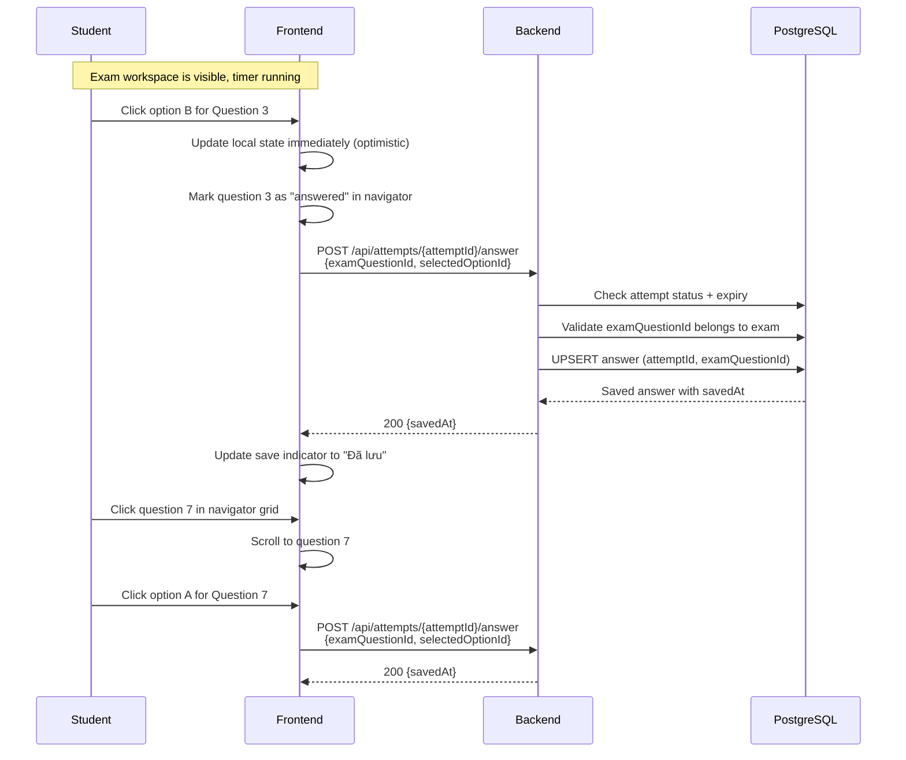
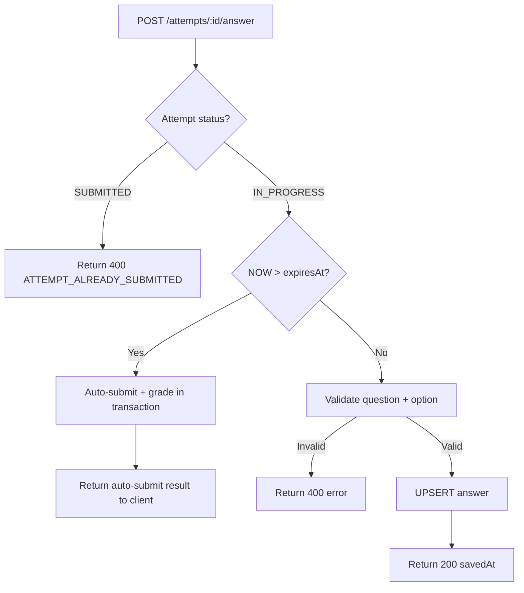

# E2. Answer Questions, Navigation, and Autosave

## 5.1 Feature Overview

| Field | Value |
|---|---|
| Feature ID | E2 |
| Feature Name | Answer Questions, Navigation, and Autosave |
| Module | E. Online Examination |
| Priority | P0 |
| Complexity | L |
| Status | Existing — fully implemented (backend + frontend) |
| Target Roles | STUDENT |
| Business Objective | Enable students to navigate exam questions, select answers, and have every answer automatically persisted server-side so that no work is lost due to network issues, browser crashes, or accidental navigation. |
| User Problem | Students risk losing their answers if the browser crashes, the network drops, or they accidentally close the tab. Autosave eliminates this risk by persisting each answer to the server as soon as it is selected. |
| Dependencies | E1 (Start Exam), D4 (Publish / Snapshot) |

## 5.2 Actors and Permissions

### Student

| Action | Allowed | Condition |
|---|---|---|
| View exam questions | Yes | Own IN_PROGRESS attempt only |
| Select / change answer | Yes | Attempt status is IN_PROGRESS AND `NOW() < expiresAt` |
| Navigate between questions | Yes | Always during attempt |
| View saved answers | Yes | Own attempt only |

### Teacher

| Action | Allowed | Condition |
|---|---|---|
| View student's answers during exam | **No** | Teachers see answers only after submission via review endpoint |

### Backend Authorization

- `POST /attempts/:id/answer` requires JWT with role STUDENT.
- Backend validates that `request.user.id === attempt.studentId`.
- Backend validates attempt is IN_PROGRESS and not expired (lazy check).
- Backend validates the `examQuestionId` belongs to the attempt's exam.
- Backend validates `selectedOptionId` exists in the question's `optionsSnapshot`.

## 5.3 Preconditions and Business Rules

| Rule ID | Rule | Enforcement |
|---|---|---|
| E2-BR-01 | Attempt must be in IN_PROGRESS status | Backend: check before save |
| E2-BR-02 | Attempt must not be expired (`NOW() < expiresAt`) | Backend: lazy expiry check triggers auto-submit if expired |
| E2-BR-03 | `examQuestionId` must belong to this attempt's exam | Backend: verify ExamQuestion.examId matches attempt.examId |
| E2-BR-04 | `selectedOptionId` must be a valid option ID from the question's `optionsSnapshot` | Backend: validate against JSONB data |
| E2-BR-05 | One answer per question per attempt — UPSERT semantics | Backend: unique constraint `(attemptId, examQuestionId)`, Prisma upsert |
| E2-BR-06 | Answer save is idempotent — saving the same answer twice produces the same result | Backend: upsert with same payload is a no-op |
| E2-BR-07 | `savedAt` is set to server `NOW()` on every save | Backend: updated in upsert |
| E2-BR-08 | Last-write-wins for the same question — no conflict resolution needed | By design: single student, single question, upsert |
| E2-BR-09 | Questions display from `contentSnapshot` and `optionsSnapshot` — never from the live question bank | Snapshot populated at publish time |
| E2-BR-10 | `isCorrect` must be stripped from `optionsSnapshot` before sending to the student | Backend: map over options and remove `isCorrect` in the response serializer |

## 5.4 Main User Flow — Happy Path



**Step-by-step:**

1. Student views the exam workspace with questions displayed from content snapshots.
2. Student clicks an answer option (A, B, C, or D).
3. Frontend immediately updates local state (optimistic UI) — the selected option shows as selected (blue tint + primary border).
4. Frontend sends `POST /api/attempts/{id}/answer` with `{examQuestionId, selectedOptionId}`.
5. Backend validates the attempt is active, the question belongs to the exam, and the option is valid.
6. Backend upserts into the `answers` table using the unique `(attemptId, examQuestionId)` constraint.
7. Backend returns `{savedAt}` timestamp.
8. Frontend updates the save status indicator.
9. Student can navigate to other questions via the question number grid at the top of the page.

### Question Navigator

- Grid of numbered buttons (1, 2, 3, ...) displayed in the sticky header bar.
- **Answered questions**: Primary blue background with white text.
- **Unanswered questions**: Outline/border style with neutral background.
- Clicking a number scrolls to that question (`#q-{id}` anchor with `scroll-mt-36`).
- Count display: "{answered}/{total} câu đã trả lời".

## 5.5 Alternative Flows

### AF-01: Student changes their answer

Student clicks a different option for a question they already answered. Frontend updates local state, sends new autosave request. Backend upserts, overwriting the previous `selectedOptionId`. The `savedAt` timestamp updates. No conflict — last write wins.

### AF-02: Student deselects an answer

Not currently supported in the UI. Once an option is selected, the student can only change it to another option, not remove it entirely. This is standard for MCQ exams.

### AF-03: Autosave request fails (network error)

Frontend fire-and-forget on the autosave call. If the request fails:
- The answer is still selected in local state (optimistic).
- The save indicator could show an error state.
- When the network recovers, the next answer change triggers a new save.
- If the student submits before recovery, the unsaved answer is lost — the server only knows what was persisted.

**Current implementation note:** The frontend `catch(() => {})` silently swallows autosave errors. See E2-OQ-01.

### AF-04: Shuffled question order

If `attempt.questionOrder` is set (shuffle enabled), the frontend should display questions in that order rather than by `position`. Current implementation does not explicitly reorder — this relies on the backend returning questions in the shuffled order.

### AF-05: Multiple question types

For MCQ / MCQ_MULTI / TRUE_FALSE, the student selects option(s). For SHORT_ANSWER / FILL_BLANK, the student types text. For ESSAY, the student writes long-form text. The answer payload varies:

| Type | `answerPayload` |
|---|---|
| MCQ | `{ selectedOptionId: "uuid" }` |
| MCQ_MULTI | `{ selectedOptionIds: ["uuid1", "uuid2"] }` |
| TRUE_FALSE | `{ selectedOptionId: "uuid" }` |
| SHORT_ANSWER | `{ text: "answer text" }` |
| FILL_BLANK | `{ text: "answer text" }` |
| ESSAY | `{ text: "long answer..." }` |

**Current implementation note:** The frontend only handles MCQ-style (single `selectedOptionId`). Multi-answer, text-based question UIs are not yet implemented.

## 5.6 Edge Cases and Failure Scenarios

| Scenario ID | Scenario | Trigger | Expected Behavior | User Feedback | Data Integrity | Recovery | Severity |
|---|---|---|---|---|---|---|---|
| E2-EC-01 | Autosave request arrives after attempt expired | Student selects answer at T-2s, network delay causes request to arrive at T+3s | Backend checks `NOW() > expiresAt`. Triggers lazy auto-submit. Returns 400 `ATTEMPT_EXPIRED` or auto-submits and returns result. | "Thời gian đã hết. Bài đã được tự động nộp." | Answer NOT saved (attempt already submitted). All previously saved answers are graded. | Attempt is submitted — student sees result | **Critical** |
| E2-EC-02 | Autosave requests arrive out of order | Student selects A, then quickly selects B. Request for B arrives before request for A. | Last-write-wins: the answer that arrives last overwrites. Due to upsert, `savedAt` reflects the most recent server timestamp. | Save indicator shows last confirmed save | The "final" answer is whatever the server processed last. This is correct behavior because the student's last interaction is what matters. | N/A — by design | **High** |
| E2-EC-03 | Student submits while autosave is pending | Student clicks Submit while an autosave POST is in flight | Submit uses `SELECT ... FOR UPDATE` on the attempt. If autosave completes first, the answer is saved before grading. If submit completes first, the pending autosave will fail (attempt status = SUBMITTED). | Score reflects all answers that were saved before the submit transaction completed | Potential for the last answer to be lost if submit races ahead of autosave | Student should save all answers before submitting. UI should warn if unsaved. | **Critical** |
| E2-EC-04 | examQuestionId does not belong to this exam | Malicious or buggy request sends a question ID from a different exam | Backend validates: load ExamQuestion, check `eq.examId === attempt.examId` | 400 error response | No answer saved | Client-side bug to fix | Medium |
| E2-EC-05 | selectedOptionId not in optionsSnapshot | Malicious request sends an option ID that doesn't exist in the snapshot | Backend validates against `optionsSnapshot` JSONB array | 400 error response | No answer saved | Client-side bug to fix | Medium |
| E2-EC-06 | Duplicate rapid clicks on same option | Student clicks the same option multiple times quickly | Frontend debounces or deduplicates. Backend upsert is idempotent — same payload = same result. | Single save indicator update | No duplicate rows (unique constraint) | Automatic | Low |
| E2-EC-07 | Very large essay answer | Student pastes 100KB of text into an essay field | Backend should validate `text.length <= 10000` (per spec). Frontend should enforce this limit with a character counter. | "Câu trả lời quá dài (tối đa 10,000 ký tự)" | Answer not saved if too long | Student shortens answer | Medium |
| E2-EC-08 | Browser crashes mid-exam | Browser process killed, power loss | All previously autosaved answers are safe in the database. Unsaved local-only answers are lost. | On resume: student sees previously saved answers; any unsaved changes are gone | Server-side answers intact | Resume via POST /attempts/start (returns existing attempt) | **High** |
| E2-EC-09 | Multiple tabs saving different answers to same question | Tab A selects option 1, Tab B selects option 2, both autosave | Last-write-wins. The tab that saves last determines the stored answer. No conflict detection. | Each tab shows its own selection locally, but the server has only one answer | No corruption — upsert is safe | Student should use one tab only. See E2-OQ-02. | High |
| E2-EC-10 | Network disconnected for extended period | WiFi drops for 5 minutes during exam | All answer selections during offline period are local only. When network returns, the next autosave persists the current local answer. Previous offline selections for other questions are lost unless retried. | No save confirmation during offline period | Only pre-disconnect answers are safe | See `resume-exam.md` for offline recovery. Current implementation has no offline queue. | **High** |
| E2-EC-11 | Server returns 500 on autosave | Database connection issue | Frontend should show save error state. Retry on next answer change. | Save indicator: error state or "Lỗi lưu" | Answer not persisted. Risk of data loss if student submits. | Network recovery + next answer action triggers retry | High |
| E2-EC-12 | Student answers all questions, then changes one | Normal flow — editing a previously answered question | Frontend updates local state, sends autosave for the changed question. Navigator maintains "answered" state for all questions. | Answer updated, navigator unchanged (already blue) | Previous answer overwritten by upsert | Automatic | Low |

## 5.7 UI/UX Specification

### Layout (Desktop)

```
┌──────────────────────────────────────────────────────────┐
│ STICKY HEADER BAR                                        │
│ [Exam Title]          [12/20 câu đã trả lời]   ⏱ 23:45 │
│                                           [Nộp bài]     │
│ [1][2][3][4][5][6][7][8][9][10]...[20]                  │
├──────────────────────────────────────────────────────────┤
│                                                          │
│  ┌─ Question Card ─────────────────────────────────────┐ │
│  │ Câu 1 (1 điểm)                                     │ │
│  │ Thủ đô của Việt Nam là gì?                          │ │
│  │                                                     │ │
│  │  ┌──────────────────────────────────────────────┐   │ │
│  │  │ (A) Hà Nội                         ● selected│   │ │
│  │  └──────────────────────────────────────────────┘   │ │
│  │  ┌──────────────────────────────────────────────┐   │ │
│  │  │ (B) TP Hồ Chí Minh                          │   │ │
│  │  └──────────────────────────────────────────────┘   │ │
│  └─────────────────────────────────────────────────────┘ │
│                                                          │
│  ┌─ Question Card ─────────────────────────────────────┐ │
│  │ Câu 2 (2 điểm)                                     │ │
│  │ ...                                                 │ │
│  └─────────────────────────────────────────────────────┘ │
│                                                          │
│  (scrollable question list with padding at bottom)       │
└──────────────────────────────────────────────────────────┘
```

### Layout (Mobile)

Same structure but:
- Question navigator wraps to multiple rows in the sticky header.
- Option buttons are full-width.
- 16px horizontal gutter.
- Timer and submit button in one line.

### Component States

**Answer Option (unselected):**
- Background: `surface` (neutral).
- Border: `border` (subtle).
- Text: `foreground`.
- Left: Circle with letter (A, B, C, D) in `input-border` circle.

**Answer Option (selected):**
- Background: `brand-primary/5` (very subtle blue tint).
- Border: `brand-primary` with `ring-1`.
- Text: `foreground`.
- Left: Letter circle with `brand-primary` background, white text.

**Answer Option (hover, not selected):**
- Background: `muted/50`.
- Border: unchanged.

**Question Navigator Button (answered):**
- Background: `brand-primary`.
- Text: white.

**Question Navigator Button (unanswered):**
- Background: `background`.
- Border: subtle.
- Text: `foreground`.

**Timer Badge:**
- Normal (> 60s remaining): `outline` variant, mono font.
- Low time (≤ 60s): `destructive` variant (red), with AlertTriangle icon.

**Save Indicator (proposed — not currently in UI):**
- Saving: spinner icon, "Đang lưu..."
- Saved: check icon, "Đã lưu" (fades after 2 seconds).
- Error: warning icon, "Lỗi lưu" (persists until next successful save).

### Accessibility

- All option buttons are `<button>` elements with keyboard focus.
- Selected state uses both color AND a radio indicator (filled circle).
- Low-time warning uses both red color AND an icon AND text.
- Question navigator buttons have sufficient contrast in both themes.

## 5.8 Data Requirements

### Existing Schema (no changes)

**Answer** — created/updated by autosave:

| Field | Type | Set At | Notes |
|---|---|---|---|
| id | UUID | Creation | PK |
| attemptId | UUID FK | Creation | References ExamAttempt |
| examQuestionId | UUID FK | Creation | References ExamQuestion |
| answerPayload | JSON | Creation / Update | `{selectedOptionId}` or `{text}` |
| feedback | String nullable | Later (teacher) | Not set during exam |
| savedAt | DateTime | Creation / Update | Server `NOW()` |

**Key constraint:** `UNIQUE(attemptId, examQuestionId)` — enables upsert semantics.

### No Schema Changes Required

The current schema fully supports all autosave operations for all question types via the flexible `answerPayload` JSON field.

## 5.9 API Requirements

### POST /api/attempts/:id/answer

| Field | Value |
|---|---|
| Method | POST |
| Endpoint | `/api/attempts/:id/answer` |
| Purpose | Save or update a student's answer to an exam question (autosave) |
| Required Role | STUDENT |
| Authentication | JWT Bearer token |

**Request Body:**

```json
{
  "examQuestionId": "uuid",
  "selectedOptionId": "uuid"
}
```

| Field | Type | Required | Validation |
|---|---|---|---|
| examQuestionId | UUID | Yes | Must belong to the attempt's exam |
| selectedOptionId | UUID | Yes (for MCQ) | Must exist in the question's `optionsSnapshot` |

**Note:** For text-based questions (SHORT_ANSWER, FILL_BLANK, ESSAY), the body would be `{ examQuestionId, text }` instead. The current implementation only supports `selectedOptionId`.

**Successful Response (200 OK):**

```json
{
  "success": true,
  "data": {
    "savedAt": "2026-11-11T10:15:30Z"
  }
}
```

**Error Responses:**

| Status | Code | Condition |
|---|---|---|
| 400 | `ATTEMPT_EXPIRED` | `NOW() > expiresAt` — triggers auto-submit |
| 400 | `ATTEMPT_ALREADY_SUBMITTED` | Attempt status is SUBMITTED |
| 400 | `INVALID_QUESTION` | examQuestionId does not belong to this exam |
| 400 | `INVALID_OPTION` | selectedOptionId not in optionsSnapshot |
| 403 | `NOT_ATTEMPT_OWNER` | JWT user is not the attempt's studentId |
| 401 | `UNAUTHORIZED` | Missing or invalid JWT |

**Idempotency:** Same payload = same result. The upsert overwrites with identical data, updating only `savedAt`. Safe for retries.

## 5.10 State Management

Answer saving does not change the attempt state — it remains IN_PROGRESS throughout.

However, the autosave endpoint performs a **lazy expiry check** on every call:



This means that an autosave request can trigger the transition `IN_PROGRESS → SUBMITTED` if the attempt has expired since the last request.

## 5.11 Acceptance Criteria

```gherkin
# Save answer
Given a student has an IN_PROGRESS attempt
When they POST /attempts/{id}/answer with {examQuestionId, selectedOptionId}
Then an answer row is created with the given payload
  And savedAt is approximately NOW (server time)
  And the response is 200 with {savedAt}

# Update answer (upsert)
Given a student has already saved an answer for question Q1 with option A
When they POST /attempts/{id}/answer with {Q1, option B}
Then the existing answer row is updated to option B
  And savedAt is updated
  And no duplicate answer row exists

# Idempotent save
Given a student saves the same answer twice (same question, same option)
When both requests complete
Then exactly one answer row exists
  And the second request returns 200 normally

# Cannot save after submit
Given an attempt with status SUBMITTED
When the student tries to save an answer
Then the response is 400 ATTEMPT_ALREADY_SUBMITTED

# Lazy expiry on autosave
Given an attempt where NOW > expiresAt but status is still IN_PROGRESS
When the student tries to save an answer
Then the attempt is auto-submitted and graded
  And the answer is NOT saved (attempt is now SUBMITTED)
  And the response indicates the attempt was auto-submitted

# Invalid question
Given an examQuestionId that belongs to a different exam
When the student tries to save an answer
Then the response is 400 INVALID_QUESTION

# Question navigator state
Given a student has answered 5 out of 20 questions
When they view the question navigator
Then 5 buttons are highlighted (primary blue)
  And 15 buttons are neutral
  And the count shows "5/20 câu đã trả lời"
```

## 5.12 QA Test Scenarios

| Test ID | Scenario | Preconditions | Steps | Test Data | Expected Result | Priority |
|---|---|---|---|---|---|---|
| E2-T01 | Save first answer | IN_PROGRESS attempt, no answers | POST answer for Q1 | Valid question + option | 200, answer row created | **Critical** |
| E2-T02 | Update existing answer | Answer exists for Q1 | POST answer for Q1 with different option | — | 200, answer updated, one row total | **Critical** |
| E2-T03 | Save to expired attempt | expiresAt in the past | POST answer | — | Auto-submit triggered, 400 or redirect | **Critical** |
| E2-T04 | Save to submitted attempt | status = SUBMITTED | POST answer | — | 400 ATTEMPT_ALREADY_SUBMITTED | **Critical** |
| E2-T05 | Invalid examQuestionId | Question from different exam | POST answer | Wrong question UUID | 400 INVALID_QUESTION | **High** |
| E2-T06 | Invalid selectedOptionId | Option not in snapshot | POST answer | Random UUID | 400 INVALID_OPTION | **High** |
| E2-T07 | Concurrent saves to different questions | Same attempt, parallel requests | POST 5 answers simultaneously for Q1..Q5 | — | All 5 saved, 5 answer rows | **High** |
| E2-T08 | Rapid same-question saves | Save Q1=A, then Q1=B, then Q1=C in 100ms | 3 sequential POSTs | — | Final answer is last-write (likely C), 1 row | **High** |
| E2-T09 | Another student's attempt | Valid question, wrong attempt | POST answer with different user's JWT | — | 403 NOT_ATTEMPT_OWNER | **High** |
| E2-T10 | Idempotent save | Save same question+option twice | 2 identical POSTs | — | Both return 200, 1 row in DB | Medium |
| E2-T11 | savedAt updates on each save | Save, wait 1s, save again | 2 POSTs | — | Second savedAt > first savedAt | Medium |
| E2-T12 | 50 questions answered | Exam with 50 questions | Save answer for each | — | 50 answer rows, all unique | Medium |

## 5.13 Open Questions and Assumptions

| # | Question | Why It Matters | Options | Recommended Default | Impact |
|---|---|---|---|---|---|
| E2-OQ-01 | Should the frontend show autosave status (saving/saved/error)? | Currently, autosave errors are silently swallowed. Students have no feedback on whether their answer was persisted. | A) Silent (current), B) Subtle indicator (saving/saved/error) | **B** — minimal indicator improves trust | Frontend-only change. Low effort. |
| E2-OQ-02 | Should multi-tab usage be detected and warned? | Two tabs can desynchronize local state. Last-write-wins is safe but confusing. | A) Ignore (current), B) Detect via localStorage heartbeat and warn | **B** — detect and warn "Bạn đang mở bài thi ở tab khác" | Frontend-only change. Medium effort. |
| E2-OQ-03 | Should there be an offline answer queue (localStorage)? | If network drops, currently answers are only in local React state and lost on refresh. | A) No queue (current), B) Queue in localStorage, sync on reconnect | **B** for production — prevents data loss | Frontend + backend sync logic. Medium effort. See `resume-exam.md`. |
| E2-OQ-04 | Should answer save use debounce or fire immediately? | Current implementation fires immediately on each option click. Rapid changes create many requests. | A) Immediate (current), B) Debounce 300ms | **A** for MCQ (saves are small). **B** for text-based answers. | Minimal impact either way for MCQ. |

### Assumptions

| # | Assumption | Basis |
|---|---|---|
| E2-A-01 | Last-write-wins is correct for a single-student attempt. No conflict resolution needed. | TECHNICAL_DECISIONS.md AD-07 |
| E2-A-02 | Autosave upsert is naturally idempotent via the unique constraint | TECHNICAL_DECISIONS.md AD-07 |
| E2-A-03 | The frontend only handles MCQ-style answers (single selectedOptionId) currently. Multi-answer and text-based question UIs need separate implementation. | Code review of take-exam page |
| E2-A-04 | Correct answers (isCorrect) are never sent to the client during an active attempt | Validated in API response serialization |
