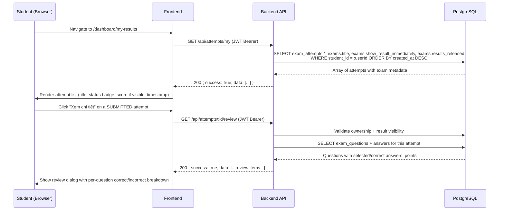
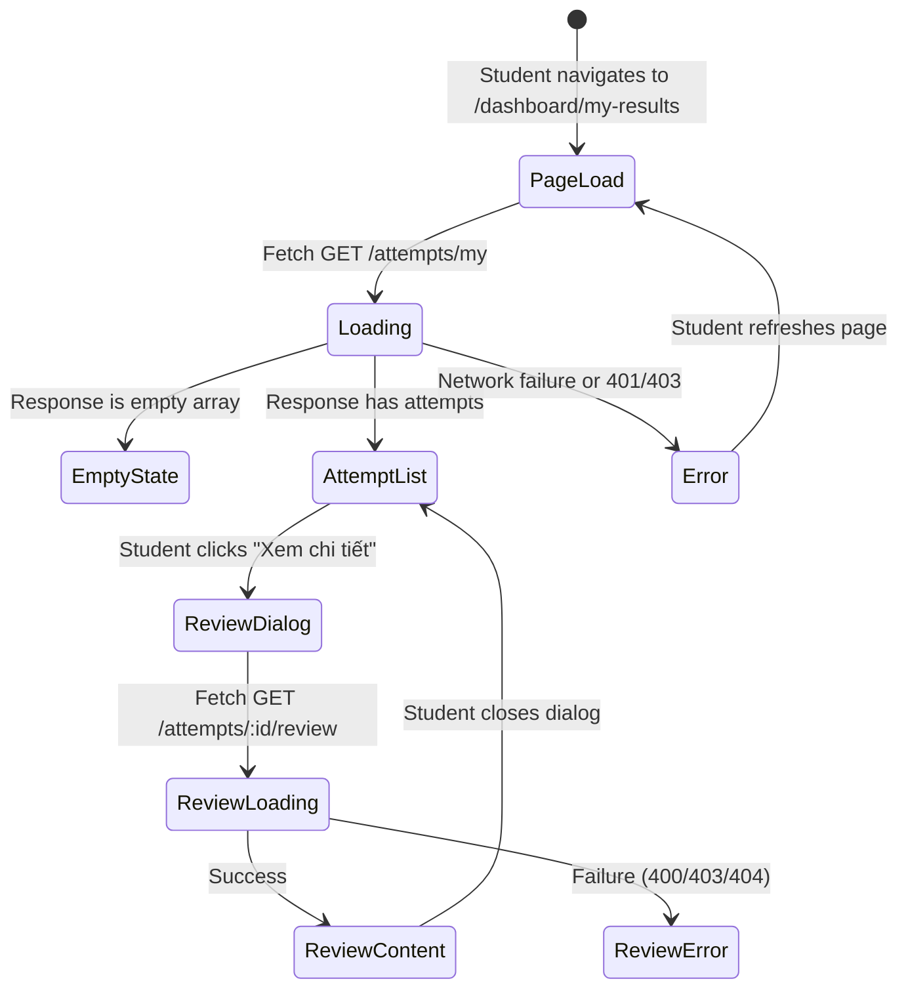

# E11. Exam History / Lịch sử làm bài

## 5.1 Feature Overview

| Field | Value |
|---|---|
| Feature ID | E11 |
| Feature Name | Exam History / Lịch sử làm bài |
| Module | E. Online Examination |
| Priority | P2 |
| Complexity | S |
| Status | Existing — fully implemented (backend + frontend) |
| Target Roles | STUDENT |
| Business Objective | Give students a single place to review all their past exam attempts — scores, statuses, and detailed answer review — so they can track their own progress and learn from mistakes. |
| User Problem | After finishing multiple exams across different classrooms, students need a consolidated view of every attempt and its outcome without navigating classroom by classroom. |
| Dependencies | E1 (Start Exam — creates the attempt), E3 (Submit Exam — grades and scores the attempt), G1 (Auto-Grading), G2 (Exam Results & Review — answer review endpoint), G5 (Result Visibility Control — showResultImmediately, resultsReleased) |

## 5.2 Actors and Permissions

### Student

| Action | Allowed | Condition |
|---|---|---|
| View own attempt list | Yes | Authenticated with role STUDENT |
| View score for a specific attempt | Yes | Attempt belongs to the student AND result visibility is satisfied (E11-BR-03) |
| View detailed answer review for a specific attempt | Yes | Attempt status is SUBMITTED AND result visibility is satisfied (E11-BR-03) |

### Teacher

| Action | Allowed | Condition |
|---|---|---|
| View student exam history via this endpoint | **No** | `GET /attempts/my` is STUDENT-only. Teachers view student results via `GET /attempts?examId=` or `GET /attempts/:id/review`. |

### Backend Authorization

- `GET /api/attempts/my` requires a valid JWT with role STUDENT (enforced by `@Roles('STUDENT')`).
- `GET /api/attempts/:id/review` requires a valid JWT. For STUDENT role, it enforces `attempt.studentId === userId` AND result visibility. For TEACHER role, it enforces `attempt.exam.ownerId === userId`.
- All authorization is server-side. The frontend hides UI elements for visual clarity, but the backend is the enforcement point.

## 5.3 Preconditions and Business Rules

| Rule ID | Rule | Enforcement |
|---|---|---|
| E11-BR-01 | The student must be authenticated with a valid JWT and role STUDENT to access `GET /attempts/my` | Backend: `JwtAuthGuard` + `@Roles('STUDENT')` |
| E11-BR-02 | The endpoint returns only attempts belonging to the authenticated student (`studentId = JWT user id`). A student can never see another student's attempts through this endpoint. | Backend: `findMany({ where: { studentId } })` |
| E11-BR-03 | A student can see their score for a SUBMITTED attempt only when `exam.showResultImmediately === true` OR `exam.resultsReleased === true`. If neither is true, the score is hidden from the list and the "Xem chi tiết" button is not shown. | Backend: score is always returned in the payload (visibility filtering is frontend). Frontend: checks `canSeeResults` before rendering score and review link. **Note:** The backend currently returns the score unconditionally in the list; visibility is enforced at the frontend layer for the list view, and at the backend layer for the review endpoint (`GET /attempts/:id/review`). |
| E11-BR-04 | Attempts are ordered by `createdAt` descending (most recent first) | Backend: `orderBy: { createdAt: 'desc' }` |
| E11-BR-05 | IN_PROGRESS attempts are included in the history list. They show status "Đang làm" with no score. | Backend: no status filter on the query. Frontend: displays "Đang làm" badge. |
| E11-BR-06 | If an IN_PROGRESS attempt has expired (`NOW() > expiresAt`), the list endpoint does NOT auto-submit it. Lazy expiry is triggered only on attempt-specific endpoints (`GET /attempts/:id`, `POST /attempts/:id/submit`, `POST /attempts/start`). The list may therefore show stale IN_PROGRESS status for expired attempts until the student navigates into one. | Backend: `getMyAttempts` performs no expiry check (verified in implementation). Frontend: displays the status as-is. |
| E11-BR-07 | The detailed answer review (`GET /attempts/:id/review`) returns all exam questions with the student's selected answer, the correct answer, points earned, and per-answer feedback. It is only accessible for SUBMITTED attempts where result visibility is satisfied. | Backend: `getAnswerReview` checks `showResultImmediately \|\| resultsReleased` for STUDENT role; throws `400 Results not available yet` if neither is true. |
| E11-BR-08 | Score is displayed in `X.X / 10` format (one decimal place). The raw score is `Decimal(10,2)` in the database, formatted with `toFixed(1)` on the frontend. | Frontend: `Number(a.score).toFixed(1)` |
| E11-BR-09 | Teacher-provided attempt-level feedback (if any) is displayed below the attempt card. | Frontend: renders `a.feedback` if non-null. |
| E11-BR-10 | Each exam title in the list comes from `exam.title` via the relation join. If an exam is deleted, the attempt row still exists but the title may be null (depending on cascade rules). Currently, `Exam` deletion is not cascading to `ExamAttempt` — no ON DELETE CASCADE in the schema — so the exam must exist. | Backend: `include: { exam: { select: { title: true, ... } } }` |

## 5.4 Main User Flow — Happy Path



**Step-by-step:**

1. Student navigates to `/dashboard/my-results` from the sidebar.
2. Frontend calls `GET /api/attempts/my` with the JWT Bearer token.
3. Backend queries all `ExamAttempt` rows where `studentId` matches the JWT user id, joined with `Exam` for title and visibility flags, ordered by `createdAt DESC`.
4. Frontend renders a card for each attempt showing: exam title, status badge ("Đã nộp" or "Đang làm"), score (if SUBMITTED and visibility allows), start time, and teacher feedback (if any).
5. For SUBMITTED attempts with visible results, a "Xem chi tiết" button is shown.
6. Student clicks "Xem chi tiết".
7. Frontend opens a dialog and calls `GET /api/attempts/:id/review`.
8. Backend validates that the student owns the attempt and that results are visible.
9. Backend loads all `ExamQuestion` rows for the exam, maps each to the student's answer, computes correctness, and returns the review array.
10. Frontend renders each question with: content, options highlighted (green for correct, red for incorrect selection), earned/total points badge, and per-answer feedback if present.

## 5.5 Alternative Flows

### AF-01: Student has no attempts

If the student has never started any exam, `GET /attempts/my` returns an empty array. The frontend shows the empty state: "Chưa có kết quả nào" in a dashed-border container.

### AF-02: Score hidden by teacher

If `exam.showResultImmediately === false` AND `exam.resultsReleased === false` for a particular attempt:
- The list card shows the exam title and status badge but **no score**.
- The "Xem chi tiết" button is **not rendered**.
- If the student manually calls `GET /attempts/:id/review`, the backend returns `400` with message "Results not available yet".

### AF-03: Student clicks into an IN_PROGRESS attempt

The list shows IN_PROGRESS attempts with the "Đang làm" badge. No score is shown (score is null for IN_PROGRESS attempts). No "Xem chi tiết" button appears because `status !== 'SUBMITTED'` fails the `canSeeResults && a.status === 'SUBMITTED'` condition.

If the student wants to continue the attempt, they must navigate to the exam-taking page separately (e.g., via the assignments list). The history page is read-only.

### AF-04: Results released after student already viewed the list

If the teacher releases results (`resultsReleased = true`) after the student loaded the page, the student must refresh the page to see the updated visibility. There is no real-time push. The frontend fetches the full list on every page mount.

### AF-05: Multiple attempts for the same exam

If `exam.maxAttempts > 1`, the student may have multiple attempts for the same exam. All attempts are listed individually, each with its own score, status, and timestamp. They are not grouped by exam — each is a separate card in reverse chronological order.

## 5.6 Edge Cases and Failure Scenarios

| Scenario ID | Scenario | Trigger | Expected Behavior | User Feedback | Data Integrity | Recovery | Severity |
|---|---|---|---|---|---|---|---|
| E11-EC-01 | Network error loading attempt list | API unreachable or timeout | Frontend fetch fails in the catch block | Currently silent — loading spinner disappears, empty state may show. **Gap**: no error message displayed. | No data change | Student refreshes the page | Medium |
| E11-EC-02 | JWT expired during page view | Access token expires between page load and "Xem chi tiết" click | `GET /attempts/:id/review` returns 401. Frontend should redirect to login. | Depends on global auth interceptor behavior | No data change | Re-login and return | Low |
| E11-EC-03 | Attempt's exam deleted after attempt was created | Admin or teacher deletes exam via direct DB manipulation | `exam` relation will fail — Prisma join returns null. Backend may throw if not handled. Currently no ON DELETE CASCADE from Exam to ExamAttempt. | 500 error if exam relation is null | Attempt data preserved, exam data lost | Teacher should not delete exams with attempts. Add ON DELETE RESTRICT or handle null exam in query. | Medium |
| E11-EC-04 | Very large number of attempts (no pagination) | Student takes hundreds of exams over time | `GET /attempts/my` returns all attempts in one response. No pagination implemented. | Slow page load, large payload | No data issue | At ~100 concurrent users, unlikely to exceed a few hundred attempts per student. Acceptable for MVP. | Low |
| E11-EC-05 | IN_PROGRESS attempt that has expired appears as "Đang làm" | Student abandoned an attempt, time expired, no subsequent request triggered lazy expiry | List shows stale "Đang làm" status (per E11-BR-06). Score is null. | Visually misleading — student may think exam is still in progress | No data corruption — lazy expiry will correct on next access to that specific attempt | Student clicks into the attempt (triggering auto-submit), or starts a new attempt for the same exam (which triggers expiry check) | Low |
| E11-EC-06 | Score shows as null for SUBMITTED attempt | Grading bug — attempt was submitted but score not calculated | Score field is null. Frontend `canSeeResults` check passes but `a.score != null` guard prevents display. | No score shown despite "Đã nộp" status | Possible data inconsistency | Teacher regrades or manually overrides score | Medium |
| E11-EC-07 | Review endpoint called for IN_PROGRESS attempt | Student crafts manual API request | Backend does not explicitly block review for IN_PROGRESS status. It only checks result visibility (`showResultImmediately \|\| resultsReleased`). If visibility is true, review data would be returned for an in-progress attempt — potentially showing correct answers while the exam is still active. | Correct answers visible during active exam | **Security concern**: student could see correct answers mid-exam | Backend should add status check: `attempt.status !== 'SUBMITTED'` → 400 | **High** |
| E11-EC-08 | Manual score override shows different score than auto-graded | Teacher overrides score via `PATCH /attempts/:id/score` | List shows the overridden score (the `score` field is updated in place). This is correct behavior. | Score shown is the teacher-overridden value | Consistent — `manualScoreOverride` flag tracks this | None needed | Low |

## 5.7 UI/UX Specification

### Page Location

- Route: `/dashboard/my-results`
- Sidebar label: "Kết quả của tôi"
- Accessible to: STUDENT role only

### Page Layout

- **Header**: `<h1>` "Kết quả của tôi" (text-2xl, font-bold)
- **List**: Vertical stack of Card components with `space-y-3` gap

### Attempt Card

Each attempt is rendered as a `Card` with:

- **Header row** (flex, space-between):
  - Left: Exam title (`CardTitle`, text-base)
  - Right: Status badge
    - SUBMITTED → `<Badge variant="default">Đã nộp</Badge>`
    - IN_PROGRESS → `<Badge variant="secondary">Đang làm</Badge>`

- **Content row** (flex, gap-4, text-sm):
  - Score (if SUBMITTED and result visibility allows):
    - `<BarChart3>` icon + `"X.X / 10"` in font-bold, text-primary
  - Start time:
    - `<Clock>` icon + `startedAt` formatted with `toLocaleString('vi-VN')`
  - "Xem chi tiết" button (if SUBMITTED and result visibility allows):
    - `<Button variant="outline" size="sm">` with `<Eye>` icon

- **Feedback** (if present):
  - Italic, text-sm, text-muted-foreground: `"Nhận xét: {feedback}"`

### Empty State

When `attempts.length === 0`:
- Centered text "Chưa có kết quả nào"
- Styled: `rounded-lg border border-dashed p-12 text-center text-muted-foreground`

### Loading State

- Centered spinner (h-8, w-8, border-4, border-primary with transparent top border)
- Displayed while the initial fetch is in flight

### Review Dialog

Triggered by "Xem chi tiết" button. Uses shadcn `Dialog` component.

- **Size**: `max-w-2xl`, `max-h-[85vh]` with vertical scroll
- **Header**: `"Chi tiết: {examTitle}"`
- **Content**: Vertical list of question review items:
  - Each item in a `rounded-lg border p-3` container
  - **Question header**: "Câu {position}: {content}" + badge showing `{earnedPoints}/{points}`
    - Badge color: `variant="default"` if correct, `variant="destructive"` if incorrect
  - **Options list**: Each option row shows:
    - Green background (`bg-green-500/10`) if it is the correct answer
    - Red background (`bg-red-500/10`) if it was selected but wrong
    - Check icon (green) for correct answer
    - X icon (red) for incorrect selection
    - Faded check for correct answer that was not selected
  - **Feedback** (if present per answer): Italic, text-xs

### Responsive Behavior

- Cards are full-width on all screen sizes
- Dialog maxes at `max-w-2xl` on desktop; full-width with standard gutter on mobile
- No horizontal scroll

## 5.8 Data Requirements

### Existing Schema (no changes required)

This feature reads from existing tables only. No new tables, columns, or indexes are needed.

**ExamAttempt** — read by this feature:

| Field | Type | Used By | Notes |
|---|---|---|---|
| id | UUID | List + Review link | PK, used to navigate to review |
| examId | UUID FK | Review query | Join to Exam |
| studentId | UUID FK | Authorization filter | `WHERE studentId = :jwtUserId` |
| startedAt | DateTime | List display | Displayed as formatted timestamp |
| submittedAt | DateTime | — | Available but not displayed in current UI |
| status | AttemptStatus | List display | Badge text: "Đã nộp" / "Đang làm" |
| score | Decimal(10,2) | List display | Formatted as `X.X / 10` |
| feedback | String nullable | List display | Teacher's attempt-level feedback |
| createdAt | DateTime | Ordering | `ORDER BY created_at DESC` |

**Exam** — joined for metadata:

| Field | Type | Used By | Notes |
|---|---|---|---|
| title | String | List display | Exam name on card header |
| showResultImmediately | Boolean | Visibility logic | Frontend `canSeeResults` check |
| resultsReleased | Boolean | Visibility logic | Frontend `canSeeResults` check |

**ExamQuestion** — read by review endpoint:

| Field | Type | Used By | Notes |
|---|---|---|---|
| contentSnapshot | String | Review display | Question text |
| optionsSnapshot | Json | Review display | Array of `{ id, content, isCorrect }` |
| points | Int | Review display | Max points per question |
| position | Int | Review display | Question ordering and label |

**Answer** — read by review endpoint:

| Field | Type | Used By | Notes |
|---|---|---|---|
| examQuestionId | String FK | Review mapping | Maps answer to question |
| answerPayload | Json | Review display | `{ selectedOptionId }` |
| feedback | String nullable | Review display | Per-answer teacher feedback |

### Indexes (existing, sufficient)

- `exam_attempts(student_id)` — used by `getMyAttempts` WHERE clause
- `exam_attempts(exam_id, student_id)` — used by related queries

### Proposed Schema Changes

None.

## 5.9 API Requirements

### GET /api/attempts/my

| Field | Value |
|---|---|
| Method | GET |
| Endpoint | `/api/attempts/my` |
| Purpose | Return all exam attempts for the authenticated student |
| Required Role | STUDENT |
| Authentication | JWT Bearer token |

**Request:** No body. No query parameters.

**Successful Response (200 OK):**

```json
{
  "success": true,
  "data": [
    {
      "id": "attempt-uuid",
      "examId": "exam-uuid",
      "studentId": "student-uuid",
      "assignmentId": "assignment-uuid",
      "startedAt": "2026-11-10T14:00:00Z",
      "expiresAt": "2026-11-10T14:45:00Z",
      "submittedAt": "2026-11-10T14:40:00Z",
      "status": "SUBMITTED",
      "score": "8.50",
      "manualScoreOverride": false,
      "feedback": "Làm tốt lắm!",
      "questionOrder": null,
      "createdAt": "2026-11-10T14:00:00Z",
      "exam": {
        "title": "Kiểm tra giữa kỳ Toán 12",
        "showResultImmediately": true,
        "resultsReleased": false
      }
    },
    {
      "id": "attempt-uuid-2",
      "examId": "exam-uuid-2",
      "studentId": "student-uuid",
      "assignmentId": null,
      "startedAt": "2026-11-09T10:00:00Z",
      "expiresAt": "2026-11-09T10:30:00Z",
      "submittedAt": null,
      "status": "IN_PROGRESS",
      "score": null,
      "manualScoreOverride": false,
      "feedback": null,
      "questionOrder": ["eq-1", "eq-3", "eq-2"],
      "createdAt": "2026-11-09T10:00:00Z",
      "exam": {
        "title": "Bài kiểm tra Vật lý",
        "showResultImmediately": false,
        "resultsReleased": false
      }
    }
  ]
}
```

**Note:** The response includes all attempt fields returned by Prisma, including `questionOrder` and `manualScoreOverride`. The frontend uses only the fields it needs.

**Error Responses:**

| Status | Code | Condition |
|---|---|---|
| 401 | `UNAUTHORIZED` | Invalid or missing JWT |
| 403 | — | JWT role is not STUDENT (RolesGuard) |

### GET /api/attempts/:id/review (used by this feature)

| Field | Value |
|---|---|
| Method | GET |
| Endpoint | `/api/attempts/:id/review` |
| Purpose | Return detailed answer review for a submitted attempt |
| Required Role | STUDENT or TEACHER |
| Authentication | JWT Bearer token |

**Path Parameters:**

| Param | Type | Description |
|---|---|---|
| id | UUID | Attempt ID |

**Successful Response (200 OK):**

```json
{
  "success": true,
  "data": [
    {
      "position": 1,
      "content": "Thủ đô của Việt Nam là?",
      "options": [
        { "id": "opt-1", "content": "Hà Nội" },
        { "id": "opt-2", "content": "TP HCM" },
        { "id": "opt-3", "content": "Đà Nẵng" },
        { "id": "opt-4", "content": "Huế" }
      ],
      "correctOptionId": "opt-1",
      "selectedOptionId": "opt-1",
      "isCorrect": true,
      "points": 1,
      "earnedPoints": 1,
      "feedback": null
    }
  ]
}
```

**Error Responses:**

| Status | Code | Condition |
|---|---|---|
| 400 | — | `Results not available yet` — student requesting review when `showResultImmediately === false` AND `resultsReleased === false` |
| 401 | `UNAUTHORIZED` | Invalid or missing JWT |
| 403 | — | Student requesting review for another student's attempt, or teacher requesting review for an exam they don't own |
| 404 | `NOT_FOUND` | Attempt with given ID does not exist |

## 5.10 State Management

This feature is read-only. It does not change any database state.



**Frontend State:**

| State Variable | Type | Initial | Description |
|---|---|---|---|
| `attempts` | `MyAttempt[]` | `[]` | Full list of student's attempts |
| `loading` | `boolean` | `true` | True while initial fetch is in flight |
| `open` (per dialog) | `boolean` | `false` | Whether the review dialog is open |
| `review` (per dialog) | `ReviewItem[]` | `[]` | Review data for the open dialog |
| `loading` (per dialog) | `boolean` | `false` | True while review fetch is in flight |

**No server-side state changes.** The feature only reads from `ExamAttempt`, `Exam`, `ExamQuestion`, and `Answer` tables.

## 5.11 Acceptance Criteria

```gherkin
# Happy path — list with submitted attempt
Given a STUDENT has 2 exam attempts: one SUBMITTED (score 8.5) and one IN_PROGRESS
When the student navigates to /dashboard/my-results
Then both attempts appear in the list, most recent first
  And the SUBMITTED attempt shows exam title, "Đã nộp" badge, "8.5 / 10" score, and start time
  And the IN_PROGRESS attempt shows exam title, "Đang làm" badge, no score, and start time

# Empty state
Given a STUDENT has never started any exam
When the student navigates to /dashboard/my-results
Then the page shows "Chưa có kết quả nào"
  And no attempt cards are rendered

# Score hidden when results not released
Given a STUDENT has a SUBMITTED attempt for an exam with showResultImmediately = false AND resultsReleased = false
When the student views the history list
Then the attempt card shows the title and "Đã nộp" badge but no score
  And the "Xem chi tiết" button is not rendered

# Score visible with showResultImmediately
Given a STUDENT has a SUBMITTED attempt for an exam with showResultImmediately = true
When the student views the history list
Then the score is displayed as "X.X / 10"
  And the "Xem chi tiết" button is rendered

# Score visible after teacher releases results
Given a STUDENT has a SUBMITTED attempt for an exam with showResultImmediately = false AND resultsReleased = true
When the student views the history list
Then the score is displayed
  And the "Xem chi tiết" button is rendered

# View detailed review
Given a STUDENT clicks "Xem chi tiết" on a SUBMITTED attempt with visible results
When the review dialog opens
Then each question shows: question text, options with correct/incorrect highlighting, earned/total points
  And correctly answered questions show a green check mark
  And incorrectly answered questions show a red X mark
  And the correct answer is highlighted in green regardless of selection

# Teacher feedback displayed
Given a teacher has provided attempt-level feedback "Làm tốt lắm!"
When the student views the history list
Then "Nhận xét: Làm tốt lắm!" appears below the attempt card content

# Authorization — student cannot see other student's attempts
Given student A and student B each have attempts
When student A calls GET /attempts/my
Then only student A's attempts are returned

# Authorization — teacher cannot access student history endpoint
Given a TEACHER user
When they call GET /api/attempts/my
Then the response is 403

# Authorization — review blocked when results not visible
Given a STUDENT has a SUBMITTED attempt for an exam with showResultImmediately = false AND resultsReleased = false
When the student calls GET /api/attempts/:id/review
Then the response is 400 "Results not available yet"
```

## 5.12 QA Test Scenarios

| Test ID | Scenario | Preconditions | Steps | Test Data | Expected Result | Priority |
|---|---|---|---|---|---|---|
| E11-T01 | Happy path — list with multiple attempts | Student has 3 SUBMITTED attempts for different exams | GET /attempts/my | Valid student JWT | 200, array of 3 attempts ordered by createdAt DESC | **Critical** |
| E11-T02 | Empty list | Student has zero attempts | GET /attempts/my | Valid student JWT | 200, empty array | **High** |
| E11-T03 | Score visible (showResultImmediately) | SUBMITTED attempt, exam.showResultImmediately=true | GET /attempts/my | — | Attempt in response has non-null score | **High** |
| E11-T04 | Score returned even when not released | SUBMITTED attempt, showResultImmediately=false, resultsReleased=false | GET /attempts/my | — | Score IS in the response payload (backend returns it; frontend hides it). Verify frontend does not display it. | **High** |
| E11-T05 | Review accessible when results visible | SUBMITTED attempt, showResultImmediately=true | GET /attempts/:id/review | Student JWT matching attempt | 200, array of review items | **Critical** |
| E11-T06 | Review blocked when results not visible | SUBMITTED attempt, showResultImmediately=false, resultsReleased=false | GET /attempts/:id/review | Student JWT matching attempt | 400 "Results not available yet" | **Critical** |
| E11-T07 | Review accessible after resultsReleased | SUBMITTED attempt, showResultImmediately=false, resultsReleased=true | GET /attempts/:id/review | Student JWT matching attempt | 200, review data returned | **High** |
| E11-T08 | IN_PROGRESS attempt in list | Student has IN_PROGRESS attempt | GET /attempts/my | — | Attempt has status "IN_PROGRESS", score is null | **High** |
| E11-T09 | Another student's attempts not visible | Student A has attempts, student B has attempts | GET /attempts/my as student A | Student A JWT | Only student A's attempts returned | **Critical** |
| E11-T10 | Teacher cannot access /attempts/my | Teacher user | GET /attempts/my | Teacher JWT | 403 Forbidden | **High** |
| E11-T11 | Student cannot review another student's attempt | Student A has attempt, student B tries to review it | GET /attempts/:attemptA/review as student B | Student B JWT | 403 Forbidden | **Critical** |
| E11-T12 | Review shows correct/incorrect per question | SUBMITTED attempt with 3 correct and 2 incorrect answers | GET /attempts/:id/review | — | Each item has correct `isCorrect`, `earnedPoints`, `correctOptionId`, `selectedOptionId` | **High** |
| E11-T13 | Unanswered question in review | Student did not answer 1 question | GET /attempts/:id/review | — | That question's `selectedOptionId` is null, `isCorrect` is false, `earnedPoints` is 0 | **Medium** |
| E11-T14 | Manual score override reflected | Teacher overrode score to 9.0 (auto-graded was 7.5) | GET /attempts/my | Student JWT | Attempt shows score "9.00" (the overridden value) | **Medium** |
| E11-T15 | Multiple attempts for same exam | maxAttempts=3, student has 3 SUBMITTED attempts | GET /attempts/my | — | All 3 attempts listed individually with their own scores | **Medium** |
| E11-T16 | Ordering is most recent first | Student has attempts at various times | GET /attempts/my | — | First item in array has the latest `createdAt` | **Medium** |
| E11-T17 | Teacher feedback displayed | Teacher added feedback "Cần cải thiện" to an attempt | GET /attempts/my | Student JWT | Attempt has `feedback: "Cần cải thiện"` | **Medium** |
| E11-T18 | Per-answer feedback in review | Teacher added feedback on a specific answer | GET /attempts/:id/review | Student JWT | Matching review item has non-null `feedback` | **Low** |

## 5.13 Open Questions and Assumptions

### Open Questions

| # | Question | Why It Matters | Options | Recommended Default | Impact | Blocks Implementation? |
|---|---|---|---|---|---|---|
| E11-OQ-01 | Should `GET /attempts/my` support pagination? | Currently returns all attempts. For long-term use, a student with many exams could accumulate hundreds of attempts. | (A) No pagination — return all (current). (B) Add offset-based pagination matching AD-10 (`?page=1&limit=20`). | **A** for MVP — at ~100 users, attempt counts will stay small. Add pagination when needed. | Low. Frontend already renders all. | No |
| E11-OQ-02 | Should the backend enforce result visibility on the list endpoint (strip `score` from attempts where results are not visible)? | Currently, `GET /attempts/my` returns the score unconditionally. The frontend hides it based on visibility flags. A student could inspect the network response and see their score before the teacher releases results. | (A) Frontend-only enforcement (current). (B) Backend strips score when `!showResultImmediately && !resultsReleased`. | **B** — backend should strip score for security. This is a minor code change: conditionally set `score: null` in the response mapping. | Medium. Affects data leakage risk. | No — current behavior is functional, but B is recommended before production. |
| E11-OQ-03 | Should the review endpoint (`GET /attempts/:id/review`) check that the attempt status is SUBMITTED before returning correct answers? | Currently it only checks result visibility, not attempt status. An IN_PROGRESS attempt with `showResultImmediately=true` would expose correct answers via the review endpoint (E11-EC-07). | (A) No status check (current). (B) Add `attempt.status !== 'SUBMITTED'` → 400 guard. | **B** — must not expose correct answers during an active attempt. | **High**. Security issue. | No for spec, but should be fixed before production. |
| E11-OQ-04 | Should expired-but-not-yet-auto-submitted attempts be auto-submitted when the list is fetched? | Currently `getMyAttempts` does not trigger lazy expiry (E11-BR-06). This means stale IN_PROGRESS statuses appear in the list. | (A) No expiry check on list (current). (B) Iterate attempts and auto-submit expired ones before returning. | **A** — performing auto-submit on a list endpoint adds latency and transactional complexity. Lazy expiry on per-attempt endpoints is sufficient. | Low. Cosmetic issue. | No |
| E11-OQ-05 | Should there be a filter or search on the history list (by exam name, date range, status)? | As attempt count grows, findability becomes an issue. | (A) No filter (current). (B) Add status filter. (C) Add search by exam title + status filter. | **A** for MVP — small data set. | Low. UX enhancement. | No |

### Assumptions

| # | Assumption | Basis |
|---|---|---|
| E11-A-01 | The student history page is read-only — it does not modify any data or trigger any state transitions | Verified: `getMyAttempts` is a pure SELECT query |
| E11-A-02 | Score is always displayed as `X.X / 10` format with one decimal place | Verified: frontend uses `Number(a.score).toFixed(1)` |
| E11-A-03 | The review dialog fetches data on every open (no client-side cache) | Verified: `useEffect` triggers on `open` change |
| E11-A-04 | `submittedAt` is available in the list response but the frontend displays `startedAt` as the timestamp, not `submittedAt` | Verified: frontend uses `a.startedAt` in the time display |
| E11-A-05 | `EXPIRED` status in the `AttemptStatus` enum is vestigial — per AD-11, expired attempts transition directly to SUBMITTED. The frontend only needs to handle IN_PROGRESS and SUBMITTED. | Per `docs/TECHNICAL_DECISIONS.md` AD-11 CONFIRMED |
| E11-A-06 | There is no real-time update mechanism — the list is fetched once on page mount and does not auto-refresh | Verified: single `useEffect` with `fetchAttempts` on mount |
