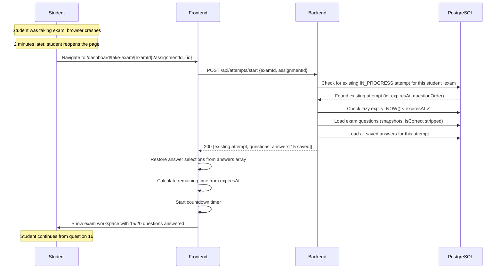
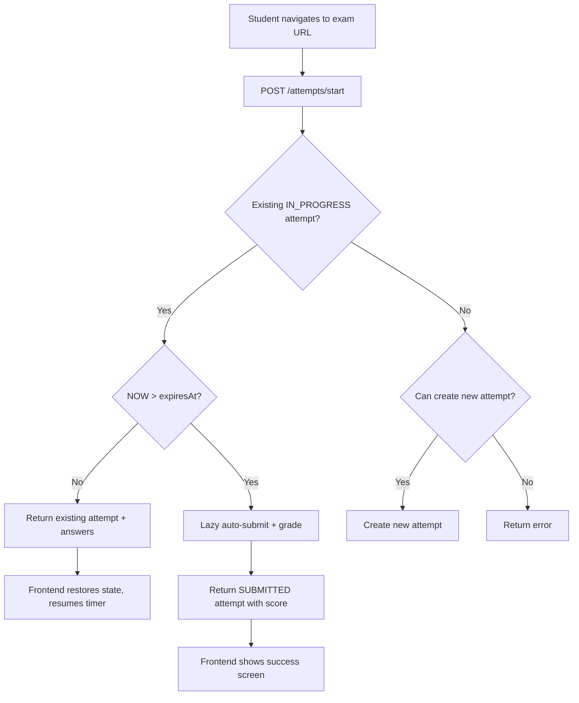

# E4. Resume Exam After Disconnection / Browser Refresh

## 5.1 Feature Overview

| Field | Value |
|---|---|
| Feature ID | E4 |
| Feature Name | Resume Exam After Disconnection |
| Module | E. Online Examination |
| Priority | P0 (basic resume) / P2 (localStorage queue) |
| Complexity | M (basic) / L (with offline queue) |
| Status | Partially implemented — basic resume via idempotent start works. No offline answer queue. |
| Target Roles | STUDENT |
| Business Objective | Ensure that a student who experiences a browser refresh, crash, navigation away, or network disconnection can safely return to their exam and continue from where they left off with all previously server-saved answers intact. |
| User Problem | Students lose connectivity or accidentally close their browser during an exam. Without reliable resume, they would lose their progress and potentially their entire attempt. |
| Dependencies | E1 (Start Exam — idempotent start), E2 (Autosave) |

## 5.2 Actors and Permissions

### Student

| Action | Allowed | Condition |
|---|---|---|
| Resume an IN_PROGRESS attempt | Yes | Navigate back to the exam URL and call POST /attempts/start |
| See previously saved answers | Yes | Returned in the start response |
| Continue answering | Yes | If attempt is still IN_PROGRESS and not expired |
| Resume an expired attempt | Partially | If `NOW() > expiresAt`, lazy expiry triggers auto-submit. Student sees result, not exam workspace. |

### Backend Behavior

- `POST /attempts/start` is the resume mechanism. It returns the existing IN_PROGRESS attempt if one exists (idempotent).
- No separate "resume" endpoint is needed. The start endpoint handles both creation and resume.
- All previously autosaved answers are included in the response.

## 5.3 Preconditions and Business Rules

| Rule ID | Rule | Enforcement |
|---|---|---|
| E4-BR-01 | Resume uses the same `POST /attempts/start` endpoint as initial start — idempotent | Backend: check for existing IN_PROGRESS attempt before creating |
| E4-BR-02 | All server-saved answers are restored on resume | Backend: include `answers[]` in the start response |
| E4-BR-03 | Timer resumes from the original `expiresAt` — no time extension on resume | Backend: `expiresAt` is immutable once set |
| E4-BR-04 | Answers saved only in local state (not yet autosaved) are lost on browser refresh/crash | By design: server is source of truth |
| E4-BR-05 | If the attempt expired during disconnection, lazy expiry auto-submits on resume | Backend: E1/E3 lazy expiry mechanism |
| E4-BR-06 | Question order is preserved on resume (`questionOrder` is stored in the attempt) | Backend: same `questionOrder` returned on resume |
| E4-BR-07 | Multiple resumes do not create multiple attempts | Backend: idempotent start |

## 5.4 Main User Flow — Happy Path



**Step-by-step:**

1. Student's browser crashed/refreshed/navigated away during exam.
2. Student navigates back to `/dashboard/take-exam/{examId}?assignmentId={id}`.
3. Frontend calls `POST /api/attempts/start` with the same exam ID.
4. Backend finds the existing IN_PROGRESS attempt (idempotent start).
5. Backend checks lazy expiry — if still within time, returns the attempt.
6. Response includes all previously saved answers.
7. Frontend rebuilds local state from the answers array:
   ```javascript
   const savedAnswers = {};
   data.answers?.forEach((a) => {
     savedAnswers[a.examQuestionId] = a.answerPayload.selectedOptionId;
   });
   setAnswers(savedAnswers);
   ```
8. Frontend calculates remaining time: `Math.max(0, (expiresAt - NOW()) / 1000)`.
9. Timer resumes. Student continues answering.

## 5.5 Alternative Flows

### AF-01: Resume after expiry

Student's browser crashed at T-10 minutes. They return 15 minutes later (5 minutes past expiry).

1. Frontend calls `POST /attempts/start`.
2. Backend finds existing IN_PROGRESS attempt.
3. Lazy expiry check: `NOW() > expiresAt` → trigger auto-submit.
4. Backend auto-submits and grades the attempt using all saved answers.
5. Response indicates the attempt is now SUBMITTED with a score.
6. Frontend shows the submission success screen, not the exam workspace.

### AF-02: Resume in a different browser/device

Student started on Chrome, browser crashed, opens Firefox.

1. Student navigates to the exam URL in Firefox.
2. `POST /attempts/start` returns the same IN_PROGRESS attempt (server-side, user identity is from JWT, not the browser).
3. All saved answers restored.
4. Works identically — no browser-local state is required for resume.

### AF-03: Network disconnection (not crash)

Student loses WiFi but the browser tab stays open.

1. Local answer selections continue to work (local state).
2. Autosave requests fail (network error).
3. When network recovers, the next autosave call succeeds.
4. **Problem**: Answers selected during the offline period for questions OTHER than the currently focused one are only in local state. If the student changes questions and then the browser crashes, those intermediate answers are lost.
5. **Proposed solution (P2)**: localStorage queue. See section 5.13.

### AF-04: Tab closed and reopened (same browser)

Student accidentally closes the tab but reopens it immediately.

1. All local state is lost (React state is gone).
2. Student navigates back to the exam URL.
3. `POST /attempts/start` restores the attempt with saved answers.
4. Timer resumes from original `expiresAt`.
5. **Gap**: Any unsaved local-only answers are lost.

### AF-05: Server restarts during exam

1. Server process restarts (deployment, crash).
2. All data is in PostgreSQL — no in-memory state.
3. When server comes back, `POST /attempts/start` works normally.
4. Brief period of 500 errors during restart. Client retries.

## 5.6 Edge Cases and Failure Scenarios

| Scenario ID | Scenario | Trigger | Expected Behavior | User Feedback | Data Integrity | Recovery | Severity |
|---|---|---|---|---|---|---|---|
| E4-EC-01 | Browser refresh mid-exam | Student hits F5 or Cmd+R | Page reloads. `POST /attempts/start` returns existing attempt with saved answers. Timer resumes from `expiresAt`. | Brief loading spinner, then exam workspace restored | All autosaved answers preserved. Unsaved local-only answers lost. | Automatic | **High** |
| E4-EC-02 | Browser crash (process killed) | Browser OOM, OS kill, power loss | Same as EC-01 but student must manually reopen the page. All server-saved answers preserved. | Must navigate back to exam URL | Autosaved answers safe | Manual — student reopens URL | **High** |
| E4-EC-03 | Resume after `expiresAt` passed | Student returns after exam time ended | Lazy expiry auto-submits on `POST /attempts/start`. Student sees result, not exam. | "Thời gian đã hết. Bài đã được tự động nộp." + score (if visible) | All saved answers graded | N/A — exam is over | **Critical** |
| E4-EC-04 | Resume with very little time left (< 10s) | Student's browser crashed at T-15s, reloads at T-5s | Attempt returned with 5 seconds left. Timer starts at 5s. May auto-submit before student can interact. | Countdown from 5s. Likely auto-submits. | Previously saved answers graded | Expected behavior | Medium |
| E4-EC-05 | Unsaved answers lost on crash | Student answered 3 questions locally but autosave hadn't fired | Only server-saved answers survive. The 3 local-only answers are gone. | Student sees those 3 questions as unanswered | Data integrity maintained (server is truth) | Student re-answers. Potential time pressure. | **High** |
| E4-EC-06 | Resume from a different device | Started on laptop, resume on phone | JWT identifies the same user. Same attempt returned. Same answers. Different viewport but all data intact. | Exam layout adapts to phone screen | No data issues | Automatic | Low |
| E4-EC-07 | Multiple tabs resume simultaneously | Student opens the exam URL in 3 tabs | All 3 receive the same attempt. Autosaves from any tab go to the same attempt. Last-write-wins for each question. | Potential confusion if tabs show different local states | No corruption — upsert protects integrity | Warn user about multiple tabs (proposed improvement) | Medium |
| E4-EC-08 | Resume after classroom removal | Student removed from classroom while exam in progress | `POST /attempts/start` might fail the membership check. However, existing IN_PROGRESS attempt should still be accessible. **Implementation note**: Current code checks membership for new starts but returns existing IN_PROGRESS regardless. | If start fails: confusing error. Recommendation: always allow resume of existing IN_PROGRESS attempt regardless of current membership. | Attempt data preserved | See E4-OQ-02 | Medium |
| E4-EC-09 | Resume after exam unpublished | Teacher archives exam while student has IN_PROGRESS attempt | `POST /attempts/start` checks exam.status === 'PUBLISHED'. May reject the resume. **Problem**: student cannot continue or submit. | Confusing "Đề thi không khả dụng" for an in-progress exam. | Attempt stays IN_PROGRESS. Lazy expiry will auto-submit eventually. | Teacher should not unpublish an exam with active attempts. See E4-OQ-03. | **High** |
| E4-EC-10 | JWT expires during offline period | Student was offline for 20+ minutes, access token expired | On resume, API returns 401. Frontend token refresh interceptor should request new access token using refresh token. If refresh token also expired: student must re-login. | Transparent if refresh works. Login redirect if both tokens expired. | No data loss — attempt is on server | Re-login + navigate to exam | Medium |

## 5.7 UI/UX Specification

### Resume Entry Point

Same as initial start: student navigates to `/dashboard/take-exam/{examId}?assignmentId={id}`. There is no separate "resume" button or URL. The system automatically detects the existing attempt.

### Loading State During Resume

- Full-page spinner with "Đang tải đề thi..." (same as initial load).
- Student does not see a distinction between "starting" and "resuming" — the experience is the same.

### Answer Restoration

- Previously saved answers are pre-selected in the UI.
- Question navigator shows answered questions as highlighted (primary blue).
- Counter shows accurate count: e.g., "15/20 câu đã trả lời".
- No "restored answers" notification (transparent to user).

### Timer on Resume

- Timer shows remaining time calculated from `expiresAt`, not from duration.
- If 10 minutes remain, timer shows 10:00 regardless of how much total time the exam had.
- Low-time styling (red, AlertTriangle) applies if remaining time ≤ 60 seconds.

### Auto-Submit on Resume (if expired)

If the attempt has expired:
1. Do not show the exam workspace.
2. Show the submission success screen directly (same as E3 post-submit screen).
3. Display score if `showResultImmediately`.

### Offline Indicator (proposed — not implemented)

When the browser detects offline status:
- Show a subtle banner: "Mất kết nối mạng. Đáp án sẽ được lưu khi có mạng lại."
- Autosave status shows error state.
- When online again, banner disappears and pending saves are flushed.

## 5.8 Data Requirements

### No Schema Changes for Basic Resume

Resume relies entirely on existing data:
- `ExamAttempt` record (status, expiresAt, questionOrder).
- `Answer` records (all saved answers for this attempt).
- `ExamQuestion` snapshots (questions to display).

### Proposed: localStorage Queue (P2)

For offline resilience, the frontend would maintain a queue in localStorage:

```typescript
interface PendingAnswer {
  examQuestionId: string;
  selectedOptionId: string;
  timestamp: number;
}

// Key: `lumi-pending-${attemptId}`
// Value: PendingAnswer[]
```

**Behavior:**
1. On each answer selection, add/update entry in localStorage queue AND fire autosave.
2. On successful autosave response, remove the entry from the queue.
3. On page load (resume), check localStorage for pending answers. Flush them to the server.
4. Queue is cleared when the attempt is submitted.

**Edge cases:**
- localStorage full → degrade gracefully, continue without queue.
- localStorage disabled (private browsing) → wrap in try/catch, skip queue.
- Stale queue entries (from a previous attempt) → check attemptId before flushing.

## 5.9 API Requirements

### No New Endpoints

Resume uses the existing `POST /api/attempts/start` endpoint (see E1). The response already includes:
- Attempt metadata (id, status, expiresAt, questionOrder).
- Exam questions (content snapshots with isCorrect stripped).
- Saved answers array.

This is sufficient for the frontend to fully restore the exam state.

### Proposed: Batch Answer Sync (P2)

For flushing an offline answer queue, a batch endpoint would be useful:

```
POST /api/attempts/:id/answers/batch
```

**Request Body:**
```json
{
  "answers": [
    { "examQuestionId": "uuid", "selectedOptionId": "uuid" },
    { "examQuestionId": "uuid", "selectedOptionId": "uuid" }
  ]
}
```

This would upsert all answers in a single transaction, reducing the number of requests needed to sync after reconnection.

**Not currently implemented.** The existing single-answer endpoint works but requires one request per pending answer.

## 5.10 State Management

Resume does not introduce new states. It interacts with the existing attempt state machine:



## 5.11 Acceptance Criteria

```gherkin
# Basic resume after refresh
Given a student has an IN_PROGRESS attempt with 15 saved answers and 10 minutes remaining
When the student refreshes the browser and the frontend calls POST /attempts/start
Then the existing attempt is returned (not a new one)
  And the response includes all 15 saved answers
  And expiresAt is unchanged (original value)
  And the frontend shows 15 questions answered with ~10 minutes on timer

# Resume after crash
Given a student's browser crashed while taking an exam
When the student reopens the browser and navigates to the exam URL
Then POST /attempts/start returns the existing attempt
  And all autosaved answers are present
  And answers that were only in local React state are NOT present

# Resume after expiry
Given a student's browser crashed at T-5 minutes
  And the student returns at T+10 minutes (past expiry)
When the frontend calls POST /attempts/start
Then the attempt is auto-submitted and graded (lazy expiry)
  And the response shows status SUBMITTED with a score
  And the frontend shows the submission success screen

# Timer resumes correctly
Given an exam with 45 min duration, started 20 min ago
When the student resumes
Then the timer shows approximately 25:00 remaining
  And the timer continues counting down normally

# Question order preserved
Given a shuffled exam with questionOrder = ["q3", "q1", "q4", "q2"]
When the student resumes
Then questions are displayed in the same shuffled order

# Different device resume
Given a student started on device A and opens the exam on device B
When device B calls POST /attempts/start
Then the same attempt is returned with all saved answers
  And the student can continue on device B
```

## 5.12 QA Test Scenarios

| Test ID | Scenario | Preconditions | Steps | Test Data | Expected Result | Priority |
|---|---|---|---|---|---|---|
| E4-T01 | Resume after page refresh | IN_PROGRESS, 10 answers saved | Refresh page, app calls POST /start | — | Same attempt returned, 10 answers present | **Critical** |
| E4-T02 | Resume after tab close + reopen | IN_PROGRESS, 8 answers | Close tab, open new tab, navigate to exam URL | — | Same attempt, 8 answers | **Critical** |
| E4-T03 | Resume after expiry | IN_PROGRESS, expiresAt passed | Navigate to exam URL | — | Auto-submitted, score returned | **Critical** |
| E4-T04 | Timer accuracy on resume | Started 20min ago, duration 45min | Resume | — | Timer shows ~25:00 | **High** |
| E4-T05 | Question order on resume | shuffleQuestions=true, questionOrder set | Resume | — | Same question order | **High** |
| E4-T06 | Unsaved answers lost | Answer Q1 locally but kill browser before autosave | Resume | — | Q1 is unanswered | **High** |
| E4-T07 | Resume on different device | Start on Chrome, resume on Safari | POST /start from Safari | Same JWT | Same attempt, same answers | Medium |
| E4-T08 | Resume with 5 seconds left | Resume when expiresAt is in 5s | Navigate to exam | — | Timer shows ~5s, likely auto-submits | Medium |
| E4-T09 | JWT expired during downtime | Access token expired | Resume | — | Token refresh interceptor handles 401, then resume works | Medium |
| E4-T10 | Resume after exam archived | Teacher archived exam while student offline | POST /start | — | Current: may reject. Expected: should still allow resume of existing IN_PROGRESS | Medium |

## 5.13 Open Questions and Assumptions

| # | Question | Why It Matters | Options | Recommended Default | Impact |
|---|---|---|---|---|---|
| E4-OQ-01 | Should a localStorage offline answer queue be implemented? | Without it, answers selected during network outage are lost if the browser refreshes. With it, answers are preserved in localStorage and synced on reconnect. | A) No queue (current), B) localStorage queue with sync on reconnect | **B** for production, **A** for MVP | Medium frontend effort. No backend changes needed (or add batch endpoint for efficiency). |
| E4-OQ-02 | Should resume work even if the student was removed from the classroom? | Currently, `POST /attempts/start` may re-check classroom membership. If the student was removed mid-exam, resume might fail. | A) Re-check membership (could block resume), B) Skip membership check if IN_PROGRESS attempt exists | **B** — an existing IN_PROGRESS attempt should always be resumable | Backend change: add early return for existing attempt before membership checks. |
| E4-OQ-03 | Should resume work even if the exam was unpublished/archived? | Teacher might archive an exam while a student has an active attempt. | A) Check exam status on resume (could block), B) Allow resume regardless of exam status for existing IN_PROGRESS attempts | **B** — once an attempt is created, it should always be completable | Backend change: skip exam status check for existing IN_PROGRESS. |
| E4-OQ-04 | Should there be a "connection lost" UI indicator? | Students currently have no feedback when network drops during exam. | A) No indicator (current), B) Online/offline banner | **B** — reduces anxiety | Frontend `navigator.onLine` + `online`/`offline` events. Low effort. |

### Assumptions

| # | Assumption | Basis |
|---|---|---|
| E4-A-01 | `POST /attempts/start` is the canonical resume mechanism. No separate resume endpoint is needed. | Current implementation; idempotent start covers creation and resume. |
| E4-A-02 | `expiresAt` is never extended on resume. The student does not get extra time. | LUMI_LITE_GUIDE.md: server-authoritative timing. |
| E4-A-03 | The server has no in-memory state for exams. All state is in PostgreSQL. Server restarts are fully recoverable. | Stateless NestJS API; Prisma for all persistence. |
| E4-A-04 | localStorage may be unavailable (private browsing, disabled, full). Any offline queue must degrade gracefully. | Standard web constraint. |
