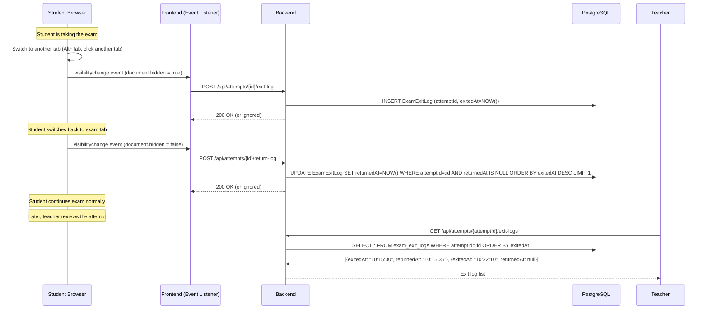
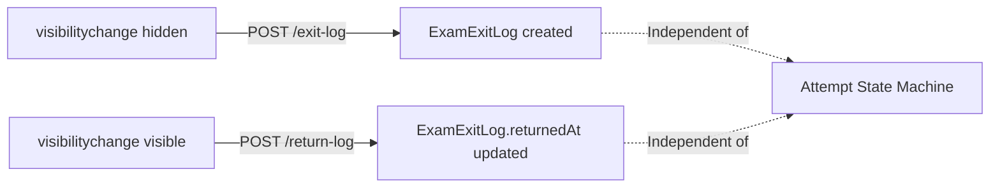

# E5. Screen Exit Monitoring

## 5.1 Feature Overview

| Field | Value |
|---|---|
| Feature ID | E5 |
| Feature Name | Screen Exit Monitoring |
| Module | E. Online Examination |
| Priority | P2 |
| Complexity | M |
| Status | Existing — implemented (backend API + frontend listener) |
| Target Roles | STUDENT (monitored), TEACHER (views logs) |
| Business Objective | Record when a student leaves the exam tab during an active attempt, providing teachers with basic integrity signals without implementing invasive proctoring. |
| User Problem | Teachers want to know if a student switched away from the exam tab (potential cheating signal). Students should be aware that tab-switching is logged as a deterrent. |
| Dependencies | E1 (Start Exam), E2 (Answer Questions) |

## 5.2 Actors and Permissions

### Student

| Action | Allowed | Condition |
|---|---|---|
| Trigger exit/return logs | Automatic | `visibilitychange` event fires during IN_PROGRESS attempt |
| View own exit logs | **No** | Not exposed to students |
| Disable monitoring | **No** | Always active during exam |

### Teacher

| Action | Allowed | Condition |
|---|---|---|
| View student's exit logs | Yes | Own exam only, via GET /attempts/:id/exit-logs |
| Delete exit logs | **No** | Immutable audit trail |
| Take punitive action based on logs | Manual decision | Logs are informational, not automatic penalties |

### Backend Authorization

- `POST /attempts/:id/exit-log` — STUDENT only, own attempt, IN_PROGRESS status.
- `POST /attempts/:id/return-log` — STUDENT only, own attempt, IN_PROGRESS status.
- `GET /attempts/:id/exit-logs` — TEACHER only, own exam's attempt.

## 5.3 Preconditions and Business Rules

| Rule ID | Rule | Enforcement |
|---|---|---|
| E5-BR-01 | Exit/return logging only works during IN_PROGRESS attempts | Backend: check attempt status |
| E5-BR-02 | Exit is recorded when the browser tab becomes hidden (document.hidden = true) | Frontend: `visibilitychange` event |
| E5-BR-03 | Return is recorded when the tab becomes visible again (document.hidden = false) | Frontend: `visibilitychange` event |
| E5-BR-04 | A return log updates the most recent exit log's `returnedAt` field | Backend: find latest exit log without returnedAt |
| E5-BR-05 | Exit logs are append-only — cannot be deleted or modified by anyone | Backend: no DELETE/PATCH endpoints |
| E5-BR-06 | Logging is best-effort — network failures do not block the exam | Frontend: fire-and-forget `.catch(() => {})` |
| E5-BR-07 | Exit logs are informational only — they do not automatically penalize the student | Product decision: no auto-penalty |
| E5-BR-08 | Mobile app-switching also triggers `visibilitychange` — expected frequent false positives on mobile | Known limitation; teacher interprets context |

## 5.4 Main User Flow — Happy Path



## 5.5 Alternative Flows

### AF-01: Multiple exits in rapid succession

Student tabs out and back repeatedly (e.g., accidental touches on mobile). Each exit creates a new log entry. This may generate many entries. **No throttling is currently implemented.**

### AF-02: Student doesn't return before submitting

Student exits the tab and submits from a different mechanism (e.g., auto-submit on expiry). The last exit log has `returnedAt = null`. This is valid — it means the student was away when the exam ended.

### AF-03: Network error on log submission

The `POST /exit-log` or `/return-log` request fails. The frontend swallows the error (`.catch(() => {})`). The exit event is NOT retried. Some exits may go unrecorded. This is acceptable — logging is best-effort.

### AF-04: Browser goes to sleep (mobile)

On mobile, when the phone screen locks or another app comes to the foreground, `visibilitychange` fires. This causes exit logs even for normal phone usage. Teachers should be informed that mobile exit counts are expected to be higher.

### AF-05: Page unload (tab close / navigate away)

The `visibilitychange` event fires before page unload. An exit log is recorded. No return log is created (page is gone). The exit log shows `returnedAt = null`.

## 5.6 Edge Cases and Failure Scenarios

| Scenario ID | Scenario | Trigger | Expected Behavior | User Feedback | Data Integrity | Recovery | Severity |
|---|---|---|---|---|---|---|---|
| E5-EC-01 | Exit log after attempt submitted | Student switches tabs after submitting | Backend checks attempt status. Rejects log for non-IN_PROGRESS attempts. | No user-facing impact | No spurious log entries | Automatic — silently rejected | Low |
| E5-EC-02 | Return without prior exit | Race condition: return event fires but exit event failed | Backend looks for latest exit log without returnedAt. If none found, return log is a no-op (returns null or creates orphan). | No user-facing impact | May have unmatched return — minor | N/A | Low |
| E5-EC-03 | Rapid tab switching (< 100ms intervals) | Automated scripts or rapid Alt+Tab | Each event creates a log entry. Could generate dozens of entries. | No user-facing impact | Many log rows but no data issue | Teacher sees high exit count — interpret as noise | Medium |
| E5-EC-04 | Exit log network request delayed | Slow network — exit log arrives at server 30 seconds late | `exitedAt` is set to server `NOW()`, not client time. The recorded time is when the server processed it, not when the student actually switched tabs. | None | Slight inaccuracy in timing | Acceptable for informational purposes | Low |
| E5-EC-05 | Browser does not support `visibilitychange` | Very old browser (extremely rare) | No exit logs are generated. Teacher sees 0 exits. | None | No data — teacher should not assume "no exits = no tab switching" | N/A | Low |
| E5-EC-06 | Student opens exam in iframe/embed | Exam loaded inside another page | `visibilitychange` does not fire for iframe visibility changes in some browsers. Exit detection may not work. | None | Incomplete monitoring | Accepted limitation | Low |
| E5-EC-07 | Multiple IN_PROGRESS attempts (shouldn't exist but defensive) | Bug or race condition | Exit log goes to the specific attempt ID in the URL. Other attempts unaffected. | None | Correct per-attempt logging | N/A | Low |

## 5.7 UI/UX Specification

### Student-Facing UI

**No visible UI for the student.** Monitoring is passive. The student is not shown a warning when they switch tabs, nor are they told how many times they've left the page.

**Proposed improvement (optional):** Show a subtle notice when the student returns to the tab: "Bạn đã rời khỏi trang thi. Hành động này đã được ghi nhận." This serves as a deterrent. See E5-OQ-01.

### Teacher-Facing UI: Exit Log View

Currently, exit logs are available via the API (`GET /attempts/:id/exit-logs`) but have no dedicated UI.

**Proposed UI** (in the attempt review or results view):

| Timestamp | Duration Away | Status |
|---|---|---|
| 10:15:30 | 5 giây | Đã quay lại |
| 10:22:10 | — | Không quay lại |

**Summary line:** "Rời khỏi trang **2 lần**" shown as a badge or note in the results table.

**Styling:**
- Exit count badge: semantic warning color (amber) if > 0.
- Each log row: neutral text, timestamp formatted in `vi-VN` locale.
- "Không quay lại" in error/muted color.

## 5.8 Data Requirements

### Existing Schema (no changes)

**ExamExitLog:**

| Field | Type | Notes |
|---|---|---|
| id | UUID | PK |
| attemptId | UUID FK | References ExamAttempt |
| exitedAt | DateTime | Server `NOW()` when exit request processed |
| returnedAt | DateTime nullable | Server `NOW()` when return request processed |

**Index:** `(attemptId)` — for querying all exits for an attempt.

**Cascade:** `onDelete: Cascade` from ExamAttempt — if attempt is deleted, logs are deleted too.

### No Schema Changes Required

## 5.9 API Requirements

### POST /api/attempts/:id/exit-log

| Field | Value |
|---|---|
| Method | POST |
| Endpoint | `/api/attempts/:id/exit-log` |
| Purpose | Record that the student left the exam tab |
| Required Role | STUDENT |
| Authentication | JWT Bearer token |

**Request Body:** None.

**Successful Response (201 Created):**

```json
{
  "success": true,
  "data": {
    "id": "log-uuid",
    "exitedAt": "2026-11-11T10:15:30Z"
  }
}
```

**Error Responses:**

| Status | Code | Condition |
|---|---|---|
| 400 | `ATTEMPT_NOT_IN_PROGRESS` | Attempt is SUBMITTED or expired |
| 403 | `NOT_ATTEMPT_OWNER` | JWT user doesn't own this attempt |

### POST /api/attempts/:id/return-log

| Field | Value |
|---|---|
| Method | POST |
| Endpoint | `/api/attempts/:id/return-log` |
| Purpose | Record that the student returned to the exam tab |
| Required Role | STUDENT |
| Authentication | JWT Bearer token |

**Request Body:** None.

**Successful Response (200 OK):**

```json
{
  "success": true,
  "data": null
}
```

**Behavior:** Finds the most recent `ExamExitLog` for this attempt where `returnedAt IS NULL`, and sets `returnedAt = NOW()`. If no unmatched exit log exists, returns success with null (no-op).

### GET /api/attempts/:id/exit-logs

| Field | Value |
|---|---|
| Method | GET |
| Endpoint | `/api/attempts/:id/exit-logs` |
| Purpose | Retrieve all exit logs for an attempt (teacher review) |
| Required Role | TEACHER |
| Authentication | JWT Bearer token |

**Authorization:** Teacher must own the exam that this attempt belongs to.

**Successful Response (200 OK):**

```json
{
  "success": true,
  "data": [
    {
      "id": "log-1",
      "exitedAt": "2026-11-11T10:15:30Z",
      "returnedAt": "2026-11-11T10:15:35Z"
    },
    {
      "id": "log-2",
      "exitedAt": "2026-11-11T10:22:10Z",
      "returnedAt": null
    }
  ]
}
```

## 5.10 State Management

Exit monitoring does not affect the attempt state machine. It is a side-effect logging mechanism that runs in parallel with the exam flow.



## 5.11 Acceptance Criteria

```gherkin
# Exit logged
Given a student has an IN_PROGRESS attempt
When the student switches to another browser tab (document.hidden = true)
Then the frontend calls POST /attempts/{id}/exit-log
  And an ExamExitLog is created with exitedAt = approximately NOW

# Return logged
Given a student has an exit log without returnedAt
When the student returns to the exam tab (document.hidden = false)
Then the frontend calls POST /attempts/{id}/return-log
  And the most recent unmatched exit log gets returnedAt = approximately NOW

# Teacher views logs
Given a teacher owns an exam with a submitted attempt that had 3 tab exits
When the teacher calls GET /attempts/{id}/exit-logs
Then the response contains 3 exit log entries ordered by exitedAt
  And each entry has exitedAt and returnedAt (or null for the last)

# No logging after submission
Given an attempt with status SUBMITTED
When a visibilitychange event fires
Then the frontend does NOT call the exit-log endpoint
  (OR if it does, the backend rejects it silently)

# Best-effort logging
Given the network is down when the student switches tabs
When the exit-log POST fails
Then the error is silently swallowed
  And the exam continues normally
  And the exit is NOT recorded
```

## 5.12 QA Test Scenarios

| Test ID | Scenario | Preconditions | Steps | Test Data | Expected Result | Priority |
|---|---|---|---|---|---|---|
| E5-T01 | Exit logged on tab switch | IN_PROGRESS attempt | Switch to another tab | — | ExamExitLog created with exitedAt | **High** |
| E5-T02 | Return logged on tab return | Previous exit log exists | Switch back to exam tab | — | Exit log's returnedAt updated | **High** |
| E5-T03 | Teacher views exit logs | Submitted attempt with 2 exits | GET /attempts/{id}/exit-logs | — | 2 entries returned | **High** |
| E5-T04 | No log after submission | SUBMITTED attempt | Switch tab | — | POST /exit-log rejected or not sent | Medium |
| E5-T05 | Multiple exits | Switch tabs 5 times | Each switch triggers exit-log + return-log | — | 5 exit log entries | Medium |
| E5-T06 | Exit without return | Switch tab, then close browser | exit-log fires, no return-log | — | 1 entry with returnedAt = null | Medium |
| E5-T07 | Return without exit | Race condition: only return event fires | POST /return-log | — | 200 with null (no-op) | Low |
| E5-T08 | Network error on exit log | Disable network, switch tabs | — | — | Error silently swallowed, exam continues | Medium |
| E5-T09 | Wrong user views logs | Different teacher's exam | GET /exit-logs | — | 403 | Medium |
| E5-T10 | Student cannot view own logs | Student JWT | GET /exit-logs | — | 403 (TEACHER only) | Medium |

## 5.13 Open Questions and Assumptions

| # | Question | Why It Matters | Options | Recommended Default | Impact |
|---|---|---|---|---|---|
| E5-OQ-01 | Should the student be warned when they return to the exam tab? | A visible warning serves as a deterrent. But it may increase anxiety for accidental tab switches. | A) Silent logging (current), B) Subtle toast: "Tab switch đã được ghi nhận", C) Prominent warning modal | **A** for MVP — silent logging is less disruptive | Frontend-only change if implemented later. |
| E5-OQ-02 | Should exit logs use client-side timestamps or server-side? | Currently, `exitedAt` is server `NOW()` when the POST is processed. This includes network latency. Actual tab-switch time differs. | A) Server time (current), B) Client sends timestamp, server stores it | **A** — server time is safer (client can be manipulated) | Accuracy trade-off: ~0.5-2s delay is acceptable for informational purposes. |
| E5-OQ-03 | Should there be a throttle on exit log creation? | Rapid tab switching can create many log entries. | A) No throttle (current), B) Server-side: max 1 exit per 3 seconds, C) Client-side debounce | **C** — client debounce of 3s is simplest | Frontend change. Reduces noise without losing meaningful signals. |
| E5-OQ-04 | Should exit count be shown in the results table? | Teachers want a quick "integrity indicator" without opening a separate log view. | A) Not shown (current), B) Badge "Rời trang X lần" in results table | **B** — aggregate in the results list, details on click | Backend: add exit count to attempt query. Frontend: badge in results. |

### Assumptions

| # | Assumption | Basis |
|---|---|---|
| E5-A-01 | Exit logs are informational only — no automatic score penalties | LUMI_LITE_GUIDE.md: "Có thể ghi nhận tín hiệu cơ bản nhưng không coi đó là bằng chứng gian lận" |
| E5-A-02 | `visibilitychange` is the primary detection mechanism. `blur`/`focus` events are not used. | Current frontend implementation |
| E5-A-03 | Mobile tab-switching generates legitimate exit events — teachers must interpret context | Standard web behavior; no mobile-specific filtering |
| E5-A-04 | Logging failures are acceptable — exam integrity > monitoring completeness | Best-effort design; exam flow is never blocked by logging |
