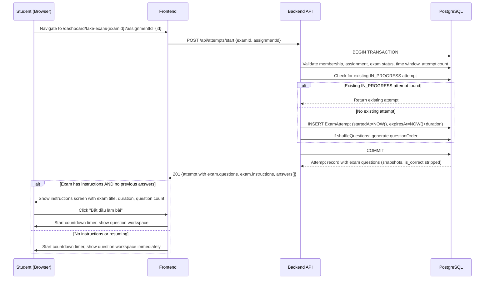
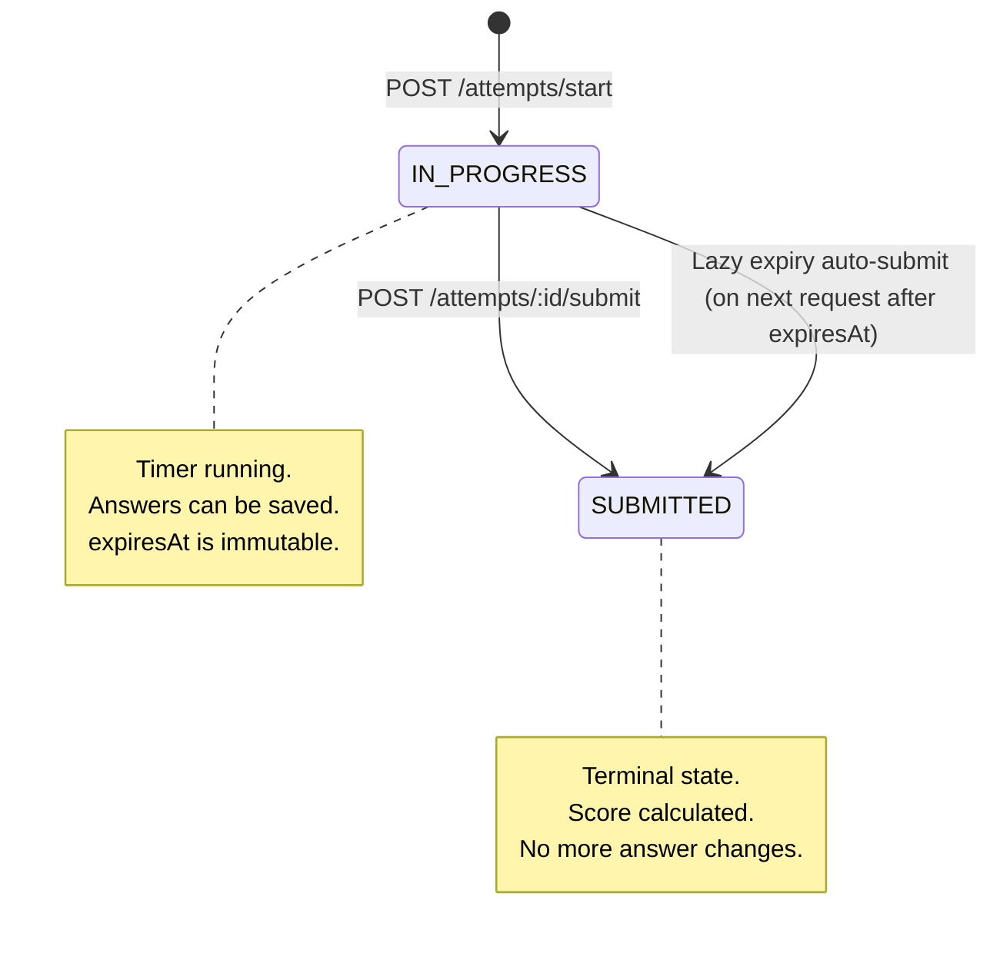

# E1. Start Exam

## 5.1 Feature Overview

| Field | Value |
|---|---|
| Feature ID | E1 |
| Feature Name | Start Exam |
| Module | E. Online Examination |
| Priority | P0 |
| Complexity | L |
| Status | Existing — fully implemented (backend + frontend) |
| Target Roles | STUDENT |
| Business Objective | Allow students to begin a timed exam attempt, creating a server-authoritative timing record and delivering exam content without exposing correct answers. |
| User Problem | Students need a controlled entry point that validates eligibility, enforces attempt limits, and starts a server-side timer that cannot be manipulated. |
| Dependencies | D1 (Exam CRUD), D4 (Publish / Snapshot), D5 (Assign Exam), A1 (Auth) |

## 5.2 Actors and Permissions

### Student

| Action | Allowed | Condition |
|---|---|---|
| View exam instructions | Yes | Must be a member of a classroom with an active assignment for this exam |
| Start an attempt | Yes | Exam is PUBLISHED, within availability window, under max attempt count, no existing IN_PROGRESS attempt |
| View exam questions (without correct answers) | Yes | Only their own IN_PROGRESS attempt |
| Cancel before starting | Yes | No attempt is created until "Bắt đầu làm bài" is clicked |

### Teacher

| Action | Allowed | Condition |
|---|---|---|
| Start an attempt | **No** | Teachers cannot take exams |
| View student's in-progress attempt | **No** | Teachers see results only after submission |

### Backend Authorization

- `POST /attempts/start` requires a valid JWT with role STUDENT.
- The endpoint validates classroom membership, assignment existence, exam status, availability window, and attempt count in a single transaction.
- All timing is server-authoritative — `started_at` and `expires_at` are set from `NOW()` on the database server, never from client timestamps.

## 5.3 Preconditions and Business Rules

| Rule ID | Rule | Enforcement |
|---|---|---|
| E1-BR-01 | Exam must be in PUBLISHED status | Backend: check `exam.status === 'PUBLISHED'` |
| E1-BR-02 | Student must be a member of a classroom that has an ACTIVE assignment for this exam | Backend: join ClassroomMember → Assignment → Exam |
| E1-BR-03 | Current server time must be within `[availableFrom, availableUntil]` if either is set | Backend: `NOW()` compared to exam fields; null means unbounded |
| E1-BR-04 | Student's existing attempt count for this exam must be < `exam.maxAttempts` | Backend: `COUNT(ExamAttempt WHERE examId AND studentId)` |
| E1-BR-05 | Student must not have an existing IN_PROGRESS attempt for this exam | Backend: If one exists, return it instead of creating a new one (idempotent) |
| E1-BR-06 | `expires_at` = `NOW() + exam.durationSeconds` — server clock only | Backend: calculated in the INSERT statement |
| E1-BR-07 | If `exam.accessCode` is set, student must provide it in the start request | Backend: compare `dto.accessCode` against `exam.accessCode` (case-sensitive) |
| E1-BR-08 | If `exam.shuffleQuestions` is true, generate a random question order and store in `attempt.questionOrder` | Backend: Fisher-Yates shuffle of ExamQuestion IDs |
| E1-BR-09 | Instructions screen is a frontend-only concern — attempt creation happens regardless | Backend: the POST creates the attempt; frontend decides whether to show instructions before revealing questions |

## 5.4 Main User Flow — Happy Path



**Step-by-step:**

1. Student navigates to `/dashboard/take-exam/{examId}?assignmentId={assignmentId}`.
2. Frontend calls `POST /api/attempts/start` with `{examId, assignmentId, accessCode?}`.
3. Backend validates all preconditions (BR-01 through BR-08) within a transaction.
4. If an IN_PROGRESS attempt already exists for this student+exam, return it (idempotent).
5. Otherwise, create a new `ExamAttempt` with server-set `startedAt` and `expiresAt`.
6. Return the attempt with exam questions (content_snapshot, options_snapshot with `is_correct` stripped), any previously saved answers, and exam metadata (instructions, title).
7. Frontend checks: if `exam.instructions` exists and `answers.length === 0`, show the instructions interstitial screen.
8. Student clicks "Bắt đầu làm bài" (or questions appear directly if no instructions / resuming).
9. Frontend starts a countdown timer from `expiresAt`.

## 5.5 Alternative Flows

### AF-01: Student resumes an existing attempt

If the student has an existing IN_PROGRESS attempt (e.g., refreshed the page, came back from network loss), `POST /attempts/start` returns the existing attempt with all previously saved answers. The frontend restores answer selections and resumes the timer from the current `expiresAt`. No new attempt is created. See `resume-exam.md` for full details.

### AF-02: Student has used all attempts

If `COUNT(attempts) >= exam.maxAttempts`, the backend returns `403` with error code `MAX_ATTEMPTS_REACHED`. The frontend shows: "Bạn đã hết lượt làm bài." with a link back to the assignments list.

### AF-03: Exam is outside availability window

If `NOW() < availableFrom`, return `403` with `EXAM_NOT_YET_AVAILABLE`. Frontend shows "Bài thi chưa mở" with the `availableFrom` datetime.
If `NOW() > availableUntil`, return `403` with `EXAM_EXPIRED`. Frontend shows "Bài thi đã hết hạn."

### AF-04: Access code required

If `exam.accessCode` is set and the request does not include `accessCode` or it doesn't match, return `403` with `INVALID_ACCESS_CODE`. The frontend should show an access code input dialog before calling start.

**Note:** The current implementation does not have a separate access code input step on the frontend — it passes `accessCode` directly in the start request. A UX improvement would be to prompt for the code before starting.

### AF-05: Student is not a member of any assigned classroom

Return `403` with `NOT_ASSIGNED`. Student sees "Bài thi này chưa được giao cho bạn."

## 5.6 Edge Cases and Failure Scenarios

| Scenario ID | Scenario | Trigger | Expected Behavior | User Feedback | Data Integrity | Recovery | Severity |
|---|---|---|---|---|---|---|---|
| E1-EC-01 | Concurrent start requests from same student | Student double-clicks "Start", or multiple tabs | Backend uses existing IN_PROGRESS check in transaction. First request creates attempt, second finds it and returns it. Both return the same attempt. | Both responses show the same exam | Exactly one attempt row exists | Automatic — idempotent | **Critical** |
| E1-EC-02 | Student starts in two browser tabs | Two tabs call POST /start simultaneously | Same as E1-EC-01: one attempt created, both tabs receive same attempt ID | Both tabs show same exam state | One attempt, both tabs autosave to it | Autosave from either tab goes to same attempt | **High** |
| E1-EC-03 | Exam unpublished while student navigates to start | Teacher archives exam between page load and start request | Backend returns `400 EXAM_NOT_PUBLISHED` | "Đề thi không khả dụng" | No attempt created | Student returns to assignment list | Medium |
| E1-EC-04 | Assignment closed between page load and start | Teacher closes assignment | Backend should check assignment.status === 'ACTIVE' | "Bài giao đã đóng" | No attempt created | Return to assignments | Medium |
| E1-EC-05 | Student removed from classroom after starting | Teacher removes student during exam | **Existing attempt continues** — removal does not invalidate in-progress attempts. Student can finish and submit. | No immediate feedback (next start attempt would fail) | Attempt data preserved | Submit still works | Medium |
| E1-EC-06 | Clock skew between DB server and application | App server and DB server clocks differ | All timing uses DB `NOW()`, not application clock. `started_at` and `expires_at` set by PostgreSQL. | None — transparent | Consistent timing | N/A — prevented by design | **Critical** |
| E1-EC-07 | Student manipulates client clock | Student sets device clock forward/backward | **No impact** — timer display is cosmetic. All enforcement uses server `expires_at`. Autosave and submit check server time. | Timer may appear wrong, but enforcement is correct | Server-authoritative | N/A — by design | **High** |
| E1-EC-08 | Database connection failure during start | DB pool exhausted or network issue | Backend returns 500. No attempt created (transaction rolled back). | "Không thể bắt đầu bài thi. Vui lòng thử lại." | No partial data — transaction ensures atomicity | Student retries — safe because start is idempotent | High |
| E1-EC-09 | `availableUntil` passes during instructions screen | Student reads instructions slowly, exam window closes | Attempt was already created. Timer runs. Student can still finish within `expiresAt`. New attempts after this one would be blocked. | Timer continues normally | `expiresAt` was locked at creation time | Student completes normally | Low |
| E1-EC-10 | Exam has zero questions | Teacher publishes exam without questions (validation gap) | Backend should validate `exam.questions.length > 0` at publish time. If somehow bypassed, start should return error. | "Đề thi không có câu hỏi" | No attempt created | Report to teacher | Low |
| E1-EC-11 | Access code contains special characters or unicode | Teacher sets access code with Vietnamese diacritics | Exact string comparison. Byte-level match required. | If wrong: "Mã truy cập không đúng" | No attempt created | Student re-enters code | Low |
| E1-EC-12 | `maxAttempts` changed after student starts | Teacher modifies exam to lower maxAttempts | Published exam cannot be modified (status check prevents this). If somehow changed via direct DB, existing attempts are not affected. | No impact on in-progress attempt | Existing attempt valid | N/A | Low |

## 5.7 UI/UX Specification

### Entry Point

Student navigates from `/dashboard/assignments` → clicks on an assigned exam card → redirected to `/dashboard/take-exam/{examId}?assignmentId={assignmentId}`.

### Loading State

Full-page centered spinner with text "Đang tải đề thi..." while `POST /attempts/start` is in flight.

### Access Code Dialog (if `exam.accessCode` is set)

- **Not currently implemented in frontend** — access code is sent directly in the start request.
- **Proposed UX**: Before calling start, show a dialog: "Nhập mã truy cập", text input, "Xác nhận" button.
- Input: single text field, no auto-capitalize, no autocomplete.
- Error: inline "Mã truy cập không đúng" below the input.

### Instructions Screen

Shown when `exam.instructions` exists AND `answers.length === 0` (first entry, not resume):

- **Layout**: Centered max-width 560px card.
- **Header**: BookOpen icon + exam title (large, bold).
- **Body**: Card with "Hướng dẫn làm bài" header. Instructions text rendered as pre-wrapped prose. Supports line breaks.
- **Footer info**: "Thời gian: {duration} phút" (calculated from `expiresAt - NOW()`).
- **Action**: Full-width primary button "Bắt đầu làm bài".
- **Note**: Timer does NOT start on the instructions screen — it was started when the attempt was created (server-side). The instructions screen only delays showing the timer UI. This is a known UX trade-off: the attempt's `expiresAt` includes time spent reading instructions.

### Error States

| Condition | Display |
|---|---|
| Network error | Alert: "Không thể kết nối. Vui lòng kiểm tra mạng và thử lại." + Retry |
| EXAM_NOT_PUBLISHED | Alert: "Đề thi không khả dụng" → redirect to assignments |
| NOT_ASSIGNED | Alert: "Bài thi này chưa được giao cho bạn" → redirect to assignments |
| MAX_ATTEMPTS_REACHED | Alert: "Bạn đã hết lượt làm bài" → redirect to assignments |
| EXAM_NOT_YET_AVAILABLE | Display: "Bài thi sẽ mở lúc {datetime}" |
| EXAM_EXPIRED | Display: "Bài thi đã hết hạn" → redirect to assignments |

### Responsive Behavior

- Mobile: instructions card takes full width with 16px gutter.
- Desktop: max-width 560px, centered.
- Button is always full-width.

## 5.8 Data Requirements

### Existing Schema (no changes required)

**ExamAttempt** — created by this feature:

| Field | Type | Set At | Notes |
|---|---|---|---|
| id | UUID | Creation | PK |
| examId | UUID FK | Creation | References Exam |
| studentId | UUID FK | Creation | References User (JWT) |
| assignmentId | UUID FK nullable | Creation | References Assignment (from request) |
| startedAt | DateTime | Creation | `NOW()` server time |
| expiresAt | DateTime | Creation | `NOW() + exam.durationSeconds` |
| submittedAt | DateTime nullable | — | Set on submit |
| status | AttemptStatus | Creation | `IN_PROGRESS` |
| score | Decimal(10,2) nullable | — | Set on grading |
| questionOrder | Json nullable | Creation | Shuffled ExamQuestion IDs if `shuffleQuestions` |
| createdAt | DateTime | Creation | `NOW()` |

**Indexes** (existing):
- `(examId, studentId)` — for attempt count queries and lookup.
- `(studentId)` — for student's attempt list.

### Proposed Schema Changes

None required. Current schema fully supports this feature.

### Concurrency Protection

The current implementation relies on the `IN_PROGRESS` status check within a single Prisma transaction. For stronger protection against concurrent start:

- **Option A (current)**: Check `findFirst({where: {examId, studentId, status: 'IN_PROGRESS'}})` inside a serializable transaction. Sufficient at ~100 users.
- **Option B (stronger)**: Add a partial unique index `CREATE UNIQUE INDEX ... ON exam_attempts(exam_id, student_id) WHERE status = 'IN_PROGRESS'`. This provides database-level guarantee against double-start regardless of application-level races. **Recommended for production.**

**Open question**: Whether to add the partial unique index. See section 5.13.

## 5.9 API Requirements

### POST /api/attempts/start

| Field | Value |
|---|---|
| Method | POST |
| Endpoint | `/api/attempts/start` |
| Purpose | Create a new exam attempt or return existing IN_PROGRESS attempt |
| Required Role | STUDENT |
| Authentication | JWT Bearer token |

**Request Body:**

```json
{
  "examId": "uuid",
  "assignmentId": "uuid | null",
  "accessCode": "string | undefined"
}
```

| Field | Type | Required | Validation |
|---|---|---|---|
| examId | UUID | Yes | Must reference existing PUBLISHED exam |
| assignmentId | UUID | No | If provided, must reference ACTIVE assignment for this exam |
| accessCode | string | Conditional | Required if `exam.accessCode` is set |

**Successful Response (201 Created or 200 OK for existing):**

```json
{
  "success": true,
  "data": {
    "id": "attempt-uuid",
    "status": "IN_PROGRESS",
    "startedAt": "2026-11-11T10:00:00Z",
    "expiresAt": "2026-11-11T10:45:00Z",
    "questionOrder": ["eq-1", "eq-3", "eq-2"] | null,
    "exam": {
      "title": "Kiểm tra giữa kỳ Toán 12",
      "instructions": "Không sử dụng tài liệu...",
      "shuffleOptions": false,
      "showResultImmediately": true,
      "questions": [
        {
          "id": "eq-uuid",
          "contentSnapshot": "Thủ đô của Việt Nam là?",
          "optionsSnapshot": [
            {"id": "opt-1", "content": "Hà Nội", "position": 0},
            {"id": "opt-2", "content": "TP HCM", "position": 1}
          ],
          "points": 1,
          "position": 0
        }
      ]
    },
    "answers": [
      {
        "examQuestionId": "eq-uuid",
        "answerPayload": {"selectedOptionId": "opt-1"}
      }
    ]
  }
}
```

**Note:** `optionsSnapshot` MUST have `isCorrect` stripped from each option before sending to the student. This is a critical security requirement — correct answers are never exposed during an active attempt.

**Error Responses:**

| Status | Code | Condition |
|---|---|---|
| 400 | `EXAM_NOT_PUBLISHED` | Exam status is not PUBLISHED |
| 403 | `NOT_ASSIGNED` | Student is not in a classroom with an active assignment for this exam |
| 403 | `EXAM_NOT_YET_AVAILABLE` | `NOW() < exam.availableFrom` |
| 403 | `EXAM_EXPIRED` | `NOW() > exam.availableUntil` |
| 403 | `MAX_ATTEMPTS_REACHED` | Attempt count >= `exam.maxAttempts` |
| 403 | `INVALID_ACCESS_CODE` | Access code provided does not match |
| 403 | `INVALID_ACCESS_CODE` | Access code required but not provided |
| 401 | `UNAUTHORIZED` | Invalid or missing JWT |

**Idempotency:** Calling this endpoint multiple times with the same `examId` and `studentId` while an IN_PROGRESS attempt exists returns the same attempt without creating a new one. This is essential for browser refresh and network retry safety.

## 5.10 State Management

The Start Exam feature creates an attempt in `IN_PROGRESS` state. The full attempt lifecycle is:



**State transitions relevant to Start Exam:**

| Transition | Trigger | Guard | Side Effect |
|---|---|---|---|
| `[none] → IN_PROGRESS` | `POST /attempts/start` | All preconditions (BR-01..08) pass | Set `startedAt`, `expiresAt`, optionally `questionOrder` |

**Notes:**
- The `EXPIRED` status exists in the enum but is not used per AD-11. When time expires, attempts are auto-submitted, going directly to `SUBMITTED`.
- `expiresAt` is set once at creation and never modified. It is the single source of truth for deadline enforcement.
- There is no `CANCELLED` state. If a student starts and abandons, the attempt stays `IN_PROGRESS` until someone queries it (lazy expiry) or a future cleanup job runs.

## 5.11 Acceptance Criteria

```gherkin
# Happy path
Given a STUDENT is a member of a classroom
  And the classroom has an ACTIVE assignment for a PUBLISHED exam
  And the exam's availability window includes NOW
  And the student has 0 existing attempts (maxAttempts = 1)
When the student calls POST /attempts/start with {examId, assignmentId}
Then a new ExamAttempt is created with status IN_PROGRESS
  And startedAt is approximately NOW (server time)
  And expiresAt = startedAt + exam.durationSeconds
  And the response includes exam questions with isCorrect stripped from options
  And the response includes an empty answers array

# Idempotent resume
Given a STUDENT has an existing IN_PROGRESS attempt for an exam
When the student calls POST /attempts/start with the same examId
Then the existing attempt is returned (not a new one)
  And the response includes previously saved answers
  And no new ExamAttempt row is created

# Access code
Given an exam has accessCode = "ABC123"
When a student calls POST /attempts/start without accessCode
Then the response is 403 INVALID_ACCESS_CODE

Given an exam has accessCode = "ABC123"
When a student calls POST /attempts/start with accessCode = "ABC123"
Then the attempt is created successfully

# Max attempts
Given a student has already submitted 1 attempt for an exam with maxAttempts = 1
When the student calls POST /attempts/start
Then the response is 403 MAX_ATTEMPTS_REACHED

# Shuffle
Given an exam has shuffleQuestions = true and 5 questions
When a student starts an attempt
Then the attempt's questionOrder contains 5 ExamQuestion IDs in a random permutation
  And a different student starting the same exam may receive a different order

# Authorization
Given a TEACHER user
When they call POST /attempts/start
Then the response is 403

Given a STUDENT not in any classroom with this exam assigned
When they call POST /attempts/start
Then the response is 403 NOT_ASSIGNED
```

## 5.12 QA Test Scenarios

| Test ID | Scenario | Preconditions | Steps | Test Data | Expected Result | Priority |
|---|---|---|---|---|---|---|
| E1-T01 | Happy path start | Published exam, ACTIVE assignment, student in classroom | POST /attempts/start {examId, assignmentId} | Valid student JWT | 201, attempt with IN_PROGRESS, correct expiresAt | **Critical** |
| E1-T02 | Correct answers not exposed | Same as T01 | Check response optionsSnapshot | — | No option has `isCorrect` field | **Critical** |
| E1-T03 | Idempotent restart | Existing IN_PROGRESS attempt | POST /attempts/start again | Same examId | 200, same attempt ID returned, no new row in DB | **Critical** |
| E1-T04 | Concurrent start (2 threads) | Same student, same exam | Fire 2 POST /start simultaneously | Same JWT | Exactly 1 attempt in DB, both responses have same attempt ID | **Critical** |
| E1-T05 | Max attempts reached | 1 SUBMITTED attempt, maxAttempts=1 | POST /attempts/start | — | 403 MAX_ATTEMPTS_REACHED | **High** |
| E1-T06 | Before availability window | exam.availableFrom = tomorrow | POST /attempts/start | — | 403 EXAM_NOT_YET_AVAILABLE | **High** |
| E1-T07 | After availability window | exam.availableUntil = yesterday | POST /attempts/start | — | 403 EXAM_EXPIRED | **High** |
| E1-T08 | Wrong access code | exam.accessCode = "ABC" | POST /start with accessCode="XYZ" | — | 403 INVALID_ACCESS_CODE | **High** |
| E1-T09 | Correct access code | exam.accessCode = "ABC" | POST /start with accessCode="ABC" | — | 201, attempt created | **High** |
| E1-T10 | Student not in classroom | Student not a member of assigned classroom | POST /start | — | 403 NOT_ASSIGNED | **High** |
| E1-T11 | Teacher cannot start | Teacher JWT | POST /start | — | 403 role check | High |
| E1-T12 | Draft exam | exam.status = DRAFT | POST /start | — | 400 EXAM_NOT_PUBLISHED | High |
| E1-T13 | Shuffle generates random order | shuffleQuestions=true, 10 questions | Start 2 different attempts | Different students | questionOrder arrays differ (probabilistic — run multiple times) | Medium |
| E1-T14 | No shuffle | shuffleQuestions=false | Start attempt | — | questionOrder is null | Medium |
| E1-T15 | Assignment CLOSED | assignment.status = CLOSED | POST /start | — | 403 or 400 (assignment not active) | Medium |
| E1-T16 | expiresAt uses server time | N/A | Compare startedAt + durationSeconds with expiresAt | — | Match within 1 second | Medium |

## 5.13 Open Questions and Assumptions

| # | Question | Why It Matters | Options | Recommended Default | Impact |
|---|---|---|---|---|---|
| E1-OQ-01 | Should a partial unique index on `(exam_id, student_id) WHERE status = 'IN_PROGRESS'` be added? | Prevents concurrent double-start at database level without application-level locking | A) Application-level check (current), B) Partial unique index | **B** — database-level protection is more robust | Low effort, high safety. Add in next migration. |
| E1-OQ-02 | Should the instructions screen time count toward exam duration? | Currently, `expiresAt` is set at attempt creation, before the student sees instructions. Reading instructions eats into exam time. | A) Current behavior (timer starts at creation), B) Timer starts when student clicks "Bắt đầu" (requires a second API call) | **A** for MVP — simpler. Document the behavior clearly to students. | Option B adds API complexity (split start into create + activate). |
| E1-OQ-03 | Should access code input be a separate frontend step before calling start? | Currently, access code is sent in the start request body. If the student doesn't know the code, they get an error. | A) Send in start request (current), B) Separate dialog before start | **B** — better UX | Frontend-only change. No backend impact. |
| E1-OQ-04 | What happens when `assignmentId` is not provided? | Current implementation accepts `null` assignmentId. Student could theoretically start an exam without going through an assignment. | A) Require assignmentId always, B) Allow direct exam access | **A** — require assignmentId for proper tracking | Backend validation change. |

### Assumptions

| # | Assumption | Basis |
|---|---|---|
| E1-A-01 | Timer display on the client is cosmetic; all enforcement uses server-side `expiresAt` | TECHNICAL_DECISIONS.md, LUMI_LITE_GUIDE.md section 7.3 |
| E1-A-02 | Lazy expiry is sufficient for ~100 concurrent users — no background scheduler needed | TECHNICAL_DECISIONS.md AD-06 |
| E1-A-03 | The `EXPIRED` status in the enum is vestigial — all expired attempts transition directly to `SUBMITTED` via auto-grading | TECHNICAL_DECISIONS.md AD-11 CONFIRMED |
| E1-A-04 | Shuffled question order is fixed for the lifetime of the attempt (stored once, never re-shuffled) | Current implementation stores `questionOrder` as JSON at creation |
