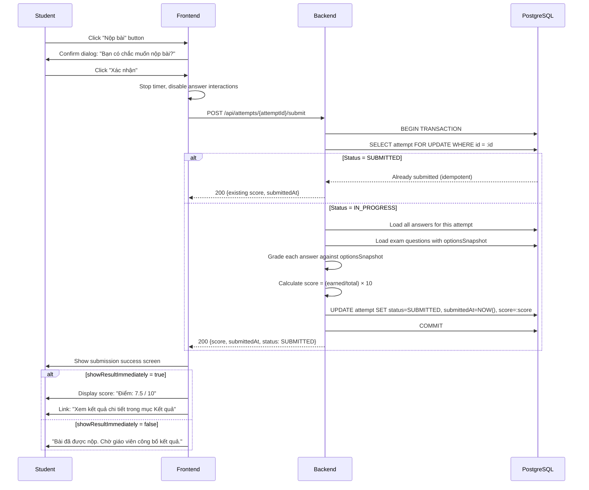
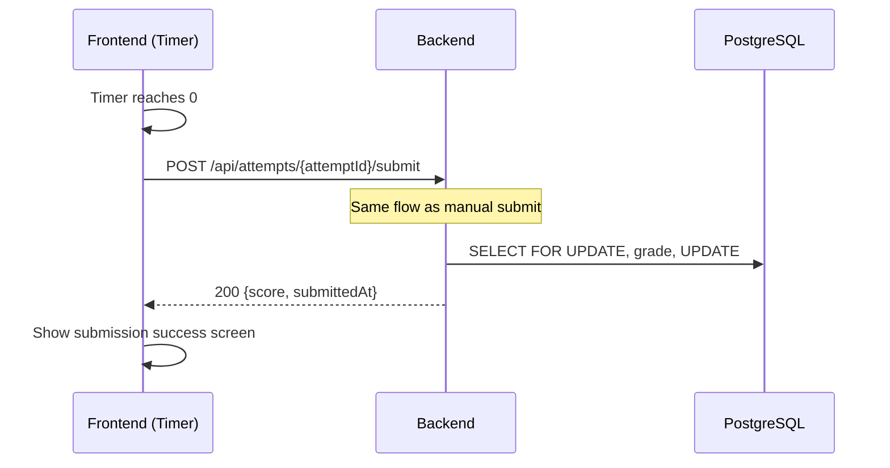
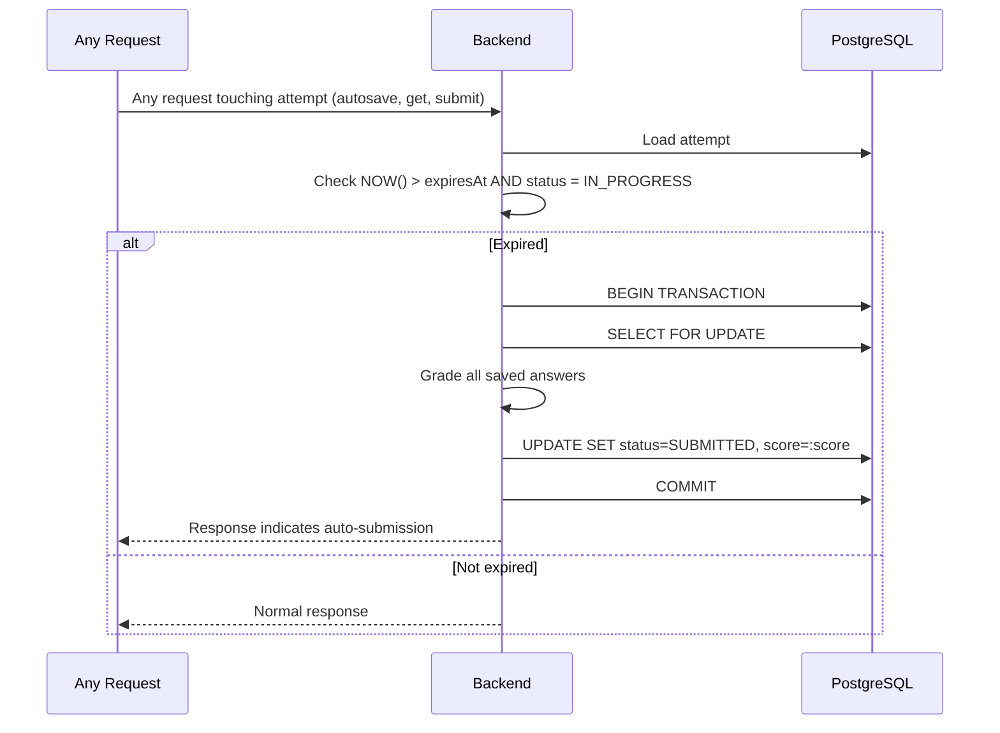
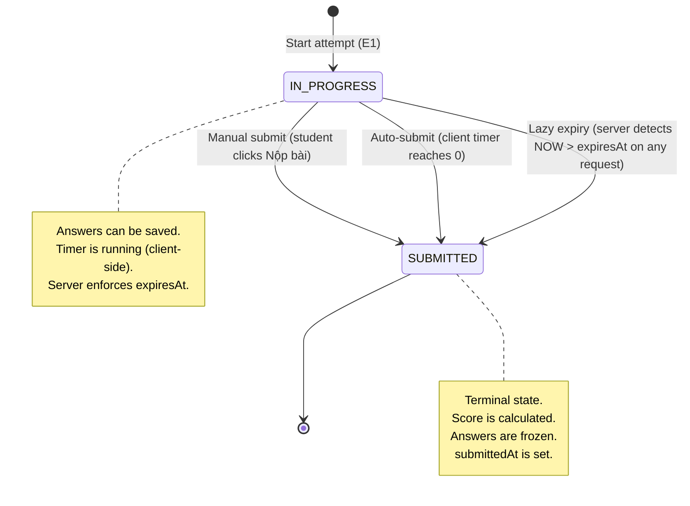

# E3. Manual and Automatic Submission

## 5.1 Feature Overview

| Field | Value |
|---|---|
| Feature ID | E3 |
| Feature Name | Manual and Automatic Submission |
| Module | E. Online Examination |
| Priority | P0 |
| Complexity | L |
| Status | Existing — fully implemented (backend + frontend) |
| Target Roles | STUDENT (initiates), system (auto-submit on expiry) |
| Business Objective | Provide two reliable submission pathways: manual submission when the student is ready, and automatic submission when time expires, ensuring every attempt is graded and no work is silently lost. |
| User Problem | Students need certainty that clicking "Nộp bài" finalizes their exam and calculates their grade. If they forget or lose connectivity at the deadline, auto-submission ensures their saved answers are still graded. |
| Dependencies | E1 (Start Exam), E2 (Answer Questions / Autosave) |

## 5.2 Actors and Permissions

### Student

| Action | Allowed | Condition |
|---|---|---|
| Submit manually | Yes | Own IN_PROGRESS attempt only |
| View result after submission | Yes | If `exam.showResultImmediately` OR `exam.resultsReleased` |
| Re-submit | **No** | Duplicate submit returns existing result (idempotent) |
| Modify answers after submission | **No** | Terminal state |

### System (Lazy Expiry)

| Action | Trigger | Condition |
|---|---|---|
| Auto-submit and grade | Any request touching an expired IN_PROGRESS attempt | `NOW() > expiresAt` AND `status = IN_PROGRESS` |

### Teacher

| Action | Allowed | Condition |
|---|---|---|
| Submit on behalf of student | **No** | No such endpoint |
| View submitted result | Yes | Own exam only, via GET /attempts?examId= |
| Override score | Yes | Via PATCH /attempts/:id/score (separate feature, see G5) |

### Backend Authorization

- `POST /attempts/:id/submit` requires JWT with role STUDENT.
- `request.user.id === attempt.studentId` enforced.
- Uses `SELECT ... FOR UPDATE` (row-level lock) to serialize concurrent submit requests.

## 5.3 Preconditions and Business Rules

| Rule ID | Rule | Enforcement |
|---|---|---|
| E3-BR-01 | Attempt must exist and belong to the requesting student | Backend: validate ownership |
| E3-BR-02 | If attempt is already SUBMITTED: return existing result (idempotent) | Backend: check status before grading |
| E3-BR-03 | If attempt is IN_PROGRESS and `NOW() > expiresAt`: auto-submit instead of rejecting | Backend: per AD-11 CONFIRMED |
| E3-BR-04 | Grading runs in a single transaction with the status transition | Backend: `BEGIN → SELECT FOR UPDATE → grade → UPDATE → COMMIT` |
| E3-BR-05 | Score = `(sum of earned points / sum of total points) × 10`, precision `Decimal(10,2)` | Backend: grading logic |
| E3-BR-06 | MCQ grading: compare `answer.answerPayload.selectedOptionId` against the option with `isCorrect: true` in `optionsSnapshot` | Backend: per-question check |
| E3-BR-07 | Unanswered questions score 0 points | Backend: no answer row = 0 |
| E3-BR-08 | `submittedAt` is set to server `NOW()` in the transaction | Backend |
| E3-BR-09 | After submission, no answers can be modified | Backend: all answer endpoints check `attempt.status` |
| E3-BR-10 | Concurrent submit requests must produce exactly one grading operation and identical results | Backend: `SELECT FOR UPDATE` serialization |

## 5.4 Main User Flow — Happy Path (Manual Submit)



### Automatic Submission (Timer Expiry)



### Lazy Expiry (Server-Side Auto-Submit)



## 5.5 Alternative Flows

### AF-01: Submit with unanswered questions

Student has answered 15 of 20 questions and clicks Submit. The 5 unanswered questions score 0. The grading logic iterates over all exam questions, and those without a corresponding answer row receive 0 points.

### AF-02: Submit immediately after starting

Student starts the exam and immediately submits with no answers saved. All questions score 0. Final score = 0.00. This is valid — the system does not require a minimum number of answered questions.

### AF-03: Double-click submit

Student clicks Submit twice rapidly. The confirmation dialog prevents the first double-click. If both requests bypass the dialog:
1. First request acquires the row lock, grades, and commits.
2. Second request acquires the lock, sees `status = SUBMITTED`, returns existing result.
Result: exactly one grading operation.

### AF-04: Submit after expiry (client-side late submit)

Student's client timer may be slightly out of sync. Student clicks Submit at T+2s (server time past expiry). Backend's lazy check detects `NOW() > expiresAt`, auto-submits, and grades. The result is the same as if auto-submit had triggered. The student sees their score.

### AF-05: Browser tab closed without submitting

Attempt stays IN_PROGRESS. On the next request (student reopens the page and calls `POST /attempts/start`), lazy expiry triggers auto-submit if the deadline has passed. Otherwise, the student resumes the exam.

## 5.6 Edge Cases and Failure Scenarios

| Scenario ID | Scenario | Trigger | Expected Behavior | User Feedback | Data Integrity | Recovery | Severity |
|---|---|---|---|---|---|---|---|
| E3-EC-01 | Concurrent submit requests (5 simultaneous) | Student clicks submit rapidly, or multiple tabs | `SELECT FOR UPDATE` serializes all 5. First request grades and commits. Remaining 4 see SUBMITTED, return existing result. | All 5 receive the same score | Exactly 1 grading, 1 score write | Automatic — idempotent | **Critical** |
| E3-EC-02 | Submit succeeds but client never receives response | Network drops after server commits | Attempt is SUBMITTED on server. Student sees spinner or error. On retry (same POST), server returns existing result (idempotent). | Temporary confusion; retry resolves it | Score is safe on server | Retry POST /submit — returns existing result | **Critical** |
| E3-EC-03 | Autosave and submit race | Autosave for Q20 is in flight when student clicks Submit | Two possible outcomes: (A) autosave completes first → Q20 answer saved → submit grades all 20. (B) submit acquires lock first → grades 19 answers → autosave fails with ATTEMPT_ALREADY_SUBMITTED. | If outcome B: Q20's answer is not counted. Student loses 1 answer. | No corruption. Slight unfairness in outcome B. | **Proposed mitigation**: frontend should flush pending autosave before submitting. Add a 500ms delay or await pending request. | **Critical** |
| E3-EC-04 | Time expires while student is offline | Student disconnects at T-5min, doesn't reconnect until T+30min | Attempt stays IN_PROGRESS in DB until next request. When student reconnects and calls any attempt endpoint (e.g., restart), lazy expiry triggers auto-submit on saved answers. | Student sees "Bài đã tự động nộp" on reconnect | All saved answers graded. Unsaved answers lost. | Automatic on reconnect | **High** |
| E3-EC-05 | Abandoned attempt (student never returns) | Student starts exam, closes browser, never comes back | Attempt stays IN_PROGRESS indefinitely. No background scheduler. It auto-submits on the first future request (e.g., teacher views results, or student starts a new attempt). | Teacher may see "Đang làm" status until lazy expiry triggers | No data loss — just delayed processing | Acceptable for ~100 users. For production: consider adding a daily cleanup cron. | **High** |
| E3-EC-06 | Grading logic error (no correct option in snapshot) | Data integrity issue — optionsSnapshot has no `isCorrect: true` | Question scores 0 for all students. Grading should not crash — treat "no correct option" as 0 points. Log a warning. | Student scores lower than expected. Teacher investigates. | Grading completes, no crash | Teacher uses regrade after fixing data | Medium |
| E3-EC-07 | Database failure during grading transaction | DB connection drops mid-transaction | Transaction rolls back. Attempt stays IN_PROGRESS. No partial state. | Submit appears to fail. Student retries. | Atomic transaction prevents partial grading | Retry submit — safe and idempotent | **High** |
| E3-EC-08 | Score calculation overflow | All questions have extremely high points (edge case) | `Decimal(10,2)` supports up to 99999999.99. Score is capped at 10.00 by the formula `(earned/total) × 10`. No overflow possible with the normalization formula. | N/A | N/A | N/A | Low |
| E3-EC-09 | Teacher unpublishes exam while student has IN_PROGRESS attempt | Teacher archives the exam | Existing attempts continue normally. The ExamQuestion snapshots are independent of the exam's status. Submit should still work. | Student submits normally. | Snapshots are immutable once created. | N/A | Medium |
| E3-EC-10 | Submit with answerPayload for non-MCQ question | Essay or short-answer question with text payload | Grading for non-MCQ: if `correctAnswer` field exists and matches (case-insensitive, trimmed), award points. For ESSAY: score = 0 (requires manual grading). | Score reflects auto-gradeable questions only | MCQ_MULTI with ALL_OR_NOTHING: all correct selected = full points, else 0 | N/A | Medium |
| E3-EC-11 | Server restart during exam period | Server process restarts | No in-memory state. All data in PostgreSQL. When server comes back, all endpoints work. IN_PROGRESS attempts unaffected. Timers are client-side; server uses `expiresAt`. | Brief 500 errors during restart. Client retries. | No data loss — all state in DB | Automatic recovery on server restart | **High** |
| E3-EC-12 | Multiple students submit same exam simultaneously | 30 students all click submit at once | Each student's submit acquires a lock on their own attempt row. No contention between different students. PostgreSQL handles concurrent transactions to different rows efficiently. | Each student gets their score. No delay. | Each attempt graded independently | Automatic | Medium |

## 5.7 UI/UX Specification

### Submit Button

- Location: top-right of the sticky header bar.
- Label: "Nộp bài" with Send icon.
- Style: Primary button (small size).
- Disabled state: while submitting (`submitting === true`), label changes to "Đang nộp...".

### Confirmation Dialog

Before submitting, a browser `confirm()` dialog appears:
- Message: "Bạn có chắc muốn nộp bài?"
- OK → proceed with submit.
- Cancel → return to exam.

**Proposed improvement:** Replace `confirm()` with a styled Dialog component showing:
- Answered count: "Bạn đã trả lời 15/20 câu."
- Warning for unanswered: "Còn 5 câu chưa trả lời."
- Primary button: "Nộp bài"
- Secondary button: "Quay lại"

### Auto-Submit Behavior

When `timeLeft` reaches 0:
1. Timer stops.
2. `handleSubmit()` is called automatically (no confirmation dialog).
3. Submit button is disabled.
4. User sees submission flow.

### Submission Success Screen

After successful submit, the entire exam workspace is replaced with:

```
┌─────────────────────────────────────────┐
│                                         │
│       ✓ (green check circle icon)       │
│                                         │
│         Đã nộp bài!                     │
│                                         │
│   [If showResultImmediately:]           │
│   Điểm: 7.5 / 10                       │
│   (score in large primary blue text)    │
│                                         │
│   Xem kết quả chi tiết trong mục        │
│   Kết quả.                              │
│                                         │
│   [If not showResultImmediately:]       │
│   Giáo viên sẽ công bố kết quả sau.    │
│                                         │
│   [Quay lại danh sách]                  │
│                                         │
└─────────────────────────────────────────┘
```

- Centered layout, max-width 560px.
- Green check icon in a subtle green circle background.
- "Đã nộp bài!" as large bold heading.
- Score displayed only if `showResultImmediately === true`.
- Button "Quay lại danh sách" navigates to `/dashboard/assignments`.

### Error States

| Condition | Display |
|---|---|
| Network error on submit | Toast: "Không thể nộp bài. Vui lòng thử lại." Submit button re-enabled. |
| Server 500 | Same as network error. Student can retry. |
| Already submitted (idempotent) | Show success screen with existing score. |

## 5.8 Data Requirements

### Fields Modified by Submission

| Field | Before Submit | After Submit |
|---|---|---|
| `ExamAttempt.status` | `IN_PROGRESS` | `SUBMITTED` |
| `ExamAttempt.submittedAt` | `null` | `NOW()` |
| `ExamAttempt.score` | `null` | Calculated `Decimal(10,2)` |

### Grading Calculation

```
For each ExamQuestion in the exam:
  1. Find the Answer row for this attempt + question
  2. If no answer: earnedPoints = 0
  3. If answer exists:
     a. Parse optionsSnapshot JSONB
     b. Find the option where isCorrect = true
     c. If answer.answerPayload.selectedOptionId === correctOptionId: earnedPoints = question.points
     d. Else: earnedPoints = 0
  4. Sum all earnedPoints → totalEarned
  5. Sum all question.points → totalPossible
  6. score = (totalEarned / totalPossible) × 10
  7. Round to 2 decimal places
```

### No Schema Changes Required

## 5.9 API Requirements

### POST /api/attempts/:id/submit

| Field | Value |
|---|---|
| Method | POST |
| Endpoint | `/api/attempts/:id/submit` |
| Purpose | Submit the exam attempt, trigger grading, and return the result |
| Required Role | STUDENT |
| Authentication | JWT Bearer token |

**Request Body:** None (empty).

**Successful Response (200 OK):**

```json
{
  "success": true,
  "data": {
    "id": "attempt-uuid",
    "status": "SUBMITTED",
    "submittedAt": "2026-11-11T10:42:00Z",
    "score": "7.50",
    "exam": {
      "showResultImmediately": true
    }
  }
}
```

**Error Responses:**

| Status | Code | Condition |
|---|---|---|
| 403 | `NOT_ATTEMPT_OWNER` | JWT user is not the attempt's studentId |
| 404 | `ATTEMPT_NOT_FOUND` | Attempt ID does not exist |
| 401 | `UNAUTHORIZED` | Missing or invalid JWT |

**Note:** There is no error for "already submitted" — an idempotent submit of a SUBMITTED attempt returns 200 with the existing result. There is no error for "expired" — an expired IN_PROGRESS attempt is auto-submitted and graded.

**Idempotency:** Critical. Multiple POST /submit requests to the same attempt always return the same score. The `SELECT FOR UPDATE` mechanism ensures exactly one grading operation occurs.

## 5.10 State Management



**Key invariants:**

1. `IN_PROGRESS → SUBMITTED` is the only transition.
2. `SUBMITTED` is terminal — no state can follow it.
3. The transition always includes grading (no ungraded submissions for MCQ).
4. The transition is atomic (single DB transaction).
5. The transition is idempotent (concurrent requests produce one grading).

## 5.11 Acceptance Criteria

```gherkin
# Manual submit
Given a student has an IN_PROGRESS attempt with 10 saved answers
When they POST /attempts/{id}/submit
Then the attempt transitions to SUBMITTED
  And submittedAt is approximately NOW
  And score is calculated correctly based on saved answers
  And the response includes the score

# Idempotent submit
Given a student's attempt is already SUBMITTED with score 7.50
When they POST /attempts/{id}/submit again
Then the response is 200 with the same score 7.50
  And submittedAt is unchanged
  And no re-grading occurs

# Auto-submit on timer expiry
Given a student's timer reaches 0 on the frontend
When the frontend calls POST /attempts/{id}/submit
Then the attempt is submitted and graded normally

# Lazy expiry auto-submit
Given an IN_PROGRESS attempt where NOW > expiresAt
When any request touches this attempt (GET, autosave, or submit)
Then the attempt is auto-submitted and graded in a transaction
  And all saved answers are included in the grade
  And unsaved answers score 0

# No answers submitted
Given a student starts an exam and immediately submits with no answers
When POST /attempts/{id}/submit
Then score = 0.00
  And status = SUBMITTED

# Score calculation
Given an exam with 4 questions worth [2, 3, 2, 3] points = 10 total
  And the student answered [correct, wrong, correct, unanswered]
When the exam is graded
Then earned = 2 + 0 + 2 + 0 = 4
  And score = (4 / 10) × 10 = 4.00

# Concurrent submit protection
Given 5 simultaneous POST /submit requests for the same attempt
When all 5 requests complete
Then exactly 1 grading operation occurred
  And all 5 responses contain the same score
```

## 5.12 QA Test Scenarios

| Test ID | Scenario | Preconditions | Steps | Test Data | Expected Result | Priority |
|---|---|---|---|---|---|---|
| E3-T01 | Manual submit happy path | IN_PROGRESS, 10/20 answered correctly | POST /submit | — | 200, score=5.00 (10/20 pts, ×10) | **Critical** |
| E3-T02 | All correct | 20/20 correct | POST /submit | — | score=10.00 | **Critical** |
| E3-T03 | All wrong | 20/20 wrong | POST /submit | — | score=0.00 | **Critical** |
| E3-T04 | No answers | 0 answers saved | POST /submit | — | score=0.00 | **Critical** |
| E3-T05 | Idempotent submit | Already SUBMITTED | POST /submit again | — | 200, same score, same submittedAt | **Critical** |
| E3-T06 | Concurrent submit (5 threads) | IN_PROGRESS | 5 simultaneous POST /submit | — | All return same score, 1 grading in DB | **Critical** |
| E3-T07 | Auto-submit on lazy expiry | expiresAt in past, status IN_PROGRESS | POST /submit | — | 200, auto-graded | **Critical** |
| E3-T08 | Submit by wrong user | Different student JWT | POST /submit | — | 403 NOT_ATTEMPT_OWNER | **High** |
| E3-T09 | Submit with mixed question types | MCQ + MCQ_MULTI + SHORT_ANSWER | POST /submit | Various payloads | Correct grading per type | **High** |
| E3-T10 | Score precision | Points: 3,3,3,1 total 10. Student gets 3 right of 4 | POST /submit | — | earned=9/10 → score=9.00 | High |
| E3-T11 | Score with uneven division | Points: 3,3,4 total 10. Student gets first only | POST /submit | — | earned=3/10 → score=3.00 | High |
| E3-T12 | Submit after autosave flush | Save Q20, immediately submit | Sequential POST /answer then POST /submit | — | Q20 included in grading | **High** |
| E3-T13 | DB failure during submit | Simulate DB timeout | POST /submit | — | 500, attempt stays IN_PROGRESS, retry works | High |
| E3-T14 | Submit does not expose correct answers | Submit, check response | POST /submit | — | Response has score but not per-question correct answers | High |

## 5.13 Open Questions and Assumptions

| # | Question | Why It Matters | Options | Recommended Default | Impact |
|---|---|---|---|---|---|
| E3-OQ-01 | Should the frontend flush pending autosave before submitting? | If an autosave for the last question is in flight when submit fires, the last answer might be lost (E3-EC-03). | A) Fire submit immediately (current), B) Await pending autosave before submitting, C) 500ms delay before submit | **B** — await pending autosave | Frontend change. Critical for exam fairness. |
| E3-OQ-02 | What happens to abandoned IN_PROGRESS attempts that are never touched again? | Without a background scheduler, they stay IN_PROGRESS forever until a query triggers lazy expiry. This affects teacher's results views. | A) Lazy only (current), B) Add a daily cron to auto-submit expired attempts | **A** for MVP, **B** for production | Minimal effort for B (one simple Prisma query in a cron job). |
| E3-OQ-03 | Should the submit confirmation dialog show unanswered question count? | Helps students avoid accidentally submitting incomplete exams. | A) Simple confirm() (current), B) Styled dialog with stats | **B** — better UX, low effort | Frontend change only. |
| E3-OQ-04 | Should the score formula change if MCQ_MULTI uses PARTIAL grading mode? | Currently ALL_OR_NOTHING. With PARTIAL: `(correctSelected / totalCorrect) × points`. | A) ALL_OR_NOTHING only (current), B) Support PARTIAL mode (gradingMode field exists) | **A** for MVP. **B** when PARTIAL grading is built. | Backend grading logic change. Schema already supports it. |

### Assumptions

| # | Assumption | Basis |
|---|---|---|
| E3-A-01 | Expired IN_PROGRESS attempts are auto-submitted, NOT left as EXPIRED | TECHNICAL_DECISIONS.md AD-11 CONFIRMED |
| E3-A-02 | `SELECT ... FOR UPDATE` provides sufficient concurrency protection at ~100 users | TECHNICAL_DECISIONS.md AD-08 |
| E3-A-03 | Score is always `(earned/total) × 10` with Decimal(10,2) precision | Consistent across all grading paths |
| E3-A-04 | MCQ_MULTI grading uses ALL_OR_NOTHING by default | ExamSchema default, TECHNICAL_DECISIONS.md |
| E3-A-05 | ESSAY questions always score 0 in auto-grading (require manual grading) | Design decision — no auto-grading for free text |
