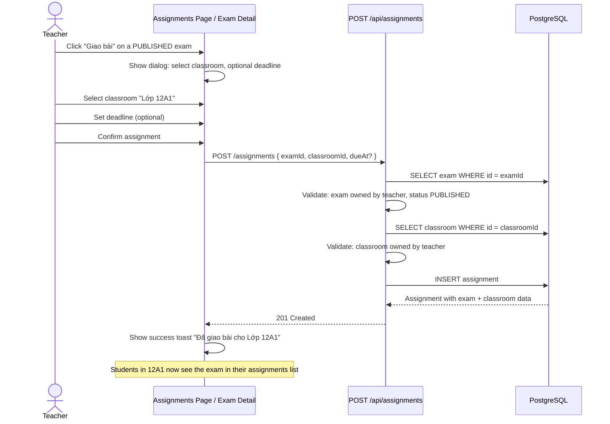
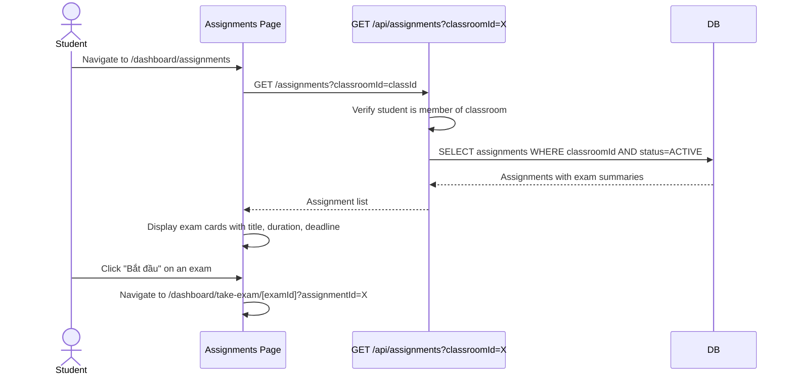
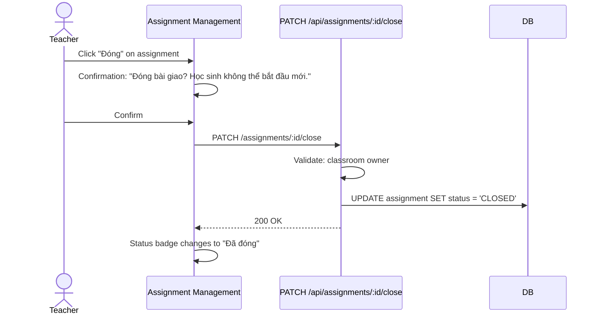
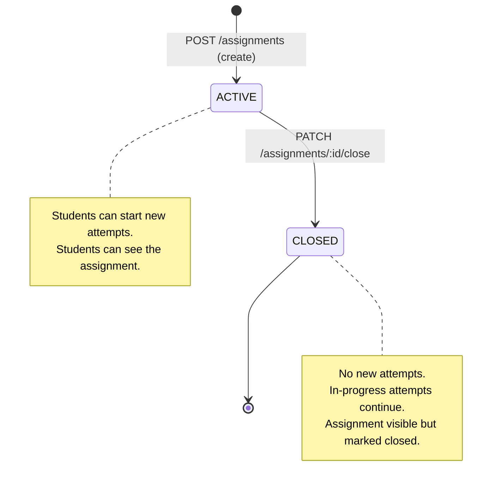

# D5. Assign Exam to Classroom

## 5.1 Feature Overview

| Field | Value |
|---|---|
| Feature ID | D5 |
| Feature Name | Assign Exam to Classroom |
| Module | D. Exam Management / F. Assignment Management |
| Priority | P0 |
| Complexity | S |
| Status | Existing — fully implemented (backend + frontend) |
| Target Roles | TEACHER (assign), STUDENT (view) |
| Business Objective | Bridge the gap between exam creation and student access by linking a published exam to a classroom, making it available to all classroom members |
| User Problem | Teachers need to distribute exams to specific groups of students. Students need to see which exams they have been assigned and their availability status |
| Dependencies | D1 (Create Exam), D4 (Publish), B1 (Create Classroom), B2 (Join Classroom) |

## 5.2 Actors and Permissions

### Teacher

| Action | Allowed | Notes |
|---|---|---|
| Create assignment (assign exam to classroom) | Yes | Must own both the exam and the classroom |
| Close assignment | Yes | Classroom owner only |
| View assignments for own exams | Yes | Filtered by exam ownership |
| Delete assignment | Not implemented | See Open Questions |

### Student

| Action | Allowed | Notes |
|---|---|---|
| View assignments for joined classrooms | Yes | Only sees ACTIVE assignments in their classrooms |
| Start attempt from assignment | Yes | Via attempts module (see E1) |
| Create/close/delete assignments | **No** | Forbidden |

### Backend Authorization Details

- **Create**: Validates `exam.ownerId === teacherId` AND `classroom.ownerId === teacherId`. Both checks are explicit.
- **Close**: Validates `assignment.classroom.ownerId === teacherId`.
- **List (GET /assignments)**: Student path checks classroom membership. Teacher path checks classroom ownership.
- **Get single (GET /assignments/:id)**: Currently has NO authorization check — any authenticated user can read any assignment by ID. **Security issue** — see Edge Cases.

## 5.3 Preconditions and Business Rules

| Rule ID | Rule | Enforcement |
|---|---|---|
| D5-R01 | Exam must be PUBLISHED to be assigned | Service checks `exam.status !== 'PUBLISHED'` |
| D5-R02 | Teacher must own the exam | Service checks `exam.ownerId !== teacherId` |
| D5-R03 | Teacher must own the classroom | Service checks `classroom.ownerId !== teacherId` |
| D5-R04 | Same exam cannot be assigned to same classroom twice | Database unique constraint `(examId, classroomId)` |
| D5-R05 | Assignment is created with status `ACTIVE` | Default in schema |
| D5-R06 | `dueAt` is optional. When null, there is no deadline | Nullable field |
| D5-R07 | Closing an assignment changes status to `CLOSED`. Students can no longer start new attempts for this assignment | Service updates status |
| D5-R08 | In-progress attempts when assignment is closed: students can still complete their current attempt (governed by `expiresAt`, not assignment status) | Attempt start checks assignment status; existing attempts use expiresAt |
| D5-R09 | A student sees an assignment only if they are a member of the assignment's classroom | List endpoint filters by membership |

## 5.4 Main User Flow — Happy Path

### Create Assignment



### Student Views Assignments



### Close Assignment



## 5.5 Alternative Flows

### AF-01: Assign same exam to multiple classrooms
1. Teacher has 3 classrooms: 12A1, 12A2, 12A3.
2. Teacher assigns the same published exam to each classroom separately.
3. Three Assignment records are created (one per classroom).
4. Students in each classroom see the exam independently.

### AF-02: Assign with deadline
1. Teacher sets `dueAt` to 2026-12-01T23:59:59Z.
2. Assignment is created with the deadline.
3. **Note**: Deadline enforcement is NOT yet implemented in the attempt start logic. See Open Questions. The `dueAt` field exists but the backend does not currently block attempts after the deadline.

### AF-03: Student joins classroom after assignment
1. Teacher assigns exam to classroom.
2. A new student joins the classroom.
3. Student can see and take the exam (assignment is linked to classroom, not to specific students).

### AF-04: Student removed from classroom after assignment
1. Student has an active assignment visible.
2. Teacher removes student from classroom.
3. Student can no longer see the assignment (list query checks membership).
4. If student has an in-progress attempt, they can still complete it (attempt is linked directly to exam/student, not gated by ongoing membership checks).

## 5.6 Edge Cases and Failure Scenarios

| Scenario ID | Scenario | Trigger | Expected Behavior | User Feedback | Data Integrity | Recovery | Severity |
|---|---|---|---|---|---|---|---|
| D5-E01 | Assign DRAFT exam | Teacher tries to assign unpublished exam | 400 "Can only assign PUBLISHED exams" | Error toast | No assignment created | Publish exam first | Medium |
| D5-E02 | Assign to unowned classroom | Teacher assigns to another teacher's classroom | 400 "Classroom not found or not owned by you" | Error message | No assignment created | Use own classroom | Medium |
| D5-E03 | Duplicate assignment | Assign same exam to same classroom twice | Prisma unique constraint violation on `(examId, classroomId)` | **Currently 500** — should be a clean 409 or 400 with message "Already assigned" | No duplicate created | None needed | High |
| D5-E04 | Assign to archived classroom | Classroom has `archivedAt` set | **Currently allowed** — no check for archive status | Assignment created but students may not see archived classroom | Functional but confusing | Check archive status at creation | Medium |
| D5-E05 | Close assignment while students taking exam | Students have IN_PROGRESS attempts | Assignment status → CLOSED. New attempts blocked. **Existing attempts continue** — governed by expiresAt | Students in exam see no change. New students see "Đã đóng" | In-progress attempts safe | Expected behavior | Low |
| D5-E06 | GET /assignments/:id without authorization | Any user accesses any assignment ID | **Currently returns the assignment** — no membership or ownership check on single-get endpoint | Full assignment data exposed | Information leak (exam and classroom details) | Add authorization check | High |
| D5-E07 | Assign exam with past `availableUntil` | Exam's availability window has expired | Assignment is created. Students see it but cannot start (blocked by attempt start validation) | Student sees exam but "Đã hết hạn" when trying to start | Assignment exists but is useless | Teacher should check exam time window | Low |
| D5-E08 | Classroom has 0 members | Teacher assigns to empty classroom | Assignment is created. No one can see it | No immediate impact | Valid state | Students will see it when they join | Low |
| D5-E09 | `dueAt` in the past | Teacher sets a past deadline | Assignment is created with past deadline. **Currently not validated** | No warning | Students may be confused if deadline enforcement is implemented later | Validate dueAt > now at creation | Medium |
| D5-E10 | Concurrent close requests | Two clicks on close button | First succeeds, second also succeeds (idempotent — already CLOSED) | No error on either | Safe | None needed | Low |
| D5-E11 | Teacher closes assignment, then wants to reopen | Teacher regrets closing | **No reopen endpoint exists** | Cannot undo | Assignment stays CLOSED | Create a new assignment. Or implement reopen | Medium |

## 5.7 UI/UX Specification

### Assignment Creation

| Element | Description |
|---|---|
| Entry point | "Giao bài" button on exam detail page (PUBLISHED) or from assignment management page |
| Dialog | Select classroom from dropdown (own classrooms only), optional date-time picker for deadline |
| Classroom selector | Dropdown listing teacher's classrooms, excluding archived |
| Deadline picker | Date-time input, optional. Label "Hạn nộp bài (tùy chọn)" |
| Submit | Primary Blue button "Giao bài" |

### Student Assignment List

| Element | Description |
|---|---|
| Location | `/dashboard/assignments` |
| Card content | Exam title, classroom name, duration, deadline (if set), status |
| Action button | "Bắt đầu" → navigates to take-exam page |
| Status badges | ACTIVE: Info blue. CLOSED: Muted. Completed: Success green |

### Teacher Assignment Management

| Element | Description |
|---|---|
| Location | `/dashboard/assignments` (teacher view) |
| Content | List of assignments grouped by exam or classroom |
| Actions | "Đóng" button to close assignment |
| Status display | ACTIVE / CLOSED badge |

### Responsive Behavior
- Desktop: Table layout with exam, classroom, deadline, status, actions columns.
- Mobile: Card layout stacked, with exam title as heading and metadata below.

## 5.8 Data Requirements

### Existing Entity: `Assignment`

| Field | Type | Required | Default | Notes |
|---|---|---|---|---|
| id | UUID | Auto | uuid() | PK |
| examId | UUID FK → Exam | Yes | — | |
| classroomId | UUID FK → Classroom | Yes | — | |
| assignedAt | DateTime | Auto | now() | |
| dueAt | DateTime? | No | null | Deadline — not enforced yet |
| status | AssignmentStatus | Yes | ACTIVE | ACTIVE / CLOSED |
| hideResults | Boolean | Yes | false | P2 feature — not yet used |

### Constraints

| Constraint | Type | Columns |
|---|---|---|
| Primary key | PK | `id` |
| Unique per exam per classroom | UNIQUE | `(examId, classroomId)` |
| FK to exam | FK | `examId` → `exams.id` |
| FK to classroom | FK | `classroomId` → `classrooms.id` |

### Proposed Schema Changes
None — schema is complete.

## 5.9 API Requirements

### POST /api/assignments — Create Assignment

| Attribute | Value |
|---|---|
| Method | POST |
| Path | `/api/assignments` |
| Purpose | Assign a published exam to a classroom |
| Required Role | TEACHER |
| Authorization | Must own both exam and classroom |

**Request Body:**
```json
{
  "examId": "uuid",
  "classroomId": "uuid",
  "dueAt": "2026-12-01T23:59:59.000Z"
}
```

**Success Response (201):**
```json
{
  "success": true,
  "data": {
    "id": "assignment-uuid",
    "examId": "exam-uuid",
    "classroomId": "classroom-uuid",
    "assignedAt": "2026-11-11T...",
    "dueAt": "2026-12-01T23:59:59.000Z",
    "status": "ACTIVE",
    "exam": { "id": "...", "title": "..." },
    "classroom": { "id": "...", "name": "..." }
  }
}
```

**Error Responses:**

| Status | Condition |
|---|---|
| 400 | Exam not found or not owned |
| 400 | Exam not PUBLISHED |
| 400 | Classroom not found or not owned |
| 409 | Already assigned to this classroom (unique constraint) — **currently returns 500** |
| 401 | Unauthenticated |
| 403 | Not TEACHER role |

### GET /api/assignments — List Assignments

| Attribute | Value |
|---|---|
| Method | GET |
| Path | `/api/assignments?classroomId=uuid` |
| Purpose | List assignments for a classroom |
| Required Role | Both (role-aware filtering) |
| Authorization | Teacher: must own classroom. Student: must be member |

**Query Parameters:**

| Param | Required | Notes |
|---|---|---|
| classroomId | Yes | Filter by classroom |

**Success Response (200):**
```json
{
  "success": true,
  "data": [
    {
      "id": "uuid",
      "examId": "uuid",
      "classroomId": "uuid",
      "assignedAt": "...",
      "dueAt": "...",
      "status": "ACTIVE",
      "exam": { "id": "...", "title": "...", "durationSeconds": 2700 }
    }
  ]
}
```

### GET /api/assignments/:id — Get Assignment Detail

| Attribute | Value |
|---|---|
| Method | GET |
| Path | `/api/assignments/:id` |
| Purpose | Get single assignment detail |
| **Security Note** | **No authorization check** — any authenticated user can read. Needs fix |

### PATCH /api/assignments/:id/close — Close Assignment

| Attribute | Value |
|---|---|
| Method | PATCH |
| Path | `/api/assignments/:id/close` |
| Purpose | Set assignment status to CLOSED |
| Required Role | TEACHER (classroom owner) |
| Authorization | Classroom owner only |

**Success Response (200):** Updated assignment object.

## 5.10 State Management

### Assignment Lifecycle



### Interaction with Exam Lifecycle

| Exam Status | Can Create Assignment? | Can Students Take Exam? |
|---|---|---|
| DRAFT | No | No |
| PUBLISHED | Yes | Yes (if ACTIVE assignment exists) |
| ARCHIVED | No (proposed) | No (proposed — existing attempts can finish) |

## 5.11 Acceptance Criteria

```
Given a teacher owns a PUBLISHED exam and a classroom,
When they create an assignment linking the two,
Then the assignment is created with status ACTIVE.

Given a student is a member of the classroom,
When they query assignments for that classroom,
Then they see the new assignment with exam summary.

Given a teacher assigns the same exam to the same classroom again,
When the request is processed,
Then the backend rejects with a duplicate error.

Given a teacher closes an assignment,
When a student tries to start a new attempt,
Then the backend rejects the attempt start.

Given a student has an IN_PROGRESS attempt when the assignment is closed,
When the student continues answering and submits,
Then the submission succeeds (governed by expiresAt, not assignment status).

Given a student is not a member of the classroom,
When they query assignments for that classroom,
Then the backend returns 403.
```

## 5.12 QA Test Scenarios

| Test ID | Scenario | Preconditions | Steps | Expected Result | Priority |
|---|---|---|---|---|---|
| D5-T01 | Create valid assignment | PUBLISHED exam, owned classroom | POST /assignments | 201, assignment created | Critical |
| D5-T02 | Assign DRAFT exam | DRAFT exam | POST /assignments | 400, "Can only assign PUBLISHED" | High |
| D5-T03 | Assign to unowned classroom | Teacher A's exam, Teacher B's classroom | POST /assignments as Teacher A | 400 | High |
| D5-T04 | Assign unowned exam | Teacher B's exam, Teacher A's classroom | POST /assignments as Teacher A | 400 | High |
| D5-T05 | Duplicate assignment | Already assigned exam to classroom | POST /assignments again | Error (unique constraint) | High |
| D5-T06 | Student lists assignments | Student in classroom, assignment exists | GET /assignments?classroomId=X | Returns the assignment | High |
| D5-T07 | Student not in classroom | Student not a member | GET /assignments?classroomId=X | 403 | High |
| D5-T08 | Close assignment | Teacher owns classroom | PATCH /assignments/:id/close | 200, status=CLOSED | High |
| D5-T09 | Close assignment — not owner | Teacher B tries to close | PATCH /assignments/:id/close | 403 | High |
| D5-T10 | GET single assignment — no auth check | Any user | GET /assignments/:id | **Current**: returns data. **Expected**: should check authorization | Critical (security) |
| D5-T11 | Student joins classroom after assignment | New student joins classroom | GET /assignments as new student | Sees the assignment | Medium |
| D5-T12 | Close then start attempt | Assignment CLOSED | Student tries POST /attempts/start | Rejected (assignment not ACTIVE) | High |

## 5.13 Open Questions

| # | Question | Why It Matters | Options | Recommended Default | Impact |
|---|---|---|---|---|---|
| D5-Q01 | Should `GET /assignments/:id` have authorization? | Currently any user can read any assignment by ID | (a) Check membership/ownership, (b) Keep open | (a) Add authorization — check if user is classroom member or exam owner | High — security fix needed |
| D5-Q02 | Should `dueAt` be enforced at attempt start? | Currently deadline exists but is not enforced | (a) Block new attempts after dueAt, (b) Treat as informational only | (a) Enforce — students should not start after deadline | Medium |
| D5-Q03 | Should assignment reopen be supported? | Teacher may close by mistake | (a) Allow CLOSED→ACTIVE transition, (b) Teacher creates new assignment, (c) Don't support | (a) Add a reopen endpoint | Low |
| D5-Q04 | Should assignment deletion be supported? | Teacher may want to remove an accidental assignment | (a) Allow if no attempts exist, (b) Soft delete, (c) No delete | (a) Hard delete only if 0 attempts | Medium |
| D5-Q05 | Should assigning to archived classrooms be blocked? | Currently allowed — creates confusing state | (a) Block with 400 "Classroom is archived", (b) Allow | (a) Block | Low |
| D5-Q06 | Should notifications be triggered on assignment creation? | Students should know they have a new exam | (a) Create notification for each classroom member, (b) Rely on polling, (c) Both | (a) Use NotificationsService.createMany — infrastructure exists but is not wired in | Medium |
| D5-Q07 | Should `hideResults` be settable at assignment time? | Field exists in schema but not in create DTO | (a) Add to DTO, (b) Remove field, (c) Defer | (a) Add when result visibility feature is polished | Low |
