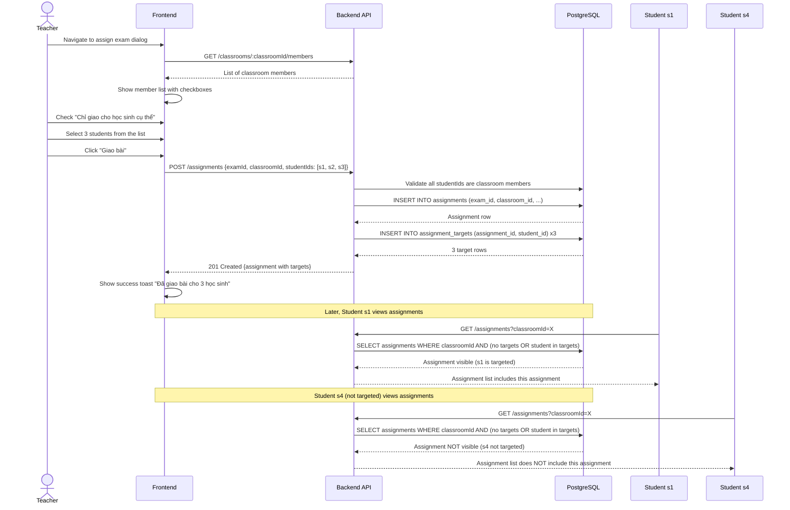

# D11. Assign to Specific Students

## 5.1 Feature Overview

| Field | Value |
|---|---|
| Feature ID | D11 |
| Feature Name | Assign to Specific Students |
| Module | D. Exam Management |
| Priority | P2 |
| Complexity | M |
| Status | Proposed — not implemented |
| Target Roles | TEACHER |
| Business Objective | Allow teachers to restrict an exam assignment to specific students within a classroom, rather than assigning to the entire class. Supports differentiated instruction, makeup exams, and targeted assessments. |
| User Problem | Currently an assignment is linked to an entire classroom (`@@unique([examId, classroomId])`). Every member of the classroom sees the assignment and can start the exam. Teachers cannot assign a makeup quiz to 3 students or give an advanced test to a subset of the class without creating a separate classroom. |
| Dependencies | D5 (Assign Exam to Classroom — F1), B2 (Join Classroom), B3 (Manage Students) |

## 5.2 Actors and Permissions

### Teacher (TEACHER)

| Action | Allowed | Notes |
|---|---|---|
| Create assignment with specific student list for own classroom | Yes | Exam must be PUBLISHED, classroom must be owned by teacher |
| Create assignment with no student list (full classroom, current behavior) | Yes | Backward-compatible default |
| Update student list on existing ACTIVE assignment | Yes | Only for own classroom |
| View which students are targeted | Yes | Assignment detail includes target list |
| Assign students who are not members of the classroom | **No** | Backend rejects; all targeted students must be current members |

### Student (STUDENT)

| Action | Allowed | Notes |
|---|---|---|
| See targeted assignment in their assignment list | Yes | Only if they are in the target list (or if no target list, meaning full classroom) |
| See non-targeted assignment | **No** | Assignment is hidden from their list |
| Start attempt for non-targeted assignment | **No** | Backend rejects with 403 at attempt start |

### Backend Authorization

- `AssignmentsController.create()` requires `@Roles('TEACHER')`.
- Teacher must own both the exam and the classroom.
- When a student list is provided, every student ID must correspond to a current member of the classroom.
- Assignment visibility and attempt start checks must verify student targeting.

## 5.3 Preconditions and Business Rules

### Preconditions

- User must be authenticated with a valid JWT.
- For creating/updating a targeted assignment: user must have role `TEACHER` and own both the exam and the classroom.
- Exam must be in PUBLISHED status.
- Classroom must not be archived.

### Business Rules

| Rule ID | Rule | Enforcement |
|---|---|---|
| D11-R01 | An `Assignment` has an optional student target list. When the list is null or empty, the assignment applies to all current and future members of the classroom (existing behavior). When the list is non-empty, only the listed students can see or attempt the exam. | Backend |
| D11-R02 | Every student ID in the target list must be a current member of the classroom (`ClassroomMember` row exists with `classroomId` and `userId`). If any ID is not a member, the request fails with 400 and lists the invalid IDs. | Backend |
| D11-R03 | The target list is stored in a new junction table `AssignmentTarget` with `@@unique([assignmentId, studentId])`. This avoids a JSON array column (which cannot be indexed or foreign-key constrained). | Backend |
| D11-R04 | When a student queries their assignment list (`GET /api/assignments?classroomId=X`), the backend filters: include assignments where (a) no `AssignmentTarget` rows exist for that assignment (whole classroom), OR (b) an `AssignmentTarget` row exists with the student's ID. | Backend |
| D11-R05 | When a student starts an attempt (`POST /api/exams/:id/attempts`), the backend checks: if the assignment has targets, the student must be in the target list. If not, return 403 `NOT_TARGETED`. | Backend |
| D11-R06 | If a targeted student is later removed from the classroom (`ClassroomMember` deleted), the `AssignmentTarget` row is **not** automatically deleted. The student can no longer start new attempts (membership check fails first), but existing attempts and results are preserved. | Backend — by design (no cascade) |
| D11-R07 | A teacher can update the target list of an ACTIVE assignment: add new students (must be classroom members) or remove students. Removing a student from the target list does not delete their existing attempts or scores. | Backend |
| D11-R08 | The existing `@@unique([examId, classroomId])` constraint on `Assignment` is preserved. A classroom still gets at most one assignment per exam. The target list refines who within that classroom can take it. | Backend — existing constraint |
| D11-R09 | The maximum number of targeted students per assignment is the classroom membership count. There is no hard cap beyond that. | Backend |
| D11-R10 | When a teacher views assignment details, the response includes the target student list with their display names and IDs, or `null` if the assignment targets the full classroom. | Backend |

## 5.4 Main User Flow — Happy Path



### Step-by-Step

1. Teacher navigates to the exam detail page and clicks "Giao bài" (Assign).
2. Teacher selects a classroom from their classroom list.
3. Frontend loads the classroom member list.
4. Teacher toggles the "Chỉ giao cho học sinh cụ thể" checkbox. When unchecked (default), the assignment targets the whole classroom.
5. When checked, a member list with checkboxes appears. Teacher selects the target students.
6. Teacher optionally sets a due date, then clicks "Giao bài".
7. Frontend sends `POST /api/assignments` with the `studentIds` array.
8. Backend validates: exam ownership, classroom ownership, PUBLISHED status, all student IDs are classroom members.
9. Backend creates the `Assignment` row and the `AssignmentTarget` rows in a transaction.
10. Success toast confirms the action.

## 5.5 Alternative Flows

### AF-01: Assign to full classroom (existing behavior)

1. Teacher does not check "Chỉ giao cho học sinh cụ thể".
2. `studentIds` is not sent (or sent as null).
3. Backend creates the Assignment with no AssignmentTarget rows.
4. All classroom members see the assignment. Behavior is identical to the current implementation.

### AF-02: Update target list — add students

1. Teacher views an existing ACTIVE assignment.
2. Teacher clicks "Chỉnh sửa đối tượng" (Edit targets).
3. The current target list is shown with checkboxes (currently selected students are pre-checked).
4. Teacher checks additional students and clicks "Lưu".
5. Frontend sends `PATCH /api/assignments/:id/targets` with the updated student ID list.
6. Backend adds new `AssignmentTarget` rows for added students. Removed students' target rows are deleted (but their attempts are preserved).

### AF-03: Update target list — remove a student

1. Teacher unchecks a student in the target edit view.
2. The `AssignmentTarget` row for that student is deleted.
3. The student can no longer see the assignment in their list or start new attempts.
4. If the student had an existing attempt (IN_PROGRESS or SUBMITTED), it remains untouched.

### AF-04: Switch from targeted to full classroom

1. Teacher unchecks "Chỉ giao cho học sinh cụ thể" in the edit view.
2. Frontend sends `PATCH /api/assignments/:id/targets` with `studentIds: null`.
3. Backend deletes all `AssignmentTarget` rows for the assignment.
4. All classroom members can now see and attempt the exam.

### AF-05: Switch from full classroom to targeted

1. Teacher checks "Chỉ giao cho học sinh cụ thể" on an existing whole-classroom assignment.
2. Teacher selects specific students.
3. Backend creates `AssignmentTarget` rows.
4. Non-targeted students can no longer see the assignment. Their existing attempts (if any) are preserved.

### AF-06: New student joins classroom after targeted assignment

1. A targeted assignment exists for students [s1, s2, s3].
2. Student s5 joins the classroom.
3. s5 does not see the assignment (not in target list).
4. Teacher must explicitly add s5 to the target list if they should take the exam.

## 5.6 Edge Cases and Failure Scenarios

| Scenario ID | Scenario | Trigger | Expected Behavior | User Feedback | Data Integrity | Recovery | Severity |
|---|---|---|---|---|---|---|---|
| D11-E01 | Student ID not a classroom member | Teacher includes a user ID that is not in the classroom | Backend returns 400 `INVALID_STUDENTS` with the invalid IDs | "Các học sinh sau không thuộc lớp học: [names]" | No data written | Remove invalid IDs and retry | Medium |
| D11-E02 | Student removed from classroom after targeting | ClassroomMember deleted, AssignmentTarget still exists | Student cannot start attempt (membership check fails before target check). Assignment target row is orphaned but harmless. | Student sees nothing (no classroom access) | Orphaned target row, no functional impact | Teacher can remove from target list (optional cleanup) | Low |
| D11-E03 | Non-targeted student tries to start attempt via direct API call | Student crafts POST /exams/:id/attempts with the assignment ID | Backend checks target list, returns 403 `NOT_TARGETED` | "Bạn không được giao bài thi này" | No attempt created | None needed | High |
| D11-E04 | Teacher targets a student, student starts attempt, then teacher removes student from target | Target removed after attempt started | IN_PROGRESS attempt continues (no interruption). Student can submit. Cannot start a new attempt. | No visible change during active attempt | Existing attempt preserved. Score preserved. | By design — no disruption to active attempts | Medium |
| D11-E05 | Duplicate student IDs in request | `studentIds: ["s1", "s1", "s2"]` | Backend deduplicates silently. Creates 2 AssignmentTarget rows. | No error; duplicates ignored | No duplicates in database (unique constraint) | N/A | Low |
| D11-E06 | Empty studentIds array vs null | `studentIds: []` sent | Treated as full classroom assignment (same as null). No target rows created. | Normal assignment creation | Consistent with "no targeting" | N/A | Low |
| D11-E07 | Assignment already exists for classroom | `@@unique([examId, classroomId])` violated | Backend returns 400 `ASSIGNMENT_EXISTS` (existing behavior) | "Bài thi đã được giao cho lớp này" | No data written | Edit existing assignment's target list instead | Medium |
| D11-E08 | Teacher assigns to archived classroom | Classroom.archivedAt is not null | Backend returns 400 `CLASSROOM_ARCHIVED` | "Không thể giao bài cho lớp đã lưu trữ" | No data written | Unarchive classroom first | Low |
| D11-E09 | All targeted students removed from target list | Teacher removes all students, leaving target list empty | Treated as switching to full classroom (D11-R01: empty list = all students) | Assignment now visible to all classroom members | AssignmentTarget rows deleted | By design | Low |

## 5.7 UI/UX Specification

### Assignment Creation Flow

The existing assignment creation dialog is extended with a targeting option.

| Element | Description |
|---|---|
| Targeting toggle | Checkbox: "Chỉ giao cho học sinh cụ thể". Default: unchecked (full classroom). |
| Student selector | Visible only when toggle is checked. Shows a scrollable list of classroom members with checkboxes. Each row: checkbox + display name + email. Search/filter input at top: "Tìm học sinh..." |
| Selected count | Below the list: "Đã chọn: X / Y học sinh" |
| Select all / Deselect all | Quick-action links above the list |

### Assignment Detail View

| Element | Description |
|---|---|
| Target indicator | Badge next to assignment title: "Toàn lớp" (full classroom) or "X học sinh" (targeted) |
| Target list | Expandable section showing targeted student names. "Chỉnh sửa" link to open edit dialog. |
| Edit targets dialog | Same student selector as creation, pre-filled with current targets. "Lưu" saves changes. |

### Student Assignment List

- No UI changes for the student. Targeted assignments appear identically to full-classroom assignments. The student does not see that they were specifically targeted.
- Non-targeted assignments simply do not appear in the list.

### Responsive Behavior

| Breakpoint | Layout |
|---|---|
| >= 768px | Student selector as a scrollable list (max-h-64) within the dialog |
| < 768px | Student selector as a full-screen sheet with sticky search bar at top and "Xong" button at bottom |

### States

| State | Behavior |
|---|---|
| Toggle off (default) | Student selector hidden. Assignment targets whole classroom. |
| Toggle on, no selection | "Giao bài" button disabled. Hint: "Chọn ít nhất một học sinh" |
| Toggle on, students selected | "Giao bài" button enabled. Selected count shown. |
| Saving | Button shows spinner, inputs disabled |
| Error | Toast with error message, dialog remains open |

## 5.8 Data Requirements

### Existing Entities Used

- **Assignment**: Extended with an optional association to `AssignmentTarget`. No column changes.
- **ClassroomMember**: Read to validate that targeted students are classroom members.
- **User**: Display name and email shown in the student selector UI.
- **ExamAttempt**: Attempt start logic updated to check targets. No schema change.

### Proposed Schema Changes

**New model: `AssignmentTarget`**

```prisma
model AssignmentTarget {
  id           String @id @default(uuid()) @db.Uuid
  assignmentId String @map("assignment_id") @db.Uuid
  studentId    String @map("student_id") @db.Uuid

  assignment Assignment @relation(fields: [assignmentId], references: [id], onDelete: Cascade)
  student    User       @relation(fields: [studentId], references: [id], onDelete: Cascade)

  @@unique([assignmentId, studentId])
  @@index([studentId])
  @@map("assignment_targets")
}
```

**Relationship additions:**

- `Assignment` gains `targets AssignmentTarget[]`.
- `User` gains `assignmentTargets AssignmentTarget[]`.

**Design rationale:** A junction table is preferred over a JSON array on `Assignment` because:
1. Foreign key constraints ensure referential integrity.
2. The `studentId` index enables efficient queries: "find all assignments targeting this student".
3. `onDelete: Cascade` on `assignmentId` automatically cleans up targets when an assignment is deleted.
4. `onDelete: Cascade` on `studentId` automatically removes targets when a user is deleted.

## 5.9 API Requirements

### POST /api/assignments — Create Assignment (modified)

The existing endpoint is extended with an optional `studentIds` field.

| Attribute | Value |
|---|---|
| Method | POST |
| Path | `/api/assignments` |
| Purpose | Create an assignment, optionally targeting specific students |
| Required Role | TEACHER |
| Changes | New optional field `studentIds` in request body |

**Updated Request Body:**

```json
{
  "examId": "exam-uuid",
  "classroomId": "classroom-uuid",
  "dueAt": "2026-12-01T23:59:59Z",
  "studentIds": ["student-uuid-1", "student-uuid-2", "student-uuid-3"]
}
```

**New Validation Rules:**

| Field | Type | Required | Constraints | Error code | Error message |
|---|---|---|---|---|---|
| `studentIds` | array of UUIDs | No | If provided and non-empty: each UUID must be a ClassroomMember of the specified classroom. Duplicates silently ignored. | `INVALID_STUDENTS` | "Các học sinh sau không thuộc lớp học: [displayNames]" |

**Updated Success Response (201):**

```json
{
  "success": true,
  "data": {
    "id": "assignment-uuid",
    "examId": "exam-uuid",
    "classroomId": "classroom-uuid",
    "dueAt": "2026-12-01T23:59:59Z",
    "status": "ACTIVE",
    "assignedAt": "2026-11-12T10:00:00Z",
    "targetType": "SPECIFIC",
    "targets": [
      { "studentId": "student-uuid-1", "displayName": "Nguyễn Văn A" },
      { "studentId": "student-uuid-2", "displayName": "Trần Thị B" },
      { "studentId": "student-uuid-3", "displayName": "Lê Văn C" }
    ]
  }
}
```

When `studentIds` is null or omitted:

```json
{
  "success": true,
  "data": {
    "id": "assignment-uuid",
    "examId": "exam-uuid",
    "classroomId": "classroom-uuid",
    "dueAt": "2026-12-01T23:59:59Z",
    "status": "ACTIVE",
    "assignedAt": "2026-11-12T10:00:00Z",
    "targetType": "ALL",
    "targets": null
  }
}
```

---

### PATCH /api/assignments/:id/targets — Update Target Students

| Attribute | Value |
|---|---|
| Method | PATCH |
| Path | `/api/assignments/:id/targets` |
| Purpose | Replace the target student list for an existing assignment |
| Required Role | TEACHER (classroom owner) |
| New endpoint | Yes |

**Request Body:**

```json
{
  "studentIds": ["student-uuid-1", "student-uuid-4"]
}
```

To switch to full classroom: `{ "studentIds": null }` or `{ "studentIds": [] }`.

**Validation Rules:**

| Field | Type | Required | Constraints | Error code | Error message |
|---|---|---|---|---|---|
| `studentIds` | array of UUIDs or null | Yes | If non-null and non-empty: each UUID must be a ClassroomMember. | `INVALID_STUDENTS` | "Các học sinh sau không thuộc lớp học: [displayNames]" |

**Success Response (200):**

```json
{
  "success": true,
  "data": {
    "id": "assignment-uuid",
    "targetType": "SPECIFIC",
    "targets": [
      { "studentId": "student-uuid-1", "displayName": "Nguyễn Văn A" },
      { "studentId": "student-uuid-4", "displayName": "Phạm Văn D" }
    ],
    "addedCount": 1,
    "removedCount": 2
  }
}
```

**Error Responses:**

| Status | Code | Condition |
|---|---|---|
| 400 | `INVALID_STUDENTS` | One or more student IDs are not classroom members |
| 400 | `ASSIGNMENT_CLOSED` | Assignment status is CLOSED |
| 401 | Unauthorized | No valid JWT |
| 403 | Forbidden | Teacher is not the classroom owner |
| 404 | Not Found | Assignment does not exist |

**Backend logic:**
1. Load current `AssignmentTarget` rows.
2. Compute diff: added = new IDs not in current; removed = current IDs not in new.
3. In a transaction: delete removed targets, insert added targets.
4. Existing attempts for removed students are **not** affected.

---

### GET /api/assignments (modified — student view)

**Current behavior:** Returns all ACTIVE assignments for the classroom.

**Updated behavior:** Filter additionally by targeting:

```sql
WHERE a.classroom_id = :classroomId
  AND a.status = 'ACTIVE'
  AND (
    NOT EXISTS (SELECT 1 FROM assignment_targets WHERE assignment_id = a.id)
    OR EXISTS (SELECT 1 FROM assignment_targets WHERE assignment_id = a.id AND student_id = :userId)
  )
```

No request/response shape change needed for the student. The filtering is transparent.

---

### GET /api/assignments/:id (modified — teacher view)

**Updated response:** Includes `targetType` and `targets` fields when the requester is the classroom-owning teacher.

---

### POST /api/exams/:id/attempts (modified — start attempt)

**Updated validation** (added after existing membership check):

```
IF assignment has AssignmentTarget rows:
  IF student NOT in AssignmentTarget for this assignment:
    THROW 403 NOT_TARGETED "Bạn không được giao bài thi này"
```

## 5.10 State Management

### Assignment Targeting State

| State | Meaning | Transitions |
|---|---|---|
| No targets (targetType=ALL) | Assignment visible to all classroom members | Teacher adds targets → SPECIFIC |
| Targets set (targetType=SPECIFIC) | Assignment visible only to targeted students | Teacher clears targets → ALL. Teacher adds/removes students → stays SPECIFIC. |

The targeting state is derived from the presence of `AssignmentTarget` rows — there is no explicit `targetType` column.

### Impact on Existing States

- **Assignment status** (ACTIVE/CLOSED): Not affected. Targeting works within both states.
- **ExamAttempt**: No state changes. Existing attempts for de-targeted students remain in their current state.

## 5.11 Acceptance Criteria

### Happy Path

```
Given a teacher owns a classroom with 20 students and a PUBLISHED exam,
When they create an assignment with studentIds = [s1, s2, s3],
Then the assignment is created with 3 AssignmentTarget rows,
And only s1, s2, s3 see the assignment in their list.

Given a targeted assignment exists for [s1, s2, s3],
When student s4 calls GET /api/assignments?classroomId=X,
Then the assignment does NOT appear in the response.

Given a targeted assignment exists for [s1, s2, s3],
When student s1 calls GET /api/assignments?classroomId=X,
Then the assignment appears in the response.
```

### Attempt Start Enforcement

```
Given a targeted assignment for [s1, s2],
When student s3 (a classroom member but not targeted) tries POST /api/exams/:id/attempts,
Then the backend returns 403 with code NOT_TARGETED.

Given a targeted assignment for [s1, s2],
When student s1 tries POST /api/exams/:id/attempts,
Then the attempt is created normally.
```

### Full Classroom (backward compatibility)

```
Given a teacher creates an assignment without studentIds,
When any classroom member calls GET /api/assignments?classroomId=X,
Then the assignment appears in the response.

Given a full-classroom assignment exists,
When any classroom member starts an attempt,
Then no target check is performed and the attempt starts normally.
```

### Update Targets

```
Given a targeted assignment for [s1, s2, s3],
When the teacher PATCHes targets to [s1, s4],
Then s2 and s3's AssignmentTarget rows are deleted,
And s4's AssignmentTarget row is created,
And s2 and s3's existing attempts (if any) remain intact.

Given a targeted assignment,
When the teacher PATCHes targets with studentIds: null,
Then all AssignmentTarget rows are deleted,
And the assignment becomes visible to all classroom members.
```

### Authorization

```
Given Teacher A owns a classroom,
When Teacher B tries to create a targeted assignment on that classroom,
Then the backend returns 403.

Given a STUDENT is authenticated,
When they try to PATCH assignment targets,
Then the backend returns 403.
```

### Validation

```
Given a classroom with members [s1, s2, s3],
When the teacher creates an assignment with studentIds = [s1, s99 (not a member)],
Then the backend returns 400 INVALID_STUDENTS listing s99.
```

## 5.12 QA Test Scenarios

| Test ID | Scenario | Preconditions | Steps | Test Data | Expected Result | Priority |
|---|---|---|---|---|---|---|
| D11-T01 | Create targeted assignment | PUBLISHED exam, classroom with 10 members | POST /assignments with studentIds = [s1, s2, s3] | 3 valid student IDs | 201, assignment + 3 AssignmentTarget rows | High |
| D11-T02 | Create full-classroom assignment (no change) | PUBLISHED exam, classroom | POST /assignments without studentIds | — | 201, no AssignmentTarget rows | High |
| D11-T03 | Targeted student sees assignment | After D11-T01 | GET /assignments?classroomId=X as s1 | — | Assignment in list | High |
| D11-T04 | Non-targeted student does not see assignment | After D11-T01 | GET /assignments?classroomId=X as s4 | — | Assignment NOT in list | High |
| D11-T05 | Non-targeted student cannot start attempt | After D11-T01 | POST /exams/:id/attempts as s4 | — | 403 NOT_TARGETED | High |
| D11-T06 | Targeted student can start attempt | After D11-T01 | POST /exams/:id/attempts as s1 | — | 201, attempt created | High |
| D11-T07 | Invalid student ID in target list | Classroom with [s1, s2] | POST /assignments with studentIds = [s1, s99] | s99 not a member | 400 INVALID_STUDENTS | High |
| D11-T08 | Update targets — add student | Targeted assignment for [s1, s2] | PATCH /assignments/:id/targets with [s1, s2, s3] | — | s3 added, response shows 3 targets | High |
| D11-T09 | Update targets — remove student | Targeted assignment for [s1, s2, s3] | PATCH /assignments/:id/targets with [s1] | — | s2, s3 removed. Their attempts preserved. | High |
| D11-T10 | Switch to full classroom | Targeted assignment for [s1, s2] | PATCH /assignments/:id/targets with null | — | All targets deleted, all members see assignment | Medium |
| D11-T11 | Switch from full to targeted | Full-classroom assignment | PATCH /assignments/:id/targets with [s1, s2] | — | 2 AssignmentTarget rows created | Medium |
| D11-T12 | Remove student from classroom after targeting | s1 targeted, then removed from classroom | Student s1 tries GET /assignments | — | Membership check fails first; assignment not visible | Medium |
| D11-T13 | Duplicate student IDs | — | POST /assignments with studentIds = [s1, s1, s2] | — | 201, 2 AssignmentTarget rows (deduplicated) | Medium |
| D11-T14 | Empty studentIds array | — | POST /assignments with studentIds = [] | — | Full-classroom assignment (no targets) | Medium |
| D11-T15 | Teacher not classroom owner | Teacher B's classroom | POST /assignments as Teacher A | — | 403 Forbidden | High |
| D11-T16 | CLOSED assignment — update targets | CLOSED assignment | PATCH /assignments/:id/targets | — | 400 ASSIGNMENT_CLOSED | Medium |
| D11-T17 | De-targeted student with active attempt | s2 has IN_PROGRESS attempt, teacher removes s2 from targets | Check s2's attempt status | — | Attempt remains IN_PROGRESS. s2 can submit (expiry/submit unchanged). Cannot start a new attempt. | High |
| D11-T18 | Full classroom — new member auto-included | Full-classroom assignment, new student joins | GET /assignments as new student | — | Assignment appears in list | Medium |
| D11-T19 | Targeted — new member NOT auto-included | Targeted assignment, new student joins | GET /assignments as new student | — | Assignment does NOT appear | Medium |

## 5.13 Open Questions and Assumptions

| # | Question | Why It Matters | Options | Recommended Default | Impact |
|---|---|---|---|---|---|
| D11-Q01 | Should removing a student from the target list cancel their IN_PROGRESS attempt? | Teacher may want to revoke access mid-exam, or may be correcting a mistake after the student has already started. | (a) Do not cancel — student can finish and submit. (b) Force-submit the attempt. (c) Cancel the attempt (lose answers). | (a) Do not cancel — least disruptive, preserves student work. Teacher can close the assignment entirely if needed. | High — affects student experience |
| D11-Q02 | Should the student see that they are specifically targeted (vs. a full-classroom assignment)? | Transparency vs. differentiation concerns. Some teachers may not want students to know they received a targeted assignment. | (a) No indication — targeted assignments look identical to full-classroom ones. (b) Show a "Giao riêng" badge. | (a) No indication — avoids social comparison and teacher preference varies | Low — UI only |
| D11-Q03 | Should notifications be sent to targeted students? | NEW_ASSIGNMENT notifications are not yet auto-triggered (J-GAP-01). When they are, should they go to all classroom members or only targets? | (a) Notify only targeted students. (b) Notify all members (leaks that an exam exists). | (a) Notify only targeted students — consistent with visibility rule. Implement when J-GAP-01 is resolved. | Low — blocked by J-GAP-01 |
| D11-Q04 | Should the `onDelete: Cascade` on `AssignmentTarget.studentId` (User) delete the target row when a user is deleted? | A deleted user cannot take exams anyway, so the target row is harmless but dead data. | (a) Cascade — clean up automatically. (b) SetNull — but studentId is required, so Cascade is the only option without making it nullable. | (a) Cascade — consistent with other user-linked tables and avoids dead rows | Low |

### Assumptions

| # | Assumption | Recommended Default | Impact if Wrong |
|---|---|---|---|
| D11-A01 | The `targetType` field in the API response is derived (from the presence of `AssignmentTarget` rows), not stored as a column. No new column on `Assignment`. | Derived field | If performance is an issue (counting targets on every list query), add a `hasTargets` boolean column. Minor migration. |
| D11-A02 | The PATCH targets endpoint replaces the entire target list (full replacement, not incremental add/remove). This simplifies the client: it sends the desired state, and the backend computes the diff. | Full replacement | If partial updates (add one, remove one) are needed, add separate endpoints. More API surface but lower network payload for large lists. |
| D11-A03 | When `studentIds` is sent as `[]` (empty array) in the create request, it is treated identically to `null` (full classroom). This avoids ambiguity between "no targeting" and "target zero students". | `[] === null === full classroom` | If a teacher intentionally wants to target zero students (assign but nobody can see it), this is not supported. An unlikely use case. |
