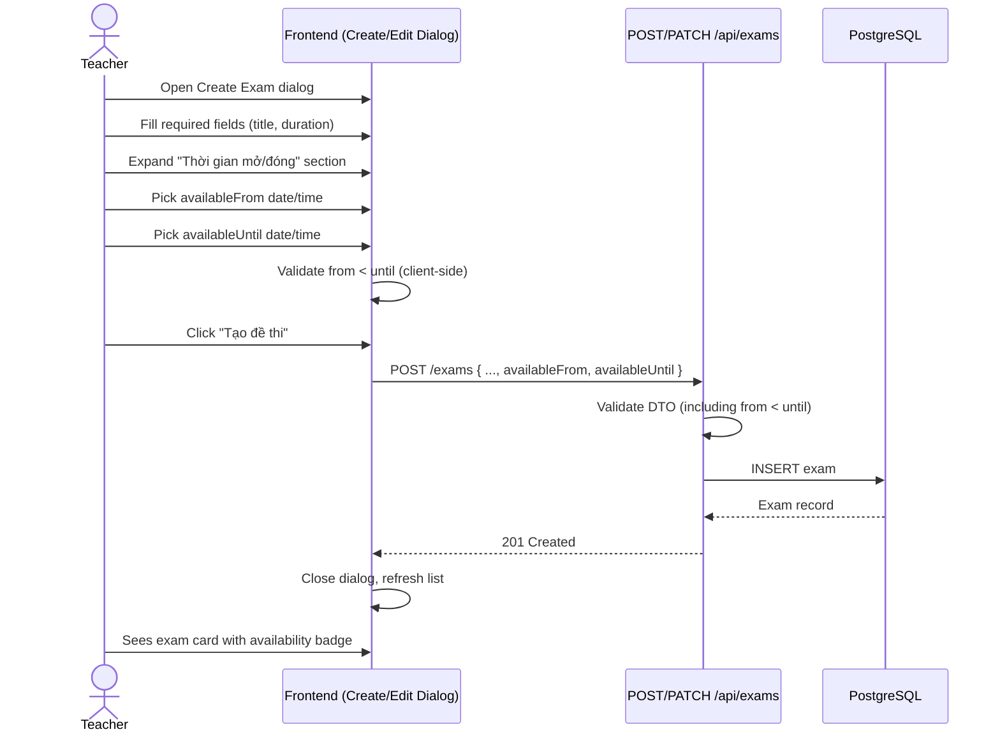
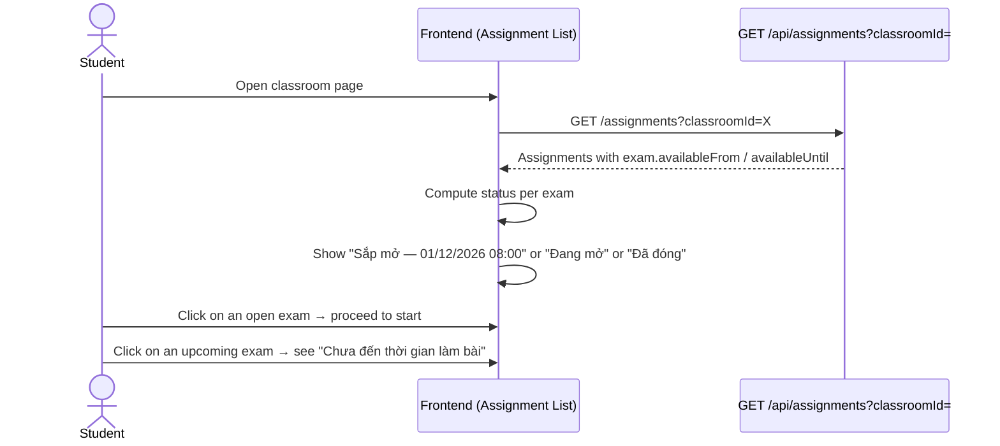
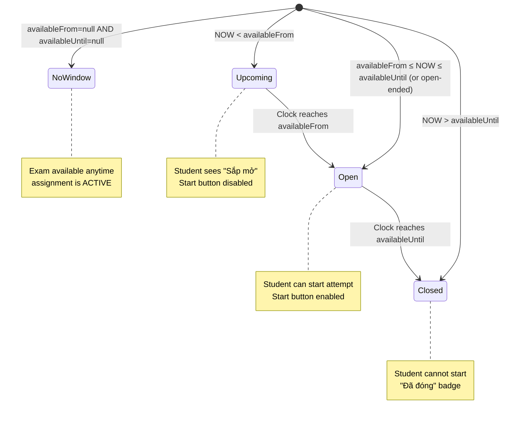

# D6. Exam Availability Window UI

## 5.1 Feature Overview

| Field | Value |
|---|---|
| Feature ID | D6 |
| Feature Name | Exam Availability Window UI |
| Module | D. Exam Management |
| Priority | P1 |
| Complexity | S |
| Status | Partial — schema fields exist (`availableFrom`, `availableUntil` on Exam), backend accepts them on create/edit, attempt-start checks `availableFrom`/`availableUntil`; **no UI** for setting them, no frontend display of availability status to students |
| Target Roles | TEACHER (configure), STUDENT (view status) |
| Business Objective | Let teachers control when an exam is accessible to students by setting a start and end time, and show students the exam's availability status so they know when they can start |
| User Problem | Teachers cannot set availability windows through the UI — fields are invisible in the create/edit dialog. Students see no indication of whether an exam is currently open, upcoming, or closed. |
| Dependencies | D1 (Create/Edit Exam), D5/F2 (Student Assignment View — for displaying status to students), E1 (Start Exam — existing backend enforcement) |

## 5.2 Actors and Permissions

### Teacher (TEACHER)

| Action | Allowed | Notes |
|---|---|---|
| Set `availableFrom` / `availableUntil` on create | Yes | DRAFT exam only |
| Update `availableFrom` / `availableUntil` on edit | Yes | DRAFT exam only (existing D1-R04 rule) |
| Clear availability window (set to null) | Yes | Makes exam available anytime while assignment is ACTIVE |
| View availability on own exams | Yes | Shown on exam detail and exam list |

### Student (STUDENT)

| Action | Allowed | Notes |
|---|---|---|
| View availability status on assigned exams | Yes | Shown in assignment list and exam instructions screen |
| Modify availability | **No** | No API endpoint exposed to students |

### Backend Authorization

- Setting `availableFrom`/`availableUntil` goes through the existing `POST /exams` and `PATCH /exams/:id` endpoints, both `@Roles('TEACHER')` with owner check.
- Student sees availability via the existing `GET /assignments?classroomId=` response, which includes exam data.
- The existing `AttemptsService.start()` already checks `availableFrom` and `availableUntil` (see `attempts.service.ts:25-30`).

## 5.3 Preconditions and Business Rules

### Preconditions
- User must be authenticated with a valid JWT.
- For setting the window: user must be a TEACHER owning the exam, and the exam must be in DRAFT status.
- For viewing the window: student must be a member of a classroom to which the exam is assigned.

### Business Rules

| Rule ID | Rule | Enforcement |
|---|---|---|
| D6-R01 | When both `availableFrom` and `availableUntil` are provided, `availableFrom` must be strictly before `availableUntil` | Backend — validate on create and update (new validation); Frontend — disable submit if `from >= until` |
| D6-R02 | `availableFrom` may be set without `availableUntil` (open-ended after start time) | Backend — accepts null `availableUntil`; Frontend — allows clearing end time |
| D6-R03 | `availableUntil` may be set without `availableFrom` (available until a deadline) | Backend — accepts null `availableFrom`; Frontend — allows clearing start time |
| D6-R04 | Both fields may be null (exam available anytime the assignment is ACTIVE) | Backend — no constraint; Frontend — default state on create |
| D6-R05 | Availability is checked server-side at attempt start using `NOW()` comparison. If `availableFrom` is set and `NOW() < availableFrom`, reject with "Bài thi chưa mở". If `availableUntil` is set and `NOW() > availableUntil`, reject with "Bài thi đã đóng" | Backend — existing logic in `AttemptsService.start()` (already implemented) |
| D6-R06 | When both `Exam.availableUntil` and `Assignment.dueAt` exist, the more restrictive (earlier) deadline applies at attempt start | Backend — check both; reject if either is exceeded. **Assumption** — see OQ-07 in `FEATURE_OPEN_QUESTIONS.md` |
| D6-R07 | `availableFrom` and `availableUntil` cannot be set to dates in the past on creation. They can be past dates on edit (teacher may need to adjust a just-passed window) | Backend — validate on create only; Frontend — datepicker shows warning for past dates but does not block |
| D6-R08 | The availability window validation (`from < until`) is enforced at both create and update time, not deferred to publish. Invalid windows should not exist even on DRAFT exams | Backend — DTO validator (new) |
| D6-R09 | Student-facing availability status is computed from `availableFrom`, `availableUntil`, and `NOW()`: "Sắp mở" (upcoming), "Đang mở" (open), "Đã đóng" (closed), or no label (no window set) | Frontend — computed from timestamps returned by API |

### Validation Rules (additions to D1 DTO)

| Field | Type | Required | Constraints | Error Message |
|---|---|---|---|---|
| `availableFrom` | ISO 8601 date string | No | Valid date; must be before `availableUntil` if both set | "Thời gian mở phải trước thời gian đóng" |
| `availableUntil` | ISO 8601 date string | No | Valid date; must be after `availableFrom` if both set | "Thời gian đóng phải sau thời gian mở" |

## 5.4 Main User Flow — Happy Path



### Student views availability



## 5.5 Alternative Flows

### AF-01: Teacher sets only availableFrom (open-ended)
1. Teacher fills `availableFrom` but leaves `availableUntil` empty.
2. Validation passes (D6-R02).
3. Exam becomes available after `availableFrom` with no end time.
4. Student sees "Mở từ 01/12/2026 08:00" with no closing time.

### AF-02: Teacher sets only availableUntil (deadline only)
1. Teacher leaves `availableFrom` empty, fills `availableUntil`.
2. Validation passes (D6-R03).
3. Exam is available immediately until `availableUntil`.
4. Student sees "Đóng lúc 01/12/2026 10:00".

### AF-03: Teacher clears previously set availability window
1. Teacher edits a DRAFT exam that had both dates set.
2. Teacher clears both fields.
3. Frontend sends `{ availableFrom: null, availableUntil: null }`.
4. Backend sets both to null. Exam is available anytime.

### AF-04: Teacher edits availability on exam detail page
1. Teacher navigates to exam detail page.
2. The availability fields are shown inline (not in a dialog).
3. Teacher modifies dates and saves.
4. Same PATCH endpoint, same validation.

### AF-05: Teacher sets availability in the past on creation
1. Teacher sets `availableFrom` to a date that has already passed.
2. Frontend shows a warning: "Thời gian mở đã qua".
3. Backend rejects with 400: "Thời gian mở không được ở quá khứ" (D6-R07 — create only).

## 5.6 Edge Cases and Failure Scenarios

| Scenario ID | Scenario | Trigger | Expected Behavior | User Feedback | Data Integrity | Recovery | Severity |
|---|---|---|---|---|---|---|---|
| D6-E01 | `availableFrom` after `availableUntil` | Teacher sets end before start | Backend returns 400 "Thời gian mở phải trước thời gian đóng" | Frontend inline error on date fields | No data changed | Fix dates and resubmit | Medium |
| D6-E02 | Past `availableFrom` on create | Teacher picks a past datetime for start | Backend returns 400 "Thời gian mở không được ở quá khứ" | Frontend shows warning icon on field | No data created | Pick a future date | Low |
| D6-E03 | Availability window very narrow (e.g., 5 minutes) | Teacher sets from/until 5 minutes apart | Accepted. Students might not have time to complete exam. No backend minimum window enforced | No warning (teacher discretion) | Valid data | Teacher should extend window | Low |
| D6-E04 | Timezone mismatch | Teacher and student in different timezones | All times stored as UTC. Frontend converts to local timezone for display | Times shown in user's local timezone | Consistent UTC storage | Frontend must always display local time | Medium |
| D6-E05 | Student starts exam 1 second before `availableUntil` | Student clicks start right before deadline | Attempt is created; `expiresAt` = `startedAt + durationSeconds`. Student has full duration even if it exceeds `availableUntil` | Timer shows full duration | Attempt created; student can finish | Existing behavior per lazy expiry design | Medium |
| D6-E06 | Teacher sets availability then publishes with window already closed | Exam published after availableUntil has passed | Publish succeeds (no validation on publish for window). No students can start. | No warning at publish time | Valid but useless assignment | Teacher must update window (but exam is PUBLISHED, so cannot edit). See Open Questions | High |
| D6-E07 | Concurrent edit: two tabs set different availability | Teacher A sets window in tab 1, different window in tab 2 | Last write wins (no optimistic locking) | No conflict warning | Last PATCH applied | Refresh to see current state | Medium |
| D6-E08 | `availableFrom` equals `availableUntil` | Teacher sets same datetime for both | Backend returns 400 "Thời gian mở phải trước thời gian đóng" (strictly less) | Inline error | No data changed | Set different times | Low |

## 5.7 UI/UX Specification

### Teacher: Create/Edit Exam Dialog Changes

| Element | Description |
|---|---|
| Section | "Thời gian mở/đóng" — collapsible section below the existing duration field, collapsed by default |
| `availableFrom` field | Label: "Mở từ". Date-time picker. Placeholder: "Không giới hạn". Clear button (×) to reset to null |
| `availableUntil` field | Label: "Đóng lúc". Date-time picker. Placeholder: "Không giới hạn". Clear button (×) to reset to null |
| Date-time picker | Calendar dropdown + time input (HH:MM). Time granularity: 1 minute. Format displayed: "dd/MM/yyyy HH:mm" (Vietnamese convention) |
| Validation message | Shown inline below the pair: "Thời gian mở phải trước thời gian đóng" (red text) when `from >= until` and both are filled |
| Past date warning | Amber warning icon with "Thời gian đã qua" next to the field when a selected date is in the past (on edit, this is a warning, not an error) |

### Teacher: Exam List Card Changes

| Element | Description |
|---|---|
| Availability badge | Below the status badge. Amber "Sắp mở: dd/MM HH:mm" if `availableFrom` is in the future. Green "Đang mở" if within window. Red "Đã đóng" if `availableUntil` is in the past. No badge if both are null |

### Teacher: Exam Detail Page Changes

| Element | Description |
|---|---|
| Availability row | In the metadata section: "Thời gian mở: dd/MM/yyyy HH:mm" and "Thời gian đóng: dd/MM/yyyy HH:mm". Shows "Không giới hạn" if null |

### Student: Assignment List Changes

| Element | Description |
|---|---|
| Status indicator | Next to exam title. Computed from `availableFrom` / `availableUntil`: |
| — "Sắp mở" | Amber badge. Tooltip: "Mở từ dd/MM/yyyy HH:mm" |
| — "Đang mở" | Green badge (or no special badge, as open is the default expected state) |
| — "Đã đóng" | Red badge. "Bắt đầu" button is disabled |
| Countdown | If `availableFrom` is within 24 hours of NOW: show "Mở sau X giờ Y phút" |

### Student: Start Exam Screen Changes

| Element | Description |
|---|---|
| Window blocked state | If exam is not yet available: overlay with "Bài thi sẽ mở lúc dd/MM/yyyy HH:mm. Vui lòng quay lại sau." and a disabled start button |
| Window expired state | If exam availability ended: overlay with "Thời gian làm bài đã kết thúc." and no start button |

### Responsive Behavior

| Breakpoint | Layout |
|---|---|
| ≥ 768px | `availableFrom` and `availableUntil` pickers side by side |
| < 768px | Stacked vertically |

## 5.8 Data Requirements

### Existing Entity: `Exam`

The fields already exist in the schema:

| Field | Type | Notes |
|---|---|---|
| `availableFrom` | DateTime? | Currently accepted by API but not shown in UI |
| `availableUntil` | DateTime? | Currently accepted by API but not shown in UI |

### Proposed Schema Changes

None. The schema already has both fields.

### Proposed Backend Changes

1. **DTO validation**: Add cross-field validation to `CreateExamDto` and `UpdateExamDto` — when both `availableFrom` and `availableUntil` are provided, `availableFrom < availableUntil`. Currently NOT ENFORCED (see D1-E03, D1-Q01).
2. **Past-date check on create**: Reject `availableFrom` in the past on `POST /exams` (not on PATCH, to allow corrections).

## 5.9 API Requirements

### No New Endpoints

This feature uses existing endpoints:
- `POST /api/exams` — already accepts `availableFrom`, `availableUntil`
- `PATCH /api/exams/:id` — already accepts `availableFrom`, `availableUntil`
- `GET /api/exams/:id` — already returns both fields
- `GET /api/assignments?classroomId=` — already returns exam data including both fields

### Backend Validation Additions

**CreateExamDto / UpdateExamDto — cross-field validation:**

```
If availableFrom AND availableUntil are both provided:
  assert availableFrom < availableUntil
  else: 400 { success: false, error: { code: "INVALID_AVAILABILITY_WINDOW", message: "Thời gian mở phải trước thời gian đóng" } }

If creating (POST only) AND availableFrom is provided:
  assert availableFrom > NOW()
  else: 400 { success: false, error: { code: "AVAILABILITY_IN_PAST", message: "Thời gian mở không được ở quá khứ" } }
```

### Existing Enforcement (no changes needed)

`AttemptsService.start()` at `attempts.service.ts:25-30` already checks:
- `exam.availableFrom && now < exam.availableFrom` → 400 "Exam is not yet available"
- `exam.availableUntil && now > exam.availableUntil` → 400 "Exam availability has ended"

**Proposed change to error messages** (Vietnamese, for consistency):
- "Exam is not yet available" → "Bài thi chưa mở"
- "Exam availability has ended" → "Bài thi đã đóng"

### Response Enhancement for Student View

The existing `GET /assignments?classroomId=` response includes `exam.availableFrom` and `exam.availableUntil` via Prisma include. The frontend computes the status client-side based on these timestamps and the local clock.

## 5.10 State Management

### Availability Status (computed, not stored)



Note: Status is computed client-side by comparing `availableFrom`/`availableUntil` against the client clock. The authoritative check happens server-side at attempt start.

## 5.11 Acceptance Criteria

### Setting Availability Window

```
Given a teacher is creating an exam,
When they set availableFrom to "2026-12-01T08:00:00Z" and availableUntil to "2026-12-01T10:00:00Z",
Then the exam is created with both fields stored.

Given a teacher sets availableFrom after availableUntil,
When the create/edit request is submitted,
Then the backend returns 400 with code "INVALID_AVAILABILITY_WINDOW" and message "Thời gian mở phải trước thời gian đóng".

Given a teacher clears both availability fields on a DRAFT exam,
When the edit is saved,
Then both fields become null, and the exam has no time restriction.
```

### Backend Enforcement

```
Given a PUBLISHED exam with availableFrom in the future,
When a student attempts to start the exam,
Then the backend returns 400 "Bài thi chưa mở".

Given a PUBLISHED exam with availableUntil in the past,
When a student attempts to start the exam,
Then the backend returns 400 "Bài thi đã đóng".

Given a PUBLISHED exam with availableFrom in the past and availableUntil in the future,
When a student attempts to start the exam,
Then the attempt is created normally (other validations permitting).
```

### Student-Facing Display

```
Given a student has an assigned exam with availableFrom="2026-12-01T08:00:00Z" and NOW < availableFrom,
When the student views the assignment list,
Then the exam shows a "Sắp mở" badge with the formatted opening time.

Given a student has an assigned exam with availableUntil in the past,
When the student views the assignment list,
Then the exam shows a "Đã đóng" badge and the start button is disabled.

Given a student has an assigned exam with no availability window (both null),
When the student views the assignment list,
Then no availability badge is shown, and the start button is enabled.
```

### Validation

```
Given a teacher creates an exam with availableFrom in the past,
When the POST request is submitted,
Then the backend returns 400 with code "AVAILABILITY_IN_PAST".

Given a teacher edits a DRAFT exam and sets availableFrom to a past date,
When the PATCH request is submitted,
Then the backend accepts it (past dates allowed on edit per D6-R07).
```

## 5.12 QA Test Scenarios

| Test ID | Scenario | Preconditions | Steps | Test Data | Expected Result | Priority |
|---|---|---|---|---|---|---|
| D6-T01 | Create exam with valid availability window | Authenticated teacher | POST /exams with availableFrom < availableUntil | from=2026-12-01T08:00:00Z, until=2026-12-01T10:00:00Z | 201, both dates stored | High |
| D6-T02 | Create with from > until | Authenticated teacher | POST /exams with inverted dates | from=2026-12-01T10:00:00Z, until=2026-12-01T08:00:00Z | 400, INVALID_AVAILABILITY_WINDOW | High |
| D6-T03 | Create with from = until | Authenticated teacher | POST /exams with equal dates | Same timestamp for both | 400, INVALID_AVAILABILITY_WINDOW | Medium |
| D6-T04 | Create with from only | Authenticated teacher | POST /exams with availableFrom, no availableUntil | from=2026-12-01T08:00:00Z | 201, availableUntil is null | Medium |
| D6-T05 | Create with until only | Authenticated teacher | POST /exams with availableUntil, no availableFrom | until=2026-12-01T10:00:00Z | 201, availableFrom is null | Medium |
| D6-T06 | Create with past from | Authenticated teacher | POST /exams with availableFrom in the past | from=2020-01-01T00:00:00Z | 400, AVAILABILITY_IN_PAST | Medium |
| D6-T07 | Edit with past from (allowed) | Teacher has DRAFT exam | PATCH /exams/:id with past availableFrom | from=2020-01-01T00:00:00Z | 200, accepted | Medium |
| D6-T08 | Clear availability | Teacher has DRAFT exam with dates set | PATCH /exams/:id { availableFrom: null, availableUntil: null } | — | 200, both fields null | Medium |
| D6-T09 | Student start before window | Student, exam with future availableFrom | POST /attempts { examId } | NOW < availableFrom | 400, "Bài thi chưa mở" | High |
| D6-T10 | Student start after window | Student, exam with past availableUntil | POST /attempts { examId } | NOW > availableUntil | 400, "Bài thi đã đóng" | High |
| D6-T11 | Student start within window | Student, exam with valid open window | POST /attempts { examId } | from < NOW < until | Attempt created normally | High |
| D6-T12 | UI: Date picker renders correctly | Teacher opens create dialog | Click on availability section | — | Two date-time pickers visible, collapsed by default | Medium |
| D6-T13 | UI: Student sees "Sắp mở" | Student in classroom with assigned exam, future availableFrom | Open assignment list | — | "Sắp mở" badge, start button disabled | High |
| D6-T14 | UI: Student sees "Đã đóng" | Student in classroom with assigned exam, past availableUntil | Open assignment list | — | "Đã đóng" badge, start button disabled | High |
| D6-T15 | Timezone display | Student in UTC+7 timezone | View exam with from=2026-12-01T01:00:00Z | — | Displayed as "01/12/2026 08:00" (local) | Medium |

## 5.13 Open Questions and Assumptions

| # | Question | Why It Matters | Options | Recommended Default | Impact |
|---|---|---|---|---|---|
| D6-Q01 | Should a PUBLISHED exam with an already-expired availability window show a warning to the teacher? | Teacher could publish an exam whose window has already passed, making it unreachable to students | (a) Warn at publish time but allow (b) Block publish if window expired (c) No check | (a) Warn but allow — teacher may intend to adjust via a new assignment or is publishing for future use | Medium — requires additional publish-time logic |
| D6-Q02 | Should `availableFrom` in the past be rejected on edit as well as create? | Current recommendation allows past dates on edit for corrections. Teacher may set a just-passed time intentionally | (a) Reject on both create and edit (b) Reject on create, allow on edit (current recommendation) (c) Allow everywhere | (b) — strictness at creation, flexibility at correction | Low |
| D6-Q03 | How should the student page handle clock skew? | Student's local clock may be ahead or behind the server. Student might see "Đang mở" but server rejects the attempt | (a) Trust server error and show message (b) Add a server-time sync call (c) Ignore skew | (a) Trust server error — when attempt start returns 400, show the server's rejection reason. Simple and correct | Low |
| D6-Q04 | Should the assignment list auto-refresh when an upcoming exam's window opens? | If a student is looking at the list and the window opens, should the badge change without manual refresh? | (a) Poll every 60s (b) Use a client timer that flips the badge at `availableFrom` (c) No auto-update | (b) Client timer — no extra API calls, just recompute status when `availableFrom` passes | Low — frontend only |

### Assumptions

| # | Assumption | Recommended Default | Impact if Wrong |
|---|---|---|---|
| D6-A01 | All timestamps are stored and transmitted as UTC. Frontend converts to local timezone for display using `Intl.DateTimeFormat` | Standard practice | If server sends local times, all comparisons break |
| D6-A02 | The interaction between `Exam.availableUntil` and `Assignment.dueAt` follows OQ-07 "most restrictive window" rule | Per OQ-07 provisional default | If PO chooses option B or C, attempt-start logic changes |
| D6-A03 | There is no minimum availability window duration enforced (e.g., a 5-minute window is valid) | Teacher discretion | Students may not have enough time. Teacher is assumed responsible |
| D6-A04 | A student who starts an attempt within the window gets the full exam duration even if `availableUntil` passes during the attempt | Existing behavior per lazy expiry design (AD-06) | If PO wants hard cutoff at `availableUntil`, significant logic change needed in auto-submit |
