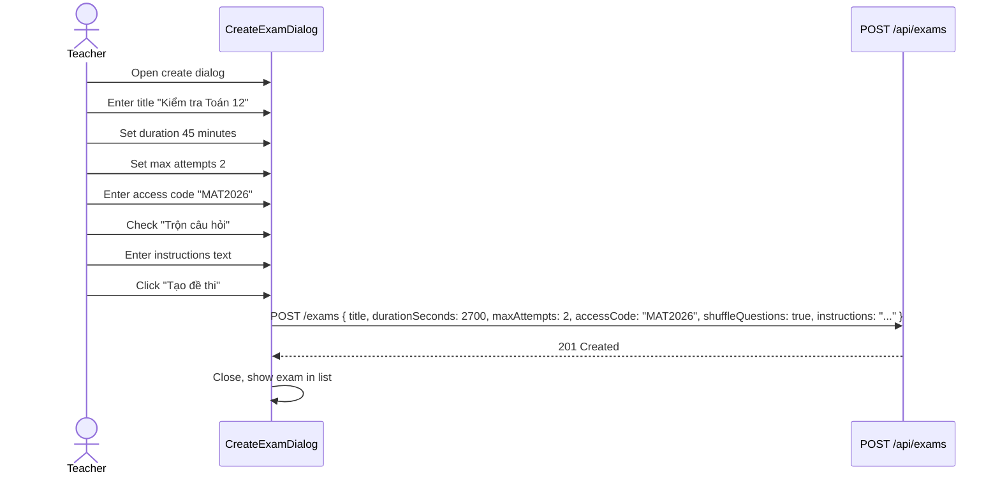
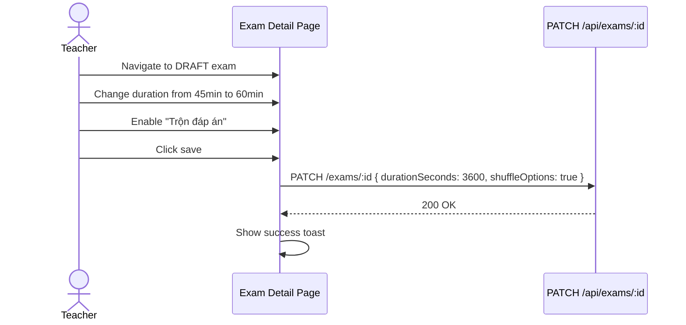
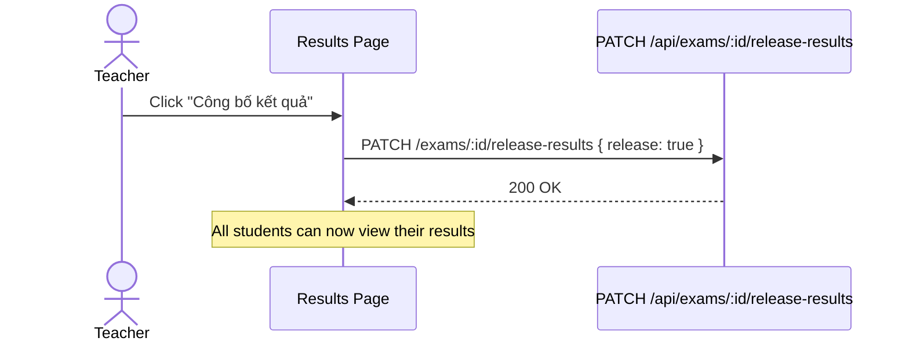
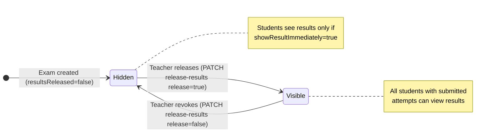

# D2. Exam Configuration

## 5.1 Feature Overview

| Field | Value |
|---|---|
| Feature ID | D2 |
| Feature Name | Exam Configuration |
| Module | D. Exam Management |
| Priority | P0 (basic), P1 (shuffle, instructions), P2 (access code, grading mode) |
| Complexity | M |
| Status | Existing — all configuration fields implemented in backend and frontend |
| Target Roles | TEACHER |
| Business Objective | Provide teachers with fine-grained control over exam behavior, timing, security, and grading rules |
| User Problem | Different assessment scenarios require different exam behaviors: timed tests need strict limits, practice exams need multiple attempts, secure exams need access codes, and shuffled exams prevent cheating |
| Dependencies | D1 (Create Exam) |

## 5.2 Actors and Permissions

### Teacher

| Action | Allowed | Notes |
|---|---|---|
| Set all configuration fields on DRAFT exam | Yes | Via create or edit |
| Modify configuration on PUBLISHED exam | **No** | Must archive and recreate |
| Toggle `resultsReleased` on PUBLISHED exam | Yes | Separate endpoint |
| View exam configuration | Yes | Owner only |

### Student

| Action | Allowed | Notes |
|---|---|---|
| View exam configuration | Partial | Sees title, description, duration, question count. Does NOT see accessCode, shuffleQuestions/Options settings, gradingMode |

## 5.3 Preconditions and Business Rules

### Configuration Fields and Their Semantics

| Field | Semantics | Default | When Evaluated |
|---|---|---|---|
| `durationSeconds` | Total time allowed per attempt, counted from `startedAt`. Server sets `expiresAt = NOW() + durationSeconds` | Required (no default) | At attempt start |
| `availableFrom` | Earliest time students can start an attempt | null (no restriction) | At attempt start |
| `availableUntil` | Latest time students can start an attempt. In-progress attempts are NOT terminated | null (no restriction) | At attempt start |
| `maxAttempts` | Maximum number of attempts per student per exam | 1 | At attempt start (count query) |
| `showResultImmediately` | Whether students see their score immediately after submission | true | At result display |
| `resultsReleased` | Teacher-controlled override: when true, all students can view results regardless of `showResultImmediately` | false | At result display |
| `shuffleQuestions` | Randomize question order per attempt | false | At attempt start (generates `questionOrder`) |
| `shuffleOptions` | Randomize option order per question per attempt | false | At attempt start |
| `accessCode` | Secret code student must enter before starting | null (no code required) | At attempt start |
| `gradingMode` | `ALL_OR_NOTHING` or `PARTIAL` for multi-answer MCQ | ALL_OR_NOTHING | At grading time |
| `instructions` | Pre-exam text shown to student before timer starts | null | Before attempt starts (UI) |

### Business Rules

| Rule ID | Rule |
|---|---|
| D2-R01 | `durationSeconds` must be ≥ 60 (minimum 1 minute exam) |
| D2-R02 | `maxAttempts` must be ≥ 1 |
| D2-R03 | When `accessCode` is null, no code prompt is shown to students |
| D2-R04 | When `shuffleQuestions` is true, a random `questionOrder` array is generated and stored on the attempt at start time. Each attempt gets its own order |
| D2-R05 | `shuffleOptions` applies to all question types including MCQ_MULTI. TRUE_FALSE questions should NOT have options shuffled (always Đúng/Sai order). **Not yet enforced** — see Open Questions |
| D2-R06 | `resultsReleased` is independent of `showResultImmediately`. A student can see results if `showResultImmediately = true` OR `resultsReleased = true` |
| D2-R07 | Configuration is frozen at publish time. The config values on the Exam record remain the runtime config for all attempts |
| D2-R08 | `instructions` text is displayed on a pre-exam screen only if non-null AND the student has no answers saved yet |
| D2-R09 | When `availableFrom` is set and current time is before it, students cannot start an attempt |
| D2-R10 | When `availableUntil` is set and current time is after it, students cannot start NEW attempts. In-progress attempts are governed by `expiresAt` |

## 5.4 Main User Flow — Happy Path

### Configure Exam During Creation



### Modify Configuration (DRAFT)



### Release Results (PUBLISHED)



## 5.5 Alternative Flows

### AF-01: Teacher creates exam for practice (unlimited attempts)
1. Teacher sets `maxAttempts` to a high value (e.g., 99).
2. Teacher sets `showResultImmediately: true`.
3. Students can retake the exam many times, seeing results each time.
4. **Note**: There is no explicit "practice mode" like Azota. This is simulated by configuration.

### AF-02: Teacher creates secure timed exam
1. Teacher sets `accessCode: "SECRET"`.
2. Teacher sets `shuffleQuestions: true` and `shuffleOptions: true`.
3. Teacher sets `showResultImmediately: false`.
4. Teacher sets `availableFrom` and `availableUntil` to a narrow window.
5. Students must enter code, see shuffled questions, and cannot see results until teacher releases them.

### AF-03: Teacher revokes result visibility
1. Teacher previously released results (`resultsReleased: true`).
2. Teacher calls `PATCH /exams/:id/release-results { release: false }`.
3. Students who had `showResultImmediately: false` can no longer see results.
4. Students who had `showResultImmediately: true` still see their own immediate results.

## 5.6 Edge Cases and Failure Scenarios

| Scenario ID | Scenario | Trigger | Expected Behavior | User Feedback | Data Integrity | Recovery | Severity |
|---|---|---|---|---|---|---|---|
| D2-E01 | `availableFrom` in the past at creation | Teacher sets a past date | Exam is created. Students can immediately start (past start = already open) | No warning | Valid state | None needed | Low |
| D2-E02 | `availableUntil` in the past at creation | Teacher accidentally sets a past end date | Exam is created. Students cannot start any attempt | **No warning** — silent failure from student perspective | Valid but useless config | Teacher must update the date | High |
| D2-E03 | `availableUntil` passes while student has IN_PROGRESS attempt | Clock passes the deadline | Student can still finish (governed by `expiresAt`). New attempts cannot start | None during exam. New start blocked with error | Attempt integrity preserved | None needed | Medium |
| D2-E04 | `maxAttempts` reduced after students already have attempts | Teacher changes from 3 to 1 in DRAFT | **Cannot happen**: this requires editing a DRAFT, which cannot have attempts (only PUBLISHED exams can have attempts) | N/A | Safe by design | N/A | Low |
| D2-E05 | `accessCode` set to empty string | Teacher clears the field | Backend receives `accessCode: ""`, stored as empty string | Ambiguous: should empty string mean no code? | **Potential issue**: empty string ≠ null. Student may be prompted for code but "" is accepted. See Open Questions | Treat empty string as null | Medium |
| D2-E06 | `shuffleQuestions` on exam with 1 question | Valid configuration | Shuffle has no visible effect (array of 1) | None | Valid | None needed | Low |
| D2-E07 | `shuffleOptions` on TRUE_FALSE question | TRUE_FALSE has exactly 2 options (Đúng, Sai) | Currently shuffles them → student may see Sai before Đúng | Confusing but not incorrect | Grading unaffected (option IDs tracked, not positions) | See Open Questions — exempt TRUE_FALSE from shuffle | Low |
| D2-E08 | `instructions` contains very long text (10000+ chars) | Teacher pastes a lengthy document | Stored without limit. UI displays with whitespace-pre-wrap | May cause scroll issues on mobile | No data issue | Add max length validation | Low |
| D2-E09 | Teacher toggles `resultsReleased` rapidly | Click on/off/on quickly | Last write wins. No debounce on backend | UI may flash | Final state matches last successful API call | Refresh to see current state | Low |
| D2-E10 | Student tries to access exam with wrong access code | Student enters incorrect code at start | Backend rejects attempt start with 400 | "Mã truy cập không đúng" | No attempt created | Retry with correct code | Medium |

## 5.7 UI/UX Specification

### Configuration in Create Dialog

The CreateExamDialog groups configuration into logical sections:

1. **Basic Info**: Title (required), Description (optional), Instructions (optional)
2. **Timing**: Duration in minutes (required), converted to seconds for API
3. **Attempts**: Max attempts (number input, min 1)
4. **Security**: Access code (text input, optional)
5. **Shuffling**: Two checkboxes — "Trộn câu hỏi", "Trộn đáp án"

### Configuration in Exam Detail Page

When viewing a DRAFT exam, all configuration fields should be editable inline or via an edit form. When viewing a PUBLISHED exam, configuration is displayed as read-only.

### Visual Indicators on Exam Cards

| Config | Indicator |
|---|---|
| `shuffleQuestions: true` | Shuffle icon + "Trộn" text |
| `accessCode` not null | Lock icon + "Mã" text |
| Duration | Clock icon + "XX phút" |
| Question count | FileQuestion icon + "XX câu" |

### Result Visibility Controls

On the Results page (`/dashboard/results`), a "Công bố kết quả" button is shown for each exam. This calls `PATCH /exams/:id/release-results`.

### Accessibility

- Configuration checkboxes must have visible labels, not just icons.
- Duration input must have a label "Thời gian (phút)".
- Access code field should not auto-reveal its value in the UI (use `type="text"` — it's not a secret password, but a shared exam code).

## 5.8 Data Requirements

All configuration fields are on the existing `Exam` model. No schema changes needed.

See D1 (Create Exam) for the complete Exam entity specification.

### Field Interactions

| Field A | Field B | Interaction |
|---|---|---|
| `showResultImmediately` | `resultsReleased` | Student sees results if EITHER is true |
| `availableFrom` | `availableUntil` | Define the window in which new attempts can start |
| `availableUntil` | `expiresAt` (on attempt) | `availableUntil` blocks new starts; `expiresAt` governs in-progress attempts |
| `shuffleQuestions` | `questionOrder` (on attempt) | Shuffle generates a per-attempt order array |
| `maxAttempts` | attempt count query | Compared at start time |

## 5.9 API Requirements

### Configuration Endpoints

Configuration is managed via the create and update APIs documented in D1 (Create Exam).

### PATCH /api/exams/:id/release-results — Toggle Result Visibility

| Attribute | Value |
|---|---|
| Method | PATCH |
| Path | `/api/exams/:id/release-results` |
| Purpose | Allow/disallow all students to view their results for this exam |
| Required Role | TEACHER (owner) |
| Authorization | Owner only |

**Request Body:**
```json
{ "release": true }
```

**Success Response (200):**
```json
{
  "success": true,
  "data": {
    "id": "uuid",
    "resultsReleased": true,
    "...": "other exam fields"
  }
}
```

**Validation:**
- `release` defaults to `true` if not provided.
- Any exam status is allowed (teacher may want to release results for an archived exam).

## 5.10 State Management

Configuration state is managed as fields on the Exam entity. See D1 for the exam lifecycle state machine.

### Result Visibility State



## 5.11 Acceptance Criteria

```
Given a teacher creates an exam with shuffleQuestions=true and maxAttempts=2,
When a student starts their first attempt,
Then the questions are displayed in a random order different from the original position order.

Given the same student starts their second attempt,
When questions are loaded,
Then the questions may be in a different random order than the first attempt.

Given an exam has accessCode="XYZ",
When a student attempts to start without providing the code,
Then the backend rejects with 400.

When the student provides accessCode="XYZ",
Then the attempt starts successfully.

Given an exam has showResultImmediately=false and resultsReleased=false,
When a student submits their attempt,
Then they see a "Chờ giáo viên công bố kết quả" message and cannot view detailed results.

Given the teacher then releases results (resultsReleased=true),
When the student refreshes,
Then they can now see their score and answer review.

Given an exam has availableUntil set to a past time,
When a student tries to start an attempt,
Then the backend rejects with "Đã hết hạn".

Given a student has an IN_PROGRESS attempt and availableUntil passes,
When the student continues working,
Then they can still submit (expiresAt governs, not availableUntil).
```

## 5.12 QA Test Scenarios

| Test ID | Scenario | Preconditions | Steps | Expected Result | Priority |
|---|---|---|---|---|---|
| D2-T01 | Shuffle questions produces different order | Published exam with 10+ questions, shuffleQuestions=true | Start two attempts for same student | questionOrder arrays differ (probabilistically) | High |
| D2-T02 | Access code enforced | Published exam with accessCode="TEST" | Start attempt without code | 400 error | High |
| D2-T03 | Access code accepted | Same exam | Start attempt with accessCode="TEST" | Attempt created | High |
| D2-T04 | Access code null means no check | Published exam with accessCode=null | Start attempt without code | Attempt created | High |
| D2-T05 | maxAttempts enforced | Published exam with maxAttempts=1, student has 1 SUBMITTED attempt | Start new attempt | Rejected | High |
| D2-T06 | maxAttempts allows multiple | Published exam with maxAttempts=3, student has 2 SUBMITTED | Start new attempt | Attempt created | High |
| D2-T07 | availableFrom in future | Published exam with availableFrom = tomorrow | Start attempt now | Rejected | High |
| D2-T08 | availableUntil in past | Published exam with availableUntil = yesterday | Start attempt now | Rejected | High |
| D2-T09 | showResultImmediately=false hides results | Submit attempt | GET result | 403 or hidden result | High |
| D2-T10 | releaseResults overrides showResultImmediately | release=true, showResultImmediately=false | GET result as student | Results visible | High |
| D2-T11 | Duration sets correct expiresAt | Exam with durationSeconds=1800 | Start attempt, check expiresAt | expiresAt ≈ startedAt + 1800s | High |
| D2-T12 | Instructions shown before exam | Exam with instructions text, student has no answers | Start attempt, check UI | Instructions screen displayed | Medium |

## 5.13 Open Questions

| # | Question | Why It Matters | Options | Recommended Default | Impact |
|---|---|---|---|---|---|
| D2-Q01 | Should TRUE_FALSE be exempt from option shuffling? | Shuffling Đúng/Sai is unusual and potentially confusing | (a) Exempt TRUE_FALSE from shuffle, (b) Shuffle all equally | (a) Exempt TRUE_FALSE | Low — check question type at shuffle time |
| D2-Q02 | How should empty string `accessCode` be handled? | `""` is not the same as `null` in PostgreSQL | (a) Treat `""` as null (no code required), (b) Accept `""` as a valid code | (a) Normalize empty string to null in service layer | Low |
| D2-Q03 | Should there be a "practice mode" toggle? | Azota has explicit practice mode with different UX | (a) Add boolean `isPractice`, (b) Simulate via high maxAttempts + showResultImmediately | (b) No new field needed | No backend change |
| D2-Q04 | Should `availableFrom`/`availableUntil` be shown in the create dialog? | Currently only title, duration, attempts, shuffle, code, instructions are in the dialog. Time window is missing from UI | (a) Add to create dialog, (b) Add to exam detail edit only | (a) Add to dialog for completeness | Frontend-only change |
| D2-Q05 | Should configuration change after publish be partially allowed? | Currently ALL config is frozen. Azota allows changing time windows and attempt limits post-publish | (a) Allow certain fields (availableFrom/Until, maxAttempts, showResultImmediately) to be edited after publish, (b) Keep frozen | (a) Allow non-content config changes | Medium — need to identify safe-to-change fields |
