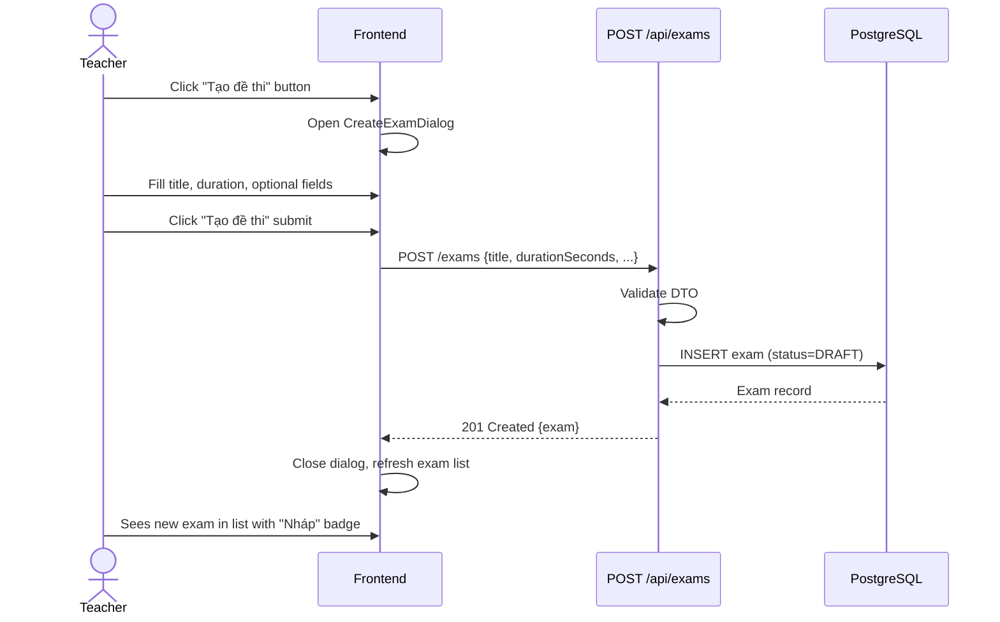
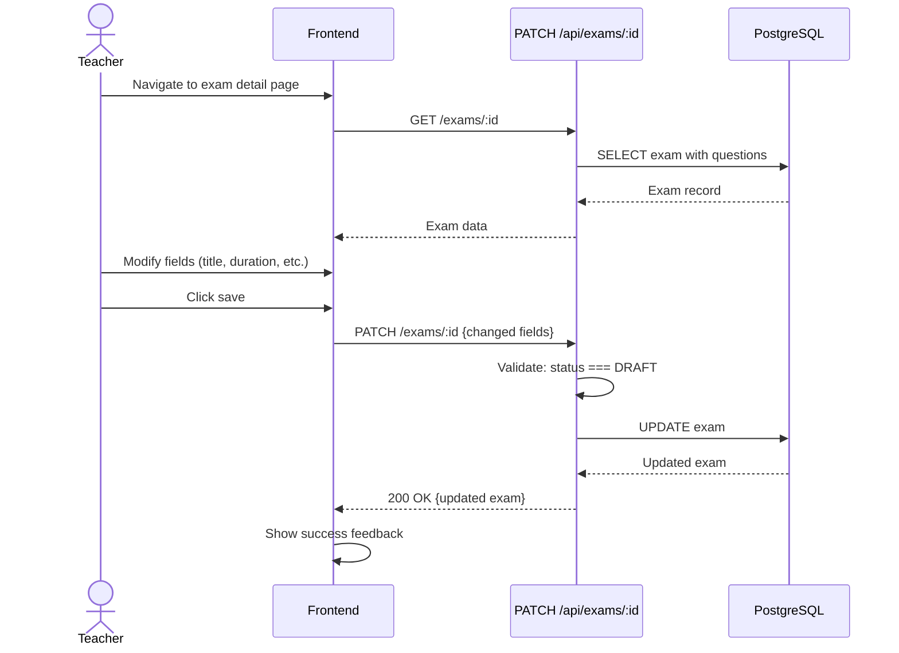
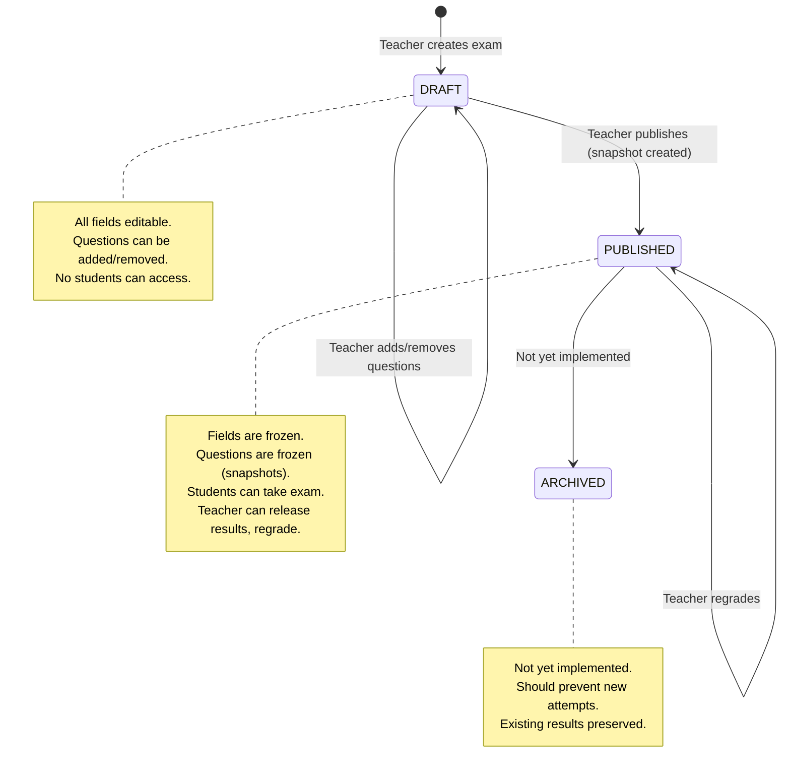

# D1. Create / Edit Exam

## 5.1 Feature Overview

| Field | Value |
|---|---|
| Feature ID | D1 |
| Feature Name | Create / Edit Exam |
| Module | D. Exam Management |
| Priority | P0 |
| Complexity | M |
| Status | Existing — fully implemented (backend + frontend) |
| Target Roles | TEACHER |
| Business Objective | Allow teachers to create and configure exam shells that will later hold questions from the question bank |
| User Problem | Teachers need a structured way to define exams with titles, descriptions, time limits, and exam-taking rules before attaching questions and publishing |
| Dependencies | A1 (Authentication), C1 (Question Bank — for later attaching questions) |

## 5.2 Actors and Permissions

### Teacher (TEACHER)

| Action | Allowed | Notes |
|---|---|---|
| Create exam | Yes | Creates in DRAFT status |
| View own exams list | Yes | Sees only own exams, all statuses |
| View own exam detail | Yes | Full detail including questions |
| Edit own DRAFT exam | Yes | All fields modifiable |
| Edit own PUBLISHED exam | **No** | Backend rejects with 400 |
| Edit own ARCHIVED exam | **No** | Backend rejects with 400 |
| Delete own exam | Not implemented | See Open Questions |
| View another teacher's exam | **No** | Backend rejects with 403 |

### Student (STUDENT)

| Action | Allowed | Notes |
|---|---|---|
| Any exam management action | **No** | Entire `/exams` controller is `@Roles('TEACHER')` |

### Backend Authorization

- The `ExamsController` class-level decorator `@Roles('TEACHER')` restricts all endpoints to teachers.
- `findByIdForOwner()` checks `exam.ownerId !== userId` and throws `ForbiddenException` if mismatch.
- `update()` additionally checks `exam.status !== 'DRAFT'` and throws `BadRequestException`.

## 5.3 Preconditions and Business Rules

### Preconditions
- User must be authenticated with a valid JWT.
- User must have role `TEACHER`.

### Business Rules

| Rule ID | Rule | Enforcement |
|---|---|---|
| D1-R01 | Title is required and must be a non-empty string | DTO validation (`@IsString()`) |
| D1-R02 | Duration must be an integer ≥ 60 seconds | DTO validation (`@IsInt() @Min(60)`) |
| D1-R03 | Exam is created in `DRAFT` status; this cannot be overridden | Backend hardcodes `status: DRAFT` |
| D1-R04 | Only DRAFT exams may be edited | `update()` checks status |
| D1-R05 | `maxAttempts` defaults to 1 if not provided; minimum is 1 | DTO validation (`@Min(1)`) |
| D1-R06 | `showResultImmediately` defaults to `true` if not provided | Backend default |
| D1-R07 | `availableFrom` must be before `availableUntil` when both are provided | **NOT ENFORCED** — see Open Questions |
| D1-R08 | `accessCode`, if provided, should be a non-empty string | DTO validation (`@IsString()`) |
| D1-R09 | Shuffle options default to `false` | Backend default |

### Validation Rules

| Field | Type | Required | Constraints |
|---|---|---|---|
| `title` | string | Yes | Non-empty |
| `description` | string | No | — |
| `instructions` | string | No | — |
| `durationSeconds` | integer | Yes | ≥ 60 |
| `availableFrom` | ISO 8601 date string | No | Valid date |
| `availableUntil` | ISO 8601 date string | No | Valid date |
| `maxAttempts` | integer | No (default: 1) | ≥ 1 |
| `showResultImmediately` | boolean | No (default: true) | — |
| `shuffleQuestions` | boolean | No (default: false) | — |
| `shuffleOptions` | boolean | No (default: false) | — |
| `accessCode` | string | No | — |

## 5.4 Main User Flow — Happy Path

### Create Exam



### Edit Exam



## 5.5 Alternative Flows

### AF-01: Teacher cancels creation
1. Teacher opens the CreateExamDialog.
2. Teacher clicks outside the dialog or presses Escape.
3. Dialog closes. No API call is made. No data changes.

### AF-02: Teacher creates exam with only required fields
1. Teacher fills only `title` and `durationSeconds`.
2. All optional fields use defaults: `maxAttempts=1`, `showResultImmediately=true`, shuffles off, no access code, no instructions, no time window.
3. Exam is created successfully.

### AF-03: Teacher edits some fields, leaves others unchanged
1. Teacher navigates to exam detail.
2. Teacher changes only the title.
3. Frontend sends `PATCH /exams/:id { title: "New Title" }` with only the changed field.
4. Backend applies partial update. Other fields unchanged.

### AF-04: Teacher navigates away from unsaved edit
1. Teacher modifies fields on the exam detail page.
2. Teacher navigates to a different page.
3. **Current behavior**: Changes are lost with no warning. See Open Questions for unresolved decision on unsaved-changes warning.

## 5.6 Edge Cases and Failure Scenarios

| Scenario ID | Scenario | Trigger | Expected Behavior | User Feedback | Data Integrity | Recovery | Severity |
|---|---|---|---|---|---|---|---|
| D1-E01 | Create with empty title | Teacher submits form with blank title | Backend returns 400 validation error | Form shows "Title is required" | No data created | Fix title and resubmit | Low |
| D1-E02 | Create with duration < 60s | Teacher enters 30 seconds | Backend returns 400 `durationSeconds must not be less than 60` | Form shows validation error | No data created | Set duration ≥ 60 | Low |
| D1-E03 | Create with `availableFrom` after `availableUntil` | Teacher sets end before start | **Currently not validated** — exam is created with invalid window | No warning | Students may be unable to start exam | Teacher must notice and fix. See Open Questions | High |
| D1-E04 | Edit a PUBLISHED exam | Teacher sends PATCH to published exam (possible via API, not via UI which hides edit controls) | Backend returns 400 "Can only modify DRAFT exams" | Error toast if attempted | No data changed | Teacher must archive and create new exam if changes needed | Medium |
| D1-E05 | Edit another teacher's exam | Crafted API request with wrong exam ID | Backend returns 403 Forbidden | Error displayed | No data changed | None needed | Medium |
| D1-E06 | Create with extremely long title | Teacher enters 10000+ character title | **Currently not validated** — Prisma stores it in `String` column | No feedback | Potentially breaks UI layout | See Open Questions for max length | Low |
| D1-E07 | Concurrent edits by same teacher in two tabs | Teacher opens exam in two browser tabs, edits in both | Last write wins (no optimistic locking) | No conflict warning | Last PATCH overwrites previous | Teacher sees latest state on refresh | Medium |
| D1-E08 | Network failure during create | Connection drops mid-POST | No response received | UI shows generic error or hangs | No data created (request never reached server, or server rolled back) | Retry submission | Low |
| D1-E09 | Network failure during edit | Connection drops mid-PATCH | No response received | UI shows error | If server received and processed: data is updated but UI doesn't reflect it. If not received: no change | Refresh page to see current state | Medium |
| D1-E10 | Create exam with `maxAttempts = 0` | Crafted API request | Backend returns 400 `maxAttempts must not be less than 1` | Error response | No data created | Set maxAttempts ≥ 1 | Low |
| D1-E11 | Edit exam that was just published by another tab | Teacher has DRAFT in tab 1, publishes in tab 2, then edits in tab 1 | Backend returns 400 "Can only modify DRAFT exams" | Error toast | No data changed | Refresh to see published state | Medium |
| D1-E12 | Non-existent exam ID in edit | Crafted API request with random UUID | Backend returns 404 "Exam not found" | Error displayed | No data changed | Correct the ID | Low |

## 5.7 UI/UX Specification

### Entry Points
- **Create**: "Tạo đề thi" button (Primary Blue, with Plus icon) on `/dashboard/exams` page.
- **Edit**: Exam detail page `/dashboard/exams/[id]` (fields editable only when status is DRAFT).

### Create Exam Dialog

| Element | Description |
|---|---|
| Trigger | Button "Tạo đề thi" on exams list page |
| Container | Modal dialog (`DialogContent`, max-w-lg, scrollable) |
| Title field | Text input, required, placeholder "VD: Kiểm tra giữa kỳ Toán 12" |
| Description field | Textarea, optional, 2 rows, placeholder "Mô tả đề thi..." |
| Instructions field | Textarea, optional, 2 rows, placeholder "Hướng dẫn cho học sinh..." |
| Duration field | Number input, required, label "Thời gian (phút)", min 1 (converted to seconds on submit) |
| Max attempts field | Number input, label "Số lần làm tối đa", min 1, default 1 |
| Access code field | Text input, optional, placeholder "Để trống nếu không cần" |
| Shuffle checkboxes | Two checkboxes: "Trộn câu hỏi" and "Trộn đáp án" |
| Submit button | Full-width, Primary Blue, text "Tạo đề thi" / "Đang tạo..." when loading |

### Exam List Page

| Element | Description |
|---|---|
| Layout | Responsive grid: 1 col mobile, 2 col tablet, 3 col desktop |
| Exam card | Card with title, status badge, description (2-line clamp), duration, question count, shuffle/lock icons |
| Status badge | DRAFT = "Nháp" (secondary), PUBLISHED = "Đã phát hành" (default/primary), ARCHIVED = "Lưu trữ" (outline) |
| Click action | Navigate to `/dashboard/exams/[id]` |

### States

| State | Behavior |
|---|---|
| Loading | Centered spinner |
| Empty | Dashed border container with "Chưa có đề thi nào. Tạo đề thi đầu tiên!" |
| Error | Toast notification with error message |
| Success (create) | Dialog closes, list refreshes |

## 5.8 Data Requirements

### Existing Entity: `Exam`

| Field | Type | Required | Default | Notes |
|---|---|---|---|---|
| id | UUID | Auto | uuid() | Primary key |
| ownerId | UUID FK → User | Yes | — | The teacher who created this exam |
| title | String | Yes | — | |
| description | String? | No | null | |
| instructions | String? | No | null | Pre-exam instructions shown to student |
| durationSeconds | Int | Yes | — | Must be ≥ 60 |
| availableFrom | DateTime? | No | null | Exam start window |
| availableUntil | DateTime? | No | null | Exam end window |
| status | ExamStatus | Yes | DRAFT | DRAFT / PUBLISHED / ARCHIVED |
| maxAttempts | Int | Yes | 1 | ≥ 1 |
| showResultImmediately | Boolean | Yes | true | |
| resultsReleased | Boolean | Yes | false | Teacher toggles post-publish |
| shuffleQuestions | Boolean | Yes | false | |
| shuffleOptions | Boolean | Yes | false | |
| accessCode | String? | No | null | |
| gradingMode | GradingMode | Yes | ALL_OR_NOTHING | |
| createdAt | DateTime | Auto | now() | |
| updatedAt | DateTime | Auto | @updatedAt | |

### Proposed Schema Changes
None — schema is complete for this feature.

### Indexes
- Primary key on `id`.
- No additional indexes needed for CRUD operations (ownerId filter is low-cardinality at ~100 users).

## 5.9 API Requirements

### POST /api/exams — Create Exam

| Attribute | Value |
|---|---|
| Method | POST |
| Path | `/api/exams` |
| Purpose | Create a new exam in DRAFT status |
| Required Role | TEACHER |
| Authorization | Any authenticated teacher can create |

**Request Body:**
```json
{
  "title": "Kiểm tra giữa kỳ Toán 12",
  "description": "Kiểm tra các chương 1-3",
  "instructions": "Không được sử dụng tài liệu",
  "durationSeconds": 2700,
  "availableFrom": "2026-12-01T08:00:00.000Z",
  "availableUntil": "2026-12-01T10:00:00.000Z",
  "maxAttempts": 1,
  "showResultImmediately": true,
  "shuffleQuestions": false,
  "shuffleOptions": false,
  "accessCode": "ABC123"
}
```

**Success Response (201):**
```json
{
  "success": true,
  "data": {
    "id": "uuid",
    "ownerId": "uuid",
    "title": "Kiểm tra giữa kỳ Toán 12",
    "status": "DRAFT",
    "durationSeconds": 2700,
    "maxAttempts": 1,
    "showResultImmediately": true,
    "shuffleQuestions": false,
    "shuffleOptions": false,
    "accessCode": "ABC123",
    "createdAt": "2026-11-11T...",
    "updatedAt": "2026-11-11T..."
  }
}
```

**Error Responses:**

| Status | Code | Condition |
|---|---|---|
| 400 | Validation error | Missing title, invalid duration, etc. |
| 401 | Unauthorized | No valid JWT |
| 403 | Forbidden | User is STUDENT |

### GET /api/exams — List Teacher's Exams

| Attribute | Value |
|---|---|
| Method | GET |
| Path | `/api/exams` |
| Purpose | List all exams owned by the authenticated teacher |
| Required Role | TEACHER |
| Authorization | Returns only the teacher's own exams |

**Success Response (200):**
```json
{
  "success": true,
  "data": [
    {
      "id": "uuid",
      "title": "...",
      "status": "DRAFT",
      "durationSeconds": 2700,
      "_count": { "questions": 10 },
      "createdAt": "..."
    }
  ]
}
```

### GET /api/exams/:id — Get Exam Detail

| Attribute | Value |
|---|---|
| Method | GET |
| Path | `/api/exams/:id` |
| Purpose | Get full exam detail with questions |
| Required Role | TEACHER (owner) |
| Authorization | `ownerId` must match authenticated user |

**Error Responses:**

| Status | Code | Condition |
|---|---|---|
| 404 | Not Found | Exam does not exist |
| 403 | Forbidden | Teacher is not the owner |

### PATCH /api/exams/:id — Update Exam

| Attribute | Value |
|---|---|
| Method | PATCH |
| Path | `/api/exams/:id` |
| Purpose | Update a DRAFT exam's fields |
| Required Role | TEACHER (owner) |
| Authorization | Owner only, DRAFT status only |

**Request Body:** Same fields as create, all optional. Only provided fields are updated.

**Error Responses:**

| Status | Code | Condition |
|---|---|---|
| 400 | Bad Request | Exam is not DRAFT |
| 403 | Forbidden | Not the owner |
| 404 | Not Found | Exam not found |

## 5.10 State Management

### Exam Lifecycle State Machine



### Allowed Operations per State

| Operation | DRAFT | PUBLISHED | ARCHIVED |
|---|---|---|---|
| Edit title, description, settings | ✅ | ❌ | ❌ |
| Add/remove questions | ✅ | ❌ | ❌ |
| Publish | ✅ | ❌ | ❌ |
| Assign to classroom | ❌ | ✅ | ❌ |
| Students take exam | ❌ | ✅ | ❌ |
| Release results | ❌ | ✅ | ✅ (read only) |
| Regrade | ❌ | ✅ | ❌ |
| Archive | ❌ | ✅ | ❌ |
| Delete | ✅ (proposed) | ❌ | ❌ |

## 5.11 Acceptance Criteria

### Create Exam

```
Given a teacher is authenticated,
When they submit a create exam request with a valid title and duration ≥ 60 seconds,
Then the exam is created in DRAFT status with the provided settings and default values for omitted fields.

Given a teacher submits a create exam request without a title,
When the request is processed,
Then the backend returns 400 with a validation error message.

Given a student is authenticated,
When they attempt to create an exam,
Then the backend returns 403 Forbidden.
```

### Edit Exam

```
Given a teacher owns a DRAFT exam,
When they submit a PATCH request with updated fields,
Then only the provided fields are updated and other fields remain unchanged.

Given a teacher owns a PUBLISHED exam,
When they submit a PATCH request,
Then the backend returns 400 "Can only modify DRAFT exams".

Given a teacher does not own the exam,
When they submit a PATCH request,
Then the backend returns 403 Forbidden.
```

### Negative Criteria

```
Given a teacher,
When they request GET /exams,
Then they see only their own exams and not any other teacher's exams.

Given an exam ID that does not exist,
When a teacher requests GET /exams/:id,
Then the backend returns 404.
```

## 5.12 QA Test Scenarios

| Test ID | Scenario | Preconditions | Steps | Test Data | Expected Result | Priority |
|---|---|---|---|---|---|---|
| D1-T01 | Create exam with all fields | Authenticated teacher | POST /exams with all fields | title="Test", durationSeconds=2700, all optionals set | 201, exam returned with correct values | High |
| D1-T02 | Create exam with required fields only | Authenticated teacher | POST /exams with title + durationSeconds | title="Test", durationSeconds=3600 | 201, defaults applied (maxAttempts=1, shuffles=false, etc.) | High |
| D1-T03 | Create with missing title | Authenticated teacher | POST /exams { durationSeconds: 3600 } | — | 400, validation error | High |
| D1-T04 | Create with duration < 60 | Authenticated teacher | POST /exams { title: "T", durationSeconds: 30 } | — | 400, validation error | Medium |
| D1-T05 | Create as STUDENT | Authenticated student | POST /exams {...} | — | 403 Forbidden | High |
| D1-T06 | Edit DRAFT exam | Teacher owns a DRAFT exam | PATCH /exams/:id { title: "New" } | — | 200, title updated | High |
| D1-T07 | Edit PUBLISHED exam | Teacher owns a PUBLISHED exam | PATCH /exams/:id { title: "New" } | — | 400, "Can only modify DRAFT exams" | High |
| D1-T08 | Edit another teacher's exam | Teacher A has exam, Teacher B tries to edit | PATCH /exams/:id as Teacher B | — | 403 Forbidden | High |
| D1-T09 | Get non-existent exam | Authenticated teacher | GET /exams/random-uuid | — | 404 Not Found | Medium |
| D1-T10 | List exams shows only own | Teacher A has 3 exams, Teacher B has 2 | GET /exams as Teacher A | — | Returns 3 exams, not Teacher B's | High |
| D1-T11 | Edit with empty body | Teacher owns DRAFT | PATCH /exams/:id {} | — | 200, no fields changed | Low |
| D1-T12 | Create with maxAttempts=0 | Authenticated teacher | POST /exams { ..., maxAttempts: 0 } | — | 400, validation error | Medium |

## 5.13 Open Questions

| # | Question | Why It Matters | Options | Recommended Default | Impact |
|---|---|---|---|---|---|
| D1-Q01 | Should `availableFrom < availableUntil` be validated? | Invalid time windows can silently prevent students from taking exams | (a) Validate at create/edit time, (b) Validate at publish time, (c) Don't validate | (b) Validate at publish time — allows drafts to be saved with incomplete config | Requires adding validation in `publish()` |
| D1-Q02 | Should there be a max title length? | Very long titles break UI layouts | (a) 200 chars, (b) 500 chars, (c) No limit | (a) 200 characters | Low — add `@MaxLength(200)` to DTO |
| D1-Q03 | Should exam deletion be implemented? | Teachers may want to delete unused drafts | (a) Allow deleting DRAFT exams only, (b) Soft delete all, (c) No delete | (a) Hard delete DRAFT, soft delete others | Medium — need cascade rules for DRAFT (no attempts exist) |
| D1-Q04 | Should there be an unsaved-changes warning on the edit page? | Teachers may lose work by navigating away | (a) `beforeunload` handler, (b) No warning | (a) Add `beforeunload` handler | Low frontend effort |
| D1-Q05 | Should `gradingMode` be settable at exam creation time? | Currently defaults to ALL_OR_NOTHING with no UI to change | (a) Add to create/edit dialog, (b) Keep as default-only for now | (b) Keep default until partial scoring is fully implemented | Low — expose in UI when P2 partial scoring is complete |
