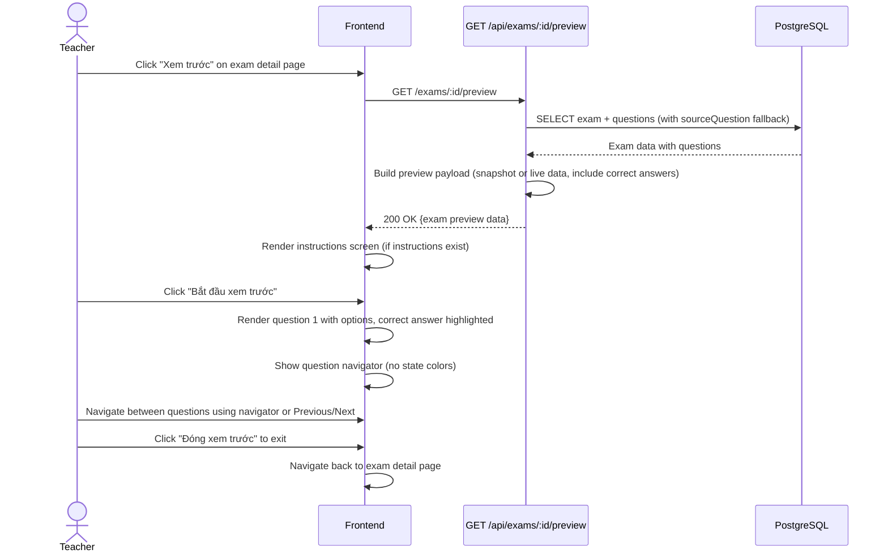

# D5. Exam Preview for Teacher

## 5.1 Feature Overview

| Field | Value |
|---|---|
| Feature ID | D5 |
| Feature Name | Exam Preview for Teacher |
| Module | D. Exam Management |
| Priority | P1 |
| Complexity | M |
| Status | Proposed — not implemented |
| Target Roles | TEACHER |
| Business Objective | Allow teachers to preview an exam exactly as a student would see it, verifying layout, question content, and flow before publishing or assigning |
| User Problem | Teachers have no way to verify how an exam looks from the student perspective. They must publish and start an attempt (creating real data) to check for errors in wording, option ordering, or missing content. |
| Dependencies | D1 (Create/Edit Exam), D3 (Manage Questions), D4 (Publish with snapshot) |

## 5.2 Actors and Permissions

### Teacher (TEACHER)

| Action | Allowed | Notes |
|---|---|---|
| Preview own DRAFT exam | Yes | Shows live question bank data (no snapshot yet) |
| Preview own PUBLISHED exam | Yes | Shows snapshot data |
| Preview own ARCHIVED exam | Yes | Shows snapshot data |
| Preview another teacher's exam | **No** | Backend rejects with 403 |

### Student (STUDENT)

| Action | Allowed | Notes |
|---|---|---|
| Access preview endpoint | **No** | Endpoint is `@Roles('TEACHER')` |

### Backend Authorization

- The preview endpoint lives on `ExamsController`, which has class-level `@Roles('TEACHER')`.
- `findByIdForOwner()` is reused to check `ownerId === userId`; throws `ForbiddenException` on mismatch.
- No `ExamAttempt` is created. Preview is a read-only operation.

## 5.3 Preconditions and Business Rules

### Preconditions
- User must be authenticated with a valid JWT.
- User must have role `TEACHER`.
- Exam must exist and be owned by the requesting teacher.
- Exam must have at least one question (otherwise preview shows an empty-state message, not an error).

### Business Rules

| Rule ID | Rule | Enforcement |
|---|---|---|
| D5-R01 | Preview never creates an `ExamAttempt` row or any other write to the database | Backend — endpoint is GET (read-only) |
| D5-R02 | For DRAFT exams, preview uses live `sourceQuestion` data (content, options) because no snapshot exists yet | Backend — response builder checks `contentSnapshot`; if null, falls back to `sourceQuestion` |
| D5-R03 | For PUBLISHED/ARCHIVED exams, preview uses `contentSnapshot` and `optionsSnapshot` (the data students actually saw) | Backend — uses snapshot fields when present |
| D5-R04 | Preview shows correct answers highlighted so the teacher can verify answer keys | Backend — includes `isCorrect` flag in response; Frontend — highlights correct options with a green indicator |
| D5-R05 | Preview does not start a timer and does not enforce any time limit | Frontend — timer component is not rendered |
| D5-R06 | Preview does not record answers and does not allow submit | Frontend — option clicks do nothing; no submit button |
| D5-R07 | If `shuffleQuestions` is true, preview shows questions in their authored order (by `position`), not shuffled | Backend — returns questions ordered by `position` regardless of shuffle setting |
| D5-R08 | If `shuffleOptions` is true, preview shows options in their authored order (by `position`) | Backend — returns options ordered by `position` regardless of shuffle setting |
| D5-R09 | Preview shows the instructions screen (if `instructions` is set) as the student would see it, followed by question content | Frontend — renders instructions panel before question area |
| D5-R10 | Preview includes a question navigator identical to the student exam UI, but without answered/unanswered state | Frontend — all navigator tiles are neutral (no color state) |
| D5-R11 | For ESSAY, SHORT_ANSWER, and FILL_BLANK types, preview shows the correct answer from `correctAnswer` field (for DRAFT) or a label "Tự luận — giáo viên chấm" for ESSAY | Frontend — displays `correctAnswer` in a styled box |

## 5.4 Main User Flow — Happy Path



### Step-by-Step

1. Teacher navigates to the exam detail page (`/dashboard/exams/[id]`).
2. Teacher clicks the "Xem trước" (Preview) button. This button is visible for exams in any status (DRAFT, PUBLISHED, ARCHIVED) as long as the exam has at least one question.
3. Frontend navigates to `/dashboard/exams/[id]/preview` or opens a full-screen overlay.
4. Frontend calls `GET /api/exams/:id/preview`.
5. Backend loads the exam, verifies ownership, builds question data (snapshot or live), and returns the full preview payload including correct answers.
6. Frontend renders the instructions screen if the exam has instructions.
7. Teacher clicks "Bắt đầu xem trước" to enter the question area.
8. Questions render one at a time, with correct options highlighted in green and a "Đáp án đúng" label.
9. Teacher uses the navigator grid or Previous/Next buttons to move between questions.
10. Teacher clicks "Đóng xem trước" (or presses Escape / browser back) to exit preview.
11. No data is written at any point.

## 5.5 Alternative Flows

### AF-01: Preview an exam with no questions
1. Teacher opens preview for an exam that has zero questions.
2. Frontend shows an empty state: "Chưa có câu hỏi nào. Thêm câu hỏi trước khi xem trước."
3. A button links to the exam question management page.

### AF-02: Preview a DRAFT exam where a source question has been deleted
1. A question was added to the exam, then the source question was deleted from the question bank.
2. `ExamQuestion.sourceQuestionId` is SET NULL on delete. `contentSnapshot` is null (not yet published).
3. Backend detects that both `contentSnapshot` and `sourceQuestion` are null.
4. Backend includes the question with `content: "[Câu hỏi đã bị xóa]"` and no options.
5. Frontend renders the placeholder text and a warning icon.

### AF-03: Preview on mobile device
1. Teacher accesses preview on a phone.
2. Layout stacks the question navigator below the question content area.
3. Previous/Next buttons are full-width at the bottom of the screen.

### AF-04: Teacher opens preview in a new tab
1. Preview URL is directly accessible: `/dashboard/exams/[id]/preview`.
2. The page loads, makes the API call, and renders normally.
3. No dependency on the parent page state.

## 5.6 Edge Cases and Failure Scenarios

| Scenario ID | Scenario | Trigger | Expected Behavior | User Feedback | Data Integrity | Recovery | Severity |
|---|---|---|---|---|---|---|---|
| D5-E01 | Preview non-existent exam | Teacher navigates to preview URL with invalid UUID | Backend returns 404 | "Không tìm thấy đề thi" error page | No data affected | Navigate back | Low |
| D5-E02 | Preview another teacher's exam | Crafted URL with another teacher's exam ID | Backend returns 403 | "Bạn không có quyền truy cập đề thi này" | No data affected | None needed | Medium |
| D5-E03 | Source question deleted mid-preview | Teacher viewing preview; another tab deletes the source question | Current preview unaffected (data already loaded). Next load will show "[Câu hỏi đã bị xóa]" | No immediate feedback; placeholder on reload | No data affected | Teacher should re-add question | Low |
| D5-E04 | Exam has mixed snapshot/live questions (partially published edge — should not happen) | Corrupted data | Backend returns whatever is available per D5-R02/R03 | May show inconsistent data | Read-only, no corruption risk | Admin intervention | Low |
| D5-E05 | Very large exam (100+ questions) | Teacher previews exam with many questions | Performance may be slow; navigator becomes scrollable | Loading spinner until data arrives | No data affected | Pagination not needed for preview (max ~200 questions practical limit) | Low |
| D5-E06 | Network failure during preview load | Connection lost during GET request | Standard error toast: "Lỗi kết nối. Vui lòng thử lại." | Error toast | No data affected | Retry or refresh | Low |
| D5-E07 | Student guesses the preview URL | Student navigates to `/exams/:id/preview` | Backend returns 403 (RolesGuard blocks STUDENT) | Error page | No data affected | None needed | Medium |

## 5.7 UI/UX Specification

### Entry Point
- **Button**: "Xem trước" (secondary/outline variant, with an Eye icon) on the exam detail page (`/dashboard/exams/[id]`).
- **Position**: In the action bar next to "Phát hành" / "Chỉnh sửa" buttons.
- **Visibility**: Shown when the exam has ≥ 1 question, regardless of exam status. Disabled with tooltip "Thêm câu hỏi trước" when question count is 0.

### Preview Page Layout

| Element | Description |
|---|---|
| Header bar | Fixed top bar with exam title, a "Chế độ xem trước" badge (amber/warning color), and "Đóng xem trước" button (top-right) |
| Instructions panel | Shown first if `instructions` is not null. Full-width card with instructions text and "Bắt đầu xem trước" button |
| Question area | Left side (desktop) or full-width (mobile). Shows question number ("Câu X"), content, type indicator, points, and options/answer area |
| Correct answer indicator | For option-based types: correct option has a green left border and "✓ Đáp án đúng" label. For SHORT_ANSWER/FILL_BLANK: shows `correctAnswer` in a green-bordered box below the input placeholder. For ESSAY: shows "Tự luận — giáo viên chấm" |
| Question navigator | Right sidebar (desktop) or collapsible bottom panel (mobile). Grid of numbered tiles, all in neutral/default style (no answered/unanswered coloring) |
| Navigation buttons | "Câu trước" (Previous) and "Câu sau" (Next) buttons below the question area |
| No timer | Timer component is completely absent |
| No submit button | There is no submit or finish button |

### Responsive Behavior

| Breakpoint | Layout |
|---|---|
| ≥ 1024px (desktop) | Two-column: question area left (flex-1), navigator sidebar right (w-64) |
| 768–1023px (tablet) | Single column. Navigator as a collapsible bar below the question |
| < 768px (mobile) | Single column. Navigator as a horizontal scrollable strip at the top. Previous/Next buttons full-width at bottom |

### States

| State | Behavior |
|---|---|
| Loading | Centered spinner with "Đang tải xem trước..." |
| No questions | Illustrated empty state with "Thêm câu hỏi" call-to-action |
| Loaded | Instructions screen (if applicable), then question content |
| Error | Toast notification with error message, redirect to exam detail |

## 5.8 Data Requirements

### Existing Entities Used (Read-Only)

- **Exam**: All fields for metadata display (title, instructions, durationSeconds for info display, shuffleQuestions, shuffleOptions).
- **ExamQuestion**: `position`, `points`, `contentSnapshot`, `optionsSnapshot`, `sourceQuestionId`.
- **Question** (via `sourceQuestion`): `content`, `type`, `correctAnswer`, `explanation`.
- **QuestionOption** (via `sourceQuestion.options`): `content`, `isCorrect`, `position`.

### Proposed Schema Changes

None. Preview is entirely read-only and reuses existing data.

## 5.9 API Requirements

### GET /api/exams/:id/preview — Preview Exam

| Attribute | Value |
|---|---|
| Method | GET |
| Path | `/api/exams/:id/preview` |
| Purpose | Return exam content as a student would see it, plus correct answers, without creating any database records |
| Required Role | TEACHER (owner) |
| Authorization | `ownerId` must match authenticated user |

**Success Response (200):**
```json
{
  "success": true,
  "data": {
    "id": "exam-uuid",
    "title": "Kiểm tra giữa kỳ Toán 12",
    "instructions": "Không được sử dụng tài liệu",
    "durationSeconds": 2700,
    "status": "DRAFT",
    "totalPoints": 30,
    "questionCount": 10,
    "questions": [
      {
        "id": "exam-question-uuid",
        "position": 1,
        "points": 3,
        "type": "MCQ",
        "content": "Đạo hàm của f(x) = x² là gì?",
        "explanation": "Áp dụng công thức đạo hàm...",
        "imageUrl": null,
        "options": [
          { "id": "opt-1", "content": "2x", "isCorrect": true, "position": 0 },
          { "id": "opt-2", "content": "x²", "isCorrect": false, "position": 1 },
          { "id": "opt-3", "content": "x", "isCorrect": false, "position": 2 },
          { "id": "opt-4", "content": "2", "isCorrect": false, "position": 3 }
        ],
        "correctAnswer": null
      },
      {
        "id": "exam-question-uuid-2",
        "position": 2,
        "points": 3,
        "type": "SHORT_ANSWER",
        "content": "Tính giới hạn lim(x→0) sin(x)/x",
        "explanation": null,
        "imageUrl": null,
        "options": [],
        "correctAnswer": "1"
      }
    ]
  }
}
```

**Response construction logic:**
- For each `ExamQuestion`, if `contentSnapshot` is not null (PUBLISHED/ARCHIVED), build from snapshot fields.
- If `contentSnapshot` is null (DRAFT), build from `sourceQuestion` and `sourceQuestion.options`.
- If both are null (deleted source, pre-publish), return `content: "[Câu hỏi đã bị xóa]"`.
- Always include `isCorrect` for options and `correctAnswer` for text-based types.
- Questions ordered by `position` ASC regardless of `shuffleQuestions` setting.
- Options ordered by `position` ASC regardless of `shuffleOptions` setting.

**Error Responses:**

| Status | Code | Condition |
|---|---|---|
| 401 | Unauthorized | No valid JWT |
| 403 | Forbidden | User is STUDENT, or teacher is not the owner |
| 404 | Not Found | Exam does not exist |

## 5.10 State Management

Preview has no state transitions. It is a stateless, read-only view. No state diagram is needed.

The exam's own lifecycle state (DRAFT → PUBLISHED → ARCHIVED) does not change as a result of preview.

## 5.11 Acceptance Criteria

### Happy Path

```
Given a teacher owns a DRAFT exam with 5 questions,
When they access GET /api/exams/:id/preview,
Then they receive a 200 response with all 5 questions using live sourceQuestion data, correct answers included, ordered by position.

Given a teacher owns a PUBLISHED exam with 5 questions,
When they access GET /api/exams/:id/preview,
Then they receive a 200 response with all 5 questions using snapshot data, correct answers included, ordered by position.

Given a teacher owns an exam with instructions set to "Không sử dụng tài liệu",
When the preview page loads,
Then the instructions screen is displayed first with the instructions text and a "Bắt đầu xem trước" button.
```

### Correct Answer Visibility

```
Given a preview includes an MCQ question with option A marked as correct,
When the teacher views that question in preview,
Then option A is visually highlighted with a green indicator and "Đáp án đúng" label.

Given a preview includes a SHORT_ANSWER question with correctAnswer "42",
When the teacher views that question in preview,
Then "42" is displayed in a green-bordered box labeled "Đáp án đúng".

Given a preview includes an ESSAY question,
When the teacher views that question in preview,
Then the label "Tự luận — giáo viên chấm" is displayed.
```

### No Data Mutation

```
Given a teacher previews an exam,
When the preview loads and the teacher navigates through all questions,
Then no ExamAttempt, Answer, or any other record is created in the database.
```

### Authorization

```
Given a student is authenticated,
When they attempt to access GET /api/exams/:id/preview,
Then the backend returns 403 Forbidden.

Given Teacher A owns an exam,
When Teacher B attempts to access GET /api/exams/:id/preview for that exam,
Then the backend returns 403 Forbidden.
```

### Edge Cases

```
Given a DRAFT exam where a linked source question has been deleted,
When the teacher previews the exam,
Then the deleted question slot shows "[Câu hỏi đã bị xóa]" with no options.

Given an exam with zero questions,
When the teacher attempts to preview,
Then the preview page shows an empty state message "Chưa có câu hỏi nào. Thêm câu hỏi trước khi xem trước."
```

## 5.12 QA Test Scenarios

| Test ID | Scenario | Preconditions | Steps | Test Data | Expected Result | Priority |
|---|---|---|---|---|---|---|
| D5-T01 | Preview DRAFT exam with MCQ questions | Teacher has DRAFT exam with 3 MCQ questions | GET /exams/:id/preview | — | 200, 3 questions with live source data, isCorrect flags present | High |
| D5-T02 | Preview PUBLISHED exam | Teacher has PUBLISHED exam with snapshots | GET /exams/:id/preview | — | 200, questions use contentSnapshot/optionsSnapshot data | High |
| D5-T03 | Preview as non-owner | Teacher A has exam, Teacher B requests preview | GET /exams/:id/preview as Teacher B | — | 403 Forbidden | High |
| D5-T04 | Preview as student | Student attempts preview | GET /exams/:id/preview as student | — | 403 Forbidden | High |
| D5-T05 | Preview non-existent exam | — | GET /exams/random-uuid/preview | — | 404 Not Found | Medium |
| D5-T06 | Preview exam with deleted source question | DRAFT exam, source question deleted | GET /exams/:id/preview | sourceQuestionId SET NULL | 200, question shows "[Câu hỏi đã bị xóa]" | Medium |
| D5-T07 | Preview exam with all question types | DRAFT exam with MCQ, MCQ_MULTI, TRUE_FALSE, SHORT_ANSWER, FILL_BLANK, ESSAY | GET /exams/:id/preview | One of each type | 200, each type rendered with appropriate correct answer display | High |
| D5-T08 | Preview does not create attempt | Teacher previews exam | GET /exams/:id/preview, then count ExamAttempt rows | — | ExamAttempt count unchanged | High |
| D5-T09 | Preview with shuffle flags on | Exam has shuffleQuestions=true, shuffleOptions=true | GET /exams/:id/preview | — | Questions and options returned in position order, not shuffled | Medium |
| D5-T10 | Preview empty exam (0 questions) | Teacher has exam with no questions | GET /exams/:id/preview | — | 200, questions array is empty | Medium |
| D5-T11 | Preview ARCHIVED exam | Teacher has ARCHIVED exam | GET /exams/:id/preview | — | 200, snapshot data returned | Low |
| D5-T12 | UI: Instructions screen shown | Exam has instructions | Open preview page | instructions = "Hướng dẫn..." | Instructions panel renders before questions | Medium |
| D5-T13 | UI: No timer displayed | Any exam | Open preview page | — | No countdown timer visible | High |
| D5-T14 | UI: No submit button | Any exam | Open preview page | — | No submit/finish button visible | High |

## 5.13 Open Questions and Assumptions

| # | Question | Why It Matters | Options | Recommended Default | Impact |
|---|---|---|---|---|---|
| D5-Q01 | Should preview be a separate page or a full-screen overlay/modal? | Affects navigation flow and URL structure | (a) Separate route `/dashboard/exams/[id]/preview` (b) Full-screen modal overlay on exam detail page | (a) Separate route — allows direct linking, browser back works naturally, independent loading | Low — UI only |
| D5-Q02 | Should preview show the question `explanation` field? | Explanation is study material; showing it in preview helps teachers verify their content | (a) Show explanations below each question (b) Show only on hover/toggle (c) Don't show | (a) Show inline — teacher is verifying content, they need to see everything | Low |
| D5-Q03 | Should preview respect `shuffleOptions` by showing a "Thứ tự sẽ được trộn" notice? | Teachers might wonder why options look ordered when they set shuffle on | (a) Show a banner "Lưu ý: Đáp án sẽ được trộn ngẫu nhiên khi học sinh làm bài" (b) No notice | (a) Show notice banner — reduces teacher confusion | Low |
| D5-Q04 | Should the preview show `durationSeconds` as informational text? | Teachers may want to verify the configured duration | (a) Show "Thời gian: 45 phút" in the header bar (b) Don't show | (a) Show — useful for verification, no harm | Low |

### Assumptions

| # | Assumption | Recommended Default | Impact if Wrong |
|---|---|---|---|
| D5-A01 | The maximum practical number of questions in an exam is ~200. Preview loads all questions in one API call (no pagination). | Acceptable for ~100 concurrent users | If exams grow to 500+ questions, preview response may be slow. Mitigation: add pagination later. |
| D5-A02 | The teacher does not need to interact with options (click to "test" an answer) in preview mode. Preview is view-only. | View-only is sufficient | If teachers want interactive preview, scope grows significantly (need local state for selected answers, but still no persistence). Can be added later. |
