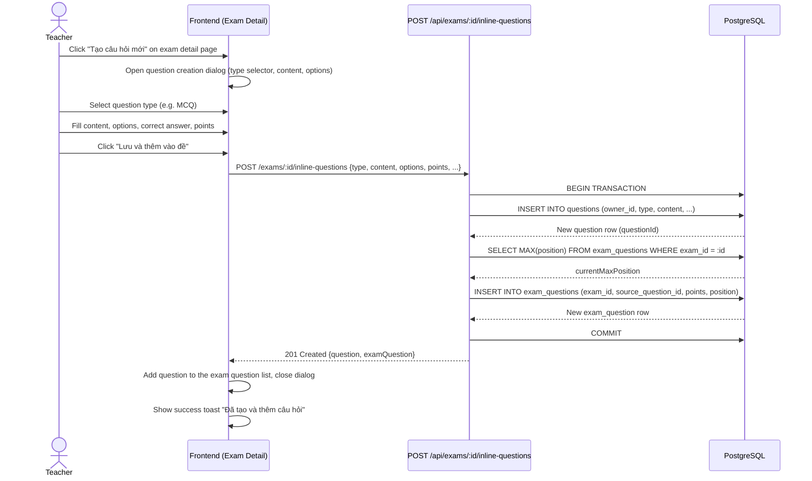

# D9. Create Questions Directly in Exam

## 5.1 Feature Overview

| Field | Value |
|---|---|
| Feature ID | D9 |
| Feature Name | Create Questions Directly in Exam |
| Module | D. Exam Management |
| Priority | P2 |
| Complexity | M |
| Status | Proposed — not implemented |
| Target Roles | TEACHER |
| Business Objective | Allow teachers to create new questions inline during exam building without leaving the exam editor, reducing context switches and speeding up exam authoring |
| User Problem | Currently a teacher must navigate to `/dashboard/questions` to create a question, then return to the exam detail page and add it via the "Thêm câu hỏi" dialog. This two-step flow interrupts the authoring flow and slows teachers who think of new questions while composing an exam. |
| Dependencies | D1 (Create/Edit Exam), D3 (Manage Questions in Exam), C1 (Create Question) |

## 5.2 Actors and Permissions

### Teacher (TEACHER)

| Action | Allowed | Notes |
|---|---|---|
| Create a question inline for own DRAFT exam | Yes | Question is saved to question bank AND linked to the exam |
| Create a question inline for own PUBLISHED/ARCHIVED exam | **No** | Exam is not DRAFT; backend rejects with 400 |
| Create a question inline for another teacher's exam | **No** | Backend rejects with 403 |

### Student (STUDENT)

| Action | Allowed | Notes |
|---|---|---|
| Access inline question creation | **No** | ExamsController is `@Roles('TEACHER')` |

### Backend Authorization

- `ExamsController` has class-level `@Roles('TEACHER')`.
- The endpoint reuses `findByIdForOwner()` to verify `ownerId === userId`; throws `ForbiddenException` on mismatch.
- Exam must be in DRAFT status; throws `BadRequestException` otherwise.

## 5.3 Preconditions and Business Rules

### Preconditions

- User must be authenticated with a valid JWT.
- User must have role `TEACHER`.
- Exam must exist and be owned by the requesting teacher.
- Exam must be in DRAFT status.

### Business Rules

| Rule ID | Rule | Enforcement |
|---|---|---|
| D9-R01 | The endpoint creates a `Question` row in the teacher's question bank (owned by the teacher) **and** an `ExamQuestion` row linking it to the exam, in a single transaction | Backend |
| D9-R02 | The created question follows all validation rules of `POST /api/questions` (C1): required options for MCQ/MCQ_MULTI/TRUE_FALSE, exactly one correct option for MCQ and TRUE_FALSE, at least one correct option for MCQ_MULTI, `correctAnswer` for SHORT_ANSWER/FILL_BLANK | Backend |
| D9-R03 | If the exam has N questions, the new `ExamQuestion` is assigned `position = N` (zero-based, appended at the end). The teacher may reorder later via existing D3 reorder flow. | Backend |
| D9-R04 | The `points` for the new `ExamQuestion` defaults to 1 unless the teacher specifies a different value in the request | Backend, Frontend |
| D9-R05 | All six question types are supported: MCQ, MCQ_MULTI, TRUE_FALSE, SHORT_ANSWER, FILL_BLANK, ESSAY | Backend, Frontend |
| D9-R06 | The created `Question` is visible in the teacher's question bank list (`GET /api/questions`) immediately after creation, identical to a question created through the standalone question bank flow | Backend |
| D9-R07 | If the teacher specifies a `categoryId`, the category must exist and be owned by the teacher. If not provided, the question has no category. | Backend |
| D9-R08 | If the transaction fails at any step (question creation or exam-question linking), neither the `Question` nor the `ExamQuestion` is persisted (atomic rollback) | Backend |
| D9-R09 | `ExamQuestion.sourceQuestionId` is set to the newly created question's ID | Backend |
| D9-R10 | The unique constraint `@@unique([examId, position])` on `ExamQuestion` must not be violated. Backend calculates position from the current maximum position for the exam + 1, or 0 if no questions exist. | Backend |

## 5.4 Main User Flow — Happy Path



### Step-by-Step

1. Teacher navigates to the exam detail page (`/dashboard/exams/[id]`). The exam is in DRAFT status.
2. Teacher clicks the "Tạo câu hỏi mới" button (visible only for DRAFT exams, next to the existing "Thêm câu hỏi" button).
3. A dialog opens with the question creation form: type selector, content textarea, options editor (for MCQ/MCQ_MULTI/TRUE_FALSE), correct answer input (for SHORT_ANSWER/FILL_BLANK), difficulty selector, category selector, points input.
4. Teacher fills the form and clicks "Lưu và thêm vào đề".
5. Frontend validates required fields client-side, then sends `POST /api/exams/:id/inline-questions`.
6. Backend validates ownership and DRAFT status, validates question data, creates both records in a transaction, returns the created data.
7. Frontend appends the new question to the exam's question list and closes the dialog.
8. A success toast confirms the action.

## 5.5 Alternative Flows

### AF-01: Teacher creates a question and continues creating more

1. After successful creation, the dialog does not auto-close.
2. Teacher clicks "Lưu và tạo tiếp" instead of "Lưu và thêm vào đề".
3. The form resets, keeping the previously selected type and category as defaults.
4. Teacher creates another question. Position increments automatically.
5. Teacher clicks "Đóng" when finished.

### AF-02: Teacher changes question type mid-form

1. Teacher selects MCQ, fills two options.
2. Teacher switches to SHORT_ANSWER.
3. Options form section hides. `correctAnswer` input appears.
4. Previously entered options are discarded (frontend state only; no API call yet).

### AF-03: Teacher specifies a category

1. Teacher selects an existing category from the dropdown.
2. If the teacher's category list is empty, a "Tạo danh mục" link is shown, opening `/dashboard/questions` in a new tab.
3. The category dropdown can be left empty (no category).

### AF-04: Teacher specifies custom points

1. Default points value is 1.
2. Teacher changes the points input to a different value (must be integer >= 1).
3. The `ExamQuestion.points` is set to the teacher-specified value.

## 5.6 Edge Cases and Failure Scenarios

| Scenario ID | Scenario | Trigger | Expected Behavior | User Feedback | Data Integrity | Recovery | Severity |
|---|---|---|---|---|---|---|---|
| D9-E01 | Exam is not in DRAFT status | Teacher somehow triggers the endpoint on a PUBLISHED exam (e.g., stale UI) | Backend returns 400 `EXAM_NOT_DRAFT` | Toast: "Chỉ có thể thêm câu hỏi vào đề thi ở trạng thái nháp" | No data written | Refresh page | Medium |
| D9-E02 | Exam does not exist | Invalid exam ID | Backend returns 404 | Error page | No data affected | Navigate back | Low |
| D9-E03 | Teacher is not the exam owner | Crafted request | Backend returns 403 | Error message | No data affected | None needed | Medium |
| D9-E04 | Validation failure — missing required fields | Content empty, or MCQ without options | Backend returns 400 with validation errors | Form shows field-level errors: "Nội dung câu hỏi là bắt buộc" | No data written | Fix and retry | Medium |
| D9-E05 | Validation failure — MCQ with no correct option | MCQ with all `isCorrect: false` | Backend returns 400 `INVALID_OPTIONS` | Error: "Cần chọn đúng một đáp án đúng" | No data written | Fix and retry | Medium |
| D9-E06 | Position conflict due to concurrent request | Two inline-create requests arrive simultaneously for the same exam | Transaction isolation ensures one succeeds and the other gets a unique constraint violation on `[examId, position]`. Failed request is retried by backend with recalculated position. | One succeeds; the other may briefly fail, then succeeds on retry | No corrupt data; transaction rollback | Backend retry (1 attempt) or user clicks again | Low |
| D9-E07 | Category not owned by teacher | `categoryId` belongs to another teacher | Backend returns 400 `INVALID_CATEGORY` | Error: "Danh mục không hợp lệ" | No data written | Select a valid category | Low |
| D9-E08 | Network failure during save | Connection lost after clicking save | Frontend shows connection error toast | "Lỗi kết nối. Vui lòng thử lại." | No data written (request never reached server, or transaction rolled back) | Retry | Low |
| D9-E09 | Maximum question limit (if any) reached | Exam already has 200 questions | Backend returns 400 `MAX_QUESTIONS_REACHED` | "Đề thi đã đạt giới hạn tối đa 200 câu hỏi" | No data written | Remove some questions first | Low |

## 5.7 UI/UX Specification

### Entry Point

- **Button**: "Tạo câu hỏi mới" (outline variant, with a `FilePlus` or `PenLine` icon) on the exam detail page.
- **Position**: In the action bar, next to the existing "Thêm câu hỏi" (add from bank) button. Only visible when exam is DRAFT.
- **Layout**: The two buttons form a button group: `[Thêm câu hỏi] [Tạo câu hỏi mới]`.

### Question Creation Dialog

| Element | Description |
|---|---|
| Dialog title | "Tạo câu hỏi mới" |
| Type selector | Dropdown with 6 types: "Trắc nghiệm một đáp án" (MCQ), "Trắc nghiệm nhiều đáp án" (MCQ_MULTI), "Đúng/Sai" (TRUE_FALSE), "Trả lời ngắn" (SHORT_ANSWER), "Điền vào chỗ trống" (FILL_BLANK), "Tự luận" (ESSAY). Default: MCQ |
| Content textarea | Required. Placeholder: "Nhập nội dung câu hỏi..." |
| Options editor | Visible for MCQ, MCQ_MULTI, TRUE_FALSE. Identical to the question bank creation form. Each option: content input + correct checkbox + delete button. "Thêm đáp án" button to add more options. |
| Correct answer input | Visible for SHORT_ANSWER, FILL_BLANK. Label: "Đáp án đúng". |
| Points input | Number input, default 1, min 1. Label: "Điểm" |
| Difficulty selector | Optional dropdown: Dễ / Trung bình / Khó |
| Category selector | Optional dropdown from teacher's categories. "Không có danh mục" default |
| Explanation textarea | Optional. Label: "Giải thích" |
| Action buttons | Primary: "Lưu và thêm vào đề". Secondary: "Lưu và tạo tiếp". Ghost: "Hủy" |

### Dialog Dimensions

- Max width: 640px (`max-w-xl`)
- Max height: 80vh with internal scroll on the form body
- Dialog footer is sticky at the bottom

### Responsive Behavior

| Breakpoint | Layout |
|---|---|
| >= 640px (desktop/tablet) | Dialog centered, max-w-xl |
| < 640px (mobile) | Dialog as full-screen sheet from bottom, with all fields stacked |

### States

| State | Behavior |
|---|---|
| Empty form | Default state when dialog opens |
| Filling | Teacher is entering data; "Lưu" buttons enabled only when required fields are valid |
| Saving | Buttons show spinner, form inputs disabled |
| Success | Toast "Đã tạo và thêm câu hỏi". Dialog closes (or resets if "Lưu và tạo tiếp") |
| Validation error | Field-level error messages in red below the invalid field |
| Server error | Toast with error message, form remains editable |

## 5.8 Data Requirements

### Existing Entities Used

- **Question**: A new row is created in the teacher's question bank. All standard fields apply: `ownerId`, `type`, `content`, `explanation`, `difficulty`, `categoryId`, `imageUrl`, `correctAnswer`.
- **QuestionOption**: For MCQ/MCQ_MULTI/TRUE_FALSE types, option rows are created via nested create.
- **ExamQuestion**: A new row links the question to the exam: `examId`, `sourceQuestionId`, `points`, `position`.
- **Exam**: Read to verify ownership and DRAFT status. Not modified.
- **QuestionCategory**: Read to verify category ownership if `categoryId` is provided.

### Proposed Schema Changes

None. All required tables and columns exist. The feature composes existing entities in a single transaction.

## 5.9 API Requirements

### POST /api/exams/:id/inline-questions — Create Question and Add to Exam

| Attribute | Value |
|---|---|
| Method | POST |
| Path | `/api/exams/:id/inline-questions` |
| Purpose | Create a new question in the teacher's question bank and simultaneously link it to the specified exam |
| Required Role | TEACHER (owner of the exam) |
| Authorization | Exam `ownerId` must match authenticated user. Exam must be DRAFT. |

**Request Body:**

```json
{
  "type": "MCQ",
  "content": "Đạo hàm của f(x) = x² là gì?",
  "explanation": "Áp dụng công thức đạo hàm...",
  "difficulty": "MEDIUM",
  "categoryId": "category-uuid",
  "imageUrl": null,
  "correctAnswer": null,
  "options": [
    { "content": "2x", "isCorrect": true, "position": 0 },
    { "content": "x²", "isCorrect": false, "position": 1 },
    { "content": "x", "isCorrect": false, "position": 2 },
    { "content": "2", "isCorrect": false, "position": 3 }
  ],
  "points": 2
}
```

**Validation Rules (DTO):**

| Field | Type | Required | Constraints | Error code | Error message |
|---|---|---|---|---|---|
| `type` | `QuestionType` enum | No (default MCQ) | One of MCQ, MCQ_MULTI, TRUE_FALSE, SHORT_ANSWER, FILL_BLANK, ESSAY | `INVALID_TYPE` | "Loại câu hỏi không hợp lệ" |
| `content` | string | Yes | Non-empty, max 10000 chars | `CONTENT_REQUIRED` | "Nội dung câu hỏi là bắt buộc" |
| `options` | array of `CreateOptionDto` | Required for MCQ, MCQ_MULTI, TRUE_FALSE | Min 2 options. MCQ/TRUE_FALSE: exactly 1 correct. MCQ_MULTI: at least 1 correct. | `INVALID_OPTIONS` | "Đáp án không hợp lệ" / "Cần ít nhất 2 đáp án" / "Cần chọn đúng một đáp án đúng" |
| `correctAnswer` | string | Required for SHORT_ANSWER, FILL_BLANK | Non-empty for those types | `CORRECT_ANSWER_REQUIRED` | "Đáp án đúng là bắt buộc cho loại câu hỏi này" |
| `points` | integer | No (default 1) | >= 1 | `INVALID_POINTS` | "Điểm phải là số nguyên >= 1" |
| `difficulty` | `Difficulty` enum | No | One of EASY, MEDIUM, HARD | `INVALID_DIFFICULTY` | "Độ khó không hợp lệ" |
| `categoryId` | UUID | No | Must exist and be owned by the teacher | `INVALID_CATEGORY` | "Danh mục không hợp lệ" |
| `explanation` | string | No | Max 5000 chars | — | — |
| `imageUrl` | string | No | Valid URL format | — | — |

**Success Response (201 Created):**

```json
{
  "success": true,
  "data": {
    "question": {
      "id": "new-question-uuid",
      "type": "MCQ",
      "content": "Đạo hàm của f(x) = x² là gì?",
      "options": [
        { "id": "opt-uuid-1", "content": "2x", "isCorrect": true, "position": 0 },
        { "id": "opt-uuid-2", "content": "x²", "isCorrect": false, "position": 1 },
        { "id": "opt-uuid-3", "content": "x", "isCorrect": false, "position": 2 },
        { "id": "opt-uuid-4", "content": "2", "isCorrect": false, "position": 3 }
      ],
      "difficulty": "MEDIUM",
      "categoryId": "category-uuid",
      "createdAt": "2026-11-12T10:00:00Z"
    },
    "examQuestion": {
      "id": "exam-question-uuid",
      "examId": "exam-uuid",
      "sourceQuestionId": "new-question-uuid",
      "points": 2,
      "position": 5
    }
  }
}
```

**Error Responses:**

| Status | Code | Condition |
|---|---|---|
| 400 | `EXAM_NOT_DRAFT` | Exam status is not DRAFT |
| 400 | `CONTENT_REQUIRED` | `content` is empty |
| 400 | `INVALID_OPTIONS` | Option validation failed for the question type |
| 400 | `INVALID_CATEGORY` | `categoryId` does not exist or not owned by teacher |
| 400 | `MAX_QUESTIONS_REACHED` | Exam already has 200 questions |
| 401 | Unauthorized | No valid JWT |
| 403 | Forbidden | Teacher is not the exam owner |
| 404 | Not Found | Exam does not exist |

## 5.10 State Management

This feature does not introduce new entity states. It creates data within existing states:

- **Exam**: Must be DRAFT. Status does not change.
- **Question**: Created in normal state (no lifecycle status on questions).
- **ExamQuestion**: Created with no snapshots (`contentSnapshot` = null, `optionsSnapshot` = null). Snapshots are populated when the exam is published (D4).

## 5.11 Acceptance Criteria

### Happy Path

```
Given a teacher owns a DRAFT exam with 3 existing questions,
When they POST /api/exams/:id/inline-questions with valid MCQ data and points=2,
Then the response is 201 with a new Question in the bank and a new ExamQuestion at position 3 with points=2.

Given a teacher creates a question inline with type SHORT_ANSWER and correctAnswer "42",
When the request succeeds,
Then the Question.correctAnswer is "42" and the Question appears in GET /api/questions for the same teacher.

Given a teacher opens the exam detail page for a DRAFT exam,
When they click "Tạo câu hỏi mới" and fill the form and submit,
Then the new question appears in the exam's question list without a page refresh.
```

### Atomicity

```
Given a teacher sends a valid inline question creation request,
When the exam_question insert fails (e.g., position conflict),
Then no Question row is persisted (transaction rolled back).

Given a teacher sends a request with invalid question data (e.g., MCQ with 0 correct options),
When the backend validates the data,
Then no Question or ExamQuestion row is created, and 400 is returned with a descriptive error.
```

### Authorization

```
Given a STUDENT is authenticated,
When they attempt POST /api/exams/:id/inline-questions,
Then the backend returns 403 Forbidden.

Given Teacher A owns an exam,
When Teacher B attempts POST /api/exams/:id/inline-questions on that exam,
Then the backend returns 403 Forbidden.

Given a teacher owns a PUBLISHED exam,
When they attempt POST /api/exams/:id/inline-questions,
Then the backend returns 400 with code EXAM_NOT_DRAFT.
```

### Question Bank Integration

```
Given a teacher creates a question inline with categoryId and difficulty,
When they later visit /dashboard/questions and filter by that category and difficulty,
Then the inline-created question appears in the results.
```

## 5.12 QA Test Scenarios

| Test ID | Scenario | Preconditions | Steps | Test Data | Expected Result | Priority |
|---|---|---|---|---|---|---|
| D9-T01 | Create MCQ inline | DRAFT exam with 2 questions | POST /exams/:id/inline-questions with MCQ, 4 options, 1 correct | content, options, points=1 | 201, Question created, ExamQuestion at position 2 | High |
| D9-T02 | Create MCQ_MULTI inline | DRAFT exam | POST with MCQ_MULTI, 4 options, 2 correct | — | 201, Question and ExamQuestion created | High |
| D9-T03 | Create TRUE_FALSE inline | DRAFT exam | POST with TRUE_FALSE, 2 options | — | 201, created successfully | Medium |
| D9-T04 | Create SHORT_ANSWER inline | DRAFT exam | POST with SHORT_ANSWER, correctAnswer="42" | — | 201, Question.correctAnswer = "42" | High |
| D9-T05 | Create FILL_BLANK inline | DRAFT exam | POST with FILL_BLANK, correctAnswer="Hà Nội" | — | 201, created successfully | Medium |
| D9-T06 | Create ESSAY inline | DRAFT exam | POST with ESSAY, no options, no correctAnswer | — | 201, created successfully | Medium |
| D9-T07 | Verify question in bank | After D9-T01 | GET /questions as the same teacher | — | The inline-created question appears in the list | High |
| D9-T08 | Reject for PUBLISHED exam | PUBLISHED exam | POST /exams/:id/inline-questions | Valid MCQ data | 400 EXAM_NOT_DRAFT | High |
| D9-T09 | Reject for non-owner | DRAFT exam owned by Teacher A | POST as Teacher B | Valid MCQ data | 403 Forbidden | High |
| D9-T10 | Reject for student | Any exam | POST as STUDENT | Valid MCQ data | 403 Forbidden | High |
| D9-T11 | Reject invalid MCQ (no correct option) | DRAFT exam | POST with MCQ, 4 options all isCorrect=false | — | 400 INVALID_OPTIONS | High |
| D9-T12 | Reject empty content | DRAFT exam | POST with content="" | — | 400 CONTENT_REQUIRED | Medium |
| D9-T13 | Transaction atomicity | DRAFT exam | Simulate position conflict | Concurrent requests | At most one succeeds; no orphan Question rows | High |
| D9-T14 | Custom points | DRAFT exam | POST with points=5 | — | ExamQuestion.points = 5 | Medium |
| D9-T15 | With category | DRAFT exam, teacher has category | POST with categoryId | Valid categoryId | Question.categoryId set | Medium |
| D9-T16 | Invalid categoryId | DRAFT exam | POST with non-existent categoryId | Random UUID | 400 INVALID_CATEGORY | Medium |

## 5.13 Open Questions and Assumptions

| # | Question | Why It Matters | Options | Recommended Default | Impact |
|---|---|---|---|---|---|
| D9-Q01 | Should the inline creation dialog support image upload for the question? | Image upload (MinIO) is not yet implemented (C-GAP-01). If this feature ships before image upload, `imageUrl` will be null for all inline-created questions. | (a) Support imageUrl field only when upload service exists. (b) Hide imageUrl field entirely until upload is implemented. (c) Allow pasting an external URL. | (b) Hide imageUrl field until upload is implemented — avoids dangling URLs and user confusion | Low — field exists, can be added later |
| D9-Q02 | Should "Lưu và tạo tiếp" (save and create another) be supported in the first iteration? | Reduces clicks for teachers creating many questions for a new exam. But increases dialog complexity. | (a) Both "Lưu và thêm vào đề" (close) and "Lưu và tạo tiếp" (keep open). (b) Only "Lưu và thêm vào đề" for simplicity. | (a) Support both — the UX cost is one extra button; the productivity gain is significant for teachers authoring exams from scratch | Low |
| D9-Q03 | Should there be a maximum number of questions per exam? | Prevents performance issues on preview, publish (snapshot generation), and attempt loading. | (a) 200 questions max. (b) No limit. (c) 100 questions max. | (a) 200 questions max — covers realistic exam sizes while preventing abuse | Low |

### Assumptions

| # | Assumption | Recommended Default | Impact if Wrong |
|---|---|---|---|
| D9-A01 | The question creation form reuses the same validation rules as `POST /api/questions` (C1). No new validation rules are introduced by this feature. | Reuse existing `CreateQuestionDto` validation | If inline creation needs different rules (e.g., mandatory category), a new DTO class is needed. Minor effort. |
| D9-A02 | Position for the new `ExamQuestion` is calculated server-side as `MAX(position) + 1` for the given exam. The client does not send a `position` field. | Server-calculated position | If the teacher needs to insert at a specific position, the endpoint needs a `position` parameter and the backend must shift existing positions. Significantly more complex. |
| D9-A03 | The response includes both the created `Question` and the `ExamQuestion`, so the frontend can update its local state without a full exam reload. | Return both objects | If only one is returned, the frontend needs an extra API call. Minor. |
