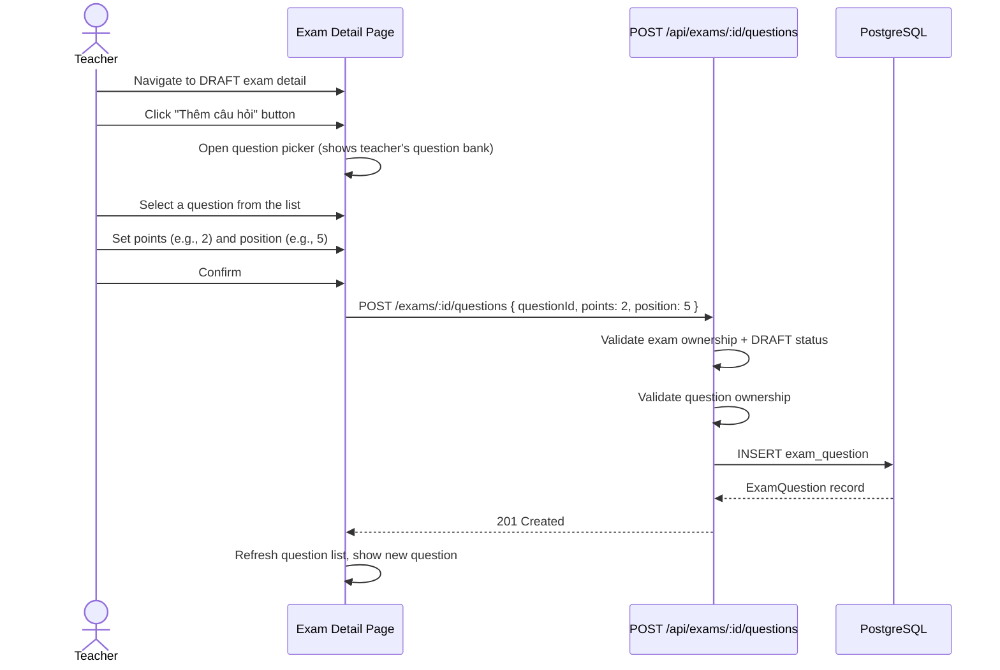
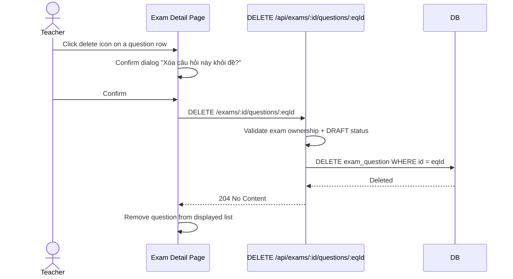

# D3. Manage Exam Questions

## 5.1 Feature Overview

| Field | Value |
|---|---|
| Feature ID | D3 |
| Feature Name | Add / Remove / Reorder Exam Questions |
| Module | D. Exam Management |
| Priority | P0 |
| Complexity | M |
| Status | Existing — backend fully implemented, frontend on exam detail page |
| Target Roles | TEACHER |
| Business Objective | Allow teachers to compose exams by selecting questions from their question bank and configuring per-question points and ordering |
| User Problem | Teachers need to build exams from their existing question bank, assigning different point values and controlling question order |
| Dependencies | D1 (Create Exam), C1 (Question Bank CRUD) |

## 5.2 Actors and Permissions

### Teacher

| Action | Allowed | Notes |
|---|---|---|
| Add question from own bank to own DRAFT exam | Yes | |
| Add question from another teacher's bank | **No** | Validated: `question.ownerId !== userId` |
| Remove question from own DRAFT exam | Yes | |
| Reorder questions in own DRAFT exam | Yes | Via updating `position` |
| Add/remove/reorder in PUBLISHED or ARCHIVED exam | **No** | Status check rejects |

### Student

| Action | Allowed | Notes |
|---|---|---|
| Any question management action | **No** | `@Roles('TEACHER')` on controller |

### Backend Authorization

- `addQuestion()`: Checks exam ownership AND question ownership. Both must belong to the authenticated teacher.
- `removeQuestion()`: Checks exam ownership. Does not verify the ExamQuestion belongs to that exam (Prisma delete will fail if ID doesn't exist).
- Status check: All modification endpoints verify `exam.status === 'DRAFT'`.

## 5.3 Preconditions and Business Rules

| Rule ID | Rule | Enforcement |
|---|---|---|
| D3-R01 | Questions can only be added to DRAFT exams | Service checks `exam.status !== 'DRAFT'` |
| D3-R02 | Teacher can only add questions from their own question bank | Service checks `question.ownerId !== ownerId` |
| D3-R03 | Each question's `points` must be ≥ 1 | DTO validation `@Min(1)` |
| D3-R04 | Each question's `position` must be ≥ 0 | DTO validation `@Min(0)` |
| D3-R05 | `(examId, position)` must be unique | Database unique constraint |
| D3-R06 | The same source question can be added multiple times to the same exam at different positions | No unique constraint on `(examId, sourceQuestionId)`. This is intentional for flexibility but may be surprising |
| D3-R07 | When a question is removed from a DRAFT exam, it is NOT deleted from the question bank — only the ExamQuestion link is removed | Cascade is on Exam delete, not on ExamQuestion delete |
| D3-R08 | Question content is NOT snapshotted when added to a draft. Snapshots happen only at publish time | `contentSnapshot` and `optionsSnapshot` remain null until publish |

### Data Flow

```
Question Bank ──(add to exam)──> ExamQuestion (reference only, no snapshot)
                                      │
                                      ▼ (at publish time)
                                 ExamQuestion (contentSnapshot + optionsSnapshot populated)
```

## 5.4 Main User Flow — Happy Path

### Add Question to Exam



### Remove Question from Exam



## 5.5 Alternative Flows

### AF-01: Add same question twice
1. Teacher adds Question A at position 0.
2. Teacher adds Question A again at position 1 (perhaps with different points).
3. Both ExamQuestion rows are created. The exam now has the same question at two positions.
4. **Note**: This is allowed by the schema (no unique on `examId + sourceQuestionId`). Whether this is desirable is an open question.

### AF-02: Reorder questions
1. Teacher wants to move question from position 3 to position 1.
2. Frontend sends `PATCH /exams/:id/questions/:eqId { position: 1 }`.
3. **Issue**: If position 1 is already taken, the unique constraint `(examId, position)` will reject the update.
4. **Current workaround**: Teacher must manually swap positions or remove/re-add. See Open Questions for auto-reorder.

### AF-03: Add question, then delete source question from bank
1. Teacher adds question to DRAFT exam.
2. Teacher deletes the source question from the question bank.
3. `sourceQuestionId` is set to null (`onDelete: SetNull` in schema).
4. The ExamQuestion row persists but loses its source reference.
5. **If exam is still DRAFT**: The question details cannot be displayed from the bank (source is gone). At publish time, `eq.sourceQuestion` will be null and the snapshot will be skipped (`if (!eq.sourceQuestion) continue`).
6. **Impact**: The exam question becomes orphaned — no content and no snapshot. This is a data integrity issue. See Edge Cases.

## 5.6 Edge Cases and Failure Scenarios

| Scenario ID | Scenario | Trigger | Expected Behavior | User Feedback | Data Integrity | Recovery | Severity |
|---|---|---|---|---|---|---|---|
| D3-E01 | Add question with duplicate position | Teacher (or API caller) adds at position already taken | Database unique constraint violation on `(examId, position)` | Prisma unique constraint error returned as 500 or unhandled. **Should be 400** | No data created | Choose a different position | High |
| D3-E02 | Add question from another teacher's bank | Crafted API request with questionId belonging to Teacher B | Backend returns 400 "Question not found or not owned by you" | Error message | No data created | Use own questions | Medium |
| D3-E03 | Add question to PUBLISHED exam | Crafted API request | Backend returns 400 "Can only modify DRAFT exams" | Error message | No data created | Cannot add. Archive and recreate if needed | Medium |
| D3-E04 | Remove non-existent ExamQuestion | Crafted API with random eqId | Prisma throws on delete. **Currently returns 500**, should be 404 | Server error | No data changed | Correct the ID | Medium |
| D3-E05 | Source question deleted after adding to exam (DRAFT) | Teacher deletes question from bank | ExamQuestion.sourceQuestionId → null (SetNull). At publish, `eq.sourceQuestion` is null, snapshot skipped | **No warning** — orphaned question silently has no content | Exam publishes with blank question | Teacher must remove the orphaned ExamQuestion before publish | Critical |
| D3-E06 | Source question edited after adding to exam (DRAFT, pre-publish) | Teacher changes question content in bank | No effect on ExamQuestion until publish. At publish, latest content is snapshotted | Expected behavior — snapshot takes current state | Correct by design | None needed | Low |
| D3-E07 | Add question with points = 0 | Crafted API with points: 0 | DTO rejects: `@Min(1)` | 400 validation error | No data created | Set points ≥ 1 | Low |
| D3-E08 | Position gap (e.g., 0, 1, 5) | Teacher adds at non-sequential positions | Allowed. UI displays in position order | No visual issue (sorted by position) | Valid but messy | Positions are for ordering, gaps are OK | Low |
| D3-E09 | Very large number of questions (100+) | Teacher adds many questions | Performance degrades on list queries | Slow page load | No data issue | Paginate question list. Not needed for MVP scale | Low |
| D3-E10 | Concurrent add at same position | Two tabs add at position 5 simultaneously | First succeeds, second fails with unique constraint | Error on second request | Only one question at that position | Change position and retry | Medium |

## 5.7 UI/UX Specification

### Exam Detail Page — Question Management Section

| Element | Description |
|---|---|
| Question list | Ordered list of ExamQuestions showing: position number, question content (from source or snapshot), points, and action buttons |
| Add button | "Thêm câu hỏi" — opens a question picker dialog |
| Question picker | Dialog showing teacher's question bank with search. Searchable, filterable (by category, type, difficulty). Select to add |
| Points input | Per-question, inline editable or in the add dialog |
| Position | Displayed as "Câu 1", "Câu 2", etc. Ideally drag-to-reorder |
| Remove button | Trash icon on each question row, with confirmation dialog |
| Empty state | "Chưa có câu hỏi nào. Thêm câu hỏi từ ngân hàng." |

### States

| State | Display |
|---|---|
| DRAFT exam | Full editing controls visible |
| PUBLISHED exam | Read-only list, snapshot content displayed, no add/remove buttons |
| Loading | Skeleton loader for question list |

### Responsive Behavior

- Desktop: Table layout with columns for position, content preview, type, points, actions.
- Mobile: Card layout stacked vertically.

## 5.8 Data Requirements

### Existing Entity: `ExamQuestion`

| Field | Type | Required | Notes |
|---|---|---|---|
| id | UUID | Auto | PK |
| examId | UUID FK → Exam | Yes | |
| sourceQuestionId | UUID FK → Question | No | Nullable — set to null if source deleted |
| points | Int | Yes | ≥ 1 |
| position | Int | Yes | ≥ 0, unique per exam |
| contentSnapshot | String? | No | Populated at publish time |
| optionsSnapshot | Json? | No | Populated at publish time; array of `{id, content, isCorrect, position}` |

### Constraints

| Constraint | Type | Columns |
|---|---|---|
| Primary key | PK | `id` |
| Exam reference | FK | `examId` → `exams.id` (CASCADE delete) |
| Source question reference | FK | `sourceQuestionId` → `questions.id` (SET NULL) |
| Unique position per exam | UNIQUE | `(examId, position)` |

### Proposed Schema Changes

None required for current functionality.

## 5.9 API Requirements

### POST /api/exams/:id/questions — Add Question

| Attribute | Value |
|---|---|
| Method | POST |
| Path | `/api/exams/:id/questions` |
| Purpose | Add a question from the bank to a DRAFT exam |
| Required Role | TEACHER (exam owner) |
| Authorization | Exam owner AND question owner must be the same teacher |

**Request Body:**
```json
{
  "questionId": "uuid-of-source-question",
  "points": 2,
  "position": 0
}
```

**Success Response (201):**
```json
{
  "success": true,
  "data": {
    "id": "exam-question-uuid",
    "examId": "exam-uuid",
    "sourceQuestionId": "question-uuid",
    "points": 2,
    "position": 0,
    "contentSnapshot": null,
    "optionsSnapshot": null
  }
}
```

**Error Responses:**

| Status | Condition |
|---|---|
| 400 | Exam is not DRAFT |
| 400 | Question not found or not owned by teacher |
| 400 | Position already taken (unique constraint — should be 409 or 400 with clear message) |
| 403 | Not the exam owner |
| 404 | Exam not found |

### DELETE /api/exams/:id/questions/:eqId — Remove Question

| Attribute | Value |
|---|---|
| Method | DELETE |
| Path | `/api/exams/:id/questions/:eqId` |
| Purpose | Remove a question from a DRAFT exam |
| Required Role | TEACHER (exam owner) |
| Authorization | Exam owner only |

**Success Response:** 204 No Content

**Error Responses:**

| Status | Condition |
|---|---|
| 400 | Exam is not DRAFT |
| 403 | Not the exam owner |
| 404 | Exam or ExamQuestion not found |

### PATCH /api/exams/:id/questions/:eqId — Update Points/Position

| Attribute | Value |
|---|---|
| Method | PATCH |
| Path | `/api/exams/:id/questions/:eqId` |
| Purpose | Update points or position of an exam question |
| Required Role | TEACHER (exam owner) |
| Authorization | Exam owner, DRAFT only |
| **Status** | **Not yet implemented** — see Open Questions |

**Request Body:**
```json
{
  "points": 3,
  "position": 2
}
```

## 5.10 State Management

Question management is gated by the exam lifecycle state (see D1). No additional state machine is needed for ExamQuestion itself.

### Key State Interactions

```
ExamQuestion lifecycle:
  Created (no snapshot) → [exam publish] → Snapshot populated → [exam archived] → Frozen
                         └──────────────── DRAFT phase: mutable ──────────────┘
```

## 5.11 Acceptance Criteria

```
Given a teacher owns a DRAFT exam and owns a question in the bank,
When they add the question to the exam with points=2 and position=0,
Then an ExamQuestion is created with the correct examId, sourceQuestionId, points, and position, and contentSnapshot is null.

Given a teacher owns a DRAFT exam with 5 questions,
When they remove question at position 2,
Then the ExamQuestion is deleted, and other positions remain unchanged.

Given a teacher adds a question to a DRAFT exam,
When the source question's content is later edited in the bank,
Then the ExamQuestion is not affected until the exam is published.

Given a teacher adds a question and then publishes the exam,
When they view the exam questions,
Then contentSnapshot and optionsSnapshot contain the question data as it was at publish time.

Given a teacher tries to add a question to a PUBLISHED exam,
When the API processes the request,
Then it returns 400 "Can only modify DRAFT exams".

Given a teacher tries to add another teacher's question,
When the API processes the request,
Then it returns 400 "Question not found or not owned by you".
```

## 5.12 QA Test Scenarios

| Test ID | Scenario | Preconditions | Steps | Expected Result | Priority |
|---|---|---|---|---|---|
| D3-T01 | Add question to DRAFT exam | Teacher has DRAFT exam and question | POST /exams/:id/questions | 201, ExamQuestion created | High |
| D3-T02 | Add question to PUBLISHED exam | Teacher has PUBLISHED exam | POST /exams/:id/questions | 400 error | High |
| D3-T03 | Add another teacher's question | Teacher A's exam, Teacher B's question | POST with Teacher B's questionId | 400 error | High |
| D3-T04 | Remove question from DRAFT | Exam has 3 questions | DELETE /exams/:id/questions/:eqId | 204, question removed | High |
| D3-T05 | Remove question from PUBLISHED | Published exam | DELETE | 400 error | High |
| D3-T06 | Add at duplicate position | Exam has question at position 0 | Add another at position 0 | Error (unique constraint) | High |
| D3-T07 | Add same question twice at different positions | DRAFT exam, one question | Add at pos 0, add same at pos 1 | Both created | Medium |
| D3-T08 | Delete source question, then publish | ExamQuestion referencing deleted question | Publish exam | Question is skipped (no snapshot). **Bug**: exam may have blank question | Critical |
| D3-T09 | Add question with points=0 | DRAFT exam | POST with points: 0 | 400 validation error | Medium |
| D3-T10 | Add question with negative position | DRAFT exam | POST with position: -1 | 400 validation error (Min(0)) | Low |

## 5.13 Open Questions

| # | Question | Why It Matters | Options | Recommended Default | Impact |
|---|---|---|---|---|---|
| D3-Q01 | Should auto-reordering be implemented? | Currently changing positions requires manual position management. Gaps and conflicts are awkward | (a) Auto-increment position on add (append to end), (b) Allow manual position only, (c) Implement drag-to-reorder with batch position update | (c) Best UX but most effort. (a) as interim | Medium |
| D3-Q02 | Should adding same question twice be prevented? | May confuse teachers and inflate scoring | (a) Allow (current), (b) Add unique constraint on (examId, sourceQuestionId), (c) Show warning but allow | (c) Show warning | Low backend, low frontend |
| D3-Q03 | What happens to orphaned ExamQuestions at publish? | If source is deleted, snapshot is skipped → blank question in published exam | (a) Validate at publish: reject if any ExamQuestion has null sourceQuestion, (b) Auto-remove orphans before publish, (c) Keep current behavior | (a) Validate at publish with clear error message | Medium — critical for data integrity |
| D3-Q04 | Should the PATCH endpoint for updating points/position be implemented? | Currently only add and remove are functional. Reordering requires delete+re-add | (a) Implement PATCH, (b) Keep delete+re-add pattern | (a) Implement PATCH for better UX | Low |
| D3-Q05 | Should there be a max questions per exam limit? | UI performance and exam length | (a) No limit, (b) Soft limit with warning (e.g., 200), (c) Hard limit | (b) Soft limit at 200 with warning | Low |
