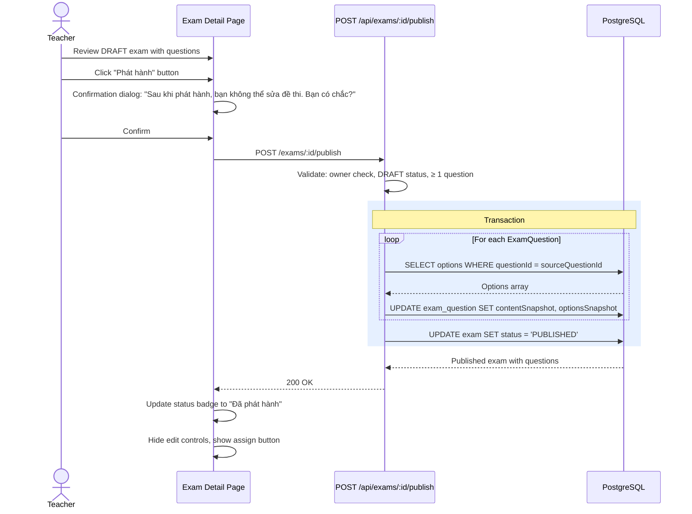
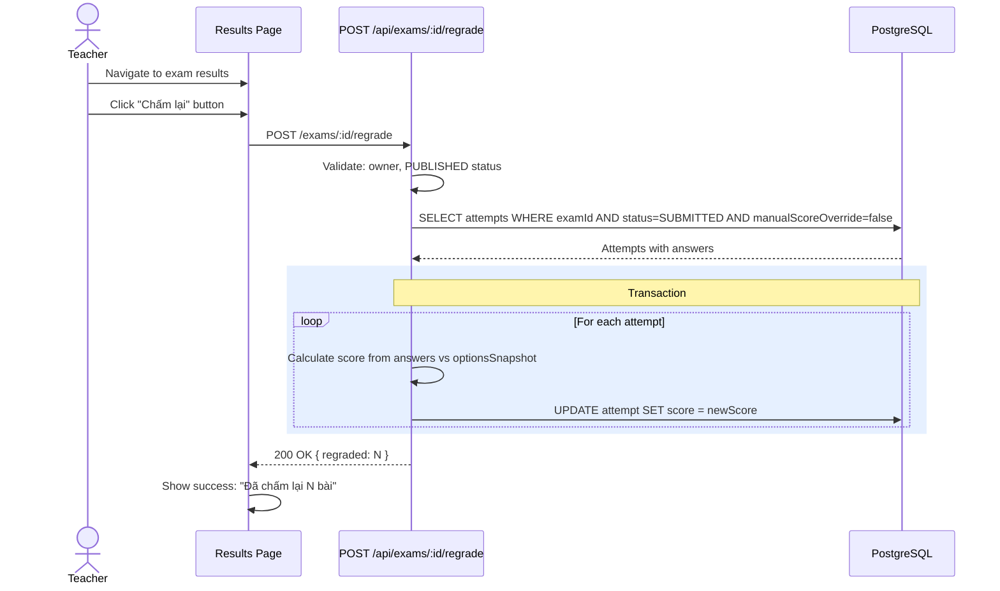
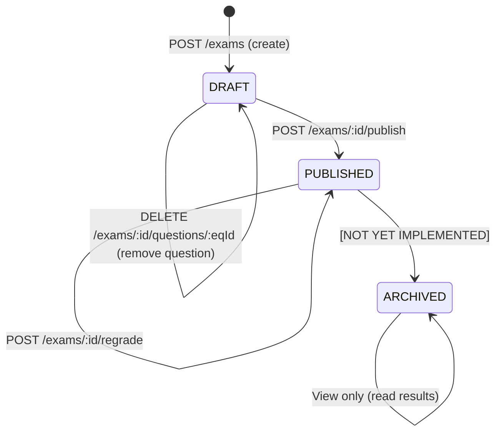
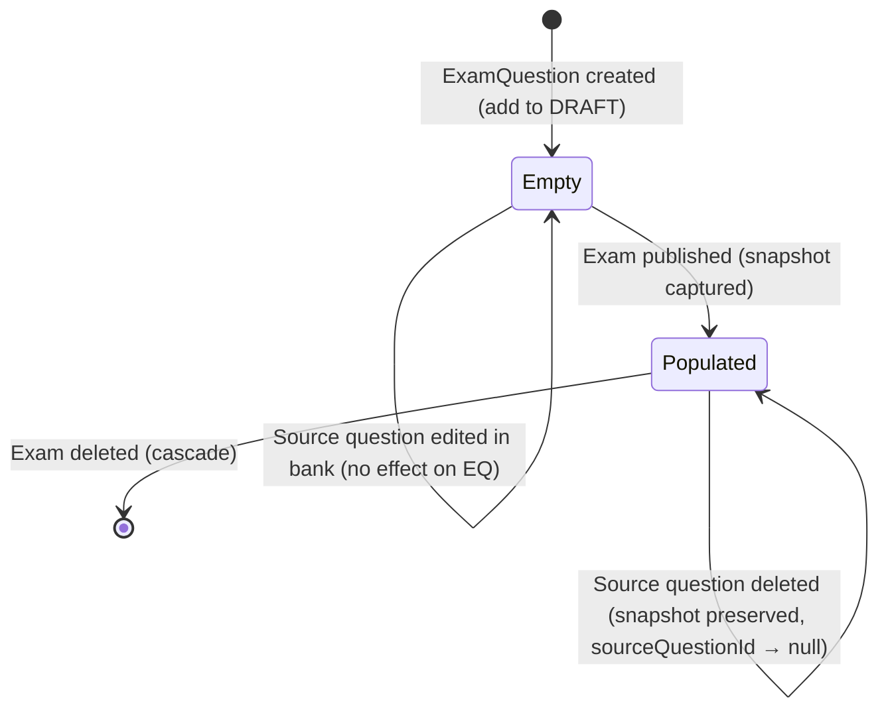

# D4. Publish / Archive Exam

## 5.1 Feature Overview

| Field | Value |
|---|---|
| Feature ID | D4 |
| Feature Name | Publish / Archive Exam (Snapshot Mechanism) |
| Module | D. Exam Management |
| Priority | P0 (publish), P2 (archive — not yet implemented) |
| Complexity | L |
| Status | Publish: Existing, fully implemented. Archive: Not implemented |
| Target Roles | TEACHER |
| Business Objective | Freeze an exam's content at a point in time so that students see a consistent, immutable set of questions regardless of later changes to the question bank |
| User Problem | If teachers edit questions in the bank after assigning an exam, students might see different content than intended, grading could be based on outdated answers, and exam integrity is compromised |
| Dependencies | D1 (Create Exam), D3 (Manage Questions), C1 (Question Bank) |

## 5.2 Actors and Permissions

### Teacher

| Action | Allowed | Notes |
|---|---|---|
| Publish own DRAFT exam | Yes | Validates preconditions |
| Publish own PUBLISHED/ARCHIVED exam | **No** | 400 error |
| Archive own PUBLISHED exam | Proposed (not yet implemented) | |
| Publish another teacher's exam | **No** | 403 |
| Regrade own PUBLISHED exam | Yes | Re-runs grading on submitted attempts |

### Student

| Action | Allowed | Notes |
|---|---|---|
| Trigger publish or archive | **No** | @Roles('TEACHER') |
| See snapshot content | Yes (during exam) | Via attempt start, which returns snapshot data |

## 5.3 Preconditions and Business Rules

### Publish Preconditions

| Rule ID | Rule | Enforcement | Current Implementation |
|---|---|---|---|
| D4-R01 | Exam must be in DRAFT status | Service check | ✅ `exam.status !== 'DRAFT'` → 400 |
| D4-R02 | Exam must have at least 1 question | Service check | ✅ `exam.questions.length === 0` → 400 |
| D4-R03 | All questions must have a source question with content | **NOT enforced** | ❌ Orphaned ExamQuestions (sourceQuestion null) are skipped silently |
| D4-R04 | All questions must have valid options | **NOT enforced** | ❌ No validation of source question's options at publish time |
| D4-R05 | Duration must be set (> 0) | Enforced at creation time | ✅ Via DTO validation |

### Snapshot Rules

| Rule ID | Rule |
|---|---|
| D4-R06 | At publish time, for each ExamQuestion: copy `sourceQuestion.content` → `contentSnapshot`, copy `sourceQuestion.options` → `optionsSnapshot` as JSON array |
| D4-R07 | `optionsSnapshot` stores `[{ id, content, isCorrect, position }]` — includes `isCorrect` for grading |
| D4-R08 | After publish, `contentSnapshot` and `optionsSnapshot` are the **source of truth** for exam content. The `sourceQuestionId` is kept for traceability only |
| D4-R09 | Editing a question in the bank after publish does NOT affect any published exam's snapshot |
| D4-R10 | Deleting a question in the bank after publish does NOT affect any published exam's snapshot (`sourceQuestionId` → null via SetNull, but snapshot data persists) |
| D4-R11 | The entire publish operation (all snapshots + status change) runs in a single database transaction |

### Archive Rules (Proposed)

| Rule ID | Rule |
|---|---|
| D4-R12 | Only PUBLISHED exams can be archived |
| D4-R13 | Archiving prevents new assignments and new attempts |
| D4-R14 | Existing in-progress attempts can be completed (governed by expiresAt) |
| D4-R15 | Existing results and snapshots are preserved permanently |
| D4-R16 | Archived exams cannot be un-archived (create a new exam instead) |

### Regrade Rules

| Rule ID | Rule |
|---|---|
| D4-R17 | Only PUBLISHED exams can be regraded |
| D4-R18 | Regrade re-calculates scores for all SUBMITTED attempts where `manualScoreOverride = false` |
| D4-R19 | Attempts with `manualScoreOverride = true` are NOT regraded (teacher's manual score is preserved) |
| D4-R20 | Regrade uses current `optionsSnapshot` to determine correctness |
| D4-R21 | Score formula: `(earnedPoints / totalPoints) * 10`, rounded to 2 decimal places |

## 5.4 Main User Flow — Happy Path

### Publish Exam



### Regrade Exam



## 5.5 Alternative Flows

### AF-01: Publish exam with orphaned questions
1. Teacher adds question, then deletes source from bank.
2. ExamQuestion has `sourceQuestionId = null`.
3. Teacher clicks publish.
4. **Current behavior**: The `if (!eq.sourceQuestion) continue` block skips this question. The exam publishes with the orphaned question having no snapshot (contentSnapshot = null, optionsSnapshot = null).
5. **Impact**: Student sees a blank question. Grading scores it as 0.
6. **Recommended fix**: Validate all ExamQuestions have non-null sourceQuestion before publish.

### AF-02: Teacher tries to modify published exam
1. Teacher realizes a mistake after publishing.
2. All edit controls are hidden in the UI.
3. API requests to PATCH would return 400.
4. **Workaround**: Teacher must create a new exam. Archive functionality (when implemented) would mark the old one as retired.

### AF-03: Regrade after modifying options snapshot (advanced)
1. This scenario is NOT currently supported.
2. If there were a way to modify optionsSnapshot after publish (e.g., fixing which answer is correct), regrade would use the updated snapshot.
3. **Currently impossible**: There is no API to edit snapshot data directly.

## 5.6 Edge Cases and Failure Scenarios

| Scenario ID | Scenario | Trigger | Expected Behavior | User Feedback | Data Integrity | Recovery | Severity |
|---|---|---|---|---|---|---|---|
| D4-E01 | Publish with 0 questions | Teacher clicks publish on empty exam | Backend returns 400 "Exam must have at least one question" | Error toast | No state change | Add questions first | Medium |
| D4-E02 | Publish with orphaned ExamQuestion (sourceQuestion deleted) | Source question was deleted from bank | **Current**: silently skips. Exam publishes with blank question | No warning | Corrupted exam content | Must detect and prevent. See AF-01 | Critical |
| D4-E03 | Publish non-DRAFT exam | API call on PUBLISHED exam | 400 "Exam is not in DRAFT status" | Error message | No state change | None needed | Low |
| D4-E04 | Transaction failure mid-publish (e.g., DB connection lost) | Infrastructure failure | Transaction rolls back. Exam remains DRAFT. No snapshots created | 500 error | **Fully safe** — transaction is atomic | Retry publish | Medium |
| D4-E05 | Concurrent publish requests (double-click) | Teacher clicks publish twice rapidly | First request succeeds (DRAFT → PUBLISHED). Second request finds PUBLISHED → returns 400 | Second click shows error | **Safe** — second request sees PUBLISHED status | Refresh page | Low |
| D4-E06 | Question with no options at publish time | Source question has 0 options (data inconsistency) | `optionsSnapshot` will be empty array `[]` | No warning at publish. Student sees question with no answer choices | Broken exam question | Validate at publish: require ≥ 2 options for MCQ | High |
| D4-E07 | Question with no correct option at publish time | All options have `isCorrect = false` | Snapshot stores the bad data. Auto-grading gives 0 points for this question regardless of answer | No warning. Student can never score on this question | Grading is "correct" given the data — but the question is defective | Validate at publish or allow teacher to fix and regrade | High |
| D4-E08 | Very large exam (200+ questions) publish | Each question requires DB read + write | Transaction may be slow but should complete | Slow response (potentially several seconds) | Atomic — all or nothing | If timeout, retry. Transaction rolls back on failure | Medium |
| D4-E09 | Regrade with 0 eligible attempts | No SUBMITTED attempts without manual override | Regrade completes instantly, returns `{ regraded: 0 }` | "Đã chấm lại 0 bài" | No data changed | None needed | Low |
| D4-E10 | Regrade skips manually overridden scores | Teacher manually set score on some attempts | Those attempts are excluded (`manualScoreOverride = false` filter) | Only non-overridden attempts regraded | Manual scores preserved | Expected behavior | Low |
| D4-E11 | Source question modified between adding and publishing | Teacher edits question in bank after adding to draft exam | Publish snapshots the **current** state of the source question, not the state when it was added | Expected and correct — snapshot captures latest content | Correct by design | None needed — this is the intended behavior |
| D4-E12 | Multiple exams reference same question, published at different times | Question edited between exam A publish and exam B publish | Each exam has its own snapshot reflecting the question state at that exam's publish time | Expected | Independent snapshots per exam | None needed | Low |

## 5.7 UI/UX Specification

### Publish Button

| Element | Description |
|---|---|
| Location | Exam detail page, top-right action area |
| Visibility | Only when exam is DRAFT |
| Appearance | Primary Blue button, "Phát hành" text |
| Confirmation | Modal dialog: "Sau khi phát hành, bạn không thể sửa đề thi và nội dung câu hỏi. Tiếp tục?" with "Hủy" (ghost) and "Phát hành" (primary) buttons |
| Loading state | Button shows spinner + "Đang phát hành..." |
| Success state | Status badge changes to "Đã phát hành". Edit controls disappear. Assign button appears |

### Regrade Button

| Element | Description |
|---|---|
| Location | Results page or exam detail (PUBLISHED state) |
| Visibility | Only when exam is PUBLISHED |
| Appearance | Secondary/outline button, "Chấm lại" text |
| Confirmation | Dialog: "Chấm lại sẽ tính lại điểm cho tất cả bài nộp (trừ điểm sửa thủ công). Tiếp tục?" |
| Success state | Toast: "Đã chấm lại X bài" |

### Status Badge Transitions

| Status | Badge | Color | Controls Visible |
|---|---|---|---|
| DRAFT | "Nháp" | Secondary (muted) | Edit, Add/Remove Questions, Publish |
| PUBLISHED | "Đã phát hành" | Default (primary) | Assign, Release Results, Regrade |
| ARCHIVED | "Lưu trữ" | Outline | View only |

## 5.8 Data Requirements

### Snapshot Data Model

The `optionsSnapshot` JSONB field stores an array of objects:

```json
[
  {
    "id": "option-uuid-1",
    "content": "Hà Nội",
    "isCorrect": true,
    "position": 0
  },
  {
    "id": "option-uuid-2",
    "content": "TP Hồ Chí Minh",
    "isCorrect": false,
    "position": 1
  }
]
```

**Critical**: The `id` field must match the original `QuestionOption.id` because `answer.answerPayload.selectedOptionId` references it. If option IDs were regenerated, existing answers would become unmatchable.

### Data Independence

After publish, the following are independent:

| Source Entity | Snapshot Field | Modifications to Source After Publish |
|---|---|---|
| `Question.content` | `ExamQuestion.contentSnapshot` | Source can be freely edited; snapshot is immutable |
| `QuestionOption.*` | `ExamQuestion.optionsSnapshot[]` | Options can be edited, reordered, or deleted; snapshot is immutable |
| `Question` (deleted) | `ExamQuestion.sourceQuestionId` → null | Snapshot data persists; only the reference link is broken |

## 5.9 API Requirements

### POST /api/exams/:id/publish — Publish Exam

| Attribute | Value |
|---|---|
| Method | POST |
| Path | `/api/exams/:id/publish` |
| Purpose | Transition exam from DRAFT to PUBLISHED, creating content snapshots |
| Required Role | TEACHER (owner) |
| Authorization | Owner only |
| Idempotency | NOT idempotent — second call returns 400 (exam is already PUBLISHED) |

**Request Body:** None

**Success Response (200):**
```json
{
  "success": true,
  "data": {
    "id": "exam-uuid",
    "status": "PUBLISHED",
    "questions": [
      {
        "id": "eq-uuid",
        "position": 0,
        "points": 2,
        "contentSnapshot": "Thủ đô của Việt Nam là gì?",
        "optionsSnapshot": [
          { "id": "opt-1", "content": "Hà Nội", "isCorrect": true, "position": 0 },
          { "id": "opt-2", "content": "Đà Nẵng", "isCorrect": false, "position": 1 }
        ]
      }
    ]
  }
}
```

**Error Responses:**

| Status | Condition |
|---|---|
| 400 | Exam not in DRAFT status |
| 400 | Exam has 0 questions |
| 403 | Not the owner |
| 404 | Exam not found |

### POST /api/exams/:id/regrade — Regrade Exam

| Attribute | Value |
|---|---|
| Method | POST |
| Path | `/api/exams/:id/regrade` |
| Purpose | Re-run auto-grading for all submitted, non-manually-overridden attempts |
| Required Role | TEACHER (owner) |
| Authorization | Owner only, PUBLISHED only |

**Request Body:** None

**Success Response (200):**
```json
{
  "success": true,
  "data": {
    "regraded": 25
  }
}
```

**Error Responses:**

| Status | Condition |
|---|---|
| 400 | Exam not PUBLISHED |
| 403 | Not the owner |
| 404 | Exam not found |

## 5.10 State Management

### Exam Lifecycle (Complete State Diagram)



### Forbidden Transitions

| From | To | Why |
|---|---|---|
| PUBLISHED | DRAFT | Would require un-snapshotting, potentially invalidating existing attempts |
| ARCHIVED | DRAFT | Same reason |
| ARCHIVED | PUBLISHED | Reopening archived exams creates confusion; create a new exam instead |
| DRAFT | ARCHIVED | No purpose; just delete the draft |

### Snapshot Lifecycle



## 5.11 Acceptance Criteria

### Publish

```
Given a teacher owns a DRAFT exam with 10 questions (each with 4 options, 1 correct),
When the teacher publishes the exam,
Then all 10 ExamQuestion rows have contentSnapshot populated with the source question's content,
And all 10 ExamQuestion rows have optionsSnapshot populated with the options array including isCorrect,
And the exam status changes to PUBLISHED.

Given a teacher publishes an exam,
When they later edit a source question's content in the question bank,
Then the ExamQuestion.contentSnapshot is unchanged,
And students taking the exam see the original snapshot content.

Given a teacher publishes an exam and then deletes a source question from the bank,
When the ExamQuestion is queried,
Then sourceQuestionId is null,
But contentSnapshot and optionsSnapshot are still intact,
And the exam continues to function normally for students.

Given a DRAFT exam with 0 questions,
When the teacher attempts to publish,
Then the backend returns 400 "Exam must have at least one question".

Given a PUBLISHED exam,
When the teacher attempts to publish again,
Then the backend returns 400 "Exam is not in DRAFT status".
```

### Regrade

```
Given a PUBLISHED exam with 20 SUBMITTED attempts (15 auto-graded, 5 manually overridden),
When the teacher runs regrade,
Then 15 attempts are regraded with recalculated scores,
And 5 manually overridden attempts are untouched.

Given a PUBLISHED exam with 0 submitted attempts,
When the teacher runs regrade,
Then the response is { regraded: 0 }.
```

## 5.12 QA Test Scenarios

| Test ID | Scenario | Preconditions | Steps | Expected Result | Priority |
|---|---|---|---|---|---|
| D4-T01 | Publish DRAFT with questions | DRAFT exam, 5 questions added | POST /publish | 200, status=PUBLISHED, all snapshots populated | Critical |
| D4-T02 | Publish DRAFT with 0 questions | DRAFT exam, no questions | POST /publish | 400, "must have at least one question" | Critical |
| D4-T03 | Publish already PUBLISHED | PUBLISHED exam | POST /publish | 400, "not in DRAFT status" | High |
| D4-T04 | Snapshot independence | Publish exam, then edit source question content | Read exam question snapshot | Snapshot unchanged | Critical |
| D4-T05 | Snapshot independence — delete source | Publish exam, then delete source question | Read exam question snapshot | Snapshot intact, sourceQuestionId = null | Critical |
| D4-T06 | Snapshot content correctness | DRAFT with question "What is 2+2?" and options A(3), B(4 ✓), C(5), D(6) | Publish, read snapshot | contentSnapshot = "What is 2+2?", optionsSnapshot has 4 options with B marked isCorrect | Critical |
| D4-T07 | Transaction atomicity | Simulate failure mid-snapshot (e.g., corrupt question data) | Publish attempt | 500 error, exam remains DRAFT, no partial snapshots | Critical |
| D4-T08 | Concurrent publish (race) | Two requests to publish same DRAFT | Fire both simultaneously | One succeeds (200), one fails (400) | High |
| D4-T09 | Regrade recalculates scores | Published exam, 10 submitted attempts | POST /regrade | All 10 scores recalculated | High |
| D4-T10 | Regrade preserves manual overrides | 3 attempts with manualScoreOverride=true | POST /regrade | Those 3 excluded, rest regraded | High |
| D4-T11 | Publish with orphaned question | ExamQuestion where source was deleted | POST /publish | **Current**: publishes with blank question. **Expected**: should reject | Critical |
| D4-T12 | Regrade on non-PUBLISHED exam | DRAFT exam | POST /regrade | 400 error | Medium |

## 5.13 Open Questions

| # | Question | Why It Matters | Options | Recommended Default | Impact |
|---|---|---|---|---|---|
| D4-Q01 | Should publish validate question content integrity? | Orphaned or malformed questions lead to broken exams | (a) Validate all ExamQuestions have sourceQuestion with ≥2 options and ≥1 correct, (b) Skip validation (current) | (a) Add validation — this is the last gate before students see the content | Medium — add checks in publish() |
| D4-Q02 | Should archive be implemented? | Currently no way to retire a published exam. Exams stay PUBLISHED forever | (a) Implement PUBLISHED→ARCHIVED transition, (b) Use soft delete, (c) Defer | (a) Implement — needed before production use | Medium |
| D4-Q03 | Should there be a way to "clone" a published exam? | Teacher wants to create a new version of an exam with modifications | (a) Clone exam + questions → new DRAFT, (b) Don't implement | (a) Useful — copy all ExamQuestions to new exam, stripping snapshots | Medium |
| D4-Q04 | Should snapshot correction be possible? | If a teacher discovers a wrong correct answer in a published exam | (a) Allow editing optionsSnapshot.isCorrect + regrade, (b) No — create new exam, (c) Allow but track as audit event | (a) with audit logging — fixing an answer key is a real-world need | High — impacts grading integrity |
| D4-Q05 | Should the response strip `isCorrect` from optionsSnapshot in certain contexts? | GET /exams/:id returns full snapshots including isCorrect. If students could see this response, answers would leak | Currently safe because exams endpoint is @Roles('TEACHER'). Student sees questions via attempt API which strips isCorrect | No change needed now, but document the security boundary | Low |
