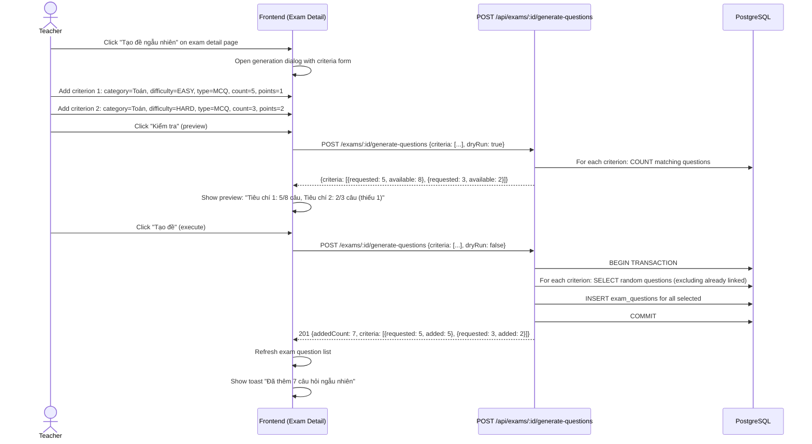

# D10. Random Exam Generation

## 5.1 Feature Overview

| Field | Value |
|---|---|
| Feature ID | D10 |
| Feature Name | Random Exam Generation |
| Module | D. Exam Management |
| Priority | P2 |
| Complexity | M |
| Status | Proposed — not implemented |
| Target Roles | TEACHER |
| Business Objective | Allow teachers to automatically generate an exam from their question bank by specifying criteria (category, difficulty, type, count), reducing manual question selection effort for large banks |
| User Problem | Teachers with large question banks (50–200+ questions) must manually browse and add questions one at a time. For routine quizzes or practice exams, random selection from the bank would save significant time. |
| Dependencies | D1 (Create/Edit Exam), D3 (Manage Questions), C1 (Question Bank), C4 (Question Categories) |

## 5.2 Actors and Permissions

### Teacher (TEACHER)

| Action | Allowed | Notes |
|---|---|---|
| Generate random questions for own DRAFT exam | Yes | Questions are added as ExamQuestion rows |
| Generate for own PUBLISHED/ARCHIVED exam | **No** | Exam must be DRAFT; backend rejects with 400 |
| Generate for another teacher's exam | **No** | Backend rejects with 403 |

### Student (STUDENT)

| Action | Allowed | Notes |
|---|---|---|
| Access random generation endpoint | **No** | ExamsController is `@Roles('TEACHER')` |

### Backend Authorization

- `ExamsController` has class-level `@Roles('TEACHER')`.
- `findByIdForOwner()` verifies `ownerId === userId`; throws `ForbiddenException` on mismatch.
- Exam must be in DRAFT status.
- Only questions owned by the same teacher are eligible for selection.

## 5.3 Preconditions and Business Rules

### Preconditions

- User must be authenticated with a valid JWT.
- User must have role `TEACHER`.
- Exam must exist and be owned by the requesting teacher.
- Exam must be in DRAFT status.
- Teacher must have at least some questions in their question bank.

### Business Rules

| Rule ID | Rule | Enforcement |
|---|---|---|
| D10-R01 | The teacher submits one or more selection criteria. Each criterion specifies: optional `categoryId`, optional `difficulty`, optional `type`, required `count` (how many questions to pick), and required `pointsPerQuestion` (points for each selected question). | Backend, Frontend |
| D10-R02 | For each criterion, the backend queries questions owned by the teacher matching all specified filters. Selection is random (`ORDER BY RANDOM()` or equivalent) and limited to `count`. | Backend |
| D10-R03 | If the number of matching questions for a criterion is less than the requested `count`, the backend returns a warning with the actual available count but does **not** fail. It selects all available matching questions. | Backend |
| D10-R04 | A question already linked to the exam (existing `ExamQuestion` row with matching `sourceQuestionId`) is excluded from the random pool. This prevents duplicates. | Backend |
| D10-R05 | A question selected by one criterion cannot be selected again by another criterion in the same request. Criteria are processed in order; earlier criteria have priority over later ones for overlapping pools. | Backend |
| D10-R06 | Selected questions are added as `ExamQuestion` rows in a single transaction. Positions are assigned sequentially starting from `MAX(existing position) + 1`. | Backend |
| D10-R07 | The endpoint operates in two modes: **preview** (`dryRun: true`) returns the matching question counts per criterion without creating any data; **execute** (`dryRun: false` or omitted) creates the ExamQuestion rows. | Backend |
| D10-R08 | After generation, the teacher can review, remove, reorder, or add more questions using existing D3 flows before publishing. Generated questions are standard ExamQuestion rows with no special flag. | N/A — by design |
| D10-R09 | The total number of questions in the exam after generation must not exceed 200. If the sum of existing questions plus requested count exceeds 200, return 400. | Backend |
| D10-R10 | `ExamQuestion.sourceQuestionId` is set for each generated row. `contentSnapshot` and `optionsSnapshot` remain null until publish (D4). | Backend |

## 5.4 Main User Flow — Happy Path



### Step-by-Step

1. Teacher navigates to the exam detail page for a DRAFT exam.
2. Teacher clicks "Tạo đề ngẫu nhiên" button.
3. A dialog opens with a criteria builder. Each criterion row has: category dropdown (optional), difficulty dropdown (optional), question type dropdown (optional), count input (required), points input (required).
4. Teacher adds one or more criteria rows using "Thêm tiêu chí".
5. Teacher clicks "Kiểm tra" to preview availability. The backend returns available counts per criterion without making changes.
6. The dialog shows a summary: for each criterion, how many questions were requested vs. how many are available. Insufficient criteria are highlighted in amber.
7. Teacher reviews and adjusts if needed (e.g., reduces count, broadens filters).
8. Teacher clicks "Tạo đề" to execute.
9. Backend selects random questions per criterion, creates ExamQuestion rows, returns the result.
10. Frontend refreshes the exam question list and shows a success toast with the total number of questions added.

## 5.5 Alternative Flows

### AF-01: Insufficient questions for a criterion

1. Teacher requests 10 HARD MCQ questions, but only 4 exist.
2. Preview shows: "Tiêu chí: 4 câu khả dụng / 10 câu yêu cầu".
3. Teacher can either proceed (get 4 instead of 10) or adjust the criterion.
4. If teacher proceeds, backend adds the 4 available questions.

### AF-02: No matching questions for a criterion

1. Teacher filters by a category with no questions.
2. Preview shows: "0 câu khả dụng / 5 câu yêu cầu".
3. The criterion is skipped during execution. No error, but the result shows `added: 0` for that criterion.

### AF-03: Teacher removes some generated questions afterward

1. After generation, teacher reviews the exam question list.
2. Teacher removes 2 questions using the existing remove button (D3).
3. Teacher can run generation again to fill the gap, or add questions manually.

### AF-04: Teacher generates with no filters (all questions eligible)

1. All filter fields left empty in a criterion.
2. Backend selects from all of the teacher's questions (excluding already-linked ones).
3. This is a valid use case for simple random exams.

### AF-05: Exam already has some questions

1. Teacher has manually added 3 questions to the exam.
2. Teacher runs random generation requesting 7 more.
3. Backend excludes the 3 already-linked source questions from the pool.
4. New questions get positions 3, 4, 5, 6, 7, 8, 9 (zero-based, after existing max position).

## 5.6 Edge Cases and Failure Scenarios

| Scenario ID | Scenario | Trigger | Expected Behavior | User Feedback | Data Integrity | Recovery | Severity |
|---|---|---|---|---|---|---|---|
| D10-E01 | Exam not DRAFT | Teacher triggers generation on a PUBLISHED exam | Backend returns 400 `EXAM_NOT_DRAFT` | Toast: "Chỉ có thể tạo đề ngẫu nhiên cho đề thi ở trạng thái nháp" | No data written | Refresh page | Medium |
| D10-E02 | Teacher has no questions | Empty question bank | Preview returns 0 available for all criteria | "Không có câu hỏi nào trong ngân hàng. Tạo câu hỏi trước." | No data affected | Create questions first | Medium |
| D10-E03 | All matching questions already in exam | Teacher runs generation twice with same criteria | Second run finds 0 eligible (all excluded) | "Tất cả câu hỏi phù hợp đã có trong đề thi" | No data written | Widen filters or accept | Low |
| D10-E04 | Criteria overlap — same question matches multiple criteria | Category A, EASY overlaps with no-filter criteria | First criterion in order claims the question; second criterion cannot reuse it | Transparent to user; result counts reflect actual additions | No duplicates | N/A | Low |
| D10-E05 | Would exceed 200 question limit | Exam has 195 questions, teacher requests 10 more | Backend returns 400 `MAX_QUESTIONS_REACHED` | "Tổng số câu hỏi sẽ vượt quá giới hạn 200. Hiện tại: 195, yêu cầu thêm: 10." | No data written | Reduce count | Low |
| D10-E06 | Empty criteria array | Teacher sends request with `criteria: []` | Backend returns 400 `CRITERIA_REQUIRED` | "Cần ít nhất một tiêu chí" | No data written | Add criteria | Low |
| D10-E07 | Concurrent generation requests | Teacher double-clicks "Tạo đề" | Frontend disables button after first click. If two requests reach the backend, transaction isolation prevents duplicate positions; second request gets positions after the first. | At most one visible result | No corrupt data | N/A | Low |
| D10-E08 | Question deleted between preview and execute | Teacher previews (5 available), then deletes a question in another tab, then executes | Backend selects from current pool; may get 4 instead of 5 | Result shows `added: 4` vs `requested: 5` | Consistent — deleted question is gone | Teacher can re-run | Low |

## 5.7 UI/UX Specification

### Entry Point

- **Button**: "Tạo đề ngẫu nhiên" (outline variant, with a `Shuffle` or `Dices` icon) on the exam detail page.
- **Position**: In the action bar, next to "Thêm câu hỏi" and "Tạo câu hỏi mới" buttons. Only visible when exam is DRAFT.

### Generation Dialog

| Element | Description |
|---|---|
| Dialog title | "Tạo đề ngẫu nhiên từ ngân hàng câu hỏi" |
| Criteria list | A dynamic list of criterion rows. Each row has 5 fields in a horizontal layout (desktop) or stacked (mobile). |
| Criterion row fields | Category dropdown (optional, "Tất cả danh mục"), Difficulty dropdown (optional, "Tất cả độ khó"), Type dropdown (optional, "Tất cả loại"), Count input (required, integer >= 1), Points input (required, integer >= 1) |
| Add criterion button | "Thêm tiêu chí" — appends a new empty criterion row. Max 10 criteria rows. |
| Remove criterion button | Trash icon on each row (visible when > 1 row) |
| Preview section | Below criteria. Shows a table after "Kiểm tra" is clicked: Criterion description, Requested, Available, Status (green check or amber warning) |
| Insufficient warning | Amber text: "Không đủ câu hỏi cho tiêu chí này. Sẽ chọn X câu thay vì Y." |
| Summary line | "Tổng: X câu hỏi, Y điểm" — calculated from criteria |
| Action buttons | "Kiểm tra" (secondary, runs dry-run), "Tạo đề" (primary, disabled until preview is run), "Hủy" (ghost) |

### Dialog Dimensions

- Max width: 800px (`max-w-3xl`)
- Max height: 80vh with internal scroll on criteria list
- Preview section and buttons are sticky at the bottom

### Responsive Behavior

| Breakpoint | Layout |
|---|---|
| >= 768px | Criterion fields in a single row (5 columns) |
| < 768px | Criterion fields stacked vertically per row, with a visual separator between criteria |

### States

| State | Behavior |
|---|---|
| Empty | One default criterion row, preview section hidden, "Tạo đề" disabled |
| Criteria filled | "Kiểm tra" enabled |
| Preview loaded | Preview table visible. "Tạo đề" enabled. Insufficient criteria marked in amber. |
| Generating | "Tạo đề" shows spinner, all inputs disabled |
| Success | Toast "Đã thêm X câu hỏi ngẫu nhiên", dialog closes, exam list refreshed |
| Error | Toast with error message, dialog remains open |

## 5.8 Data Requirements

### Existing Entities Used

- **Question**: Queried for random selection. Filters on `ownerId`, `categoryId`, `difficulty`, `type`.
- **QuestionOption**: Not directly queried (options are loaded at preview/publish time, not during generation).
- **ExamQuestion**: Created for each selected question. Existing rows checked to exclude already-linked questions.
- **Exam**: Read to verify ownership and DRAFT status. Not modified.
- **QuestionCategory**: Read for the category dropdown in the UI.

### Proposed Schema Changes

None. Random generation creates standard `ExamQuestion` rows using existing tables.

## 5.9 API Requirements

### POST /api/exams/:id/generate-questions — Generate Random Exam Questions

| Attribute | Value |
|---|---|
| Method | POST |
| Path | `/api/exams/:id/generate-questions` |
| Purpose | Select random questions from the teacher's bank based on criteria and add them as ExamQuestions |
| Required Role | TEACHER (owner of the exam) |
| Authorization | Exam `ownerId` must match authenticated user. Exam must be DRAFT. |

**Request Body:**

```json
{
  "criteria": [
    {
      "categoryId": "category-uuid",
      "difficulty": "EASY",
      "type": "MCQ",
      "count": 5,
      "pointsPerQuestion": 1
    },
    {
      "categoryId": "category-uuid",
      "difficulty": "HARD",
      "type": "MCQ",
      "count": 3,
      "pointsPerQuestion": 2
    }
  ],
  "dryRun": true
}
```

**Validation Rules (DTO):**

| Field | Type | Required | Constraints | Error code | Error message |
|---|---|---|---|---|---|
| `criteria` | array | Yes | Min 1 item, max 10 items | `CRITERIA_REQUIRED` | "Cần ít nhất một tiêu chí" / "Tối đa 10 tiêu chí" |
| `criteria[].categoryId` | UUID | No | Must exist and be owned by the teacher if provided | `INVALID_CATEGORY` | "Danh mục không hợp lệ" |
| `criteria[].difficulty` | `Difficulty` enum | No | EASY, MEDIUM, HARD | `INVALID_DIFFICULTY` | "Độ khó không hợp lệ" |
| `criteria[].type` | `QuestionType` enum | No | MCQ, MCQ_MULTI, TRUE_FALSE, SHORT_ANSWER, FILL_BLANK, ESSAY | `INVALID_TYPE` | "Loại câu hỏi không hợp lệ" |
| `criteria[].count` | integer | Yes | >= 1, <= 100 | `INVALID_COUNT` | "Số lượng câu hỏi phải từ 1 đến 100" |
| `criteria[].pointsPerQuestion` | integer | Yes | >= 1 | `INVALID_POINTS` | "Điểm phải là số nguyên >= 1" |
| `dryRun` | boolean | No | Default false | — | — |

**Success Response — Dry Run (200):**

```json
{
  "success": true,
  "data": {
    "criteria": [
      {
        "index": 0,
        "categoryId": "category-uuid",
        "difficulty": "EASY",
        "type": "MCQ",
        "requested": 5,
        "available": 8
      },
      {
        "index": 1,
        "categoryId": "category-uuid",
        "difficulty": "HARD",
        "type": "MCQ",
        "requested": 3,
        "available": 2
      }
    ],
    "totalRequested": 8,
    "totalAvailable": 10
  }
}
```

**Success Response — Execute (201):**

```json
{
  "success": true,
  "data": {
    "criteria": [
      {
        "index": 0,
        "requested": 5,
        "added": 5
      },
      {
        "index": 1,
        "requested": 3,
        "added": 2
      }
    ],
    "totalAdded": 7,
    "examQuestions": [
      {
        "id": "eq-uuid-1",
        "sourceQuestionId": "q-uuid-1",
        "points": 1,
        "position": 3
      }
    ]
  }
}
```

**Error Responses:**

| Status | Code | Condition |
|---|---|---|
| 400 | `EXAM_NOT_DRAFT` | Exam status is not DRAFT |
| 400 | `CRITERIA_REQUIRED` | `criteria` array is empty |
| 400 | `MAX_QUESTIONS_REACHED` | Adding the requested count would exceed 200 total |
| 400 | `INVALID_CATEGORY` | A `categoryId` does not exist or is not owned by the teacher |
| 401 | Unauthorized | No valid JWT |
| 403 | Forbidden | Teacher is not the exam owner |
| 404 | Not Found | Exam does not exist |

### Backend Implementation Notes

For random selection, use Prisma raw query with `ORDER BY RANDOM() LIMIT :count` on PostgreSQL. This is efficient for the pool sizes expected (teacher's own questions, typically < 1000). Process criteria in array order, maintaining a `Set<string>` of already-selected question IDs to enforce D10-R05.

## 5.10 State Management

This feature does not introduce new entity states. It creates `ExamQuestion` rows within the existing DRAFT exam flow.

- **Exam**: Must be DRAFT. Status does not change.
- **ExamQuestion**: Created with `contentSnapshot = null` and `optionsSnapshot = null`. Snapshots are populated at publish time (D4).

## 5.11 Acceptance Criteria

### Happy Path

```
Given a teacher owns a DRAFT exam with 0 questions and has 20 MCQ EASY questions in their bank,
When they POST /exams/:id/generate-questions with criteria [{type: "MCQ", difficulty: "EASY", count: 10, pointsPerQuestion: 1}],
Then 10 ExamQuestion rows are created at positions 0–9, each with points=1 and sourceQuestionId pointing to a distinct question.

Given a teacher requests a dry run with the same criteria,
When the backend processes the request,
Then the response shows requested=10, available=20, and no ExamQuestion rows are created.
```

### Insufficient Questions

```
Given a teacher has 3 HARD MCQ questions,
When they POST with criteria [{difficulty: "HARD", type: "MCQ", count: 10, pointsPerQuestion: 2}],
Then 3 ExamQuestion rows are created (all available), the response shows requested=10, added=3.
```

### No Duplicates

```
Given a teacher has 5 MCQ questions, 2 are already linked to the exam,
When they POST with criteria [{type: "MCQ", count: 5, pointsPerQuestion: 1}],
Then only the 3 unlinked questions are added, response shows requested=5, added=3.
```

### Multiple Criteria — No Overlap

```
Given a teacher has 10 questions: 5 EASY MCQ, 5 HARD MCQ,
When they POST with criteria:
  [{difficulty: "EASY", count: 3, pointsPerQuestion: 1}, {count: 5, pointsPerQuestion: 2}],
Then criterion 1 selects 3 EASY questions; criterion 2 selects from the remaining 7 (the 3 selected by criterion 1 are excluded from the pool for criterion 2).
```

### Authorization

```
Given a STUDENT is authenticated,
When they attempt POST /api/exams/:id/generate-questions,
Then the backend returns 403 Forbidden.

Given Teacher A owns an exam,
When Teacher B attempts the generate endpoint on that exam,
Then the backend returns 403 Forbidden.

Given a PUBLISHED exam,
When the owner attempts generation,
Then the backend returns 400 EXAM_NOT_DRAFT.
```

### Limit Enforcement

```
Given an exam has 198 questions,
When a teacher requests generation of 5 more,
Then the backend returns 400 MAX_QUESTIONS_REACHED with a message showing current count and requested count.
```

## 5.12 QA Test Scenarios

| Test ID | Scenario | Preconditions | Steps | Test Data | Expected Result | Priority |
|---|---|---|---|---|---|---|
| D10-T01 | Basic random generation | DRAFT exam, 0 questions; teacher has 20 MCQ EASY | POST with criteria [{difficulty: EASY, type: MCQ, count: 5, pointsPerQuestion: 1}] | — | 201, 5 ExamQuestions created | High |
| D10-T02 | Dry run preview | Same as T01 | POST with dryRun: true | — | 200, requested=5, available=20, no ExamQuestions created | High |
| D10-T03 | Insufficient questions | Teacher has 3 matching questions | POST with count: 10 | — | 201, added=3, requested=10 | High |
| D10-T04 | No matching questions | Teacher has no HARD ESSAY questions | POST with criteria [{difficulty: HARD, type: ESSAY, count: 5, pointsPerQuestion: 1}] | — | 201, added=0 | Medium |
| D10-T05 | Exclude already-linked questions | Exam has 3 MCQ questions from bank; teacher has 10 MCQ | POST with count: 10 for MCQ | — | added=7 (10 minus 3 already linked) | High |
| D10-T06 | Multiple criteria — no overlap | Teacher has 5 EASY, 5 HARD | Two criteria: EASY count=3, all count=4 | — | 3 EASY + 4 from remaining 7 = 7 total | High |
| D10-T07 | Reject for PUBLISHED exam | PUBLISHED exam | POST with valid criteria | — | 400 EXAM_NOT_DRAFT | High |
| D10-T08 | Reject for non-owner | DRAFT exam owned by Teacher A | POST as Teacher B | — | 403 Forbidden | High |
| D10-T09 | Reject for student | Any exam | POST as STUDENT | — | 403 Forbidden | High |
| D10-T10 | Exceed 200 question limit | Exam has 198 questions | POST with count: 5 | — | 400 MAX_QUESTIONS_REACHED | Medium |
| D10-T11 | Empty criteria array | DRAFT exam | POST with criteria: [] | — | 400 CRITERIA_REQUIRED | Medium |
| D10-T12 | Randomness verification | Teacher has 20 questions | Run generation 3 times (reset between each) with count=5 | — | Selected questions differ between runs (not deterministic) | Medium |
| D10-T13 | Generated questions visible in exam | After successful generation | GET /exams/:id | — | All generated ExamQuestions appear in the response with correct positions and points | High |
| D10-T14 | Category filter works | Teacher has 10 questions: 5 in Cat A, 5 in Cat B | POST with criteria [{categoryId: CatA, count: 3, pointsPerQuestion: 1}] | — | All 3 added questions belong to Cat A | Medium |
| D10-T15 | All three filters combined | Teacher has questions across types, difficulties, categories | POST with narrow criteria | — | Only exact matches selected | Medium |

## 5.13 Open Questions and Assumptions

| # | Question | Why It Matters | Options | Recommended Default | Impact |
|---|---|---|---|---|---|
| D10-Q01 | Should the teacher be required to run a preview (dry run) before executing, or can they execute directly? | Forcing preview adds a step but prevents surprise results. | (a) Preview required — "Tạo đề" button only enabled after preview. (b) Preview optional — teacher can execute directly. | (a) Preview required — protects against unintended results, especially with insufficient questions | Low — UI flow only |
| D10-Q02 | Should the dry-run available count account for overlap between criteria? | If criterion 1 and criterion 2 draw from overlapping pools, the available counts shown independently may be misleading. | (a) Independent counts (simpler, may overcount). (b) Sequential counts (accurate but harder to explain). | (a) Independent counts — simpler to implement and explain. The execute step handles overlap correctly regardless. Add a note: "Lưu ý: Một câu hỏi chỉ được chọn một lần." | Low |
| D10-Q03 | Should the teacher be able to specify sub-categories (include children) or only exact category match? | Teachers may organize questions in hierarchical categories (e.g., "Toán > Đại số > Phương trình"). | (a) Exact category match only. (b) Include all descendants of the selected category. | (a) Exact match only — simpler. Teachers can run multiple criteria for sub-categories. | Low — can add hierarchy later |

### Assumptions

| # | Assumption | Recommended Default | Impact if Wrong |
|---|---|---|---|
| D10-A01 | PostgreSQL `ORDER BY RANDOM()` is performant enough for the expected question bank sizes (< 1000 questions per teacher). | Use `ORDER BY RANDOM()` directly | If a teacher has 10,000+ questions, this becomes slow. Mitigation: use `TABLESAMPLE` or application-level random selection. Unlikely at this scale. |
| D10-A02 | The maximum number of criteria per request is 10. This covers realistic use cases (e.g., 3 difficulty levels x 2 question types = 6 criteria). | Limit to 10 | If teachers need more, increase the limit. Minimal backend impact. |
| D10-A03 | Generated questions are indistinguishable from manually added questions. There is no `isGenerated` flag on `ExamQuestion`. | No special flag | If analytics on generation vs manual selection is needed later, add a `source` field. Minor migration. |
