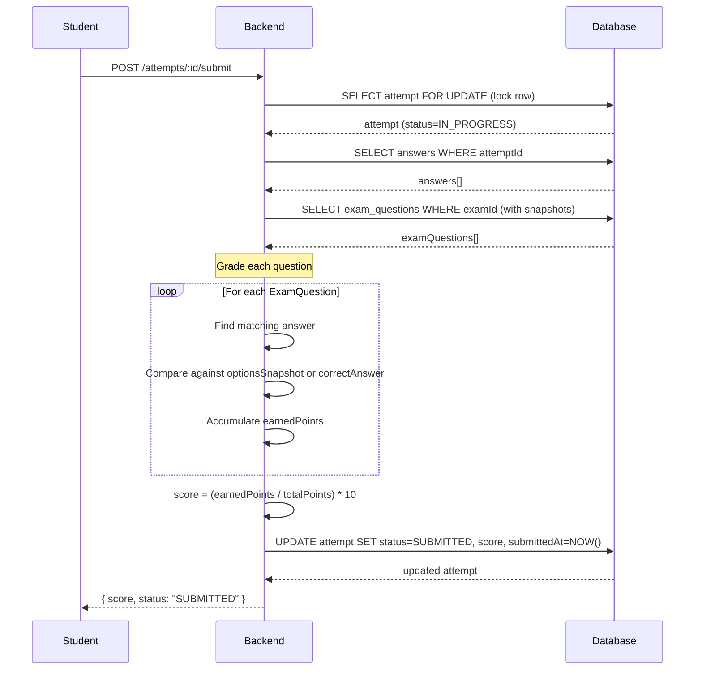
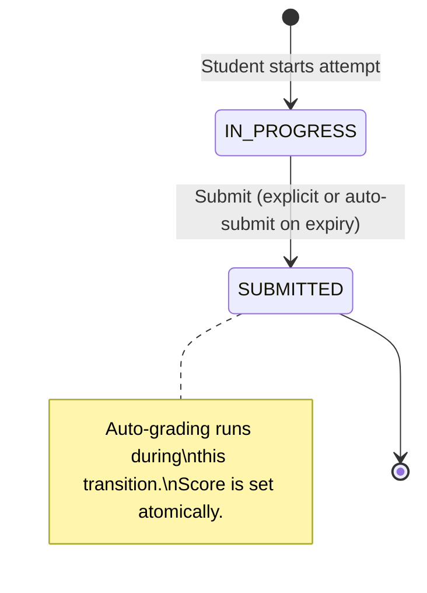

# G1. Automatic Grading

## 5.1 Feature Overview

| Field | Value |
|---|---|
| Feature ID | G1 |
| Feature Name | Automatic Grading |
| Module | G. Grading & Results |
| Priority | P0 |
| Complexity | L |
| Status | Existing — core MCQ grading implemented; SHORT_ANSWER/FILL_BLANK matching partially implemented; PARTIAL grading mode for MCQ_MULTI proposed (P2) |
| Target Roles | System (automatic), Teacher (views results), Student (views score) |
| Business Objective | Eliminate manual grading effort for objective question types. Deliver instant, consistent scores to students and teachers. |
| User Problem | Teachers cannot manually grade hundreds of submissions in time. Students expect immediate feedback on objective questions. |
| Dependencies | E5 (Auto-submit on Timeout), D4 (Publish Exam — snapshot mechanism), C3 (Question Types) |

## 5.2 Actors and Permissions

### System (Grading Engine)

- **Triggers**: Runs automatically inside the submit transaction — either via explicit student submit or lazy-expiry auto-submit.
- **Reads**: ExamAttempt, Answer rows, ExamQuestion.optionsSnapshot, ExamQuestion.contentSnapshot.
- **Writes**: ExamAttempt.score, ExamAttempt.status → SUBMITTED, ExamAttempt.submittedAt.
- **Cannot**: Override a manual score. Grading only runs when `manualScoreOverride = false` (or on initial submit before any override exists).

### Teacher

- **Views**: All attempt scores for exams they own.
- **Cannot**: Trigger auto-grading directly (it is automatic). Can trigger regrade (see G4).

### Student

- **Views**: Own score, subject to result visibility rules (see G5).
- **Cannot**: Trigger grading, modify score, view other students' scores.

### Backend Authorization

- Grading runs inside the submit endpoint (`POST /attempts/:id/submit`), which requires the student to own the attempt.
- Score read is protected by attempt ownership (student) or exam ownership (teacher).

## 5.3 Preconditions and Business Rules

### Preconditions

1. Attempt must be in `IN_PROGRESS` status (or expired but not yet transitioned).
2. Exam must be `PUBLISHED` — draft exams have no snapshots to grade against.
3. ExamQuestion rows must have populated `optionsSnapshot` (non-null for MCQ types) or `contentSnapshot` (for SHORT_ANSWER/FILL_BLANK).

### Grading Rules by Question Type

| Type | Grading Method | Correct Condition |
|---|---|---|
| `MCQ` | Compare `answerPayload.selectedOptionId` against the single option in `optionsSnapshot` where `isCorrect = true` | Exact match → full points; mismatch → 0 |
| `MCQ_MULTI` (ALL_OR_NOTHING) | Compare `answerPayload.selectedOptionIds[]` against all options where `isCorrect = true` | All correct selected AND no incorrect selected → full points; otherwise → 0 |
| `MCQ_MULTI` (PARTIAL) | Count correct and incorrect selections | Score = `(correctSelected / totalCorrect) * points`, with optional penalty for incorrect selections. **Status: P2, not yet implemented.** |
| `TRUE_FALSE` | Same as MCQ — exactly 2 options, 1 correct | Exact match → full points; mismatch → 0 |
| `SHORT_ANSWER` | Compare `answerPayload.text` against `correctAnswer` field on the ExamQuestion snapshot | Case-insensitive, trimmed match. If `correctAnswer` contains comma-separated values, match any one. |
| `FILL_BLANK` | Same as SHORT_ANSWER | Same rules apply |
| `ESSAY` | No auto-grading | Score remains null until teacher manually grades. Earned points = 0 for auto-grade calculation. |

### Score Calculation Formula

```
earnedPoints = sum of points for each correctly answered question
totalPoints  = sum of points for all questions in the exam
score        = (earnedPoints / totalPoints) * 10
```

- Score is stored as `Decimal(10, 2)` — two decimal places.
- Rounding: **ROUND_HALF_UP** — 7.555 → 7.56.
- If `totalPoints = 0` (no questions or all 0-point), score = 0.
- Unanswered questions earn 0 points but their points still count toward `totalPoints`.

### Business Constraints

- Grading is **atomic**: all questions graded in a single transaction. Partial grading failures roll back the entire operation.
- Grading is **idempotent**: re-submitting an already-submitted attempt returns the existing score without re-grading.
- The grading engine uses **snapshot data only** — never reads from the live Question or QuestionOption tables during grading.

## 5.4 Main User Flow — Happy Path



### Step-by-Step

1. **Student** clicks "Nộp bài" (Submit) or timer auto-submits.
2. **Backend** acquires row-level lock on the attempt (`SELECT ... FOR UPDATE`).
3. **Backend** verifies status is `IN_PROGRESS` (if `SUBMITTED`, returns existing result).
4. **Backend** loads all answers for this attempt.
5. **Backend** loads all exam questions with their snapshots.
6. **Backend** grades each question according to its type (see rules above).
7. **Backend** calculates final score.
8. **Backend** updates attempt: `status = SUBMITTED`, `score = calculated`, `submittedAt = NOW()`.
9. **Backend** commits transaction.
10. **Frontend** receives score and displays result (if visibility allows).

## 5.5 Alternative Flows

### AF-1: Lazy Expiry Auto-Submit

When any request touches an expired attempt (NOW() > expiresAt, status still IN_PROGRESS):
1. Backend detects expiry.
2. Backend triggers the same grading flow as explicit submit.
3. Attempt transitions to SUBMITTED (not EXPIRED) per technical decision AD-11.
4. Whatever answers were saved are graded.

### AF-2: No Answers Saved

1. Student starts exam but answers nothing.
2. On submit or expiry, grading runs with 0 matching answers.
3. earnedPoints = 0, score = 0.00.
4. Attempt is still marked SUBMITTED with score 0.

### AF-3: Mixed Question Types (some auto-gradable, some essay)

1. Auto-gradable questions are graded normally.
2. Essay questions contribute 0 earned points to the auto-grade score.
3. Score reflects only auto-gradable portion: `score = (earnedMCQ / totalPoints) * 10`.
4. Teacher can later override the score manually to account for essay grading.
5. **Open question**: Should the score exclude essay point weight from totalPoints until manually graded? See section 5.13.

### AF-4: Concurrent Submit Requests

1. Two submit requests arrive simultaneously for the same attempt.
2. First request acquires the row lock, grades, commits.
3. Second request acquires the lock, sees `status = SUBMITTED`, returns existing result.
4. No double-grading occurs.

## 5.6 Edge Cases and Failure Scenarios

| Scenario ID | Scenario | Trigger | Expected Behavior | User Feedback | Data Integrity | Recovery | Severity |
|---|---|---|---|---|---|---|---|
| G1-EC-01 | All questions unanswered | Student submits without selecting any answers | earnedPoints = 0, score = 0.00, status = SUBMITTED | "Bài đã nộp. Điểm: 0.0/10" | Score stored correctly | None needed | Medium |
| G1-EC-02 | Exam has 0 total points | All exam questions have points = 0 (misconfiguration) | score = 0.00 (division guard: if totalPoints = 0, score = 0) | Score shown as 0.0 | No division-by-zero crash | Teacher should fix point allocation | Low |
| G1-EC-03 | Answer references non-existent option | answerPayload.selectedOptionId doesn't match any option in snapshot | Treat as incorrect answer; 0 points for that question | No specific feedback (graded as wrong) | Safe — option lookup returns no match | None | Low |
| G1-EC-04 | MCQ_MULTI with empty selectedOptionIds | Student submits MCQ_MULTI without selecting anything | 0 points for that question | Graded as incorrect | Consistent with "no selection = wrong" | None | Low |
| G1-EC-05 | MCQ_MULTI partial match (ALL_OR_NOTHING) | Student selects 2 of 3 correct options | 0 points (all-or-nothing mode) | Shown as incorrect in review | Mode is per-exam setting | None | Medium |
| G1-EC-06 | SHORT_ANSWER case mismatch | Student types "hà nội", correct = "Hà Nội" | Match succeeds (case-insensitive comparison) | Shown as correct | Normalization applied before comparison | None | Medium |
| G1-EC-07 | SHORT_ANSWER whitespace | Student types "  Hà Nội  " with leading/trailing spaces | Match succeeds (trimmed before comparison) | Shown as correct | Trimming applied | None | Low |
| G1-EC-08 | SHORT_ANSWER multiple accepted answers | correctAnswer = "Hà Nội, Ha Noi, Hanoi" | Match against any comma-separated value | Correct if any variant matches | Split by comma, trim each, case-insensitive compare | None | Medium |
| G1-EC-09 | Grading transaction fails mid-way | Database error during score UPDATE | Entire transaction rolls back; attempt remains IN_PROGRESS | 500 error, student can retry submit | No partial grading persisted | Student retries submit | Critical |
| G1-EC-10 | Score precision edge case | Earned 7 of 9 points, score = 7.777... | Stored as 7.78 (ROUND_HALF_UP) | Displays as "7.8" (1 decimal in UI) | Decimal(10,2) handles precision | None | Low |
| G1-EC-11 | Essay questions in auto-grade | Exam has 3 MCQ (30pts) + 1 Essay (10pts), student answers MCQ correctly | earnedPoints = 30, totalPoints = 40, score = 7.50 | Score may seem low to student | Score is "auto-grade only" until teacher intervenes | Teacher overrides manually | High |
| G1-EC-12 | optionsSnapshot is null | ExamQuestion has no snapshot (should not happen after publish) | Skip question, treat as 0 earned / 0 total for that question | No visible error | Defensive coding | Fix data integrity | Critical |

## 5.7 UI/UX Specification

Auto-grading itself has no dedicated UI — it runs server-side during submission. The visible outcomes appear in:

### Post-Submit Screen (Student)

- **If showResultImmediately = true**: Display score prominently: `"Điểm: 7.5 / 10"` in brand-primary color, large font.
- **If showResultImmediately = false**: Display `"Bài đã được nộp. Chờ giáo viên công bố kết quả."` — no score shown.
- Both cases show a success state (green checkmark icon).

### Answer Review (Student — via StudentReviewDialog)

- Per-question display:
  - Question content with position number.
  - Options listed with visual indicators:
    - **Correct answer**: green background tint + check icon.
    - **Student's incorrect selection**: red background tint + X icon.
    - **Student's correct selection**: green background tint + check icon.
  - Points: `"3/5 điểm"` badge per question.
  - Per-answer feedback from teacher (if any).

### Results Table (Teacher — via /dashboard/results)

- Table columns: Học sinh, Trạng thái, Điểm, Thời gian nộp, Thao tác.
- Score displayed as `X.X` (1 decimal).
- Badge "Sửa điểm" if `manualScoreOverride = true`.
- Action buttons: Review (eye icon), Edit Score (pencil), Feedback (message).

### Loading and Error States

- **Grading in progress**: Submission button shows spinner + "Đang nộp..." text. Button disabled.
- **Grading error**: Toast notification "Có lỗi xảy ra khi nộp bài. Vui lòng thử lại."
- **Empty exam**: Not possible — publish validates at least 1 question.

## 5.8 Data Requirements

### Existing Schema (No Changes Needed for Core Grading)

**ExamAttempt** — stores the grading result:
```
score          Decimal?  @db.Decimal(10, 2)
status         AttemptStatus  (IN_PROGRESS → SUBMITTED)
submittedAt    DateTime?
```

**Answer** — stores each student's response:
```
answerPayload  Json  // { selectedOptionId: string } or { selectedOptionIds: string[] } or { text: string }
```

**ExamQuestion** — stores the answer key (snapshot):
```
optionsSnapshot  Json?   // [{ id, content, isCorrect, position }]
contentSnapshot  String? // for SHORT_ANSWER: the correctAnswer is snapshotted here or in optionsSnapshot
```

### Proposed Schema Addition (for tracking auto-grade detail)

**Assumption**: Currently, per-question grading results are computed on-the-fly when the review endpoint is called. No persistent per-question score is stored.

**Open question**: Should per-question earned points be stored in the Answer table (e.g., `earnedPoints Int?`) to avoid recomputation? Current approach (recompute on read) is acceptable at this scale. See section 5.13.

### Indexing

- `exam_attempts(exam_id, student_id)` — existing index, used for fetching attempts per exam.
- `answers(attempt_id, exam_question_id)` — existing unique constraint, optimal for grading lookups.

## 5.9 API Requirements

### POST /attempts/:id/submit (Existing — grading is embedded)

| Field | Value |
|---|---|
| Method | POST |
| Endpoint | `/api/attempts/:id/submit` |
| Purpose | Submit attempt and trigger automatic grading |
| Required Role | STUDENT (attempt owner) |
| Authorization | `attempt.studentId === currentUser.id` |
| Request Body | None |
| Success Response (200) | `{ success: true, data: { id, status: "SUBMITTED", score: "7.50", submittedAt, examId } }` |
| Error: Already submitted (200) | Returns existing result (idempotent) |
| Error: Not owner (403) | `{ success: false, error: { code: "FORBIDDEN", message: "Access denied" } }` |
| Error: Attempt not found (404) | `{ success: false, error: { code: "NOT_FOUND", message: "Attempt not found" } }` |
| Idempotency | Yes — duplicate submit returns same score |

### GET /attempts/:id/review (Existing — returns grading details)

| Field | Value |
|---|---|
| Method | GET |
| Endpoint | `/api/attempts/:id/review` |
| Purpose | Return per-question grading breakdown |
| Required Role | TEACHER (exam owner) or STUDENT (attempt owner, subject to visibility) |
| Authorization | Teacher: `exam.ownerId === currentUser.id`. Student: `attempt.studentId === currentUser.id AND (exam.showResultImmediately OR exam.resultsReleased)` |
| Request Body | None |
| Success Response (200) | `{ success: true, data: [{ position, content, options, correctOptionId, selectedOptionId, isCorrect, points, earnedPoints, feedback }] }` |
| Error: Results not available (403) | `{ success: false, error: { code: "RESULTS_NOT_AVAILABLE", message: "Kết quả chưa được công bố" } }` |

## 5.10 State Management

Auto-grading is part of the attempt state transition. No separate grading state exists.



**Transition: IN_PROGRESS → SUBMITTED**
- Trigger: `POST /attempts/:id/submit` or lazy expiry detection.
- Side effect: Grading engine runs, score calculated and stored.
- Constraint: Transition is atomic (single transaction with row lock).
- Irreversible: Once SUBMITTED, cannot return to IN_PROGRESS.

## 5.11 Acceptance Criteria

### Positive Criteria

```
Given a student has answered 3 out of 5 MCQ questions correctly (each worth 2 points),
When the student submits the attempt,
Then the score is (6 / 10) * 10 = 6.00, status is SUBMITTED, and submittedAt is set.
```

```
Given a student selects the correct option for a TRUE_FALSE question,
When the attempt is graded,
Then the question is marked correct and its points are counted.
```

```
Given a SHORT_ANSWER question with correctAnswer "Hà Nội",
When the student types "hà nội" (lowercase),
Then the answer is graded as correct (case-insensitive match).
```

```
Given an MCQ_MULTI question with 3 correct options and ALL_OR_NOTHING mode,
When the student selects all 3 correct options and no incorrect ones,
Then the question earns full points.
```

```
Given a student submits with no answers saved,
When grading runs,
Then the score is 0.00 and status is SUBMITTED.
```

### Negative Criteria

```
Given an attempt that is already SUBMITTED,
When the student sends another submit request,
Then the existing score is returned without re-grading.
```

```
Given an MCQ_MULTI question with 3 correct options and ALL_OR_NOTHING mode,
When the student selects only 2 correct options,
Then the question earns 0 points.
```

```
Given an ESSAY question in the exam,
When auto-grading runs,
Then the essay question contributes 0 earned points (not auto-gradable).
```

## 5.12 QA Test Scenarios

| Test Case ID | Scenario | Preconditions | Test Steps | Test Data | Expected Result | Priority |
|---|---|---|---|---|---|---|
| G1-TC-01 | All MCQ correct | 5 MCQ questions, 2pts each. Student answers all correctly. | Submit attempt | 5 correct selectedOptionIds | Score = 10.00 | P0 |
| G1-TC-02 | All MCQ incorrect | 5 MCQ questions, 2pts each. Student answers all wrong. | Submit attempt | 5 wrong selectedOptionIds | Score = 0.00 | P0 |
| G1-TC-03 | Partial MCQ correct | 5 MCQ questions, 2pts each. 3 correct, 2 wrong. | Submit attempt | Mixed answers | Score = 6.00 | P0 |
| G1-TC-04 | Unanswered questions | 5 MCQ questions. Student answers 2, skips 3. | Submit attempt | 2 answers saved | Score = (earned/10)*10 | P0 |
| G1-TC-05 | TRUE_FALSE correct | 1 TRUE_FALSE question (5pts), student picks correct | Submit | Correct optionId | Score = 10.00 | P0 |
| G1-TC-06 | MCQ_MULTI all-or-nothing correct | MCQ_MULTI with 3 correct options. Student selects all 3. | Submit | 3 correct IDs | Full points | P1 |
| G1-TC-07 | MCQ_MULTI all-or-nothing partial | MCQ_MULTI with 3 correct. Student selects 2 correct + 1 incorrect. | Submit | 2 correct + 1 wrong | 0 points | P1 |
| G1-TC-08 | SHORT_ANSWER exact match | correctAnswer = "Hà Nội" | Submit with "Hà Nội" | text = "Hà Nội" | Correct | P1 |
| G1-TC-09 | SHORT_ANSWER case-insensitive | correctAnswer = "Hà Nội" | Submit with "hà nội" | text = "hà nội" | Correct | P1 |
| G1-TC-10 | SHORT_ANSWER multiple accepted | correctAnswer = "HN, Hà Nội, Ha Noi" | Submit with "Ha Noi" | text = "Ha Noi" | Correct | P1 |
| G1-TC-11 | SHORT_ANSWER wrong answer | correctAnswer = "Hà Nội" | Submit with "Đà Nẵng" | text = "Đà Nẵng" | Incorrect, 0 points | P1 |
| G1-TC-12 | ESSAY in mixed exam | 3 MCQ (6pts) + 1 Essay (4pts). All MCQ correct. | Submit | 3 correct MCQ, essay text | Score = 6.00 (essay not graded) | P1 |
| G1-TC-13 | Double submit idempotency | Attempt already submitted with score 8.00 | POST /submit again | Same attempt ID | Returns score 8.00, no re-grade | P0 |
| G1-TC-14 | Concurrent submit | Two simultaneous submit requests | Fire 5 concurrent POSTs | Same attempt ID | All return same score, 1 grading | P0 |
| G1-TC-15 | Lazy expiry grading | Attempt expired (expiresAt < NOW), 3 answers saved | Any request touches attempt | Answers graded | Auto-submit, score calculated | P0 |
| G1-TC-16 | Score precision | 7/9 points correct | Submit | 7/9 earned | Score = 7.78 | P1 |
| G1-TC-17 | Zero total points | All exam questions have 0 points | Submit | Any answers | Score = 0.00 (no crash) | P1 |

## 5.13 Open Questions and Assumptions

| # | Question | Why It Matters | Options | Recommended Default | Impact |
|---|---|---|---|---|---|
| 1 | How should ESSAY questions affect the total score when mixed with auto-gradable types? | A student getting 100% on MCQ but 0 on essay shows a misleading score until teacher grades. | (a) Include essay points in totalPoints (current). (b) Exclude essay points from totalPoints until manually graded. (c) Show two scores: auto-grade and final. | (a) Include — simpler; teacher overrides after manual grading. Add a note to the teacher: "Bài có câu tự luận chưa chấm." | High — affects score interpretation |
| 2 | Should per-question earned points be persisted in the Answer table? | Currently recomputed on each review request. At scale (>1000 attempts), this becomes expensive. | (a) Recompute on read (current). (b) Store `earnedPoints` on Answer during grading. | (a) for MVP. ~100 users means recomputation is negligible. | Low for MVP, Medium for scale |
| 3 | What is the penalty formula for incorrect selections in PARTIAL MCQ_MULTI grading? | Determines whether wrong guesses are penalized. | (a) No penalty: `correctSelected / totalCorrect`. (b) Penalty: `(correctSelected - incorrectSelected) / totalCorrect`, min 0. | (b) with minimum 0, which discourages guessing. | Medium — P2 feature |
| 4 | Should SHORT_ANSWER matching support regex or fuzzy matching? | Exact match may be too strict for some subjects. | (a) Exact match with case/whitespace normalization (current). (b) Add Levenshtein distance threshold. (c) Teacher-defined regex patterns. | (a) for MVP. Keep it simple and predictable. | Low for MVP |

### Assumptions

- **A1**: Grading always uses snapshot data, never live question bank data. This is confirmed by the snapshot mechanism (AD-05).
- **A2**: Score is always on a 0–10 scale, regardless of total points. This is the Vietnamese grading convention.
- **A3**: `ROUND_HALF_UP` is used for score precision. Not explicitly confirmed by PO but is standard practice.
- **A4**: Unanswered questions always score 0 — there is no negative scoring.
