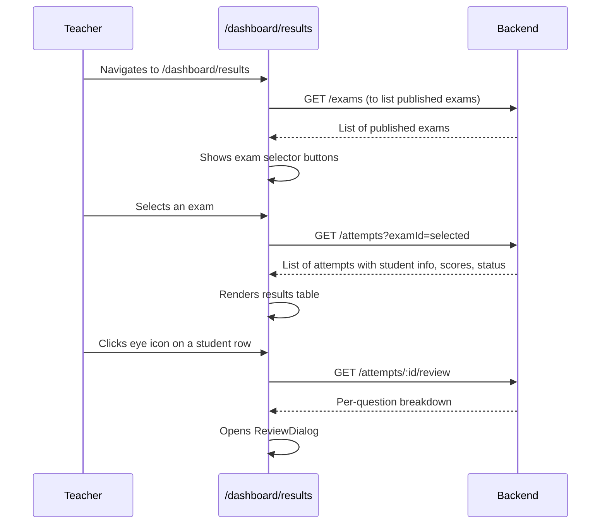
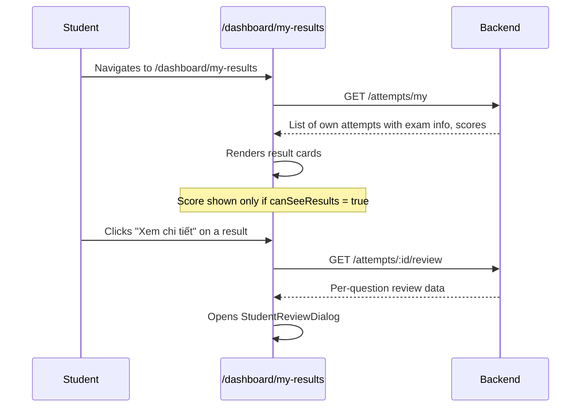

# G3. Exam Results — Student Results, Classroom Results, Answer Review

## 5.1 Feature Overview

| Field | Value |
|---|---|
| Feature ID | G3 |
| Feature Name | Exam Results |
| Module | G. Grading & Results |
| Priority | P0 (basic results), P1 (answer review) |
| Complexity | M |
| Status | Existing — student results, teacher results table, and answer review all implemented. |
| Target Roles | Teacher (view all results), Student (view own results) |
| Business Objective | Provide clear visibility into exam performance for both teachers and students. Enable teachers to evaluate class-wide performance and individual student work. |
| User Problem | Teachers need to see how the class performed and identify students who need help. Students need to review their mistakes and learn from feedback. |
| Dependencies | G1 (Auto-Grading), G5 (Result Visibility), E6 (Submit Exam), D4 (Publish Exam) |

## 5.2 Actors and Permissions

### Teacher

| Action | Rule |
|---|---|
| View all attempts for own exams | Allowed — GET /attempts?examId=X |
| View detailed review of any attempt on own exam | Allowed — GET /attempts/:id/review |
| View student info (name, email) in results | Allowed |
| View attempts on another teacher's exam | **Forbidden** — 403 |
| Export results | **Proposed (P2)** — not yet implemented |

### Student

| Action | Rule |
|---|---|
| View own attempts list | Allowed — GET /attempts/my |
| View own score | Allowed, **subject to result visibility** (see G5) |
| View detailed review of own attempt | Allowed, **subject to result visibility** |
| View other students' scores | **Forbidden** |
| View teacher feedback on own attempt | Allowed when results are visible |

### Backend Authorization

- `GET /attempts?examId=X`: Teacher only. Validates `exam.ownerId === currentUser.id`.
- `GET /attempts/my`: Student only. Returns only `attempt.studentId === currentUser.id`.
- `GET /attempts/:id/review`: Teacher (exam owner) or Student (attempt owner + visibility check).

## 5.3 Preconditions and Business Rules

### Preconditions

1. Exam must be `PUBLISHED` (results only exist for published exams).
2. Attempt must be `SUBMITTED` to have a score (IN_PROGRESS attempts show status only).

### Business Rules

| Rule | Description |
|---|---|
| Result visibility | Student sees score/review only if `exam.showResultImmediately = true` OR `exam.resultsReleased = true`. Teacher always sees everything. |
| Score display format | Display as X.X (1 decimal place in UI), stored as Decimal(10,2). |
| Manual override badge | If `manualScoreOverride = true`, show a "Sửa điểm" badge in the teacher view. |
| Feedback display | Attempt-level feedback shown below the score. Per-answer feedback shown inline in the review. |
| Sorting | Teacher results default sorted by student name. Student results sorted by date descending. |
| No results state | If no attempts exist, show empty state message. |
| IN_PROGRESS display | Teacher sees IN_PROGRESS attempts in the list with "Đang làm" status badge and no score. |

## 5.4 Main User Flow — Happy Path

### Teacher Views Exam Results



### Student Views Own Results



## 5.5 Alternative Flows

### AF-1: No Published Exams

1. Teacher navigates to results page.
2. No published exams exist.
3. Empty state: "Chưa có đề thi nào được phát hành."

### AF-2: No Submissions for Selected Exam

1. Teacher selects an exam.
2. No attempts exist.
3. Empty state: "Chưa có bài nộp nào."

### AF-3: Student with Results Not Released

1. Student sees their attempt listed with status "Đã nộp."
2. Score is hidden (`canSeeResults = false`).
3. "Xem chi tiết" button is not shown.
4. Message: "Chờ giáo viên công bố kết quả."

### AF-4: Multiple Attempts per Exam

1. If `maxAttempts > 1`, a student may have multiple attempts for the same exam.
2. Student sees all attempts listed, each with its own score and date.
3. Teacher sees all attempts per student in the results table.

### AF-5: Teacher Clicks "Công bố kết quả"

1. Teacher clicks the "Công bố kết quả" button.
2. Backend sets `exam.resultsReleased = true`.
3. All students with attempts on this exam can now see their scores and reviews.
4. See G5 for detailed release flow.

## 5.6 Edge Cases and Failure Scenarios

| Scenario ID | Scenario | Trigger | Expected Behavior | User Feedback | Data Integrity | Recovery | Severity |
|---|---|---|---|---|---|---|---|
| G3-EC-01 | Student views results before submission | Attempt is IN_PROGRESS | Show status badge "Đang làm", no score shown | Status-only display | No score to leak | N/A | Low |
| G3-EC-02 | Teacher views IN_PROGRESS attempt review | Teacher clicks review on unsubmitted attempt | Show current answers (without grading, no correct/incorrect marks) OR show "Chưa nộp bài" | Teacher sees partial work | No scoring attempted | N/A | Medium |
| G3-EC-03 | Results released then un-released | Teacher toggles resultsReleased back to false | Students lose access to review. Scores already seen cannot be "unseen" but API stops serving them. | "Kết quả đã bị ẩn" on next refresh | No data change, only visibility | Teacher re-releases | Medium |
| G3-EC-04 | Large result set | Exam has 500+ submissions | API should paginate or the frontend must handle rendering performance | Possible slow load | No data issue | Implement pagination on GET /attempts?examId= | Medium |
| G3-EC-05 | Student removed from classroom after submission | Student is no longer a member but has submitted attempts | Attempts still visible to teacher and student. Membership removal does not delete attempts. | Results accessible | Attempts preserved | N/A | Medium |
| G3-EC-06 | Exam deleted or archived | Teacher archives exam after students submitted | Results still accessible (attempts reference exam). Archived exam's results remain viewable. | No change to results | Attempts reference exam by FK | N/A | Low |
| G3-EC-07 | Score display precision | Auto-graded score is 7.78, manual override to 7.80 | Both display as "7.8" in UI (1 decimal). Teacher sees full precision in edit dialog. | Consistent display | Decimal(10,2) stores exact value | None | Low |
| G3-EC-08 | Concurrent review access | Teacher and student access the same attempt review simultaneously | Both see correct data (read-only operation) | No conflict | No writes | N/A | Low |
| G3-EC-09 | Review for expired auto-submitted attempt | Attempt auto-submitted on expiry | Review shows same data as explicit submit. Some questions may be unanswered. | Normal review with unanswered questions marked | Correct | N/A | Low |

## 5.7 UI/UX Specification

### Teacher Results Page (`/dashboard/results`)

**Entry Point**: Sidebar navigation → "Kết quả" (teacher role only).

**Layout**:
1. **Header**: "Kết quả" + "Công bố kết quả" button (outline variant, right-aligned).
2. **Exam Selector**: Horizontal row of buttons for each published exam. Active exam uses primary variant, others use outline.
3. **Results Table**: Full-width responsive table.

**Table Columns**:

| Column | Content | Width |
|---|---|---|
| Học sinh | displayName (bold) + email (muted, smaller) | Auto |
| Trạng thái | Badge: "Đã nộp" (default) / "Đang làm" (secondary) + "Sửa điểm" (outline) if manual override | 120px |
| Điểm | Monospace, bold. "—" if not submitted | 80px |
| Thời gian nộp | Locale-formatted date. "—" if not submitted | 160px |
| Thao tác | 3 icon buttons: Eye (review), Pencil (edit score), MessageSquare (feedback) | 120px |

**Empty State**: Dashed border container, centered text: "Chưa có bài nộp nào."

### Student Results Page (`/dashboard/my-results`)

**Entry Point**: Sidebar navigation → "Kết quả của tôi" (student role only).

**Layout**: Vertical list of Card components.

**Card Content**:
- **Header**: Exam title (bold) + status badge.
- **Body**:
  - Score (if visible): `BarChart3` icon + "X.X / 10" in primary color, bold.
  - Date: `Clock` icon + formatted startedAt.
  - "Xem chi tiết" button (if canSeeResults).
  - Feedback (if any): italic muted text "Nhận xét: ..."

**Empty State**: "Chưa có kết quả nào."

### ReviewDialog (Teacher View)

- **Trigger**: Eye icon in results table.
- **Title**: "Bài làm: {studentName}".
- **Content**: Scrollable list of questions.
  - Per question: position, content, option list with color coding.
  - Points badge: "{earned}/{total} điểm".
  - Feedback text if exists.
- **Max width**: 2xl (672px). Max height: 85vh with overflow scroll.

### StudentReviewDialog (Student View)

- **Trigger**: "Xem chi tiết" button.
- **Title**: "Chi tiết: {examTitle}".
- **Content**: Same structure as teacher review but:
  - No edit capabilities.
  - Shows per-answer feedback from teacher.
  - Color coding: green for correct answers, red for incorrect student selections.

### Color Coding for Answer Review

| State | Visual Treatment |
|---|---|
| Correct answer (not selected by student) | Green tint background (`bg-green-500/10`) + green check icon (50% opacity) |
| Correct answer (selected by student) | Green tint background + green check icon (full opacity) |
| Incorrect selection by student | Red tint background (`bg-red-500/10`) + red X icon |
| Unselected, not correct | No highlighting |

### Responsive Behavior

- Results table: horizontal scroll on mobile.
- Cards: full-width on mobile, 2-column on tablet, 3-column on desktop.
- Review dialogs: full screen on mobile.

## 5.8 Data Requirements

### Existing Schema (Sufficient)

No schema changes needed. Results rely on:

- **ExamAttempt**: score, status, submittedAt, startedAt, feedback, manualScoreOverride, studentId, examId.
- **Answer**: attemptId, examQuestionId, answerPayload, feedback.
- **ExamQuestion**: contentSnapshot, optionsSnapshot, points, position.
- **Exam**: showResultImmediately, resultsReleased, title.
- **User**: displayName, email (for teacher result view).

### Queries and Indexes

| Query | Used By | Index |
|---|---|---|
| `SELECT attempts WHERE examId = X` | Teacher results | `@@index([examId, studentId])` exists |
| `SELECT attempts WHERE studentId = X` | Student results | `@@index([studentId])` exists |
| `SELECT answers WHERE attemptId = X` | Answer review | Part of unique `@@unique([attemptId, examQuestionId])` |
| `SELECT exam_questions WHERE examId = X` | Answer review | Part of unique `@@unique([examId, position])` |

### Data Joins for Review

The review endpoint performs:
1. Load attempt (with exam for ownership check).
2. Load exam questions ordered by position.
3. Load answers for this attempt.
4. Left-join answers to questions (some questions may have no answer).
5. For each question: determine correctness, map selectedOptionId to option in snapshot.

## 5.9 API Requirements

### GET /attempts?examId=X (Teacher — List Results)

| Field | Value |
|---|---|
| Method | GET |
| Endpoint | `/api/attempts?examId=:examId` |
| Purpose | List all attempts for a specific exam (teacher results view) |
| Required Role | TEACHER |
| Authorization | `exam.ownerId === currentUser.id` |
| Query Parameters | `examId` (required, UUID) |
| Success Response (200) | `{ "success": true, "data": [{ "id", "status", "score", "manualScoreOverride", "feedback", "submittedAt", "startedAt", "student": { "id", "displayName", "email" } }] }` |
| Error: Not exam owner (403) | Standard 403 |
| Notes | Returns all statuses (IN_PROGRESS, SUBMITTED). No pagination currently — acceptable for ~100 users. |

### GET /attempts/my (Student — Own Results)

| Field | Value |
|---|---|
| Method | GET |
| Endpoint | `/api/attempts/my` |
| Purpose | List all attempts for the current student |
| Required Role | STUDENT |
| Authorization | Automatic — returns only `studentId === currentUser.id` |
| Success Response (200) | `{ "success": true, "data": [{ "id", "status", "score", "feedback", "submittedAt", "startedAt", "exam": { "title", "showResultImmediately", "resultsReleased" } }] }` |
| Notes | Score is included in the response data. Frontend uses `showResultImmediately || resultsReleased` to decide whether to display it. |

### GET /attempts/:id/review (Answer Review)

| Field | Value |
|---|---|
| Method | GET |
| Endpoint | `/api/attempts/:id/review` |
| Purpose | Return per-question grading breakdown for an attempt |
| Required Role | TEACHER (exam owner) or STUDENT (attempt owner) |
| Authorization | Teacher: `exam.ownerId === currentUser.id`. Student: `attempt.studentId === currentUser.id` AND `(exam.showResultImmediately OR exam.resultsReleased)` |
| Success Response (200) | `{ "success": true, "data": [{ "position", "content", "options": [{ "id", "content" }], "correctOptionId", "selectedOptionId", "isCorrect", "points", "earnedPoints", "feedback" }] }` |
| Error: Not visible (403) | `{ "success": false, "error": { "code": "RESULTS_NOT_AVAILABLE", "message": "Kết quả chưa được công bố" } }` |
| Notes | Options in the response do NOT include `isCorrect` raw field. Instead, `correctOptionId` identifies the correct answer. For MCQ_MULTI: `correctOptionIds[]` and `selectedOptionIds[]`. |

## 5.10 State Management

Results are read-only views of attempt state. No state transitions occur in this feature. The relevant state is:

```
Attempt Status:
  IN_PROGRESS → visible in teacher list (status only, no score)
  SUBMITTED   → visible with score in both teacher and student views
```

Result visibility is governed by two exam-level flags:
```
showResultImmediately: boolean (set at exam creation, immutable after publish)
resultsReleased: boolean (toggled by teacher post-submission)
```

Student can see results when: `showResultImmediately || resultsReleased`.

## 5.11 Acceptance Criteria

### Positive

```
Given a teacher owns an exam with 3 submitted attempts,
When the teacher navigates to /dashboard/results and selects the exam,
Then all 3 attempts are listed with student names, scores, and submission times.
```

```
Given a student has submitted an attempt with score 8.50 and showResultImmediately = true,
When the student navigates to /dashboard/my-results,
Then the score "8.5 / 10" is displayed.
```

```
Given a student clicks "Xem chi tiết" on a submitted attempt,
When the review dialog opens,
Then each question shows the student's selection, the correct answer, and whether it was correct.
```

```
Given a teacher clicks the eye icon on a student's attempt,
When the review dialog opens,
Then the teacher sees all questions with correct answers highlighted and per-answer feedback.
```

### Negative

```
Given a student has submitted an attempt but showResultImmediately = false and resultsReleased = false,
When the student views /dashboard/my-results,
Then the score is not displayed and "Xem chi tiết" button is hidden.
```

```
Given Teacher A tries to view results for Teacher B's exam,
When Teacher A calls GET /attempts?examId=B's-exam-id,
Then the request is rejected with 403.
```

```
Given a student calls GET /attempts/:id/review for another student's attempt,
When the backend checks ownership,
Then the request is rejected with 403.
```

## 5.12 QA Test Scenarios

| Test Case ID | Scenario | Preconditions | Test Steps | Test Data | Expected Result | Priority |
|---|---|---|---|---|---|---|
| G3-TC-01 | Teacher views results | Exam with 5 submitted attempts | Navigate to results, select exam | — | 5 rows with student data, scores | P0 |
| G3-TC-02 | Teacher views empty results | Published exam, no submissions | Select exam | — | "Chưa có bài nộp nào" message | P0 |
| G3-TC-03 | Teacher reviews attempt | Submitted attempt | Click eye icon | — | Question-by-question breakdown | P0 |
| G3-TC-04 | Student views own results | 2 submitted attempts | Navigate to my-results | — | 2 result cards with scores | P0 |
| G3-TC-05 | Student with hidden results | showResultImmediately=false, resultsReleased=false | Navigate to my-results | — | Status shown, no score, no "Xem chi tiết" | P0 |
| G3-TC-06 | Student review after release | resultsReleased=true | Click "Xem chi tiết" | — | Full review displayed | P1 |
| G3-TC-07 | Student sees feedback | Teacher wrote feedback on attempt | Student views results | feedback: "Tốt" | "Nhận xét: Tốt" shown | P1 |
| G3-TC-08 | Answer review color coding | 5 questions: 3 correct, 2 incorrect | Open review dialog | — | Green for correct, red for incorrect | P1 |
| G3-TC-09 | Manual override badge | manualScoreOverride=true | Teacher views results table | — | "Sửa điểm" badge visible | P1 |
| G3-TC-10 | IN_PROGRESS in teacher view | Student started but hasn't submitted | Teacher views results | — | Row shows "Đang làm", no score | P1 |
| G3-TC-11 | Cross-teacher access blocked | Teacher A's exam | Teacher B calls GET /attempts?examId | — | 403 | P0 |
| G3-TC-12 | Cross-student access blocked | Student A's attempt | Student B calls GET /attempts/:id/review | — | 403 | P0 |
| G3-TC-13 | Multiple attempts per exam | maxAttempts=3, student submitted twice | Student views my-results | — | 2 result cards for same exam | P1 |
| G3-TC-14 | Unanswered questions in review | Student answered 3 of 5 questions | Open review | — | 2 questions show no selection, 0 earned | P1 |

## 5.13 Open Questions and Assumptions

| # | Question | Why It Matters | Options | Recommended Default | Impact |
|---|---|---|---|---|---|
| 1 | Should GET /attempts?examId support pagination? | At ~100 users, full result sets are small. At scale, they could be large. | (a) No pagination (current). (b) Add page/limit query params. | (a) for MVP. All results fit in memory at this scale. | Low for MVP |
| 2 | Should the review endpoint return correct answers for MCQ_MULTI differently than MCQ? | MCQ_MULTI has multiple correct answers, not a single correctOptionId. | (a) Use correctOptionIds[] for MCQ_MULTI. (b) Always use correctOptionIds[] for all types (single-element for MCQ). | (a) — different field names per type, matching the existing API shape. | Medium |
| 3 | Should teachers be able to review IN_PROGRESS attempts? | Useful for proctoring (see what students have answered). Could be a privacy concern. | (a) Allow review of IN_PROGRESS (no grading shown). (b) Block until submitted. | (b) — only allow review after submission. Teachers can see exit logs separately. | Low |
| 4 | What score does the student results API return: the best attempt, latest, or all? | Relevant when maxAttempts > 1. | (a) Return all attempts (current). (b) Return only best score. | (a) — student sees all attempts; "best score" is a reporting feature, not a data filter. | Low |

### Assumptions

- **A1**: The review endpoint recomputes grading results on the fly (not stored per-question). Acceptable at scale for ~100 users.
- **A2**: Score visibility is controlled at the API level. The frontend checks `showResultImmediately || resultsReleased` to decide UI display, but the backend also enforces it on the review endpoint.
- **A3**: All date/times are displayed in the user's locale (vi-VN) using the browser's `toLocaleString`.
