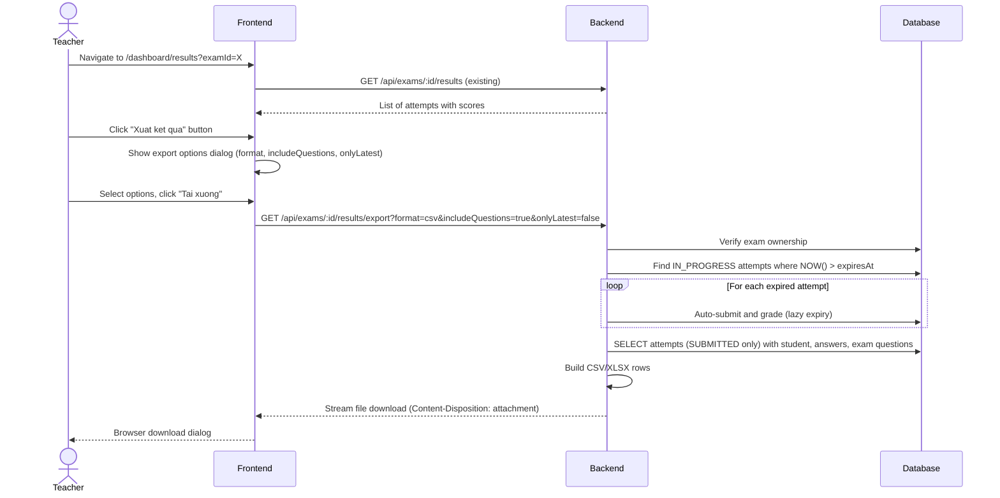
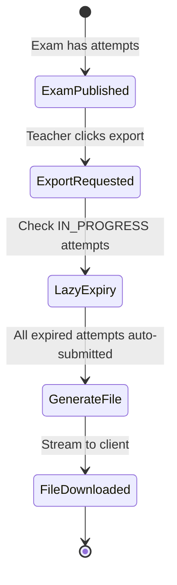

# G9. Export Grading Results

## 5.1 Feature Overview

| Field | Value |
|---|---|
| **Feature ID** | G9 |
| **Feature Name** | Export Grading Results |
| **Module** | G. Grading & Results |
| **Priority** | P2 |
| **Complexity** | M |
| **Status** | Not implemented — no export endpoints or UI exist. The `getAttemptsForExam` service method returns attempt data with student info, but no file generation or download capability exists. |
| **Target Roles** | Teacher |
| **Business Objective** | Allow teachers to download a structured file (CSV or Excel) of all grading results for an exam, enabling offline analysis, grade book integration, and record keeping. |
| **User Problem** | Teachers can view results in the web UI but cannot extract them for reporting, parent meetings, or importing into school grading systems. Manual transcription from screen to spreadsheet is error-prone and time-consuming. |
| **Dependencies** | G1 (Auto-Grading), G2 (Exam Results & Review), G3 (Manual Grading & Score Override), E3 (Submit Exam — attempt status lifecycle) |

## 5.2 Actors and Permissions

### Teacher

- **Can export**: Results for exams they own.
- **Can choose**: File format (CSV or XLSX), whether to include per-question scores, whether to include all attempts or only the latest per student.
- **Cannot**: Export results for exams owned by another teacher.

### System (Backend)

- **Generates**: The export file server-side and streams it as a download response.
- **Reads**: ExamAttempt, Answer, ExamQuestion, User (student) data.
- **Enforces**: Ownership check and lazy expiry on in-progress attempts before export.

### Backend Authorization

- The export endpoint requires `TEACHER` role (via `RolesGuard`).
- Ownership is verified: `exam.ownerId === currentUser.id`.
- No student can access this endpoint.

## 5.3 Preconditions and Business Rules

### Preconditions

1. The exam must be `PUBLISHED` (or `ARCHIVED`). DRAFT exams have no attempts.
2. At least one attempt must exist for the exam. If no attempts exist, the endpoint returns an empty file with headers only.
3. The teacher must own the exam.

### Business Rules

| Rule ID | Rule | Enforced |
|---|---|---|
| G9-BR-01 | Only the exam owner (teacher) can export results. Ownership is checked by comparing `exam.ownerId` with the authenticated user's ID. | Backend |
| G9-BR-02 | Before generating the export, the system evaluates lazy expiry on all `IN_PROGRESS` attempts for this exam: any attempt where `NOW() > expiresAt` is auto-submitted and graded with saved answers (consistent with AD-06 and AD-11). This ensures the export reflects current scores. | Backend |
| G9-BR-03 | The default export includes one row per attempt. When `onlyLatest=true`, the export includes only the most recent submitted attempt per student (by `submittedAt DESC`, falling back to `startedAt DESC`). | Backend |
| G9-BR-04 | Attempts with status `IN_PROGRESS` (still within time) are excluded from the export by default. They have no score and are still active. | Backend |
| G9-BR-05 | Score is exported as the stored `ExamAttempt.score` value (Decimal(10,2), scale 0-10). Manually overridden scores (`manualScoreOverride = true`) are exported with the override flag set to "Co" (Yes). | Backend |
| G9-BR-06 | When `includeQuestions=true`, the export includes one additional column per exam question, showing the earned points for that question in the attempt. Column headers use the pattern `"Cau {position}"` (e.g., `"Cau 1"`, `"Cau 2"`). | Backend |
| G9-BR-07 | Student display name and email are included in every export. If a student account has been deleted (cascade), the attempt row is included with `displayName = "(Da xoa)"` and `email = ""`. | Backend |
| G9-BR-08 | The file is generated server-side and streamed as a download. The response uses `Content-Disposition: attachment; filename="..."` with `Content-Type` set to `text/csv; charset=utf-8` or `application/vnd.openxmlformats-officedocument.spreadsheetml.sheet`. | Backend |
| G9-BR-09 | The exported filename follows the pattern: `{exam.title}_ket-qua_{YYYYMMDD}.{csv|xlsx}`. Non-ASCII characters in the title are preserved (UTF-8). Characters not valid in filenames (`/`, `\`, `:`, `*`, `?`, `"`, `<`, `>`, `|`) are replaced with `_`. | Backend |
| G9-BR-10 | CSV files use UTF-8 encoding with a BOM (``) prefix so that Excel opens them with correct Vietnamese character display. Column separator is comma (`,`). | Backend |
| G9-BR-11 | The export must complete within a reasonable time for the expected data volume. At ~100 concurrent users and a maximum of ~1000 attempts per exam (100 students x 10 max attempts), the query and file generation should complete in under 5 seconds. | Backend |
| G9-BR-12 | Per-question earned points are calculated at export time by comparing the student's `answerPayload` against the `optionsSnapshot` on `ExamQuestion`, using the same logic as the grading engine. This ensures consistency even if the grading engine is updated. **Alternative**: if `earnedPoints` is stored per answer in the future, read it directly. | Backend |
| G9-BR-13 | The export does not include the actual answers or answer content — only earned points per question (when requested). This keeps the file focused on grading results. | Backend |

## 5.4 Main User Flow — Happy Path



### Steps

1. Teacher navigates to the results page for a specific exam (`/dashboard/results?examId=X`).
2. Teacher clicks the "Xuat ket qua" (Export Results) button.
3. A dialog appears with export options: file format (CSV/XLSX), include per-question scores (checkbox), export all attempts or only the latest per student (radio).
4. Teacher confirms. Frontend issues a GET request to the export endpoint with query parameters.
5. Backend verifies exam ownership (403 if not owner).
6. Backend runs lazy expiry: finds all IN_PROGRESS attempts for this exam where `NOW() > expiresAt`, auto-submits each.
7. Backend queries all SUBMITTED attempts for the exam, joining student info and (if requested) answers with exam questions.
8. Backend builds the file:
   - **Header row**: `"STT"`, `"Ho ten"`, `"Email"`, `"Diem (X/10)"`, `"Thoi gian nop"`, `"Trang thai"`, `"Diem thu cong"`, and optionally `"Cau 1"`, `"Cau 2"`, ...
   - **Data rows**: One per attempt (or one per student if `onlyLatest=true`).
9. Backend streams the file to the client with the appropriate `Content-Type` and `Content-Disposition` headers.
10. The browser triggers a file download.

## 5.5 Alternative Flows

### AF-01: No Attempts Exist

1. Teacher clicks "Xuat ket qua" for an exam with no submissions.
2. Backend returns a file containing only the header row.
3. Frontend does not show an error — the downloaded file is valid but empty.

### AF-02: All Attempts Still IN_PROGRESS (Within Time)

1. All attempts are currently active (students are taking the exam now).
2. Backend filters to SUBMITTED attempts only, finding none.
3. Same as AF-01: file with headers only.

### AF-03: Some Attempts Expired but Not Yet Auto-Submitted

1. Backend runs lazy expiry before generating the export (G9-BR-02).
2. Expired attempts are auto-submitted and graded.
3. These now appear in the export with their auto-graded scores.

### AF-04: Export XLSX Format

1. Teacher selects XLSX format.
2. Backend uses the `exceljs` library (or equivalent) to generate an `.xlsx` file.
3. The first row is bold and frozen (header). Columns are auto-sized.
4. The file is streamed with `Content-Type: application/vnd.openxmlformats-officedocument.spreadsheetml.sheet`.

### AF-05: Only Latest Attempt Per Student

1. Teacher selects `onlyLatest=true`.
2. Backend groups attempts by `studentId`, picks the most recent SUBMITTED attempt per student (by `submittedAt DESC`).
3. Export contains one row per student.

### AF-06: Exam with Manual Score Overrides

1. Some attempts have `manualScoreOverride = true`.
2. The exported score is the stored `ExamAttempt.score` (which already reflects the override).
3. The "Diem thu cong" column shows "Co" for overridden attempts and empty for auto-graded ones.

## 5.6 Edge Cases and Failure Scenarios

| Scenario ID | Scenario | Trigger | Expected Behavior | User Feedback | Data Integrity | Recovery | Severity |
|---|---|---|---|---|---|---|---|
| G9-EC-01 | Exam has 0 attempts | Teacher exports immediately after publishing | File with headers only, no data rows | File downloads successfully; teacher opens and sees empty spreadsheet | No impact | None needed | Low |
| G9-EC-02 | Student account deleted (cascade) | Student's user row was deleted after submitting | Attempt row exists but `student` relation is null | Row shows `"(Da xoa)"` for name, empty email | Attempt data preserved, student info lost | None — data loss is by design (cascade) | Medium |
| G9-EC-03 | Exam title contains special characters | Title has `/`, `"`, or non-ASCII chars | Filename sanitized per G9-BR-09; content unaffected | File downloads with a safe filename | No impact | None | Low |
| G9-EC-04 | Large export (~1000 rows with per-question scores) | 100 students x 10 attempts, 50 questions each | Streaming prevents memory issues; completes within 5s | Download may take 2-3 seconds | No impact | None | Low |
| G9-EC-05 | Concurrent export requests | Teacher clicks download twice rapidly | Each request generates independently; no locking needed | Two file downloads | No impact | None | Low |
| G9-EC-06 | Lazy expiry during export auto-submits an attempt that a student is actively working on | Student's time expired but they haven't submitted; export triggers auto-submit | Correct behavior — the attempt was past its expiry. Student sees "submitted" on their next request. | Student may be surprised if they thought they had more time, but server time is authoritative | Consistent with AD-06 and AD-11 | None | Medium |
| G9-EC-07 | Per-question score calculation differs from stored score | Possible if grading engine was updated after original grading | Spec uses stored attempt score, not recalculated. Per-question earned points are recalculated from snapshot at export time — minor inconsistency possible. | Score column matches stored value; per-question columns sum may differ slightly from total | Low risk — only per-question column is recalculated | Document that regrade should be run before export if engine was updated | Low |
| G9-EC-08 | Network interruption during file download | Connection drops mid-stream | Partial file downloaded; browser may show error | Teacher retries download | No server-side impact — export is read-only | Teacher clicks download again | Low |
| G9-EC-09 | CSV injection via student display name | Student name contains `=`, `+`, `-`, `@` as first character | Prefix cell value with a single quote `'` or tab character to prevent formula interpretation in Excel | No visible impact to teacher | No impact | Built-in mitigation | Medium |

## 5.7 UI/UX Specification

### Export Button Location

- **Page**: `/dashboard/results` (teacher's results view for a specific exam).
- **Placement**: Top-right of the results table, next to any existing action buttons.
- **Label**: `"Xuat ket qua"` with a download icon (e.g., `Download` icon from lucide-react).
- **Visibility**: Only visible when the teacher is viewing results for a specific exam (query param `examId` is set).
- **Disabled state**: Disabled with tooltip `"Chua co bai nop nao"` if there are 0 submitted attempts.

### Export Options Dialog

A modal dialog appears when the teacher clicks the export button:

**Title**: `"Xuat ket qua bai kiem tra"`

**Fields**:
1. **Dinh dang file** (File format) — Radio group
   - `"CSV (.csv)"` — default
   - `"Excel (.xlsx)"`

2. **Noi dung** (Content) — Checkbox
   - `"Bao gom diem tung cau hoi"` (Include per-question scores) — unchecked by default

3. **Bai lam** (Attempts) — Radio group
   - `"Tat ca cac lan lam"` (All attempts) — default
   - `"Chi lan lam moi nhat cua moi hoc sinh"` (Only latest per student)

**Actions**:
- `"Tai xuong"` (Download) — primary button
- `"Huy"` (Cancel) — secondary button

### Exported Column Descriptions

| Column Header | Description | Example Value |
|---|---|---|
| `STT` | Row number (sequential, starting at 1) | `1` |
| `Ho ten` | Student display name | `Nguyen Van A` |
| `Email` | Student email | `nguyenvana@example.com` |
| `Diem (X/10)` | Attempt score, 2 decimal places | `7.50` |
| `Thoi gian nop` | Submission timestamp in `DD/MM/YYYY HH:mm` format (Vietnam timezone, UTC+7) | `15/12/2026 14:30` |
| `Trang thai` | Attempt status in Vietnamese | `Da nop` / `Het han (tu dong nop)` |
| `Diem thu cong` | Manual override flag | `Co` or empty |
| `Cau {N}` | Earned points for question N (only if `includeQuestions=true`) | `2` or `0` or `1.5` |

### Status Mapping for Export

| AttemptStatus + Context | Vietnamese Label |
|---|---|
| `SUBMITTED` and `submittedAt <= expiresAt` | `Da nop` |
| `SUBMITTED` and `submittedAt > expiresAt` (auto-submitted by lazy expiry) | `Het han (tu dong nop)` |

### Loading State

While the download is being generated (the GET request is in flight), show a spinner on the "Tai xuong" button and disable it. No progress bar needed at this scale.

## 5.8 Data Requirements

### Schema Changes

None. This feature reads existing data only.

### Data Queries

The export endpoint needs:

1. **Exam with questions**: `Exam` (for title, ownership check) + `ExamQuestion[]` (for question positions and points, and for per-question score calculation via `optionsSnapshot`).
2. **Attempts with student info**: `ExamAttempt[]` where `status = 'SUBMITTED'`, joined with `User` (student) for `displayName` and `email`.
3. **Answers** (only if `includeQuestions=true`): `Answer[]` for each attempt, joined with `ExamQuestion` for the `optionsSnapshot` to calculate earned points.

### Indexing

Existing indexes are sufficient:
- `exam_attempts(exam_id, student_id)` — for querying attempts by exam.
- `answers(attempt_id, exam_question_id)` — for fetching answers per attempt.

### Data Volume Estimate

- Max attempts per exam: ~1000 (100 students x 10 max attempts, though typical is 100-200).
- Max questions per exam: ~100 (practical limit).
- Max answer rows per export: ~100,000 (1000 attempts x 100 questions). At this scale, a single query with appropriate joins is feasible.

### Dependencies: Libraries

| Library | Purpose | License |
|---|---|---|
| None (built-in) | CSV generation — simple string concatenation or a lightweight helper | N/A |
| `exceljs` (optional, for XLSX) | XLSX file generation with streaming support | MIT |

**Decision needed**: Whether to support XLSX in the first iteration or start with CSV only. CSV is simpler and requires no additional dependency. See Open Questions.

## 5.9 API Requirements

### GET /api/exams/:id/results/export (New Endpoint)

| Field | Value |
|---|---|
| **Method** | GET |
| **Path** | `/api/exams/:id/results/export` |
| **Controller** | `ExamsController` or `AttemptsController` (implementation choice) |
| **Role** | `TEACHER` |
| **Description** | Generate and stream a CSV or XLSX file containing all grading results for the specified exam. |

**Path Parameters**:

| Param | Type | Required | Description |
|---|---|---|---|
| `id` | UUID | Yes | Exam ID |

**Query Parameters**:

| Param | Type | Required | Default | Description | Validation |
|---|---|---|---|---|---|
| `format` | string | No | `csv` | File format: `csv` or `xlsx` | Must be one of `csv`, `xlsx` |
| `includeQuestions` | boolean | No | `false` | Include per-question earned points columns | `true` or `false` |
| `onlyLatest` | boolean | No | `false` | Export only the most recent submitted attempt per student | `true` or `false` |

**Success Response (200)**:
- Body: binary file stream
- Headers:
  ```
  Content-Type: text/csv; charset=utf-8       (for CSV)
  Content-Type: application/vnd.openxmlformats-officedocument.spreadsheetml.sheet  (for XLSX)
  Content-Disposition: attachment; filename="Kiem_tra_Toan_ket-qua_20261215.csv"
  ```

**Error Responses**:

| Status | Code | Message | Trigger |
|---|---|---|---|
| 401 | `UNAUTHORIZED` | `"Vui long dang nhap"` | Not authenticated |
| 403 | `FORBIDDEN` | `"Ban khong co quyen xuat ket qua bai kiem tra nay"` | Teacher does not own this exam |
| 404 | `NOT_FOUND` | `"Khong tim thay bai kiem tra"` | Exam ID does not exist |
| 400 | `BAD_REQUEST` | `"Dinh dang khong hop le. Su dung 'csv' hoac 'xlsx'"` | Invalid `format` value |

### Interaction with Existing Endpoints

- `GET /api/attempts?examId=X` (existing, teacher role) — returns the same data used to populate the results page. The export endpoint queries the same data but generates a file.
- No changes to existing endpoints are needed.

## 5.10 State Management

No new states are introduced. The export is a read-only operation.

The only side effect is lazy expiry: expired `IN_PROGRESS` attempts are auto-submitted before the export runs. This is consistent with existing behavior (AD-06, AD-11).



## 5.11 Acceptance Criteria

### Happy Path

```gherkin
Given a teacher owns an exam with 5 submitted attempts,
When the teacher requests GET /api/exams/:id/results/export?format=csv,
Then the response is a CSV file download,
  and the file contains a header row and 5 data rows,
  and each row includes STT, Ho ten, Email, Diem (X/10), Thoi gian nop, Trang thai, Diem thu cong.
```

```gherkin
Given a teacher exports with includeQuestions=true and the exam has 10 questions,
When the file is generated,
Then the header row includes "Cau 1" through "Cau 10" after the standard columns,
  and each data row has the earned points for each question.
```

```gherkin
Given a student has 3 submitted attempts for an exam,
When the teacher exports with onlyLatest=true,
Then only the most recent submitted attempt appears for that student.
```

```gherkin
Given a student has 3 submitted attempts for an exam,
When the teacher exports with onlyLatest=false (default),
Then all 3 attempts appear in the export.
```

```gherkin
Given an attempt has manualScoreOverride = true and score = 8.50,
When the export is generated,
Then the row shows "8.50" in the Diem column and "Co" in the Diem thu cong column.
```

```gherkin
Given the exported CSV file is opened in Excel,
When the teacher views it,
Then Vietnamese characters display correctly (UTF-8 BOM).
```

### Lazy Expiry

```gherkin
Given an exam has 2 IN_PROGRESS attempts where NOW() > expiresAt,
When the teacher requests an export,
Then the 2 attempts are auto-submitted and graded before the file is generated,
  and they appear in the export as "Het han (tu dong nop)".
```

### Negative / Permission Cases

```gherkin
Given a teacher does not own the exam,
When they request GET /api/exams/:id/results/export,
Then the response is 403 with message "Ban khong co quyen xuat ket qua bai kiem tra nay".
```

```gherkin
Given a STUDENT role user,
When they request GET /api/exams/:id/results/export,
Then the response is 403 (RolesGuard blocks the request).
```

```gherkin
Given the exam does not exist,
When a teacher requests the export,
Then the response is 404 with message "Khong tim thay bai kiem tra".
```

```gherkin
Given the format parameter is "pdf",
When the teacher requests the export,
Then the response is 400 with message "Dinh dang khong hop le. Su dung 'csv' hoac 'xlsx'".
```

### CSV Safety

```gherkin
Given a student's display name is "=CMD('calc')",
When the export is generated as CSV,
Then the name cell is escaped to prevent formula injection (e.g., prefixed with a single quote or tab).
```

## 5.12 QA Test Scenarios

| Test Case ID | Scenario | Preconditions | Test Steps | Test Data | Expected Result | Priority |
|---|---|---|---|---|---|---|
| G9-TC-01 | Basic CSV export | Exam with 3 submitted attempts | GET /api/exams/:id/results/export?format=csv | 3 students, MCQ exam | CSV file with 3 rows + header, correct scores | P0 |
| G9-TC-02 | XLSX export | Same as G9-TC-01 | GET ...?format=xlsx | Same | XLSX file with 3 rows + header, correct scores | P1 |
| G9-TC-03 | Include per-question scores | Exam with 5 questions, 2 attempts | GET ...?includeQuestions=true | Known answers | Extra columns "Cau 1"-"Cau 5" with correct earned points | P0 |
| G9-TC-04 | Only latest attempt per student | Student A has 3 attempts, Student B has 1 | GET ...?onlyLatest=true | Multiple attempts | 2 rows: latest for A, the 1 for B | P0 |
| G9-TC-05 | All attempts (default) | Student A has 3 attempts, Student B has 1 | GET ...?onlyLatest=false | Multiple attempts | 4 rows total | P0 |
| G9-TC-06 | Manual override flag | 1 attempt with manualScoreOverride=true | GET ...?format=csv | Override score = 9.00 | Row shows 9.00 and "Co" in override column | P1 |
| G9-TC-07 | Lazy expiry before export | 1 IN_PROGRESS attempt past expiresAt | GET export endpoint | Expired attempt with saved answers | Attempt auto-submitted, appears in export | P0 |
| G9-TC-08 | No attempts | Published exam, no attempts | GET export endpoint | Empty exam | File with headers only, 0 data rows | P1 |
| G9-TC-09 | Ownership check — wrong teacher | Exam owned by Teacher A | Teacher B requests export | Different teacher | 403 Forbidden | P0 |
| G9-TC-10 | Student role rejected | Exam exists | STUDENT requests export | Student token | 403 Forbidden | P0 |
| G9-TC-11 | Exam not found | Invalid exam ID | GET /api/exams/invalid-uuid/results/export | Bad UUID | 404 Not Found | P1 |
| G9-TC-12 | Invalid format parameter | Valid exam | GET ...?format=pdf | "pdf" | 400 Bad Request | P1 |
| G9-TC-13 | Vietnamese characters in CSV | Student names with diacritics | GET ...?format=csv, open in Excel | "Nguyen Van A" with diacritics | Characters display correctly (BOM present) | P1 |
| G9-TC-14 | CSV injection prevention | Student name = "=SUM(A1:A10)" | GET ...?format=csv | Formula-like name | Cell escaped, no formula execution in Excel | P1 |
| G9-TC-15 | Filename sanitization | Exam title = `"Kiem tra: Chuong 3/4"` | GET export endpoint | Title with special chars | Filename: `Kiem_tra__Chuong_3_4_ket-qua_20261215.csv` | P2 |
| G9-TC-16 | Deleted student | Student account deleted after submission | GET export endpoint | Attempt exists, student null | Row shows "(Da xoa)" and empty email | P2 |
| G9-TC-17 | Auto-submitted status label | Attempt auto-submitted (submittedAt > expiresAt) | GET export endpoint | Lazy-expired attempt | Trang thai = "Het han (tu dong nop)" | P1 |
| G9-TC-18 | Large export performance | 500 attempts, 50 questions, includeQuestions=true | GET export endpoint | 25,000 answer lookups | Response completes in under 5 seconds | P2 |

## 5.13 Open Questions and Assumptions

| # | Question | Why It Matters | Options | Recommended Default | Impact | Blocks Implementation? |
|---|---|---|---|---|---|---|
| 1 | Should XLSX be supported in the first iteration, or CSV only? | XLSX requires the `exceljs` dependency (~1.5 MB). CSV is zero-dependency. Teachers commonly use Excel, which handles CSV with BOM correctly. | (a) CSV only. (b) CSV + XLSX. | (a) CSV only for the first iteration. XLSX can be added later without API changes (the `format` param is already defined). | Low — CSV meets the core need. | No |
| 2 | Which controller should own the export endpoint? | The data crosses exam and attempt domains. | (a) `ExamsController` under `/exams/:id/results/export`. (b) `AttemptsController` under `/attempts/export?examId=X`. | (a) `ExamsController` — the exam is the primary entity. | Low — implementation detail. | No |
| 3 | Should per-question earned points be stored on the Answer model, or recalculated at export time? | Storing avoids recalculation but adds a schema change. Recalculating uses the same grading logic. | (a) Recalculate from `optionsSnapshot` at export time. (b) Add `earnedPoints Decimal?` to the Answer model. | (a) Recalculate at export time. Avoids schema migration and keeps Answer lean. At this data volume, the cost is negligible. | Low | No |
| 4 | Should the export include a summary row (total count, average score, min, max)? | Useful for quick analysis, but teachers can compute it in their spreadsheet. | (a) No summary row. (b) Append a summary row at the bottom. | (a) No summary row. Keep the export as clean tabular data for easy import into other systems. | Low | No |
| 5 | What timezone should be used for `Thoi gian nop`? | The server stores timestamps in UTC. Vietnamese teachers expect Vietnam time (UTC+7). | (a) UTC. (b) UTC+7 (Vietnam). (c) Configurable (complex). | (b) UTC+7 hardcoded. All users are Vietnamese per project scope. | Low | No |
| 6 | Should there be a row limit or pagination for the export? | At ~100 users, a single exam is unlikely to exceed 1000 attempts. But future growth could change this. | (a) No limit. (b) Limit to 10,000 rows. | (a) No limit. At the target scale (~100 users), this is safe. If the system scales, add streaming pagination. | Low | No |
| 7 | Should the export endpoint use Fastify's streaming reply (`reply.raw`) or buffer the entire file? | Streaming is more memory-efficient for large files. Buffering is simpler. | (a) Buffer in memory, then send. (b) Stream using Fastify reply.raw. | (a) Buffer in memory. At ~1000 rows, the file is under 1 MB. Streaming adds complexity with no benefit at this scale. | Low | No |

### Assumptions

| ID | Assumption | Risk if Wrong |
|---|---|---|
| A-G9-01 | Vietnamese timezone (UTC+7) is correct for all users. No timezone configuration is needed. | If the platform expands beyond Vietnam, timestamps will need per-user timezone. Low risk for MVP. |
| A-G9-02 | CSV with UTF-8 BOM is sufficient for Excel compatibility on Windows. macOS Excel also handles this correctly. | If a specific Excel version mishandles BOM, the teacher may see garbled characters. Mitigated by also offering XLSX (OQ #1). |
| A-G9-03 | The `getAttemptsForExam` query pattern (exam ownership check + attempt fetch) is reusable for the export endpoint with additional joins. No new query optimization is needed. | If the query is slow at scale, add database-level aggregation or a materialized view. Not expected at ~100 users. |
| A-G9-04 | The `exceljs` library is the best choice for XLSX generation if XLSX support is added. It supports streaming and is well-maintained. | If `exceljs` is too large or slow, alternatives like `xlsx-populate` or `SheetJS` could be evaluated. |
| A-G9-05 | Formula injection mitigation (prefixing `=`, `+`, `-`, `@` cells) is sufficient. No deeper sanitization is needed. | If a new injection vector is discovered, the mitigation needs updating. Standard practice is sufficient. |

---

### Handoff

**Artifacts**: `docs/features/grading/export-results.md`

**Open questions blocking implementation**: None.

**Open questions NOT blocking implementation**:
- OQ #1: CSV only vs CSV+XLSX — recommended CSV only, XLSX deferred.
- OQ #2: Controller placement — recommended ExamsController.
- OQ #3: Stored vs recalculated per-question points — recommended recalculate.
- OQ #4: Summary row — recommended no.
- OQ #5: Timezone — recommended UTC+7 hardcoded.
- OQ #6: Row limit — recommended none.
- OQ #7: Streaming vs buffering — recommended buffering.

**Prerequisites the developer must resolve**:
1. Add the export endpoint to `ExamsController` (or chosen controller).
2. Implement CSV generation with UTF-8 BOM and formula injection prevention.
3. Implement per-question score recalculation from `optionsSnapshot` (when `includeQuestions=true`).
4. Run lazy expiry on IN_PROGRESS attempts before generating the export.
5. Handle the "only latest per student" grouping logic.
6. Set Fastify response headers for file download (`Content-Type`, `Content-Disposition`).
7. Add the "Xuat ket qua" button and export options dialog to the results page.
8. If XLSX is included: add `exceljs` dependency and implement XLSX generation.
