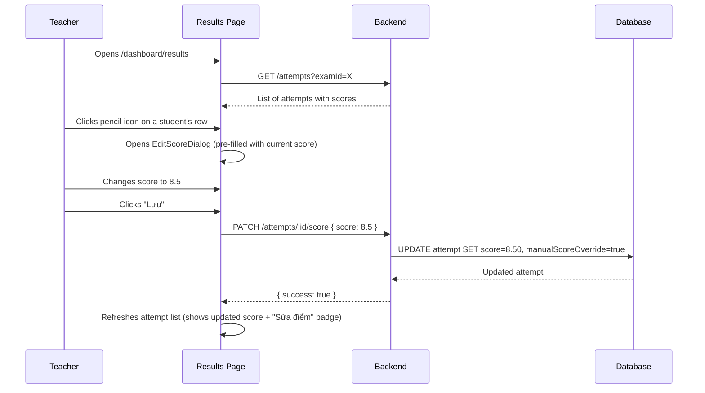
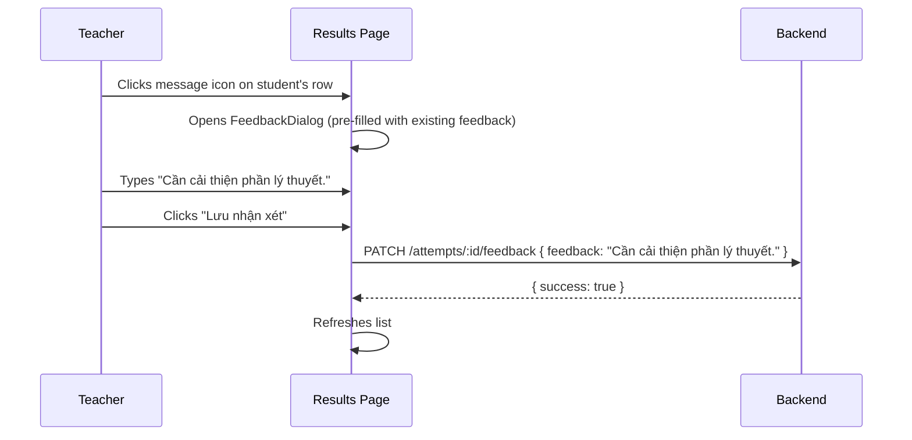

# G2. Manual Grading — Score Override, Teacher Feedback, Answer Feedback

## 5.1 Feature Overview

| Field | Value |
|---|---|
| Feature ID | G2 |
| Feature Name | Manual Grading |
| Module | G. Grading & Results |
| Priority | P1 |
| Complexity | M |
| Status | Existing — score override and attempt-level feedback implemented. Per-answer feedback schema exists, endpoint partially implemented. |
| Target Roles | Teacher |
| Business Objective | Allow teachers to adjust machine-graded scores, provide pedagogical feedback, and grade question types that cannot be auto-graded (essays). |
| User Problem | Auto-grading cannot handle essay questions, subjective partial credit, or errors in the answer key. Teachers need the ability to override scores and communicate feedback. |
| Dependencies | G1 (Auto-Grading), G5 (Result Visibility), D4 (Publish Exam) |

## 5.2 Actors and Permissions

### Teacher

| Action | Rule |
|---|---|
| View all attempts for own exams | Allowed |
| Override score on any attempt of own exam | Allowed — sets `manualScoreOverride = true` |
| Write attempt-level feedback | Allowed |
| Write per-answer feedback | Allowed |
| Override score on another teacher's exam | **Forbidden** — 403 |
| Delete or undo a score override | Allowed — can set score back to auto-graded value, but `manualScoreOverride` remains true |

### Student

| Action | Rule |
|---|---|
| View own score (subject to visibility) | Allowed |
| View teacher feedback on own attempt | Allowed (when results are visible) |
| View per-answer feedback | Allowed (when results are visible, in review) |
| Modify score or feedback | **Forbidden** |

### Backend Authorization

- `PATCH /attempts/:id/score`: Teacher must own the exam associated with the attempt. Checked via `attempt → exam → ownerId`.
- `PATCH /attempts/:id/feedback`: Same ownership check.
- Per-answer feedback endpoint (if implemented): Teacher must own the exam; answer must belong to that exam's attempt.

## 5.3 Preconditions and Business Rules

### Preconditions

1. Attempt must exist and be in `SUBMITTED` status (cannot override score on `IN_PROGRESS` attempts).
2. Teacher must own the exam that the attempt belongs to.

### Business Rules

| Rule | Description |
|---|---|
| Score range | 0.00 – 10.00 inclusive. Values outside this range are rejected (400). |
| Score precision | Decimal(10,2). Accepts up to 2 decimal places. Values with more are rounded to 2. |
| Override flag | Setting a manual score sets `manualScoreOverride = true`. This flag is informational — it tells the UI and regrade logic that the score was manually adjusted. |
| Override persistence | A manual override is preserved across regrade operations. Regrade skips attempts where `manualScoreOverride = true`. |
| Feedback length | Attempt feedback: max 5000 characters. Per-answer feedback: max 2000 characters. |
| Feedback visibility | Feedback is visible to the student only when result visibility is enabled (showResultImmediately OR resultsReleased). |
| Audit | The `reason` field on score override is optional but recommended. Currently not stored in a separate audit table — only the latest score is persisted. |

## 5.4 Main User Flow — Happy Path

### Score Override



### Attempt-Level Feedback



## 5.5 Alternative Flows

### AF-1: Teacher Reverts to Auto-Graded Score

1. Teacher previously overrode score to 9.0 but realizes the auto-grade (7.5) was correct.
2. Teacher opens EditScoreDialog, enters 7.5.
3. Score is updated to 7.5. `manualScoreOverride` remains `true` (no way to distinguish "reverted" from "manually set to same value").
4. **Note**: To truly revert, the teacher would need to trigger a regrade (G4), which skips manually-overridden attempts. This is a known limitation — see Open Questions.

### AF-2: Teacher Provides Feedback Without Changing Score

1. Teacher opens FeedbackDialog.
2. Types feedback text.
3. Saves. Score is untouched.
4. Student sees feedback in their results view.

### AF-3: Scoring an Essay Question

1. Exam contains 3 MCQ (6pts) + 1 Essay (4pts). Auto-grade gives 6.00.
2. Teacher reviews the essay answer in ReviewDialog.
3. Teacher decides the essay deserves 3/4 points. New total earned = 9/10.
4. Teacher opens EditScoreDialog, enters 9.0.
5. Score updated to 9.00, manualScoreOverride = true.

### AF-4: Bulk Feedback (Not Yet Implemented)

Currently, feedback must be set one attempt at a time. Bulk feedback is out of scope for MVP.

## 5.6 Edge Cases and Failure Scenarios

| Scenario ID | Scenario | Trigger | Expected Behavior | User Feedback | Data Integrity | Recovery | Severity |
|---|---|---|---|---|---|---|---|
| G2-EC-01 | Score out of range | Teacher enters 11.0 or -1 | Backend rejects with 400 | "Điểm phải từ 0 đến 10" | No change | Teacher corrects input | Medium |
| G2-EC-02 | Score with excessive decimals | Teacher enters 8.555 | Backend rounds to 8.56 (or rejects — depends on validation) | Accept and round, or show validation error | Decimal(10,2) stores at most 2 decimals | None | Low |
| G2-EC-03 | Override on IN_PROGRESS attempt | Teacher tries to score an unsubmitted attempt | Backend rejects with 400 "Attempt not submitted" | Error message displayed | No change | Wait for submission | Medium |
| G2-EC-04 | Concurrent score updates | Two teachers update the same attempt's score simultaneously | Last write wins — no conflict detection | No error shown; last save persists | Acceptable for ~100 users | Teacher refreshes to see latest | Low |
| G2-EC-05 | Feedback exceeds max length | Teacher pastes 10,000+ characters | Backend truncates or rejects with 400 | "Nhận xét tối đa 5000 ký tự" | No change | Teacher shortens text | Low |
| G2-EC-06 | Empty feedback | Teacher submits empty string | Accepted — clears existing feedback | Feedback cleared | Null or empty string stored | None | Low |
| G2-EC-07 | Override then regrade | Teacher overrides score, then triggers regrade for the exam | Regrade skips this attempt (manualScoreOverride = true) | No change to this attempt; other attempts regraded | Override preserved | Expected behavior | High |
| G2-EC-08 | Teacher not exam owner | Teacher A tries to score Teacher B's exam attempt | 403 Forbidden | "Bạn không có quyền thực hiện thao tác này" | No change | N/A | High |
| G2-EC-09 | Attempt does not exist | PATCH /attempts/nonexistent-id/score | 404 Not Found | "Không tìm thấy bài làm" | No change | Check attempt ID | Low |
| G2-EC-10 | Feedback on unsubmitted attempt | Teacher writes feedback on IN_PROGRESS attempt | Accept or reject? Currently: accept (feedback stored regardless of status) | Feedback saved | Debatable — student won't see it until submitted | None | Low |
| G2-EC-11 | Student views feedback before results released | Exam has showResultImmediately=false, resultsReleased=false | Feedback is hidden along with score | Student sees "Chờ giáo viên công bố" | Feedback not leaked | Teacher releases results | Medium |

## 5.7 UI/UX Specification

### Entry Point

- `/dashboard/results` page — teacher-only.
- Each attempt row has 3 action buttons: Review (eye), Edit Score (pencil), Feedback (message).

### EditScoreDialog

- **Trigger**: Click pencil icon on any attempt row.
- **Fields**:
  - Score input: `<Input type="number" min={0} max={10} step={0.1} />` — pre-filled with current score.
- **Buttons**: "Lưu" (primary), dialog close (cancel).
- **States**:
  - Loading: button text "Đang lưu...", disabled.
  - Error: toast notification.
  - Success: dialog closes, table refreshes.
- **Badge**: After override, the attempt row shows a "Sửa điểm" outline badge next to the status.

### FeedbackDialog

- **Trigger**: Click message icon on any attempt row.
- **Fields**:
  - Textarea: pre-filled with existing feedback (or empty). Placeholder: "Nhận xét cho học sinh..." Max 5000 chars. 3 rows default height.
- **Buttons**: "Lưu nhận xét" (primary), dialog close (cancel).
- **States**: Same as EditScoreDialog.

### ReviewDialog (Read-Only Grading View)

- **Trigger**: Click eye icon on any attempt row.
- **Content**: Per-question breakdown:
  - Question text and position.
  - Options with color coding (green for correct, red for selected-incorrect).
  - Points earned badge per question.
  - Per-answer feedback text (if any).
- **Note**: This dialog is read-only. Score editing and feedback writing happen in their own dialogs.

### Responsive Behavior

- On mobile (<640px): Action buttons collapse into a dropdown menu or use icon-only buttons.
- Dialogs are full-width on mobile with reduced padding.

## 5.8 Data Requirements

### Existing Schema (Sufficient)

**ExamAttempt**:
```
score                Decimal?  @db.Decimal(10, 2)
manualScoreOverride  Boolean   @default(false)
feedback             String?
```

**Answer**:
```
feedback  String?  // per-answer feedback from teacher
```

### No Schema Changes Required

All fields for manual grading already exist. The `reason` field for score override audit is not in the schema — it is accepted in the API but not persisted. See Open Questions.

## 5.9 API Requirements

### PATCH /attempts/:id/score

| Field | Value |
|---|---|
| Method | PATCH |
| Endpoint | `/api/attempts/:id/score` |
| Purpose | Override the auto-graded score with a manual score |
| Required Role | TEACHER |
| Authorization | Teacher must own the exam: `attempt.exam.ownerId === currentUser.id` |
| Request Body | `{ "score": 8.5, "reason": "Bổ sung điểm tự luận" }` |
| Validation | `score`: required, number, min 0, max 10. `reason`: optional, string, max 500 chars. |
| Success Response (200) | `{ "success": true, "data": { "id": "...", "score": "8.50", "manualScoreOverride": true } }` |
| Error: Invalid score (400) | `{ "success": false, "error": { "code": "VALIDATION_ERROR", "message": "Score must be between 0 and 10" } }` |
| Error: Not submitted (400) | `{ "success": false, "error": { "code": "ATTEMPT_NOT_SUBMITTED", "message": "Cannot score an in-progress attempt" } }` |
| Error: Not authorized (403) | `{ "success": false, "error": { "code": "FORBIDDEN", "message": "Access denied" } }` |
| Idempotency | No — each call overwrites the previous score |

### PATCH /attempts/:id/feedback

| Field | Value |
|---|---|
| Method | PATCH |
| Endpoint | `/api/attempts/:id/feedback` |
| Purpose | Set or update teacher feedback on an attempt |
| Required Role | TEACHER |
| Authorization | Teacher must own the exam: `attempt.exam.ownerId === currentUser.id` |
| Request Body | `{ "feedback": "Cần cải thiện phần lý thuyết." }` |
| Validation | `feedback`: required, string, max 5000 chars |
| Success Response (200) | `{ "success": true, "data": { "id": "...", "feedback": "..." } }` |
| Error: Not authorized (403) | Standard 403 |

### Per-Answer Feedback (Proposed Enhancement)

| Field | Value |
|---|---|
| Method | PATCH |
| Endpoint | `/api/answers/:id/feedback` (proposed) or `/api/attempts/:attemptId/answers/:examQuestionId/feedback` |
| Purpose | Set feedback on a specific answer |
| Required Role | TEACHER |
| Authorization | Teacher owns the exam via attempt → exam chain |
| Request Body | `{ "feedback": "Gần đúng nhưng thiếu giải thích." }` |
| Status | **Proposed** — schema field exists on Answer, but no dedicated endpoint implemented. Currently, per-answer feedback may be set through a combined update or not at all. |

## 5.10 State Management

Manual grading does not introduce new states. It modifies data on an existing `SUBMITTED` attempt.

**manualScoreOverride flag lifecycle**:
```
false (default) → true (after PATCH /score) → stays true forever
```

This flag cannot be set back to false via the API. Regrade operations respect this flag by skipping overridden attempts.

## 5.11 Acceptance Criteria

### Positive

```
Given a teacher owns an exam with a submitted attempt scoring 5.00,
When the teacher sets the score to 8.00 via PATCH /attempts/:id/score,
Then the attempt score is 8.00 and manualScoreOverride is true.
```

```
Given a teacher writes feedback "Làm tốt lắm!" on an attempt,
When the student views their results (and visibility is enabled),
Then the student sees "Nhận xét: Làm tốt lắm!" on their result card.
```

```
Given a teacher overrides a score and then triggers regrade,
When regrade runs,
Then the manually-overridden attempt's score is unchanged.
```

```
Given a teacher sets score to 0.00,
When the score is saved,
Then the score is 0.00 (zero is a valid manual score).
```

### Negative

```
Given a teacher does not own the exam,
When they attempt to override the score,
Then the request is rejected with 403.
```

```
Given an attempt is still IN_PROGRESS,
When the teacher tries to set the score,
Then the request is rejected with 400.
```

```
Given a teacher enters score 15.0,
When the request is sent,
Then the backend rejects with 400 validation error.
```

## 5.12 QA Test Scenarios

| Test Case ID | Scenario | Preconditions | Test Steps | Test Data | Expected Result | Priority |
|---|---|---|---|---|---|---|
| G2-TC-01 | Override score | Submitted attempt, auto-score 5.00, teacher owns exam | PATCH score = 8.5 | score: 8.5 | Score = 8.50, manualScoreOverride = true | P1 |
| G2-TC-02 | Override score to 0 | Submitted attempt, auto-score 7.00 | PATCH score = 0 | score: 0 | Score = 0.00, flag = true | P1 |
| G2-TC-03 | Override score to 10 | Submitted attempt, auto-score 3.00 | PATCH score = 10 | score: 10 | Score = 10.00, flag = true | P1 |
| G2-TC-04 | Score out of range (high) | Submitted attempt | PATCH score = 11 | score: 11 | 400 error | P1 |
| G2-TC-05 | Score out of range (negative) | Submitted attempt | PATCH score = -1 | score: -1 | 400 error | P1 |
| G2-TC-06 | Score on IN_PROGRESS | Attempt not submitted | PATCH score = 5 | score: 5 | 400 "not submitted" | P1 |
| G2-TC-07 | Non-owner teacher | Teacher B's attempt on Teacher A's exam | Teacher B PATCHes score | score: 5 | 403 Forbidden | P0 |
| G2-TC-08 | Add feedback | Submitted attempt, no feedback | PATCH feedback | feedback: "Tốt" | Feedback stored | P1 |
| G2-TC-09 | Update feedback | Existing feedback "Tốt" | PATCH feedback "Cần cải thiện" | new text | Feedback updated | P1 |
| G2-TC-10 | Clear feedback | Existing feedback | PATCH feedback "" | empty string | Feedback cleared | P2 |
| G2-TC-11 | Student sees feedback | Teacher wrote feedback, results released | Student GET /attempts/my | — | Feedback visible | P1 |
| G2-TC-12 | Student hidden feedback | Teacher wrote feedback, results NOT released | Student GET /attempts/my | — | Feedback hidden | P1 |
| G2-TC-13 | Override then regrade | manualScoreOverride=true, score=9.0, then POST regrade | Trigger regrade | — | Score stays 9.0 | P1 |
| G2-TC-14 | Concurrent overrides | Two teachers update same attempt | Fire 2 PATCHes simultaneously | score: 7, score: 8 | One wins, no crash | P2 |

## 5.13 Open Questions and Assumptions

| # | Question | Why It Matters | Options | Recommended Default | Impact |
|---|---|---|---|---|---|
| 1 | Should score override be auditable? | Teachers may need to justify grade changes. Currently, `reason` is accepted but not persisted. | (a) Persist `reason` in a new `score_audit_log` table. (b) Store `reason` on the attempt (loses history). (c) Don't persist (current). | (c) for MVP — add audit log when needed. | Low for MVP, Medium for compliance |
| 2 | Can a teacher undo a manual override (set manualScoreOverride back to false)? | If a teacher accidentally overrides, they can't tell the system to "revert to auto-grade." | (a) Add an "undo override" endpoint that re-triggers auto-grade. (b) Teacher manually enters the auto-graded value. (c) Regrade undoes it for non-overridden attempts only. | (b) — teacher re-enters the value. Document that regrade skips overridden attempts. | Low |
| 3 | Should per-answer feedback have a dedicated endpoint? | The Answer.feedback field exists but has no clean API. | (a) PATCH /answers/:id/feedback. (b) Accept per-answer feedback as part of a batch update on the attempt review. (c) Defer to P2. | (a) — simple dedicated endpoint, consistent with other feedback endpoints. | Medium |
| 4 | Should feedback be allowed on IN_PROGRESS attempts? | A teacher might want to add notes before the student submits. | (a) Allow it (current behavior). (b) Reject — feedback only on submitted attempts. | (b) — feedback is pedagogical, only meaningful after submission. | Low |

### Assumptions

- **A1**: Only one score value is stored per attempt (no score history). The latest value is the truth.
- **A2**: `manualScoreOverride` is a one-way flag — once true, it stays true. This is intentional to protect manual grades during regrade.
- **A3**: The `reason` field in PATCH /score is accepted for backward compatibility but is not persisted in the current implementation.
