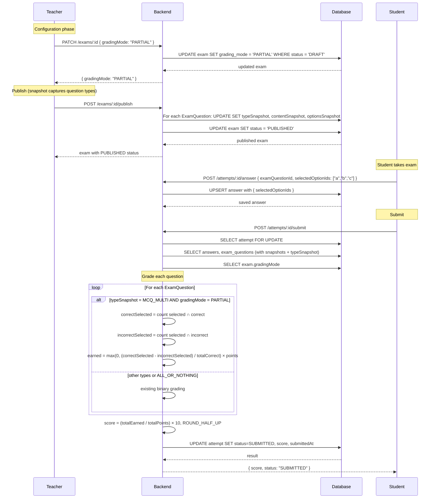
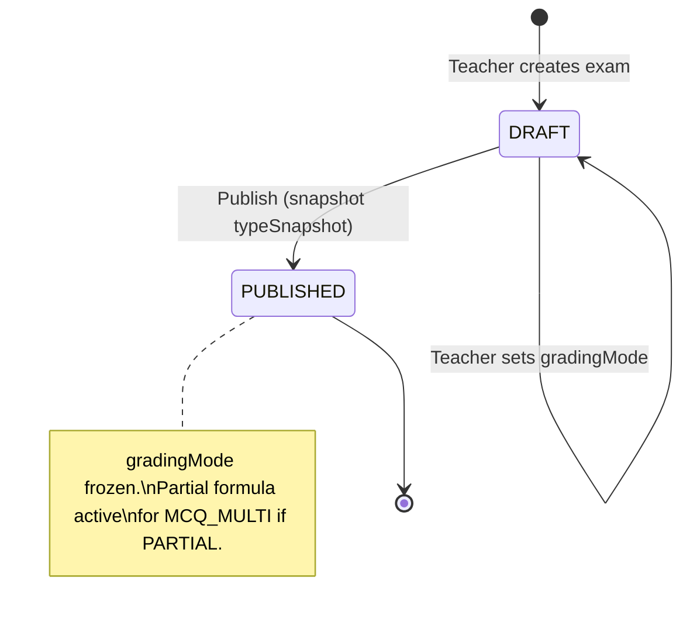

# G7. Partial Scoring for MCQ_MULTI

## 5.1 Feature Overview

| Field | Value |
|---|---|
| Feature ID | G7 |
| Feature Name | Partial Scoring for MCQ_MULTI |
| Module | G. Grading & Results |
| Priority | P2 |
| Complexity | M |
| Status | Proposed — `GradingMode` enum and `Exam.gradingMode` field exist in schema; grading engine does not read the field and does not implement PARTIAL logic. Current grading only compares `selectedOptionId` (singular); MCQ_MULTI's `selectedOptionIds[]` payload is never evaluated. |
| Target Roles | Teacher (configures grading mode), System (applies partial formula), Student (sees partial score in review) |
| Business Objective | Give students proportional credit for partially correct multi-select answers instead of the binary all-or-nothing default, resulting in fairer scoring and better measurement of partial knowledge. |
| User Problem | Under ALL_OR_NOTHING, a student who selects 3 of 4 correct options earns the same 0 points as a student who selects nothing. Teachers want finer granularity. |
| Dependencies | G1 (Auto-Grading), D4 (Publish Exam — snapshot), G4 (Regrade), C3 (Question Types — MCQ_MULTI) |

## 5.2 Actors and Permissions

### Teacher

- **Configures**: Sets `gradingMode` when creating or editing a DRAFT exam. Cannot change `gradingMode` after publish.
- **Views**: Partial scores per question in the review screen, where earned points can be fractional.
- **Triggers regrade**: If `gradingMode` is changed on a new exam version, existing attempts on the previous version are not affected; only a regrade (G4) recalculates under the mode active on the exam at regrade time.

### System (Grading Engine)

- **Reads**: `Exam.gradingMode`, `ExamQuestion.optionsSnapshot`, `Answer.answerPayload.selectedOptionIds[]`.
- **Writes**: `ExamAttempt.score`.
- **Constraint**: PARTIAL logic applies **only** to MCQ_MULTI questions. MCQ, TRUE_FALSE, SHORT_ANSWER, FILL_BLANK, ESSAY grading is unchanged regardless of the mode.

### Student

- **Views**: Per-question earned points in the review screen. A partially correct MCQ_MULTI question may show fractional earned points (e.g., `"2.5/5 điểm"`).
- **Cannot**: Choose grading mode or see other students' scores.

### Backend Authorization

- `gradingMode` is a property of the Exam. Setting it requires exam ownership (teacher) and DRAFT status.
- Grading runs inside the submit transaction; no additional permission check is needed beyond attempt ownership.

## 5.3 Preconditions and Business Rules

### Preconditions

1. Exam must be `PUBLISHED` before grading runs (snapshot must exist).
2. `ExamQuestion.optionsSnapshot` must be non-null for MCQ_MULTI questions.
3. The question type must be determinable at grading time (see G7-BR-09).

### Business Rules

| Rule ID | Rule | Enforcement |
|---|---|---|
| G7-BR-01 | `gradingMode` may be set to `ALL_OR_NOTHING` (default) or `PARTIAL`. The setting is exam-wide — it applies to every MCQ_MULTI question in the exam. | Backend (create/update exam DTO validation) + Frontend (exam configuration form) |
| G7-BR-02 | `gradingMode` can only be set or changed while the exam is in `DRAFT` status. After publish, the field is read-only. | Backend (reject update if `status !== DRAFT`) |
| G7-BR-03 | When `gradingMode = PARTIAL`, the grading formula for each MCQ_MULTI question is: `earnedPoints = max(0, (correctSelected - incorrectSelected) / totalCorrect) × questionPoints`, where `correctSelected` = number of options the student selected that are `isCorrect = true`, `incorrectSelected` = number of options the student selected that are `isCorrect = false`, `totalCorrect` = total number of options with `isCorrect = true` in the snapshot, `questionPoints` = `ExamQuestion.points`. The result is floored at 0 — a student can never lose points beyond the question. | Backend (grading engine) |
| G7-BR-04 | When `gradingMode = ALL_OR_NOTHING` (or the question is not MCQ_MULTI), the existing binary grading logic applies: full points if all correct options are selected and no incorrect options are selected; otherwise 0. | Backend (grading engine) |
| G7-BR-05 | Intermediate earned points from the partial formula are kept at full floating-point precision during accumulation. Only the final exam score (`(totalEarned / totalPoints) × 10`) is rounded to 2 decimal places using `ROUND_HALF_UP`. | Backend (grading engine) |
| G7-BR-06 | An MCQ_MULTI question with an empty `selectedOptionIds` array (or no answer saved) earns 0 points under both modes. | Backend (grading engine) |
| G7-BR-07 | An MCQ_MULTI question where `totalCorrect = 0` in the snapshot (misconfiguration) earns 0 points and does not cause a division error. | Backend (grading engine — guard `totalCorrect > 0`) |
| G7-BR-08 | Regrade (G4) respects the exam's current `gradingMode` at the time of regrade. If the teacher creates a new exam with PARTIAL mode and regrades, all non-manually-overridden attempts are recalculated using the PARTIAL formula. | Backend (regrade service) |
| G7-BR-09 | The grading engine must know each question's type at grading time. Because `ExamQuestion` currently has no `questionType` field, the type must be stored in the snapshot. **Requirement**: Add a `typeSnapshot` field to `ExamQuestion` (or embed type in `optionsSnapshot`), populated during publish from `Question.type`. Without this, the engine cannot distinguish MCQ from MCQ_MULTI. | Backend (publish service, schema migration) |
| G7-BR-10 | Non-MCQ_MULTI question types are unaffected by `gradingMode`. MCQ, TRUE_FALSE, SHORT_ANSWER, FILL_BLANK, and ESSAY follow their existing grading rules regardless of the mode setting. | Backend (grading engine — type check before applying partial formula) |
| G7-BR-11 | A manual score override (`manualScoreOverride = true`) is never recalculated by the partial scoring engine. This is consistent with G1 and G4. | Backend (skip override check) |

## 5.4 Main User Flow — Happy Path



### Step-by-Step

1. **Teacher** opens the exam configuration while the exam is in `DRAFT` status.
2. **Teacher** sets "Chế độ chấm điểm" to "Chấm điểm theo phần" (PARTIAL).
3. **Backend** validates the exam is DRAFT and saves `gradingMode = PARTIAL`.
4. **Teacher** publishes the exam. The publish transaction snapshots each question's type into `ExamQuestion.typeSnapshot`.
5. **Student** takes the exam and selects answers for MCQ_MULTI questions via `selectedOptionIds[]`.
6. **Student** submits. The grading engine:
   a. Reads the exam's `gradingMode`.
   b. For each `ExamQuestion`, checks `typeSnapshot`.
   c. If `typeSnapshot = MCQ_MULTI` and `gradingMode = PARTIAL`, applies the partial formula (G7-BR-03).
   d. Otherwise, applies existing grading logic.
7. Score is calculated and stored atomically.

## 5.5 Alternative Flows

### AF-1: Teacher Leaves gradingMode at Default (ALL_OR_NOTHING)

1. No behavioral change. MCQ_MULTI questions are graded as today: all correct selected and none incorrect → full points; otherwise → 0.

### AF-2: Exam Has No MCQ_MULTI Questions

1. `gradingMode = PARTIAL` has no effect. All questions are graded by their type-specific rules.
2. No error. The setting is silently ignored.

### AF-3: Student Selects Only Incorrect Options

1. `correctSelected = 0`, `incorrectSelected >= 1`.
2. Formula: `max(0, (0 - incorrectSelected) / totalCorrect) × points = 0`.
3. Student earns 0 points for the question.

### AF-4: Lazy Expiry Auto-Submit with Partial Mode

1. Expired attempt triggers auto-submit (per AD-11).
2. Grading engine reads `gradingMode` from the exam and applies PARTIAL formula to MCQ_MULTI answers.
3. Behavior is identical to explicit submit.

### AF-5: Regrade After Changing Mode on a New Exam Version

1. Teacher cannot change `gradingMode` on a published exam.
2. If the teacher creates a new exam with a different mode, the old exam's attempts remain scored under the old mode.
3. Regrade on the old exam uses the old exam's `gradingMode`.

## 5.6 Edge Cases and Failure Scenarios

| Scenario ID | Scenario | Trigger | Expected Behavior | User Feedback | Data Integrity | Recovery | Severity |
|---|---|---|---|---|---|---|---|
| G7-EC-01 | Student selects all correct + some incorrect (PARTIAL) | MCQ_MULTI with 3 correct. Student selects 3 correct + 1 incorrect. | earned = max(0, (3-1)/3) × points = 0.667 × points | Shown as partial credit in review | Consistent | None | Medium |
| G7-EC-02 | Student selects all correct, no incorrect (PARTIAL) | MCQ_MULTI with 3 correct. Student selects exactly those 3. | earned = max(0, (3-0)/3) × points = full points | Shown as full credit | Same as ALL_OR_NOTHING | None | Low |
| G7-EC-03 | totalCorrect = 0 in snapshot | Misconfigured MCQ_MULTI: no option marked correct | earned = 0 (division guard) | Graded as 0 | No crash | Teacher fixes question | Low |
| G7-EC-04 | selectedOptionIds is empty array | Student opened question but deselected all | earned = 0 | Same as unanswered | Consistent | None | Low |
| G7-EC-05 | selectedOptionIds contains duplicate IDs | Client-side bug sends same ID twice | Deduplicate before counting. Each option counted at most once. | No visible effect | Clean data | None | Low |
| G7-EC-06 | selectedOptionIds references non-existent option | Stale or forged option ID | Option not found in snapshot → not counted as correct or incorrect | No special feedback | Safe — lookup returns no match | None | Low |
| G7-EC-07 | Rounding of fractional earned points | 2 of 3 correct, 0 incorrect, question worth 5 points → earned = 3.333... | Accumulated at full precision. Final score rounded at exam level. | Score shown as e.g., 7.78 | Decimal(10,2) | None | Low |
| G7-EC-08 | MCQ_MULTI with only 1 correct option | Unusual but valid configuration | Behaves like MCQ under PARTIAL: 1 correct selected → full; 1 correct + any incorrect → partial; 0 correct → 0 | Consistent | Valid | None | Low |
| G7-EC-09 | Concurrent submit with PARTIAL mode | Two requests arrive simultaneously | Same as G1-EC-09: first acquires lock, grades with PARTIAL; second returns existing result | No double-grading | Atomic | None | Low |
| G7-EC-10 | manualScoreOverride = true on regrade | Teacher had overridden score; regrade triggered | Attempt skipped — score preserved | No change | Consistent with G4 | None | Medium |

## 5.7 UI/UX Specification

### Exam Configuration Form (Teacher — Exam DRAFT)

- **Location**: Exam configuration page, within the "Cấu hình chấm điểm" (Grading configuration) section.
- **Control**: Radio group or select dropdown.
  - Label: `"Chế độ chấm điểm cho câu nhiều đáp án"`
  - Option 1: `"Tất cả hoặc không (All-or-Nothing)"` — default, selected.
  - Option 2: `"Chấm điểm theo phần (Partial Credit)"`.
- **Help text** below the control: `"Chế độ 'Theo phần' cho điểm tỷ lệ theo số đáp án đúng đã chọn, trừ điểm cho đáp án sai. Chỉ áp dụng cho câu hỏi nhiều đáp án."`
- **Disabled state**: If the exam is `PUBLISHED` or `ARCHIVED`, show the current mode as read-only text, no control.
- **Visibility**: Only show if the exam contains at least one MCQ_MULTI question, or always show (recommended: always show, since questions may be added later).

### Answer Review — Partial Score Display (Teacher and Student)

- Per-question score badge for MCQ_MULTI under PARTIAL mode may show fractional points: `"3.3/5 điểm"`.
- Display earned points with 1 decimal place in the UI (even though stored at 2 decimal precision).
- Visual indicators for each option (same as current):
  - Correct option selected by student: green background + check icon.
  - Incorrect option selected by student: red background + X icon.
  - Correct option NOT selected by student: green background + check icon (dimmed).
  - Incorrect option NOT selected: no highlight.

### Score Display Consistency

- All score displays follow existing convention: `X.X / 10` (1 decimal).
- No separate "partial score" column. The existing score column shows the final calculated score.

## 5.8 Data Requirements

### Schema Changes Required

**ExamQuestion** — add `typeSnapshot`:
```
typeSnapshot  String?  @map("type_snapshot")
```
Populated during publish from `Question.type`. Stores the question type (`MCQ`, `MCQ_MULTI`, `TRUE_FALSE`, `SHORT_ANSWER`, `FILL_BLANK`, `ESSAY`) frozen at publish time.

**Exam.gradingMode** — already exists:
```
gradingMode  GradingMode  @default(ALL_OR_NOTHING)  @map("grading_mode")
```
No schema change needed. DTO change needed (see API Requirements).

### Answer Payload for MCQ_MULTI

The `Answer.answerPayload` for MCQ_MULTI questions must use the structure:
```json
{ "selectedOptionIds": ["uuid-1", "uuid-2", "uuid-3"] }
```

This is distinct from MCQ's `{ "selectedOptionId": "uuid" }`.

**Current gap**: `SaveAnswerDto` only accepts `selectedOptionId: string`. It must be extended to accept `selectedOptionIds: string[]` for MCQ_MULTI. The save-answer endpoint must detect the question type and validate the appropriate payload shape.

### Indexing

No new indexes required. Existing indexes on `answers(attempt_id, exam_question_id)` and `exam_attempts(exam_id, student_id)` are sufficient.

## 5.9 API Requirements

### PATCH /exams/:id (Existing — extend DTO)

| Field | Value |
|---|---|
| Method | PATCH |
| Endpoint | `/api/exams/:id` |
| Change | Add `gradingMode` to `UpdateExamDto` |
| Validation | `gradingMode` must be `ALL_OR_NOTHING` or `PARTIAL`. Exam must be in `DRAFT` status. |
| Error: Not DRAFT (400) | `{ success: false, error: { code: "BAD_REQUEST", message: "Chỉ có thể thay đổi chế độ chấm điểm khi đề thi ở trạng thái nháp" } }` |

### POST /exams (Existing — extend DTO)

| Field | Value |
|---|---|
| Method | POST |
| Endpoint | `/api/exams` |
| Change | Add optional `gradingMode` to `CreateExamDto`. Default: `ALL_OR_NOTHING`. |
| Validation | Must be `ALL_OR_NOTHING` or `PARTIAL`. |

### POST /attempts/:id/answer (Existing — extend DTO and handler)

| Field | Value |
|---|---|
| Method | POST |
| Endpoint | `/api/attempts/:id/answer` |
| Change | `SaveAnswerDto` must accept either `selectedOptionId: string` (MCQ, TRUE_FALSE) or `selectedOptionIds: string[]` (MCQ_MULTI). |
| Validation | For MCQ_MULTI: `selectedOptionIds` must be an array of non-empty strings, max length equal to the number of options in the snapshot, no duplicates. For MCQ/TRUE_FALSE: `selectedOptionId` must be a non-empty string. |
| Error: Wrong payload shape (400) | `{ success: false, error: { code: "VALIDATION_ERROR", message: "Dữ liệu trả lời không đúng định dạng" } }` |

### POST /attempts/:id/submit (Existing — internal logic change)

No API contract change. The grading engine internally reads `exam.gradingMode` and applies the appropriate formula.

### GET /attempts/:id/review (Existing — response change)

Response per question gains clarity on partial scoring:
- `earnedPoints` may be fractional (e.g., `3.33`).
- Add `selectedOptionIds: string[]` alongside `selectedOptionId` for MCQ_MULTI questions.
- Add `gradingMode: string` to the review response envelope so the frontend can display appropriate context.

### POST /exams/:id/regrade (Existing — internal logic change)

No API contract change. The regrade logic reads `exam.gradingMode` and applies the same formula as the submit grading engine.

## 5.10 State Management

No new states are introduced. The grading mode is a configuration property of the exam, not a state in the attempt lifecycle.



**Exam.gradingMode lifecycle**:
- Mutable in `DRAFT`.
- Immutable after `PUBLISHED` (backend rejects update; frontend disables control).
- Read by grading engine at submit time and regrade time.

## 5.11 Acceptance Criteria

### Positive Criteria

```
Given an exam with gradingMode = PARTIAL and an MCQ_MULTI question with 4 correct options (5 points),
When a student selects 3 correct options and 0 incorrect options,
Then the question earns max(0, (3-0)/4) × 5 = 3.75 points.
```

```
Given an exam with gradingMode = PARTIAL and an MCQ_MULTI question with 3 correct options (6 points),
When a student selects 2 correct options and 1 incorrect option,
Then the question earns max(0, (2-1)/3) × 6 = 2.00 points.
```

```
Given an exam with gradingMode = PARTIAL and an MCQ_MULTI question with 2 correct options (4 points),
When a student selects 2 correct options and 2 incorrect options,
Then the question earns max(0, (2-2)/2) × 4 = 0.00 points.
```

```
Given an exam with gradingMode = ALL_OR_NOTHING and an MCQ_MULTI question with 3 correct options,
When a student selects 2 of 3 correct options and no incorrect options,
Then the question earns 0 points (all-or-nothing rule).
```

```
Given an exam with gradingMode = PARTIAL containing 2 MCQ_MULTI (5 pts each) and 3 MCQ (2 pts each),
When the student earns 3.75 + 5.00 on MCQ_MULTI and 4 on MCQ,
Then totalEarned = 12.75, totalPoints = 16, score = (12.75/16) × 10 = 7.97.
```

```
Given a teacher creating a DRAFT exam,
When the teacher sets gradingMode to PARTIAL via the API,
Then the response confirms gradingMode = PARTIAL.
```

```
Given a teacher views a student's answer review for an MCQ_MULTI question graded under PARTIAL mode,
When the student earned 3.33/5 points,
Then the review shows "3.3/5 điểm" and highlights correct/incorrect selections.
```

### Negative Criteria

```
Given a PUBLISHED exam,
When the teacher attempts to change gradingMode via PATCH /exams/:id,
Then the API returns 400 with message "Chỉ có thể thay đổi chế độ chấm điểm khi đề thi ở trạng thái nháp".
```

```
Given an exam with gradingMode = PARTIAL and an MCQ question (not MCQ_MULTI),
When the student selects the wrong answer,
Then the question earns 0 points (PARTIAL mode does not affect MCQ).
```

```
Given gradingMode = PARTIAL and an MCQ_MULTI question,
When the student selects 0 correct and 3 incorrect options,
Then earned = max(0, (0-3)/totalCorrect) × points = 0 (floor at 0).
```

```
Given an attempt with manualScoreOverride = true,
When a regrade is triggered on the exam with gradingMode = PARTIAL,
Then the attempt's score is not recalculated.
```

## 5.12 QA Test Scenarios

| Test Case ID | Scenario | Preconditions | Test Steps | Test Data | Expected Result | Priority |
|---|---|---|---|---|---|---|
| G7-TC-01 | PARTIAL: all correct, no incorrect | PARTIAL mode, MCQ_MULTI with 3 correct opts, 5 pts | Select all 3 correct, submit | selectedOptionIds = [c1, c2, c3] | earned = 5.00 | P0 |
| G7-TC-02 | PARTIAL: some correct, no incorrect | PARTIAL mode, MCQ_MULTI with 4 correct opts, 8 pts | Select 2 correct, submit | selectedOptionIds = [c1, c2] | earned = max(0, 2/4) × 8 = 4.00 | P0 |
| G7-TC-03 | PARTIAL: some correct, some incorrect | PARTIAL mode, MCQ_MULTI with 3 correct opts, 6 pts | Select 2 correct + 1 incorrect, submit | selectedOptionIds = [c1, c2, w1] | earned = max(0, (2-1)/3) × 6 = 2.00 | P0 |
| G7-TC-04 | PARTIAL: penalty exceeds credit | PARTIAL mode, MCQ_MULTI with 2 correct opts, 4 pts | Select 1 correct + 2 incorrect | selectedOptionIds = [c1, w1, w2] | earned = max(0, (1-2)/2) × 4 = 0.00 | P0 |
| G7-TC-05 | PARTIAL: no answers | PARTIAL mode, MCQ_MULTI, 5 pts | Student skips question | No answer saved | earned = 0 | P1 |
| G7-TC-06 | PARTIAL: empty selectedOptionIds | PARTIAL mode, MCQ_MULTI, 5 pts | Send selectedOptionIds = [] | Empty array | earned = 0 | P1 |
| G7-TC-07 | ALL_OR_NOTHING: partial selection | ALL_OR_NOTHING mode, MCQ_MULTI with 3 correct | Select 2 of 3 correct, no incorrect | selectedOptionIds = [c1, c2] | earned = 0 | P0 |
| G7-TC-08 | ALL_OR_NOTHING: exact match | ALL_OR_NOTHING mode, MCQ_MULTI with 3 correct | Select all 3 correct, no incorrect | selectedOptionIds = [c1, c2, c3] | earned = full points | P0 |
| G7-TC-09 | Mixed question types under PARTIAL | PARTIAL mode, 2 MCQ_MULTI + 2 MCQ + 1 TRUE_FALSE | Answer all, some partial on MCQ_MULTI | Various | MCQ/TF binary; MCQ_MULTI partial | P0 |
| G7-TC-10 | Set gradingMode on DRAFT exam | DRAFT exam, teacher | PATCH /exams/:id { gradingMode: "PARTIAL" } | Valid | 200, gradingMode = PARTIAL | P0 |
| G7-TC-11 | Reject gradingMode change on PUBLISHED | PUBLISHED exam, teacher | PATCH /exams/:id { gradingMode: "PARTIAL" } | Published exam | 400 error | P0 |
| G7-TC-12 | Final score precision | PARTIAL mode, fractional earned points | Calculate and verify rounding | (12.755 / 16) × 10 = 7.97 | ROUND_HALF_UP → 7.97 | P1 |
| G7-TC-13 | Regrade with PARTIAL mode | PARTIAL mode exam, 5 submitted attempts | POST /exams/:id/regrade | Attempts without manual override | All recalculated with PARTIAL formula | P1 |
| G7-TC-14 | Regrade skips manual overrides | PARTIAL mode, 1 manual override + 2 auto-graded | POST /exams/:id/regrade | Mixed | Only auto-graded recalculated | P1 |
| G7-TC-15 | Duplicate option IDs in payload | PARTIAL mode | Send selectedOptionIds with duplicates | [c1, c1, c2] | Deduplicated, counted as 2 selections | P2 |
| G7-TC-16 | totalCorrect = 0 guard | Misconfigured question with 0 correct options | Submit | No correct options | earned = 0, no crash | P2 |
| G7-TC-17 | Auto-submit on expiry with PARTIAL | PARTIAL mode, attempt expired | Lazy expiry triggers auto-submit | Saved partial answers | Graded with PARTIAL formula | P1 |
| G7-TC-18 | Review shows partial earned points | PARTIAL mode, question earned 3.33 of 5 | GET /attempts/:id/review | Teacher or student | earnedPoints = 3.33, display "3.3/5 điểm" | P1 |

## 5.13 Open Questions and Assumptions

| # | Question | Why It Matters | Options | Recommended Default | Impact |
|---|---|---|---|---|---|
| 1 | Should the penalty formula include incorrect selections, or just award credit for correct ones? | Penalty discourages guessing; no-penalty rewards partial knowledge equally regardless of wrong guesses. | (a) No penalty: `correctSelected / totalCorrect × points`. (b) With penalty: `max(0, (correctSelected - incorrectSelected) / totalCorrect) × points`. | (b) Penalty formula, floor at 0. This is the standard for Vietnamese national exams and aligns with OQ-06 recommendation. **Does not block implementation** — the formula can be changed before release. | Medium — affects score fairness |
| 2 | How should `ExamQuestion` store the question type for grading? | The grading engine needs to distinguish MCQ_MULTI from other types. `ExamQuestion` currently has no type field, and `sourceQuestionId` may be null. | (a) Add `typeSnapshot String?` to ExamQuestion, populated at publish. (b) Embed `{ type: "MCQ_MULTI" }` inside the existing `optionsSnapshot` JSON. (c) Infer from snapshot structure (multiple `isCorrect: true` = MCQ_MULTI). | (a) Add `typeSnapshot`. It is explicit, indexed if needed, and unambiguous. **Blocks implementation** — requires a schema migration and publish logic change. | High — core data requirement |
| 3 | Should the teacher be able to choose between penalty and no-penalty variants of PARTIAL mode? | Gives teachers flexibility. Adds UI and backend complexity. | (a) Single PARTIAL formula (penalty). (b) PARTIAL_NO_PENALTY and PARTIAL_WITH_PENALTY as separate enum values. | (a) Single formula. A third grading mode adds UX complexity for a niche scenario. Keep it simple for MVP. | Low |
| 4 | Should the `SaveAnswerDto` be split into type-specific DTOs, or use a union? | MCQ needs `selectedOptionId`, MCQ_MULTI needs `selectedOptionIds`. Current DTO is MCQ-only. | (a) Single DTO with optional fields: `selectedOptionId?`, `selectedOptionIds?`, `text?`. (b) Type-discriminated union based on a `type` field. (c) Keep payload as opaque `Json` with server-side validation. | (a) Single DTO with optional fields — simplest to implement and validate. **Does not block spec** — implementation detail for the developer. | Low |

### Assumptions

- **A1**: The penalty formula `max(0, (correctSelected - incorrectSelected) / totalCorrect) × points` is the recommended default per OQ-06 and Vietnamese exam practice. If PO selects the no-penalty variant, only the formula line changes; the rest of the spec is unchanged.
- **A2**: `gradingMode` is exam-wide, not per-question. All MCQ_MULTI questions in an exam share the same mode. Per-question mode is not needed at this scale.
- **A3**: Fractional earned points per question are kept at full precision internally and only rounded at the final exam score level. This avoids cumulative rounding drift.
- **A4**: The `SaveAnswerDto` gap (only accepts `selectedOptionId`) is a prerequisite that must be resolved before this feature can function. Without it, MCQ_MULTI answers cannot be saved.
- **A5**: The `CreateExamDto` / `UpdateExamDto` gap (no `gradingMode` field) is a prerequisite.

---

### Handoff

**Artifacts**: `docs/features/grading/partial-scoring.md`

**Open questions blocking implementation**:
- OQ #2: How to store question type on `ExamQuestion` — requires schema migration decision from architect.

**Open questions NOT blocking implementation**:
- OQ #1: Penalty vs no-penalty formula — recommended default (penalty) can proceed.
- OQ #3: Single vs multiple PARTIAL variants — recommended default (single) can proceed.
- OQ #4: DTO structure — implementation detail.

**Prerequisites the developer must resolve**:
1. Add `typeSnapshot` to `ExamQuestion` (schema migration).
2. Populate `typeSnapshot` during publish.
3. Extend `CreateExamDto` and `UpdateExamDto` to include `gradingMode`.
4. Extend `SaveAnswerDto` to accept `selectedOptionIds: string[]`.
5. Update `gradeAndSubmit` to read `exam.gradingMode` and handle MCQ_MULTI payload.
6. Update `regrade` to read `exam.gradingMode` and apply partial formula.
