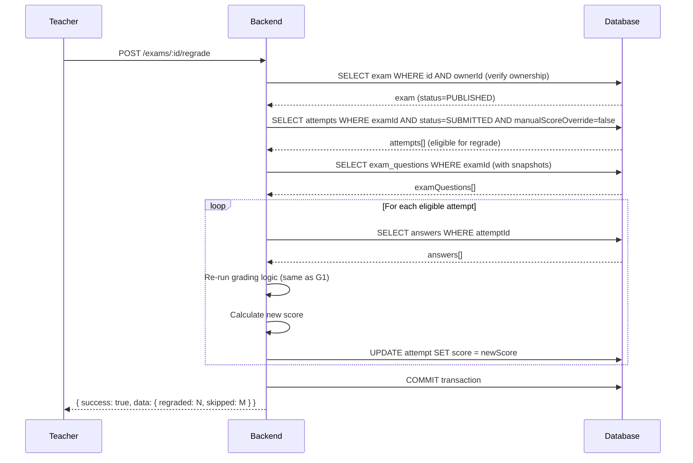
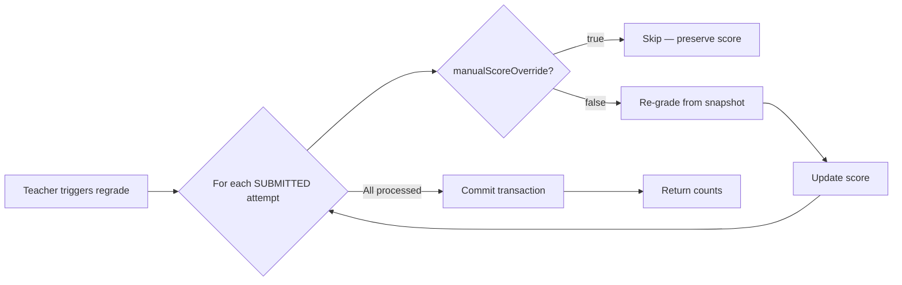

# G4. Regrade Exam

## 5.1 Feature Overview

| Field | Value |
|---|---|
| Feature ID | G4 |
| Feature Name | Regrade Exam |
| Module | G. Grading & Results |
| Priority | P2 |
| Complexity | M |
| Status | Existing — API endpoint implemented (`POST /exams/:id/regrade`), no dedicated frontend UI button. |
| Target Roles | Teacher |
| Business Objective | Allow teachers to correct grading after fixing an error in the exam's answer key or scoring configuration, without requiring students to retake the exam. |
| User Problem | If a teacher discovers an answer key error after students have submitted, all affected scores are wrong. Manual correction attempt-by-attempt is tedious and error-prone. |
| Dependencies | G1 (Auto-Grading), G2 (Manual Grading — respects override flag), D4 (Publish Exam — snapshot mechanism) |

## 5.2 Actors and Permissions

### Teacher

| Action | Rule |
|---|---|
| Trigger regrade on own exam | Allowed |
| Trigger regrade on another teacher's exam | **Forbidden** — 403 |
| View updated scores after regrade | Allowed via results page |

### Student

| Action | Rule |
|---|---|
| Trigger regrade | **Forbidden** |
| View updated score after regrade | Allowed (subject to visibility) — score updates immediately |

### System

- Regrade runs synchronously within the request.
- Processes all `SUBMITTED` attempts where `manualScoreOverride = false`.
- Updates each attempt's `score` in a transaction.

### Backend Authorization

- `POST /exams/:id/regrade`: Teacher must own the exam (`exam.ownerId === currentUser.id`).
- Exam must be `PUBLISHED` (regrading a DRAFT or ARCHIVED exam is meaningless).

## 5.3 Preconditions and Business Rules

### Preconditions

1. Exam must be in `PUBLISHED` status.
2. Teacher must own the exam.
3. At least one SUBMITTED attempt must exist (otherwise regrade is a no-op).

### Business Rules

| Rule | Description |
|---|---|
| Skip manual overrides | Attempts with `manualScoreOverride = true` are **not** regraded. Their scores are preserved. |
| Grading source | Regrade uses the same snapshot data (`optionsSnapshot`, `contentSnapshot`) that the original grading used. Regrading does NOT use live question bank data. |
| Score formula | Same formula as G1: `score = (earnedPoints / totalPoints) * 10`, Decimal(10,2), ROUND_HALF_UP. |
| Atomicity | All eligible attempts are regraded in a single transaction. If one fails, none are updated. |
| Idempotency | Regrading a second time with no changes produces the same scores. Safe to retry. |
| No status change | Regrade does not change attempt status. Attempts remain `SUBMITTED`. |
| Notification | Currently no notification is sent to students after regrade. See Open Questions. |

### When Regrade Is Useful

Regrade is valuable when the teacher:
1. Discovers an incorrect `isCorrect` flag in the optionsSnapshot — **but this cannot be fixed** because snapshots are immutable after publish. See Open Questions.
2. Changes the exam's `gradingMode` (e.g., from ALL_OR_NOTHING to PARTIAL for MCQ_MULTI).
3. Wants to recalculate scores after adjusting question point values — **but point values in ExamQuestion are also part of the published structure.**

**Important limitation**: Since snapshots are immutable, regrade with the current architecture only recalculates scores based on existing snapshots. It is useful for gradingMode changes or for fixing implementation bugs in the grading logic (deploy a code fix, then regrade). It does NOT help fix a wrong answer key in the snapshot.

## 5.4 Main User Flow — Happy Path



### Steps

1. Teacher decides a regrade is needed (e.g., after fixing grading mode).
2. Teacher triggers `POST /exams/:id/regrade`.
3. Backend verifies ownership and exam status.
4. Backend loads all SUBMITTED attempts with `manualScoreOverride = false`.
5. For each attempt: reload answers, re-run grading, update score.
6. Commit all changes in one transaction.
7. Return count of regraded and skipped attempts.

## 5.5 Alternative Flows

### AF-1: No Eligible Attempts

1. All attempts either have `manualScoreOverride = true` or no SUBMITTED attempts exist.
2. Regrade completes with `{ regraded: 0, skipped: N }`.
3. No data changes.

### AF-2: Mixed Override and Auto-Graded Attempts

1. 10 attempts exist: 3 have manual overrides, 7 are auto-graded.
2. Regrade processes the 7, skips the 3.
3. Response: `{ regraded: 7, skipped: 3 }`.

### AF-3: Score Changes After Regrade

1. Original grading had a bug. After code fix, teacher triggers regrade.
2. Some scores increase, some decrease, some stay the same.
3. All scores updated atomically.
4. Students see new scores immediately on next page load (no notification).

### AF-4: Regrade After GradingMode Change

1. Teacher changes exam `gradingMode` from `ALL_OR_NOTHING` to `PARTIAL`.
2. Teacher triggers regrade.
3. MCQ_MULTI questions are now graded with partial scoring.
4. Students who had partial correct answers may now earn points.
5. **Note**: Changing gradingMode on a PUBLISHED exam is currently not allowed via the update endpoint (PUBLISHED exams are immutable). This flow requires an exception or a dedicated API. See Open Questions.

## 5.6 Edge Cases and Failure Scenarios

| Scenario ID | Scenario | Trigger | Expected Behavior | User Feedback | Data Integrity | Recovery | Severity |
|---|---|---|---|---|---|---|---|
| G4-EC-01 | Regrade on DRAFT exam | Teacher calls regrade on unpublished exam | 400 "Exam must be published" | Error toast | No change | N/A | Low |
| G4-EC-02 | Regrade with 0 submissions | No attempts exist | 200 with `{ regraded: 0, skipped: 0 }` | Success message "Không có bài cần chấm lại" | No change | N/A | Low |
| G4-EC-03 | All attempts manually overridden | All have manualScoreOverride=true | 200 with `{ regraded: 0, skipped: N }` | "Tất cả bài đã được sửa điểm thủ công" | No change | N/A | Low |
| G4-EC-04 | Transaction failure mid-regrade | Database error after updating 5 of 10 attempts | Entire transaction rolls back; no scores change | 500 error | All scores unchanged | Teacher retries | Critical |
| G4-EC-05 | Concurrent regrade requests | Teacher clicks regrade twice quickly | Second request sees same data, produces same result | Both succeed (idempotent) | No double-counting | N/A | Low |
| G4-EC-06 | Large number of attempts | 1000+ attempts to regrade | May be slow (sequential re-grading) | Long wait time | Data consistent | Consider async processing at scale | Medium |
| G4-EC-07 | IN_PROGRESS attempt during regrade | Student is currently taking the exam | IN_PROGRESS attempts are excluded (status filter = SUBMITTED) | Not affected | No interference | N/A | Low |
| G4-EC-08 | Student submits during regrade | Regrade is processing; student submits their attempt | Student's submit runs its own grading in a separate transaction. No conflict with regrade (different attempt rows). | Both succeed | Consistent | N/A | Low |
| G4-EC-09 | Snapshot data corrupted | optionsSnapshot is null for some questions | Skip question (0 earned, 0 total for that question) or fail the regrade | Depends on implementation | Defensive handling needed | Fix data | Critical |

## 5.7 UI/UX Specification

### Current State

No dedicated UI button for regrade exists. The API is ready but not wired to the frontend.

### Proposed UI

**Location**: `/dashboard/results` page, next to the "Công bố kết quả" button.

**Button**: "Chấm lại" (outline variant, secondary position).

**Interaction Flow**:
1. Teacher clicks "Chấm lại".
2. Confirmation dialog: "Bạn có chắc muốn chấm lại tất cả bài thi? Bài có điểm sửa thủ công sẽ không bị ảnh hưởng."
3. On confirm: API call, loading state on button.
4. On success: Toast "Đã chấm lại {N} bài. {M} bài sửa điểm thủ công được bỏ qua."
5. Results table refreshes with updated scores.

**States**:
- Loading: Button disabled, spinner, "Đang chấm lại..."
- Error: Toast with error message.
- Success: Toast with counts.

## 5.8 Data Requirements

### Existing Schema (Sufficient)

No schema changes needed. Regrade reads and writes the same fields as the original grading:

- **Reads**: ExamAttempt (status, manualScoreOverride), Answer (answerPayload), ExamQuestion (optionsSnapshot, points).
- **Writes**: ExamAttempt (score).

### No Audit Trail

Currently, there is no record that a regrade occurred or what the previous scores were. If audit is needed:

**Proposed** (P3): `regrade_log` table: `{ id, examId, triggeredBy, triggeredAt, attemptCount, previousScores: JSON }`.

## 5.9 API Requirements

### POST /exams/:id/regrade

| Field | Value |
|---|---|
| Method | POST |
| Endpoint | `/api/exams/:id/regrade` |
| Purpose | Re-run automatic grading for all eligible attempts of this exam |
| Required Role | TEACHER |
| Authorization | `exam.ownerId === currentUser.id` |
| Request Body | None |
| Success Response (200) | `{ "success": true, "data": { "regraded": 7, "skipped": 3 } }` |
| Error: Not published (400) | `{ "success": false, "error": { "code": "EXAM_NOT_PUBLISHED", "message": "Can only regrade published exams" } }` |
| Error: Not owner (403) | Standard 403 |
| Error: Exam not found (404) | Standard 404 |
| Idempotency | Yes — same input produces same scores. Safe to retry. |
| Performance | Synchronous. At ~100 users with ~30 questions per exam, completes in <5 seconds. |

## 5.10 State Management

Regrade does not introduce new states. It modifies `score` on existing SUBMITTED attempts.



## 5.11 Acceptance Criteria

### Positive

```
Given an exam with 5 submitted attempts (3 auto-graded, 2 manually overridden),
When the teacher triggers regrade,
Then 3 attempts are regraded and 2 are skipped,
And the response shows { regraded: 3, skipped: 2 }.
```

```
Given a grading logic fix is deployed,
When the teacher regrades the exam,
Then all non-overridden scores are recalculated with the corrected logic.
```

```
Given a student has a score of 6.00 and the regrade calculates 7.00,
When regrade completes,
Then the student's score shows 7.00 on their next results page load.
```

### Negative

```
Given a teacher does not own the exam,
When they trigger regrade,
Then the request is rejected with 403.
```

```
Given the exam is in DRAFT status,
When regrade is triggered,
Then the request is rejected with 400.
```

```
Given an attempt has manualScoreOverride = true,
When regrade runs,
Then this attempt's score is unchanged.
```

## 5.12 QA Test Scenarios

| Test Case ID | Scenario | Preconditions | Test Steps | Test Data | Expected Result | Priority |
|---|---|---|---|---|---|---|
| G4-TC-01 | Regrade all auto-graded | 5 submitted, 0 overridden | POST regrade | — | { regraded: 5, skipped: 0 } | P2 |
| G4-TC-02 | Skip manual overrides | 5 submitted, 2 overridden | POST regrade | — | { regraded: 3, skipped: 2 } | P2 |
| G4-TC-03 | No submissions | Published exam, 0 attempts | POST regrade | — | { regraded: 0, skipped: 0 } | P2 |
| G4-TC-04 | All overridden | 3 submitted, all overridden | POST regrade | — | { regraded: 0, skipped: 3 } | P2 |
| G4-TC-05 | Score actually changes | After grading logic fix | POST regrade | Known different result | Scores updated | P2 |
| G4-TC-06 | Idempotent regrade | Run regrade twice | POST regrade x2 | — | Both return same counts, same scores | P2 |
| G4-TC-07 | Non-owner blocked | Teacher B's exam | POST regrade as Teacher A | — | 403 | P2 |
| G4-TC-08 | DRAFT exam blocked | Unpublished exam | POST regrade | — | 400 | P2 |
| G4-TC-09 | Transaction rollback | Simulate DB error mid-regrade | Force failure | — | All scores unchanged | P2 |
| G4-TC-10 | IN_PROGRESS excluded | 1 IN_PROGRESS + 3 SUBMITTED | POST regrade | — | Only 3 processed | P2 |

## 5.13 Open Questions and Assumptions

| # | Question | Why It Matters | Options | Recommended Default | Impact |
|---|---|---|---|---|---|
| 1 | How can a teacher fix a wrong answer key in the snapshot? | Snapshots are immutable. Regrade recalculates using the same (wrong) snapshot. | (a) Allow editing optionsSnapshot on PUBLISHED exams (risky). (b) Archive exam, create new version with correct snapshot, regrade the old one's attempts. (c) Add a "fix answer key" endpoint that patches the snapshot and triggers regrade. | (c) — dedicated endpoint for answer key corrections, with audit log. **This is currently a gap.** | High |
| 2 | Should students be notified after regrade? | Students may not know their score changed. | (a) No notification (current). (b) Create a notification per affected student: "Điểm bài {exam} đã được cập nhật." | (b) — use NotificationsService.createMany. | Medium |
| 3 | Should regrade be async for large exams? | Synchronous regrade could timeout for 1000+ attempts. | (a) Synchronous (current, fine for ~100 users). (b) Add async job queue (BullMQ) for large regrades. | (a) for MVP. | Low for MVP |
| 4 | Should there be a regrade audit log? | No record exists of when regrade happened or what changed. | (a) No log (current). (b) Log to a `regrade_log` table. (c) Log previous scores in the response for the teacher to review. | (a) for MVP. Teacher can verify by checking scores manually. | Low |
| 5 | Can gradingMode be changed on PUBLISHED exams to enable regrade with different mode? | Currently PUBLISHED exams cannot be modified. This blocks the "change grading mode then regrade" flow. | (a) Allow changing gradingMode on PUBLISHED exams (exception to immutability). (b) Archive and recreate. | (a) — gradingMode does not affect the snapshot, only the grading calculation. Safe to change. | Medium |

### Assumptions

- **A1**: Regrade is synchronous and completes within the request timeout (~30s). Acceptable for ~100 users.
- **A2**: Regrade uses the same grading logic as the initial auto-grade (G1). No separate grading path.
- **A3**: manualScoreOverride is a reliable indicator. If a teacher manually set a score, regrade respects it unconditionally.
- **A4**: No partial regrade (e.g., regrade specific students). The operation applies to all eligible attempts.
